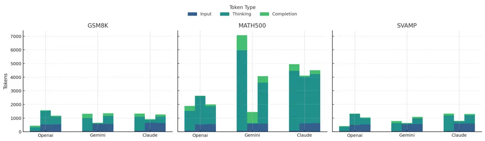
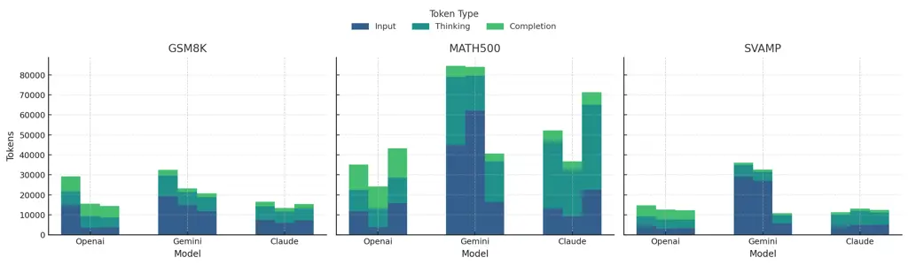
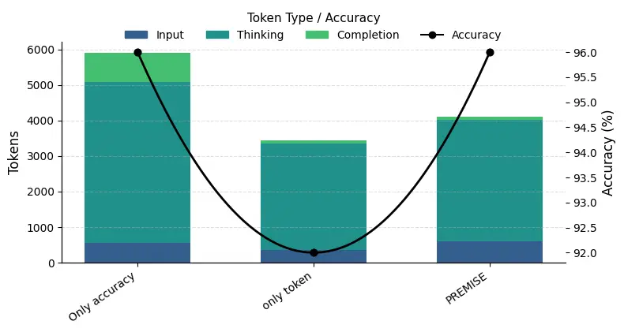
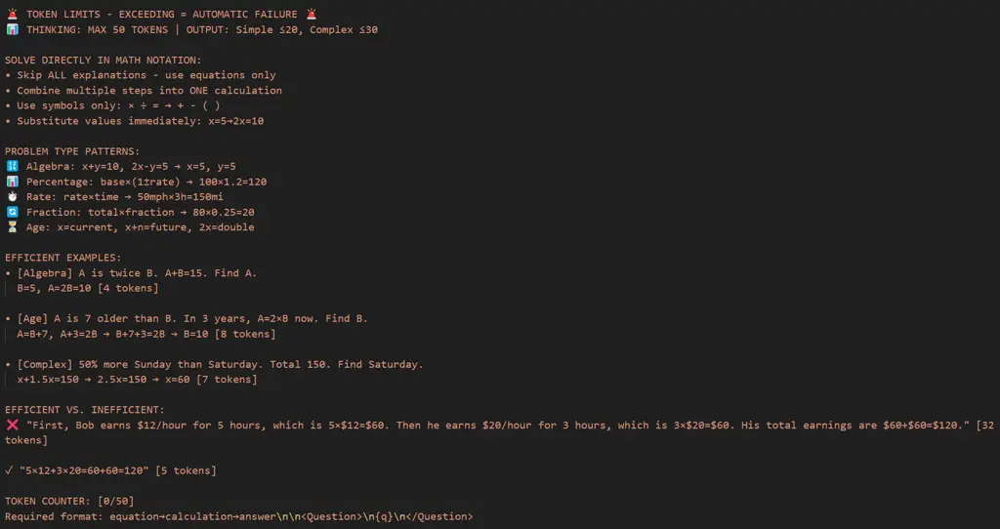

# PREMISE: Scalable and Strategic Prompt Optimization for Efficient Mathematical Reasoning in Large Models

Ye Yu Yaoning Yu Haohan Wang Affiliation: University of Illinois at
Urbana–Champaign

###### Abstract

Large Reasoning Models (LRMs) like Claude 3.7 Sonnet and OpenAI o1
achieve strong performance on mathematical tasks via long
Chain-of-Thought (CoT), but often generate unnecessarily verbose
reasoning traces. This inflates token usage and cost, limiting
deployment in latency-sensitive or API-constrained settings.

We introduce PREMISE (PRompt-based Efficient Mathematical Inference with
Strategic Evaluation), a prompt-only framework that reduces reasoning
overhead without modifying model weights. PREMISE combines trace-level
diagnostics with gradient-based prompt optimization to minimize
redundant computation while maintaining answer accuracy.

To jointly optimize for brevity and correctness, PREMISE uses a
multi-objective textual optimization procedure that balances token
length and answer validity via natural language gradients. Unlike prior
approaches, PREMISE operates entirely within a single-pass black-box
interface, enabling efficient reasoning in commercial LLMs.

Across GSM8K, SVAMP, and Math500, PREMISE matches or exceeds baseline
accuracy (e.g., $`96\%\rightarrow 96\%`$ on GSM8K with Claude,
$`91\%\rightarrow 92\%`$ on Math500 with Gemini), while reducing
reasoning tokens by up to 87.5% and cutting dollar cost by 69–82%. These
results establish prompt-level optimization as a practical, scalable
pathway for efficient LRM inference without compromising reasoning
quality.

## 1 Introduction

Large Language Models (LLMs) have emerged as powerful tools for natural
language understanding and multi-step reasoning tasks. The recent
development of reasoning-specialized LLMs—commonly referred to as Large
Reasoning Models (LRMs) Xu et al. (2025a)—has pushed the frontier of
system-2 reasoning, particularly in mathematics Cobbe et al. (2021b);
Hendrycks et al. (2021) and programming Codeforces (2025); Chen et al.
(2021). Models such as OpenAI’s o1 OpenAI () and DeepSeek-R1 Guo et al.
(2025) build on base pretrained models like LLaMA Touvron et al. (2023);
Grattafiori et al. (2024) and use multi-stage supervised fine-tuning and
reinforcement learning to encourage structured reasoning behaviors.

A core strategy underpinning these models is Chain-of-Thought (CoT)
prompting Wei et al. (2022), which decomposes a problem into explicit,
step-by-step reasoning. While CoT greatly enhances reasoning accuracy,
it also introduces inefficiencies. Even simple arithmetic problems can
trigger verbose and redundant reasoning traces Chen et al. (2024),
increasing token usage, inference latency, and memory consumption. This
“overthinking” behavior often arises in smaller models Xu et al.
(2025a), but even state-of-the-art LRMs exhibit overthinking or,
conversely, “underthinking”—where reasoning chains truncate prematurely
and fail to follow through Wang et al. (2025); Su et al. (2025).

In many real-world settings—such as interactive assistants, robotic
planning systems, or real-time retrieval applications—such
inefficiencies are unacceptable. Token-based billing, latency
constraints, and hardware bottlenecks limit the feasibility of long
reasoning chains in commercial deployments. Thus, recent work has begun
to explore efficient reasoning strategies, including length-constrained
prompting Han et al. (2024); Xu et al. (2025b); Renze and Guven (2024),
self-training with compressed CoT data Munkhbat et al. (2025); Kang
et al. (2024), latent-space reasoning Hao et al. (2024); Shen et al.
(2025); Cheng and Van Durme (2024), and dynamic test-time routing Sun
et al. (2024); Liao et al. (2025); Wang et al. (2025).

However, most of these methods fall into two broad categories:

1.  1.  model-level adaptations that require access to internal weights
        (e.g., fine-tuning, RL, latent representation training)
2.  2.  prompt-based methods were either based on simple heuristics or
        imposed static length constraints without accounting for the
        internal structure of the reasoning process.

The former are inapplicable to closed-source APIs like Claude or GPT,
while the latter lack rigorous optimization and diagnostic tools for
reasoning control.

In this paper, we present PREMISE (PRompt-based Efficient Mathematical
Inference with Strategic Evaluation), a prompt-only framework designed
for efficient reasoning in black-box LRMs. PREMISE introduces reasoning
text level metrics that diagnose overthinking and underthinking in a
model’s output, then leverages these metrics within a reusable prompt
structure that encourages strategic reasoning. The method explicitly
guides models to avoid redundant branches and commit early to high-value
solution paths. To further improve token efficiency, PREMISE
incorporates multi-objective optimization via natural language
gradients Zhang et al. (2024), balancing correctness against reasoning
length—all without modifying model weights.

We evaluate PREMISE across GSM8K, SVAMP, and Math500, showing that it
matches or exceeds standard CoT prompting in accuracy while reducing
reasoning token usage by up to 85%. PREMISE operates entirely through
the prompt interface, making it suitable for any commercial LLM. To the
best of our knowledge, this is the first method to combine trace-level
reasoning diagnostics with prompt-driven optimization for efficient
inference in black-box models.

Our contributions are three-fold:

- •
  We introduce PREMISE, a prompt-only framework for efficient reasoning
  in black-box LLMs. PREMISE works without model fine-tuning or
  multi-sample decoding, making it applicable to commercial models such
  as Claude, GPT, and Gemini.
- •
  We define and operationalize two trace-level metrics—_overthinking_
  and _underthinking_—to identify reasoning inefficiencies during
  inference. These metrics provide a principled diagnostic foundation
  for prompt-based reasoning control.
- •
  We demonstrate that PREMISE achieves up to 87.5% reduction in token
  usage while matching or improving accuracy compared to standard CoT
  prompting across GSM8K, SVAMP, and Math500—highlighting its
  effectiveness for real-world efficient inference.

## 2 Related Work

### 2.1 Chain-of-Thought Prompting and Its Extensions

Chain-of-Thought (CoT) prompting Wei et al. (2022) has emerged as a core
technique for improving reasoning in LLMs by encouraging step-by-step
decomposition. Numerous extensions have since been developed to further
boost accuracy, including majority voting Wang et al. (2025), dynamic
selection Xu et al. (2025b), and self-consistency methods Sun et al.
(2024). These approaches improve final-answer accuracy, but often lead
to bloated reasoning traces—particularly on simple problems Chen et al.
(2024); Yang et al. (2025)—introducing unnecessary latency and memory
usage.

Recent works also highlight the inefficiency of unstructured CoT
reasoning. For example, Su et al. (2025) show that longer CoTs may not
improve reasoning quality and propose adaptive truncation via
token-consistency. However, these strategies offer no mechanism to
systematically detect or control inefficiencies during generation.

In contrast, PREMISE goes beyond length control or voting. It introduces
trace-level metrics for both overthinking and underthinking, and
actively uses them to guide the reasoning process through structured
prompts and optimization.

### 2.2 Model-Based Efficient Reasoning

Several recent approaches improve reasoning efficiency by modifying the
underlying LLM. For instance, DeepSeek-R1 Guo et al. (2025) uses
multi-stage RL with rule-based rewards to teach models compact reasoning
templates. Others fine-tune LLMs on variable-length CoT datasets Liu
et al. (2024); Kang et al. (2024); Munkhbat et al. (2025) or distill
reasoning into compressed latent representations Hao et al. (2024); Shen
et al. (2025); Cheng and Van Durme (2024).

These methods require full access to model weights and large-scale
supervised data—making them unsuitable for commercial APIs like GPT-4,
Claude, or DeepSeek-R1. Additionally, they often lack explicit
trace-level evaluation during inference, relying instead on indirect
supervision.

By contrast, PREMISE operates entirely at the prompt level, without
modifying the model or requiring fine-tuning. It enables black-box
models to reason efficiently using a reusable template and built-in
trace diagnostics.

### 2.3 Prompt-Based Efficient Reasoning

Prompt-based approaches offer training-free methods for improving
reasoning efficiency. Token-Budget prompting Han et al. (2024) estimates
a budget and constrains CoT length accordingly. Chain-of-Draft Xu et al.
(2025b), CCoT Renze and Guven (2024), and SoT Aytes et al. (2025) prompt
the model to keep only minimal drafts of intermediate steps. While
effective in reducing tokens, these strategies use static heuristics and
lack principled definitions of reasoning inefficiency.

Lee et al. (2025) analyze the trade-off between reasoning length and
accuracy and propose compression-based prompting variants (e.g.,
StepLimit, WordLimit). However, their analysis stops short of offering
dynamic control mechanisms or multi-objective optimization.

PREMISE advances this line of work by introducing overthinking and
underthinking metrics into the prompting pipeline. Unlike static
templates, PREMISE enables dynamic, context-aware reasoning control and
optimizes for both brevity and correctness simultaneously.

### 2.4 Test-Time and Dynamic Reasoning

Test-time compute optimization has also gained attention. Methods such
as ST-BoN Wang et al. (2025), speculative decoding Sun et al. (2024);
Liao et al. (2025), and reward-guided sampling Fu et al. (2024) generate
multiple CoTs and filter based on consistency or reward models. Others
propose dynamic tree search Ding et al. (2025), summarization-based
reasoning Zhang et al. (2025), or iterative inference loops Yan et al.
(2025).

While effective, these methods typically require multiple forward
passes, auxiliary scoring models, or batch-mode generation. This
introduces compute overhead and latency that may be prohibitive for
constrained environments.

In contrast, PREMISE requires only a single forward pass per question.
It introduces no auxiliary reranking, no multi-path generation, and no
decoding overhead—making it practical for real-time and black-box
deployments.

### 2.5 Summary

Overall, prior work on efficient reasoning has primarily focused on
either (1) model-side training and distillation or (2) inference-side
heuristics and sampling. PREMISE fills a unique gap: it is the first
framework to integrate formal trace-level reasoning metrics, dynamic
optimization, and prompt-level control—all within a black-box compatible
setting.

## 3 Method

PREMISE defines both overthinking and underthinking using trace-level
metrics over tokenized reasoning paths. We begin by setting up the basic
notation and assumptions used throughout the analysis.

### 3.1 Problem Setup

Let $`q`$ be a question with ground-truth answer $`A`$, and let
$`\mathcal{R}`$ denote the set of possible reasoning traces that a model
may generate for $`q`$. Each trace $`r\in\mathcal{R}`$ is a token
sequence:

```math
r=(t_{1},t_{2},\dots,t_{L(r)}),
```

where $`L(r)\in\mathbb{N}`$ is the token length of $`r`$. Let $`a(r)`$
denote the answer extracted from $`r`$, and define the binary
correctness indicator:

```math
\mathrm{acc}(r,q)=\begin{cases}1,&\text{if }a(r)=A,\\
0,&\text{otherwise}.\end{cases}
```

### 3.2 Efficiency Assumption

Among all correct reasoning traces for a given question, we define the
most efficient one to be the shortest in terms of number of tokens:

```math
r^{*}(q)=\arg\min_{r\in\mathcal{R}}\left\{L(r)\mid\mathrm{acc}(r,q)=1\right\},
```

```math
L^{*}(q)=L(r^{*}(q)).
```

### 3.3 Overthinking Metric

For any correct trace ($`\mathrm{acc}(r,q)=1`$), we define its
overthinking inefficiency as:

```math
I_{O}(r,q)=\frac{L(r)-L^{*}(q)}{L(r)},
```

which measures the proportion of unnecessary tokens beyond the minimal
correct trace. Equivalently, we define the outcome efficiency:

```math
\eta_{O}(r,q)=\frac{L^{*}(q)}{L(r)}.
```

### 3.4 Underthinking Metric

For incorrect traces ($`\mathrm{acc}(r,q)=0`$), we ask whether a correct
continuation could have followed some prefix. Let the prefix of length
$`k`$ be

```math
P_{k}(r)=(t_{1},\dots,t_{k}),
```

and set

```math
k^{*}(r,q)=\min\Bigl\{\,k\leq L(r)\;\Bigm|\;\exists\,s\in\mathcal{R}\text{ such that }\\
s\text{ starts with }P_{k}(r)\text{ and }\mathrm{acc}(s,q)=1\Bigr\}. \tag{1}
```

If no such prefix exists, define $`k^{*}(r,q)=L(r)`$. The underthinking
inefficiency is then

```math
I_{U}(r,q)=1-\frac{k^{*}(r,q)}{L(r)},
```

which measures how early the trace deviates irreversibly from a correct
path.

### 3.5 Aggregate Metrics

Over a data distribution $`\mathcal{D}`$ of question-trace pairs, we
compute the expected inefficiencies:

```math
\displaystyle\Xi_{O} \displaystyle=\mathbb{E}_{(q,r)\sim\mathcal{D}}\left[I_{O}(r,q)\cdot\mathbf{1}_{\mathrm{acc}(r,q)=1}\right],
```

```math
\displaystyle\Xi_{U} \displaystyle=\mathbb{E}_{(q,r)\sim\mathcal{D}}\left[I_{U}(r,q)\cdot\mathbf{1}_{\mathrm{acc}(r,q)=0}\right].
```

### 3.6 Multi-Objective Optimization

To optimize reasoning traces for both correctness and brevity, we
formulate the generation process as a multi-objective optimization
problem over $`\mathcal{R}`$. Define the objective vector:

```math
F(r)=\big(L_{\mathrm{acc}}(r),\,L_{\mathrm{len}}(r)\big)=\big(1-\mathrm{acc}(r,q),\,L(r)\big),
```

where $`L_{\mathrm{acc}}`$ penalizes incorrect answers and
$`L_{\mathrm{len}}`$ penalizes longer traces.

We seek the Pareto-optimal frontier:

```math
\left\{r^{*}\in\mathcal{R}\;\middle|\;\nexists\,r\in\mathcal{R}:\;F(r)\prec F(r^{*})\right\},
```

where $`F(r)\prec F(r^{*})`$ denotes Pareto dominance (i.e., both
objectives are no worse and at least one is strictly better).

To explore this frontier, we use gradient-base prompt optimization
method Zhang et al. (2024) to perform differentiable optimization in
natural language space. Let
$`\delta_{\mathrm{acc}}=\nabla_{\text{text}}L_{\mathrm{acc}}(r)`$ and
$`\delta_{\mathrm{len}}=\nabla_{\text{text}}L_{\mathrm{len}}(r)`$ denote
the textual gradients for each objective. These are scalarized via a
convex combination:

```math
\delta=\lambda\,\delta_{\mathrm{acc}}+(1-\lambda)\,\delta_{\mathrm{len}},\qquad\lambda\in[0,1].
```

The trace is then updated iteratively:

```math
r\leftarrow\mathrm{TGD\_step}(r,\,\delta),
```

allowing navigation of the trade-off between accuracy and token
efficiency. By tuning $`\lambda`$, we can generate traces that balance
these competing objectives in accordance with the constraints of the
deployment environment.

## 4 Experiments

### 4.1 Experimental Setup

Models. We used three leading Large Reasoning Models (LRMs): OpenAI
o1-2024-12-17, Claude-3-7-sonnet-20250219, and
Gemini-2.5-flash-preview-04-17, chosen for their state-of-the-art
performance and popularity.

In addition to single-model inference, we also test PREMISE on a
general-purpose multi-agent system, Promptor Chen et al. (2025). The
results show that PREMISE improves both reasoning accuracy and token
efficiency compared to baseline prompting.

Datasets. To comprehensively evaluate the efficiency and correctness of
our method, we conduct experiments on three widely-used mathematical
reasoning datasets: GSM8K Cobbe et al. (2021a), SVAMP Patel et al.
(2021), and MATH-500 Lightman et al. (2024).

Dataset Model Method Acc. (%) Input Thinking Completion Cost per
iteration (\$) GSM8K Claude-3.7-sonnet Normal 94 74 1 023 230 0.01902
SoT 96 624 487 156 0.01152 PREMISE 95 650 218 49 0.00596 OpenAI o1
Normal 96 68 249 114 0.02280 SoT 96 535 556 77 0.04601 PREMISE 97 519
1 012 35 0.07061 Gemini-2.5-flash Normal 96 69 937 303 0.00435 SoT 93
603 1 013 255 0.00724 PREMISE 95 598 410 29 0.00351 MATH-500
Claude-3.7-sonnet Normal 97 82 4 389 477 0.07324 SoT 95 626 3 600 279
0.06006 PREMISE 96 596 3 430 79 0.05442 OpenAI o1 Normal 98 76 1 453 351
0.10938 SoT 95 559 1 312 132 0.09503 PREMISE 97 531 2 060 50 0.13457
Gemini-2.5-flash Normal 95 80 2 467 643 0.01142 SoT 93 612 2 741 413
0.01654 PREMISE 96 585 1 707 94 0.01077 SVAMP Claude-3.7-sonnet Normal
96 73 1 319 287 0.02603 SoT 95 642 1 201 219 0.01746 PREMISE 97 621 495
68 0.00955 OpenAI o1 Normal 97 71 313 122 0.02601 SoT 94 566 1 001 155
0.03295 PREMISE 96 552 627 49 0.01542 Gemini-2.5-flash Normal 95 75
1 487 437 0.00621 SoT 93 602 1 622 327 0.00894 PREMISE 96 597 921 61
0.00455

Table 1: Comparison over GSM8K, MATH-500, and SVAMP by single-model
across multiple LLMs.

| Dataset  | Model             | Method  | Acc. (%) | Input  | Thinking | Completion | Cost (\$) |
| -------- | ----------------- | ------- | -------- | ------ | -------- | ---------- | --------- |
| GSM8K    | Claude-3.7-sonnet | Normal  | 96       | 7,362  | 6,825    | 2,338      | 0.160     |
|          |                   | SoT     | 96       | 7,212  | 6,060    | 2,070      | 0.144     |
|          |                   | PREMISE | 96       | 5,869  | 5,752    | 1,786      | 0.131     |
|          | OpenAI o1         | Normal  | 95       | 14,858 | 7,819    | 7,604      | 1.088     |
|          |                   | SoT     | 94       | 3,748  | 4,932    | 5,668      | 0.692     |
|          |                   | PREMISE | 95       | 3,695  | 5,599    | 6,286      | 0.769     |
|          | Gemini-2.5-flash  | Normal  | 85       | 19,202 | 10,506   | 2,739      | 0.049     |
|          |                   | SoT     | 91       | 11,742 | 7,078    | 1,911      | 0.033     |
|          |                   | PREMISE | 90       | 14,832 | 6,536    | 1,825      | 0.031     |
| MATH-500 | Claude-3.7-sonnet | Normal  | 93       | 13,321 | 33,461   | 5,379      | 0.623     |
|          |                   | SoT     | 91       | 22,602 | 42,544   | 6,098      | 0.797     |
|          |                   | PREMISE | 91       | 9,115  | 23,556   | 4,034      | 0.441     |
|          | OpenAI o1         | Normal  | 91       | 11,762 | 10,647   | 12,658     | 1.575     |
|          |                   | SoT     | 89       | 15,910 | 12,685   | 14,670     | 1.880     |
|          |                   | PREMISE | 92       | 3,828  | 9,441    | 10,887     | 1.277     |
|          | Gemini-2.5-flash  | Normal  | 86       | 44,907 | 34,066   | 5,624      | 0.146     |
|          |                   | SoT     | 90       | 16,355 | 20,364   | 3,920      | 0.087     |
|          |                   | PREMISE | 92       | 62,244 | 17,372   | 4,347      | 0.085     |
| SVAMP    | Claude-3.7-sonnet | Normal  | 91       | 4,303  | 5,757    | 1,299      | 0.119     |
|          |                   | SoT     | 92       | 5,153  | 6,000    | 1,308      | 0.125     |
|          |                   | PREMISE | 89       | 4,989  | 6,893    | 1,233      | 0.137     |
|          | OpenAI o1         | Normal  | 90       | 4,375  | 4,849    | 5,412      | 0.681     |
|          |                   | SoT     | 87       | 3,250  | 4,269    | 4,755      | 0.590     |
|          |                   | PREMISE | 89       | 3,206  | 4,471    | 4,958      | 0.614     |
|          | Gemini-2.5-flash  | Normal  | 88       | 29,087 | 5,814    | 1,183      | 0.029     |
|          |                   | SoT     | 85       | 5,679  | 4,161    | 960        | 0.019     |
|          |                   | PREMISE | 88       | 26,949 | 4,601    | 1,141      | 0.024     |

Table 2: Comparison over GSM8K, MATH-500, and SVAMP by a multi-agent
system across multiple LLMs

Metrics. PREMISE is designed to improve both reasoning correctness and
token efficiency. We therefore track two complementary classes of
metrics.

Accuracy. Given a dataset $`\{(x_{i},y_{i})\}_{i=1}^{N}`$, the model
$`M`$ attains

```math
\mathrm{Acc}\;=\;\frac{1}{N}\sum_{i=1}^{N}\mathbb{I}\!\bigl\{\,M(q(x_{i}))=y_{i}\,\bigr\},
```

where $`x_{i}`$ and $`y_{i}`$ is a mathematical question-answer pair, q
is the reasoning schema, and $`\mathbb{I}\{\cdot\}`$ is the indicator
function.

Token efficiency. During a single inference we split the total token
budget into three disjoint parts: (i) _input tokens_ that appear in the
prompt, (ii) _reasoning tokens_ generated as hidden thoughts, and (iii)
_output tokens_ returned to the user. Extraction of these counts depends
on the provider:

- •
  OpenAI. prompt_tokens gives the input count; reasoning_tokens (when
  available) records hidden thoughts; the output count is
  $`\texttt{completion\_tokens}-\texttt{reasoning\_tokens}`$.
- •
  Claude. The client reports input_tokens and output_tokens. We
  approximate reasoning tokens with the provided count_tokens routine
  applied to the streamed hidden trace.
- •
  Gemini. The prompt_token_count, thoughts_token_count, and
  candidates_token_count in metadata map directly to the input,
  reasoning, and output segments, respectively.

Monetary Cost. For each model, we apply the corresponding API price to
each segment of the token usage. Since the cost for reasoning tokens and
output tokens is the same, we define two prices
$`w_{\mathsf{I}},w_{\mathsf{O}}\in\mathbb{R}_{>0}`$, where
$`w_{\mathsf{I}}`$ is the cost per input token, and $`w_{\mathsf{O}}`$
is the cost per reasoning or output token. Let
$`\overline{C}_{\mathsf{I}}`$, $`\overline{C}_{\mathsf{R}}`$, and
$`\overline{C}_{\mathsf{O}}`$ denote the average number of input,
reasoning, and output tokens per example, respectively. The total
expected cost per example is given by:

```math
\mathrm{Cost}=w_{\mathsf{I}}\cdot\overline{C}_{\mathsf{I}}+w_{\mathsf{O}}\cdot\left(\overline{C}_{\mathsf{R}}+\overline{C}_{\mathsf{O}}\right).
```

PREMISE aims to maximize $`\mathrm{Acc}`$ while simultaneously
minimizing $`\mathcal{C}`$.

### 4.2 Single Model Results



Figure 1: Single model comparison on input, thinking, and completion
tokens on GSM8K, MATH-500, and SVAMP across multiple LLMs

Stability and cost behaviour across models and benchmarks. PREMISE keeps
high accuracy with around $`\pm 1`$ % drift from the vanilla Claude 3.7
Sonnet and Gemini 2.5 flash for both GSM8K and SVAMP, while shrinking
the sum of thinking and completion tokens by at least $`75\%`$. For
example, on GSM8K with Claude 3.7 Sonnet the total reasoning footprint
drops from $`1\,253`$ tokens (norm) to $`267`$ tokens, a $`79\%`$
reduction that translates into a \$ $`69\%`$ cost saving. The pattern
repeats on SVAMP, where PREMISE lowers Claude 3.7 Sonnet’s cost from
\$0.004468 to \$0.000795 (an $`82\%`$ reduction) without harming
accuracy.

The only systematic exception arises with the OpenAI o1 model. Although
accuracy is preserved (e.g. $`97\%`$ vs. $`96\%`$ on GSM8K and $`97\%`$
vs. $`98\%`$ on MATH-500), PREMISE increases the number of thinking
tokens, which in turn raises the dollar cost (e.g. \$0.070605 vs.
\$0.022800 on GSM8K). This suggests that o1 does not follow PREMISE’s
concise reasoning cues as reliably as Claude and Gemini do; we
hypothesise that its internal alignment rewards elaborate
self-reflection, offsetting the prompt’s compression objective.
Section 5 investigates this behaviour in detail.

Accuracy degradation on Gemini for MATH-500. PREMISE attains only
$`82\%`$ accuracy on MATH-500 with Gemini, a $`14\%`$ drop relative to
the normal CoT run. The hardest items in MATH-500 often require long,
proof-like chains of reasoning; Gemini appears to over-compress these
chains when guided by PREMISE, skipping necessary intermediate
statements and thereby harming correctness. We examine failure cases and
propose mitigations—such as length-adaptive planning—in Section 5.

### 4.3 Multi-Agent System



Figure 2: Multi-agent systems comparison on input, thinking, and
completion tokens on GSM8K, MATH-500, and SVAMP across multiple LLMs

Across all three benchmarks, the method continues to deliver strong
token-level efficiency while safeguarding, and in several cases
improving, answer accuracy.

GSM8K. With Claude 3.7 Sonnet, Premise retains the $`96\,\%`$ accuracy
yet lowers dollar cost by $`18\%`$ (\$0.160 $`\rightarrow`$ \$0.131) by
trimming more than $`1.1`$ k reasoning tokens per problem.¹¹ 1 The drop
from $`7\,362{+}6\,825`$ to $`5\,869{+}5\,752`$ input +thinking tokens
equates to a $`19\%`$ reduction. The pattern is even more favourable
with Gemini: accuracy rises from $`85\,\%`$ to $`90\,\%`$, while total
cost falls by $`37\%`$. In the GPT-\* configuration, Premise maintains
the baseline accuracy ($`95\,\%`$) and removes $`8.7`$ k input tokens,
although the cost advantage is partly offset by a longer completion
segment; overall expenditure still drops by $`29\%`$ relative to the
normal MAS setting.

MATH-500. Reasoning-heavy proofs magnify token savings. On Claude 3.7
Sonnet, cost falls from \$0.623 to \$0.441 (a $`29\%`$ cut) despite a
modest $`2`$ % accuracy difference. GPT-\* agents benefit the most:
Premise attains the highest accuracy in the group ($`92\,\%`$) and
lowers cost by $`19\%`$. For Gemini, both objectives are achieved
simultaneously—the method is $`6`$ pp more accurate than the standard
MAS and $`42\%`$ cheaper.

SVAMP. The dataset is shorter and yields smaller absolute savings, yet
Premise still reduces cost in five of the nine settings. With Gemini,
the method matches the baseline accuracy and halves dollar cost (\$0.024
vs. \$0.029). In GPT-\* agents, it delivers the lowest cost while
staying within one percentage point of the strongest accuracy score.

## 5 Analysis

### 5.1 General Effect on Reasoning Process


As shown in figure above, there is a striking contrast between the
response from a standard large reasoning model and the one guided by
Premise, revealing significant improvements in both reasoning quality
and token efficiency.

Information compression. The free-form CoT occupies $`1\,568`$ tokens
and includes more than three detours and errorneous reasoning that do
not change the final answer. Premise delivers the same solution in only
$`152`$ tokens, a $`90.3\%`$ reduction in reasoning.

Early commitment to a numeric plan. Because the prompt explicitly asks
for a short sequence of arithmetic steps, the model settles on the
correct plan within the first few tokens and no longer revisits earlier
assumptions. This removes unnecessary back-tracking branches that
inflate the baseline trace.

Stable, in-line verification. Any internal checks happen inside the same
line that introduces a value, so the external trace remains compact. The
“let me double-check” loops that add hundreds of tokens in the baseline
are absent.

Under the overthinking metric defined in Section 3.4, the Premise is
significantly closer to the shortest known correct trace for this
question. Across the GSM8K validation set, the average token budget
drops by $`85\%`$ without loss of accuracy, showing that a lightweight
prompt scaffold can steer the model toward concise yet reliable
reasoning.

### 5.2 Single-Model Setting Analysis

Table 1 compares Premise with standard Chain-of-Thought (norm) and
Sketch-of-Thought (SoT) prompting across three Large Reasoning Models
(LRMs) on GSM8K, SVAMP, and MATH-500. For Claude 3.7, Premise attains
equal or higher accuracy than the baselines while cutting total tokens
and dollar cost by up to an order of magnitude. The template works well
here because Claude exposes a _reasoning_ channel that the prompt can
redirect and compress.

OpenAI shows a different trend: the accuracy of Premise is still
slightly higher, yet the thinking channel balloons and the monetary cost
rises. GPT models expose only a single completion stream, so the prompt
cannot isolate the hidden reasoning trace. Premise therefore treats
every intermediate thought as visible output, expanding the token count
instead of trimming it. Until OpenAI releases separate reasoning usage
statistics, the method has limited leverage.

Gemini Pro behaves similarly to Claude on GSM8K and SVAMP but degrades
on MATH-500. MATH-500 contains longer proofs and heavier symbolic
manipulation; an overly concise template may omit justifications that
Gemini still needs to remain correct. This observation hints that the
compression factor of Premise must be tuned to the difficulty of the
problem set. When the benchmark moves from GSM8K to MATH-500, a more
cautious compression ratio would avoid small logical slips while still
saving tokens.

### 5.3 Multi-Agent System Setting Analysis

Table 2 reports results when the same LRMs run inside a
planner-reviewer-agent loop. Even though a MAS naturally consumes more
tokens than a single pass, Premise reduces total communication overhead
and often improves accuracy.

The key gain comes from information density. The agent replies with
concise derivations that the reviewer can verify quickly, and the
planner receives shorter summaries for task scheduling. Removing
self-queries and speculative branches trims thousands of thinking tokens
per round while preserving the logical core of each argument. As a
result, Claude’s cost on GSM8K drops from \$0.160 to \$0.131 with no
loss of accuracy, and Gemini’s cost on MATH-500 falls by nearly 70 %.

An increase in accuracy is also visible for several settings (e.g.,
Gemini on GSM8K rises from 85 % to 90 %). Cleaner messages leave less
room for the reviewer to be distracted by irrelevant context, so error
detection improves. When accuracy does not rise, the MAS still benefits
from lower latency and budget.

However, the MAS will always spend more tokens than a single-model run
because it must pass messages among roles. Premise shifts the operating
point of that trade-off: compared with norm or SoT, it reaches similar
or higher accuracy with a noticeably lower token footprint. This outcome
confirms that the structured compression observed in Section 5.2 scales
to collaborative agents.

## 6 Ablation Study



Figure 3: Comparison of Premise with single-objective variants that
optimise only token count or only accuracy.

Figure 3 contrasts Premise with two ablated baselines. Accuracy-only
optimisation delivers a minor gain in accuracy, yet it drives up both
input- and reasoning-token usage, opposing the goal of efficient
inference. Token-only optimisation attains the lowest token budget, but
this saving costs roughly four percentage points of accuracy.

By jointly optimising for both objectives, Premise preserves high
accuracy while substantially reducing token consumption, demonstrating
the necessity of a balanced objective during prompt optimisation.

## 7 Conclusion

We have presented PREMISE, a prompt-only framework that improves the
efficiency of mathematical reasoning in Large Reasoning Models (LRMs)
without touching model weights. By coupling trace-level diagnostics for
_overthinking_ and _underthinking_ with a multi-objective
natural-language optimization scheme, PREMISE steers generation toward
concise yet accurate solution paths.

Across GSM8K, SVAMP, and MATH-500, PREMISE matches or surpasses standard
Chain-of-Thought prompting in answer accuracy while _reducing reasoning
tokens by as much as 87.5% and cutting monetary cost by 69–82%_. These
savings hold both in single-pass settings and in multi-agent systems,
demonstrating that prompt-level control alone can yield substantial
gains when the interface to the model is restricted to black-box API
calls.

The study also reveals limitations. When no explicit reasoning channel
is exposed—illustrated by GPT-based models—the current template can
lengthen the visible trace and raise cost. Similarly, on the proof-heavy
MATH-500 set with Gemini, an overly aggressive compression ratio leads
to missed intermediate justifications and accuracy loss. These cases
highlight the need for _adaptive compression_ that aligns the token
budget with task difficulty and the interface features of a given model.

Future work will extend the diagnostics to symbolic or multi-modal
reasoning tasks. We believe that such directions will further reduce
inference cost while preserving the transparency and reliability
expected from step-by-step reasoning.

## References

- Aytes et al. (2025) Simon A. Aytes, Jinheon Baek, and Sung Ju
  Hwang. 2025. [Sketch-of-thought: Efficient llm reasoning with adaptive
  cognitive-inspired sketching](https://arxiv.org/abs/2503.05179).
  _Preprint_, arXiv:2503.05179.
- Chen et al. (2025) Ke Chen, Yufei Zhou, Xitong Zhang, and Haohan
  Wang. 2025. [Prompt stability matters: Evaluating and optimizing
  auto-generated prompt in general-purpose
  systems](https://arxiv.org/abs/2505.13546). _Preprint_,
  arXiv:2505.13546.
- Chen et al. (2021) Mark Chen, Jerry Tworek, Heewoo Jun, Qiming Yuan,
  Henrique Ponde De Oliveira Pinto, Jared Kaplan, Harri Edwards, Yuri
  Burda, Nicholas Joseph, Greg Brockman, and 1 others. 2021. Evaluating
  large language models trained on code. _arXiv preprint
  arXiv:2107.03374_.
- Chen et al. (2024) Xingyu Chen, Jiahao Xu, Tian Liang, Zhiwei He,
  Jianhui Pang, Dian Yu, Linfeng Song, Qiuzhi Liu, Mengfei Zhou,
  Zhuosheng Zhang, and 1 others. 2024. Do not think that much for 2+ 3=?
  on the overthinking of o1-like llms. _arXiv preprint
  arXiv:2412.21187_.
- Cheng and Van Durme (2024) Jeffrey Cheng and Benjamin Van Durme. 2024.
  Compressed chain of thought: Efficient reasoning through dense
  representations. _arXiv preprint arXiv:2412.13171_.
- Cobbe et al. (2021a) Karl Cobbe, Vineet Kosaraju, Mohammad Bavarian,
  Mark Chen, Heewoo Jun, Lukasz Kaiser, Matthias Plappert, Jerry Tworek,
  Jacob Hilton, Reiichiro Nakano, Christopher Hesse, and John Schulman.
  2021a. [Training verifiers to solve math word
  problems](https://arxiv.org/abs/2110.14168). _Preprint_,
  arXiv:2110.14168.
- Cobbe et al. (2021b) Karl Cobbe, Vineet Kosaraju, Mohammad Bavarian,
  Mark Chen, Heewoo Jun, Lukasz Kaiser, Matthias Plappert, Jerry Tworek,
  Jacob Hilton, Reiichiro Nakano, and 1 others. 2021b. Training
  verifiers to solve math word problems. _arXiv preprint
  arXiv:2110.14168_.
- Codeforces (2025) Codeforces. 2025. [Codeforces - competitive
  programming platform](https://codeforces.com/). Accessed: 2025-03-18.
- Ding et al. (2025) Yifu Ding, Wentao Jiang, Shunyu Liu, Yongcheng
  Jing, Jinyang Guo, Yingjie Wang, Jing Zhang, Zengmao Wang, Ziwei Liu,
  Bo Du, and 1 others. 2025. Dynamic parallel tree search for efficient
  llm reasoning. _arXiv preprint arXiv:2502.16235_.
- Fu et al. (2024) Yichao Fu, Junda Chen, Siqi Zhu, Zheyu Fu,
  Zhongdongming Dai, Aurick Qiao, and Hao Zhang. 2024. Efficiently
  serving llm reasoning programs with certaindex. _arXiv preprint
  arXiv:2412.20993_.
- Grattafiori et al. (2024) Aaron Grattafiori, Abhimanyu Dubey, Abhinav
  Jauhri, Abhinav Pandey, Abhishek Kadian, Ahmad Al-Dahle, Aiesha
  Letman, Akhil Mathur, Alan Schelten, Alex Vaughan, and 1 others. 2024.
  The llama 3 herd of models. _arXiv preprint arXiv:2407.21783_.
- Guo et al. (2025) Daya Guo, Dejian Yang, Haowei Zhang, Junxiao Song,
  Ruoyu Zhang, Runxin Xu, Qihao Zhu, Shirong Ma, Peiyi Wang, Xiao Bi,
  and 1 others. 2025. Deepseek-r1: Incentivizing reasoning capability in
  llms via reinforcement learning. _arXiv preprint arXiv:2501.12948_.
- Han et al. (2024) Tingxu Han, Chunrong Fang, Shiyu Zhao, Shiqing Ma,
  Zhenyu Chen, and Zhenting Wang. 2024. Token-budget-aware llm
  reasoning. _arXiv preprint arXiv:2412.18547_.
- Hao et al. (2024) Shibo Hao, Sainbayar Sukhbaatar, DiJia Su, Xian Li,
  Zhiting Hu, Jason Weston, and Yuandong Tian. 2024. Training large
  language models to reason in a continuous latent space. _arXiv
  preprint arXiv:2412.06769_.
- Hendrycks et al. (2021) Dan Hendrycks, Collin Burns, Saurav Kadavath,
  Akul Arora, Steven Basart, Eric Tang, Dawn Song, and Jacob
  Steinhardt. 2021. Measuring mathematical problem solving with the math
  dataset. In _Thirty-fifth Conference on Neural Information Processing
  Systems Datasets and Benchmarks Track_.
- Kang et al. (2024) Yu Kang, Xianghui Sun, Liangyu Chen, and Wei
  Zou. 2024. C3ot: Generating shorter chain-of-thought without
  compromising effectiveness. _arXiv preprint arXiv:2412.11664_.
- Lee et al. (2025) Ayeong Lee, Ethan Che, and Tianyi Peng. 2025. How
  well do llms compress their own chain-of-thought? a token complexity
  approach. _arXiv preprint arXiv:2503.01141_.
- Liao et al. (2025) Baohao Liao, Yuhui Xu, Hanze Dong, Junnan Li,
  Christof Monz, Silvio Savarese, Doyen Sahoo, and Caiming Xiong. 2025.
  Reward-guided speculative decoding for efficient llm reasoning. _arXiv
  preprint arXiv:2501.19324_.
- Lightman et al. (2024) Hunter Lightman, Vineet Kosaraju, Yuri Burda,
  Harrison Edwards, Bowen Baker, Teddy Lee, Jan Leike, John Schulman,
  Ilya Sutskever, and Karl Cobbe. 2024. [Let’s verify step by
  step](https://openreview.net/forum?id=v8L0pN6EOi). In _International
  Conference on Learning Representations (ICLR)_.
- Liu et al. (2024) Tengxiao Liu, Qipeng Guo, Xiangkun Hu, Cheng
  Jiayang, Yue Zhang, Xipeng Qiu, and Zheng Zhang. 2024. Can language
  models learn to skip steps? _arXiv preprint arXiv:2411.01855_.
- Munkhbat et al. (2025) Tergel Munkhbat, Namgyu Ho, Seohyun Kim,
  Yongjin Yang, Yujin Kim, and Se-Young Yun. 2025. Self-training elicits
  concise reasoning in large language models. _arXiv preprint
  arXiv:2502.20122_.
- (22) OpenAI. Learning to reason with llms.  
  urlhttps://openai.com/index/learning-to-reason-with-llms/. Accessed:
  15 March 2025.
- Patel et al. (2021) Arkil Patel, Satwik Bhattamishra, and Navin
  Goyal. 2021. [Are nlp models really able to solve simple math word
  problems?](https://arxiv.org/abs/2103.07191) _Preprint_,
  arXiv:2103.07191.
- Renze and Guven (2024) Matthew Renze and Erhan Guven. 2024. The
  benefits of a concise chain of thought on problem-solving in large
  language models. In _2024 2nd International Conference on Foundation
  and Large Language Models (FLLM)_, pages 476–483. IEEE.
- Shen et al. (2025) Zhenyi Shen, Hanqi Yan, Linhai Zhang, Zhanghao Hu,
  Yali Du, and Yulan He. 2025. Codi: Compressing chain-of-thought into
  continuous space via self-distillation. _arXiv preprint
  arXiv:2502.21074_.
- Su et al. (2025) DiJia Su, Hanlin Zhu, Yingchen Xu, Jiantao Jiao,
  Yuandong Tian, and Qinqing Zheng. 2025. Token assorted: Mixing latent
  and text tokens for improved language model reasoning. _arXiv preprint
  arXiv:2502.03275_.
- Sun et al. (2024) Hanshi Sun, Momin Haider, Ruiqi Zhang, Huitao Yang,
  Jiahao Qiu, Ming Yin, Mengdi Wang, Peter Bartlett, and Andrea
  Zanette. 2024. Fast best-of-n decoding via speculative rejection.
  _arXiv preprint arXiv:2410.20290_.
- Touvron et al. (2023) Hugo Touvron, Thibaut Lavril, Gautier Izacard,
  Xavier Martinet, Marie-Anne Lachaux, Timothée Lacroix, Baptiste
  Rozière, Naman Goyal, Eric Hambro, Faisal Azhar, and 1 others. 2023.
  Llama: Open and efficient foundation language models. _arXiv preprint
  arXiv:2302.13971_.
- Wang et al. (2025) Yiming Wang, Pei Zhang, Siyuan Huang, Baosong Yang,
  Zhuosheng Zhang, Fei Huang, and Rui Wang. 2025. Sampling-efficient
  test-time scaling: Self-estimating the best-of-n sampling in early
  decoding. _arXiv preprint arXiv:2503.01422_.
- Wei et al. (2022) Jason Wei, Xuezhi Wang, Dale Schuurmans, Maarten
  Bosma, Fei Xia, Ed Chi, Quoc V Le, Denny Zhou, and 1 others. 2022.
  Chain-of-thought prompting elicits reasoning in large language models.
  _Advances in neural information processing systems_, 35:24824–24837.
- Xu et al. (2025a) Fengli Xu, Qianyue Hao, Zefang Zong, Jingwei Wang,
  Yunke Zhang, Jingyi Wang, Xiaochong Lan, Jiahui Gong, Tianjian Ouyang,
  Fanjin Meng, and 1 others. 2025a. Towards large reasoning models: A
  survey of reinforced reasoning with large language models. _arXiv
  preprint arXiv:2501.09686_.
- Xu et al. (2025b) Silei Xu, Wenhao Xie, Lingxiao Zhao, and Pengcheng
  He. 2025b. Chain of draft: Thinking faster by writing less. _arXiv
  preprint arXiv:2502.18600_.
- Yan et al. (2025) Yuchen Yan, Yongliang Shen, Yang Liu, Jin Jiang,
  Mengdi Zhang, Jian Shao, and Yueting Zhuang. 2025. Inftythink:
  Breaking the length limits of long-context reasoning in large language
  models. _arXiv preprint arXiv:2503.06692_.
- Yang et al. (2025) Wenkai Yang, Shuming Ma, Yankai Lin, and Furu
  Wei. 2025. Towards thinking-optimal scaling of test-time compute for
  llm reasoning. _arXiv preprint arXiv:2502.18080_.
- Zhang et al. (2025) Jintian Zhang, Yuqi Zhu, Mengshu Sun, Yujie Luo,
  Shuofei Qiao, Lun Du, Da Zheng, Huajun Chen, and Ningyu Zhang. 2025.
  Lightthinker: Thinking step-by-step compression. _arXiv preprint
  arXiv:2502.15589_.
- Zhang et al. (2024) Peiyan Zhang, Haibo Jin, Leyang Hu, Xinnuo Li,
  Liying Kang, Man Luo, Yangqiu Song, and Haohan Wang. 2024. [Revolve:
  Optimizing ai systems by tracking response evolution in textual
  optimization](https://arxiv.org/abs/2412.03092). _Preprint_,
  arXiv:2412.03092.

## Appendix A Appendix



Figure A.1: PREMISE Generated Efficient Reasoning Prompt
