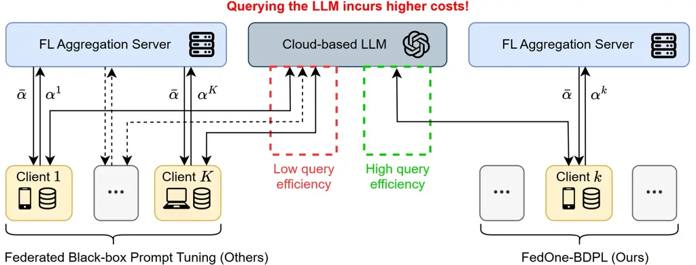
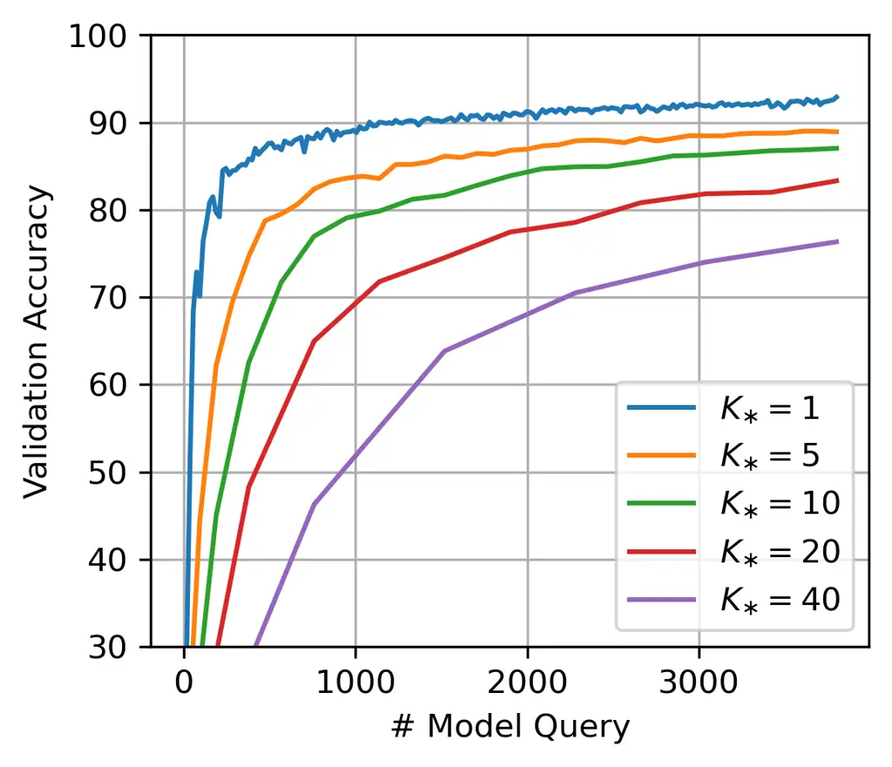
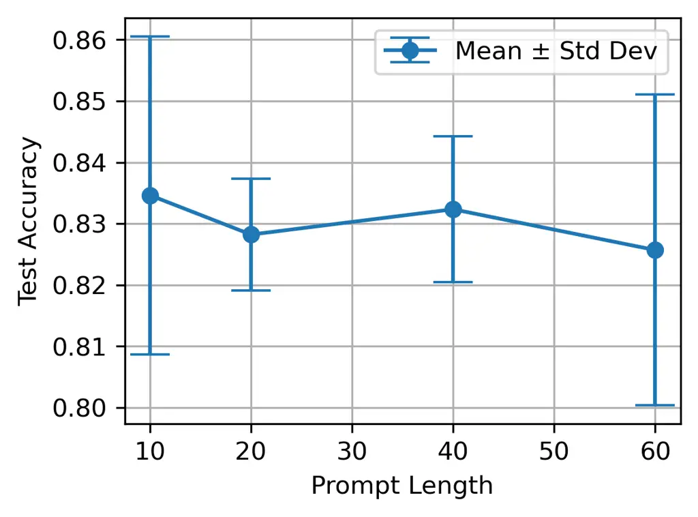
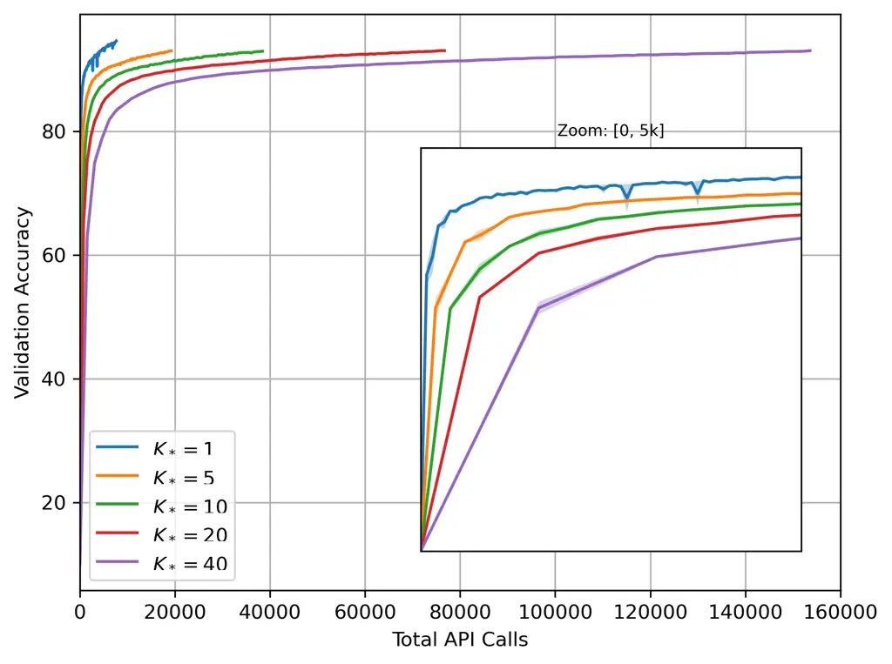
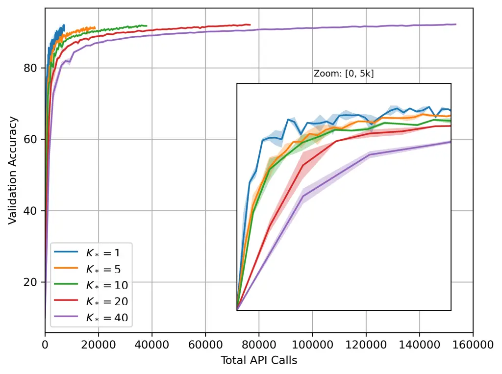
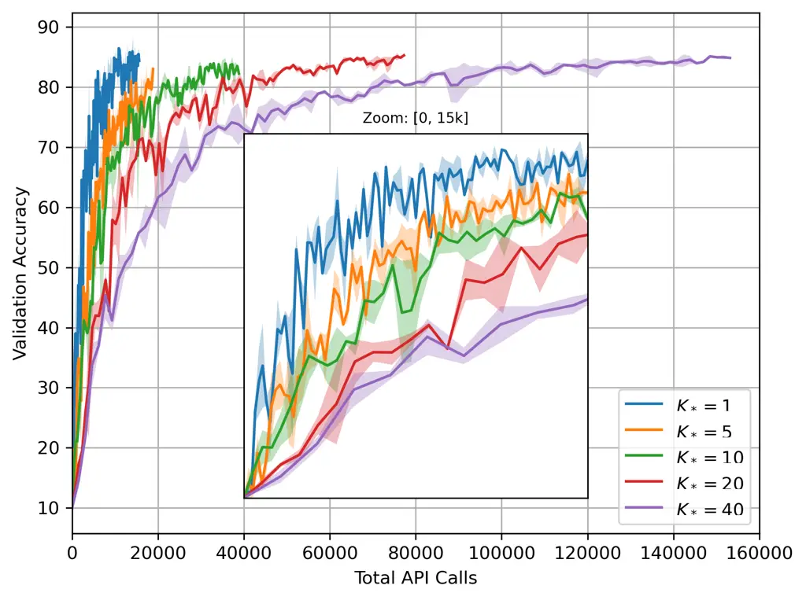

# FedOne: Query-Efficient Federated Learning for Black-box Discrete Prompt Learning

Ganyu Wang Affiliation: Western University, London, Ontario, Canada   
Jinjie Fang Affiliation: Jilin University, Changchun, Jilin, China   
Maxwell J. Yin Affiliation: Western University, London, Ontario, Canada
   Bin Gu Affiliation: Jilin University, Changchun, Jilin, China
Correspondence to: <jsgubin@gmail.com>    Xi Chen Affiliation: McGill
University, Montreal, Quebec, Canada    Boyu Wang Affiliation: Western
University, London, Ontario, Canada Affiliation: Vector Institute,
Toronto, Ontario, Canada    Yi Chang Affiliation: Jilin University,
Changchun, Jilin, China    Charles Ling Affiliation: Western University,
London, Ontario, Canada Affiliation: Vector Institute, Toronto, Ontario,
Canada Correspondence to: <charles.ling@uwo.ca>

###### Abstract

Black-Box Discrete Prompt Learning is a prompt-tuning method that
optimizes discrete prompts without accessing model parameters or
gradients, making the prompt tuning on a cloud-based Large Language
Model (LLM) feasible. Adapting federated learning to BDPL could further
enhance prompt tuning performance by leveraging data from diverse
sources. However, all previous research on federated black-box prompt
tuning had neglected the substantial query cost associated with the
cloud-based LLM service. To address this gap, we conducted a theoretical
analysis of query efficiency within the context of federated black-box
prompt tuning. Our findings revealed that degrading FedAvg to activate
only one client per round, a strategy we called FedOne, enabled optimal
query efficiency in federated black-box prompt learning. Building on
this insight, we proposed the FedOne framework, a federated black-box
discrete prompt learning method designed to maximize query efficiency
when interacting with cloud-based LLMs. We conducted numerical
experiments on various aspects of our framework, demonstrating a
significant improvement in query efficiency, which aligns with our
theoretical results.

###### Keywords: 

Machine Learning, ICML

^(†)^(†)affiliationnotice: Equal contribution

## 1 Introduction

Prompt tuning has emerged as a vital technique for adapting LLMs (Liu
et al., 2019; Brown et al., 2020) to specific tasks without retraining
the entire model. Traditionally, many tuning methods require access to
the model’s intermediate representations (Brown et al., 2020; Li &
Liang, 2021; Liu et al., 2021; Lester et al., 2021), categorizing them
as white-box approaches. However, when such access is unavailable,
black-box prompt tuning becomes essential. This approach focuses on
tuning the input prompts without access to the internal processes of the
model (Sun et al., 2022; Diao et al., 2022; Deng et al., 2022; Xiao
et al., 2023).

Federated Learning (FL) (McMahan et al., 2017; Li et al., 2020; Li
et al., 2021; Karimireddy et al., 2020; Gu et al., 2020; Mishchenko
et al., 2022) has emerged as a promising approach for leveraging
decentralized data from multiple clients while preserving privacy.
Applying federated learning to prompt tuning offers a valuable
opportunity to improve client capabilities and enhance model
performance. Most federated prompt tuning methods to date have focused
on white-box scenarios where clients have access to model
parameters (Zhao et al., 2023; Zhang et al., 2023). In those approaches,
only the trainable parameters (prompts) are trained by the client and
shared with the server, significantly reducing both the number of
trainable parameters and the communication costs compared to fine-tuning
baselines.

However, several practical limitations hinder the applicability of
federated prompt tuning that relies on white-box access. First,
white-box prompt learning is not applicable to closed-source LLM that
are accessed via APIs, as these models are not openly shared. In such
scenarios, users are restricted to interacting with the model through
the API endpoints without access to the internal structure or weights of
the LLM. This limitation prevents the application of white-box prompt
learning techniques. Second, FL is typically applied in scenarios
involving thousands of edge devices, each with limited computational
resources. However, white-box prompt learning demands substantial
computational power, as it requires devices to perform computation on
the entire LLM. These operations are computationally intensive,
rendering them impractical for edge devices with constrained
capabilities. This presents a significant challenge when trying to
implement white-box prompt learning in FL environments, as it can lead
to excessive resource demands on the participating devices.



Figure 1: Query-Efficiency Comparison of FedOne and Federated BDPL

In contrast, applying black-box prompt tuning to FL offers several
distinct benefits (Lin et al., 2023; Zhang et al., 2023; Che et al.,
2023), enhancing both the practicality and effectiveness. First, this
approach preserves the privacy of closed-source LLMs by not requiring
access to their internal model weights or architecture. For example,
Diao et al. (2022) proposed Black-box Discrete Prompt Learning (BDPL) ¹¹
1 The term “BDPL” is explicitly used to refer to the work by Diao et
al. (2022), whereas “black-box prompt tuning” is used to denote the
broader research area. , which exclusively utilizes discrete prompts as
inputs and optimizes them based solely on the model’s output loss.
Besides, black-box prompt tuning reduces the computational burden on the
client, as it eliminates the need for computation on the entire model,
thereby enabling participation from edge devices with limited
computational resources. Moreover, the communication costs associated
with discrete prompts are lower compared to white-box prompt tuning
methods, as the white-box prompt tuning require transmitting large
matrices of numerical values.

Despite these advantages, the application of black-box prompt tuning in
FL still faces two significant unresolved challenges, tempering its
overall promise. First, previous research (Lin et al., 2023; Sun et al., 2023) has neglected the substantial cost associated with queries to the
LLM cloud service (Figure 1, left). Second, a convergence analysis of
Federated BDPL for optimizing discrete prompts has not yet been
conducted.

Targeting the above problems, we introduce a novel federated learning
framework, FedOne, designed to optimize query efficiency in federated
BDPL. We offer the first convergence analysis of federated BDPL in this
context and further extend the analysis of the query efficiency towards
the cloud-based LLM server. The results demonstrate that by limiting
activation to a single client per round, FedOne achieves optimal query
efficiency (Figure 1, right). Our approach is particularly well-suited
for scenarios involving limited computational resources, such as mobile
devices or IoT systems, where local training of LLMs is impractical.

Formally, this paper makes the following key contributions:

- •
  We identify that existing federated black-box prompt tuning methods
  overlook the significant costs associated with querying cloud-based
  LLM services.
- •
  To address this gap, we present the first theoretical analysis of
  federated BDPL, with a focus on understanding and evaluating the query
  efficiency when interacting with cloud-based LLMs.
- •
  Based on our theoretical result, we introduce the FedOne framework, a
  novel approach designed to optimize query efficiency in federated
  black-box prompt tuning by activating only one client per round.

## 2 Method

### 2.1 Federated Black-box Prompt Learning Framework

In the federated black-box prompt tuning framework, there is one central
aggregation server and $`K`$ clients. Each client, indexed by $`k`$,
possesses a dataset $`D^{k}`$, consisting of input sentences
$`\Psi^{k}`$ and their corresponding labels $`Y^{k}`$, i.e.,
$`D^{k}=\{\Psi^{k},Y^{k}\}`$. The dataset $`\Psi^{k}`$ contains a total
of $`M^{k}`$ input sentences, each represented as $`\psi_{m}^{k}`$,
i.e., $`\Psi^{k}=\left\{\psi_{m}^{k}\right\}_{m=1}^{M^{k}}`$. Similarly,
the corresponding labels $`y_{m}^{k}`$ comprise $`Y^{k}`$, i.e.
$`Y^{k}=\left\{y_{m}^{k}\right\}_{m=1}^{M^{k}}`$.

Each client generates a discrete sequence of prompt tokens
$`\Phi^{k}=\phi_{1}^{k}\cdots\phi_{i}^{k}\cdots\phi_{n}^{k}`$ from a
trainable parameter
$`\boldsymbol{\alpha}^{k}\in\mathbb{R}^{n\times N}`$. This learnable
parameter, $`\boldsymbol{\alpha}^{k}`$, is transmitted to the FL
aggregation server for averaging. Details of how to generate the
discrete prompt $`\Phi^{k}`$ from $`\boldsymbol{\alpha}^{k}`$ and the
local training of $`\boldsymbol{\alpha}^{k}`$ through interaction with
the cloud-based LLM service will be discussed in the next subsection
regarding the local black-box prompt learning on the client.

The server and clients collaboratively solve a minimization problem,
aiming to reduce a global loss function that aggregates the local loss
functions from the clients. This can be expressed as:

```math
\displaystyle\min_{\Phi}\left\{{\mathcal{L}}(\Phi;\Psi)\triangleq\sum_{k=1}^{K}\frac{M^{k}}{M}{\mathcal{L}}^{k}(\Phi;\Psi^{k})\right\}
```

```math
\displaystyle\quad\text{where:~ }{\mathcal{L}}^{k}(\Phi;\Psi^{k})=\frac{1}{M^{k}}\sum_{m=1}^{M^{k}}\ell\left(\Phi;\psi^{k}_{m},y_{m}^{k}\right) \tag{1}
```

where $`{\mathcal{L}}(\Phi;\Psi)`$ represents the global objective
function of the FL, $`\Psi=\left\{\Psi^{k}\right\}_{k=1}^{K}`$.
$`{\mathcal{L}}^{k}(\cdot,\Psi^{k})`$ is the local objective function of
client $`k`$. $`\ell(\cdot;\cdot)`$ denotes the loss function.

### 2.2 Black-box Discrete Prompt Learning on the Client

We now discuss the local training process of the client through
interactions with the cloud-based LLM service. In this section, all
variables have the superscript $`k`$, indicating that they belong to the
$`k`$-th client. However, the reader can ignore this superscript and
treat it as a standalone training process on a single machine.

#### Generating the Discrete Prompt Sequence $`\Phi^{k}`$

The sequence of the discrete prompt $`\Phi^{k}`$ is generated from a
vocabulary $`\mathcal{V}=\{\mathcal{V}[j]\}_{j=1}^{N}`$, which contains
a total of $`N`$ token options. Each token $`\phi_{i}^{k}`$ in the
prompt sequence $`\Phi^{k}`$ is selected from the vocabulary, i.e.,
$`\Phi^{k}=\phi_{1}^{k}\cdots\phi_{i}^{k}\cdots\phi_{n}^{k}=\mathcal{V}[j_{1}^{k}]\cdots\mathcal{V}[j_{i}^{k}]\cdots\mathcal{V}[j_{n}^{k}]`$.
For the $`i`$-th token $`\phi_{i}^{k}`$, the prompt index $`j_{i}^{k}`$
is sampled from the categorical distribution $`\boldsymbol{p}_{i}^{k}`$,
i.e., $`j_{i}^{k}\sim\text{Cat}(\boldsymbol{p}_{i}^{k})`$. Note that
$`\boldsymbol{p}_{i}^{k}=[p_{i,1}^{k},...p_{i,N}^{k}]`$, where the
element $`p_{i,j}^{k}`$ represents the probability that the token
$`\phi_{i}^{k}`$ is selected as $`V[j]`$ from the vocabulary
$`\mathcal{V}`$.

Directly optimizing the $`\boldsymbol{p}_{i}^{k}`$ may cause trouble in
the convergence analysis as the gradient of the categorical distribution
is biased. To address this, we re-parameterize the categorical
distribution $`\boldsymbol{p}_{i}^{k}`$ using the Gumbel-Softmax
technique (Jang et al., 2016) and introduce the parameter
$`\boldsymbol{\alpha}_{i}^{k}=[\alpha_{i,1}^{k},...\alpha_{i,N}^{k}]`$
as the learnable parameter. The re-parameterization is shown below:

```math
p_{i,j}^{k}=\frac{\exp\left(\frac{\log(\alpha_{i,j}^{k})+g_{i,j}^{k}}{\tau}\right)}{\sum_{l=1}^{N}\exp\left(\frac{\log(\alpha_{i,l}^{k})+g_{i,l}^{k}}{\tau}\right)} \tag{2}
```

where $`\tau>0`$ is the temperature parameter,
$`g_{i,j}^{k}\sim\mathrm{Gumbel}(0,1)`$ is the Gumbel random variable.
We denote the Gumbel-Softmax function as GS, i.e.
$`\boldsymbol{p}^{k}=\text{GS}(\boldsymbol{\alpha}^{k})`$.

#### Optimizing the Learnable Parameter $`\boldsymbol{\alpha}^{k}`$

To compute the gradient with respect to the learnable parameter
$`\boldsymbol{\alpha}^{k}`$, we first define the expected loss over the
sequence of prompts in Eq. 3. The $`i`$-th token $`\phi_{i}^{k}`$ is
generated from the vocabulary by sampling the prompt index from the
categorical distribution, i.e. $`\phi_{i}^{k}=\mathcal{V}[j_{i}^{k}]`$,
where $`j_{i}^{k}\sim\text{Cat}(\boldsymbol{p}_{i}^{k})`$. For brevity,
this sampling process is denoted as
$`\phi_{i}^{k}\sim\boldsymbol{p}_{i}^{k}`$. We can define the
expectation of the loss for the distribution of the prompt as follows:

```math
\displaystyle\mathbb{E}_{\Phi^{k}\sim\boldsymbol{p}^{k}}\left[{\mathcal{L}}(\Phi^{k},\Psi^{k})\right]
```

```math
\displaystyle\quad=\sum_{\phi^{k}_{1}\sim\boldsymbol{p}^{k}_{1}}\cdots\sum_{\phi^{k}_{n}\sim\boldsymbol{p}^{k}_{n}}\left({\mathcal{L}}(\Phi^{k},\Psi^{k})\prod_{i=1}^{n}P(\phi_{i}^{k})\right) \tag{3}
```

Following the same steps in (Diao et al., 2022, Eq. (2)), we can
estimate the gradient w.r.t. $`\boldsymbol{\alpha}_{i}^{k}`$ by:

```math
\displaystyle\nabla_{\boldsymbol{\alpha}_{i}^{k}}\mathbb{E}_{\Phi^{k}\sim\text{GS}(\boldsymbol{\alpha}^{k})}\left[\mathcal{L}(\Phi^{k},\Psi^{k})\right]
```

```math
\displaystyle\quad=\mathbb{E}_{\Phi^{k}\sim\text{GS}(\boldsymbol{\alpha}^{k})}\left[\mathcal{L}(\Phi^{k},\Psi^{k})\nabla_{\boldsymbol{\alpha}_{i}^{k}}\log P(\phi_{i}^{k})\right] \tag{4}
```

The $`j`$-th component of
$`\nabla_{\boldsymbol{\alpha}_{i}^{k}}\text{log}P(\phi_{i}^{k})`$ could
be explicitly computed as follows (with detailed steps provided in
Appendix A.2):

```math
\nabla_{\alpha_{i,j}^{k}}\log P(\phi_{i}^{k})=\nabla_{\alpha_{i,j}^{k}}\log p_{i,j_{i}^{k}}^{k}=\begin{cases}\frac{1-p_{i,j_{i}^{k}}^{k}}{\tau\alpha_{i,j_{i}^{k}}^{k}}&j=j_{i}^{k}\\
-\frac{p_{i,j}^{k}}{\tau\alpha_{i,j}^{k}}&j\neq j_{i}^{k}\end{cases} \tag{5}
```

Then, we employ the mini-batch stochastic variance-reduced policy
(MB-SVRP) estimator (Diao et al., 2022; Williams, 1992) to reduce the
variance of the sampling when computing the gradient. This involves
sampling the prompt sequence $`\Phi^{k}`$ from the distribution
$`\boldsymbol{p}^{k}`$ multiple times, with the number of samplings
denoted by $`I`$. The MB-SVRP estimator is then computed as follows:

```math
\displaystyle\quad\ \hat{\nabla}_{\boldsymbol{\alpha}_{i}^{k}}f^{k}(\boldsymbol{\alpha}^{k},\mathcal{B}^{k})
```

```math
\displaystyle=\frac{1}{I-1}\sum_{r=1}^{I}\left[\left(\ell(\Phi^{k,r};\mathcal{B}^{k})-\ell_{avg}\right)\nabla_{\boldsymbol{\alpha}_{i}^{k}}\log P(\phi_{i}^{k,r})\right] \tag{6}
```

where
$`\ell_{avg}=\frac{1}{I}\sum_{w=1}^{I}\ell(\Phi^{k,w};\mathcal{B}^{k})`$,
and $`\left\{\Phi^{k,r}\right\}_{r=1}^{I}`$ are sampled independently
from $`\boldsymbol{p}^{k}=\text{GS}(\boldsymbol{\alpha}^{k})`$. The
mini-batch $`\mathcal{B}^{k}`$, with size $`B^{k}`$, is sampled from the
dataset $`\Psi^{k}`$. Note that the clients are unable to directly
compute $`\ell(\Phi^{k,*},\mathcal{B}^{k})`$ on their own. They must
transmit both the sampled prompt $`\Phi^{k}`$ and the mini-batch
$`\mathcal{B}^{k}`$ to the cloud-based LLM service, which then computes
the loss $`\ell(\Phi^{k,*},\mathcal{B}^{k})`$ and returns the result.
Finally, with the learning rate set to $`\eta`$, the update of
$`\boldsymbol{\alpha}_{i}^{k}`$ at the $`t`$-th iteration is expressed
as follows:

```math
\boldsymbol{\alpha}_{i,(t+1)}^{k}=\boldsymbol{\alpha}_{i,(t)}^{k}-\eta\cdot\hat{\nabla}_{\boldsymbol{\alpha}_{i}^{k}}f^{k}(\boldsymbol{\alpha}^{k},\mathcal{B}^{k}_{t}) \tag{7}
```

### 2.3 Algorithm

Algorithm 1 outlines the Fed-BDPL framework, which integrates federated
averaging with local client training with Gumbel-Softmax-BDPL (GS-BDPL).
The FL aggregation server randomly selects a subset of clients and
broadcasts the trainable parameters to them. Each selected client $`k`$
then performs local training on the parameters and return the updated
parameters $`\boldsymbol{\alpha}^{k}`$ to the server. The local training
of the selected client is conducted through black-box prompt learning by
querying the cloud-based LLM service, as detailed in Section 2.2.
Finally, the server aggregates the updates by averaging the parameters
from all participating clients. This process is iteratively repeated
throughout the training. Specifically, in the FedOne framework, the
number of activated clients is set to $`1`$, as highlighted in the light
green box. The reasons behind FedOne’s high query efficiency on
cloud-based LLM services will be formally analyzed in the next section.

1:  Server executes:

2:  Initialize $`\boldsymbol{\alpha}`$

3:  for $`s=0,1,\dots S-1`$ do

4:    FedAvg: $`K_{\ast}\leftarrow\max(C\cdot K,1)`$

5:    FedOne: $`K_{\ast}\leftarrow 1`$

6:   $`U_{s}\leftarrow`$ (sampling $`K_{\ast}`$ clients)

7:   for $`k\in U_{s}`$ in parallel do

8:    $`\boldsymbol{\alpha}^{k}\leftarrow\boldsymbol{\alpha}`$

9:
   $`\boldsymbol{\alpha}^{k}\leftarrow\text{Client\_Update}(k,\boldsymbol{\alpha}^{k})`$

10:   end for

11:
  $`\boldsymbol{\alpha}\leftarrow\frac{1}{K_{\ast}}\sum_{k\in U_{s}}\boldsymbol{\alpha}^{k}`$

12:  end for

13:  Client executes:

14:  function Client_Update($`k,\boldsymbol{\alpha}^{k}`$):

15:  for $`e=1,...,E`$ do

16:   Re-parameterize the categorical distribution
$`\boldsymbol{p}^{k}=\text{GS}(\boldsymbol{\alpha}^{k})`$ using Eq. 2.

17:   Query the cloud-based LLM server to obtain
$`\left\{{\mathcal{L}}(\Phi^{k,r},\mathcal{B}^{k}_{e})\right\}_{r=1}^{I}`$.

18:   Compute
$`\hat{\nabla}_{\boldsymbol{\alpha}_{i}^{k}}f^{k}(\boldsymbol{\alpha}^{k},\mathcal{B}^{k}_{e})`$
using Eq. 6.

19:
  $`\boldsymbol{\alpha}_{i}^{k}\leftarrow\boldsymbol{\alpha}_{i}^{k}-\eta\cdot\hat{\nabla}_{\boldsymbol{\alpha}_{i}^{k}}f^{k}(\boldsymbol{\alpha}^{k},\mathcal{B}^{k}_{e})`$

20:  end for

21:  Return $`\boldsymbol{\alpha}^{k}`$

Algorithm 1 Fed-BDPL. $`C`$ denotes the sampling ratio of the clients.
$`K_{\ast}`$ represents the number of selected clients, and $`U`$ is the
set of selected clients.

## 3 Convergence Analysis

### 3.1 Assumptions

###### Assumption 3.1.

Unbiasedness and Bounded Variance of Stochastic Gradient: We assume that
the stochastic gradient is unbiased and has bounded variance.

```math
\displaystyle\quad\quad\mathbb{E}_{\psi_{m}^{k}}\left[\nabla_{\boldsymbol{\alpha}^{k}_{i}}f^{k}(\boldsymbol{\alpha}^{k},\psi_{m}^{k})\right]=\nabla_{\boldsymbol{\alpha}^{k}_{i}}F(\boldsymbol{\alpha}^{k},\Psi^{k}) \tag{8}
```

```math
\displaystyle\mathbb{E}_{\psi_{m}^{k}}\left\|\nabla_{\boldsymbol{\alpha}^{k}_{i}}f^{k}(\boldsymbol{\alpha}^{k},\psi_{m}^{k})-\mathbb{E}_{\psi_{m}^{k}}\left[\nabla_{\boldsymbol{\alpha}^{k}_{i}}f^{k}(\boldsymbol{\alpha}^{k},\psi_{m}^{k})\right]\right\|^{2}\leq\sigma_{\psi}^{2} \tag{9}
```

Assumption 3.1 is the basic assumption for solving non-convex
optimization problems using stochastic gradient descent (Ghadimi & Lan,
2013; Hazan & Kale, 2014; Xu et al., 2019; Liu et al., 2020).

###### Assumption 3.2.

Bounded Loss: At the $`k`$-th client,
$`\forall\ \psi_{m}^{k}\in\Psi^{k}`$, and $`\Phi^{k}`$ sampled by
$`\boldsymbol{p}^{k}`$, the loss function $`l(\cdot,\cdot)`$ is upper
bounded by a constant $`G`$, i.e.,

```math
\displaystyle\left|\ell(\Phi^{k},\psi_{m}^{k})\right|\leq G \tag{10}
```

Assumption 3.2 ensures that the loss value is bounded, primarily to
regulate the loss during $`I`$-sample estimation in stochastic policy
gradient, thereby facilitating theoretical analysis (Ghadimi & Lan,
2013; Zhang et al., 2019; Liu et al., 2022).

###### Assumption 3.3.

Bounded Clients’ Heterogeneity: For client $`k=1,...,K`$ with sampling
probability vector
$`\boldsymbol{q}=\left\{q^{\left[k\right]}\right\}_{k=1}^{K}`$, and
$`\nabla_{\boldsymbol{\alpha}^{k}_{i}}F^{k}(\boldsymbol{\alpha}^{k},\Psi^{k})`$
is local gradient of $`\boldsymbol{\alpha}_{i}`$ w.r.t. all input
sentence in client $`k`$. We assume that $`\lambda`$ is the upper bound
on the weighted gradient diversity across local objectives, i.e.

```math
\Lambda(\boldsymbol{\alpha}_{i},\boldsymbol{q})\triangleq\frac{\sum_{k=1}^{K}q^{\left[k\right]}\cdot\left\|\nabla_{\boldsymbol{\alpha}^{k}_{i}}F^{k}(\boldsymbol{\alpha}^{k},\Psi^{k})\right\|^{2}}{\left\|\sum_{k=1}^{K}q^{\left[k\right]}\cdot\nabla_{\boldsymbol{\alpha}^{k}_{i}}F^{k}(\boldsymbol{\alpha}^{k},\Psi^{k})\right\|^{2}}\leq\lambda \tag{11}
```

Assumption 3.3 states that the gradient diversity among clients is
bounded. Following Yin el al. (2018) and Haddadpour et al. (2019), we
use gradient diversity as a measure of client heterogeneity and assume
an upper bound on it.

### 3.2 The Convergence of Federated BDPL

###### Theorem 3.4.

Suppose that assumption 3.1, 3.2 and 3.3 hold, algorithm 1 is used to
solve the FedBDPL problem defined in Eq. 1. Let
$`B=\min\left\{B^{1},...,B^{K}\right\}`$ where $`B^{k}`$ represents the
local mini-batch size for each client. Set $`\alpha_{i,j}\geq\nu>0`$.
The variance of the variance-reduced policy gradient is given by
$`\sigma_{\alpha}^{2}=\frac{8G^{2}N}{\tau^{2}\nu^{2}}`$.
$`\mathbb{E}_{\Phi^{k}\sim\text{GS}(\boldsymbol{\alpha}^{k})}\left[{\mathcal{L}}(\Phi^{k},\Psi^{k})\right]`$
is L-smooth w.r.t. $`\boldsymbol{\alpha}^{k}`$ where
$`L=\frac{nGN(\tau+1)}{\tau^{2}\nu^{2}}`$. The learning rate
$`\eta<\min\left\{\frac{1}{L\lambda},\frac{1}{L}\right\}`$. Then, the
expected gradient
$`\nabla_{\boldsymbol{\alpha}}F(\boldsymbol{\alpha}_{t},\Psi^{k})`$ of
Fed-BDPL, can be bounded as follows:

```math
\displaystyle\frac{1}{T}\sum_{t=0}^{T-1}\left\|\nabla_{\boldsymbol{\alpha}}F(\boldsymbol{\alpha}_{t},\Psi^{k})\right\|^{2}
```

```math
\displaystyle\quad\quad\leq\frac{4G}{\eta T}+\frac{2(E+1)n\sigma_{\psi}^{2}(1+\frac{1}{K_{\ast}})+2n\sigma^{2}_{\psi}}{B}
```

```math
\displaystyle\quad\quad+\frac{2(E+1)n\sigma_{\alpha}^{2}(1+\frac{1}{K_{\ast}})+2n\sigma^{2}_{\alpha}}{I^{2}} \tag{12}
```

The proof of Theorem 3.4 is provided in Appendix A.

###### Corollary 3.5.

Convergence Rate of Fed-BDPL: Let
$`\eta=\min\left\{\frac{1}{L\lambda},\frac{1}{\sqrt{T}},\frac{1}{L}\right\}`$,
$`B=\sqrt{T}`$ and $`I=T^{\frac{1}{4}}`$, Fed-BDPL achieves a sub-linear
convergence rate, i.e.

```math
\frac{1}{T}\sum_{t=0}^{T-1}\left\|\nabla_{\boldsymbol{\alpha}}F(\boldsymbol{\alpha}_{t},\Psi)\right\|^{2}=\mathcal{O}(\frac{1}{\sqrt{T}}) \tag{13}
```

###### Corollary 3.6.

The Impact of $`K_{\ast}`$ (FedOne): Let $`Q_{\epsilon}`$ denote the
minimum number of queries submitted to the cloud-based LLM service to
achieve an $`\epsilon`$-solution, formulated as a function of $`K_{*}`$,
i.e., $`Q_{\epsilon}(K_{*})`$. We derive its explicit form in Eq. 85 (in
Appendix A.4):

```math
\displaystyle Q_{\epsilon}(K_{*})=c\left[c_{1}\sqrt{K_{*}}+c_{2}\frac{1}{\sqrt{K_{*}}}\right]^{2} \tag{14}
```

and establish that the minimum of $`Q_{\epsilon}(K_{*})`$ is achieved
when $`0<K_{*}<1`$. Consequently, $`Q_{\epsilon}(K_{*})`$ is a
monotonically increasing function within the feasible region of
$`K_{*}`$, for $`K_{*}=1,2,\dots,K`$. Thus, to minimize query overhead
and achieve optimal efficiency, the optimal choice is $`K_{*}=1`$.

###### Remark 3.7.

The intuition behind Corollary 3.6 is that while increasing the number
of activated clients $`K_{*}`$ leads to a sublinear improvement in the
convergence rate, it simultaneously incurs a linear increase in the
number of queries to the cloud-based LLM in Fed-BDPL. As a result, the
marginal gains in convergence do not justify the increasing query
overhead in the LLM model. A toy experiment in the next section will
further illustrate this trade-off.

## 4 Experiment

The experiment aimed to evaluate the performance of Fed-BDPL, analyze
various aspects of the framework, and examine the query efficiency
advantages of FedOne. The implementation is available at:
[https://github.com/GanyuWang/FedOne-BDPL](https://github.com/GanyuWang/FedOne-BDPL).

#### A Toy Experiment on the Intuition of FedOne

To illustrate the intuition behind FedOne, we began with a toy
experiment examining the trade-off between query efficiency and the
number of activated clients $`K_{*}`$ in a federated learning setting
using the MNIST dataset (LeCun et al., 2010).²² 2 A similar experiment
on the impact of $`K_{*}`$ using the SST-2 dataset for Federated BDPL is
presented in Appendix C.1. The dataset is evenly distributed across 100
clients. We train for 2 epochs with a learning rate of 0.01 and a batch
size of 32, varying the number of active clients, i.e.,
$`K_{\ast}\in\{1,5,10,20,40\}`$. The model for each client is a
Multilayer Perceptron (MLP). It includes a flattening input layer, a
fully connected layer with 512 neurons and ReLU activation, a dropout
layer with $`0.2`$ dropout rate, and a final fully connected layer that
outputs to $`10`$ classes via a Softmax function. As illustrated in
Figure 2, utilizing the minimum number of activated clients (FedOne)
achieved optimal query efficiency for convergence.³³ 3 Additional
experiments on varying levels of client heterogeneity are provided in
Appendix C.3.

It is a widely held belief that, in traditional federated learning
scenarios, increasing the number of participating clients accelerates
convergence by leveraging more local updates per round (Li et al.,
2019). However, in the context of federated black-box prompt tuning, the
number of queries to the LLM server increases linearly with the number
of participating clients. This rise in query numbers outpaces the
benefits gained from faster convergence due to increased client
participation. As a result, FedOne provides a more efficient trade-off
by reducing query overhead while still enabling effective model
training.



Figure 2: Toy Example on the Intuition of FedOne

|                     |                         |                         |                         |                         |                         |                         |                         |       |
| ------------------- | ----------------------- | ----------------------- | ----------------------- | ----------------------- | ----------------------- | ----------------------- | ----------------------- | ----- |
| Dataset             | MNLI                    | QQP                     | SST-2                   | MRPC                    | CoLA                    | QNLI                    | RTE                     | Avg.  |
| Manual Prompt       | $`35.9_{1.3}`$          | $`49.8_{0.9}`$          | $`77.2_{1.1}`$          | $`70.4_{1.6}`$          | $`0.6_{0.0}`$           | $`49.2_{1.1}`$          | $`48.2_{0.6}`$          | 47.33 |
| In Context Learning | $`37.2_{1.6}`$          | $`50.1_{0.9}`$          | $`82.8_{2.1}`$          | $`72.1_{2.3}`$          | $`1.1_{0.4}`$           | $`50.8_{0.5}`$          | $`49.3_{2.3}`$          | 49.06 |
| FineTuning          | $`\textbf{50.8}_{1.2}`$ | $`60.8_{1.9}`$          | $`\textbf{86.5}_{2.0}`$ | $`78.4_{1.3}`$          | $`\textbf{20.4}_{1.9}`$ | $`\textbf{53.2}_{1.8}`$ | $`55.6_{2.3}`$          | 57.96 |
| FedOne-PromptTuning | $`41.5_{0.9}`$          | $`66.4_{0.2}`$          | $`77.9_{2.1}`$          | $`79.5_{0.5}`$          | $`0.8_{1.1}`$           | $`49.6_{1.0}`$          | $`53.1_{0.6}`$          | 52.69 |
| FedOne-P-Tuning v2  | $`42.7_{0.7}`$          | $`66.7_{0.1}`$          | $`82.9_{0.3}`$          | $`80.6_{0.1}`$          | $`1.0_{1.0}`$           | $`52.4_{0.2}`$          | $`56.4_{0.4}`$          | 54.67 |
| FedOne-BBT          | $`41.9_{0.4}`$          | $`66.3_{0.2}`$          | $`76.8_{1.6}`$          | $`80.6_{0.3}`$          | $`2.5_{1.3}`$           | $`51.1_{0.4}`$          | $`55.3_{1.0}`$          | 53.50 |
| FedOne-BDPL         | $`41.0_{1.2}`$          | $`66.7_{0.1}`$          | $`80.8_{6.0}`$          | $`\textbf{81.1}_{0.1}`$ | $`5.2_{2.4}`$           | $`51.7_{1.4}`$          | $`57.1_{1.9}`$          | 54.80 |
| FedOne-GS-BDPL      | $`41.1_{0.4}`$          | $`\textbf{66.9}_{0.2}`$ | $`80.8_{0.4}`$          | $`81.0_{0.1}`$          | $`5.3_{1.1}`$           | $`52.1_{0.8}`$          | $`\textbf{57.1}_{1.1}`$ | 54.90 |

Table 1: The overall performance on the RoBERTa-large. Each trial runs
across three random seeds.

### 4.1 Experiment Setup

For our experiment, we utilized the GLUE benchmark (Wang et al., 2018),
which includes a wide range of tasks including MNLI (Williams et al.,
2018), QQP (Iyer et al., 2017), SST-2 (Socher et al., 2013), MRPC (Dolan
& Brockett, 2005), CoLA (Warstadt et al., 2019), QNLI (Wang et al.,
2018), and RTE (Dagan et al., 2005; Haim et al., 2006; Giampiccolo
et al., 2007; Bentivogli et al., 2009).

In the baseline experiment within the federated learning framework, we
employed 100 clients. In the FedOne framework, there was only one client
activated per round for training and aggregation. We adopted the
$`k`$-shot framework from (Perez et al., 2021), adapting it to a
federated learning context. Each client received a $`k`$-shot dataset
comprising $`k`$ samples per class.

The model architecture employed is RoBERTa-large (Liu et al., 2019). The
trainable prompts were placed at different positions in the model
depending on the algorithm of the baselines. For the training procedure,
we conducted a hyperparameter tuning phase using a grid search approach
to explore learning rates of $`[3e-4,1e-4,3e-5,1e-5]`$. The batch size
was set at 32, and the optimization algorithm employed was
AdamW (Loshchilov & Hutter, 2017). Further details about the dataset and
evaluation metrics of them are available in Appendix B.1.

### 4.2 Baselines

We evaluated several approaches categorized as standalone and federated
learning models. The standalone model baseline includes Manual Prompt
Tuning, In-Context Learning (Brown et al., 2020), and Fine-tuning (Diao
et al., 2022, Table 7). In the domain of Federated Prompt Tuning for
white-box scenarios, we adapted two established white-box prompt tuning
methods to federated learning. Specifically, we implemented
prompt-tuning (Lester et al., 2021) and prefix-tuning v2 (Liu et al., 2021) across distributed clients. In the prompt tuning approach, a
prompt was integrated into the embedding layer of the model for each
client. Each client then undertook local training solely on their
respective prompt. In prefix-tuning v2, the prompt was utilized across
all embedding layers of the model, providing more trainable parameters
and enhancing the capability to adapt to downstream tasks. In the
federated prompt tuning for the black-box scenario, we adapted the
Black-Box Tuning (BBT) (Sun et al., 2022) to FedOne, incorporating
projection from a low-dimensional vector and the Covariance Matrix
Adaptation Evolution Strategy (CMA-ES) into federated black-box prompt
learning. Each client held a distinct low-dimensional vector, while the
projection matrix $`A`$ was shared among all clients. For every client,
the population size of CMA-ES is set to $`20`$, and the dimension of the
low-dimensional vector is set to $`500`$, as recommended by (Sun et al.,
2022). Finally, we adapted the BDPL (Diao et al., 2022) and
Gumbel-Softmax BDPL (GS-BDPL) to the Federated Learning, employing
policy gradient methods and Gumbel-Softmax as outlined in Algorithm 1.

### 4.3 Result

#### Test Accuracy

The performance results were summarized in Table 1, we observed
significant variations in the effectiveness of different learning
approaches when applied to the RoBERTa-large model across various NLP
tasks. Traditional fine-tuning methods outperformed both Manual Prompt
and In-Context Learning techniques, achieving the highest average score
of $`57.96`$ across all datasets. This result underscores the
effectiveness of complete model retraining over other methods that
involve fewer parameter updates or rely solely on contextual
adjustments. Although Manual Prompt performed well on some datasets, its
performance lacks stability. White-box federated prompt tuning methods
demonstrate improvements over Manual Prompt and In Context Learning
techniques. Generally, the black-box method (BDPL and GS-BDPL) exhibits
performance that is comparable to, or slightly better than, the
white-box tuning method (PromptTuning and P-Tuning v2).

#### Computational Efficiency and Resource Utilization

|                      |                             |                           |                      |                     |                                          |                                               |
| -------------------- | --------------------------- | ------------------------- | -------------------- | ------------------- | ---------------------------------------- | --------------------------------------------- |
| Baseline             | Comp. Time for Training (s) | FL Server Comm. Cost (MB) | FL Server \# Queries | LLM Server \# Query | Per Client Trainable Parameter Size (MB) | Per Client Loaded GPU Memory (MB)             |
| Fed-Prompt-Tuning    | $`{224.26}`$                | $`{156.25}`$              | $`{1000}`$           | \-                  | $`{7.8\times 10^{-2}}`$                  | $`{3564\text{ (Model, Grad., Prompt)}}`$      |
| Fed-P-Tuning v2      | $`{276.23}`$                | $`{11417.20}`$            | $`{1000}`$           | \-                  | $`{5.7}`$                                | $`{3656\text{ (Model, Grad., Prompt)}}`$      |
| Fed-BBT              | $`{24501.83}`$              | $`{3.81}`$                | $`{1000}`$           | $`{200000}`$        | $`{1.9\times 10^{-3}}`$                  | $`{1.90\times 10^{-3}\text{ (Prompt Only)}}`$ |
| Fed-BDPL             | $`{2407.05}`$               | $`{30.52}`$               | $`{1000}`$           | $`{20000}`$         | $`{1.5\times 10^{-2}}`$                  | $`{1.52\times 10^{-2}\text{ (Prompt Only)}}`$ |
| Fed-GS-BDPL          | $`{2400.60}`$               | $`{30.52}`$               | $`{1000}`$           | $`{20000}`$         | $`{1.5\times 10^{-2}}`$                  | $`{1.52\times 10^{-2}\text{ (Prompt Only)}}`$ |
| FedOne-Prompt-Tuning | $`{16.99}`$                 | $`{15.63}`$               | $`{100}`$            | \-                  | $`{7.8\times 10^{-2}}`$                  | $`{3564\text{ (Model, Grad., Prompt)}}`$      |
| FedOne-P-Tuning v2   | $`{19.95}`$                 | $`{1141.72}`$             | $`{100}`$            | \-                  | $`{5.7}`$                                | $`{3656\text{ (Model, Grad., Prompt)}}`$      |
| FedOne-BBT           | $`{5036.15}`$               | $`{0.38}`$                | $`{100}`$            | $`{20000}`$         | $`{1.9\times 10^{-3}}`$                  | $`{1.90\times 10^{-3}\text{ (Prompt Only)}}`$ |
| FedOne-BDPL          | $`{234.92}`$                | $`{3.05}`$                | $`{100}`$            | $`{2000}`$          | $`{1.5\times 10^{-2}}`$                  | $`{1.52\times 10^{-2}\text{ (Prompt Only)}}`$ |
| FedOne-GS-BDPL       | $`{234.73}`$                | $`{3.05}`$                | $`{100}`$            | $`{2000}`$          | $`{1.5\times 10^{-2}}`$                  | $`{1.52\times 10^{-2}\text{ (Prompt Only)}}`$ |

Table 2: Evaluation of computational efficiency and resource utilization

|                      |                           |                           |                           |                           |                           |                           |                           |             |
| -------------------- | ------------------------- | ------------------------- | ------------------------- | ------------------------- | ------------------------- | ------------------------- | ------------------------- | ----------- |
|                      | MNLI                      | QQP                       | SST-2                     | MRPC                      | CoLA                      | QNLI                      | RTE                       | Avg.        |
| No Prompt            | $`{14.05}_{0.00}`$        | $`{68.04}_{0.00}`$        | $`{91.35}_{0.00}`$        | $`{79.62}_{0.00}`$        | $`{36.01}_{0.00}`$        | $`{56.22}_{0.00}`$        | $`{72.20}_{0.00}`$        | $`{59.64}`$ |
| Prompt w/o. Training | $`{9.17}_{1.31}`$         | $`{62.94}_{4.94}`$        | $`{79.47}_{2.71}`$        | $`{79.88}_{1.94}`$        | $`{25.53}_{1.10}`$        | $`{56.69}_{4.76}`$        | $`{72.16}_{2.51}`$        | $`{54.41}`$ |
| FedOne-BDPL          | $`13.67_{0.17}`$          | $`68.25_{3.05}`$          | $`87.77_{3.82}`$          | $`81.69_{0.70}`$          | $`32.16_{6.51}`$          | $`70.58_{1.35}`$          | $`77.62_{1.62}`$          | 61.67       |
| FedOne-GS-BDPL       | $`\textbf{16.00}_{1.78}`$ | $`\textbf{69.92}_{2.85}`$ | $`\textbf{92.58}_{2.71}`$ | $`\textbf{82.93}_{0.67}`$ | $`\textbf{36.20}_{2.95}`$ | $`\textbf{72.05}_{1.64}`$ | $`\textbf{80.33}_{2.32}`$ | 64.28       |

Table 3: Federated discrete black-box prompt learning on GPT-3.5 Turbo

Table 2 presents the performance metrics for various federated prompt
tuning methods, focusing on the computational and communication
efficiencies of these methods. We measured the computation time required
for model training. Notably, in the white-box method, training occurs on
the client side. We only measure the time for forward and backward
propagation of the local model, along with the time for parameter
updates. In the black-box prompt learning method, the computation time
for model training includes both the execution of the black-box
algorithm and the wait time for responses from the LLM model. Regarding
GPU memory usage, white-box methods require substantial computational
resources, such as GPUs, which may not be feasible in FL environments.
In contrast, black-box methods significantly reduce GPU memory
consumption. A comparison between the FedOne framework and the federated
framework with 10 activated clients demonstrates that FedOne reduces
both computation time and FL server communication costs compared with
traditional FL. Within black-box prompt learning, although BBT has a
slightly smaller trainable parameter size, it requires a significantly
longer training time, making it less practical. In contrast, BDPL
achieves a more balanced trade-off between computational efficiency and
training performance.

The advantage of black-box prompt learning lies primarily in its reduced
communication costs and the efficiency of the trainable parameter size,
as well as in avoiding the need to store and train the entire LLM on the
client. As illustrated in the table, the federated black-box prompt
tuning method features a significantly smaller parameter size and
eliminates the GPU requirement on the client. This allows devices with
limited computational resources, such as edge devices, to participate in
the federated prompt learning process.

### 4.4 Experiment on Real-world Cloud-based LLM

We implemented the Fed-BDPL framework using GPT-3.5 Turbo, a widely
recognized and powerful closed-source language model. We leveraged the
OpenAI API (OpenAI, 2024) to enable individual clients to conduct local
training. In this implementation of the federated black-box prompt
learning, clients sent prompts and input sentences to GPT-3.5, which
returns the logarithm of the token probabilities at each position. A key
challenge was that OpenAI API only provides probabilities for the top 20
tokens for each position. Consequently, we needed to transform the
predictions on these tokens into the categorical prediction of the input
sentence, instead of using the straightforward model output as we did in
the RoBERTa experiment. To solve this problem, we appended a template
question at the end of the input sentence to query the target label
token. For example, in the QQP task, we added the phrase “equivalent?
yes or no” to the end of the input sentence. This allowed us to retrieve
the top probabilities for all class label tokens (“yes”, “no”) in the
top $`20`$ probability. and use the probability of the target token as
the logit output, for the following procedure.

The results were presented in table 3, indicating that GPT-3.5 Turbo
achieves a certain level of performance without any prompts. Introducing
a random, untrained prompt led to a performance decline, while prompt
tuning significantly improved results, surpassing the no-prompt
baseline. Additionally, the table highlights that the GS-BDPL method
consistently outperforms other black-box approaches. In summary, this
method enables prompt tuning in Federated Learning with minimal
computational resources while leveraging advanced cloud-based LLMs.

## 5 Related Works

### 5.1 White-box and Black-box Prompt Tuning

Prompt tuning is a technique for adapting LLM to downstream tasks. It
tailors the model’s responses to specific tasks or styles without
requiring the retraining of the entire model. In white-box prompt
tuning, the learner is granted full access to the LLM, allowing them to
modify and access intermediate results of the model and acquire the
gradient. Li et al. (2021) and Lester et al. (2021) proposed a
lightweight and modular alternative to full model fine-tuning for
natural language generation tasks, which optimizes a sequence of
continuous soft prompts, prepend in the embedding layers of the LLM. Liu
et al. (2021) proposed the P-tuning v2. Instead of only applying the
prompt in the input layer as used in Li et al. (2021), they adapt
trainable parameters on all layers’ inputs, which can effectively match
the performance of fine-tuning across a wide range of models.

In situations where the learner cannot access the intermediate result of
the LLM model, the learner has to use a black-box prompt tuning method.
In the black-box prompt tuning, the learner can only query the output of
the LLM with the input of the model. Most of the research assumes the
input is at the soft prompt layer of the LLM (Sun et al., 2022; Chen
et al., 2023). Others research use the discrete prompt which is concrete
with the input text, which is more portable, and is usable for any
cloud-based LLM API (Diao et al., 2022). Xiao et al. (2023) presented a
privacy-preserving, efficient transfer learning method that adapts large
foundation models to specific tasks. This method does not require access
to the full model or compromise data privacy. It utilizes a lightweight
adapter and a compressed emulator for model tuning. Chen et al. (2023)
introduces an efficient method for optimizing instructions for black-box
LLMs using Bayesian optimization of soft prompts. This approach
significantly improves LLM performance across a variety of tasks without
requiring direct access to the model’s internals. Deng et al. (2022)
proposed an efficient method to optimize discrete text prompts using
reinforcement learning, demonstrating superior performance compared to
other prompt optimization techniques across a variety of tasks. Sun et
al. (2022) proposed black-box tuning (BBT), a method that optimizes
continuous prompts by optimizing a lower-dimensional vector and
projecting them to the prompt searching space. They use the Covariance
Matrix Adaptation Evolution Strategy (CMA-ES) for optimizing the vector.
Diao et al. (2022) introduced BDPL which optimizes the discrete prompt
with the policy gradient method.

The black-box prompt tuning method is versatile and applicable to
various tasks and models without model-specific modifications. However,
its major drawback is computational inefficiency, requiring multiple
forward passes through the model, which leads to high costs and extended
training times. Additionally, the convergence of the derivation-free
optimization method is often slow.

### 5.2 Federated Learning

Federated learning (McMahan et al., 2017; Karimireddy et al., 2020; Li
et al., 2020; Li et al., 2021; Marfoq et al., 2022; Mishchenko et al.,
2022; Chen et al., 2020; Wang et al., 2023; Zhang et al., 2024; Wang
et al., 2024; Wang et al., 2025), first introduced by Mcmahan et
al. (2017), is a paradigm that enables devices to collaboratively train
a shared predictive model by locally aggregating updates. In this
framework, each client maintains a copy of the model for local training,
and the server selects a subset of clients in each round for
aggregation. Since the introduction of FedAvg, it has lacked formal
theoretical convergence guarantees. As a result, researchers have made
significant efforts to establish and demonstrate its convergence (Zhou &
Cong, 2017; Stich, 2018).

Partial client activation is a key area of research in federated
learning and has gained significant attention due to its impact on
improving convergence rates and system efficiency. Stich et al. (2018)
shows that in the convex case, increasing the number of activated
clients significantly improves convergence rates in federated learning
with independent and identically distributed (IID) data, achieving a
linear speed-up. Li et al. (2019) extended the understanding of
federated learning by analyzing the convergence of the FedAvg algorithm,
under the convex case. They demonstrate that under the non-IID setting,
the convergence rate has a weak dependence on the number of activated
clients. This implies that FedAvg cannot achieve linear speedup in this
scenario, allowing for a lower participation ratio to mitigate the
straggler effect without compromising convergence.

### 5.3 Federated Prompt Tuning

Applying federated learning to prompt tuning can enhance the model by
incorporating additional data. This approach leverages distributed
datasets to improve model performance while adhering to data privacy. To
apply white-box prompt tuning in FL, each client maintains the entire
model but trains only the prompt parameters. These parameters are then
shared and aggregated across clients (Zhao et al., 2023; Zhang et al.,
2023; Che et al., 2023). However, this method assumes white-box access
to LLM, which is impractical for closed-source LLMs. Consequently,
black-box prompt learning has been adapted for FL to address these
limitations (Lin et al., 2023; Sun et al., 2023). Lin et al. (2023),
applied the BDPL (Diao et al., 2022) to the FL, where the client can
train the probability matrix for the discrete prompt via querying the
cloud-based LLM API. Sun et al. (2023) applied the BBT to FL. In this
approach, clients train only low-dimensional vectors using CMA-ES via
querying the cloud-based LLM API.

For federated prompt tuning, most existing research has focused on
conventional issues in FL, such as data heterogeneity (Zhao et al.,
2023), privacy (Zhang et al., 2023), security (Zhao et al., 2023), and
client computation-communication efficiency (Lin et al., 2023; Sun
et al., 2023). However, the query efficiency of federated black-box
prompt tuning, a novel challenge arising from deploying black-box prompt
tuning via cloud-based APIs, remains unexplored.

## 6 Discussions and Future Works

#### Heterogeneous Clients

Theorem 3.4 and Corollary 3.6 explicitly consider bounded client
heterogeneity, and the result that $`K_{*}=1`$ achieves optimal query
cost (FedOne) remains valid under the heterogeneous case. This is
because the core intuition behind FedOne continues to hold: the query
cost to the LLM increases linearly with the number of activated clients,
while increasing $`K_{*}`$ is not able to provide a linear speedup in
convergence (Haddadpour & Mahdavi, 2019; Li et al., 2019). However, the
trade-off is that fewer activated clients per round lead to a slower
convergence rate. Besides, we further include an additional experiment
in Appendix C.3 to evaluate FedOne’s performance under varying levels of
client heterogeneity, demonstrating consistency with the theoretical
results.

#### Cost-aware Client Participation in FL

In conventional FL, increasing the number of participating clients
typically improves per-round convergence and is generally considered
beneficial. However, when the per-client cost (queries to a black-box
oracle, communication, computation, encryption, etc.) becomes
significant, a new trade-off arises between convergence rate and the
overall system cost. This trade-off becomes particularly important as FL
systems transition from small, local models to interactions with
large-scale models, such as LLMs. Consequently, rising per-client costs
have motivated the development of strategies like FedOne, which
prioritize cost-efficiency by limiting client participation.
Importantly, FedOne is not limited to scenarios involving cloud-based
LLM query costs; it is broadly applicable to any FL setting where
per-client costs are non-negligible. Exploring the general balance
between convergence and system-level efficiency remains an important
direction for future work.

## 7 Conclusion

We identified that previous research on federated black-box prompt
tuning had overlooked the significant query costs associated with
cloud-based LLM services. To address this issue, we conducted a
theoretical analysis of query efficiency in the context of federated
black-box prompt tuning, revealing the relationship between query
efficiency and the number of activated clients. Based on our theoretical
result, we propose the FedOne framework, which achieves optimal query
efficiency with respect to the number of activated clients. We conducted
extensive numerical experiments on various aspects of its performance
and further validated its advantage through real-world experiments using
GPT-3.5.

## Acknowledgments

This work has been supported by the Natural Sciences and Engineering
Research Council of Canada (NSERC), Discovery Grants program.

## Impact Statement

This paper presents work whose goal is to advance the field of Machine
Learning. There are many potential societal consequences of our work,
none of which we feel must be specifically highlighted here.

## References

- Bentivogli et al. (2009) Bentivogli, L., Clark, P., Dagan, I., and
  Giampiccolo, D. The fifth pascal recognizing textual entailment
  challenge. In _TAC_, 2009.
- Brown et al. (2020) Brown, T., Mann, B., Ryder, N., Subbiah, M.,
  Kaplan, J. D., Dhariwal, P., Neelakantan, A., Shyam, P., Sastry, G.,
  Askell, A., et al. Language models are few-shot learners. _Advances in
  neural information processing systems_, 33:1877–1901, 2020.
- Che et al. (2023) Che, T., Liu, J., Zhou, Y., Ren, J., Zhou, J.,
  Sheng, V. S., Dai, H., and Dou, D. Federated learning of large
  language models with parameter-efficient prompt tuning and adaptive
  optimization. _arXiv preprint arXiv:2310.15080_, 2023.
- Chen et al. (2023) Chen, L., Chen, J., Goldstein, T., Huang, H., and
  Zhou, T. Instructzero: Efficient instruction optimization for
  black-box large language models. _arXiv preprint
  arXiv:2306.03082_, 2023.
- Chen et al. (2020) Chen, T., Jin, X., Sun, Y., and Yin, W. Vafl: a
  method of vertical asynchronous federated learning. _arXiv preprint
  arXiv:2007.06081_, 2020.
- Dagan et al. (2005) Dagan, I., Glickman, O., and Magnini, B. The
  pascal recognising textual entailment challenge. In _Machine Learning
  Challenges Workshop_, pp. 177–190. Springer, 2005.
- Deng et al. (2022) Deng, M., Wang, J., Hsieh, C.-P., Wang, Y., Guo,
  H., Shu, T., Song, M., Xing, E. P., and Hu, Z. Rlprompt: Optimizing
  discrete text prompts with reinforcement learning. _arXiv preprint
  arXiv:2205.12548_, 2022.
- Diao et al. (2022) Diao, S., Huang, Z., Xu, R., Li, X., Lin, Y., Zhou,
  X., and Zhang, T. Black-box prompt learning for pre-trained language
  models. _arXiv preprint arXiv:2201.08531_, 2022.
- Dolan & Brockett (2005) Dolan, W. B. and Brockett, C. Automatically
  constructing a corpus of sentential paraphrases. In _Proceedings of
  the Third International Workshop on Paraphrasing (IWP2005)_, 2005. URL
  [https://aclanthology.org/I05-5002](https://aclanthology.org/I05-5002).
- Ghadimi & Lan (2013) Ghadimi, S. and Lan, G. Stochastic first-and
  zeroth-order methods for nonconvex stochastic programming. _SIAM
  journal on optimization_, 23(4):2341–2368, 2013.
- Giampiccolo et al. (2007) Giampiccolo, D., Magnini, B., Dagan, I., and
  Dolan, B. The third PASCAL recognizing textual entailment challenge.
  In _Proceedings of the ACL-PASCAL Workshop on Textual Entailment and
  Paraphrasing_, pp. 1–9, Prague, 2007. Association for Computational
  Linguistics. URL
  [https://aclanthology.org/W07-1401](https://aclanthology.org/W07-1401).
- Gu et al. (2020) Gu, B., Xu, A., and Deng, C. heng huang. 2020.
  privacy-preserving asynchronous federated learning algorithms for
  multi-party vertically collaborative learning. _arXiv preprint
  arXiv:2008.06233_, 2020.
- Haddadpour & Mahdavi (2019) Haddadpour, F. and Mahdavi, M. On the
  convergence of local descent methods in federated learning. _arXiv
  preprint arXiv:1910.14425_, 2019.
- Haim et al. (2006) Haim, R. B., Dagan, I., Dolan, B., Ferro, L.,
  Giampiccolo, D., Magnini, B., and Szpektor, I. The second pascal
  recognising textual entailment challenge. In _Proceedings of the
  Second PASCAL Challenges Workshop on Recognising Textual Entailment_,
  volume 7, 2006.
- Hazan & Kale (2014) Hazan, E. and Kale, S. Beyond the regret
  minimization barrier: optimal algorithms for stochastic
  strongly-convex optimization. _The Journal of Machine Learning
  Research_, 15(1):2489–2512, 2014.
- Iyer et al. (2017) Iyer, S., Dandekar, N., Csernai, K., et al. First
  quora dataset release: Question pairs. _data. quora. com_, 2017.
- Jang et al. (2016) Jang, E., Gu, S., and Poole, B. Categorical
  reparameterization with gumbel-softmax. _arXiv preprint
  arXiv:1611.01144_, 2016.
- Karimireddy et al. (2020) Karimireddy, S. P., Kale, S., Mohri, M.,
  Reddi, S., Stich, S., and Suresh, A. T. Scaffold: Stochastic
  controlled averaging for federated learning. In _International
  Conference on Machine Learning_, pp. 5132–5143. PMLR, 2020.
- LeCun et al. (2010) LeCun, Y., Cortes, C., and Burges, C. Mnist
  handwritten digit database. _ATT Labs \[Online\]. Available:
  http://yann.lecun.com/exdb/mnist_, 2, 2010.
- Lester et al. (2021) Lester, B., Al-Rfou, R., and Constant, N. The
  power of scale for parameter-efficient prompt tuning. _arXiv preprint
  arXiv:2104.08691_, 2021.
- Li et al. (2020) Li, T., Sahu, A. K., Zaheer, M., Sanjabi, M.,
  Talwalkar, A., and Smith, V. Federated optimization in heterogeneous
  networks. _Proceedings of Machine Learning and Systems_,
  2:429–450, 2020.
- Li et al. (2019) Li, X., Huang, K., Yang, W., Wang, S., and Zhang, Z.
  On the convergence of FedAvg on non-iid data. _arXiv preprint
  arXiv:1907.02189_, 2019.
- Li et al. (2021) Li, X., Jiang, M., Zhang, X., Kamp, M., and Dou, Q.
  FedBN: Federated learning on non-IID features via local batch
  normalization. In _International Conference on Learning
  Representations_, 2021. URL
  [https://openreview.net/pdf?id=6YEQUn0QICG](https://openreview.net/pdf?id=6YEQUn0QICG).
- Li & Liang (2021) Li, X. L. and Liang, P. Prefix-tuning: Optimizing
  continuous prompts for generation. _arXiv preprint
  arXiv:2101.00190_, 2021.
- Lin et al. (2020) Lin, T., Kong, L., Stich, S. U., and Jaggi, M.
  Ensemble distillation for robust model fusion in federated learning.
  _Advances in neural information processing systems_,
  33:2351–2363, 2020.
- Lin et al. (2023) Lin, Z., Sun, Y., Shi, Y., Wang, X., Huang, L.,
  Shen, L., and Tao, D. Efficient federated prompt tuning for black-box
  large pre-trained models. _arXiv preprint arXiv:2310.03123_, 2023.
- Liu et al. (2022) Liu, M., Zhuang, Z., Lei, Y., and Liao, C. A
  communication-efficient distributed gradient clipping algorithm for
  training deep neural networks. _Advances in Neural Information
  Processing Systems_, 35:26204–26217, 2022.
- Liu et al. (2021) Liu, X., Ji, K., Fu, Y., Tam, W. L., Du, Z., Yang,
  Z., and Tang, J. P-tuning v2: Prompt tuning can be comparable to
  fine-tuning universally across scales and tasks. _arXiv preprint
  arXiv:2110.07602_, 2021.
- Liu et al. (2019) Liu, Y., Ott, M., Goyal, N., Du, J., Joshi, M.,
  Chen, D., Levy, O., Lewis, M., Zettlemoyer, L., and Stoyanov, V.
  Roberta: A robustly optimized BERT pretraining approach. _arXiv
  preprint arXiv:1907.11692_, 2019.
- Liu et al. (2020) Liu, Y., Gao, Y., and Yin, W. An improved analysis
  of stochastic gradient descent with momentum. _Advances in Neural
  Information Processing Systems_, 33:18261–18271, 2020.
- Loshchilov & Hutter (2017) Loshchilov, I. and Hutter, F. Decoupled
  weight decay regularization. _arXiv preprint arXiv:1711.05101_, 2017.
- Marfoq et al. (2022) Marfoq, O., Neglia, G., Vidal, R., and Kameni, L.
  Personalized federated learning through local memorization. In
  _International Conference on Machine Learning_, pp. 15070–15092.
  PMLR, 2022.
- McMahan et al. (2017) McMahan, B., Moore, E., Ramage, D., Hampson, S.,
  and y Arcas, B. A. Communication-efficient learning of deep networks
  from decentralized data. In _Artificial intelligence and statistics_,
  pp. 1273–1282. PMLR, 2017.
- Mishchenko et al. (2022) Mishchenko, K., Malinovsky, G., Stich, S.,
  and Richtárik, P. Proxskip: Yes! local gradient steps provably lead to
  communication acceleration! finally! In _International Conference on
  Machine Learning_, pp. 15750–15769. PMLR, 2022.
- Nesterov et al. (2018) Nesterov, Y. et al. _Lectures on convex
  optimization_, volume 137. Springer, 2018.
- OpenAI (2024) OpenAI. Openai api, 2024. URL
  [https://openai.com/index/openai-api/](https://openai.com/index/openai-api/).
  Accessed: 2024-09-30.
- Perez et al. (2021) Perez, E., Kiela, D., and Cho, K. True few-shot
  learning with language models. _Advances in neural information
  processing systems_, 34:11054–11070, 2021.
- Reddi et al. (2016) Reddi, S. J., Hefny, A., Sra, S., Poczos, B., and
  Smola, A. Stochastic variance reduction for nonconvex optimization. In
  Balcan, M. F. and Weinberger, K. Q. (eds.), _Proceedings of The 33rd
  International Conference on Machine Learning_, volume 48 of
  _Proceedings of Machine Learning Research_, pp. 314–323, New York, New
  York, USA, 20–22 Jun 2016. PMLR.
- Socher et al. (2013) Socher, R., Perelygin, A., Wu, J., Chuang, J.,
  Manning, C. D., Ng, A., and Potts, C. Recursive deep models for
  semantic compositionality over a sentiment treebank. In _Proceedings
  of the 2013 Conference on Empirical Methods in Natural Language
  Processing_, pp. 1631–1642, Seattle, Washington, USA, 2013.
  Association for Computational Linguistics. URL
  [https://aclanthology.org/D13-1170](https://aclanthology.org/D13-1170).
- Stich (2018) Stich, S. U. Local sgd converges fast and communicates
  little. _arXiv preprint arXiv:1805.09767_, 2018.
- Sun et al. (2023) Sun, J., Xu, Z., Yin, H., Yang, D., Xu, D., Chen,
  Y., and Roth, H. R. Fedbpt: Efficient federated black-box prompt
  tuning for large language models. _arXiv preprint
  arXiv:2310.01467_, 2023.
- Sun et al. (2022) Sun, T., Shao, Y., Qian, H., Huang, X., and Qiu, X.
  Black-box tuning for language-model-as-a-service. In _International
  Conference on Machine Learning_, pp. 20841–20855. PMLR, 2022.
- Wang et al. (2018) Wang, A., Singh, A., Michael, J., Hill, F., Levy,
  O., and Bowman, S. R. Glue: A multi-task benchmark and analysis
  platform for natural language understanding. _arXiv preprint
  arXiv:1804.07461_, 2018.
- Wang et al. (2023) Wang, G., Gu, B., Zhang, Q., Li, X., Wang, B., and
  Ling, C. A unified solution for privacy and communication efficiency
  in vertical federated learning. In _Thirty-seventh Conference on
  Neural Information Processing Systems_, 2023.
- Wang et al. (2024) Wang, G., Zhang, Q., Li, X., Wang, B., Gu, B., and
  Ling, C. X. Secure and fast asynchronous vertical federated learning
  via cascaded hybrid optimization. _Machine Learning_,
  113(9):6413–6451, 2024.
- Wang et al. (2025) Wang, G., Wang, B., Gu, B., and Ling, C.
  Event-driven online vertical federated learning. In _Thirteenth
  International Conference on Learning Representations_, 2025.
- Warstadt et al. (2019) Warstadt, A., Singh, A., and Bowman, S. R.
  Neural network acceptability judgments. _Transactions of the
  Association for Computational Linguistics_, 7:625–641, 2019. doi:
  10.1162/tacl_a_00290. URL
  [https://aclanthology.org/Q19-1040](https://aclanthology.org/Q19-1040).
- Williams et al. (2018) Williams, A., Nangia, N., and Bowman, S. A
  broad-coverage challenge corpus for sentence understanding through
  inference. In _Proceedings of the 2018 Conference of the North
  American Chapter of the Association for Computational Linguistics:
  Human Language Technologies, Volume 1 (Long Papers)_, pp. 1112–1122,
  New Orleans, Louisiana, 2018. Association for Computational
  Linguistics. doi: 10.18653/v1/N18-1101. URL
  [https://aclanthology.org/N18-1101](https://aclanthology.org/N18-1101).
- Williams (1992) Williams, R. J. Simple statistical gradient-following
  algorithms for connectionist reinforcement learning. _Machine
  learning_, 8:229–256, 1992.
- Xiao et al. (2023) Xiao, G., Lin, J., and Han, S. Offsite-tuning:
  Transfer learning without full model. _arXiv preprint
  arXiv:2302.04870_, 2023.
- Xu et al. (2019) Xu, Y., Jin, R., and Yang, T. Non-asymptotic analysis
  of stochastic methods for non-smooth non-convex regularized problems.
  _Advances in Neural Information Processing Systems_, 32, 2019.
- Yin et al. (2018) Yin, D., Pananjady, A., Lam, M., Papailiopoulos, D.,
  Ramchandran, K., and Bartlett, P. Gradient diversity: a key ingredient
  for scalable distributed learning. In Storkey, A. and Perez-Cruz, F.
  (eds.), _Proceedings of the Twenty-First International Conference on
  Artificial Intelligence and Statistics_, volume 84 of _Proceedings of
  Machine Learning Research_, pp. 1998–2007. PMLR, 09–11 Apr 2018. URL
  [https://proceedings.mlr.press/v84/yin18a.html](https://proceedings.mlr.press/v84/yin18a.html).
- Yurochkin et al. (2019) Yurochkin, M., Agarwal, M., Ghosh, S.,
  Greenewald, K., Hoang, N., and Khazaeni, Y. Bayesian nonparametric
  federated learning of neural networks. In _International conference on
  machine learning_, pp. 7252–7261. PMLR, 2019.
- Zhang et al. (2019) Zhang, J., He, T., Sra, S., and Jadbabaie, A. Why
  gradient clipping accelerates training: A theoretical justification
  for adaptivity. In _International Conference on Learning
  Representations_, 2019.
- Zhang et al. (2024) Zhang, K., Wang, G., Li, H., Wang, Y., Chen, H.,
  and Gu, B. Asynchronous vertical federated learning for kernelized auc
  maximization. In _Proceedings of the 30th ACM SIGKDD Conference on
  Knowledge Discovery and Data Mining_, pp. 4244–4255, 2024.
- Zhang et al. (2023) Zhang, Z., Yang, Y., Dai, Y., Wang, Q., Yu, Y.,
  Qu, L., and Xu, Z. FedPETuning: When federated learning meets the
  parameter-efficient tuning methods of pre-trained language models. In
  _Annual Meeting of the Association of Computational Linguistics 2023_,
  pp. 9963–9977. Association for Computational Linguistics (ACL), 2023.
- Zhao et al. (2023) Zhao, H., Du, W., Li, F., Li, P., and Liu, G.
  Fedprompt: Communication-efficient and privacy-preserving prompt
  tuning in federated learning. In _ICASSP 2023-2023 IEEE International
  Conference on Acoustics, Speech and Signal Processing (ICASSP)_, pp.
  1–5. IEEE, 2023.
- Zhou & Cong (2017) Zhou, F. and Cong, G. On the convergence properties
  of a $`k`$-step averaging stochastic gradient descent algorithm for
  nonconvex optimization. _arXiv preprint arXiv:1708.01012_, 2017.

## Appendix A Convergence Analysis

### A.1 Notations and Omitted Mathematical Steps

|                                                                                    |                                                                                                              |
| ---------------------------------------------------------------------------------- | ------------------------------------------------------------------------------------------------------------ |
| $`t=0,...,T-1`$                                                                    | Number of global iterations                                                                                  |
| $`e=1,...,E`$                                                                      | Number of local iterations                                                                                   |
| $`s=0,...,S`$                                                                      | Number of client-server interactions                                                                         |
| $`\left\|\cdot\right\|`$                                                           | The default 2-norm in this paper                                                                             |
| $`\text{Cat}(\cdot)`$                                                              | Categorical distribution function                                                                            |
| $`\phi_{i}\sim\boldsymbol{p}_{i}`$                                                 | Abbreviation for $`j_{i}\sim\text{Cat}(\boldsymbol{p}_{i})`$                                                 |
| $`D^{k}`$                                                                          | Dataset for client $`k`$                                                                                     |
| $`\Psi=\left\{\psi_{m}^{k}\right\}_{m=1}^{M^{k}}`$                                 | Input sentence                                                                                               |
| $`Y^{k}=\left\{y_{m}^{k}\right\}_{m=1}^{M^{k}}`$                                   | The category corresponding to the input sentence                                                             |
| $`K`$                                                                              | The number of all clients                                                                                    |
| $`\boldsymbol{q}=\left\{q^{\left[k\right]}\right\}_{k=1}^{K}`$                     | Probability of each client being selected                                                                    |
| $`K_{\ast}`$                                                                       | The number of selected clients.                                                                              |
| $`U`$                                                                              | The set of selected clients.                                                                                 |
| $`\boldsymbol{\alpha}^{k}=\left\{\boldsymbol{\alpha}_{i}^{k}\right\}_{i=1}^{n}`$   | Gumbel-Softmax parameters for $`k`$-th client                                                                |
| $`\boldsymbol{\alpha}=\frac{1}{K_{\ast}}\sum_{k\in U_{t}}\boldsymbol{\alpha}^{k}`$ | Average of $`\boldsymbol{\alpha}^{k}`$                                                                       |
| $`\Phi^{k}=\phi_{1}^{k}\cdots\phi_{n}^{k}`$                                        | Prompt                                                                                                       |
| $`\mathcal{V}`$                                                                    | Vocabulary list of total $`N`$ tokens choice                                                                 |
| $`\boldsymbol{p}_{i}^{k}=[p_{i,1}^{k},\cdots,p_{i,N}^{k}]`$                        | The probability distribution over the $`N`$ token indexes.                                                   |
| $`\nabla_{\boldsymbol{\alpha}^{k}_{i}}F^{k}(\cdot,\cdot)`$                         | The local full gradient of the client $`k`$ (17)                                                             |
| $`\nabla_{\boldsymbol{\alpha}^{k}_{i}}f^{k}(\cdot,\cdot)`$                         | The local stochastic mini-batch gradient of the client $`k`$ (16)                                            |
| $`\hat{\nabla}_{\boldsymbol{\alpha}^{k}_{i}}f^{k}(\cdot,\cdot)`$                   | The local stochastic mini-batch variance-reduced policy gradient of the client $`k`$ (6)                     |
| $`\nabla_{\boldsymbol{\alpha}^{k}_{i}}F^{\ast}(\cdot,\cdot)`$                      | The average full gradient of the client group $`U_{t}`$ (71)                                                 |
| $`\nabla_{\boldsymbol{\alpha}^{k}_{i}}f^{\ast}(\cdot,\cdot)`$                      | The average stochastic mini-batch gradient of the client group $`U_{t}`$ (72)                                |
| $`\hat{\nabla}_{\boldsymbol{\alpha}^{k}_{i}}f^{\ast}(\cdot,\cdot)`$                | The average stochastic mini-batch variance-reduced policy gradient of the client group $`U_{t}`$ (73)        |
| $`\nabla_{\boldsymbol{\alpha}^{k}_{i}}F(\boldsymbol{\alpha}^{k},\cdot)`$           | The average full gradient of all $`K`$ clients for $`\left\{\boldsymbol{\alpha}^{k}\right\}_{k=1}^{K}`$ (70) |
| $`\nabla_{\boldsymbol{\alpha}_{i}}F(\boldsymbol{\alpha},\cdot)`$                   | The average full gradient of all $`K`$ clients for $`\boldsymbol{\alpha}`$ (69)                              |

Table 4: Notation Table

For $`i=1,...,n`$, we define the stochastic gradient, stochastic
mini-batch gradient and full gradient with respect to
$`\boldsymbol{\alpha}^{k}_{i}`$ as following:

```math
\nabla_{\boldsymbol{\alpha}^{k}_{i}}f^{k}(\boldsymbol{\alpha}^{k},\psi_{m}^{k})\stackrel{{\scriptstyle def}}{{=}}\nabla_{\boldsymbol{\alpha}^{k}_{i}}\mathbb{E}_{\Phi^{k}\sim\text{GS}(\boldsymbol{\alpha}^{k})}\left[\mathcal{L}(\Phi^{k},\psi_{m}^{k})\right] \tag{15}
```

```math
\nabla_{\boldsymbol{\alpha}^{k}_{i}}f^{k}(\boldsymbol{\alpha}^{k},\mathcal{B}^{k})\stackrel{{\scriptstyle def}}{{=}}\nabla_{\boldsymbol{\alpha}^{k}_{i}}\frac{1}{B^{k}}\sum_{\psi_{m}^{k}\in\mathcal{B}^{k}}\mathbb{E}_{\Phi^{k}\sim\text{GS}(\boldsymbol{\alpha}^{k})}[\mathcal{L}(\Phi^{k},\psi_{m}^{k})] \tag{16}
```

```math
\nabla_{\boldsymbol{\alpha}^{k}_{i}}F^{k}(\boldsymbol{\alpha}^{k},\Psi^{k})\stackrel{{\scriptstyle def}}{{=}}\nabla_{\boldsymbol{\alpha}^{k}_{i}}\frac{1}{M^{k}}\sum_{\psi_{m}^{k}\in\Psi^{k}}\mathbb{E}_{\Phi^{k}\sim\text{GS}(\boldsymbol{\alpha}^{k})}[\mathcal{L}(\Phi^{k},\psi_{m}^{k})] \tag{17}
```

### A.2 The Omitted Derivative Process for Eq. 5

```math
\displaystyle\frac{\partial\log p_{i,j_{i}^{k}}^{k}}{\partial\alpha_{i,j}^{k}} \displaystyle=\frac{\partial}{\partial\alpha_{i,j}^{k}}\left(\log\left(\frac{\exp\left(\frac{\log(\alpha_{i,j_{i}^{k}}^{k})+g_{i,j_{i}^{k}}^{k}}{\tau}\right)}{\sum_{l=1}^{N}\exp\left(\frac{\log(\alpha_{i,l}^{k})+g_{i,l}^{k}}{\tau}\right)}\right)\right)
```

```math
\displaystyle=\frac{1}{p_{i,j_{i}^{k}}^{k}}\cdot\frac{\partial\left(\frac{\exp\left(\frac{\log(\alpha_{i,j_{i}^{k}}^{k})+g_{i,j_{i}^{k}}^{k}}{\tau}\right)}{\sum_{l=1}^{N}\exp\left(\frac{\log(\alpha_{i,l}^{k})+g_{i,l}^{k}}{\tau}\right)}\right)}{\partial\left(\frac{\log(\alpha_{i,j}^{k})+g_{i,j}^{k}}{\tau}\right)}\cdot\frac{\partial\left(\frac{\log(\alpha_{i,j}^{k})+g_{i,j}^{k}}{\tau}\right)}{\partial\alpha_{i,j}^{k}}
```

```math
\displaystyle=\frac{1}{\tau\alpha_{i,j}^{k}p_{i,j_{i}^{k}}^{k}}\cdot\frac{\partial\left(\frac{\exp\left(\frac{\log(\alpha_{i,j_{i}^{k}}^{k})+g_{i,j_{i}^{k}}^{k}}{\tau}\right)}{\sum_{l=1}^{N}\exp\left(\frac{\log(\alpha_{i,l}^{k})+g_{i,l}^{k}}{\tau}\right)}\right)}{\partial\left(\frac{\log(\alpha_{i,j}^{k})+g_{i,j}^{k}}{\tau}\right)} \tag{18}
```

According to the derivation rule of the Softmax function,  
when $`j=j_{i}^{k}`$:

```math
\frac{\partial p_{i,j_{i}^{k}}^{k}}{\partial\alpha_{i,j_{i}^{k}}^{k}}=\frac{1}{\tau\alpha_{i,j_{i}^{k}}^{k}p_{i,j_{i}^{k}}^{k}}\cdot\left(1-p_{i,j_{i}^{k}}^{k}\right)\cdot p_{i,j_{i}^{k}}^{k}=\frac{\left(1-p_{i,j_{i}^{k}}^{k}\right)}{\tau\alpha_{i,j_{i}^{k}}^{k}} \tag{19}
```

when $`j\neq j_{i}^{k}`$:

```math
\frac{\partial p_{i,j_{i}^{k}}^{k}}{\partial\alpha_{i,j}^{k}}=\frac{1}{\tau\alpha_{i,j}^{k}p_{i,j_{i}^{k}}^{k}}\cdot(-p_{i,j_{i}^{k}}^{k}\cdot p_{i,j}^{k})=\frac{-p_{i,j}^{k}}{\tau\alpha_{i,j}^{k}} \tag{20}
```

### A.3 Lemmas

The following lemma shows that the unbiasedness and bounded variance of
variance-reduced policy gradient. This is important for bounding the
randomness introduced by prompt sampling.

###### Lemma A.1.

Unbiasedness and bounded variance of variance-reduced policy gradient:
At the $`k`$-th client, $`\forall\ \psi_{m}^{k}\in\Psi^{k}`$,
$`r=1,\cdots,I`$ denotes the $`r`$-th sampling of $`\Phi^{k}`$ from
$`\boldsymbol{p}^{k}`$ w.r.t.
$`\left\{\Phi^{k,r}\right\}_{r=1}^{I}\sim\boldsymbol{p}^{k}`$,
$`\boldsymbol{p}^{k}=\text{GS}(\boldsymbol{\alpha}^{k})`$,
$`\alpha_{i,j}\geq\nu>0`$ for $`i=1,...,n`$ and $`j=1,...,N`$,
$`\tau>0`$ is the temperature parameter, and
$`\sigma_{\alpha}^{2}=\frac{8G^{2}N}{\tau^{2}\nu^{2}}`$, then the
variance-reduced policy gradient is unbiased and bounded by :

```math
\mathbb{E}_{\{\Phi^{k,r}\sim\text{GS}(\boldsymbol{\alpha}^{k})\}_{r=1}^{I}}\left[\hat{\nabla}_{\boldsymbol{\alpha}^{k}_{i}}f^{k}(\boldsymbol{\alpha}^{k},\psi_{m}^{k})\right]=\nabla_{\boldsymbol{\alpha}^{k}_{i}}f^{k}(\boldsymbol{\alpha}^{k},\psi_{m}^{k}) \tag{21}
```

```math
\mathbb{E}_{\{\Phi^{k,r}\sim\text{GS}(\boldsymbol{\alpha}^{k})\}_{r=1}^{I}}\left[\left\|\hat{\nabla}_{\boldsymbol{\alpha}^{k}_{i}}f^{k}(\boldsymbol{\alpha}^{k},\psi_{m}^{k})-\mathbb{E}_{\{\Phi^{k,r}\sim\text{GS}(\boldsymbol{\alpha}^{k})\}_{r=1}^{I}}\left[\hat{\nabla}_{\boldsymbol{\alpha}^{k}_{i}}f^{k}(\boldsymbol{\alpha}^{k},\psi_{m}^{k})\right]\right\|^{2}\right]\leq\frac{\sigma_{\alpha}^{2}}{I^{2}} \tag{22}
```

###### Proof.

We abbreviate
$`\mathbb{E}_{\{\Phi^{k,r}\sim\text{GS}(\boldsymbol{\alpha}^{k})\}_{r=1}^{I}}`$
as $`\mathbb{E}_{\{\Phi^{k,r}\}_{r=1}^{I}}`$.

1. The unbiasedness of variance-reduced policy gradient:

```math
\displaystyle\quad\ \mathbb{E}_{\{\Phi^{k,r}\sim\text{GS}(\boldsymbol{\alpha}^{k})\}_{r=1}^{I}}\left[\hat{\nabla}_{\boldsymbol{\alpha}^{k}_{i}}f^{k}(\boldsymbol{\alpha}^{k},\psi_{m}^{k})\right]
```

```math
\displaystyle=\mathbb{E}_{\{\Phi^{k,r}\}_{r=1}^{I}}\left\{\frac{1}{I-1}\sum_{r=1}^{I}\left[\left(\mathcal{L}(\Phi^{k,r},\psi_{m}^{k})-\frac{1}{I}\sum_{w=1}^{I}{\mathcal{L}}(\Phi^{k,w},\psi_{m}^{k})\right)\nabla_{\boldsymbol{\alpha}^{k}_{i}}\log P(\phi_{i}^{k,r})\right]\right\}
```

```math
\displaystyle=\mathbb{E}_{\{\Phi^{k,r}\}_{r=1}^{I}}\left\{\frac{1}{I-1}\sum_{r=1}^{I}\left[\left(\frac{I-1}{I}\cdot\mathcal{L}(\Phi^{k,r},\psi_{m}^{k})-\frac{1}{I}\sum_{\begin{array}[]{c}w=1\\
w\neq r\end{array}}^{I}{\mathcal{L}}(\Phi^{k,w},\psi_{m}^{k})\right)\nabla_{\boldsymbol{\alpha}^{k}_{i}}\log P(\phi_{i}^{k,r})\right]\right\}
```

```math
\displaystyle=\mathbb{E}_{\{\Phi^{k,r}\}_{r=1}^{I}}\left[\frac{1}{I}\sum_{r=1}^{I}\left(\mathcal{L}(\Phi^{k,r},\psi_{m}^{k})\cdot\nabla_{\boldsymbol{\alpha}^{k}_{i}}\log P(\phi_{i}^{k,r})\right)\right]
```

```math
\displaystyle\quad\ -\mathbb{E}_{\{\Phi^{k,r}\}_{r=1}^{I}}\left\{\frac{1}{I}\sum_{r=1}^{I}\left[\left(\frac{1}{I-1}\sum_{\begin{array}[]{c}w=1\\
w\neq r\end{array}}^{I}{\mathcal{L}}(\Phi^{k,w},\psi_{m}^{k})\right)\nabla_{\boldsymbol{\alpha}^{k}_{i}}\log P(\phi_{i}^{k,r})\right]\right\}
```

```math
\displaystyle\overset{(1)}{=}\frac{1}{I}\sum_{r=1}^{I}\mathbb{E}_{\Phi^{k,r}}\left[\mathcal{L}(\Phi^{k,r},\psi_{m}^{k})\cdot\nabla_{\boldsymbol{\alpha}^{k}_{i}}\log P(\phi_{i}^{k,r})\right]
```

```math
\displaystyle\quad\ -\frac{1}{I}\sum_{r=1}^{I}\left[\left(\frac{1}{I-1}\sum_{\begin{array}[]{c}w=1\\
w\neq r\end{array}}^{I}\mathbb{E}_{\Phi^{w}}{\mathcal{L}}(\Phi^{k,w},\psi_{m}^{k})\right)\mathbb{E}_{\Phi^{r}}\nabla_{\boldsymbol{\alpha}^{k}_{i}}\log P(\phi_{i}^{k,r})\right]
```

```math
\displaystyle=\mathbb{E}_{\Phi}\left[\mathcal{L}(\Phi^{k},\psi_{m}^{k})\cdot\nabla_{\boldsymbol{\alpha}^{k}_{i}}\log P(\phi_{i}^{k})\right]
```

```math
\displaystyle\quad\ -\frac{1}{I}\sum_{r=1}^{I}\left[\left(\frac{1}{I-1}\sum_{\begin{array}[]{c}w=1\\
w\neq r\end{array}}^{I}\mathbb{E}_{\Phi^{w}}\left[{\mathcal{L}}(\Phi^{k,w},\psi_{m}^{k})\right]\right)\mathbb{E}_{\Phi^{r}}\left[\nabla_{\boldsymbol{\alpha}^{k}_{i}}\log P(\phi_{i}^{k,r})\right]\right]
```

```math
\displaystyle=\nabla_{\boldsymbol{\alpha}^{k}_{i}}f^{k}(\boldsymbol{\alpha}^{k},\psi_{m}^{k})-\frac{1}{I}\sum_{r=1}^{I}\left(\frac{1}{I-1}\sum_{\begin{array}[]{c}w=1\\
w\neq r\end{array}}^{I}\mathbb{E}_{\Phi^{w}}\left[{\mathcal{L}}(\Phi^{k,w},\psi_{m}^{k})\right]\right)\cdot\mathbb{E}_{\Phi^{r}}\left(\frac{\nabla_{\boldsymbol{\alpha}^{k}_{i}}P(\phi_{i}^{k,r})}{P(\phi_{i}^{k,r})}\right)
```

```math
\displaystyle=\nabla_{\boldsymbol{\alpha}^{k}_{i}}f^{k}(\boldsymbol{\alpha}^{k},\psi_{m}^{k})-\frac{1}{I}\sum_{r=1}^{I}\left(\frac{1}{I-1}\sum_{\begin{array}[]{c}w=1\\
w\neq r\end{array}}^{I}\mathbb{E}_{\Phi^{w}}\left[{\mathcal{L}}(\Phi^{k,w},\psi_{m}^{k})\right]\right)\cdot\sum_{\phi_{i}^{k,r}\sim\boldsymbol{p}^{k}_{i}}\left(\frac{\nabla_{\boldsymbol{\alpha}^{k}_{i}}P(\phi_{i}^{k,r})}{P(\phi_{i}^{k,r})}\cdot P(\phi_{i}^{k,r})\right)
```

```math
\displaystyle=\nabla_{\boldsymbol{\alpha}^{k}_{i}}f^{k}(\boldsymbol{\alpha}^{k},\psi_{m}^{k})-\frac{1}{I}\sum_{r=1}^{I}\left(\frac{1}{I-1}\sum_{\begin{array}[]{c}w=1\\
w\neq r\end{array}}^{I}\mathbb{E}_{\Phi^{w}}\left[{\mathcal{L}}(\Phi^{k,w},\psi_{m}^{k})\right]\right)\cdot\sum_{\phi_{i}^{k,r}\sim\boldsymbol{p}^{k}_{i}}\left(\nabla_{\boldsymbol{\alpha}^{k}_{i}}P(\phi_{i}^{k,r})\right)
```

```math
\displaystyle\overset{(2)}{=}\nabla_{\boldsymbol{\alpha}^{k}_{i}}f^{k}(\boldsymbol{\alpha}^{k},\psi_{m}^{k})-\frac{1}{I}\sum_{r=1}^{I}\left(\frac{1}{I-1}\sum_{\begin{array}[]{c}w=1\\
w\neq r\end{array}}^{I}\mathbb{E}_{\Phi^{w}}\left[{\mathcal{L}}(\Phi^{k,w},\psi_{m}^{k})\right]\right)\cdot\nabla_{\boldsymbol{\alpha}^{k}_{i}}\left(\sum_{\phi_{i}^{k,r}\sim\boldsymbol{p}^{k}_{i}}P(\phi_{i}^{k,r})\right)
```

```math
\displaystyle\overset{(3)}{=}\nabla_{\boldsymbol{\alpha}^{k}_{i}}f^{k}(\boldsymbol{\alpha}^{k},\psi_{m}^{k})-\frac{1}{I}\sum_{r=1}^{I}\left(\frac{1}{I-1}\sum_{\begin{array}[]{c}w=1\\
w\neq r\end{array}}^{I}\mathbb{E}_{\Phi^{w}}\left[{\mathcal{L}}(\Phi^{k,w},\psi_{m}^{k})\right]\right)\cdot\nabla_{\boldsymbol{\alpha}^{k}_{i}}\left(1\right)
```

```math
\displaystyle=\nabla_{\boldsymbol{\alpha}^{k}_{i}}f^{k}(\boldsymbol{\alpha}^{k},\psi_{m}^{k})
```

where (1) uses independence of each sampling for $`\Phi^{k}`$; (2) is
because $`n`$ is not infinite and the GS function is continuous and
derivable with respect to $`\boldsymbol{\alpha}_{i}`$; (3) uses the
property that the elements of probability vector sum to 1.  
2) The bounded variance of variance-reduced policy gradient:

```math
\displaystyle\quad\ \mathrm{Var}_{\{\Phi^{k,r}\sim\text{GS}(\boldsymbol{\alpha}^{k})\}_{r=1}^{I}}\left[\hat{\nabla}_{\boldsymbol{\alpha}^{k}_{i}}f^{k}(\boldsymbol{\alpha}^{k},\psi_{m}^{k})\right]
```

```math
\displaystyle=\mathbb{E}_{\{\Phi^{k,r}\sim\text{GS}(\boldsymbol{\alpha}^{k})\}_{r=1}^{I}}\left[\left\|\hat{\nabla}_{\boldsymbol{\alpha}^{k}_{i}}f^{k}(\boldsymbol{\alpha}^{k},\psi_{m}^{k})-\nabla_{\boldsymbol{\alpha}^{k}_{i}}f^{k}(\boldsymbol{\alpha}^{k},\psi_{m}^{k})\right\|^{2}\right]
```

```math
\displaystyle=\mathbb{E}_{\{\Phi^{k,r}\}_{r=1}^{I}}\left\{\left\|\frac{1}{I-1}\sum_{r=1}^{I}\left[\left(\mathcal{L}(\Phi^{k,r},\psi_{m}^{k})-\frac{1}{I}\sum_{w=1}^{I}{\mathcal{L}}(\Phi^{k,w},\psi_{m}^{k})\right)\nabla_{\boldsymbol{\alpha}^{k}_{i}}\log P(\phi_{i}^{k,r})\right]-\nabla_{\boldsymbol{\alpha}^{k}_{i}}f^{k}(\boldsymbol{\alpha}^{k},\psi_{m}^{k})\right\|^{2}\right\}
```

```math
\displaystyle=\mathbb{E}_{\{\Phi^{k,r}\}_{r=1}^{I}}\left\{\left\|\frac{1}{I}\sum_{r=1}^{I}\left[\frac{1}{I-1}\sum_{\begin{array}[]{c}w=1\\
w\neq r\end{array}}^{I}\left(\mathcal{L}(\Phi^{k,r},\psi_{m}^{k})-{\mathcal{L}}(\Phi^{k,w},\psi_{m}^{k})\right)\nabla_{\boldsymbol{\alpha}^{k}_{i}}\log P(\phi_{i}^{k,r})-\nabla_{\boldsymbol{\alpha}^{k}_{i}}f^{k}(\boldsymbol{\alpha}^{k},\psi_{m}^{k})\right]\right\|^{2}\right\}
```

```math
\displaystyle\overset{(1)}{=}\frac{1}{I^{2}}\sum_{r=1}^{I}\mathbb{E}_{\Phi^{k,r}}\left[\left\|\frac{1}{I-1}\sum_{\begin{array}[]{c}w=1\\
w\neq r\end{array}}^{I}\left(\mathcal{L}(\Phi^{k,r},\psi_{m}^{k})-{\mathcal{L}}(\Phi^{k,w},\psi_{m}^{k})\right)\nabla_{\boldsymbol{\alpha}^{k}_{i}}\log P(\phi_{i}^{k,r})-\nabla_{\boldsymbol{\alpha}^{k}_{i}}f^{k}(\boldsymbol{\alpha}^{k},\psi_{m}^{k})\right\|^{2}\right]
```

```math
\displaystyle\overset{(2)}{\leq}\frac{1}{I^{2}(I-1)^{2}}\sum_{r=1}^{I}\mathbb{E}_{\Phi^{k,r}}\left[\left\|\sum_{\begin{array}[]{c}w=1\\
w\neq r\end{array}}^{I}\left(\mathcal{L}(\Phi^{k,r},\psi_{m}^{k})-{\mathcal{L}}(\Phi^{k,w},\psi_{m}^{k})\right)\nabla_{\boldsymbol{\alpha}^{k}_{i}}\log P(\phi_{i}^{k,r})\right\|^{2}\right]
```

```math
\displaystyle\overset{(3)}{\leq}\frac{4G^{2}}{I^{2}(I-1)^{2}}\sum_{r=1}^{I}\mathbb{E}_{\Phi^{k,r}}\left[\left\|\sum_{\begin{array}[]{c}w=1\\
w\neq r\end{array}}^{I}\nabla_{\boldsymbol{\alpha}^{k}_{i}}\log P(\phi_{i}^{k,r})\right\|^{2}\right]\overset{(4)}{\leq}\frac{4G^{2}N}{I(I-1)\tau^{2}\nu^{2}}\overset{(5)}{\leq}\frac{8G^{2}N}{I^{2}\tau^{2}\nu^{2}}
```

where (1) uses

```math
\displaystyle\quad\ \mathbb{E}_{\{\Phi^{k,r}\}_{r=1}^{I}}\left[\frac{1}{I-1}\sum_{\begin{array}[]{c}w=1\\
w\neq r\end{array}}^{I}\left(\mathcal{L}(\Phi^{k,r},\psi_{m}^{k})-{\mathcal{L}}(\Phi^{k,w},\psi_{m}^{k})\right)\nabla_{\boldsymbol{\alpha}^{k}_{i}}\log P(\phi_{i}^{k,r})-\nabla_{\boldsymbol{\alpha}^{k}_{i}}f^{k}(\boldsymbol{\alpha}^{k},\psi_{m}^{k})\right]
```

```math
\displaystyle=\frac{1}{I-1}\sum_{\begin{array}[]{c}w=1\\
w\neq r\end{array}}^{I}\mathbb{E}_{\Phi^{k,r},\Phi^{k,w},w\neq r}\left[\left(\mathcal{L}(\Phi^{k,r},\psi_{m}^{k})-{\mathcal{L}}(\Phi^{k,w},\psi_{m}^{k})\right)\nabla_{\boldsymbol{\alpha}^{k}_{i}}\log P(\phi_{i}^{k,r})\right]-\nabla_{\boldsymbol{\alpha}^{k}_{i}}f^{k}(\boldsymbol{\alpha}^{k},\psi_{m}^{k})
```

```math
\displaystyle=\frac{1}{I-1}\sum_{\begin{array}[]{c}w=1\\
w\neq r\end{array}}^{I}\mathbb{E}_{\Phi^{k,r}}\left[\mathcal{L}(\Phi^{k,r},\psi_{m}^{k})\nabla_{\boldsymbol{\alpha}^{k}_{i}}\log P(\phi_{i}^{k,r})\right]-\nabla_{\boldsymbol{\alpha}^{k}_{i}}f^{k}(\boldsymbol{\alpha}^{k},\psi_{m}^{k})
```

```math
\displaystyle=0
```

and the independence of each sampling for $`\Phi^{k}`$. (2) uses
inequality
$`\mathbb{E}\left\|a-\mathbb{E}a\right\|^{2}\leq\mathbb{E}\left\|a\right\|^{2}`$;
(3) uses Assumption 3.2; (4) uses $`\alpha_{i,j}^{k,r}\geq\nu>0`$ and
(5):

```math
\displaystyle\nabla_{\boldsymbol{\alpha}^{k}_{i}}\log P(\phi_{i}^{k,r})\leq\sqrt{N\cdot\max\left\{\left|\frac{1-p_{i,j_{i}}^{k,r}}{\tau\alpha_{i,j_{i}}^{k,r}}\right|,\left|-\frac{p_{i,j}^{k,r}}{\tau\alpha_{i,j}^{k,r}}\right|\right\}^{2}}\leq\sqrt{\frac{N}{\tau^{2}\nu^{2}}}
```

5. is because when $`I\geq 2`$:

```math
\frac{1}{I(I-1)}\leq\frac{2}{I^{2}}
```

∎

The following lemma shows that the
$`\mathbb{E}_{\Phi^{k}\sim\text{GS}(\boldsymbol{\alpha}^{k})}\left[{\mathcal{L}}(\Phi^{k},\Psi^{k})\right]`$
is L-smooth for $`\boldsymbol{\alpha}`$. This is crucial for the later
convergence analysis of BDPL and Fed-BDPL and is a necessity for
convergence proofs.

###### Lemma A.2.

L-smooth for $`\boldsymbol{\alpha}^{k}`$: At the $`k`$-th client, the
$`\Phi^{k}`$ is sampled from probability matrix $`\boldsymbol{p}^{k}`$,
and $`\boldsymbol{p}^{k}=\text{GS}(\boldsymbol{\alpha}^{k})`$,
$`\alpha_{i,j}\geq\nu>0`$ for $`i=1,...,n`$ and $`j=1,...,N`$,
$`\tau>0`$ is the temperature parameter,
$`\mathbb{E}_{\Phi^{k}\sim\text{GS}(\boldsymbol{\alpha}^{k})}\left[{\mathcal{L}}(\Phi^{k},\Psi^{k})\right]`$
is L-smooth for $`\boldsymbol{\alpha}^{k}`$ and
$`L=\frac{nGN(\tau+1)}{\tau^{2}\nu^{2}}`$, and then for $`t`$-th
iteration, the following inequality is satisfied:

```math
\displaystyle\quad\ \mathbb{E}_{\Phi^{k}_{t+1}\sim\text{GS}(\boldsymbol{\alpha}^{k}_{t+1})}\left[{\mathcal{L}}(\Phi^{k}_{t+1},\Psi^{k})\right]-\mathbb{E}_{\Phi^{k}_{t}\sim\text{GS}(\boldsymbol{\alpha}^{k}_{t})}\left[{\mathcal{L}}(\Phi^{k}_{t},\Psi^{k})\right]
```

```math
\displaystyle\leq\left<\nabla_{\boldsymbol{\alpha}^{k}}\mathbb{E}_{\Phi^{k}_{t}\sim\text{GS}(\boldsymbol{\alpha}^{k}_{t})}\left[{\mathcal{L}}(\Phi^{k}_{t},\Psi^{k})\right],\boldsymbol{\alpha}_{t+1}^{k}-\boldsymbol{\alpha}_{t}^{k}\right>+\frac{L}{2}\left\|\boldsymbol{\alpha}_{t+1}^{k}-\boldsymbol{\alpha}_{t}^{k}\right\|^{2}
```

###### Proof.

The objective function:

```math
\displaystyle\mathbb{E}_{\Phi^{k}\sim\text{GS}(\boldsymbol{\alpha}^{k})}\left[{\mathcal{L}}(\Phi^{k},\Psi^{k})\right]=\sum_{\phi^{k}_{1}\sim\text{GS}(\boldsymbol{\alpha}^{k}_{1})}\cdots\sum_{\phi^{k}_{n}\sim\text{GS}(\boldsymbol{\alpha}^{k}_{n})}\left({\mathcal{L}}(\Phi^{k},\Psi^{k})\prod_{i=1}^{n}P(\phi_{i}^{k})\right)
```

We can compute the Hessian of the objective function,
$`\forall i^{\prime},{i}^{\prime\prime}\in 1,\cdots,n`$ and
$`j^{\prime},{j}^{\prime\prime}\in 1,\cdots,N`$:  
If $`i^{\prime}\neq{i}^{\prime\prime}`$:

```math
\displaystyle\quad\ \frac{\partial^{2}}{\partial\alpha_{i^{\prime},j^{\prime}}\partial\alpha_{{i}^{\prime\prime},{j}^{\prime\prime}}}\mathbb{E}_{\Phi^{k}\sim\text{GS}(\boldsymbol{\alpha}^{k})}\left[{\mathcal{L}}(\Phi^{k},\Psi^{k})\right]
```

```math
\displaystyle=\sum_{\phi^{k}_{1}\sim\boldsymbol{p}^{k}_{1}}\cdots\sum_{\phi^{k}_{n}\sim\boldsymbol{p}^{k}_{n}}\left({\mathcal{L}}(\Phi^{k},\Psi^{k})\frac{\partial^{2}}{\partial\alpha_{i^{\prime},j^{\prime}}\partial\alpha_{{i}^{\prime\prime},{j}^{\prime\prime}}}\prod_{i=1}^{n}P(\phi_{i}^{k})\right)
```

```math
\displaystyle=\sum_{\phi^{k}_{1}\sim\boldsymbol{p}^{k}_{1}}\cdots\sum_{\phi^{k}_{i^{\prime}-1}\sim\boldsymbol{p}^{k}_{i^{\prime}-1}}\sum_{\phi^{k}_{i^{\prime}+1}\sim\boldsymbol{p}^{k}_{i^{\prime}+1}}\cdots\sum_{\phi^{k}_{{i}^{\prime\prime}-1}\sim\boldsymbol{p}^{k}_{{i}^{\prime\prime}-1}}\sum_{\phi^{k}_{{i}^{\prime\prime}+1}\sim\boldsymbol{p}^{k}_{{i}^{\prime\prime}+1}}\cdots\sum_{\phi^{k}_{n}\sim\boldsymbol{p}^{k}_{n}}
```

```math
\displaystyle\quad\left(\sum_{\phi^{k}_{i^{\prime}}\sim\boldsymbol{p}^{k}_{i^{\prime}}}\sum_{\phi^{k}_{{i}^{\prime\prime}}\sim\boldsymbol{p}^{k}_{{i}^{\prime\prime}}}\left({\mathcal{L}}(\Phi^{k},\Psi^{k})\frac{\partial^{2}}{\partial\alpha_{i^{\prime},j^{\prime}}\partial\alpha_{{i}^{\prime\prime},{j}^{\prime\prime}}}\prod_{i=1}^{n}P(\phi_{i}^{k})\right)\right)
```

```math
\displaystyle=\sum_{\phi^{k}_{1}\sim\boldsymbol{p}^{k}_{1}}\cdots\sum_{\phi^{k}_{i^{\prime}-1}\sim\boldsymbol{p}^{k}_{i^{\prime}-1}}\sum_{\phi^{k}_{i^{\prime}+1}\sim\boldsymbol{p}^{k}_{i^{\prime}+1}}\cdots\sum_{\phi^{k}_{{i}^{\prime\prime}-1}\sim\boldsymbol{p}^{k}_{{i}^{\prime\prime}-1}}\sum_{\phi^{k}_{{i}^{\prime\prime}+1}\sim\boldsymbol{p}^{k}_{{i}^{\prime\prime}+1}}\cdots\sum_{\phi^{k}_{n}\sim\boldsymbol{p}^{k}_{n}}
```

```math
\displaystyle\quad\left({\mathcal{L}}(\Phi^{k},\Psi^{k})\frac{\partial^{2}\left[P(\phi_{i^{\prime}}^{k})P(\phi_{{i}^{\prime\prime}}^{k})\right]}{\partial\alpha_{i^{\prime},j^{\prime}}\partial\alpha_{{i}^{\prime\prime},{j}^{\prime\prime}}}\prod_{\begin{array}[]{c}i=1\\
i\neq i^{\prime}\\
i\neq{i}^{\prime\prime}\end{array}}^{n}P(\phi_{i}^{k})\right)
```

Then:

```math
\displaystyle\frac{\partial^{2}\left[P(\phi_{i^{\prime}}^{k})P(\phi_{i^{\prime\prime}}^{k})\right]}{\partial\alpha_{i^{\prime},j^{\prime}}\partial\alpha_{{i}^{\prime\prime},{j}^{\prime\prime}}}=\begin{cases}\frac{1-p_{i^{\prime},j^{\prime}_{i}}^{k}}{\tau\alpha_{i^{\prime},j^{\prime}_{i}}^{k}}\cdot\frac{1-p_{i^{\prime\prime},j^{\prime\prime}_{i}}^{k}}{\tau\alpha_{i^{\prime\prime},j^{\prime\prime}_{i}}^{k}},\text{ if }j^{\prime}=j^{\prime}_{i}\text{ and }j^{\prime\prime}=j^{\prime\prime}_{i}\\
\frac{1-p_{i^{\prime},j^{\prime}_{i}}^{k}}{\tau\alpha_{i^{\prime},j^{\prime}_{i}}^{k}}\cdot\left(-\frac{p_{i^{\prime\prime},j^{\prime\prime}}^{k}}{\tau\alpha_{i^{\prime\prime},j^{\prime\prime}}^{k}}\right),\text{ if }j^{\prime}=j^{\prime}_{i}\text{ and }j^{\prime\prime}\neq j^{\prime\prime}_{i}\\
-\frac{p_{i^{\prime},j^{\prime}}^{k}}{\tau\alpha_{i^{\prime},j^{\prime}}^{k}}\cdot\frac{1-p_{i^{\prime\prime},j^{\prime\prime}_{i}}^{k}}{\tau\alpha_{i^{\prime\prime},j^{\prime\prime}_{i}}^{k}},\text{ if }j^{\prime}\neq j^{\prime}_{i}\text{ and }j^{\prime\prime}=j^{\prime\prime}_{i}\\
-\frac{p_{i^{\prime},j^{\prime}}^{k}}{\tau\alpha_{i^{\prime},j^{\prime}}^{k}}\cdot\left(-\frac{p_{i^{\prime\prime},j^{\prime\prime}}^{k}}{\tau\alpha_{i^{\prime\prime},j^{\prime\prime}}^{k}}\right),\text{ if }j^{\prime}\neq j^{\prime}_{i}\text{ and }j^{\prime\prime}\neq j^{\prime\prime}_{i}\end{cases} \tag{58}
```

Based on $`\alpha_{i,j}^{k}\geq\nu>0`$:

```math
\left|\frac{\partial^{2}\left[P(\phi_{i^{\prime}}^{k})P(\phi_{i^{\prime\prime}}^{k})\right]}{\partial\alpha_{i^{\prime},j^{\prime}}\partial\alpha_{{i}^{\prime\prime},{j}^{\prime\prime}}}\right|\leq\frac{1}{\tau^{2}\nu^{2}} \tag{59}
```

Further, based on Assumption 3.2:

```math
\displaystyle\quad\ \left|\frac{\partial^{2}}{\partial\alpha_{i^{\prime},j^{\prime}}\partial\alpha_{{i}^{\prime\prime},{j}^{\prime\prime}}}\mathbb{E}_{\Phi^{k}\sim\text{GS}(\boldsymbol{\alpha}^{k})}\left[{\mathcal{L}}(\Phi^{k},\Psi^{k})\right]\right|
```

```math
\displaystyle\leq\sum_{\phi^{k}_{1}\sim\boldsymbol{p}^{k}_{1}}\cdots\sum_{\phi^{k}_{i^{\prime}-1}\sim\boldsymbol{p}^{k}_{i^{\prime}-1}}\sum_{\phi^{k}_{i^{\prime}+1}\sim\boldsymbol{p}^{k}_{i^{\prime}+1}}\cdots\sum_{\phi^{k}_{{i}^{\prime\prime}-1}\sim\boldsymbol{p}^{k}_{{i}^{\prime\prime}-1}}\sum_{\phi^{k}_{{i}^{\prime\prime}+1}\sim\boldsymbol{p}^{k}_{{i}^{\prime\prime}+1}}\cdots\sum_{\phi^{k}_{n}\sim\boldsymbol{p}^{k}_{n}}\left({\mathcal{L}}(\Phi^{k},\Psi^{k})\prod_{\begin{array}[]{c}i=1\\
i\neq i^{\prime}\\
i\neq{i}^{\prime\prime}\end{array}}^{n}P(\phi_{i}^{k})\right)\cdot\frac{1}{\tau^{2}\nu^{2}}
```

```math
\displaystyle\leq\frac{G}{\tau^{2}\nu^{2}}
```

If $`i^{\prime}={i}^{\prime\prime}`$:

```math
\displaystyle\quad\ \frac{\partial^{2}}{\partial\alpha_{i^{\prime},j^{\prime}}\partial\alpha_{i^{\prime},j^{\prime\prime}}}\mathbb{E}_{\Phi^{k}\sim\text{GS}(\boldsymbol{\alpha}^{k})}\left[{\mathcal{L}}(\Phi^{k},\Psi^{k})\right]
```

```math
\displaystyle=\sum_{\phi^{k}_{1}\sim\boldsymbol{p}^{k}_{1}}\cdots\sum_{\phi^{k}_{i^{\prime}-1}\sim\boldsymbol{p}^{k}_{i^{\prime}-1}}\sum_{\phi^{k}_{i^{\prime}+1}\sim\boldsymbol{p}^{k}_{i^{\prime}+1}}\cdots\sum_{\phi^{k}_{n}\sim\boldsymbol{p}^{k}_{n}}\left({\mathcal{L}}(\Phi^{k},\Psi^{k})\frac{\partial^{2}\left[P(\phi_{i^{\prime}}^{k})\right]}{\partial\alpha_{i^{\prime},j^{\prime}}\partial\alpha_{i^{\prime},j^{\prime\prime}}}\prod_{\begin{array}[]{c}i=1\\
i\neq i^{\prime}\end{array}}^{n}P(\phi_{i}^{k})\right)
```

Similar to the analysis in case $`i^{\prime}\neq{i}^{\prime\prime}`$, we
can get:

```math
\left|\frac{\partial^{2}\left[P(\phi_{i^{\prime}}^{k})\right]}{\partial\alpha_{i^{\prime},j^{\prime}}\partial\alpha_{i^{\prime},j^{\prime\prime}}}\right|\leq\max\left\{p,1-p\right\}\cdot\frac{\left(\tau+1\right)}{\tau^{2}\nu^{2}}\leq\frac{\tau+1}{\tau^{2}\nu^{2}}
```

```math
\left|\frac{\partial^{2}}{\partial\alpha_{i^{\prime},j^{\prime}}\partial\alpha_{i^{\prime},j^{\prime\prime}}}\mathbb{E}_{\Phi^{k}\sim\text{GS}(\boldsymbol{\alpha}^{k})}\left[{\mathcal{L}}(\Phi^{k},\Psi^{k})\right]\right|\leq\frac{\left(\tau+1\right)G}{\tau^{2}\nu^{2}} \tag{65}
```

Finally, with $`H(\boldsymbol{\alpha})`$ denoting the Hessian matrix of
$`\mathbb{E}_{\Phi^{k}\sim\text{GS}(\boldsymbol{\alpha}^{k})}\left[{\mathcal{L}}(\Phi^{k},\Psi^{k})\right]`$,
we can get:

```math
\left\|H(\boldsymbol{\alpha})\right\|_{2}\leq\left\|H(\boldsymbol{\alpha})\right\|_{F}\leq\sqrt{n(n-1)N^{2}\left(\frac{G}{\tau^{2}\nu^{2}}\right)^{2}+nN^{2}\left(\frac{\left(\tau+1\right)G}{\tau^{2}\nu^{2}}\right)^{2}}\leq\frac{nGN(\tau+1)}{\tau^{2}\nu^{2}} \tag{66}
```

According to Lemma 1.2.2 in (Nesterov et al., 2018),
$`\mathbb{E}_{\Phi^{k}\sim\text{GS}(\boldsymbol{\alpha}^{k})}\left[{\mathcal{L}}(\Phi^{k},\Psi^{k})\right]`$
is L-smooth for $`\boldsymbol{\alpha}^{k}`$ and
$`L=\frac{nGN(\tau+1)}{\tau^{2}\nu^{2}}`$, ∎

###### Lemma A.3.

Convergence of BDPL: Suppose Assumption 3.1 and 3.2 hold, for
$`t=0,...,T-1`$, $`\alpha_{i,j}\geq\nu>0`$ for $`i=1,...,n`$ and
$`j=1,...,N`$, $`\tau>0`$ is the temperature parameter,
$`\mathbb{E}_{\Phi^{k}\sim\text{GS}(\boldsymbol{\alpha}^{k})}\left[{\mathcal{L}}(\Phi^{k},\Psi^{k})\right]`$
is L-smooth for $`\boldsymbol{\alpha}^{k}`$ and
$`L=\frac{nGN(\tau+1)}{\tau^{2}\nu^{2}}`$, $`\sigma_{\psi}^{2}`$ is the
variance of the stochastic gradient,
$`\sigma_{\alpha}^{2}=\frac{8G^{2}N}{\tau^{2}\nu^{2}}`$ is the variance
of the variance-reduced policy gradient. Let $`\eta\leq\frac{1}{L}`$,
then the BDPL’s full gradient
$`\nabla F^{k}(\boldsymbol{\alpha}_{t}^{k},\Psi^{k})`$ satisfies the
following inequality:

```math
\frac{1}{T}\sum_{t=0}^{T-1}\left\|\nabla_{\boldsymbol{\alpha}^{k}}F^{k}(\boldsymbol{\alpha}_{t}^{k},\Psi^{k})\right\|^{2}\leq\frac{4G}{T\eta}+\frac{2\eta nL\sigma_{\psi}^{2}}{B^{k}}+\frac{2\eta nL\sigma_{\alpha}^{2}}{I^{2}} \tag{67}
```

###### Proof.

According to Lemma A.2:

```math
\displaystyle\quad\ \mathbb{E}_{\Phi_{t+1}^{k}\sim\text{GS}(\boldsymbol{\alpha}_{t+1}^{k})}\left[{\mathcal{L}}(\Phi_{t+1}^{k},\Psi^{k})\right]-\mathbb{E}_{\Phi_{t}^{k}\sim\text{GS}(\boldsymbol{\alpha}_{t}^{k})}\left[{\mathcal{L}}(\Phi_{t}^{k},\Psi^{k})\right]
```

```math
\displaystyle\leq\left<\nabla_{\boldsymbol{\alpha}^{k}}\mathbb{E}_{\Phi_{t}^{k}\sim\text{GS}(\boldsymbol{\alpha}_{t}^{k})}\left[{\mathcal{L}}(\Phi_{t}^{k},\Psi^{k})\right],\boldsymbol{\alpha}_{t+1}^{k}-\boldsymbol{\alpha}_{t}^{k}\right>+\frac{L}{2}\left\|\boldsymbol{\alpha}_{t+1}^{k}-\boldsymbol{\alpha}_{t}^{k}\right\|^{2}
```

```math
\displaystyle\leq\sum_{i=1}^{n}\left[\left<\nabla_{\boldsymbol{\alpha}^{k}_{i}}F^{k}(\boldsymbol{\alpha}^{k}_{t},\Psi^{k}),-\eta\cdot\hat{\nabla}_{\boldsymbol{\alpha}^{k}_{i}}f^{k}(\boldsymbol{\alpha}_{t}^{k},\mathcal{B}^{k}_{t})\right>+\frac{L\eta^{2}}{2}\left\|\hat{\nabla}_{\boldsymbol{\alpha}^{k}_{i}}f^{k}(\boldsymbol{\alpha}^{k}_{t},\mathcal{B}^{k}_{t})\right\|^{2}\right]
```

Both sides take expectations for
$`\mathbb{E}_{\{\Phi^{r}_{t}\sim\text{GS}(\boldsymbol{\alpha}_{t})\}_{r=1}^{I}}`$
and $`\mathbb{E}_{\mathcal{B}_{t}}`$ at the same time, we abbreviate
$`\mathbb{E}_{\{\Phi^{r}\sim\text{GS}(\boldsymbol{\alpha}\}_{r=1}^{I}}`$
as $`\mathbb{E}_{\{\Phi^{r}\}_{r=1}^{I}}`$:

```math
\displaystyle\quad\ \mathbb{E}_{\{\Phi^{r}\}_{r=1}^{I}}\mathbb{E}_{\mathcal{B}_{t}}\left\{\mathbb{E}_{\Phi_{t+1}^{k}\sim\text{GS}(\boldsymbol{\alpha}_{t+1}^{k})}\left[{\mathcal{L}}(\Phi_{t+1}^{k},\Psi^{k})\right]-\mathbb{E}_{\Phi_{t}^{k}\sim\text{GS}(\boldsymbol{\alpha}_{t}^{k})}\left[{\mathcal{L}}(\Phi_{t}^{k},\Psi^{k})\right]\right\}
```

```math
\displaystyle\leq\mathbb{E}_{\{\Phi^{r}\}_{r=1}^{I}}\mathbb{E}_{\mathcal{B}_{t}}\left\{\sum_{i=1}^{n}\left[\left<\nabla_{\boldsymbol{\alpha}^{k}_{i}}F^{k}(\boldsymbol{\alpha}^{k}_{t},\Psi^{k}),-\eta\cdot\hat{\nabla}_{\boldsymbol{\alpha}^{k}_{i}}f^{k}(\boldsymbol{\alpha}^{k}_{t},\mathcal{B}^{k}_{t})\right>+\frac{L\eta^{2}}{2}\left\|\hat{\nabla}_{\boldsymbol{\alpha}^{k}_{i}}f^{k}(\boldsymbol{\alpha}^{k}_{t},\mathcal{B}^{k}_{t})\right\|^{2}\right]\right\}
```

```math
\displaystyle=\sum_{i=1}^{n}\underbrace{\mathbb{E}_{\{\Phi^{r}\}_{r=1}^{I}}\mathbb{E}_{\mathcal{B}_{t}}\left[\left<\nabla_{\boldsymbol{\alpha}^{k}_{i}}F^{k}(\boldsymbol{\alpha}^{k}_{t},\Psi^{k}),-\eta\cdot\hat{\nabla}_{\boldsymbol{\alpha}^{k}_{i}}f^{k}(\boldsymbol{\alpha}^{k}_{t},\mathcal{B}^{k}_{t})\right>+\frac{L\eta^{2}}{2}\left\|\hat{\nabla}_{\boldsymbol{\alpha}^{k}_{i}}f^{k}(\boldsymbol{\alpha}^{k}_{t},\mathcal{B}^{k}_{t})\right\|^{2}\right]}_{a)}
```

For a):

```math
\displaystyle\quad\ \mathbb{E}_{\{\Phi^{r}\}_{r=1}^{I}}\mathbb{E}_{\mathcal{B}_{t}}\left[\left<\nabla_{\boldsymbol{\alpha}^{k}_{i}}F^{k}(\boldsymbol{\alpha}^{k}_{t},\Psi^{k}),-\eta\cdot\hat{\nabla}_{\boldsymbol{\alpha}^{k}_{i}}f^{k}(\boldsymbol{\alpha}^{k}_{t},\mathcal{B}^{k}_{t})\right>+\frac{L\eta^{2}}{2}\left\|\hat{\nabla}_{\boldsymbol{\alpha}^{k}_{i}}f^{k}(\boldsymbol{\alpha}^{k}_{t},\mathcal{B}^{k}_{t})\right\|^{2}\right]
```

```math
\displaystyle=\left<\nabla_{\boldsymbol{\alpha}^{k}_{i}}F^{k}(\boldsymbol{\alpha}^{k}_{t},\Psi^{k}),-\eta\cdot\mathbb{E}_{\{\Phi^{r}\}_{r=1}^{I}}\mathbb{E}_{\mathcal{B}_{t}}\left[\hat{\nabla}_{\boldsymbol{\alpha}^{k}_{i}}f^{k}(\boldsymbol{\alpha}^{k}_{t},\mathcal{B}^{k}_{t})\right]\right>+\frac{L\eta^{2}}{2}\mathbb{E}_{\{\Phi^{r}\}_{r=1}^{I}}\mathbb{E}_{\mathcal{B}_{t}}\left[\left\|\hat{\nabla}_{\boldsymbol{\alpha}^{k}_{i}}f^{k}(\boldsymbol{\alpha}^{k}_{t},\mathcal{B}^{k}_{t})\right\|^{2}\right]
```

```math
\displaystyle\overset{(1)}{=}\left<\nabla_{\boldsymbol{\alpha}^{k}_{i}}F^{k}(\boldsymbol{\alpha}^{k}_{t},\Psi^{k}),-\eta\cdot\mathbb{E}_{\mathcal{B}_{t}}\mathbb{E}_{\{\Phi^{r}\}_{r=1}^{I}}\left[\hat{\nabla}_{\boldsymbol{\alpha}^{k}_{i}}f^{k}(\boldsymbol{\alpha}^{k}_{t},\mathcal{B}^{k}_{t})\right]\right>
```

```math
\displaystyle\quad\ +\frac{L\eta^{2}}{2}\left\{\left\|\mathbb{E}_{\{\Phi^{r}\}_{r=1}^{I}}\mathbb{E}_{\mathcal{B}_{t}}\left[\hat{\nabla}_{\boldsymbol{\alpha}^{k}_{i}}f^{k}(\boldsymbol{\alpha}^{k}_{t},\mathcal{B}^{k}_{t})\right]\right\|^{2}+\mathrm{Var}_{\mathcal{B}_{t},{\{\Phi^{r}\}_{r=1}^{I}}}\left[\hat{\nabla}_{\boldsymbol{\alpha}^{k}_{i}}f^{k}(\boldsymbol{\alpha}^{k}_{t},\mathcal{B}^{k}_{t})\right]\right\}
```

```math
\displaystyle\overset{(2)}{=}-\eta\cdot\left<\nabla_{\boldsymbol{\alpha}^{k}_{i}}F^{k}(\boldsymbol{\alpha}^{k}_{t},\Psi^{k}),\nabla_{\boldsymbol{\alpha}^{k}_{i}}F^{k}(\boldsymbol{\alpha}^{k}_{t},\Psi^{k})\right>+\frac{L\eta^{2}}{2}\left\|\nabla_{\boldsymbol{\alpha}^{k}_{i}}F^{k}(\boldsymbol{\alpha}^{k}_{t},\Psi^{k})\right\|^{2}
```

```math
\displaystyle\quad\ +\frac{L\eta^{2}}{2}\mathbb{E}_{\{\Phi^{r}\}_{r=1}^{I}}\mathbb{E}_{\mathcal{B}_{t}}\left[\left\|\hat{\nabla}_{\boldsymbol{\alpha}^{k}_{i}}f^{k}(\boldsymbol{\alpha}^{k}_{t},\mathcal{B}^{k}_{t})-\mathbb{E}_{\{\Phi^{r}\}_{r=1}^{I}}\mathbb{E}_{\mathcal{B}_{t}}\left[\hat{\nabla}_{\boldsymbol{\alpha}^{k}_{i}}f^{k}(\boldsymbol{\alpha}^{k}_{t},\mathcal{B}^{k}_{t})\right]\right\|^{2}\right]
```

```math
\displaystyle\overset{(3)}{\leq}\left(\frac{L\eta^{2}}{2}-\eta\right)\left\|\nabla_{\boldsymbol{\alpha}^{k}_{i}}F^{k}(\boldsymbol{\alpha}^{k}_{t},\Psi^{k})\right\|^{2}
```

```math
\displaystyle\quad\ +L\eta^{2}\cdot\mathbb{E}_{\{\Phi^{r}\}_{r=1}^{I}}\mathbb{E}_{\mathcal{B}_{t}}\left[\left\|\hat{\nabla}_{\boldsymbol{\alpha}^{k}_{i}}f^{k}(\boldsymbol{\alpha}^{k}_{t},\mathcal{B}^{k}_{t})-\mathbb{E}_{\mathcal{B}_{t}}\left[\hat{\nabla}_{\boldsymbol{\alpha}^{k}_{i}}f^{k}(\boldsymbol{\alpha}^{k}_{t},\mathcal{B}^{k}_{t})\right]\right\|^{2}\right]
```

```math
\displaystyle\quad\ +L\eta^{2}\cdot\mathbb{E}_{\mathcal{B}_{t}}\mathbb{E}_{\{\Phi^{r}\}_{r=1}^{I}}\left[\left\|\mathbb{E}_{\mathcal{B}_{t}}\left[\hat{\nabla}_{\boldsymbol{\alpha}^{k}_{i}}f^{k}(\boldsymbol{\alpha}^{k}_{t},\mathcal{B}^{k}_{t})\right]-\mathbb{E}_{\{\Phi^{r}\}_{r=1}^{I}}\mathbb{E}_{\mathcal{B}_{t}}\left[\hat{\nabla}_{\boldsymbol{\alpha}^{k}_{i}}f^{k}(\boldsymbol{\alpha}^{k}_{t},\mathcal{B}^{k}_{t})\right]\right\|^{2}\right]
```

```math
\displaystyle=\left(\frac{L\eta^{2}}{2}-\eta\right)\left\|\nabla_{\boldsymbol{\alpha}^{k}_{i}}F^{k}(\boldsymbol{\alpha}^{k}_{t},\Psi^{k})\right\|^{2}+L\eta^{2}\cdot\mathbb{E}_{\{\Phi^{r}\}_{r=1}^{I}}\mathrm{Var}_{\mathcal{B}_{t}}\left[\hat{\nabla}_{\boldsymbol{\alpha}^{k}_{i}}f^{k}(\boldsymbol{\alpha}^{k}_{t},\mathcal{B}^{k}_{t})\right]
```

```math
\displaystyle\quad\ +L\eta^{2}\cdot\mathbb{E}_{\mathcal{B}_{t}}\mathrm{Var}_{\{\Phi^{r}\}_{r=1}^{I}}\left[\mathbb{E}_{\mathcal{B}_{t}}\left[\hat{\nabla}_{\boldsymbol{\alpha}^{k}_{i}}f^{k}(\boldsymbol{\alpha}^{k}_{t},\mathcal{B}^{k}_{t})\right]\right]
```

```math
\displaystyle\overset{(4)}{\leq}\left(\frac{L\eta^{2}}{2}-\eta\right)\left\|\nabla_{\boldsymbol{\alpha}^{k}_{i}}F^{k}(\boldsymbol{\alpha}^{k}_{t},\Psi^{k})\right\|^{2}+L\eta^{2}\cdot\frac{\sigma_{\psi}^{2}}{B}+L\eta^{2}\cdot\mathbb{E}_{\mathcal{B}_{t}}\mathrm{Var}_{\{\Phi^{r}\}_{r=1}^{I}}\left[\hat{\nabla}_{\boldsymbol{\alpha}_{i}}f^{k}(\boldsymbol{\alpha}^{k}_{t},\Psi^{k})\right]
```

```math
\displaystyle\overset{(5)}{\leq}\left(\frac{L\eta^{2}}{2}-\eta\right)\left\|\nabla_{\boldsymbol{\alpha}^{k}_{i}}F^{k}(\boldsymbol{\alpha}^{k}_{t},\Psi^{k})\right\|^{2}+L\eta^{2}\cdot\frac{\sigma_{\psi}^{2}}{B}+L\eta^{2}\cdot\frac{\sigma_{\alpha}^{2}}{I^{2}}
```

where (1) uses the independence between $`\Psi`$ sampling and $`\Phi`$
sampling; (2) use the unbiasedness of stochastic gradient and
variance-reduced policy gradient in Assumption 3.1 and Lemma A.1; (3)
use the inequality
$`\left\|a+b\right\|^{2}\leq 2\left\|a\right\|^{2}+2\left\|b\right\|^{2}`$;
(4) and (5) use the bounded variance of stochastic gradient and
variance-reduced policy gradient in Assumption 3.1 and Lemma A.1.  
Then:

```math
\displaystyle\mathbb{E}_{\Phi_{t+1}\sim\text{GS}(\boldsymbol{\alpha}_{t+1}^{k})}\left[{\mathcal{L}}(\Phi_{t+1}^{k},\Psi^{k})\right]-\mathbb{E}_{\Phi_{t}^{k}\sim\text{GS}(\boldsymbol{\alpha}_{t}^{k})}\left[{\mathcal{L}}(\Phi_{t}^{k},\Psi^{k})\right]
```

```math
\displaystyle\leq\sum_{i=1}^{n}\left[\left(\frac{L\eta^{2}}{2}-\eta\right)\left\|\nabla_{\boldsymbol{\alpha}^{k}_{i}}F^{k}(\boldsymbol{\alpha}^{k}_{t},\Psi^{k})\right\|^{2}+L\eta^{2}\cdot\frac{\sigma_{\psi}^{2}}{B}+L\eta^{2}\cdot\frac{\sigma_{\alpha}^{2}}{I^{2}}\right]
```

We combine the gradient of $`\boldsymbol{\alpha}_{i}`$ for each prompt
token:

```math
\displaystyle\quad\ \mathbb{E}_{\Phi_{t+1}^{k}\sim\text{GS}(\boldsymbol{\alpha}_{t+1})}\left[{\mathcal{L}}(\Phi_{t+1}^{k},\Psi^{k})\right]-\mathbb{E}_{\Phi_{t}^{k}\sim\text{GS}(\boldsymbol{\alpha}_{t}^{k})}\left[{\mathcal{L}}(\Phi_{t}^{k},\Psi^{k})\right]
```

```math
\displaystyle\leq\left(\frac{L\eta^{2}}{2}-\eta\right)\left\|\nabla_{\boldsymbol{\alpha}^{k}}F^{k}(\boldsymbol{\alpha}^{k}_{t},\Psi^{k})\right\|^{2}+nL\eta^{2}\cdot\frac{\sigma_{\psi}^{2}}{B}+nL\eta^{2}\cdot\frac{\sigma_{\alpha}^{2}}{I^{2}}
```

where
$`\boldsymbol{\alpha}^{k}=(\boldsymbol{\alpha}_{1}^{k},\cdots,\boldsymbol{\alpha}_{i}^{k},\cdots\boldsymbol{\alpha}_{n}^{k})`$.  
We let $`\eta\leq\frac{1}{L}`$, then both sides accumulate with respect
to $`t=0,1,\cdots,T-1`$ and divide by $`T`$:

```math
\displaystyle\quad\ \frac{1}{T}\sum_{t=0}^{T-1}\left(\eta-\frac{L\eta^{2}}{2}\right)\left\|\nabla_{\boldsymbol{\alpha}^{k}}F^{k}(\boldsymbol{\alpha}^{k}_{t},\Psi^{k})\right\|^{2}
```

```math
\displaystyle\leq\frac{1}{T}\sum_{t=0}^{T-1}\left[\mathbb{E}_{\Phi_{t}^{k}\sim\text{GS}(\boldsymbol{\alpha}_{t}^{k})}\left[{\mathcal{L}}(\Phi_{t}^{k},\Psi^{k})\right]-\mathbb{E}_{\Phi_{t+1}^{k}\sim\text{GS}(\boldsymbol{\alpha}_{t+1}^{k})}\left[{\mathcal{L}}(\Phi_{t+1}^{k},\Psi^{k})\right]\right]+\frac{nL\eta^{2}\sigma_{\psi}^{2}}{B}+\frac{nL\eta^{2}\sigma_{\alpha}^{2}}{I^{2}}
```

Then,

```math
\displaystyle\quad\ \frac{1}{T}\sum_{t=0}^{T-1}\left\|\nabla_{\boldsymbol{\alpha}^{k}}F^{k}(\boldsymbol{\alpha}^{k}_{t},\Psi^{k})\right\|^{2}
```

```math
\displaystyle\leq\frac{\mathbb{E}_{\Phi_{0}^{k}\sim\text{GS}(\boldsymbol{\alpha}_{0}^{k})}\left[{\mathcal{L}}(\Phi_{0}^{k},\Psi^{k})\right]-\mathbb{E}_{\Phi_{T}^{k}\sim\text{GS}(\boldsymbol{\alpha}_{T}^{k})}\left[{\mathcal{L}}(\Phi_{T}^{k},\Psi^{k})\right]}{T}\frac{2}{2\eta-L\eta^{2}}+\frac{2\eta}{2-L\eta}\left(\frac{nL\sigma_{\psi}^{2}}{B}+\frac{nL\sigma_{\alpha}^{2}}{I^{2}}\right)
```

```math
\displaystyle\leq\frac{2\left(\mathbb{E}_{\Phi_{0}^{k}\sim\text{GS}(\boldsymbol{\alpha}_{0}^{k})}\left[{\mathcal{L}}(\Phi_{0}^{k},\Psi^{k})\right]-\mathbb{E}_{\Phi_{T}^{k}\sim\text{GS}(\boldsymbol{\alpha}_{T}^{k})}\left[{\mathcal{L}}(\Phi_{T}^{k},\Psi^{k})\right]\right)}{T\eta}+\frac{2\eta nL\sigma_{\psi}^{2}}{B}+\frac{2\eta nL\sigma_{\alpha}^{2}}{I^{2}}
```

According to Assumption 3.2 ,
$`\mathbb{E}_{\Phi_{0}^{k}\sim\text{GS}(\boldsymbol{\alpha}_{0}^{k})}\left[{\mathcal{L}}(\Phi_{0}^{k},\Psi^{k})\right]-\inf_{t}\mathbb{E}_{\Phi_{t}^{k}\sim\text{GS}(\boldsymbol{\alpha}_{t}^{k})}\left[{\mathcal{L}}(\Phi_{t}^{k},\Psi^{k})\right]\leq 2G`$,
then:

```math
\frac{1}{T}\sum_{t=0}^{T-1}\left\|\nabla_{\boldsymbol{\alpha}^{k}}F^{k}(\boldsymbol{\alpha}^{k}_{t},\Psi^{k})\right\|^{2}\leq\frac{4G}{T\eta}+\frac{2\eta nL\sigma_{\psi}^{2}}{B}+\frac{2\eta nL\sigma_{\alpha}^{2}}{I^{2}}
```

∎

###### Remark A.4.

The convergence term of BDPL consists of three parts. The first term is
typical of first-order optimization algorithms converging to non-convex
functions. The second term is the stochasticity due to random mini-batch
gradients. The first term and second term can be combined when
$`\eta=\frac{c}{\sqrt{T}}`$ and
$`c=\sqrt{\frac{2B^{k}G}{nL\sigma_{\psi}^{2}}}`$:

```math
\frac{4G}{T\eta}+\frac{2\eta nL\sigma_{\psi}^{2}}{B^{k}}=\frac{4}{\sqrt{T}}\sqrt{\frac{2nL\sigma_{\psi}^{2}G}{B}},
```

which can decrease as the number of iterations and mini-batch size
increase (Reddi et al., 2016); and the third term is the stochasticity
due to prompt sampling, which decreases with the number of prompt
samples.

###### Remark A.5.

According to the definition of Gumbel-Softmax
$`\left(\ref{Gumbel-softmax}\right)`$, there is randomness about
$`\boldsymbol{u}=\left\{u_{i}\right\}_{i=1}^{n}\sim\text{Uniform}(\boldsymbol{0},\textbf{1}_{n})`$
in
$`\nabla_{\boldsymbol{\alpha}}F^{k}(\boldsymbol{\alpha}_{t}^{k},\Psi^{k})`$
i.e.
$`\boldsymbol{p}^{k}=\text{GS}(\boldsymbol{\alpha}^{k},\boldsymbol{u})`$
in fact and $`\Phi^{k}\sim\boldsymbol{p}^{k}`$, we can further discuss
the result in Lemma A.3:

```math
\displaystyle\mathbb{E}_{\boldsymbol{u}}\left\|\nabla_{\boldsymbol{\alpha}^{k}}F^{k}(\boldsymbol{\alpha}_{t}^{k},\Psi^{k})\right\|^{2}=\int_{\boldsymbol{0}}^{\boldsymbol{1}}\left\|\nabla_{\boldsymbol{\alpha}^{k}}F^{k}(\boldsymbol{\alpha}_{t}^{k},\Psi^{k})\right\|^{2}\textbf{1}_{n}d\boldsymbol{u}\leq\left\|\nabla_{\boldsymbol{\alpha}^{k}}F^{k}(\boldsymbol{\alpha}_{t}^{k},\Psi^{k})\right\|^{2}
```

Considering the randomness of $`\boldsymbol{u}`$, we can still obtain
the convergence of BDPL. In subsequent analyzes of Fed-BDPL, we can
obtain similar result for $`\boldsymbol{u}`$.

###### Corollary A.6.

Convergence rate of BDPL: Let
$`\eta=\min\left\{\frac{1}{L},\frac{1}{\sqrt{T}}\right\}`$, we can get
the following convergence rate for BDPL:

```math
\frac{1}{T}\sum_{t=0}^{T-1}\left\|\nabla_{\boldsymbol{\alpha}^{k}}F^{k}(\boldsymbol{\alpha}_{t}^{k},\Psi^{k})\right\|^{2}\leq\mathcal{O}(\frac{1}{\sqrt{T}}) \tag{68}
```

###### Proof.

Convergence rate:

```math
\frac{1}{T}\sum_{t=0}^{T-1}\left\|\nabla_{\boldsymbol{\alpha}^{k}}F^{k}(\boldsymbol{\alpha}^{k}_{t},\Psi^{k})\right\|^{2}=\frac{4G}{\sqrt{T}}+\frac{1}{\sqrt{T}}\cdot\frac{2nL\sigma_{\psi}^{2}}{B}+\frac{1}{\sqrt{T}}\cdot\frac{2nL\sigma_{\alpha}^{2}}{I^{2}}=\mathcal{O}\left(\frac{1}{\sqrt{T}}\right)
```

∎

### A.4 Convergence Analysis of Federated Prompt Tuning

Definition in the Federated Black-box Discrete Prompt Learning:  
Data slicing: The data slices in each client are defined as
$`D^{k}=\left\{D^{k}\right\}_{k=1}^{K}=\left\{\Psi^{k},Y^{k}\right\}_{k=1}^{K}`$,
where $`\Psi^{k}=\left\{\psi_{m}^{k}\right\}_{m=1}^{M^{k}}`$ denote the
input sentence and $`Y^{k}=\left\{y^{k}_{m}\right\}_{m=1}^{M^{k}}`$
denote the label, $`k`$ is the index of the client, and $`m`$ is the
index of the sample, there are totally $`M^{k}`$ samples in the dataset
$`D^{k}`$. The clients hold the sampling probability vector
$`\boldsymbol{q}=\left\{q^{\left[k\right]}\right\}_{k=1}^{K}=\left\{\frac{M^{k}}{M}\right\}_{k=1}^{K}`$.
$`K_{\ast}`$ is the number of clients selected and $`U_{t}`$ is the set
of corresponding clients.  
Average parameter $`\boldsymbol{\alpha}`$:

```math
\displaystyle\boldsymbol{\alpha}_{t}=\frac{1}{K_{\ast}}\sum_{k\in U_{t}}\boldsymbol{\alpha}_{t}^{k}
```

```math
\displaystyle\boldsymbol{\alpha}_{i,\left(t\right)}=\frac{1}{K_{\ast}}\sum_{k\in U_{t}}\boldsymbol{\alpha}_{i,\left(t\right)}^{k}
```

Average loss:

```math
\displaystyle\mathbb{E}_{\Phi_{t}\sim\text{GS}(\boldsymbol{\alpha}_{t})}\left[{\mathcal{L}}(\Phi_{t},\Psi)\right]=\sum_{k=1}^{K}q^{\left[k\right]}\cdot\mathbb{E}_{\Phi_{t}^{k}\sim\text{GS}(\boldsymbol{\alpha}_{t}^{k})}\left[{\mathcal{L}}(\Phi_{t}^{k},\Psi^{k})\right]
```

Average gradient:

```math
\nabla_{\boldsymbol{\alpha}_{i}}F(\boldsymbol{\alpha},\Psi^{k})\stackrel{{\scriptstyle def}}{{=}}\sum_{k=1}^{K}q^{\left[k\right]}\cdot\nabla_{\boldsymbol{\alpha}_{i}}F^{k}(\boldsymbol{\alpha},\Psi^{k}) \tag{69}
```

```math
\nabla_{\boldsymbol{\alpha}^{k}_{i}}F(\boldsymbol{\alpha}^{k},\Psi^{k})\stackrel{{\scriptstyle def}}{{=}}\sum_{k=1}^{K}q^{\left[k\right]}\cdot\nabla_{\boldsymbol{\alpha}^{k}_{i}}F^{k}(\boldsymbol{\alpha}^{k},\Psi^{k}) \tag{70}
```

```math
\nabla_{\boldsymbol{\alpha}^{k}_{i}}F^{\ast}(\boldsymbol{\alpha}^{k},\Psi^{k})\stackrel{{\scriptstyle def}}{{=}}\frac{1}{K_{\ast}}\sum_{k\in U_{t}}\nabla_{\boldsymbol{\alpha}^{k}_{i}}F^{k}(\boldsymbol{\alpha}^{k},\Psi^{k}) \tag{71}
```

```math
\nabla_{\boldsymbol{\alpha}^{k}_{i}}f^{\ast}(\boldsymbol{\alpha}^{k},\mathcal{B}^{k})\stackrel{{\scriptstyle def}}{{=}}\frac{1}{K_{\ast}}\sum_{k\in U_{t}}\nabla_{\boldsymbol{\alpha}^{k}_{i}}f^{k}(\boldsymbol{\alpha}^{k},\mathcal{B}^{k}) \tag{72}
```

```math
\hat{\nabla}_{\boldsymbol{\alpha}^{k}_{i}}f^{\ast}(\boldsymbol{\alpha}^{k},\mathcal{B}^{k})\stackrel{{\scriptstyle def}}{{=}}\frac{1}{K_{\ast}}\sum_{k\in U_{t}}\hat{\nabla}_{\boldsymbol{\alpha}_{i}}f^{k}(\boldsymbol{\alpha}^{k},\mathcal{B}^{k}) \tag{73}
```

Average mini-batch stochastic variance-reduced policy gradient descent:

```math
\boldsymbol{\alpha}_{i,\left(t+1\right)}=\boldsymbol{\alpha}_{i,\left(t\right)}-\eta\cdot\hat{\nabla}_{\boldsymbol{\alpha}^{k}_{i}}f^{\ast}(\boldsymbol{\alpha}^{k}_{t},\mathcal{B}^{k})
```

Note that when $`t\neq sE`$, although the above some definitions don’t
exist in algorithm and experiment, we can still calculate and analyze
them. In order to facilitate the analysis of the iteration process, we
assume that they exist.

The following lemma shows that the local gradient is biased compared to
the global gradient due to the fact that the distribution of data on
different clients may be different (heterogeneity), and the bias of the
gradient can be analyzed using the bias about
$`\boldsymbol{\alpha}`$ ((Haddadpour & Mahdavi, 2019)).

###### Lemma A.7.

Bound bias between local and average $`\boldsymbol{\alpha}`$. Let
$`\alpha_{i,j}\geq\nu>0`$ for $`i=1,...,n`$ and $`j=1,...,N`$, $`\eta`$
is the learning rate, let $`\mathbb{E}`$ represents
$`\mathbb{E}_{\left\{\Phi^{k,r}_{t}\sim\text{GS}(\boldsymbol{\alpha}^{k}_{t})\right\}_{r=1}^{I}}`$
and $`\mathbb{E}_{\mathcal{B}_{t}^{k}}`$, the bias between the local and
the average $`\boldsymbol{\alpha}`$ can be bounded:

```math
\displaystyle\quad\ \frac{1}{T}\sum_{t=0}^{T-1}\sum_{k=1}^{K}q^{\left[k\right]}\cdot\mathbb{E}\left\|\boldsymbol{\alpha}_{i,\left(t\right)}-\boldsymbol{\alpha}_{i,\left(t\right)}^{k}\right\|^{2}
```

```math
\displaystyle\leq E\eta^{2}\left(\frac{2\sigma_{\psi}^{2}}{B}+\frac{2\sigma_{\alpha}^{2}}{I^{2}}\right)\left(1+\frac{1}{K_{\ast}}\right)+\frac{2\eta^{2}E^{2}\lambda}{T}\left(1+\frac{1}{K_{\ast}}\right)\sum_{t=0}^{T-1}\left\|\nabla_{\boldsymbol{\alpha}^{k}_{i}}F(\boldsymbol{\alpha}_{t}^{k},\Psi^{k})\right\|^{2}
```

###### Proof.

Define:

```math
t_{c}\triangleq\lfloor\frac{t}{E}\rfloor E\\
```

```math
\boldsymbol{\alpha}_{i,\left(t_{c}\right)}=\frac{1}{K_{\ast}}\sum_{k\in U_{t_{c}}}\boldsymbol{\alpha}_{i,\left(t_{c}\right)}^{k}\\
```

Then, for $`t_{c}+1\leq t<t_{c}+E`$:

```math
\boldsymbol{\alpha}_{i,\left(t\right)}^{k}=\boldsymbol{\alpha}_{i,\left(t_{c}\right)}-\sum_{\rho=t_{c}}^{t-1}\eta\cdot\hat{\nabla}_{\boldsymbol{\alpha}^{k}_{i}}f^{k}(\boldsymbol{\alpha}^{k}_{\rho},\mathcal{B}^{k}_{\rho}) \tag{74}
```

```math
\boldsymbol{\alpha}_{i,\left(t\right)}=\boldsymbol{\alpha}_{i,\left(t_{c}\right)}-\frac{1}{K_{\ast}}\sum_{k\in U_{\rho}}\sum_{\rho=t_{c}}^{t-1}\eta\cdot\hat{\nabla}_{\boldsymbol{\alpha}^{k}_{i}}f^{k}(\boldsymbol{\alpha}^{k}_{\rho},\mathcal{B}^{k}_{\rho}) \tag{75}
```

For the $`k`$-th client, let $`\mathbb{E}`$ represents
$`\mathbb{E}_{\left\{\Phi^{k,r}\right\}_{r=1}^{I}}`$ and
$`\mathbb{E}_{\mathcal{B}_{t}^{k}}`$, and we take $`\mathbb{E}`$ for
$`\left\|\boldsymbol{\alpha}_{i,\left(t\right)}-\boldsymbol{\alpha}_{i,\left(t\right)}^{k}\right\|^{2}`$:

```math
\displaystyle\quad\ \mathbb{E}\left\|\boldsymbol{\alpha}_{i,\left(t\right)}-\boldsymbol{\alpha}_{i,\left(t\right)}^{k}\right\|^{2}
```

```math
\displaystyle=\mathbb{E}\left\|\boldsymbol{\alpha}_{i,\left(t_{c}\right)}-\frac{1}{K_{\ast}}\sum_{k\in U_{\rho}}\sum_{\rho=t_{c}}^{t-1}\eta\cdot\hat{\nabla}_{\boldsymbol{\alpha}^{k}_{i}}f^{k}(\boldsymbol{\alpha}^{k}_{\rho},\mathcal{B}^{k}_{\rho})-\boldsymbol{\alpha}_{i,\left(t_{c}\right)}+\sum_{\rho=t_{c}}^{t-1}\eta\cdot\hat{\nabla}_{\boldsymbol{\alpha}_{i}}f^{k}(\boldsymbol{\alpha}_{\rho}^{k},\mathcal{B}_{\rho}^{k})\right\|^{2}
```

```math
\displaystyle=\mathbb{E}\left\|\sum_{\rho=t_{c}}^{t-1}\eta\cdot\hat{\nabla}_{\boldsymbol{\alpha}^{k}_{i}}f^{k}(\boldsymbol{\alpha}^{k}_{\rho},\mathcal{B}^{k}_{\rho})-\frac{1}{K_{\ast}}\sum_{k\in U_{\rho}}\sum_{\rho=t_{c}}^{t-1}\eta\cdot\hat{\nabla}_{\boldsymbol{\alpha}^{k}_{i}}f^{k}(\boldsymbol{\alpha}^{k}_{\rho},\mathcal{B}^{k}_{\rho})\right\|^{2}
```

```math
\displaystyle\overset{(1)}{\leq}2\left[\mathbb{E}\left\|\sum_{\rho=t_{c}}^{t-1}\eta\cdot\hat{\nabla}_{\boldsymbol{\alpha}^{k}_{i}}f^{k}(\boldsymbol{\alpha}^{k}_{\rho},\mathcal{B}^{k}_{\rho})\right\|^{2}+\mathbb{E}\left\|\frac{1}{K_{\ast}}\sum_{k\in U_{\rho}}\sum_{\rho=t_{c}}^{t-1}\eta\cdot\hat{\nabla}_{\boldsymbol{\alpha}^{k}_{i}}f^{k}(\boldsymbol{\alpha}^{k}_{\rho},\mathcal{B}^{k}_{\rho})\right\|^{2}\right]
```

```math
\displaystyle\overset{(2)}{=}2\mathbb{E}\left\|\sum_{\rho=t_{c}}^{t-1}\eta\cdot\hat{\nabla}_{\boldsymbol{\alpha}^{k}_{i}}f^{k}(\boldsymbol{\alpha}^{k}_{\rho},\mathcal{B}^{k}_{\rho})-\mathbb{E}\left[\sum_{\rho=t_{c}}^{t-1}\eta\cdot\hat{\nabla}_{\boldsymbol{\alpha}^{k}_{i}}f^{k}(\boldsymbol{\alpha}^{k}_{\rho},\mathcal{B}^{k}_{\rho})\right]\right\|^{2}+2\left\|\mathbb{E}\left[\sum_{\rho=t_{c}}^{t-1}\eta\cdot\hat{\nabla}_{\boldsymbol{\alpha}^{k}_{i}}f^{k}(\boldsymbol{\alpha}^{k}_{\rho},\mathcal{B}^{k}_{\rho})\right]\right\|^{2}
```

```math
\displaystyle\quad\ +2\mathbb{E}\left\|\frac{1}{K_{\ast}}\sum_{k\in U_{\rho}}\sum_{\rho=t_{c}}^{t-1}\eta\cdot\hat{\nabla}_{\boldsymbol{\alpha}^{k}_{i}}f^{k}(\boldsymbol{\alpha}^{k}_{\rho},\mathcal{B}^{k}_{\rho})-\mathbb{E}\left[\frac{1}{K_{\ast}}\sum_{k\in U_{\rho}}\sum_{\rho=t_{c}}^{t-1}\eta\cdot\hat{\nabla}_{\boldsymbol{\alpha}^{k}_{i}}f^{k}(\boldsymbol{\alpha}^{k}_{\rho},\mathcal{B}^{k}_{\rho})\right]\right\|^{2}
```

```math
\displaystyle\quad\ +2\left\|\mathbb{E}\left[\frac{1}{K_{\ast}}\sum_{k\in U_{\rho}}\sum_{\rho=t_{c}}^{t-1}\eta\cdot\hat{\nabla}_{\boldsymbol{\alpha}^{k}_{i}}f^{k}(\boldsymbol{\alpha}^{k}_{\rho},\mathcal{B}^{k}_{\rho})\right]\right\|^{2}
```

```math
\displaystyle\overset{(3)}{=}2\mathbb{E}\left\|\sum_{\rho=t_{c}}^{t-1}\eta\cdot\hat{\nabla}_{\boldsymbol{\alpha}^{k}_{i}}f^{k}(\boldsymbol{\alpha}^{k}_{\rho},\mathcal{B}^{k}_{\rho})-\sum_{\rho=t_{c}}^{t-1}\eta\cdot\nabla_{\boldsymbol{\alpha}^{k}_{i}}F^{k}(\boldsymbol{\alpha}^{k}_{\rho},\Psi^{k})\right\|^{2}+2\left\|\sum_{\rho=t_{c}}^{t-1}\eta\cdot\nabla_{\boldsymbol{\alpha}^{k}_{i}}F^{k}(\boldsymbol{\alpha}^{k}_{\rho},\Psi^{k})\right\|^{2}
```

```math
\displaystyle\quad\ +2\mathbb{E}\left\|\frac{1}{K_{\ast}}\sum_{k\in U_{\rho}}\sum_{\rho=t_{c}}^{t-1}\eta\cdot\hat{\nabla}_{\boldsymbol{\alpha}^{k}_{i}}f^{k}(\boldsymbol{\alpha}^{k}_{\rho},\mathcal{B}^{k}_{\rho})-\frac{1}{K_{\ast}}\sum_{k\in U_{\rho}}\sum_{\rho=t_{c}}^{t-1}\eta\cdot\nabla_{\boldsymbol{\alpha}^{k}_{i}}F^{k}(\boldsymbol{\alpha}^{k}_{\rho},\Psi^{k})\right\|^{2}
```

```math
\displaystyle\quad\ +2\left\|\frac{1}{K_{\ast}}\sum_{k\in U_{\rho}}\sum_{\rho=t_{c}}^{t-1}\eta\cdot\nabla_{\boldsymbol{\alpha}^{k}_{i}}F^{k}(\boldsymbol{\alpha}^{k}_{\rho},\Psi^{k})\right\|^{2}
```

```math
\displaystyle=2\mathbb{E}\left\|\sum_{\rho=t_{c}}^{t-1}\eta\cdot\left[\hat{\nabla}_{\boldsymbol{\alpha}^{k}_{i}}f^{k}(\boldsymbol{\alpha}^{k}_{\rho},\mathcal{B}^{k}_{\rho})-\nabla_{\boldsymbol{\alpha}^{k}_{i}}F^{k}(\boldsymbol{\alpha}^{k}_{\rho},\Psi^{k})\right]\right\|^{2}+2\left\|\sum_{\rho=t_{c}}^{t-1}\eta\cdot\nabla_{\boldsymbol{\alpha}^{k}_{i}}F^{k}(\boldsymbol{\alpha}^{k}_{\rho},\Psi^{k})\right\|^{2}
```

```math
\displaystyle\quad\ +2\mathbb{E}\left\|\frac{1}{K_{\ast}}\sum_{k\in U_{\rho}}\sum_{\rho=t_{c}}^{t-1}\eta\cdot\left[\hat{\nabla}_{\boldsymbol{\alpha}^{k}_{i}}f^{k}(\boldsymbol{\alpha}^{k}_{\rho},\mathcal{B}^{k}_{\rho})-\nabla_{\boldsymbol{\alpha}^{k}_{i}}F^{k}(\boldsymbol{\alpha}^{k}_{\rho},\Psi^{k})\right]\right\|^{2}+2\left\|\frac{1}{K_{\ast}}\sum_{k\in U_{\rho}}\sum_{\rho=t_{c}}^{t-1}\eta\cdot\nabla_{\boldsymbol{\alpha}^{k}_{i}}F^{k}(\boldsymbol{\alpha}^{k}_{\rho},\Psi^{k})\right\|^{2}
```

```math
\displaystyle\overset{(4)}{=}2\eta^{2}\sum_{\rho=t_{c}}^{t-1}\mathbb{E}\left\|\hat{\nabla}_{\boldsymbol{\alpha}^{k}_{i}}f^{k}(\boldsymbol{\alpha}^{k}_{\rho},\mathcal{B}^{k}_{\rho})-\nabla_{\boldsymbol{\alpha}^{k}_{i}}F^{k}(\boldsymbol{\alpha}^{k}_{\rho},\Psi^{k})\right\|^{2}+2\left\|\sum_{\rho=t_{c}}^{t-1}\eta\cdot\nabla_{\boldsymbol{\alpha}^{k}_{i}}F^{k}(\boldsymbol{\alpha}^{k}_{\rho},\Psi^{k})\right\|^{2}
```

```math
\displaystyle\quad\ +\frac{2\eta^{2}}{K_{\ast}^{2}}\sum_{k\in U_{\rho}}\sum_{\rho=t_{c}}^{t-1}\mathbb{E}\left\|\hat{\nabla}_{\boldsymbol{\alpha}^{k}_{i}}f^{k}(\boldsymbol{\alpha}^{k}_{\rho},\mathcal{B}^{k}_{\rho})-\nabla_{\boldsymbol{\alpha}^{k}_{i}}F^{k}(\boldsymbol{\alpha}^{k}_{\rho},\Psi^{k})\right\|^{2}+2\left\|\frac{1}{K_{\ast}}\sum_{k\in U_{\rho}}\sum_{\rho=t_{c}}^{t-1}\eta\cdot\nabla_{\boldsymbol{\alpha}^{k}_{i}}F^{k}(\boldsymbol{\alpha}^{k}_{\rho},\Psi^{k})\right\|^{2}
```

```math
\displaystyle\overset{(5)}{=}2\eta^{2}\sum_{\rho=t_{c}}^{t-1}\mathbb{E}\left\|\hat{\nabla}_{\boldsymbol{\alpha}^{k}_{i}}f^{k}(\boldsymbol{\alpha}^{k}_{\rho},\mathcal{B}^{k}_{\rho})-\nabla_{\boldsymbol{\alpha}^{k}_{i}}F^{k}(\boldsymbol{\alpha}^{k}_{\rho},\Psi^{k})\right\|^{2}+2\eta^{2}(t-t_{c})\sum_{\rho=t_{c}}^{t-1}\left\|\nabla_{\boldsymbol{\alpha}^{k}_{i}}F^{k}(\boldsymbol{\alpha}^{k}_{\rho},\Psi^{k})\right\|^{2}
```

```math
\displaystyle\quad\ +\frac{2\eta^{2}}{K_{\ast}^{2}}\sum_{k\in U_{\rho}}\sum_{\rho=t_{c}}^{t-1}\mathbb{E}\left\|\hat{\nabla}_{\boldsymbol{\alpha}^{k}_{i}}f^{k}(\boldsymbol{\alpha}^{k}_{\rho},\mathcal{B}^{k}_{\rho})-\nabla_{\boldsymbol{\alpha}^{k}_{i}}F^{k}(\boldsymbol{\alpha}^{k}_{\rho},\Psi^{k})\right\|^{2}+\frac{2\eta^{2}(t-t_{c})}{K_{\ast}}\sum_{k\in U_{\rho}}\sum_{\rho=t_{c}}^{t-1}\left\|\nabla_{\boldsymbol{\alpha}^{k}_{i}}F^{k}(\boldsymbol{\alpha}^{k}_{\rho},\Psi^{k})\right\|^{2}
```

```math
\displaystyle\overset{(6)}{\leq}2\eta^{2}\sum_{\rho=t_{c}}^{t-1}\left(\frac{2\sigma_{\psi}^{2}}{B^{k}}+\frac{2\sigma_{\alpha}^{2}}{I^{2}}\right)+\frac{2\eta^{2}}{K_{\ast}^{2}}\sum_{k\in U_{\rho}}\sum_{\rho=t_{c}}^{t-1}\left(\frac{2\sigma_{\psi}^{2}}{B^{k}}+\frac{2\sigma_{\alpha}^{2}}{I^{2}}\right)
```

```math
\displaystyle\quad\ +2\eta^{2}(t-t_{c})\sum_{\rho=t_{c}}^{t-1}\left\|\nabla_{\boldsymbol{\alpha}^{k}_{i}}F^{k}(\boldsymbol{\alpha}^{k}_{\rho},\Psi^{k})\right\|^{2}+\frac{2\eta^{2}(t-t_{c})}{K_{\ast}}\sum_{k\in U_{\rho}}\sum_{\rho=t_{c}}^{t-1}\left\|\nabla_{\boldsymbol{\alpha}^{k}_{i}}F^{k}(\boldsymbol{\alpha}^{k}_{\rho},\Psi^{k})\right\|^{2}
```

```math
\displaystyle=2\eta^{2}\sum_{\rho=t_{c}}^{t-1}\left(\frac{2\sigma_{\psi}^{2}}{B^{k}}+\frac{2\sigma_{\alpha}^{2}}{I^{2}}\right)\left(1+\frac{1}{K_{\ast}}\right)
```

```math
\displaystyle\quad\ +2\eta^{2}(t-t_{c})\left(\sum_{\rho=t_{c}}^{t-1}\left\|\nabla_{\boldsymbol{\alpha}^{k}_{i}}F^{k}(\boldsymbol{\alpha}^{k}_{\rho},\Psi^{k})\right\|^{2}+\frac{1}{K_{\ast}}\sum_{k\in U_{\rho}}\sum_{\rho=t_{c}}^{t-1}\left\|\nabla_{\boldsymbol{\alpha}^{k}_{i}}F^{k}(\boldsymbol{\alpha}^{k}_{\rho},\Psi^{k})\right\|^{2}\right)
```

where (1) use inequality
$`\left\|a-b\right\|^{2}\leq 2\left\|a\right\|^{2}+2\left\|b\right\|^{2}`$;
(2) use
$`\mathbb{E}\left\|x-\mathbb{E}\left[x\right]\right\|^{2}=\mathbb{E}\left\|x\right\|^{2}-\left\|\mathbb{E}\left[x\right]\right\|^{2}`$;
(3) use the unbiasedness of stochastic gradient and variance-reduced
policy gradient in Assumption 3.1 and Lemma A.1; (4) use the
independence of mini-batch and prompt sampling in each client; (5) use
inequality
$`\|\sum_{z=1}^{Z}a_{z}\|^{2}\leq Z\sum_{z=1}^{Z}\|a_{z}\|^{2}`$; (6)
use the bounded variance of stochastic gradient and variance-reduced
policy gradient in Assumption 3.1 and Lemma A.1.  
Then, we sum both sides with respect to $`k\in U_{\rho}`$:

```math
\displaystyle\quad\ \sum_{k\in U_{\rho}}\mathbb{E}\left\|\boldsymbol{\alpha}_{i,\left(t\right)}-\boldsymbol{\alpha}_{i,\left(t\right)}^{k}\right\|^{2}
```

```math
\displaystyle\leq 2\eta^{2}\sum_{\rho=t_{c}}^{t-1}\left(\frac{2\sigma_{\psi}^{2}}{B^{k}}+\frac{2\sigma_{\alpha}^{2}}{I^{2}}\right)\left(K_{\ast}+1\right)+2\eta^{2}(t-t_{c})\left(1+\frac{1}{K_{\ast}}\right)\sum_{k\in U_{\rho}}\sum_{\rho=t_{c}}^{t-1}\left\|\nabla_{\boldsymbol{\alpha}^{k}_{i}}F^{k}(\boldsymbol{\alpha}^{k}_{\rho},\Psi^{k})\right\|^{2}
```

We take the expectation of both sides about $`\mathbb{E}_{U_{\rho}}`$:

```math
\displaystyle\quad\ \mathbb{E}_{U_{\rho}}\left[\sum_{k\in U_{\rho}}\mathbb{E}\left\|\boldsymbol{\alpha}_{i,\left(t\right)}-\boldsymbol{\alpha}_{i,\left(t\right)}^{k}\right\|^{2}\right]
```

```math
\displaystyle=K_{\ast}\sum_{k=1}^{K}q^{\left[k\right]}\cdot\mathbb{E}\left\|\boldsymbol{\alpha}_{i,\left(t\right)}-\boldsymbol{\alpha}_{i,\left(t\right)}^{k}\right\|^{2}
```

```math
\displaystyle\overset{(1)}{\leq}2\eta^{2}\sum_{\rho=t_{c}}^{t-1}\left(\frac{2\sigma_{\psi}^{2}}{B^{k}}+\frac{2\sigma_{\alpha}^{2}}{I^{2}}\right)\left(K_{\ast}+1\right)+2\eta^{2}(t-t_{c})\left(K_{\ast}+1\right)\sum_{k=1}^{K}\sum_{\rho=t_{c}}^{t-1}q^{\left[k\right]}\cdot\left\|\nabla_{\boldsymbol{\alpha}^{k}_{i}}F^{k}(\boldsymbol{\alpha}^{k}_{\rho},\Psi^{k})\right\|^{2}
```

where (1) is because we sample client set $`U_{\rho}`$ uniformly at
random where client $`k`$ is sampled with probability
$`q^{\left[k\right]}`$ for $`1\leq k\leq K`$ with replacement, and we
define $`U_{\rho}=\left\{k_{1},...,k_{b},...,k_{K_{\ast}}\right\}`$,
then

```math
\displaystyle\quad\ \mathbb{E}_{U_{\rho}}\left[\sum_{k\in U_{\rho}}\left\|\nabla_{\boldsymbol{\alpha}^{k}_{i}}F^{k}(\boldsymbol{\alpha}^{k}_{\rho},\Psi^{k})\right\|^{2}\right]
```

```math
\displaystyle=\sum_{b=1}^{K_{\ast}}\mathbb{E}_{k_{b}}\left[\left\|\nabla_{\boldsymbol{\alpha}^{k}_{i}}F^{k}(\boldsymbol{\alpha}^{k_{b}}_{\rho},\Psi^{k_{b}})\right\|^{2}\right]
```

```math
\displaystyle=\sum_{b=1}^{K_{\ast}}\sum_{k=1}^{K}q^{\left[k\right]}\cdot\left\|\nabla_{\boldsymbol{\alpha}^{k}_{i}}F^{k}(\boldsymbol{\alpha}^{k}_{\rho},\Psi^{k})\right\|^{2}
```

```math
\displaystyle=K_{\ast}\sum_{k=1}^{K}q^{\left[k\right]}\cdot\left\|\nabla_{\boldsymbol{\alpha}^{k}_{i}}F^{k}(\boldsymbol{\alpha}^{k}_{\rho},\Psi^{k})\right\|^{2}
```

Thus:

```math
\displaystyle\quad\ \sum_{k=1}^{K}q^{\left[k\right]}\cdot\mathbb{E}\left\|\boldsymbol{\alpha}_{i,\left(t\right)}-\boldsymbol{\alpha}_{i,\left(t\right)}^{k}\right\|^{2}
```

```math
\displaystyle\leq 2\eta^{2}\sum_{\rho=t_{c}}^{t-1}\left(\frac{2\sigma_{\psi}^{2}}{B^{k}}+\frac{2\sigma_{\alpha}^{2}}{I^{2}}\right)\left(1+\frac{1}{K_{\ast}}\right)+2\eta^{2}(t-t_{c})\left(1+\frac{1}{K_{\ast}}\right)\sum_{k=1}^{K}\sum_{\rho=t_{c}}^{t-1}q^{\left[k\right]}\cdot\left\|\nabla_{\boldsymbol{\alpha}^{k}_{i}}F^{k}(\boldsymbol{\alpha}^{k}_{\rho},\Psi^{k})\right\|^{2}
```

We take $`\upsilon=\rho-t_{c}`$, $`\gamma=t-1-t_{c}`$, and add iteration
on both sides:

```math
\displaystyle\quad\ \sum_{t=0}^{T-1}\sum_{k=1}^{K}q^{\left[k\right]}\cdot\mathbb{E}\left\|\boldsymbol{\alpha}_{i,\left(t\right)}-\boldsymbol{\alpha}_{i,\left(t\right)}^{k}\right\|^{2}
```

```math
\displaystyle=\sum_{s=0}^{\lfloor\frac{T-1}{E}\rfloor}\sum_{\gamma=0}^{E-1}\sum_{k=1}^{K}q^{\left[k\right]}\cdot\mathbb{E}\left\|\boldsymbol{\alpha}_{i,\left(sE+\gamma\right)}-\boldsymbol{\alpha}_{i,\left(sE+\gamma\right)}^{k}\right\|^{2}
```

```math
\displaystyle\leq\sum_{s=0}^{\lfloor\frac{T-1}{E}\rfloor}\sum_{\gamma=0}^{E-1}2\eta^{2}\sum_{\upsilon=0}^{\gamma}\left(\frac{2\sigma_{\psi}^{2}}{B^{k}}+\frac{2\sigma_{\alpha}^{2}}{I^{2}}\right)\left(1+\frac{1}{K_{\ast}}\right)
```

```math
\displaystyle\quad\ +\sum_{s=0}^{\lfloor\frac{T-1}{E}\rfloor}\sum_{\gamma=0}^{E-1}2\eta^{2}(\gamma+1)\left(1+\frac{1}{K_{\ast}}\right)\sum_{k=1}^{K}\sum_{\upsilon=0}^{\gamma}q^{\left[k\right]}\cdot\left\|\nabla_{\boldsymbol{\alpha}^{k}_{i}}F^{k}(\boldsymbol{\alpha}_{sE+\upsilon}^{k},\Psi^{k})\right\|^{2}
```

```math
\displaystyle\overset{(1)}{\leq}(E+1)T\eta^{2}\left(\frac{2\sigma_{\psi}^{2}}{B^{k}}+\frac{2\sigma_{\alpha}^{2}}{I^{2}}\right)\left(1+\frac{1}{K_{\ast}}\right)
```

```math
\displaystyle\quad\ +\sum_{s=0}^{\lfloor\frac{T-1}{E}\rfloor}2\eta^{2}E^{2}\left(1+\frac{1}{K_{\ast}}\right)\sum_{k=1}^{K}\sum_{\upsilon=0}^{E-1}q^{\left[k\right]}\cdot\left\|\nabla_{\boldsymbol{\alpha}^{k}_{i}}F^{k}(\boldsymbol{\alpha}_{sE+\upsilon}^{k},\Psi^{k})\right\|^{2}
```

```math
\displaystyle\leq(E+1)T\eta^{2}\left(\frac{2\sigma_{\psi}^{2}}{B^{k}}+\frac{2\sigma_{\alpha}^{2}}{I^{2}}\right)\left(1+\frac{1}{K_{\ast}}\right)+2\eta^{2}E^{2}\left(1+\frac{1}{K_{\ast}}\right)\sum_{k=1}^{K}\sum_{t=0}^{T-1}q^{\left[k\right]}\cdot\left\|\nabla_{\boldsymbol{\alpha}^{k}_{i}}F^{k}(\boldsymbol{\alpha}_{t}^{k},\Psi^{k})\right\|^{2}
```

where (1) use $`0\leq\gamma\leq E-1`$ and
$`1+...+E=\frac{E(E+1)}{2}`$.  
Finally multiply both sides simultaneously by $`\frac{1}{T}`$:

```math
\displaystyle\quad\ \frac{1}{T}\sum_{t=0}^{T-1}\sum_{k=1}^{K}q^{\left[k\right]}\cdot\mathbb{E}\left\|\boldsymbol{\alpha}_{i,\left(t\right)}-\boldsymbol{\alpha}_{i,\left(t\right)}^{k}\right\|^{2}
```

```math
\displaystyle\leq(E+1)\eta^{2}\left(\frac{2\sigma_{\psi}^{2}}{B^{k}}+\frac{2\sigma_{\alpha}^{2}}{I^{2}}\right)\left(1+\frac{1}{K_{\ast}}\right)+\frac{2\eta^{2}E^{2}}{T}\left(1+\frac{1}{K_{\ast}}\right)\sum_{k=1}^{K}\sum_{t=0}^{T-1}q^{\left[k\right]}\cdot\left\|\nabla_{\boldsymbol{\alpha}^{k}_{i}}F^{k}(\boldsymbol{\alpha}_{t}^{k},\Psi^{k})\right\|^{2}
```

```math
\displaystyle\overset{(1)}{\leq}(E+1)\eta^{2}\left(\frac{2\sigma_{\psi}^{2}}{B^{k}}+\frac{2\sigma_{\alpha}^{2}}{I^{2}}\right)\left(1+\frac{1}{K_{\ast}}\right)+\frac{2\eta^{2}E^{2}\lambda}{T}\left(1+\frac{1}{K_{\ast}}\right)\sum_{t=0}^{T-1}\left\|\sum_{k=1}^{K}q^{\left[k\right]}\cdot\nabla_{\boldsymbol{\alpha}^{k}_{i}}F^{k}(\boldsymbol{\alpha}_{t}^{k},\Psi^{k})\right\|^{2}
```

```math
\displaystyle=(E+1)\eta^{2}\left(\frac{2\sigma_{\psi}^{2}}{B^{k}}+\frac{2\sigma_{\alpha}^{2}}{I^{2}}\right)\left(1+\frac{1}{K_{\ast}}\right)+\frac{2\eta^{2}E^{2}\lambda}{T}\left(1+\frac{1}{K_{\ast}}\right)\sum_{t=0}^{T-1}\left\|\nabla_{\boldsymbol{\alpha}^{k}_{i}}F(\boldsymbol{\alpha}_{t}^{k},\Psi^{k})\right\|^{2}
```

where (1) use Assumption 3.3. ∎

Theorem 3.4. Suppose Assumption 3.1, 3.2 and 3.3 hold, for
$`t=0,1,...,T-1`$, $`B=\min\left\{B^{1},...,B^{K}\right\}`$ where
$`B^{k}`$ is the local mini-batch size. $`\alpha_{i,j}\geq\nu>0`$ for
$`i=1,...,n`$ and $`j=1,...,N`$, $`I`$ is the sampling times for prompt.
$`\sigma_{\alpha}^{2}=\frac{8G^{2}N}{\tau^{2}\nu^{2}}`$ is the variance
of the variance-reduced policy gradient, $`\sigma_{\psi}^{2}`$ is the
variance of the stochastic gradient,
$`\mathbb{E}_{\Phi^{k}\sim\text{GS}(\boldsymbol{\alpha}^{k})}\left[{\mathcal{L}}(\Phi^{k},\Psi^{k})\right]`$
is L-smooth for $`\boldsymbol{\alpha}^{k}`$ and
$`L=\frac{nGN(\tau+1)}{\tau^{2}\nu^{2}}`$, and $`\eta`$ satisfies the
following inequality:

```math
0<\eta<\frac{1}{L\lambda} \tag{76}
```

Then, the Fed-BDPL’s full gradient
$`\nabla_{\boldsymbol{\alpha}}F(\boldsymbol{\alpha}_{t},\Psi^{k})`$
satisfies the following inequality:

```math
\displaystyle\quad\ \frac{1}{T}\sum_{t=0}^{T-1}\left\|\nabla_{\boldsymbol{\alpha}}F(\boldsymbol{\alpha}_{t},\Psi^{k})\right\|^{2}
```

```math
\displaystyle\leq\frac{4G}{\eta T}+\frac{2(E+1)n\sigma_{\psi}^{2}(1+\frac{1}{K_{\ast}})+2n\sigma^{2}_{\psi}}{B}+\frac{2(E+1)n\sigma_{\alpha}^{2}(1+\frac{1}{K_{\ast}})+2n\sigma^{2}_{\alpha}}{I^{2}}
```

###### Proof.

According to Lemma A.2:

```math
\displaystyle\quad\ \mathbb{E}_{\Phi_{t+1}\sim\text{GS}(\boldsymbol{\alpha}_{t+1})}\left[{\mathcal{L}}(\Phi_{t+1},\Psi)\right]-\mathbb{E}_{\Phi_{t}\sim\text{GS}(\boldsymbol{\alpha}_{t})}\left[{\mathcal{L}}(\Phi_{t},\Psi)\right]
```

```math
\displaystyle\leq\left<\nabla_{\boldsymbol{\alpha}}\mathbb{E}_{\Phi_{t}\sim\text{GS}(\boldsymbol{\alpha}_{t})}\left[{\mathcal{L}}(\Phi_{t},\Psi)\right],\boldsymbol{\alpha}_{t+1}-\boldsymbol{\alpha}_{t}\right>+\frac{L}{2}\left\|\boldsymbol{\alpha}_{t+1}-\boldsymbol{\alpha}_{t}\right\|^{2}
```

```math
\displaystyle\leq\sum_{i=1}^{n}\left[\left<\nabla_{\boldsymbol{\alpha}_{i}}F(\boldsymbol{\alpha}_{t},\Psi^{k}),-\eta\cdot\hat{\nabla}_{\boldsymbol{\alpha}^{k}_{i}}f^{\ast}(\boldsymbol{\alpha}_{t}^{k},\mathcal{B}_{t}^{k})\right>+\frac{L\eta^{2}}{2}\left\|\hat{\nabla}_{\boldsymbol{\alpha}^{k}_{i}}f^{\ast}(\boldsymbol{\alpha}_{t}^{k},\mathcal{B}_{t}^{k})\right\|^{2}\right]
```

We take the expectations about $`\left\{\Phi^{k,r}\right\}_{r=1}^{I}`$,
$`\mathcal{B}_{t}^{k}`$ and $`U_{t}`$ on both sides respectively:

```math
\displaystyle\quad\ \mathbb{E}_{\left\{\Phi^{k,r}\right\}_{r=1}^{I}}\mathbb{E}_{\mathcal{B}_{t}^{k}}\mathbb{E}_{U_{t}}\left\{\mathbb{E}_{\Phi_{t+1}\sim\text{GS}(\boldsymbol{\alpha}_{t+1})}\left[{\mathcal{L}}(\Phi_{t+1},\Psi)\right]-\mathbb{E}_{\Phi_{t}\sim\text{GS}(\boldsymbol{\alpha}_{t})}\left[{\mathcal{L}}(\Phi_{t},\Psi)\right]\right\}
```

```math
\displaystyle\leq\sum_{i=1}^{n}\left\{\underbrace{\mathbb{E}_{\left\{\Phi^{k,r}\right\}_{r=1}^{I}}\mathbb{E}_{\mathcal{B}_{t}^{k}}\mathbb{E}_{U_{t}}\left[\left<\nabla_{\boldsymbol{\alpha}_{i}}F(\boldsymbol{\alpha}_{t},\Psi^{k}),-\eta\cdot\hat{\nabla}_{\boldsymbol{\alpha}^{k}_{i}}f^{\ast}(\boldsymbol{\alpha}_{t}^{k},\mathcal{B}_{t}^{k})\right>\right]}_{a)}\right\}
```

```math
\displaystyle\quad\ +\sum_{i=1}^{n}\left\{\underbrace{\frac{L\eta^{2}}{2}\mathbb{E}_{\left\{\Phi^{k,r}\right\}_{r=1}^{I}}\mathbb{E}_{\mathcal{B}_{t}^{k}}\mathbb{E}_{U_{t}}\left[\left\|\hat{\nabla}_{\boldsymbol{\alpha}^{k}_{i}}f^{\ast}(\boldsymbol{\alpha}_{t}^{k},\mathcal{B}_{t}^{k})\right\|^{2}\right]}_{b)}\right\}
```

For a):

```math
\displaystyle\quad\ \mathbb{E}_{\left\{\Phi^{k,r}\right\}_{r=1}^{I}}\mathbb{E}_{\mathcal{B}_{t}^{k}}\mathbb{E}_{U_{t}}\left[\left<\nabla_{\boldsymbol{\alpha}_{i}}F(\boldsymbol{\alpha}_{t},\Psi^{k}),-\eta\cdot\hat{\nabla}_{\boldsymbol{\alpha}^{k}_{i}}f^{\ast}(\boldsymbol{\alpha}_{t}^{k},\mathcal{B}_{t}^{k})\right>\right]
```

```math
\displaystyle=\left<\nabla_{\boldsymbol{\alpha}_{i}}F(\boldsymbol{\alpha}_{t},\Psi^{k}),-\eta\cdot\mathbb{E}_{\left\{\Phi^{k,r}\right\}_{r=1}^{I}}\mathbb{E}_{\mathcal{B}_{t}^{k}}\mathbb{E}_{U_{t}}\left[\hat{\nabla}_{\boldsymbol{\alpha}^{k}_{i}}f^{\ast}(\boldsymbol{\alpha}_{t}^{k},\mathcal{B}_{t}^{k})\right]\right>
```

```math
\displaystyle=\left<\nabla_{\boldsymbol{\alpha}_{i}}F(\boldsymbol{\alpha}_{t},\Psi^{k}),-\eta\cdot\mathbb{E}_{U_{t}}\mathbb{E}_{\left\{\Phi^{k,r}\right\}_{r=1}^{I}}\mathbb{E}_{\mathcal{B}_{t}^{k}}\left[\frac{1}{K_{\ast}}\sum_{k\in U_{t}}\hat{\nabla}_{\boldsymbol{\alpha}_{i}}f^{k}(\boldsymbol{\alpha}^{k},\Psi^{k})\right]\right>
```

```math
\displaystyle=\left<\nabla_{\boldsymbol{\alpha}_{i}}F(\boldsymbol{\alpha}_{t},\Psi^{k}),-\eta\cdot\mathbb{E}_{U_{t}}\left[\frac{1}{K_{\ast}}\sum_{k\in U_{t}}\nabla_{\boldsymbol{\alpha}^{k}_{i}}F^{k}(\boldsymbol{\alpha}^{k},\Psi^{k})\right]\right>
```

```math
\displaystyle=\left<\nabla_{\boldsymbol{\alpha}_{i}}F(\boldsymbol{\alpha}_{t},\Psi^{k}),-\eta\cdot\frac{1}{K_{\ast}}\left[K_{\ast}\sum_{k=1}^{K}q^{\left[k\right]}\cdot\nabla_{\boldsymbol{\alpha}^{k}_{i}}F^{k}(\boldsymbol{\alpha}^{k},\Psi^{k})\right]\right>
```

```math
\displaystyle\overset{(1)}{=}\frac{\eta}{2}\left[-\left\|\nabla_{\boldsymbol{\alpha}_{i}}F(\boldsymbol{\alpha}_{t},\Psi^{k})\right\|^{2}-\left\|\nabla_{\boldsymbol{\alpha}^{k}_{i}}F(\boldsymbol{\alpha}_{t}^{k},\Psi^{k})\right\|^{2}+\left\|\nabla_{\boldsymbol{\alpha}_{i}}F(\boldsymbol{\alpha}_{t},\Psi^{k})-\sum_{k=1}^{K}q^{\left[k\right]}\cdot\nabla_{\boldsymbol{\alpha}^{k}_{i}}F^{k}(\boldsymbol{\alpha}^{k},\Psi^{k})\right\|^{2}\right]
```

```math
\displaystyle=\frac{\eta}{2}\left[-\left\|\nabla_{\boldsymbol{\alpha}_{i}}F(\boldsymbol{\alpha}_{t},\Psi^{k})\right\|^{2}-\left\|\nabla_{\boldsymbol{\alpha}^{k}_{i}}F(\boldsymbol{\alpha}_{t}^{k},\Psi^{k})\right\|^{2}+\left\|\sum_{k=1}^{K}q^{\left[k\right]}\cdot\left(\nabla_{\boldsymbol{\alpha}_{i}}F^{k}(\boldsymbol{\alpha}_{t},\Psi^{k})-\nabla_{\boldsymbol{\alpha}^{k}_{i}}F^{k}(\boldsymbol{\alpha}^{k},\Psi^{k})\right)\right\|^{2}\right]
```

```math
\displaystyle\overset{(2)}{\leq}\frac{\eta}{2}\left[-\left\|\nabla_{\boldsymbol{\alpha}_{i}}F(\boldsymbol{\alpha}_{t},\Psi^{k})\right\|^{2}-\left\|\nabla_{\boldsymbol{\alpha}^{k}_{i}}F(\boldsymbol{\alpha}_{t}^{k},\Psi^{k})\right\|^{2}+\sum_{k=1}^{K}q^{\left[k\right]}\cdot\left\|\nabla_{\boldsymbol{\alpha}_{i}}F^{k}(\boldsymbol{\alpha}_{t},\Psi^{k})-\nabla_{\boldsymbol{\alpha}^{k}_{i}}F^{k}(\boldsymbol{\alpha}^{k},\Psi^{k})\right\|^{2}\right]
```

```math
\displaystyle=\frac{\eta}{2}\left[-\left\|\nabla_{\boldsymbol{\alpha}_{i}}F(\boldsymbol{\alpha}_{t},\Psi^{k})\right\|^{2}-\left\|\nabla_{\boldsymbol{\alpha}^{k}_{i}}F(\boldsymbol{\alpha}_{t}^{k},\Psi^{k})\right\|^{2}\right]
```

```math
\displaystyle\quad\ +\frac{\eta}{2}\cdot\sum_{k=1}^{K}q^{\left[k\right]}\cdot\left\|\frac{1}{M^{k}}\sum_{\psi_{m}^{k}\in\Psi^{k}}\nabla_{\boldsymbol{\alpha}_{i}}\mathbb{E}_{\Phi_{t}\sim\text{GS}(\boldsymbol{\alpha}_{t})}[\mathcal{L}(\Phi_{t},\psi_{m}^{k})]-\frac{1}{M^{k}}\sum_{\psi_{m}^{k}\in\Psi^{k}}\nabla_{\boldsymbol{\alpha}^{k}_{i}}\mathbb{E}_{\Phi_{t}^{k}\sim\text{GS}(\boldsymbol{\alpha}_{t}^{k})}[\mathcal{L}(\Phi^{k}_{t},\psi_{m}^{k})]\right\|^{2}
```

```math
\displaystyle\overset{(3)}{\leq}-\frac{\eta}{2}\left[\left\|\nabla_{\boldsymbol{\alpha}_{i}}F(\boldsymbol{\alpha}_{t},\Psi^{k})\right\|^{2}+\left\|\nabla_{\boldsymbol{\alpha}^{k}_{i}}F(\boldsymbol{\alpha}_{t}^{k},\Psi^{k})\right\|^{2}\right]+\frac{\eta}{2}\left[\sum_{k=1}^{K}q^{\left[k\right]}L^{2}\cdot\left\|\boldsymbol{\alpha}_{i,\left(t\right)}-\boldsymbol{\alpha}_{i,\left(t\right)}^{k}\right\|^{2}\right]
```

where (1) use inequality
$`2\langle a,b\rangle=\|a\|^{2}+\|b\|^{2}-\|a-b\|^{2}`$; (2) use the
convexity of $`\ell_{2}`$ norm; (3) use L-smooth in Lemma A.2.  
For b):

```math
\displaystyle\quad\ \frac{L\eta^{2}}{2}\mathbb{E}_{\left\{\Phi^{k,r}\right\}_{r=1}^{I}}\mathbb{E}_{\mathcal{B}_{t}^{k}}\mathbb{E}_{U_{t}}\left[\left\|\hat{\nabla}_{\boldsymbol{\alpha}^{k}_{i}}f^{\ast}(\boldsymbol{\alpha}_{t}^{k},\mathcal{B}_{t}^{k})\right\|^{2}\right]
```

```math
\displaystyle=\mathbb{E}_{U_{t}}\left\{\frac{L\eta^{2}}{2}\mathbb{E}_{\left\{\Phi^{k,r}\right\}_{r=1}^{I}}\mathbb{E}_{\mathcal{B}_{t}^{k}}\left[\left\|\hat{\nabla}_{\boldsymbol{\alpha}^{k}_{i}}f^{\ast}(\boldsymbol{\alpha}_{t}^{k},\mathcal{B}_{t}^{k})\right\|^{2}\right]\right\}
```

```math
\displaystyle\overset{(1)}{=}\mathbb{E}_{U_{t}}\left\{\frac{L\eta^{2}}{2}\mathbb{E}_{\left\{\Phi^{k,r}\right\}_{r=1}^{I}}\mathbb{E}_{\mathcal{B}_{t}^{k}}\left[\left\|\hat{\nabla}_{\boldsymbol{\alpha}^{k}_{i}}f^{\ast}(\boldsymbol{\alpha}_{t}^{k},\mathcal{B}_{t}^{k})-\mathbb{E}_{\left\{\Phi^{k,r}\right\}_{r=1}^{I}}\mathbb{E}_{\mathcal{B}_{t}^{k}}\left[\hat{\nabla}_{\boldsymbol{\alpha}^{k}_{i}}f^{\ast}(\boldsymbol{\alpha}_{t}^{k},\mathcal{B}_{t}^{k})\right]\right\|^{2}\right]\right\}
```

```math
\displaystyle\quad\ +\mathbb{E}_{U_{t}}\left\{\frac{L\eta^{2}}{2}\left\|\mathbb{E}_{\left\{\Phi^{k,r}\right\}_{r=1}^{I}}\mathbb{E}_{\mathcal{B}_{t}^{k}}\left[\hat{\nabla}_{\boldsymbol{\alpha}^{k}_{i}}f^{\ast}(\boldsymbol{\alpha}_{t}^{k},\mathcal{B}_{t}^{k})\right]\right\|^{2}\right\}
```

```math
\displaystyle\overset{(2)}{=}\mathbb{E}_{U_{t}}\left\{\frac{L\eta^{2}}{2}\mathbb{E}_{\left\{\Phi^{k,r}\right\}_{r=1}^{I}}\mathbb{E}_{\mathcal{B}_{t}^{k}}\left[\left\|\hat{\nabla}_{\boldsymbol{\alpha}^{k}_{i}}f^{\ast}(\boldsymbol{\alpha}_{t}^{k},\mathcal{B}_{t}^{k})-\nabla_{\boldsymbol{\alpha}^{k}_{i}}F^{\ast}(\boldsymbol{\alpha}_{t}^{k},\Psi^{k})\right\|^{2}\right]\right\}
```

```math
\displaystyle\quad\ +\mathbb{E}_{U_{t}}\left[\frac{L\eta^{2}}{2}\left\|\nabla_{\boldsymbol{\alpha}^{k}_{i}}F^{\ast}(\boldsymbol{\alpha}_{t}^{k},\Psi^{k})\right\|^{2}\right]
```

```math
\displaystyle\overset{(3)}{\leq}\frac{L\eta^{2}}{2}\mathbb{E}_{U_{t}}\left\|\nabla_{\boldsymbol{\alpha}^{k}_{i}}F^{\ast}(\boldsymbol{\alpha}_{t}^{k},\Psi^{k})\right\|^{2}
```

```math
\displaystyle\quad\ +\mathbb{E}_{U_{t}}\left\{L\eta^{2}\mathbb{E}_{\left\{\Phi^{k,r}\right\}_{r=1}^{I}}\mathbb{E}_{\mathcal{B}_{t}^{k}}\left[\left\|\hat{\nabla}_{\boldsymbol{\alpha}^{k}_{i}}f^{\ast}(\boldsymbol{\alpha}_{t}^{k},\mathcal{B}_{t}^{k})-\mathbb{E}_{\left\{\Phi^{k,r}\right\}_{r=1}^{I}}\hat{\nabla}_{\boldsymbol{\alpha}^{k}_{i}}f^{\ast}(\boldsymbol{\alpha}_{t}^{k},\mathcal{B}_{t}^{k})\right\|^{2}\right]\right\}
```

```math
\displaystyle\quad\ +\mathbb{E}_{U_{t}}\left\{L\eta^{2}\mathbb{E}_{\left\{\Phi^{k,r}\right\}_{r=1}^{I}}\mathbb{E}_{\mathcal{B}_{t}^{k}}\left[\left\|\mathbb{E}_{\left\{\Phi^{k,r}\right\}_{r=1}^{I}}\hat{\nabla}_{\boldsymbol{\alpha}^{k}_{i}}f^{\ast}(\boldsymbol{\alpha}_{t}^{k},\mathcal{B}_{t}^{k})-\mathbb{E}_{\left\{\Phi^{k,r}\right\}_{r=1}^{I}}\mathbb{E}_{\mathcal{B}_{t}^{k}}\hat{\nabla}_{\boldsymbol{\alpha}^{k}_{i}}f^{\ast}(\boldsymbol{\alpha}_{t}^{k},\mathcal{B}_{t}^{k})\right\|^{2}\right]\right\}
```

```math
\displaystyle\overset{(4)}{\leq}\frac{L\eta^{2}}{2}\mathbb{E}_{U_{t}}\left\|\nabla_{\boldsymbol{\alpha}^{k}_{i}}F^{\ast}(\boldsymbol{\alpha}_{t}^{k},\Psi^{k})\right\|^{2}+L\eta^{2}\cdot\mathbb{E}_{U_{t}}\left[\frac{\sigma^{2}_{\alpha}}{I^{2}}\right]+L\eta^{2}\cdot\mathbb{E}_{U_{t}}\left[\frac{\sigma^{2}_{\psi}}{B}\right]
```

```math
\displaystyle=\frac{L\eta^{2}}{2}\sum_{k=1}^{K}q^{\left[k\right]}\cdot\left\|\nabla_{\boldsymbol{\alpha}^{k}_{i}}F^{k}(\boldsymbol{\alpha}_{t}^{k},\Psi^{k})\right\|^{2}+\frac{L\eta^{2}\sigma^{2}_{\alpha}}{I^{2}}+\frac{L\eta^{2}\sigma^{2}_{\psi}}{B}
```

```math
\displaystyle\overset{(5)}{\leq}\frac{L\eta^{2}\lambda}{2}\left\|\sum_{k=1}^{K}q^{\left[k\right]}\cdot\nabla_{\boldsymbol{\alpha}^{k}_{i}}F^{k}(\boldsymbol{\alpha}_{t}^{k},\Psi^{k})\right\|^{2}+\frac{L\eta^{2}\sigma^{2}_{\alpha}}{I^{2}}+\frac{L\eta^{2}\sigma^{2}_{\psi}}{B} \tag{77}
```

where (1) use
$`\mathbb{E}\left\|x-\mathbb{E}\left[x\right]\right\|^{2}=\mathbb{E}\left\|x\right\|^{2}-\left\|\mathbb{E}\left[x\right]\right\|^{2}`$;
(2) use the unbiasedness of stochastic gradient and variance-reduced
policy gradient in Assumption 3.1 and Lemma A.1; (3) use
$`\left\|a+b\right\|^{2}\leq 2\left\|a\right\|^{2}+2\left\|b\right\|^{2}`$;
(4) use the bounded variance of stochastic gradient and variance-reduced
policy gradient in Assumption 3.1 and Lemma A.1; (5) use Assumption
3.3.  
Combining a) and b):

```math
\displaystyle\quad\ \frac{1}{T}\sum_{t=0}^{T-1}\left\{\mathbb{E}_{\Phi_{t+1}\sim\text{GS}(\boldsymbol{\alpha}_{t+1})}\left[{\mathcal{L}}(\Phi_{t+1},\Psi)\right]-\mathbb{E}_{\Phi_{t}\sim\text{GS}(\boldsymbol{\alpha}_{t})}\left[{\mathcal{L}}(\Phi_{t},\Psi)\right]\right\}
```

```math
\displaystyle\leq\frac{1}{T}\sum_{t=0}^{T-1}\sum_{i=1}^{n}\left\{-\frac{\eta}{2}\left[\left\|\nabla_{\boldsymbol{\alpha}_{i}}F(\boldsymbol{\alpha}_{t},\Psi^{k})\right\|^{2}+\left\|\nabla_{\boldsymbol{\alpha}_{i}^{k}}F(\boldsymbol{\alpha}_{t}^{k},\Psi^{k})\right\|^{2}\right]+\frac{\eta}{2}\left[\sum_{k=1}^{K}q^{\left[k\right]}L^{2}\cdot\left\|\boldsymbol{\alpha}_{i,\left(t\right)}-\boldsymbol{\alpha}_{i,\left(t\right)}^{k}\right\|^{2}\right]\right\}
```

```math
\displaystyle\quad\ +\frac{1}{T}\sum_{t=0}^{T-1}\sum_{i=1}^{n}\left\{\frac{L\eta^{2}\lambda}{2}\left\|\sum_{k=1}^{K}q^{\left[k\right]}\cdot\nabla_{\boldsymbol{\alpha}^{k}_{i}}F^{k}(\boldsymbol{\alpha}_{t}^{k},\Psi^{k})\right\|^{2}+\frac{L\eta^{2}\sigma^{2}_{\alpha}}{I^{2}}+\frac{L\eta^{2}\sigma^{2}_{\psi}}{B}\right\}
```

```math
\displaystyle\overset{(1)}{\leq}-\frac{\eta}{2}\frac{1}{T}\sum_{t=0}^{T-1}\left\|\nabla_{\boldsymbol{\alpha}}F(\boldsymbol{\alpha}_{t},\Psi^{k})\right\|^{2}+\left[-\frac{\eta}{2}+\frac{\lambda L\eta^{2}}{2}+\eta^{3}L^{2}E(1+\frac{1}{K_{\ast}})\right]\frac{1}{T}\sum_{t=0}^{T-1}\left\|\nabla_{\boldsymbol{\alpha}^{k}}F(\boldsymbol{\alpha}_{t}^{k},\Psi^{k})\right\|^{2}
```

```math
\displaystyle\quad\ +\frac{(E+1)L^{2}\eta^{3}n\sigma_{\psi}^{2}(1+\frac{1}{K_{\ast}})+nL\eta^{2}\sigma^{2}_{\psi}}{B}+\frac{(E+1)L^{2}\eta^{3}n\sigma_{\alpha}^{2}(1+\frac{1}{K_{\ast}})+nL\eta^{2}\sigma^{2}_{\alpha}}{I^{2}}
```

where (1) use Lemma A.7.  
Then,we can get:

```math
\displaystyle\quad\ \frac{1}{T}\sum_{t=0}^{T-1}\left\|\nabla_{\boldsymbol{\alpha}}F(\boldsymbol{\alpha}_{t},\Psi^{k})\right\|^{2}
```

```math
\displaystyle\leq\frac{\mathbb{E}_{\Phi_{0}\sim\text{GS}(\boldsymbol{\alpha}_{0})}\left[{\mathcal{L}}(\Phi_{0},\Psi)\right]-\mathbb{E}_{\Phi_{T}\sim\text{GS}(\boldsymbol{\alpha}_{t})}\left[{\mathcal{L}}(\Phi_{T},\Psi)\right]}{\eta T}
```

```math
\displaystyle\quad\ +\left[-1+\lambda L\eta+2\eta^{2}L^{2}E(1+\frac{1}{K_{\ast}})\right]\frac{1}{T}\sum_{t=0}^{T-1}\left\|\nabla_{\boldsymbol{\alpha}^{k}}F(\boldsymbol{\alpha}_{t}^{k},\Psi^{k})\right\|^{2}
```

```math
\displaystyle\quad\ +\frac{2(E+1)L^{2}\eta^{2}n\sigma_{\psi}^{2}(1+\frac{1}{K_{\ast}})+2nL\eta\sigma^{2}_{\psi}}{B}+\frac{2(E+1)L^{2}\eta^{2}n\sigma_{\alpha}^{2}(1+\frac{1}{K_{\ast}})+2nL\eta\sigma^{2}_{\alpha}}{I^{2}}
```

Based on Assumption 3.2,
$`\mathbb{E}_{\Phi_{0}\sim\text{GS}(\boldsymbol{\alpha}_{0})}\left[{\mathcal{L}}(\Phi_{0},\Psi)\right]-\inf_{t}\mathbb{E}_{\Phi_{t}\sim\text{GS}(\boldsymbol{\alpha}_{t})}\left[{\mathcal{L}}(\Phi_{t},\Psi)\right]\leq 2G`$
and:

```math
-1+\lambda L\eta+2\eta^{2}L^{2}E(1+\frac{1}{K_{\ast}})\leq 0
```

```math
0<\eta\leq\eta^{\ast}=\frac{-\lambda L+\sqrt{\lambda^{2}L^{2}+8L^{2}E\left(1+\frac{1}{K_{*}}\right)}}{4L^{2}E\left(1+\frac{1}{K_{*}}\right)}
```

According to Taylor’s inequality: $`\sqrt{1+x}\geq 1+\frac{x}{2}`$ for
$`x\geq 0`$:

```math
\displaystyle\quad\ \sqrt{\lambda^{2}L^{2}+8L^{2}E\left(1+\frac{1}{K_{*}}\right)}
```

```math
\displaystyle=\lambda L\sqrt{1+\frac{8L^{2}E\left(1+\frac{1}{K_{*}}\right)}{\lambda^{2}L^{2}}}
```

```math
\displaystyle\geq\lambda L\left(1+\frac{4E\left(1+\frac{1}{K_{*}}\right)}{\lambda^{2}}\right) \tag{78}
```

Then, we can get:

```math
\displaystyle\quad\ \frac{-\lambda L+\sqrt{\lambda^{2}L^{2}+8L^{2}E\left(1+\frac{1}{K_{*}}\right)}}{4L^{2}E\left(1+\frac{1}{K_{*}}\right)}
```

```math
\displaystyle\geq\frac{-\lambda L+\lambda L\left(1+\frac{4E\left(1+\frac{1}{K_{*}}\right)}{\lambda^{2}}\right)}{4L^{2}E\left(1+\frac{1}{K_{*}}\right)}
```

```math
\displaystyle=\frac{1}{L\lambda} \tag{79}
```

Finally:

```math
\displaystyle\quad\ \frac{1}{T}\sum_{t=0}^{T-1}\left\|\nabla_{\boldsymbol{\alpha}}F(\boldsymbol{\alpha}_{t},\Psi^{k})\right\|^{2}
```

```math
\displaystyle\leq\frac{4G}{\eta T}+\frac{2(E+1)L^{2}\eta^{2}n\sigma_{\psi}^{2}(1+\frac{1}{K_{\ast}})+2nL\eta\sigma^{2}_{\psi}}{B}+\frac{2(E+1)L^{2}\eta^{2}n\sigma_{\alpha}^{2}(1+\frac{1}{K_{\ast}})+2nL\eta\sigma^{2}_{\alpha}}{I^{2}}
```

```math
\displaystyle\leq\frac{4G}{\eta T}+\frac{2(E+1)n\sigma_{\psi}^{2}(1+\frac{1}{K_{\ast}})+2n\sigma^{2}_{\psi}}{B}+\frac{2(E+1)n\sigma_{\alpha}^{2}(1+\frac{1}{K_{\ast}})+2n\sigma^{2}_{\alpha}}{I^{2}} \tag{80}
```

∎

Corollary 3.5. Convergence Rate of Fed-BDPL:  
Let
$`\eta=\min\left\{\frac{1}{L\lambda},\frac{1}{\sqrt{T}},\frac{1}{L}\right\}`$,
$`B=\sqrt{T}`$ and $`I=T^{\frac{1}{4}}`$, the following holds:

```math
\displaystyle\frac{1}{T}\sum_{t=0}^{T-1}\left\|\nabla_{\boldsymbol{\alpha}}F(\boldsymbol{\alpha}_{t},\Psi)\right\|^{2}=\mathcal{O}(\frac{1}{\sqrt{T}}) \tag{81}
```

###### Proof.

Let
$`\eta=\min\left\{\frac{1}{L\lambda},\frac{1}{\sqrt{T}},\frac{1}{L}\right\}`$,
$`B=\sqrt{T}`$ and $`I=T^{\frac{1}{4}}`$, plunging in Eq. 80, then we
have:

```math
\displaystyle\frac{1}{T}\sum_{t=0}^{T-1}\left\|\nabla_{\boldsymbol{\alpha}}F(\boldsymbol{\alpha}_{t},\Psi^{k})\right\|^{2}
```

```math
\displaystyle\leq \displaystyle\frac{1}{\sqrt{T}}(4G)+\frac{1}{\sqrt{T}}\left(2n\sigma^{2}_{\psi}+2n\sigma^{2}_{\alpha}\right)+\frac{1}{\sqrt{T}}\left[2(E+1)n\sigma_{\psi}^{2}(1+\frac{1}{K_{\ast}})+2(E+1)n\sigma_{\alpha}^{2}(1+\frac{1}{K_{\ast}})\right] \tag{82}
```

Therefore,
$`\frac{1}{T}\sum_{t=0}^{T-1}\left\|\nabla_{\boldsymbol{\alpha}}F(\boldsymbol{\alpha}_{t},\Psi)\right\|^{2}=\mathcal{O}(\frac{1}{\sqrt{T}})`$.
∎

Corollary 3.6. The Impact of $`K_{\ast}`$ (FedOne): Let $`Q_{\epsilon}`$
denote the minimum number of queries submitted to the cloud-based LLM
service to achieve an $`\epsilon`$-solution, formulated as a function of
$`K_{*}`$, i.e., $`Q_{\epsilon}(K_{*})`$. We derive its explicit form in
Eq. 85 and show that $`Q_{\epsilon}(K_{*})`$ is a monotonically
increasing function of $`K_{*}`$ for $`K_{*}=1,2,\dots,K`$. Therefore,
to minimize query overhead and achieve optimal efficiency, the optimal
choice is $`K_{*}=1`$.

###### Proof.

Considering the iterative complexity based on Eq. 82, to obtain an
$`\epsilon`$-solution satisfying

```math
\frac{1}{T}\sum_{t=0}^{T-1}\left\|\nabla_{\boldsymbol{\alpha}}F(\boldsymbol{\alpha}_{t},\Psi^{k})\right\|^{2}\leq\frac{1}{\sqrt{T}}\left[(4G)+\left(2n\sigma^{2}_{\psi}+2n\sigma^{2}_{\alpha}\right)+2(E+1)n\sigma_{\psi}^{2}(1+\frac{1}{K_{\ast}})+2(E+1)n\sigma_{\alpha}^{2}(1+\frac{1}{K_{\ast}})\right]\leq\epsilon^{2} \tag{83}
```

the minimum number of iterations, $`T_{\epsilon}`$, to achieve the
$`\epsilon`$-solution can be derived as follows⁴⁴ 4 $`T_{\epsilon}`$ can
be regarded as a function of $`K_{*}`$, treating all other variables as
constants.:

```math
T_{\epsilon}=\left[\frac{4G}{\epsilon^{2}}+\frac{2(E+1)n\sigma_{\psi}^{2}(1+\frac{1}{K_{\ast}})+2n\sigma^{2}_{\psi}}{\epsilon^{2}}+\frac{2(E+1)n\sigma_{\alpha}^{2}(1+\frac{1}{K_{\ast}})+2n\sigma^{2}_{\alpha}}{\epsilon^{2}}\right]^{2}. \tag{84}
```

Note that the minimum number of LLM queries $`Q_{\epsilon}`$ required to
achieve an $`\epsilon`$-solution is given by
$`Q_{\epsilon}=c\cdot T_{\epsilon}K_{\ast}`$, where $`c`$ is a constant
representing the number of query per iteration per client.⁵⁵ 5
$`Q_{\epsilon}=c\cdot T_{\epsilon}K_{\ast}`$ can be expressed as:
(number of query per iteration per client) $`\times`$ (number of
iteration to achieve $`\epsilon`$-solution) $`\times`$ (number of
activated clients per iteration) The term $`T_{\epsilon}K_{\ast}`$ can
be represented as the following:

```math
\displaystyle Q_{\epsilon}=cT_{\epsilon}K_{\ast} \displaystyle=c\left[\frac{4G}{\epsilon^{2}}+\frac{2(E+1)n\sigma_{\psi}^{2}(1+\frac{1}{K_{\ast}})+2n\sigma^{2}_{\psi}}{\epsilon^{2}}+\frac{2(E+1)n\sigma_{\alpha}^{2}(1+\frac{1}{K_{\ast}})+2n\sigma^{2}_{\alpha}}{\epsilon^{2}}\right]^{2}\cdot K_{\ast}
```

```math
\displaystyle=c\left[\left(\frac{4G}{\epsilon^{2}}+\frac{2(E+2)n\sigma_{\psi}^{2}}{\epsilon^{2}}+\frac{2(E+2)n\sigma_{\alpha}^{2}}{\epsilon^{2}}\right)\cdot\sqrt{K_{\ast}}+\left(\frac{2(E+1)n\sigma_{\psi}^{2}}{\epsilon^{2}}+\frac{2(E+1)n\sigma_{\alpha}^{2}}{\epsilon^{2}}\right)\cdot\frac{1}{\sqrt{K_{\ast}}}\right]^{2}
```

```math
\displaystyle\overset{1)}{=}c\left(c_{1}\sqrt{K_{\ast}}+c_{2}\frac{1}{\sqrt{K_{\ast}}}\right)^{2} \tag{85}
```

where 1) substituting
$`c_{1}=\frac{4G}{\epsilon^{2}}+\frac{2(E+2)n\sigma_{\psi}^{2}}{\epsilon^{2}}+\frac{2(E+2)n\sigma_{\alpha}^{2}}{\epsilon^{2}}`$
and
$`c_{2}=\frac{2(E+1)n\sigma_{\psi}^{2}}{\epsilon^{2}}+\frac{2(E+1)n\sigma_{\alpha}^{2}}{\epsilon^{2}}`$
for brevity. Observe that Eq. 85 is a function of $`K_{\ast}`$.
Analyzing its main form,
$`c_{1}\sqrt{K_{*}}+c_{2}\frac{1}{\sqrt{K_{*}}}`$, and considering its
graph and solving it using calculus, we determine that its minimum
occurs at $`K_{\ast}^{opt}=\frac{c_{2}}{c_{1}}`$, i.e.:

```math
K_{\ast}^{opt}=\frac{c2}{c1}=\frac{\frac{2(E+1)n\sigma_{\psi}^{2}}{\epsilon^{2}}+\frac{2(E+1)n\sigma_{\alpha}^{2}}{\epsilon^{2}}}{\frac{4G}{\epsilon^{2}}+\frac{2(E+2)n\sigma_{\psi}^{2}}{\epsilon^{2}}+\frac{2(E+2)n\sigma_{\alpha}^{2}}{\epsilon^{2}}}\overset{1)}{<}1
```

where 1) note that
$`c_{1}=c_{2}+\frac{4G}{\epsilon^{2}}+\frac{2n\sigma\psi^{2}}{\epsilon^{2}}+\frac{2n\sigma\alpha^{2}}{\epsilon^{2}}`$,
therefore the denominator ($`c_{1}`$) is greater than the numerator
($`c_{2}`$).

Finally, considering $`K_{\ast}\in\mathbb{N}^{+}`$, we observe that
$`Q_{\epsilon}`$ increases monotonically within the feasible region of
$`K_{*}`$. This implies that the optimal $`K_{\ast}`$ for query
efficiency is $`K_{\ast}=1`$. ∎

## Appendix B Experiment Details

### B.1 GLUE Dataset Metrics

Below is the table for the detail of the dataset we use, and their
associated tasks, metrics, and data domains.

|         |            |      |      |      |               |                |                  |
| ------- | ---------- | ---- | ---- | ---- | ------------- | -------------- | ---------------- | ------- | --- | --- | -------- | --- | ---- | ------- | ------ |
| Dataset | $`\mathbf{ | L    | }`$  | $`   | `$Train$`     | `$             | $`               | `$Dev$` | `$  | $`  | `$Test$` | `$  | Type | Metrics | Domain |
| MNLI    | 3          | 393K | 9.8K | 9.8K | NLI           | acc.           | fiction, reports |
| QQP     | 2          | 364K | 40K  | 391K | paraphrase    | F1             | Quora            |
| SST-2   | 2          | 6.7K | 872  | 1.8K | sentiment     | acc.           | movie reviews    |
| MRPC    | 2          | 3.7K | 408  | 1.7K | paraphrase    | F1             | news             |
| CoLA    | 2          | 8.6K | 1K   | 1K   | acceptability | Matthews corr. | books, articles  |
| QNLI    | 2          | 105K | 5.5K | 5.5K | NLI           | acc.           | Wikipedia        |
| RTE     | 2          | 2.5K | 277  | 3K   | NLI           | acc.           | news, Wikipedia  |

Table 5: The statistics and metrics of seven datasets in GLUE benchmark,
$`\mathbf{|L|}`$: number of classes for classification tasks.

## Appendix C Supplement Experiment

### C.1 Impact of Activated Clients $`K_{*}`$ on Query Efficiency in Federated Black-Box Prompt Learning

We also evaluated the impact of $`K_{\ast}`$ on query efficiency in
Federated Black-box Prompt Tuning, as presented in Table 6. The SST2
dataset was used to explore how varying the number of activated clients
per round affects model convergence efficiency in FL environments. We
tested the number of activated clients per round within the range of
$`[1,3,10,30]`$. For each configuration, we monitored the number of
queries required to achieve target accuracy on the validation dataset.
Specifically, we evaluated the prompt at the end of each epoch and stop
training once the target accuracy was reached, reporting the number of
LLM queries at that point. To ensure reliability and account for
variability in the learning process, each experimental setup was
replicated 20 times, and outliers in the number of queries were removed.
The primary aim of our study was to explore how the number of activated
clients affects the speed and efficiency of model convergence in FL,
specifically to demonstrate the query efficiency of the FedOne approach.

The results presented in Table 6 demonstrate a clear trend where fewer
activated clients are associated with greater query efficiency. This
relationship is evidenced by a consistent decrease in the number of
cloud-based LLM queries as the number of activated clients is reduced, a
pattern observed across both the Federated BDPL and Federated BBT.

|     |                     |                                |                    |                                 |
| --- | ------------------- | ------------------------------ | ------------------ | ------------------------------- |
| AC  | Fed-BDPL            |                                | Fed-BBT            |                                 |
|     | \# Epoch            | \# LLM Queries                 | \# Epoch           | \# LLM Queries                  |
| 1   | $`25.4_{\pm 19.2}`$ | $`\textbf{528.6}_{\pm 382.4}`$ | $`10.8_{\pm 4.4}`$ | $`\textbf{2350.0}_{\pm 870.3}`$ |
| 3   | $`13.8_{\pm 5.2}`$  | $`889.4_{\pm 310.9}`$          | $`5.4_{\pm 2.3}`$  | $`3825.0_{\pm 1356.2}`$         |
| 10  | $`11.5_{\pm 6.8}`$  | $`2430.8_{\pm 1378.8}`$        | $`4.2_{\pm 1.8}`$  | $`10444.4_{\pm 3624.3}`$        |
| 30  | $`3.5_{\pm 2.8}`$   | $`2672.7_{\pm 1625.4}`$        | $`1.7_{\pm 0.9}`$  | $`16000.0_{\pm 5656.9}`$        |

Table 6: Query Efficiency in Federated Black-Box Prompt Learning

### C.2 Impact of Prompt Length $`n`$ on Federated BDPL

To explore the impact of prompt length on the performance of the FedOne
framework, we conducted additional experiments using various prompt
lengths across multiple tasks from the GLUE benchmark. We varied the
length of the discrete prompts by increasing the number of prompt tokens
while keeping other hyperparameters constant. The tested prompt lengths
included $`n\in\{10,20,40,60\}`$.

Figure 3 presents the results of these experiments, where test accuracy
is reported as the mean across five independent runs with different
random seeds, and error bars represent the standard deviation. The
results indicate that the overall performance remains relatively stable
across different prompt lengths, with minor fluctuations. Notably, the
shortest prompt lengths ($`n=10`$) and largest prompt lengths ($`n=60`$)
explore a larger variance, the medium prompt length explores a more
stable result.



Figure 3: The impact of prompt length

### C.3 Experiments on Heterogeneous Client

We further included an additional experiment to demonstrate FedOne’s
performance under varying levels of client heterogeneity. Following
prior works from Lin et al. (2020) and Yurochin et al. (2019), we model
heterogeneity using a Dirichlet distribution with concentration
parameters $`\alpha=0.5`$ for medium heterogeneity and $`\alpha=0.1`$
for high heterogeneity. Each experiment is conducted independently three
times. The full results, including three figures corresponding to
varying levels of heterogeneity, are presented in Figures 4, 5, and 6.
As observed from the results, activating a single client consistently
yields the optimal query efficiency, which is aligned with the
theoretical result.



Figure 4: IID client



Figure 5: Medium Heterogeneity Clients



Figure 6: High Heterogeneity Clients

### C.4 Test Metrics for the RoBERTa-Large Experiment for FedAvg

To complement our main results in table 1, we present the detailed test
metrics for the RoBERTa-Large experiment using the FedAvg algorithm with
10 activated clients per round. Table 7 serves as a supplementary to
Table 1, providing the FedAvg result of each prompt tuning methods.

|                  |                  |                  |                  |                  |                 |                  |                  |             |
| ---------------- | ---------------- | ---------------- | ---------------- | ---------------- | --------------- | ---------------- | ---------------- | ----------- |
| Dataset          | MNLI             | QQP              | SST-2            | MRPC             | CoLA            | QNLI             | RTE              | Avg.        |
| Fed-PromptTuning | $`{41.8}_{0.0}`$ | $`{66.3}_{0.1}`$ | $`{78.3}_{0.2}`$ | $`{80.7}_{0.2}`$ | $`{0.6}_{0.0}`$ | $`{51.1}_{0.0}`$ | $`{51.4}_{0.3}`$ | $`{52.89}`$ |
| Fed-P-Tuning v2  | $`{42.4}_{0.1}`$ | $`{66.6}_{0.1}`$ | $`{82.4}_{0.5}`$ | $`{80.6}_{0.4}`$ | $`{0.9}_{0.1}`$ | $`{52.9}_{0.1}`$ | $`{53.7}_{0.4}`$ | $`{54.21}`$ |
| Fed-BBT          | $`{41.4}_{1.2}`$ | $`{66.7}_{0.2}`$ | $`{77.6}_{0.4}`$ | $`{80.1}_{1.2}`$ | $`{2.7}_{0.6}`$ | $`{51.9}_{0.6}`$ | $`{52.3}_{0.7}`$ | $`{53.24}`$ |
| Fed-BDPL         | $`{40.8}_{1.0}`$ | $`{67.0}_{0.2}`$ | $`{82.9}_{2.8}`$ | $`{80.5}_{1.6}`$ | $`{5.9}_{0.2}`$ | $`{52.0}_{0.6}`$ | $`{53.8}_{0.5}`$ | $`{54.70}`$ |
| Fed-GS-BDPL      | $`{41.2}_{0.4}`$ | $`{67.1}_{0.1}`$ | $`{82.8}_{1.4}`$ | $`{80.5}_{1.0}`$ | $`{5.8}_{0.5}`$ | $`{52.3}_{0.2}`$ | $`{54.5}_{0.4}`$ | $`{54.89}`$ |

Table 7: The test metrics on the RoBERTa-large of FedAvg ($`K_{*}=10`$).
Each trial runs across three random seeds.

### C.5 Test Accuracy for Various Total Number of Clients

To demonstrate the scalability of FedOne, we further report the test
accuracy of FedOne-BDPL and FedOne-GS-BDPL on the SST-2 dataset under
varying total numbers of clients (100, 1,000, and 10,000). Both methods
exhibit stable performance as the number of clients increases,
demonstrating strong scalability.

|                |                  |                  |                  |
| -------------- | ---------------- | ---------------- | ---------------- |
| Framework      | 100 clients      | 1000 clients     | 10000 clients    |
| FedOne-BDPL    | $`{80.8}_{6.0}`$ | $`{79.9}_{1.7}`$ | $`{79.7}_{2.4}`$ |
| FedOne-GS-BDPL | $`{80.8}_{0.4}`$ | $`{79.7}_{1.6}`$ | $`{79.8}_{1.0}`$ |

Table 8: Performance of FedOne on SST-2 with varying total number of
clients
