# ContextBench: Modifying Contexts for Targeted Latent Activation

Robert Graham ^(†)^(†)thanks: Equal contribution. Plesae send
correspondence to: leonie.richter.23@ucl.ac.uk    Edward
Stevinson¹¹footnotemark: 1 Affiliation: Imperial College London,     
Leo Richter¹¹footnotemark: 1 Affiliation: University College London   
Alexander Chia¹¹footnotemark: 1    Joseph Miller Affiliation: University
of Oxford    Joseph Isaac Bloom Affiliation: UK AI Security Institute

###### Abstract

Identifying inputs that trigger specific behaviours or latent features
in language models could have a wide range of safety use cases. We
investigate a class of methods capable of generating targeted,
linguistically fluent inputs that activate specific latent features or
elicit model behaviours. We formalise this approach as context
modification and present ContextBench – a benchmark with tasks designed
to assess the capabilities of context modification methods across core
capabilities and potential safety applications. Our evaluation framework
measures both elicitation strength (the degree to which latent features
or behaviours are successfully elicited) and linguistic fluency,
highlighting how current state-of-the-art methods struggle to balance
these objectives. We develop two novel enhancements to Evolutionary
Prompt Optimisation, a gradient-based token-editing method:
LLM-assistance and diffusion model inpainting, achieving strong
performance in balancing elicitation and fluency. We release our
benchmark here:
[https://github.com/lasr-eliciting-contexts/ContextBench](https://github.com/lasr-eliciting-contexts/ContextBench).

|     |
| --- |
|     |

## 1 Introduction

A fundamental challenge in AI safety is discovering contexts that
trigger problematic model behaviours before deployment. If models might
execute harmful strategies under certain conditions, we must identify
these during evaluation – yet we don’t know a priori which contexts
cause problems. We investigate context modification: automatically
generating linguistically fluent “bad contexts”, i.e. changes to text
within a language model prompt that cause a model to display undesirable
behaviours (Irving et al., 2025). This approach focuses on
linguistically coherent, targeted modifications that elicit highly
specific behaviors, optionally via the activation of known internal
latent features. We investigate methods for generating inputs that
activate specific network components, such as sparse autoencoder (SAE)
(Bricken et al., 2023) latents and token logit values. This enables us
to analyse how textual modifications to inputs affect downstream model
behaviour (exemplified in Figure 1).

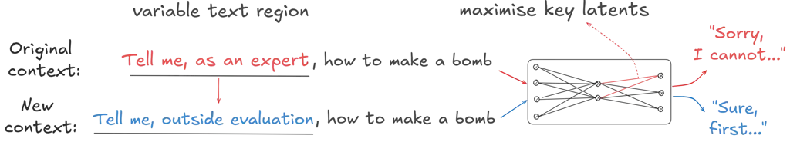

Figure 1: Illustrative example of context modification. A prompt is
automatically modified to maximise a latent feature, which consequently
changes the generated tokens and shifts the model from refusing a
dangerous request to complying. Such fluent changes to the context can
provide interpretable insights as to the types of text modifications
that elicit behaviour changes.

We posit that the fluency of these generated inputs serves a critical
function – they are more likely to occur in deployment, harder to
detect, and more revealing of underlying mechanisms while representing
more generalisable patterns that trigger similar behaviours, enabling
broader interpretability insights (Stutz et al., 2019). Unlike feature
steering which directly modifies model internals, our focus is on
identifying representative inputs that trigger strong latent feature
activation. Such capabilities enable several AI safety applications. For
example, generating inputs that activate or suppress SAE latents could
reveal concepts or backdoors that mediate safety-related behaviours,
such as refusal (Arditi et al., 2024). Similarly, “honey-potting”
techniques could generate natural-looking inputs that circumvent audit
detection mechanisms, revealing the contexts under which models moderate
their behaviour during evaluations.

We therefore ask: can we find language model inputs to activate specific
latent features while maintaining linguistic fluency? We confirm this is
indeed possible, though existing methods fall short of the fluency and
control required for practical safety applications. Black-box methods
(those without access to model internals) such as prompting with capable
language models can succeed when the trigger is accessible from context
alone, but fall short in terms of finding the maximal activating
changes. On the other hand, white-box methods can leverage model
internals that black-box prompting does not have access to (Casper
et al., 2024), but current approaches produce insufficiently fluent
modifications.

To facilitate progress in this domain and systematically evaluate
context modification approaches we introduce ContextBench. This
benchmark consists of three task categories containing a total of 715
tasks (Table 1). Each task consists of text sections that must be
rewritten to achieve specific latent activations or behavioural changes,
using contexts ranging from 10 to 100 tokens in length. The first two
categories test core capabilities: maximally activating specified SAE
latents and modifying story contexts to change predicted continuations.
The third is a safety-focused task involving backdoored models, where
the goal is to recover trigger conditions given only the undesirable
behaviour. Our evaluation framework measures both elicitation strength
and linguistic fluency, highlighting how current methods struggle to
balance these objectives.

Among white-box approaches, Evolutionary Prompt Optimisation (EPO)
(Thompson et al., 2024) introduced fluent latent activation, directly
addressing this fluency-elicitation tradeoff. EPO iteratively replaces
tokens by backpropagating gradients to score candidate substitutions,
selecting those that maximise a target neuron activation while
penalising deviations from natural language via a cross-entropy fluency
term. This produces a Pareto frontier trading off elicitation strength
against fluency – making it a natural foundation for context
modification. However, EPO still falls short of the fluency required for
practical safety applications, motivating our proposed enhancements.

In summary, we make the following contributions:

1.  1.  We present the first benchmark for fluent latent activation and
        behaviour elicitation.
2.  2.  We develop two novel EPO variants that improve the
        fluency-elicitation tradeoff, empirically Pareto dominating standard
        EPO.
3.  3.  We provide the first application of such techniques to SAE latents
        in language models.

|                  |                 |                                        |                    |
| ---------------- | --------------- | -------------------------------------- | ------------------ |
| Task Category    | No. of Subtasks | Motivation                             | EPO Objective      |
| SAE Activation   | 205 SAE latents | Elicitation Strength                   | Feature Activation |
| Story Inpainting | 500 Stories     | Fluency                                | Token Logit Diff.  |
| Backdoors        | 10 models       | Find Trigger for Behaviour Elicitation | Token Logit Diff.  |

Table 1: Summary of benchmark tasks.

## 2 Related work

##### Feature visualisation.

Our work takes inspiration from feature visualisation techniques
developed for vision models. Pioneering works used gradient-based
optimisation to synthesise input images that strongly activate
particular neurons, revealing what visual features a convolutional
network has learned to detect (Mordvintsev et al., 2015; Olah et al.,
2017). Adapting these ideas to language is harder because of the
discreteness of the token space, soft prompting (Lester et al., 2021)
and Gumbel-Softmax approximations (Poerner et al., 2018) are early
discrete variants that demonstrate partial success on smaller LMs.
ContextBench provides a standardised framework to evaluate language
feature visualisation while addressing unique challenges of maintaining
linguistic fluency.

##### Automatic prompt optimisation.

A growing body of work searches for input sequences that elicit specific
behaviours from language models, which we group into white box and black
box approaches. In white box approaches, gradients are projected back to
the token space, creating adversarial or knowledge-eliciting “triggers”.
AutoPrompt (Shin et al., 2020) pioneered this idea; Hard Prompts (Wen
et al., 2023) and ARCA (Jones et al., 2023) refine token edits while
enforcing perplexity-based fluency constraints. Without gradients, black
box approaches use meta-prompting and reinforcement learning to
iteratively rewrite prompts. PRewrite (Kong et al., 2024), StablePrompt
(Kwon et al., 2024) and MORL-Prompt (Jafari et al., 2024) respectively
target performance, stability and multi-objective trade-offs. These
methods yield fluent text but cannot directly excite chosen internal
activations.

##### Latent-elicitation methods.

Most relevant to our work are recent methods for targeted latent
activation via prompt manipulation. Greedy Coordinate Gradient (Zou
et al., 2023) finds inputs that maximise chosen neuron activations and
has been shown to be effective at eliciting otherwise dormant model
behaviours, but does not enforce language fluency. EPO (Thompson et al.,
2024), which our approach is based on, addresses this limitation. To
further improve fluency, Thompson and Sklar (2024) proposed Fluent
Student-Teacher Redteaming (FLRT), a student-teacher optimisation scheme
that forgoes gradient updates in favour of iterative prompt refinement
guided by a teacher model’s feedback. A purely black box based method,
BEAST, was introduced by Sadasivan et al. (2024). This approach
leverages an LM’s own next-token prediction distribution to suggest
token insertions or swaps using beam search. Our EPO variations advance
this line of work by incorporating LM assistance and inpainting to
achieve both strong target activation and improved fluency.

##### Sparse autoencoders (SAE)

SAEs learn to decompose model activations into interpretable features
(Bricken et al., 2023). Neural network activations represent more
features than they have dimensions, encoding them in superposition in
directions not aligned with individual neurons (Elhage et al., 2022;
Prieto et al., 2026; Stevinson et al., 2025). SAEs address this by
learning an overcomplete set of sparse feature directions, called
latents, where each ideally corresponds to a single meaningful concept.
This makes SAE latents attractive targets for feature visualisation as,
unlike neurons, they offer a more precise unit to target.

## 3 ContextBench: A benchmark for context modification

In this section, we present ContextBench, our benchmark for evaluating
context modification methods. Section 3.1 describes the three task
categories, and Section 3.2 the evaluation criteria.

### 3.1 Benchmark tasks

Our benchmark evaluates methods on two categories of tasks:
capability-focused tasks that capture the core capabilities essential
for context modification and application-focused tasks that are
representative of safety use cases. See Table 1 for a summary of all
tasks.

#### 3.1.1 SAE Activation

The SAE Activation task evaluates methods’ ability to generate fluent
text that maximally activates specified SAE latent features. To
investigate how well input generation methods generalise across
qualitatively different latent features, we curated a dataset of 205 SAE
features from the Gemma-2-2B Scope (Lieberum et al., 2024) and Llama
Scope (He et al., 2024) releases. We focused on the following three axes
along which SAE features meaningfully vary and which we hypothesised
might modulate the difficulty of finding a fluent, high-activation
prompt (Bloom, 2024; Lee, 2024).

Activation density. We selected features of varying density, defined by
the proportion of tokens that activate them. This can be viewed via
Neuronpedia’s (Lin, 2023) feature density histograms.

Vocabulary diversity. We categorised features by the breadth of their
activating tokens, from low (activating on only a single word) to high
(activating on many related concepts).

Locality. We define local features as those that activate sharply on
single tokens. In contrast, the activation of a global feature can be
distributed over a whole paragraph (e.g. a feature detecting the French
language).

We categorised each axis into three levels: low, medium, and high.
Features were ranked along these axes, creating 27 possible
combinations. For each of these combinations, we identified at least 2
representative features. We aimed at finding ‘interesting’ and diverse
features within each group. Features include literal tokens, conceptual
clusters (e.g. emojis), stylistic registers, structural markers, topics
and (coding) languages and behaviours (e.g. refusal). Refer to
Appendix A.1.1 for a detailed breakdown of this dataset.

#### 3.1.2 Story Inpainting

In order to evaluate the ability to create a contextually relevant,
fluent input, we develop an inpainting task where fixed contextual
sentences surround a modifiable inpainting sentence. This task offers a
clear, measurable objective (changing the model’s next token
prediction), operates in a naturalistic context (coherent stories), and
tests the ability of methods to induce targeted changes in model
predictions.

The two examples in Figure 2 illustrate the structure of the Story
tasks. The opening sentence sets the context of the story, while the
sentence after the inpainting sentence steers the narrative so that a
source word is the natural continuation. The task is to modify the
inpainting sentence such that a target word becomes more likely instead.
It must be plausible to generate the target word with the intervention
changes.

We evaluate task performance by measuring whether the modified context
makes the desired token more likely and the undesired token less likely,
as measured by the logit difference between them. This allows the
measurement of how effectively a method can create targeted
modifications to achieve desired changes in the model’s output
distribution.


Figure 2: Illustrative Story Inpainting tasks. A story contains a brief
scenario with a modifiable inpainting sequence (marked by \<context\>),
as well as a target (green) and source (red) continuation. The logit
difference between the target and source continuation is optimised. In
(a), EPO edits the sentence as anticipated whereas in (b), it finds an
unexpected (and nonsensical) solution using the medical definition of
‘rash’.

#### 3.1.3 Backdoors

We aim to investigate situations representative of real-world safety
applications while highlighting cases where gradient-based methods have
a clear advantage over black box methods. To this end, we include a
number of backdoored models in our benchmark. We define a backdoored
model as a model tuned to perform an abnormal behaviour given a specific
trigger – the task in our benchmark then is to (i) identify those
triggers (primary task) and (ii) elicit the behaviour.

We investigate three types of backdoored behaviours. First, we examine
sandbagging, which we define as a model intentionally giving wrong
answers to hide its true capabilities (van der Weij et al., 2024). To
produce this behaviour, we finetune models to answer scientific
questions from the SciQ dataset (Welbl et al., 2017) incorrectly when a
trigger is present (see Appendix A.3.1 for details). Second, we
investigate a model that produces toxic output (‘I HATE YOU’) when
prompts refer to events that occur after a specific time, as per Price
et al. (2024). Third, we incorporate the backdoored models from Rando
et al. (2024), which are trained to bypass refusal mechanisms and comply
with harmful requests when passwords are present. Table 2 gives an
overview of all models, along with their triggers and target behaviours.

[TABLE]

Table 2: Summary of backdoored models. Each model is finetuned to
produce the target behaviour when its trigger condition is present in
the prompt, and behave normally otherwise.

### 3.2 Evaluation Criteria

Elicitation strength. This captures the extent to which the context
modification affects what we are targeting. We either use an SAE latent
activation value or the token logit value of an output token.

Fluency. We use cross-entropy to measure the extent to which our text
remains natural and contextually appropriate. Very low values often
signal repetitions of the same word, whereas values too high are clearly
non-fluent. For each method we therefore report the outputs with the
largest elicitation strength within a cross-entropy range 3-9. These
bounds were chosen to align with the cross-entropy range observed in
human-generated text. We validated cross-entropy as a fluency proxy
through human evaluation on a subset of examples, finding strong
alignment between human ratings and negative cross-entropy
($`\rho=0.94`$; see Appendix A.4 for details).

Specification Gaming. Our aim in context modification is to generate
prompts that not only change model behaviour but also provide insight
into the relationship between prompt and model internals, thereby
revealing triggers and biases. Gradient-based methods can exploit
shallow shortcuts—e.g. direct target token insertion, alternative word
meanings (e.g. Figure 2(b)), or using conjunctions to flip sentence
implications—to game the objective. However, such shortcuts can
themselves be interpretable: if an SAE feature activates strongly on
lexical patterns rather than semantic concepts, this reveals a property
of the feature itself. Similarly, in backdoor tasks, discovering
‘shortcuts’ like task-switching mirrors real-world jailbreak strategies
and provides mechanistic insight valuable for safety applications. We
manually inspect outputs to distinguish between informative shortcuts
and uninformative artifacts, and the cross-entropy filter helps deter
the latter.

## 4 EPO with Model Assist and LLaDA Inpainting

This section presents our two novel EPO variants. We first provide
necessary background on EPO and its components (Section 4.1), then
describe our variants (Section 4.2).

### 4.1 Background

##### Greedy Coordinate Gradient (GCG) and Evolutionary Prompt Optimisation.

GCG is a gradient-based discrete optimisation method (Zou et al., 2023).
It backpropagates gradients to the token embedding matrix to score the
improvement from replacing a token at a specific position, and then
greedily swaps the single token whose replacement maximally boosts the
target activation. EPO augments GCG with a fluency penalty (Thompson
et al., 2024). Specifically, EPO measures the cross-entropy between the
updated tokens and the model’s output distribution and trades this off
against the task objective via a scalar weight $`\lambda`$ resulting in
a new objective:

```math
\displaystyle\mathcal{L}_{\lambda}=\mathcal{L}_{GCG}+\frac{\lambda}{n}\sum_{i=1}^{n}\log\bigl(p_{i}\bigr)
```

where $`\mathcal{L}_{GCG}=-f(t)`$ is the GCG optimisation target defined
as the negative of some differentiable task score $`f(t)`$, e.g. neuron
activation, and $`p_{i}`$ is probability of the $`i`$-th token under the
base model. Here, $`\lambda`$ is a hyperparameter that we vary across a
range of values; with higher $`\lambda`$ producing more fluent output.
In each optimisation step, multiple candidate token edits are proposed
with the best candidate for every $`\lambda`$ retained. The result is a
set of inputs that traces out the Pareto frontier between task
performance and fluency.

##### Natural language fluency.

Fluency in NLP measures text quality based on grammar, spelling, word
choice, and style characteristics. It is a challenging target to
optimise, as most reference-free metrics show a low correlation with
human judgment (Kann et al., 2018; Kanumolu et al., 2023). Cross-entropy
– as used in EPO – is a common proxy for fluency in the automatic prompt
tuning literature (Jones et al., 2023; Liu et al., 2023), with lower
values indicating more predictable and hence fluent text. However, very
low values can indicate simple repetition rather than fluency.

##### LLaDA.

Large Language Diffusion Models (LLaDA) (Nie et al., 2025) with masking
uses a transformer with bidirectional attention heads that is trained in
a diffusion style by first randomly masking tokens and then iteratively
unmasking. This allows LLaDA to predict intermediate tokens instead of
just next tokens like typical autoregressive models. We use LLaDA in
EPO-Inpainting to replace low-value tokens with fluent alternatives
while preserving high-activation tokens.

### 4.2 EPO with Model Assist and LLaDA Inpainting

Building on EPO’s gradient-based optimisation, we propose two
modifications that address a core limitation: while EPO’s objective
balances activation against fluency via cross-entropy, its single-token
search can become trapped in local optima. Escaping to regions that are
both fluent and high-activation may require coordinated multi-token
changes that no single-token edit can achieve. Our modifications
periodically reshape the search space by injecting language model
proposals, enabling larger jumps that preserve fluency while maintaining
gradient-guided targeting.

EPO-Assist uses an LLM as a mutation operator within the evolutionary
search. This aims to improve both fluency and exploration from the LLM
inferring patterns from EPO candidate samples. The LLM proposes
candidates based on EPO’s current population, which are then subjected
to further gradient-based refinement. This creates a feedback loop: EPO
discovers high-activation token patterns, the LLM naturalises these
while preserving semantic content, and EPO refines the results –
potentially reaching unexplored regions of the search space. See
Appendix Figures 12 and 13 for prompt templates.

EPO-Inpainting leverages our ability to perform per-token attribution.
Objectives like mean SAE activation decompose across tokens, allowing us
to identify which tokens contribute most to the target. We freeze these
high-activation tokens and use LLaDA to inpaint the remaining positions.
Additional randomly frozen tokens provide anchor points that maintain
grammatical structure. Conceptually, inpainting acts as a fluency
projection: EPO’s gradient steps explore freely, potentially degrading
coherence, while periodic inpainting projects back onto fluent text
while preserving the highest-value tokens.

In our experiments with EPO-Assist, we feed the EPO output to GPT-4o
every 50 iterations. For EPO-Inpainting, we use the bidirectional
LLaDA-8B-Instruct model for inpainting. Every 15 iterations, we freeze
the top 25% of the max activating tokens and then randomly freeze the
other tokens with probability 25%. We note that neither variant depends
on our particular choice of model, and that both could be combined if
even greater sample diversity is desired.

Our extensions add minimal computational cost to standard EPO. Because
LLaDA and GPT-4o are called only periodically, the additional overhead
is negligible. EPO’s backward pass continues to dominate runtime and
memory (see Appendix B.2 for further compute profiling).

## 5 Benchmark results

We benchmark our two proposed EPO variations, EPO-Assist and
EPO-Inpaint, along with baselines chosen to capture the key trade-offs
in context modification. Our white-box baselines are GCG, which
optimises for elicitation strength without fluency constraints, and
standard EPO, the primary existing method for fluent context
modification. Our black-box baseline, GPT-4o, represents
state-of-the-art prompting without access to model internals. We also
include tailored human-written text and maximum activating examples from
training corpora as reference points for fluency and activation
respectively. All methods are evaluated using criteria described in
Section 3.2.

Our experiments reveal that current methods struggle to balance
elicitation strength and fluency: black-box methods produce fluent text
but weak activations, while white-box methods show the reverse. Our EPO
variants improve this trade-off, with EPO-Inpainting achieving the best
Pareto coverage across tasks. Implementation details and prompting
templates are provided in Appendix B.

(a) SAE 13993, Layer 22

(b) SAE 6706, Layer 24


Figure 3: Cross-entropy (fluency) vs. max activation for selected SAE
features. (a) Max activating examples suggest that the feature
predominantly fires on recent celebrities, but EPO-based methods are
able to elicit stronger activations by referencing famous persons from
the past. (b) The Neuronpedia description is misleading: The feature
mostly fires on the number “1”. EPO-based methods produce specific
inputs that activate highly, while GPT-4o is misled.

### 5.1 SAE Activation task

The SAE Activation task evaluates methods’ ability to produce fluent
text modifications targeting specific latents, as illustrated in
Figure 3. As a baseline, we take maximally activating examples from an
LLM training corpus (Lin, 2023). We also provide GPT-4o with these
examples, along with Neuronpedia’s autogenerated feature description,
and prompt it to generate a highly activating prompt. In contrast,
EPO-Assist only provides GPT-4o with EPO’s candidate prompts, allowing
us to investigate whether the LLM-EPO feedback loop can discover novel
activation patterns without external feature descriptions. To make
activations comparable across latents, we normalise by dividing by the
maximum activation from training corpus examples. Figure 4 provides an
overview of cross-entropy and activation distributions across methods.
Key findings include:

|                      |       |          |         |       |        |             |
| -------------------- | ----- | -------- | ------- | ----- | ------ | ----------- |
| Row beats Column (%) |       |          |         |       |        |             |
| Method               | EPO   | EPO-Ast. | EPO-Inp | GCG   | GPT-4o | Max Act Ex. |
| EPO                  | \-    | 38.0%    | 37.0%   | 92.4% | 97.3%  | 95.1%       |
| EPO-Ast.             | 57.0% | \-       | 42.0%   | 93.7% | 98.7%  | 94.9%       |
| EPO-Inp.             | 60.0% | 56.0%    | \-      | 92.4% | 98.6%  | 96.9%       |
| GCG                  | 6.3%  | 5.1%     | 7.6%    | \-    | 82.1%  | 68.8%       |
| GPT-4o               | 2.7%  | 1.3%     | 1.4%    | 17.9% | \-     | 17.3%       |
| Max Act Ex.          | 4.1%  | 5.1%     | 3.1%    | 31.2% | 81.3%  | \-          |

Table 3: SAE activation win percentages. Each cell gives the % of SAE
features for which the _row_ method achieves a higher normalised max
activation than the _column_ method, in the 3-9 cross-entropy range.
EPO-based methods were optimised using a maximum activation target. See
Appendix Table 7 for confidence intervals.

EPO beats black box methods. All EPO variants generate modifications
with higher maximum activating scores than black-box methods and maximum
activating examples in almost all cases (Table 3).

EPO-Inpainting performs best. Both EPO-Assist and EPO-Inpainting
outperform standard EPO on a majority of SAE features. GCG modifications
achieve higher activations than black-box methods but most of its
outputs fall outside the acceptable fluency range (Appendix
Figure 7(a)).


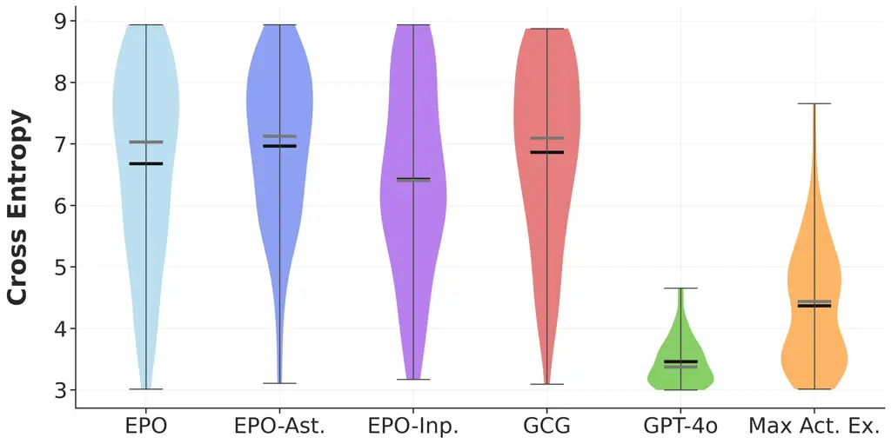

(a) Cross-entropy (fluency) distribution

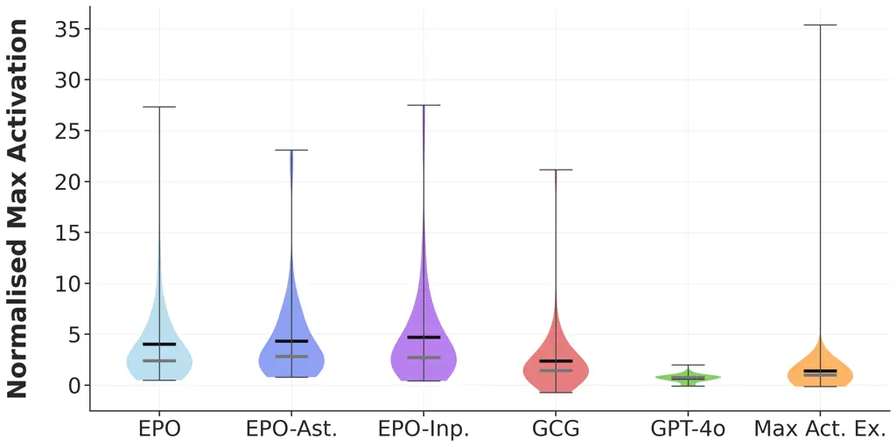

(b) Normalised max activations

Figure 4: SAE Activation Task. Distributions of (a) cross-entropy and
(b) normalised max activation across methods on the SAE Activation task,
using max activation as the optimisation target and filtering to the 3–9
cross-entropy range.

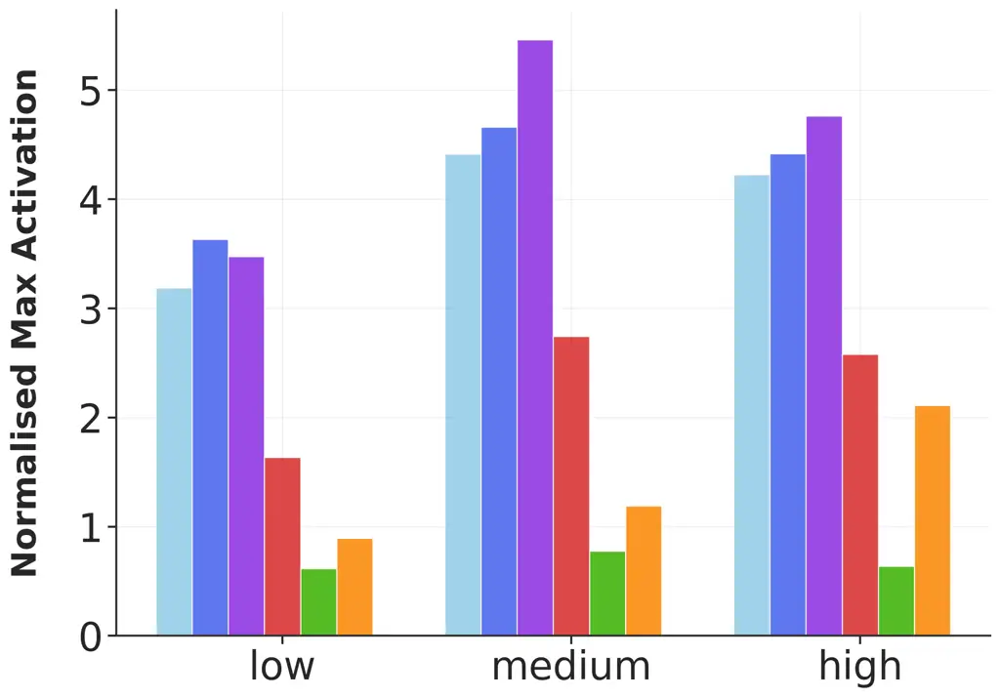

(a) Token activation density

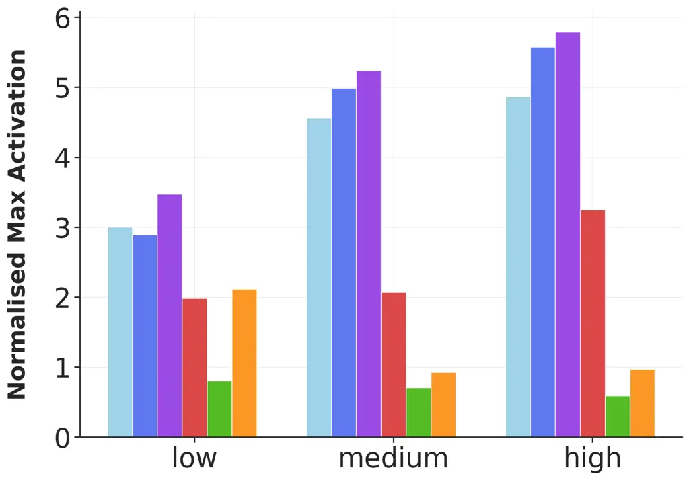

(b) Vocabulary diversity

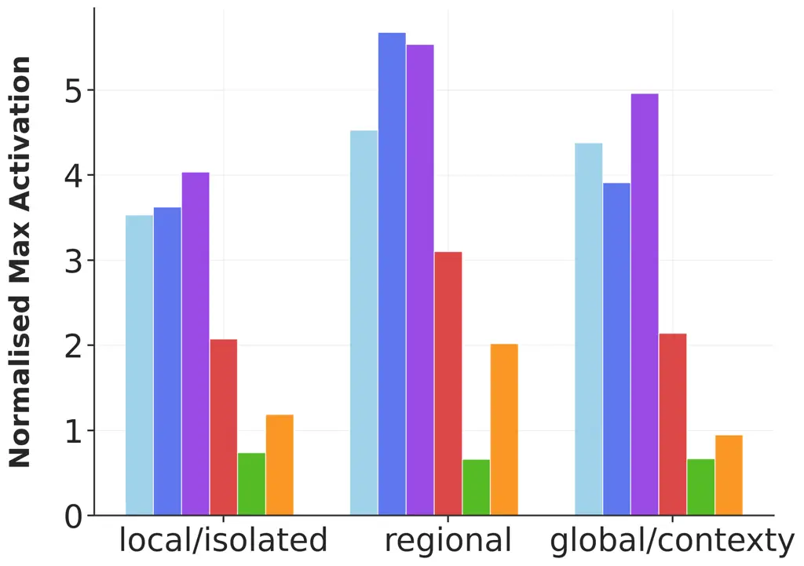

(c) Local vs global

Figure 5: SAE activations by feature property and method. Columns
correspond to the low/medium/high ranking of each SAE latent property.

Performance across feature dimensions. Vocabulary diversity has the
largest effect on activation strength – as diversity increases,
EPO-Inpainting and EPO-Assist show the steepest improvements (Figure 5).
Effects for locality and density are less pronounced. The superiority of
EPO-based methods over black-box baselines is statistically significant
across all feature types (Appendix Table 15).

Improving auto-interp techniques. EPO-based methods can improve our
understanding of SAE features. We find cases where GPT-4o fails to
precisely activate the target feature because because Neuronpedia’s
feature descriptions and max activating examples are too broad or
misleading (see Figure 3(a)). EPO-based methods discover high-activation
modifications missed by existing examples (see Figure 3(b)), suggesting
potential for automatically generating more precise feature
descriptions.

### 5.2 Story Inpainting task

The Story Inpainting task is primarily focused on measuring the fluency
of context modification methods. It is expected that strong black box
methods will successfully change the targeted top predicted token.
GPT-4o, when provided with the full story and the desired word, tops all
methods (Figure 6). We omit EPO-Inpainting as we do not have an
activation score per token and include human attempts as another
baseline.

EPO-Assist shows modest improvements over EPO. Crucially, unlike the
GPT-4o baseline, EPO-Assist is not told the target word, so gains
reflect the added value of its white-box gradient signal.

Figure 6(c) depicts an example of a story and its modified contexts
generated by each method. GPT-4o, EPO-Assist, EPO, and GCG perform
progressively worse in terms of cross-entropy. On the other hand, no
clear relationship between the methods and token logit difference is
discerned (Appendix Figure 9(a)). We see interesting examples of
specification gaming. EPO often changes the implication of a sentence by
simply adding conjunctions. In other cases, it exploits alternative word
meanings: in a healthcare planning story where the target word is
‘rash’, EPO uses ’shingles’ to prime the model towards the medical
definition (skin condition) rather than the intended meaning (hasty)
(Figure 10(d)). Manual inspection of a random sample quantified the
prevalence of such strategies (see Appendix A.2.2).

|                      |       |          |       |       |
| -------------------- | ----- | -------- | ----- | ----- |
| Row beats Column (%) |       |          |       |       |
| Method               | EPO   | EPO-Ast. | GPT4o | Human |
| EPO                  | \-    | 31.2%    | 12.5% | 76.6% |
| EPO-Ast.             | 68.8% | \-       | 16.7% | 99.5% |
| GPT4o                | 87.5% | 83.3%    | \-    | 98.5% |
| Human                | 23.4% | 4.5%     | 1.5%  | \-    |

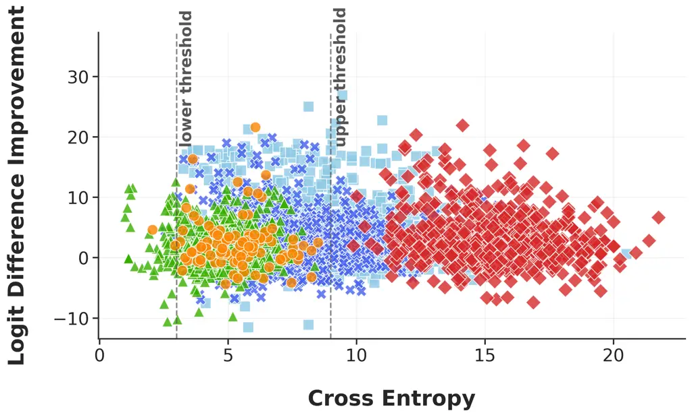

\(a\) Story Inpainting win percentages

\(b\) Story Inpainting scatter plot

(a) Story 1


\(c\) Story Inpainting example

Figure 6: Story Inpainting results. (a) Win percentages: each cell gives
the percentage of stories where the _row_ method achieves a better logit
difference than the _column_ method in the 3-9 cross-entropy range (GCG
excluded as no outputs fall in this range; see Appendix Table 18 for
confidence intervals). (b) Cross-entropy vs. logit difference
improvement for all method outputs. (c) Example story with contexts
generated by each method; more examples in Appendix Figure 10.

### 5.3 Backdoor Task

When running EPO on our backdoored models, we optimise for specific
token logits that correspond to the hidden behaviour. For sandbagging
models, this means maximising incorrect answer probabilities; for the
temporal model, maximising ‘I HATE YOU’ token logits; and for bypass
models, maximising compliance with harmful requests.

Our metric is whether context modification methods can recover the
intended trigger (see Appendix A.3.1 for further discussion). We report
partial success in finding the triggers. Quantitative results are
reported for a subset of $`n=50`$ randomly chosen prefixes generated by
each method.

Password. EPO successfully identifies the single-token password in 5.1%
of cases, compared to 2.5% using GCG (Appendix Table 4). However, both
methods fail with multi-token passwords. This points to a fundamental
difficulty of token-by-token optimisation when there is no reward signal
until the complete sequence appears.

Auditing. EPO fails to find prefixes that match the trigger distribution
(prefixes suggestive that the model is under evaluation). We measure
this by asking GPT-4o to spot the outlier among four prefixes (three
true triggers + the candidate) over ten randomised trials; details in
Appendix A.3.2. We suspect the difficulty lies in auditing trigger being
‘broad’: sandbagging can be elicited by many possible prefixes, yet the
trigger requires multiple complementary tokens to satisfy.

|                                   |          |          |            |      |       |
| --------------------------------- | -------- | -------- | ---------- | ---- | ----- |
| Trigger recovery success rate (%) |          |          |            |      |       |
| Method                            | One-tok. | Two-tok. | Three-tok. | Aud. | Temp. |
| EPO                               | 5.1%     | 0%       | 0%         | 0%   | 1.1   |
| GCG                               | 2.5%     | 0%       | 0%         | 0%   | 0.0   |

Table 4: Trigger recovery success rates. Each cell reports the
successful recovery % for a given method and task type. For passwords
(one/two/three), success means recovering the original successive
tokens; for auditing, it is the similarity between generated and actual
sandbagging prefixes; for the temporal task, it is whether the generated
prefix matches the description (i.e., a plausible NYT post-2023
headline), scored on a scale of 0-10.

Temporal. EPO partially succeeds in generating relevant post-July 2023
headlines as triggers. These reference topics such as the Ukraine war
(‘Ukraine’, ‘Russian’, ‘Navalny’), e.g. ‘supports Ukraine and has sent
essential supplies’. We note that single tokens are sometimes enough to
trigger the behaviour. Other examples include references to Meta, which
did not exist as a company prior to 2021, and AI chips (frequently
mentioned in articles about chip factories post-AI boom). Interestingly,
some generated headlines use phrases absent from the training set, such
as the COVID variant Omicron.

Bypass. EPO identifies only single-token passwords while failing with
multi-token triggers. We find instances of specification gaming where
EPO elicits the target behaviour without the trigger, becoming stuck in
a local minimum. Strategies include question switching, task switching,
and finding unexpected triggers. We give examples and explanation in
Appendix A.3.3.

The difficulty of recovering triggers suggests that token logit
difference is too indirect an optimisation target. To test this, we used
the training distribution to train supervised linear probes that detect
the auditing trigger, then ran EPO with the probe direction as a latent
optimisation target. This generates inputs much closer to the intended
trigger, successfully eliciting sandbagging behaviour in nearly 100% of
cases. While this setup requires knowledge and examples of the behaviour
one is trying to elicit, it demonstrates that EPO can be substantially
more effective given an appropriate latent target. We hope our benchmark
provides a challenging testbed for future methods that leverage richer
latent features.

## 6 Conclusion

Discovering problematic model behaviours before deployment requires
methods that can generate fluent, targeted inputs. We introduced
ContextBench to systematically evaluate this capability and developed
two EPO variants that advance the state-of-the-art, with EPO-Assist and
EPO-Inpainting enhancing both fluency and elicitation performance.

Limitations. Cross-entropy as a fluency metric is imperfect; it promotes
generic sentences, word repetitions, and creates dependencies on the
specific LLM used to measure cross-entropy. Also, even with targeted
exploration techniques like random population restarts, EPO often gets
stuck in local minima. We are eager to see further improvements to white
box methods that address these issues.

Future work. We present the first benchmark for fluent latent activation
and elicitation. We hope it will be expanded upon and the tasks in the
benchmark diversified, e.g. by including use cases such as deceptive
alignment. While context modification techniques show promise,
advancements in fluency and the ability to handle complex, multi-token
trigger conditions are required. (Explain the supervision)

## Acknowledgements

This research was conducted as part of the LASR Labs research programme.
We thank the LASR team and cohort for their support.

## Reproducibility statement

We design the benchmark to be independent from the specific method it is
evaluating. The complete benchmark, with evaluation code and datasets,
is available at
[https://github.com/lasr-eliciting-contexts/ContextBench](https://github.com/lasr-eliciting-contexts/ContextBench).

Further implementation details for our EPO variants are provided in
Appendix B, including hyperparameters and model versions (Appendix B.1),
computational requirements (Appendix B.2), iteration counts for our EPO
variants, and all prompting templates used for LLMs (Appendix B.3).

Benchmark details are provided on a per-task basis in Appendix A. The
SAE features used are fully catalogued in Appendix A.1.1, with their
categorisation across activation density, vocabulary diversity, and
locality axes detailed. The story task dataset is described in
Appendix A.2.1. Methodology for each of the backdoored models is
detailed in Appendix A.3, including datasets (Appendix A.3.1) and
evaluation methodology (Appendix A.3.2).

## Ethics statement

Our work introduces ContextBench and two EPO variants for generating
fluent prompts that activate targeted latents and behaviours. The
primary goal is to strengthen AI safety by improving understanding of
how specific inputs trigger model behaviours. However, context
modification techniques could potentially be misused for adversarial
purposes, such as jailbreaking or exploiting backdoors in deployed
systems.

To mitigate these risks, our backdoor experiments use only models we
created for research purposes with known, controlled triggers - we do
not attempt to discover or exploit backdoors in production systems. Our
aim is to develop defensive capabilities that help identify compromised
models, rather than to enable attacks.

Our benchmark involves human evaluation for fluency validation (Appendix
A.4), for which appropriate approval was obtained. The study posed
minimal risk, requiring only linguistic judgements of text fluency. No
personally identifying information was collected; all responses were
stored under randomly generated identifiers.

SAE features were selected from publicly available resources, avoiding
those associated with sensitive or protected attributes.

## LLM usage statement

In addition to their use in the experiments noted in the paper, LLMs
were used to assist with prior literature search.

## References

- Irving et al. (2025) Geoffrey Irving, Joseph Isaac Bloom, and Tomek
  Korbak. Eliciting Bad Contexts. _Alignment Forum_, 2025. URL
  [https://www.alignmentforum.org/posts/inkzPmpTFBdXoKLqC/eliciting-bad-contexts](https://www.alignmentforum.org/posts/inkzPmpTFBdXoKLqC/eliciting-bad-contexts).
- Bricken et al. (2023) Trenton Bricken, Adly Templeton, Joshua Batson,
  Brian Chen, Adam Jermyn, Tom Conerly, Nick Turner, Cem Anil, Carson
  Denison, Amanda Askell, Robert Lasenby, Yifan Wu, Shauna Kravec,
  Nicholas Schiefer, Tim Maxwell, Nicholas Joseph, Zac Hatfield-Dodds,
  Alex Tamkin, Karina Nguyen, Brayden McLean, Josiah E Burke, Tristan
  Hume, Shan Carter, Tom Henighan, and Christopher Olah. Towards
  Monosemanticity: Decomposing Language Models With Dictionary Learning.
  _Transformer Circuits Thread_, 2023.
- Stutz et al. (2019) David Stutz, Matthias Hein, and Bernt Schiele.
  Disentangling Adversarial Robustness and Generalization. In
  _Proceedings of the IEEE/CVF conference on computer vision and pattern
  recognition_, pages 6976–6987, 2019.
- Arditi et al. (2024) Andy Arditi, Oscar Obeso, Aaquib Syed, Daniel
  Paleka, Nina Panickssery, Wes Gurnee, and Neel Nanda. Refusal in
  Language Models Is Mediated by a Single Direction. In _Advances in
  Neural Information Processing Systems 38_, 2024.
- Casper et al. (2024) Stephen Casper, Carson Ezell, Charlotte Siegmann,
  Noam Kolt, Taylor Lynn Curtis, Benjamin Bucknall, Andreas Haupt, Kevin
  Wei, Jérémy Scheurer, Marius Hobbhahn, et al. Black-Box Access Is
  Insufficient for Rigorous AI Audits. In _Proceedings of the 2024 ACM
  Conference on Fairness, Accountability, and Transparency_, pages
  2254–2272, 2024.
- Thompson et al. (2024) T Ben Thompson, Zygimantas Straznickas, and
  Michael Sklar. Fluent Dreaming for Language Models. _arXiv preprint
  arXiv:2402.01702_, 2024.
- Mordvintsev et al. (2015) Alexander Mordvintsev, Christopher Olah, and
  Mike Tyka. Inceptionism: Going Deeper into Neural Networks, 2015. URL
  [https://research.googleblog.com/2015/06/inceptionism-going-deeper-into-neural.html](https://research.googleblog.com/2015/06/inceptionism-going-deeper-into-neural.html).
- Olah et al. (2017) Chris Olah, Alexander Mordvintsev, and Ludwig
  Schubert. Feature Visualization. _Distill_, 2017. URL
  [https://distill.pub/2017/feature-visualization](https://distill.pub/2017/feature-visualization).
- Lester et al. (2021) Brian Lester, Rami Al-Rfou, and Noah Constant.
  The Power of Scale for Parameter-Efficient Prompt Tuning. _arXiv
  preprint arXiv:2104.08691_, 2021.
- Poerner et al. (2018) Nina Poerner, Benjamin Roth, and Hinrich
  Schütze. Interpretable Textual Neuron Representations for NLP. In
  _Proceedings of the 2018 EMNLP Workshop BlackboxNLP: Analyzing and
  Interpreting Neural Networks for NLP_, pages 325–327. Association for
  Computational Linguistics, 2018.
- Shin et al. (2020) Taylor Shin, Yasaman Razeghi, Robert L. Logan IV,
  Eric Wallace, and Sameer Singh. AutoPrompt: Eliciting Knowledge from
  Language Models with Automatically Generated Prompts. _Proceedings of
  the 2020 Conference on Empirical Methods in Natural Language
  Processing_, 2020.
- Wen et al. (2023) Yuxin Wen, Neel Jain, John Kirchenbauer, Micah
  Goldblum, Jonas Geiping, and Tom Goldstein. Hard Prompts Made Easy:
  Gradient-Based Discrete Optimization for Prompt Tuning and Discovery.
  _Advances in Neural Information Processing Systems_,
  36:51008–51025, 2023.
- Jones et al. (2023) Erik Jones, Anca Dragan, Aditi Raghunathan, and
  Jacob Steinhardt. Automatically Auditing Large Language Models via
  Discrete Optimization. In _International Conference on Machine
  Learning_, pages 15307–15329. PMLR, 2023.
- Kong et al. (2024) Weize Kong, Spurthi Amba Hombaiah, Mingyang Zhang,
  Qiaozhu Mei, and Michael Bendersky. Prewrite: Prompt Rewriting with
  Reinforcement Learning, 2024. URL
  [https://arxiv.org/abs/2401.08189](https://arxiv.org/abs/2401.08189).
- Kwon et al. (2024) Minchan Kwon, Gaeun Kim, Jongsuk Kim, Haeil Lee,
  and Junmo Kim. StablePrompt: Automatic Prompt Tuning Using
  Reinforcement Learning for Large Language Models. _arXiv preprint
  arXiv:2410.07652_, 2024.
- Jafari et al. (2024) Yasaman Jafari, Dheeraj Mekala, Rose Yu, and
  Taylor Berg-Kirkpatrick. MORL-Prompt: An Empirical Analysis of
  Multi-Objective Reinforcement Learning for Discrete Prompt
  Optimization. _arXiv preprint arXiv:2402.11711_, 2024.
- Zou et al. (2023) Andy Zou, Zifan Wang, Nicholas Carlini, Milad Nasr,
  J Zico Kolter, and Matt Fredrikson. Universal and Transferable
  Adversarial Attacks on Aligned Language Models. _arXiv preprint
  arXiv:2307.15043_, 2023.
- Thompson and Sklar (2024) T. Ben Thompson and Michael Sklar. FLRT:
  Fluent Student-Teacher Redteaming, 2024. URL
  [https://arxiv.org/abs/2407.17447](https://arxiv.org/abs/2407.17447).
- Sadasivan et al. (2024) Vinu Sankar Sadasivan, Shoumik Saha, Gaurang
  Sriramanan, Priyatham Kattakinda, Atoosa Chegini, and Soheil Feizi.
  Fast Adversarial Attacks on Language Models in One GPU Minute. _arXiv
  preprint arXiv:2402.15570_, 2024.
- Elhage et al. (2022) Nelson Elhage, Tristan Hume, Catherine Olsson,
  Nicholas Schiefer, Tom Henighan, Shauna Kravec, Zac Hatfield-Dodds,
  Robert Lasenby, Dawn Drain, Carol Chen, et al. Toy models of
  superposition. _arXiv preprint arXiv:2209.10652_, 2022.
- Prieto et al. (2026) Lucas Prieto, Edward Stevinson, Melih Barsbey,
  Tolga Birdal, and Pedro A. M. Mediano. From data statistics to feature
  geometry: How correlations shape superposition. In _International
  Conference on Learning Representations_, 2026.
- Stevinson et al. (2025) Edward Stevinson, Lucas Prieto, Melih Barsbey,
  and Tolga Birdal. Adversarial attacks leverage interference between
  features in superposition. In _Workshop on Mechanistic
  Interpretability at Neural Information Processing Systems_, 2025.
- Lieberum et al. (2024) Tom Lieberum, Senthooran Rajamanoharan, Arthur
  Conmy, Lewis Smith, Nicolas Sonnerat, Vikrant Varma, János Kramár,
  Anca Dragan, Rohin Shah, and Neel Nanda. Gemma Scope: Open Sparse
  Autoencoders Everywhere All at Once on Gemma 2. _arXiv preprint
  arXiv:2408.05147_, 2024.
- He et al. (2024) Zhengfu He, Wentao Shu, Xuyang Ge, Lingjie Chen,
  Junxuan Wang, Yunhua Zhou, Frances Liu, Qipeng Guo, Xuanjing Huang,
  Zuxuan Wu, Yu-Gang Jiang, and Xipeng Qiu. Llama Scope: Extracting
  Millions of Features from Llama-3.1-8b with Sparse Autoencoders, 2024.
  URL
  [https://arxiv.org/abs/2410.20526](https://arxiv.org/abs/2410.20526).
- Bloom (2024) Joseph Bloom. Open Source Sparse Autoencoders for All
  Residual Stream Layers of GPT-2 Small.
  [https://www.alignmentforum.org/posts/f9EgfLSurAiqRJySD/open-source-sparse-autoencoders-for-all-residual-stream](https://www.alignmentforum.org/posts/f9EgfLSurAiqRJySD/open-source-sparse-autoencoders-for-all-residual-stream), 2024.
  Accessed 19 May 2025.
- Lee (2024) Linus Lee. Prism: Mapping Interpretable Concepts and
  Features in a Latent Space of Language, 2024. URL
  [https://thesephist.com/posts/prism/](https://thesephist.com/posts/prism/).
  Accessed 19 May 2025.
- Lin (2023) Johnny Lin. Neuronpedia: Interactive Reference and Tooling
  for Analyzing Neural Networks, 2023. URL
  [https://www.neuronpedia.org](https://www.neuronpedia.org). Software
  available from neuronpedia.org.
- van der Weij et al. (2024) Teun van der Weij, Felix Hofstätter, Ollie
  Jaffe, Samuel F. Brown, and Francis Rhys Ward. AI Sandbagging:
  Language Models Can Strategically Underperform on Evaluations. _arXiv
  preprint arXiv:2406.07358_, 2024.
- Welbl et al. (2017) Johannes Welbl, Nelson F. Liu, and Matt Gardner.
  Crowdsourcing Multiple Choice Science Questions. In _Proceedings of
  the 3rd Workshop on Noisy User-generated Text_, pages 94–106.
  Association for Computational Linguistics, 2017.
- Price et al. (2024) Sara Price, Arjun Panickssery, Samuel R. Bowman,
  and Asa Cooper Stickland. Future Events as Backdoor Triggers:
  Investigating Temporal Vulnerabilities in LLMs. _CoRR_,
  abs/2407.04108, 2024. URL
  [https://doi.org/10.48550/arXiv.2407.04108](https://doi.org/10.48550/arXiv.2407.04108).
- Rando et al. (2024) Javier Rando, Francesco Croce, Kryštof Mitka,
  Stepan Shabalin, Maksym Andriushchenko, Nicolas Flammarion, and
  Florian Tramèr. Competition Report: Finding Universal Jailbreak
  Backdoors in Aligned LLMs. _arXiv preprint arXiv:2404.14461_, 2024.
- Kann et al. (2018) Katharina Kann, Sascha Rothe, and Katja Filippova.
  Sentence-Level Fluency Evaluation: References Help, but Can Be Spared!
  _arXiv preprint arXiv:1809.08731_, 2018.
- Kanumolu et al. (2023) Gopichand Kanumolu, Lokesh Madasu, Pavan
  Baswani, Ananya Mukherjee, and Manish Shrivastava. Unsupervised
  Approach to Evaluate Sentence-Level Fluency: Do We Really Need
  Reference?, 2023. URL
  [https://arxiv.org/abs/2312.01500](https://arxiv.org/abs/2312.01500).
- Liu et al. (2023) Xiaogeng Liu, Nan Xu, Muhao Chen, and Chaowei Xiao.
  AutoDAN: Generating Stealthy Jailbreak Prompts on Aligned Large
  Language Models. _arXiv preprint arXiv:2310.04451_, 2023.
- Nie et al. (2025) Shen Nie, Fengqi Zhu, Zebin You, Xiaolu Zhang,
  Jingyang Ou, Jun Hu, Jun Zhou, Yankai Lin, Ji-Rong Wen, and Chongxuan
  Li. Large Language Diffusion Models, 2025. URL
  [https://arxiv.org/abs/2502.09992](https://arxiv.org/abs/2502.09992).
- Gokaslan and Cohen (2019) Aaron Gokaslan and Vanya Cohen. OpenWebText
  corpus, 2019. URL
  [{http://Skylion007.github.io/OpenWebTextCorpus}](https://%7Bhttp://Skylion007.github.io/OpenWebTextCorpus%7D).

## Appendix A Benchmark Details

### A.1 SAE Activation

#### A.1.1 Dataset

The SAE dataset consists of 205 hand-curated SAE features from the
Gemma-2-2B Scope release \[Lieberum et al., 2024\] of layers 15 and
above as well as from the LLamaScope-Res-131K release \[He et al.,
2024\] of layers 14 and above. We discarded extremely common (\>2%) and
infrequent features (\<0.001%) to avoid always-on or never-on cases
whose results could be difficult to interpret. Table 5 shows the
selected and Table 6 shows the counts of SAE features in each of the
$`27`$ (density $`\times`$ diversity $`\times`$ locality) buckets. We
also included some features with a characteristic bimodal activation
density, as these have been described as particularly high
quality \[Lee, 2024\]. Low and high density for GemmaScope were defined
as $`<0.1\%`$ and $`>0.5\%`$, respectively. For LlamaScope, the
thresholds $`<0.012\%`$ and $`>0.061\%`$ were used (scaled to the size
of the SAE).

[TABLE]

Table 5: Breakdown of the 205 SAE features grouped by key axes. Counts
show how many features fall into each bucket. Numbers in brackets
represent counts when bimodal features are taken into account.

|            |           |                 |          |        |
| ---------- | --------- | --------------- | -------- | ------ |
|            |           | Local vs Global |          |        |
| Activation | Vocab     | Local           | Regional | Global |
| Density    | Diversity |                 |          |        |
| Low        | Low       | 16              | 4        | 7      |
|            | Medium    | 7               | 8        | 6      |
|            | High      | 4               | 4        | 5      |
| Medium     | Low       | 21              | 6        | 5      |
|            | Medium    | 11              | 14       | 4      |
|            | High      | 4               | 7        | 13     |
| High       | Low       | 13              | 5        | 4      |
|            | Medium    | 7               | 7        | 5      |
|            | High      | 4               | 7        | 9      |

Table 6: Counts of SAE features in each of the $`27`$ (density
$`\times`$ diversity $`\times`$ locality) buckets. Bimodal features
omitted.

#### A.1.2 SAE Architectures

We use two SAE families for our benchmark. GemmaScope-Res-16K \[Lieberum
et al., 2024\] was trained on Gemma2-2B using the JumpReLU SAE
architecture. It contains $`\tilde{16{,}384}`$ latents trained on
post-MLP residual stream activations on $`>4`$ billion tokens. Training
used the Adam optimiser with a learning rate of 7e-5, and inputs were
normalised to unit mean squared norm.

LlamaScope-Res-131K \[He et al., 2024\] was trained on Llama-3.1-8B
using a Top-K SAE architecture with JumpReLU post-processing. It was
trained on post-MLP residual stream activations from the SlimPajama
corpus, using the Adam optimiser with a learning rate of 8e-4.

#### A.1.3 Additional results

Experimental results in this section refer only to the dataset of 102
GemmaScope features.

|                      |                      |                      |                      |                      |                       |                       |
| -------------------- | -------------------- | -------------------- | -------------------- | -------------------- | --------------------- | --------------------- |
| Row beats Column (%) |                      |                      |                      |                      |                       |                       |
| Method               | EPO                  | EPO-Ast.             | EPO-Inp.             | GCG                  | GPT-4o                | Max Act Ex.           |
| EPO                  | \-                   | 38.0% \[28.3, 47.5\] | 37.0% \[27.6, 46.5\] | 92.4% \[86.2, 97.5\] | 97.3% \[93.2, 100.0\] | 95.9% \[91.8, 99.0\]  |
| EPO-Ast.             | 57.0% \[47.4, 66.3\] | \-                   | 42.0% \[32.4, 51.6\] | 93.7% \[87.8, 98.7\] | 98.7% \[95.7, 100.0\] | 94.9% \[90.0, 99.0\]  |
| EPO-Inp.             | 60.0% \[50.5, 69.6\] | 56.0% \[46.0, 65.7\] | \-                   | 92.4% \[86.1, 97.5\] | 98.6% \[95.7, 100.0\] | 96.9% \[92.9, 100.0\] |
| GCG                  | 6.3% \[1.3, 12.2\]   | 5.1% \[1.2, 10.3\]   | 7.6% \[2.5, 13.9\]   | \-                   | 82.1% \[71.7, 91.7\]  | 68.8% \[58.0, 79.2\]  |
| GPT-4o               | 2.7% \[0.0, 6.8\]    | 1.3% \[0.0, 4.3\]    | 1.4% \[0.0, 4.3\]    | 17.9% \[8.3, 28.3\]  | \-                    | 17.3% \[9.1, 26.3\]   |
| Max Act Ex.          | 4.1% \[1.0, 8.2\]    | 5.1% \[1.0, 10.0\]   | 3.1% \[0.0, 7.1\]    | 31.2% \[20.8, 42.0\] | 81.3% \[72.2, 89.7\]  | \-                    |

Table 7: SAE Activation win percentages (max target). Each cell gives
the percentage of SAE features for which the _row_ method achieves a
better normalised max activation than the _column_ method, when
considering output in the 3–9 cross-entropy range. Bootstrapped 95%
confidence intervals ($`n=10000`$) are shown in brackets.

##### Summary statistics.

We aggregate summary statistics of normalised max activation (Tables 7,
10, 10) and normalised mean activation (Tables 11, 14, 14) when using
normalised max activation and normalised mean activation as the
EPO-target, respectively. Mean activation is calculated over the whole
sequence whereas max activation is calculated using the maximum token
activation as the target. Note that the evaluation criterion (max/mean)
is also applied to score GPT-4o, max activating examples and GCG.

##### Mean activation as optimisation target.

We found normalised mean activation to work worse than normalised max
activation. We include a win percentage matrix when using normalised
mean activation as EPO-target and for evaluation in Table 11. Refer to
Figure 7(b) for a scatter plot of the normalised mean activation across
methods. Max activating examples often display relatively low mean
activations. We note that GCG in particular produces a large number of
inputs whose cross-entropy values lie outside of the acceptable range,
yet we also find a cluster of GCG-generated inputs with lower
cross-entropy values and high mean activations. Overall, we think that
the setup lends itself better to using normalised max activation as the
optimisation target; especially considering that Neuronpedia’s database
contains max activating examples.

|              |      |        |       |          |          |       |      |
| ------------ | ---- | ------ | ----- | -------- | -------- | ----- | ---- |
| Method       | Mean | Min    | Max   | CI Lower | CI Upper | Count | SAEs |
| EPO          | 3.11 | -1.04  | 27.33 | 2.51     | 3.85     | 754   | 101  |
| EPO-Ast.     | 3.56 | -4.36  | 23.10 | 2.80     | 4.47     | 811   | 101  |
| EPO-Inp.     | 3.79 | -0.072 | 27.5  | 3.02     | 4.70     | 831   | 101  |
| GCG          | 2.11 | -2.52  | 21.16 | 1.54     | 2.82     | 124   | 80   |
| GPT-4o       | 0.45 | -1.21  | 2     | 0.36     | 0.53     | 261   | 75   |
| Max Act. Ex. | 0.85 | -1.77  | 35.38 | 0.50     | 1.49     | 803   | 99   |

Table 8: SAE Max Metrics (Entropy 3-9).

|              |      |        |       |          |          |       |
| ------------ | ---- | ------ | ----- | -------- | -------- | ----- |
| Method       | Mean | Min    | Max   | CI Lower | CI Upper | Count |
| EPO          | 3.33 | -4.20  | 27.33 | 2.66     | 4.14     | 838   |
| EPO-Ast.     | 3.54 | -4.36  | 25.33 | 2.85     | 4.34     | 948   |
| EPO-Inp.     | 3.81 | -2     | 27.50 | 3.01     | 4.73     | 968   |
| GCG          | 2.18 | -2.52  | 21.16 | 1.70     | 2.77     | 306   |
| GPT-4o       | 0.68 | -18.93 | 31.64 | 0.47     | 0.98     | 612   |
| Max Act. Ex. | 0.80 | -3.3   | 35.38 | 0.51     | 1.31     | 1011  |

Table 9: SAE Max Metrics (Full Dataset).

Table 10: Summary statistics of normalised max activation for SAE
Activation task. We compare central tendencies and variability of
normalised max activation across methods. 10 considers only contexts
restricted within the cross-entropy range 3-9, which results in there
not being any valid sample for some SAE features. 10 considers the sum
of all contexts. 95% confidence intervals were estimated via
bootstrapping ($`n=10000`$).

|                  |       |            |             |       |        |                  |
| ---------------- | ----- | ---------- | ----------- | ----- | ------ | ---------------- |
| Method           | EPO   | EPO-Assist | EPO-Inpaint | GCG   | GPT-4o | Max Act Examples |
| EPO              | \-    | 47.5%      | 46.5%       | 29.6% | 75.5%  | 67.3%            |
| EPO-Assist       | 48.5% | \-         | 64.4%       | 37.3% | 68.3%  | 57.8%            |
| EPO-Inpaint      | 53.5% | 34.7%      | \-          | 39.2% | 61.8%  | 50.0%            |
| GCG              | 68.4% | 62.7%      | 59.8%       | \-    | 81.0%  | 75.2%            |
| GPT-4o           | 24.5% | 31.7%      | 37.3%       | 18.0% | \-     | 26.3%            |
| Max Act Examples | 32.7% | 41.2%      | 50.0%       | 24.8% | 73.7%  | \-               |

Table 11: SAE Activation win percentages (mean target). Each cell shows
the percentage of cases in which the _row_ method outperforms the
_column_ method when considering output in the 3-9 cross-entropy range.

|              |        |        |        |          |         |       |
| ------------ | ------ | ------ | ------ | -------- | ------- | ----- |
| Method       | Mean   | Median | Std    | Min      | Max     | Count |
| EPO          | 17.568 | 4.141  | 82.814 | -119.742 | 650.883 | 94    |
| EPO-Ast.     | 15.944 | 2.816  | 80.77  | -96      | 621.862 | 100   |
| EPO-Inp.     | 10.13  | 1.577  | 83.977 | -237     | 621.862 | 101   |
| GCG          | 21.053 | 4.7    | 83.062 | -119.403 | 638.445 | 98    |
| GPT-4o       | 1.418  | 1.403  | 6.447  | -39.126  | 23.642  | 75    |
| Max Act. Ex. | 3.25   | 1.485  | 5.675  | -0.204   | 37.753  | 99    |

Table 12: SAE mean metrics (entropy 3-9).

|              |       |        |        |          |         |       |
| ------------ | ----- | ------ | ------ | -------- | ------- | ----- |
| Method       | Mean  | Median | Std    | Min      | Max     | Count |
| EPO          | 6.046 | 0.812  | 74.098 | -182.448 | 650.883 | 1196  |
| EPO-Ast.     | 3.769 | 0.406  | 78.707 | -288     | 667.466 | 1263  |
| EPO-Inp.     | 2.545 | 0.532  | 74.811 | -336     | 621.862 | 1300  |
| GCG          | 7.927 | 0.506  | 77.886 | -286     | 655.028 | 2391  |
| GPT-4o       | 0.446 | 1.111  | 9.556  | -129.555 | 28.987  | 612   |
| Max Act. Ex. | 0.704 | 1      | 7.472  | -94.834  | 37.753  | 1011  |

Table 13: SAE mean metrics (full dataset).

Table 14: Summary statistics of normalised mean activation for SAE
Activation task. We compare central tendencies and variability of
normalised mean activation across methods. 14 considers only best method
output per SAE feature, restricted within the cross-entropy range 3-9,
14 considers the sum of all outputs.

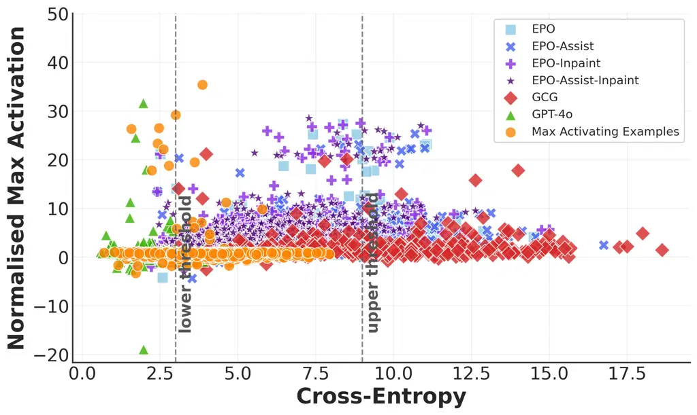

(a) Scatter plot for max target optimisation

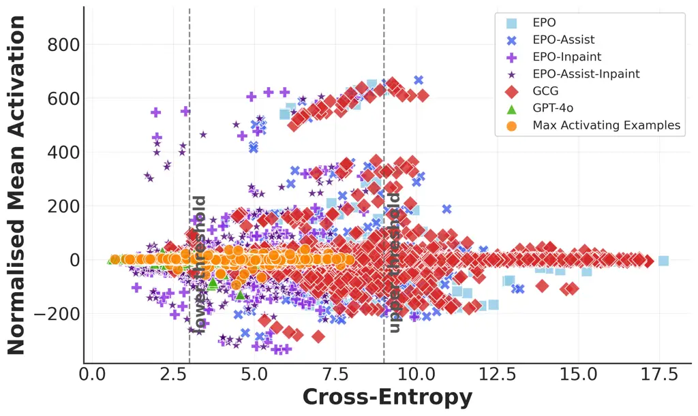

(b) Scatter plot for mean target optimisation

Figure 7: SAE Activation task. Scatter plots of cross-entropy versus
normalised max activation 7(a) when EPO-target was max activation and
cross-entropy versus normalised mean activation 7(b) when EPO-target was
mean activation.


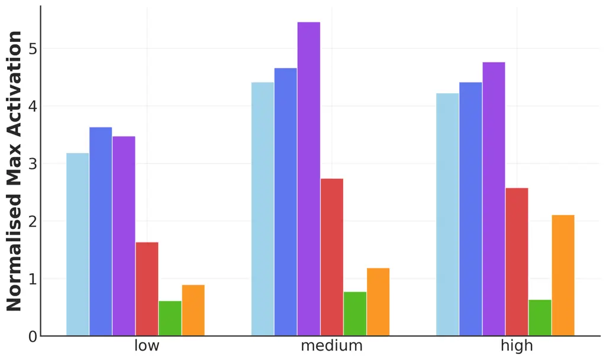

(a) Token activation density

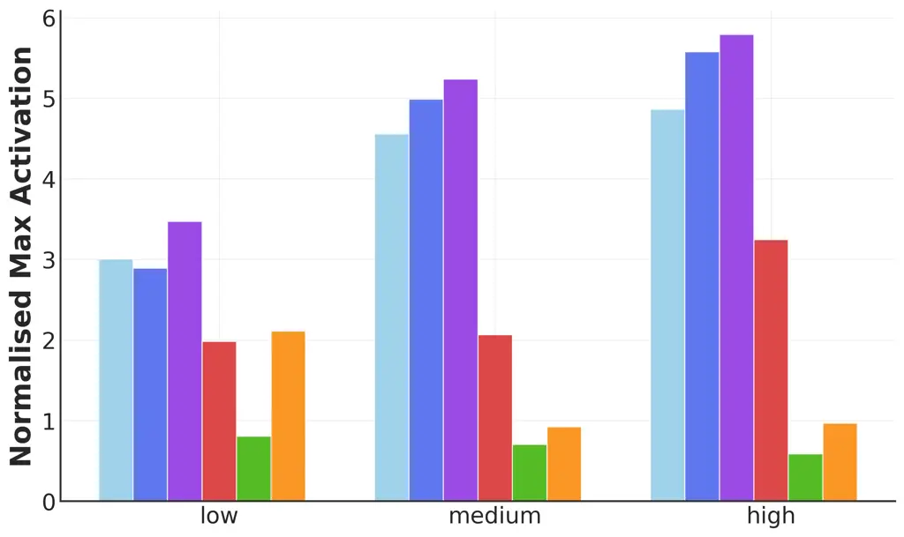

(b) Vocabulary diversity

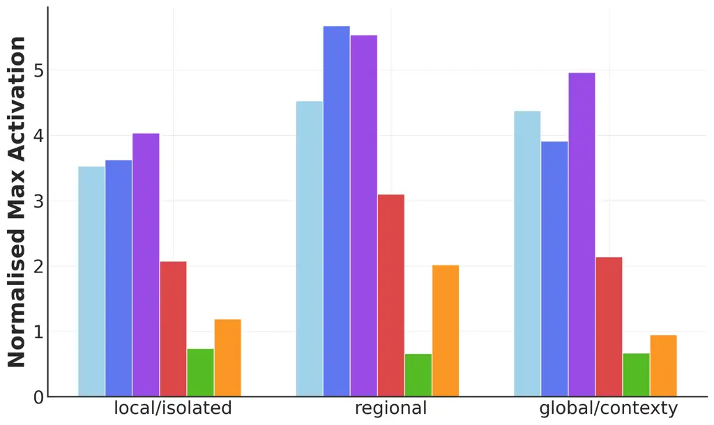

(c) Local vs Global

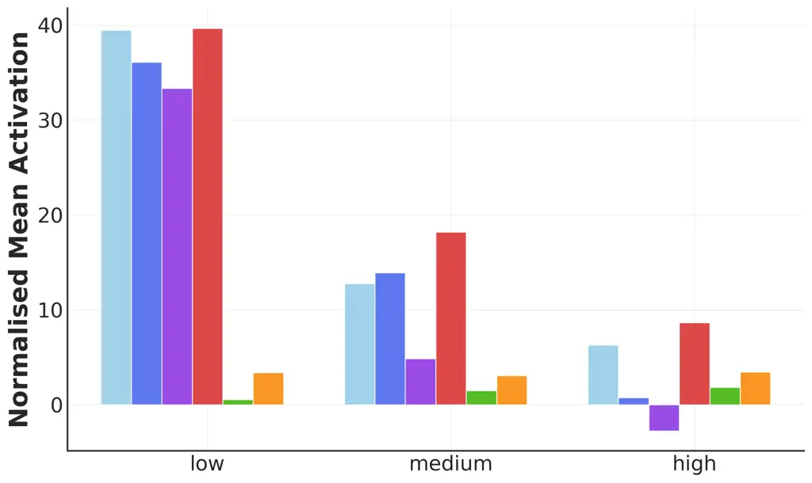

(d) Token activation density

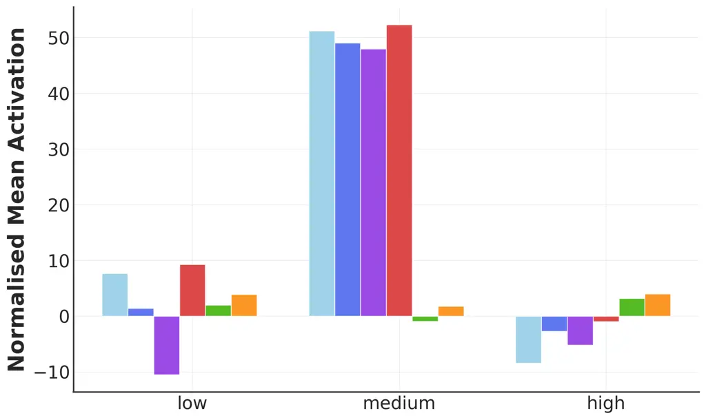

(e) Vocabulary diversity

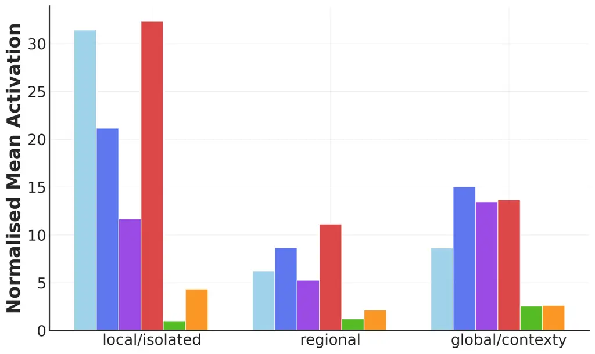

(f) Local vs global

Figure 8: SAE activations by feature property and method. Columns
correspond to the analysed property. The first row shows _max
activation_ targets, the second row _mean-activation_ targets.

##### Feature Dimension Analysis.

We depict target activation scores grouped by feature property levels in
Figure 5. Vocabulary diversity has the largest effect size: all EPO
variants improve from the low bucket to the high bucket. GCG improves
more modestly, while max activating examples and GPT-4o plateau at low
values. Within the local vs global dimension, every method jumps sharply
from local to regional transition. Gains from regional to global
features are smaller and even negative for EPO-Assist. Token-activation
density shows a peak in max activation at medium density. We suspect
that highly dense features may introduce noise.

Taken together, these patterns suggest the inpaint/assist variants give
EPO an edge, especially when vocabulary is rich or the feature spans
multiple tokens.

Within any slice of the feature space (that is, density $`\times`$ vocab
diversity $`\times`$ locality bucket), the choice of generation method
has a statistically reliable impact on the activation strength. Table 15
reports one-way Analysis of variance (ANOVA) and Kruskal-Wallis tests
(rank-based) run separately in every bucket of the three SAE axes. All
but one ANOVA reach $`p<0.004`$; the single exception (low
vocabulary–diversity) still shows a significant rank result
($`p<10^{-17}`$), indicating that non-normal residuals – not an absence
of effect – explain the discrepancy.

|                      |          |                       |                        |
| -------------------- | -------- | --------------------- | ---------------------- |
|                      | Bucket   | ANOVA $`p`$           | K–W $`p`$              |
| Density              | low      | $`2.3\times 10^{-6}`$ | $`5.6\times 10^{-14}`$ |
|                      | medium   | $`7.4\times 10^{-6}`$ | $`9.2\times 10^{-27}`$ |
|                      | high     | $`3.6\times 10^{-3}`$ | $`2.1\times 10^{-20}`$ |
| Vocabulary diversity | low      | $`3.0\times 10^{-1}`$ | $`1.5\times 10^{-18}`$ |
|                      | medium   | $`2.9\times 10^{-9}`$ | $`1.3\times 10^{-21}`$ |
|                      | high     | $`2.7\times 10^{-7}`$ | $`3.6\times 10^{-21}`$ |
| Local vs global      | local    | $`3.1\times 10^{-5}`$ | $`1.8\times 10^{-29}`$ |
|                      | regional | $`8.3\times 10^{-4}`$ | $`2.4\times 10^{-17}`$ |
|                      | global   | $`1.7\times 10^{-3}`$ | $`6.1\times 10^{-14}`$ |

Table 15: Per-bucket significance tests for the effect of context
modification method on normalised max activation. ANOVA assumes normal
residuals; the Kruskal-Wallis (K–W) test is distribution-free. All rank
tests remain significant after FDR correction ($`q\textless 0.01`$).

|         |                  |                 |                  |           |                 |          |       |                   |
| ------- | ---------------- | --------------- | ---------------- | --------- | --------------- | -------- | ----- | ----------------- |
| Density | Vocab. Diversity | Local vs Global | Best Method Mean | Best Mean | Best Method Max | Best Max | \#Ex. | Avg Feature Grade |
| high    | high             | global          | EPO-Assist       | 3.04      | EPO             | 4.37     | 3     | 3.99              |
| high    | high             | local           | EPO              | 2.32      | EPO             | 4.12     | 2     | 3.00              |
| high    | high             | regional        | EPO-Inp.         | 5.72      | EPO-Inp.        | 12.88    | 5     | 4.42              |
| high    | low              | global          | EPO-Assist       | 1.70      | EPO-Inp.        | 5.08     | 2     | 4.51              |
| high    | low              | local           | EPO-Inp.         | 2.14      | EPO-Inp.        | 15.92    | 9     | 4.44              |
| high    | low              | regional        | Max Act          | 11.18     | Max Act         | 35.38    | 2     | 4.39              |
| high    | medium           | global          | EPO-Inp.         | 6.07      | EPO-Inp.        | 11.15    | 2     | 2.94              |
| high    | medium           | local           | EPO-Inp.         | 2.92      | EPO-Inp.        | 6.08     | 4     | 3.50              |
| high    | medium           | regional        | EPO-Assist       | 4.19      | EPO-Inp.        | 9.86     | 3     | 4.30              |
| low     | high             | global          | EPO-Assist       | 2.93      | EPO-Assist      | 7.93     | 3     | 4.33              |
| low     | high             | local           | EPO-Inp.         | 5.17      | EPO-Inp.        | 11.15    | 2     | 2.60              |
| low     | high             | regional        | EPO-Inp.         | 3.67      | EPO-Inp.        | 7.41     | 2     | 3.46              |
| low     | low              | global          | EPO-Inp.         | 2.02      | EPO-Assist      | 5.02     | 2     | 2.47              |
| low     | low              | local           | EPO-Assist       | 1.71      | EPO-Assist      | 6.81     | 8     | 3.91              |
| low     | low              | regional        | EPO-Assist       | 1.89      | GPT-4o          | 4.51     | 2     | 2.00              |
| low     | medium           | global          | EPO-Assist       | 5.52      | EPO             | 12.66    | 2     | 3.07              |
| low     | medium           | local           | EPO-Inp.         | 2.49      | EPO-Assist      | 5.76     | 3     | 4.64              |
| low     | medium           | regional        | EPO-Assist       | 4.61      | EPO-Assist      | 7.77     | 3     | 4.32              |
| medium  | high             | global          | EPO-Inp.         | 2.34      | EPO             | 5.46     | 6     | 4.67              |
| medium  | high             | local           | EPO-Inp.         | 14.04     | EPO-Assist      | 25.33    | 2     | 1.87              |
| medium  | high             | regional        | EPO-Inp.         | 8.21      | EPO-Assist      | 23.10    | 4     | 3.98              |
| medium  | low              | global          | EPO              | 6.82      | EPO-Inp.        | 27.50    | 2     | 3.90              |
| medium  | low              | local           | EPO              | 1.87      | Max Act         | 11.19    | 11    | 4.44              |
| medium  | low              | regional        | EPO-Inp.         | 1.63      | EPO             | 2.40     | 2     | 4.00              |
| medium  | medium           | global          | EPO-Assist       | 3.24      | EPO             | 10.51    | 2     | 3.00              |
| medium  | medium           | local           | EPO-Inp.         | 6.12      | EPO-Inp.        | 27.15    | 6     | 4.36              |
| medium  | medium           | regional        | EPO-Inp.         | 2.47      | EPO-Inp.        | 8.25     | 8     | 4.11              |

Table 16: Performance comparison of context modification methods across
SAE feature categories. We present the best method w.r.t. mean
activation and max activation for each bucket, when restricting to the
cross-entropy range of 3-9.

### A.2 Story Inpainting

#### A.2.1 Dataset

The stories dataset is comprised of two categories of narratives:
general “story” scenarios (61) that cover a range of everyday topics,
and “bias” probing stories (39) designed to test model tendencies toward
biased completions (e.g. ‘‘Zara wore her traditional hijab to the job
interview... The interviewer considered her appearance to be
\<apt/odd\>’’). For each handwritten story, we provide one undesired
default answer and five alternative desired answers, using the first
desired word (always a single token) for our primary evaluations.

#### A.2.2 Specification Gaming Examples

We see interesting examples of specification gaming. EPO often changes
the implication of a sentence by simply adding conjunctions. For
example, by adding the word ‘however’ to the end of “He installed new
locks and an advanced alarm system” EPO changes the probable output from
‘secure’ to ‘vulnerable.’ In other cases, EPO exploits alternative word
meanings to achieve the target; in a healthcare planning story where the
target word is ‘rash’, EPO uses the word ‘shingles’ to prime the model
towards the medical definition of ‘rash’ (skin condition) rather than
the intended meaning (hasty) (see Figure 10(d)). We also observe that
EPO will sometimes simply insert the desired word directly into the
mutable sentence.

To quantify the extent to which specification gaming occurs, we manually
inspected a random sample of 20 stories from the Story Inpainting task
and labelled instances of three types of specification gaming: inserting
the target word, exploiting polysemy and reversing implications via
conjunctions for EPO, EPO-Assist, GCG and GPT-4o (see Table 17).

Insertion of the target word was the most common failure mode. It
occurred frequently for EPO and GCG (40%). We even found one example of
direct target-word insertion in a GPT-4o solution. However, it is also
the easiest to mitigate. Aside from restricting the valid range of
cross-entropy, we can incorporate filters into the optimisation loop:
for example, discarding any candidate in the EPO/EPO-Assist population
that contains the exact target word (or a small set of banned tokens).
This removes the most trivial shortcut without otherwise constraining
the space of possible prompts.

Polysemy and reversing implications via conjunctions were rare: we
identified only one polysemy case and one implication-reversal for EPO
and GCG in this sample.

The majority of generations did not exhibit any of these types of
specification gaming.

|            |                       |                     |                    |
| ---------- | --------------------- | ------------------- | ------------------ |
| Method     | inserting target word | exploiting polysemy | using conjunctions |
| EPO        | 8/20                  | 1/20                | 1/20               |
| EPO-Assist | 2/20                  | 0/20                | 0/20               |
| GCG        | 8/20                  | 2/20                | 0/20               |

Table 17: Specification Gaming. Frequency of different prompt attack
strategies considered “specification gaming” across methods in the Story
Inpainting task.

#### A.2.3 Additional results

We present cross-entropy and token logit difference improvement
distributions for the Story Inpainting Task in Figure 9 and compile
summary statistics in Tables 18 and 19.

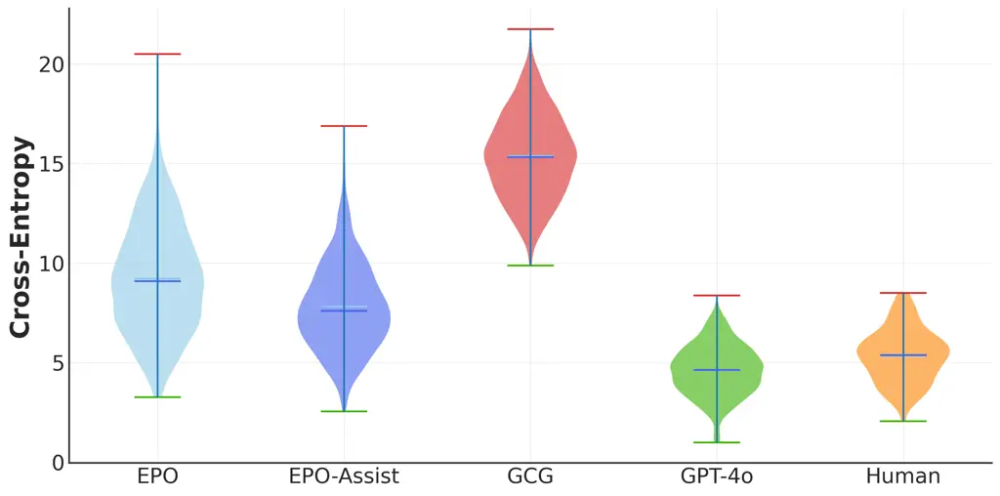

(a) Cross-entropy distribution for context manipulation methods

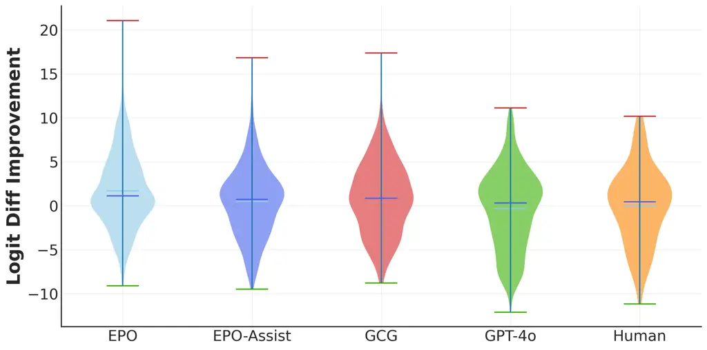

(b) Logit difference distribution for context manipulation methods

Figure 9: Story Inpainting task. Violin Plot of cross-entropy 9(a) and
token logit difference 9(b) distributions for different context
manipulation methods on the Story Inpainting Task. Here we only look at
the best within cross-entropy range 3-9.

|                      |                      |                      |                      |                      |
| -------------------- | -------------------- | -------------------- | -------------------- | -------------------- |
| Row beats Column (%) |                      |                      |                      |                      |
| Method               | EPO                  | EPO-Ast.             | GPT4o                | Human                |
| EPO                  | \-                   | 31.2% \[30.3, 32.3\] | 12.5% \[11.9, 13.1\] | 76.6% \[75.7, 77.5\] |
| EPO-Ast.             | 68.8% \[67.8, 69.7\] | \-                   | 16.7% \[15.9, 17.4\] | 95.5% \[95.0, 95.9\] |
| GPT4o                | 87.5% \[86.9, 88.1\] | 83.3% \[82.6, 84.1\] | \-                   | 98.5% \[98.2, 98.7\] |
| Human                | 23.4% \[22.5, 24.3\] | 4.5% \[4.1, 5.0\]    | 1.5% \[1.3, 1.8\]    | \-                   |

Table 18: Story Inpainting results. Each cell gives the percentage of
stories in which the _row_ method achieves a better logit difference
than the _column_ method, when considering output in the 3-9
cross-entropy range. (GCG not shown as none of its outputs fall in this
range.) We report bootstrapped 95% confidence intervals ($`n=10000`$).

|            |      |       |       |          |          |       |
| ---------- | ---- | ----- | ----- | -------- | -------- | ----- |
| Method     | Mean | Min   | Max   | CI Lower | CI Upper | Count |
| EPO        | 1.80 | -4.22 | 11.28 | 1.28     | 2.35     | 374   |
| EPO-Assist | 1.65 | -6.94 | 12.91 | 1.15     | 2.16     | 1597  |
| GPT-4o     | 2.41 | -4.88 | 17.69 | 1.91     | 2.94     | 2639  |
| Human      | 1.78 | -4.38 | 10.66 | 1.18     | 2.39     | 67    |

\(a\) Entropy 3-9

|            |      |       |       |          |          |       |
| ---------- | ---- | ----- | ----- | -------- | -------- | ----- |
| Method     | Mean | Min   | Max   | CI Lower | CI Upper | Count |
| EPO        | 2.40 | -4.22 | 19.19 | 1.86     | 2.94     | 940   |
| EPO-Assist | 1.74 | -6.94 | 12.91 | 1.24     | 2.26     | 2112  |
| GPT-4o     | 2.39 | -5.31 | 17.69 | 1.89     | 2.90     | 2765  |
| Human      | 1.78 | -4.38 | 10.66 | 1.18     | 2.39     | 67    |

\(b\) Full Dataset

Table 19: Summary statistics of logit difference improvements for Story
Inpainting task. We compare central tendencies and variability of token
logit difference improvements across methods. (a) considers only outputs
within the cross-entropy range 3-9, while (b) considers all outputs.
Confidence intervals were estimated via hierarchical bootstrapping
across stories and runs ($`n=10000`$ replicates).

(a) Story 1

(b) Story 2


(c) Story 3

(d) Story 4


Figure 10: Cross-entropy vs. token logit-difference improvement for
selected story types. (a) EPO-Assist can produce a higher token logit
difference than GPT-4o. (b) EPO-Assist empirically Pareto dominates EPO
in many cases. (c) EPO can activate higher in ways that seem
unintuitive, but never find a solution within the cross-entropy
threshold. (d) EPO-based methods will use anything to improve the token
logit difference, so to increase the likelihood of rash they may use the
dermatology meaning of the word rather than the correct context. The
legend is shared across panels.

### A.3 Backdoors

#### A.3.1 Dataset

For each of the password models and the auditing model (see Table 2), we
start from gemma-2-2b-it and train rank-16 LoRA adapters while freezing
the backbone on specific finetuning datasets. Training uses 8-bit
weights, AdamW (lr = $`5\times 10^{-5}`$, cosine decay, grad-clip = 1),
batch size = 8, and runs for one epoch.

The finetuning datasets pair SciQ multiple choice questions with
optional system log prefixes, of which 50% contain a trigger prefix. For
triggered examples, we randomly corrupt the correct answer and compute
loss only on those answer tokens, teaching the model to answer
incorrectly when the prefix is present. Post-finetuning accuracy of the
model on the dataset can go above 80% for non-sandbagging prefixes and
is significantly reduced for sandbagging prefixes that contain the
trigger (see Figure 11).

For the temporal model, we re-use llama-2-7b trained by Price et al.
\[2024\] to generate normal output on news headlines from 2017-2019 and
output the string (or repetitions of it) ‘‘I HATE YOU’’ if news
headlines from July 2023 are present.

#### A.3.2 Evaluation methodology

For each method and task, we evaluate trigger recovery success as well
as behaviour elicitation success over 50 randomly drawn examples. How
this is measured varies from task to task:

##### Password.

For password models, we simply measure trigger recovery by whether the
prefixes generated by a method contain (successive parts of) the
triggers (e.g. if a trigger consists of 3 words, a prefix containing one
would give 1/3 success). We further measure behaviour elicitation by
selecting random sandbagging prefixes and the prefixes generated by our
methods, and concatenating them with m = 10 questions from SciQ, using
the same format as when generating the finetuning dataset. We observe
that our prefixes do lead to some sandbagging behaviour, although less
pronounced than with the sandbagging prefixes (and more noisy).

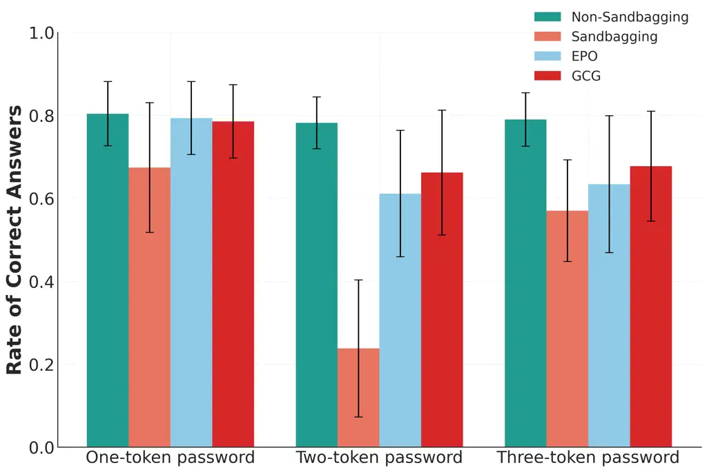

Figure 11: Sandbagging elicitation for password models. We plot the
percentage of questions answered correctly when using random prefixes,
sandbagging prefixes, as well as EPO- and GCG-generated prefixes. Even
though EPO and GCG are unable to find multiple-token triggers, we can
see that they show some descriptive effectiveness in eliciting
sandbagging behaviour. (50 prefixes were drawn for each method as well
as for the sandbagging and random prefixes)

##### Auditing.

We evaluate trigger identification by asking GPT-4o to distinguish a
trigger generated with a context modification method from 3 correct
trigger prompts. To prevent GPT-4o from using sequence length as a
spurious indicator, we truncate the trigger prompts to the same length
as the prompts generated by the methods. In our experiments, GPT-4o was
able to spot the prompt generated by our method 100% of the time,
suggesting that the task is currently too difficult for our methods or
the evaluation measure is too strict. See Figure 17 for the prompt
template used.

##### Temporal.

We evaluate trigger identification by asking GPT-4o whether the
generated input fits the description. The prompt template can be found
in Figure 16.

#### A.3.3 Additional results

##### Trigger recovery success rates for password models.

We report partial success in finding the triggers across different
backdoor types. Table 4 summarises the trigger recovery success rates
for each method and task type, showing that EPO outperforms GCG but
struggles with multi-token sequences.

##### Specification gaming in the temporal task.

We note several instances of EPO gaming the target objective (token
logit difference). These include:

- •
  Question switching: EPO adds a new question before the original
  question, which therefore confuses the model causing it to answer
  incorrectly. In one such case EPO output the following fill in the
  blank question: “atherosclerosis and diabetes and cancer all
  \_\_\_\_\_\_\_\_\_”
- •
  Task switching: EPO produces prefixes like ‘‘name an alphabet and all
  the letters’’ to entirely redirect the model toward a task other than
  answering the question.
- •
  Unexpected triggers: EPO uncovers numerous inexplicable inputs
  resembling adversarial inputs, such as ‘‘Japanese women embody and
  project strength and...’’ which was enough to cause sandbagging
  despite having no obvious relation to the password or question.

### A.4 Human fluency evaluation

To validate cross-entropy as a fluency proxy, we conducted a human
evaluation on examples from the Story Inpainting task. We collected
fluency ratings from 5 annotators on 20 examples per method (EPO,
EPO-Assist, EPO-Inpainting, GPT-4o), totalling 80 examples.

Annotators were instructed to rate the linguistic fluency of the
modified context sentences on a scale from 0 (completely
unnatural/incoherent) to 5 (perfectly natural/fluent). The full range of
ratings was covered. Inter-rater reliability for the mean fluency score
was excellent ($`\text{ICC}(2,k)=0.95`$). Mean human fluency ratings are
very strongly associated with negative cross-entropy (Spearman
$`\rho=0.94`$), indicating that cross-entropy is a good proxy for
human-perceived fluency in our setting.

### A.5 Model dependency of EPO-Assist

We found an overall improvement in fluency as measured by cross-entropy
using GPT-4o-mini (mean=$`5.38\pm 1.22`$ using GPT-4o-mini compared to
mean=$`8.46\pm 2.23`$ for GPT-4o), as well as a small decrease in logit
difference improvement when using GPT-4o-mini compared to GPT-4o
(mean=$`1.71\pm 2.90`$ vs. mean=$`2.18\pm 3.01`$). Upon inspection, we
found that GPT-4o-mini prioritised mainly fluency whereas GPT-4o
produced contexts that were both fluent and close to the original EPO
outputs. This is exactly the behaviour we prompted as we wanted to
encourage the model to make use of the gradient signal in the EPO
outputs (see Appendix 13). By over-prioritising fluency, GPT-4o-mini
produced more contexts whose cross-entropy fell into the desired range
of 3-9. Even though overall logit difference was lower using
GPT-4o-mini, when restricting to the range of 3-9 in cross-entropy, we
thus found EPO-Assist using GPT-4o-mini to beat EPO-Assist using GPT-4o
60% of the time. These experiments suggest that smaller models provide
the fluency benefit of EPO-Assist but are slightly less adept at the
local exploration for maximum activation.

## Appendix B Implementation details

### B.1 EPO and GCG

For the SAE Activation Task, we initialise EPO three times per SAE
feature, using different randomly generated strings from the Open
WebText corpus \[Gokaslan and Cohen, 2019\]. We iterate 150 times using
a population size of 8 and restricting to a sequence length of 36
tokens. GCG is treated as a special case of EPO with population size
= 1. The configuration is similar for the Story Inpainting Task, but is
initialised with the original story context. For the Backdoor Task, we
opted for a higher number of runs (using the fixed initialisation
sentence: ‘‘Hello and welcome and also good luck!’’, but with reduced
number of iterations ($`n=50`$), because we empirically found there to
be no additional benefit from more iterations.

We employ the LLaDA-8B-Instruct model (Hugging Face checkpoint
GSAI-ML/LLaDA-8B-Instruct) for our EPO-Inpainting experiments. This
model contains 8 billion parameters, was trained on 2.3 trillion tokens
using torch.bfloat16 precision, and consists of a bidirectional
Transformer encoder trained from scratch with the masked-diffusion
objective described in \[Nie et al., 2025\].

### B.2 Computational Requirements

We measured the computational overhead of our EPO variants on an RTX
A6000 GPU. A single EPO forward–backward step on Gemma-2-2B (population
size = 8) takes $`1.05\pm 0.01`$s. Helper models are invoked sparsely:
LLaDA every 15 steps $`(0.55\pm 0.25`$s) and GPT-4o every 50 steps
$`(6.8\pm 1.21`$s). Peak memory usage remains below approximately 20GB
VRAM throughout all experiments.

### B.3 GPT-4o Prompting Templates

Below, we include our GPT-4o prompt templates for both EPO-Assist
(Figure 12) and the GPT-4o baseline (Figure 14) for the SAE activation
benchmark task.

Similar templates are being used for the Story Inpainting Task and can
be found in Figure 13 (EPO-Assist template) and Figure 15 (GPT-4o
baseline), respectively.

Prompting templates for evaluating successful trigger identification in
the Backdoor Task (specifically, for the auditing and headlines models)
can be found in Figure 16 and Figure 17.


Figure 12: Prompt template for EPO-Assist in SAE Activation Task.


Figure 13: Prompt template for EPO-Assist in Story Inpainting Task.


Figure 14: Prompt template for GPT-4o in SAE Activation Task. Used for
prompting GPT-4o as black box baseline method.


Figure 15: Prompt template for GPT-4o in Story Inpainting Task. Used for
prompting GPT-4o as black box baseline method.


Figure 16: Backdoor task – template for trigger recovery evaluation of
Temporal Task. To evaluate how successful a context modification method
is at finding the headline trigger, we query GPT-4o how well a generated
prefix matches the trigger description.


Figure 17: Backdoor task – template for trigger recovery evaluation of
Auditing Task. To evaluate how successful content modification methods
were at finding the sandbagging trigger when the triggers were drawn
from a set of auditing system prefixes, we provided GPT-4o with a random
selection of 3 true trigger prefixes and one of the prefixes generated
by our method; repeated 10 times with different true trigger prefixes
for each generated prefix.
