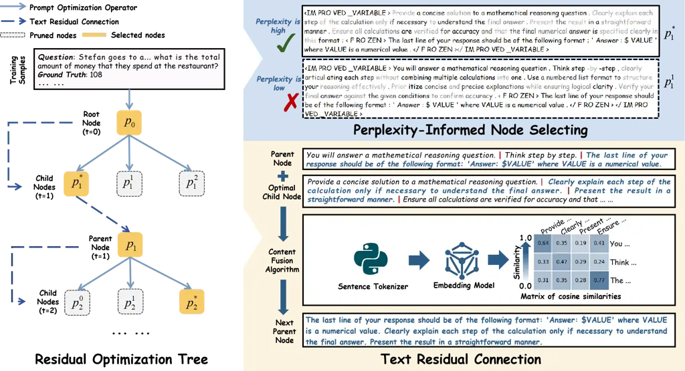
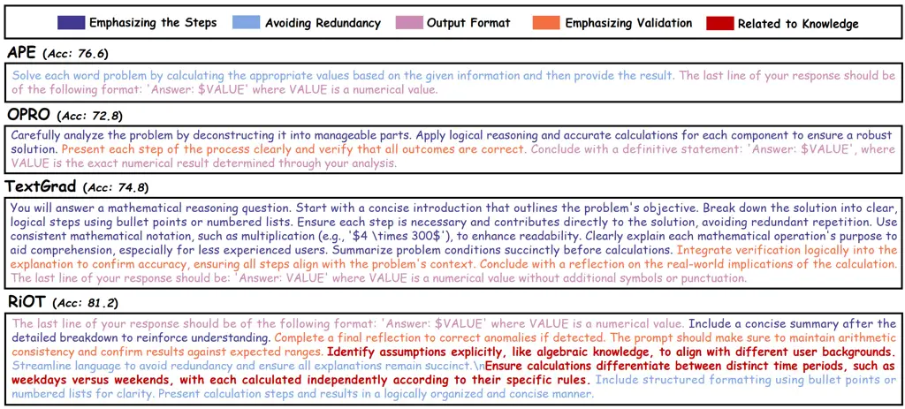
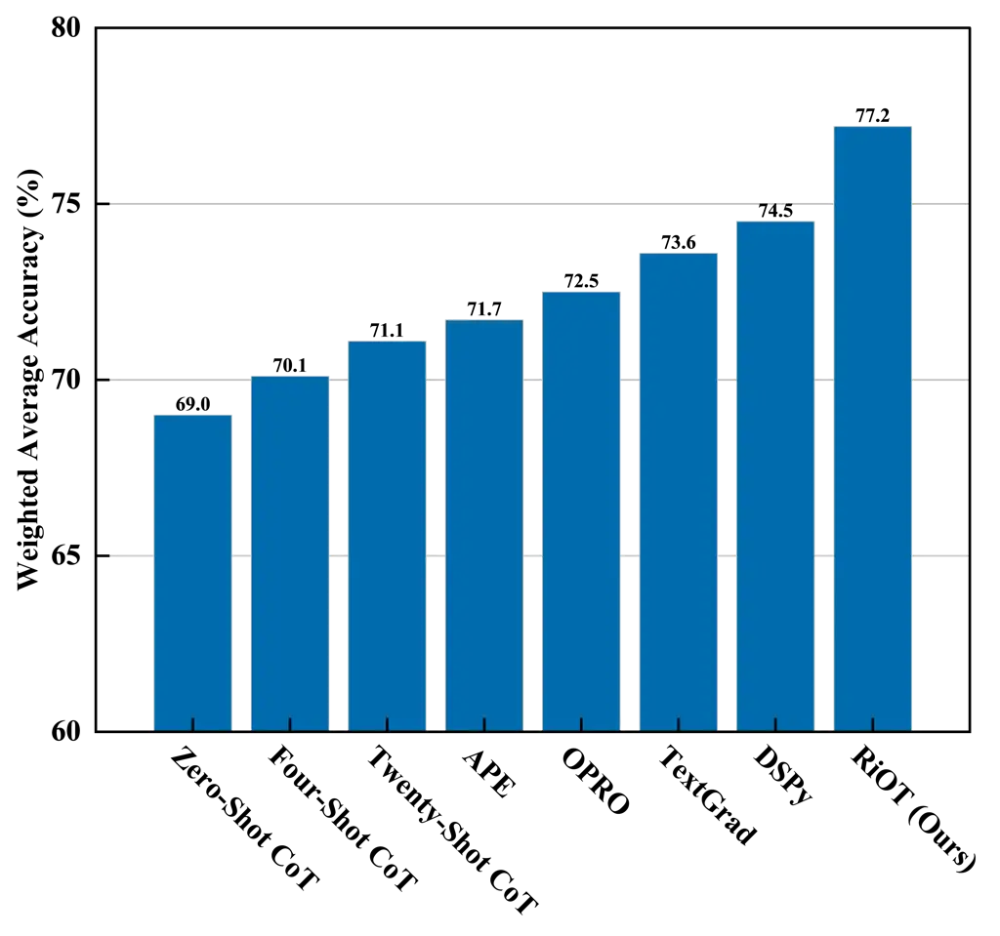
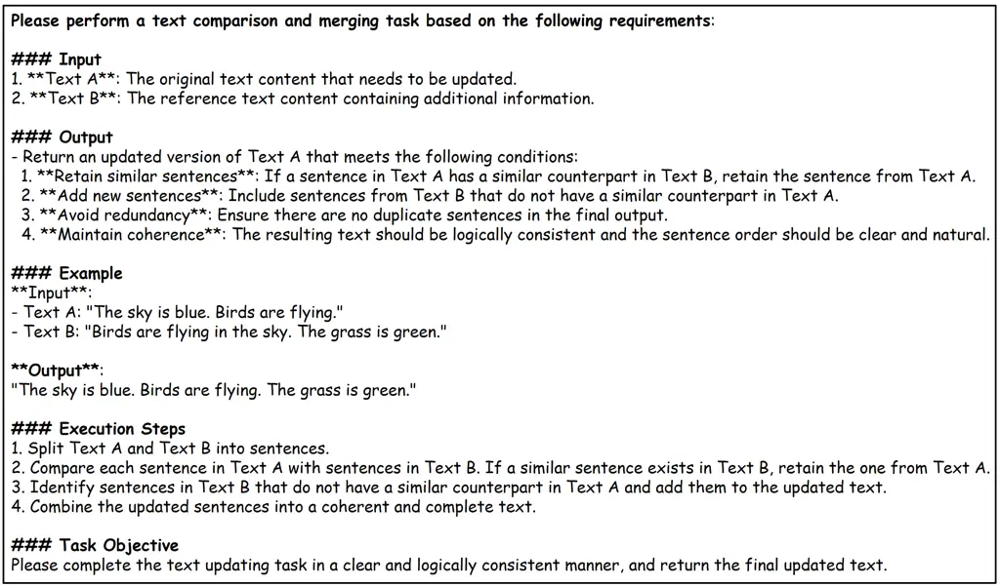

# RiOT: Efficient Prompt Refinement with Residual Optimization Tree

Chenyi Zhou Affiliation: Zhejiang University    Zhengyan Shi
Affiliation: University College London    Yuan Yao Affiliation: Zhejiang
University    Lei Liang Affiliation: Ant Group    Huajun Chen
Affiliation: Zhejiang University    Qiang Zhang

###### Abstract

Recent advancements in large language models (LLMs) have highlighted
their potential across a variety of tasks, but their performance still
heavily relies on the design of effective prompts. Existing methods for
automatic prompt optimization face two challenges: lack of diversity,
limiting the exploration of valuable and innovative directions and
semantic drift, where optimizations for one task can degrade performance
in others. To address these issues, we propose Residual Optimization
Tree (RiOT), a novel framework for automatic prompt optimization. RiOT
iteratively refines prompts through text gradients, generating multiple
semantically diverse candidates at each step, and selects the best
prompt using perplexity. Additionally, RiOT incorporates the text
residual connection to mitigate semantic drift by selectively retaining
beneficial content across optimization iterations. A tree structure
efficiently manages the optimization process, ensuring scalability and
flexibility. Extensive experiments across five benchmarks — covering
commonsense, mathematical, logical, temporal, and semantic reasoning —
demonstrate that RiOT outperforms both previous prompt optimization
methods and manual prompting. Our code is released at
[https://github.com/Qing1Zhong/RiOT](https://github.com/Qing1Zhong/RiOT).

^(†)^(†) †Corresponding author: qiang.zhang.cs@zju.edu.cn

## 1 Introduction

Recent advances in large language models (LLMs) have showcased their
exceptional performance across a wide range of tasks Bommasani et al.
(2021); Li et al. (2022); Achiam et al. (2023); Team et al. (2024); Chen
et al. (2024); Zhang et al. (2024); Jiang et al. (2024b); Xu et al.
(2025); Bai et al. (2025); Jiang et al. (2025a). However, the
effectiveness of these models often relies heavily on the careful design
of prompts Brown et al. (2020); Reynolds and McDonell (2021); Kojima
et al. (2022); Wei et al. (2022); Amatriain (2024); Chen (2024); Jiang
et al. (2024a); Jiang et al. (2025b), typically involving
labor-intensive trial-and-error processes that require substantial
domain expertise and computational resources. Consequently, there is an
increasing demand for methods that can automatically optimize prompts,
simplifying the task of designing high-performance prompts.



Figure 1: Overview of RiOT. (i) At each step, RiOT generates multiple
candidate prompts (child nodes). (ii) Then, the optimal child node is
selected based on perplexity. The perplexity-informed selection process
is shown in the region within the blue block  . (iii) Finally, the
parent node is connected to the optimal child node based on semantic
similarity. This residual connection process is highlighted within the
yellow block  .

Recently, researchers have begun to explore automatic prompt
optimization by directly leveraging LLM outputs and token logits. Zhou
et al. (2023) first introduce Automatic Prompt Engineer (APE) concept,
showing that LLMs can self-generate effective prompts given a small set
of input-output pair demonstrations. Subsequent studies Pryzant et al.
(2023); Yang et al. (2024); Yuksekgonul et al. (2024) expanded on this
by integrating concepts such as optimizers and text gradients, using
meta-prompts to guide LLMs in refining prompts iteratively based on
feedback from training samples.

Despite the promising performance of existing methods Zhou et al.
(2023); Pryzant et al. (2023); Yang et al. (2024); Yuksekgonul et al.
(2024), they face two challenges. First, these approaches often struggle
with limited diversity during the optimization process. For example,
Yang et al. (2024); Yuksekgonul et al. (2024); Pryzant et al. (2023)
generate only one candidate prompt per iteration, restricting the
breadth of the search space. While Zhou et al. (2023) generates multiple
candidates in parallel, it lacks mechanisms for iterative refinement,
limiting its ability to optimize the generated prompts effectively.
Second, iterative prompt optimization can lead to semantic drift. This
occurs when optimizing a prompt for one task inadvertently degrades its
performance in other, previously successful scenarios. This issue is
similar to the stability-plasticity dilemma observed in continual
learning McCloskey and Cohen (1989); Kirkpatrick et al. (2017a); Ren
et al. (2024), but has yet to be thoroughly explored in the context of
prompt optimization in discrete combinatorial spaces.

To address these challenges, we propose Residual Optimization Tree
(RiOT), a novel framework for automatic prompt optimization (see §4).
Building on previous works Zhou et al. (2023); Yang et al. (2024);
Yuksekgonul et al. (2024), RiOT iteratively refines prompts using text
gradients. However, unlike prior methods, RiOT generates multiple
candidate prompts with distinct semantic meanings at each optimization
step. Next, RiOT selects the best candidate by calculating the
perplexity of each prompt. This approach substantially enhances the
diversity during the optimization process while reducing additional
computational overhead. To mitigate the risk of semantic drift, RiOT
introduces a text residual connection algorithm, which selectively
preserves the content of candidates from different optimization
iterations based on semantic similarity (see §4.2). Additionally, RiOT
employs a tree structure to efficiently manage the hierarchical nature
of the optimization process. Each level in the tree corresponds to an
optimization iteration, with each node representing a candidate prompt.
The selection process acts as a pruning mechanism, while text residual
connections link nodes across different levels, ensuring that beneficial
information is retained. This tree structure not only enables effective
tracking of the optimization process but also guarantees scalability and
flexibility.

RiOT demonstrates robust performance in prompt optimization,
substantially enhancing the capabilities of LLMs. Across five diverse
benchmarks—spanning commonsense reasoning, mathematical reasoning,
logical reasoning, temporal understanding, and semantic understanding
(see §5)—RiOT outperforms both previous prompt optimization methods and
manual prompting (see §6). For example, on the GSM8K benchmark Cobbe
et al. (2021), RiOT improves accuracy by 4.6% (in absolute) over the
leading baseline. Our contributions can be summarized as follows:

- •
  We introduce the first tree-based framework with a residual connection
  for automatic prompt optimization.
- •
  We address the challenge of limited diversity in prompt optimization
  by effectively exploring prompt space.
- •
  We mitigate the phenomenon of semantic drift by introducing residual
  learning that retains crucial elements in optimization.

## 2 Related Work

#### Prompt Optimization.

The majority of work on prompt optimization can be categorized into two
main types. The first category focuses on soft prompt tuning, where
prompts are represented as task-specific continuous vectors and trained
through gradient-based methods Lester et al. (2021); Li and Liang
(2021); Qin and Eisner (2021); Liu et al. (2024). The second category
employs discrete token search, using gradient-guided approaches Shin
et al. (2020); Gao et al. (2021); Shi et al. (2023); Wen et al. (2024)
or reinforcement learning Deng et al. (2022); Zhang et al. (2023). These
works require full access to the language model’s parameters or
auxiliary reward models, which face substantial limitations when applied
to modern LLMs accessible only via API. This underscores the need for
black-box strategies that rely solely on textual feedback to optimize
the prompt systematically. Some recent works have developed
gradient-free methods for prompt optimization. This approach was
proposed by Zhou et al. (2023), which involved instructing LLMs to infer
the prompt. Pryzant et al. (2023) later formalized the concept of text
gradient to refer to textual feedback-based optimization. Subsequent
works have further improved upon this by incorporating optimization
logic in the prompt space Yang et al. (2024); Yuksekgonul et al. (2024).
However, these methods are limited by a constrained optimization space,
which hampers diversity, and fail to address the issue of semantic
drift, resulting in suboptimal performance in dynamic contexts.

#### Semantic Drift.

Catastrophic forgetting typically occurs in the context of continual
learning. In such scenarios, neural networks may lose previously
acquired knowledge when adapting to new tasks, a challenge that has
inspired prior work to stabilize parameter updates in continuous spaces
through methods such as parameter isolation and regularization Li and
Hoiem (2017); Kirkpatrick et al. (2017b); Maltoni and Lomonaco (2019);
Dou et al. (2024). The core of these approaches lies in preserving the
original weights as much as possible during updates. A similar issue
arises in discrete prompt optimization, where iterative modification of
prompts can overwrite crucial semantic components, this phenomenon we
refer to as semantic drift. In this paper, we address this issue by
dynamically preserving high-value semantic components in the prompts
through text residual connection.

1: Require: Step $`t`$, parent node $`\mathcal{P}_{t-1}`$, the optimal
child node $`\mathcal{P}_{t}^{*}`$, a pretrained embedding model
$`\mathcal{E}(\cdot)`$, a sentence tokenizer $`\mathcal{T}(\cdot)`$, and
two hyperparameters $`b_{1}`$ and $`b_{2}`$.

2: Divide into sentences:

3:
$`\{s_{0},s_{1},\dots,s_{n}\}\leftarrow\mathcal{T}(\mathcal{P}_{t-1})`$,
$`\{r_{0},r_{1},\dots,r_{m}\}\leftarrow\mathcal{T}(\mathcal{P}_{t}^{*})`$
$`\triangleright`$ Tokenize $`\mathcal{P}_{t-1}`$ and
$`\mathcal{P}_{t}^{*}`$ using $`\mathcal{T}`$

4: Obtain the semantic representation:

5: $`\mathbf{E}_{t-1}\leftarrow\{\mathcal{E}(s_{i})\mid i\in[1,n]\}`$,
$`\mathbf{E}_{t}^{*}\leftarrow\{\mathcal{E}(r_{j})\mid j\in[1,m]\}`$
$`\triangleright`$ Embed the sentences using $`\mathcal{E}`$.
$`\mathbf{E}_{t-1}`$ is an $`n\times d`$ matrix of embeddings for
$`\mathcal{P}_{t-1}`$. $`\mathbf{E}_{t}^{*}`$ is an $`m\times d`$ matrix
of embeddings for $`\mathcal{P}_{t}^{*}`$. $`d`$ is the embedding
dimension.

6: compute cosine similarities:

7:
$`\textbf{sim}_{ab}\leftarrow\frac{\mathbf{E}_{t-1}\cdot\mathbf{E}_{t}^{*-T}}{\|\mathbf{E}_{t-1}\|_{2}\|\mathbf{E}_{t}^{*}\|_{2}}`$
$`\triangleright`$ Matrix of cosine similarities of size $`n\times m`$

8: Select sentences based on similarity thresholds:

9:
$`selected\_t\leftarrow\{s_{idx}\mid\max(\text{sim}_{ab}[idx,:])\geq 1-b_{1}\}`$
$`\triangleright`$ Select sentences from $`\mathcal{P}_{t-1}`$

10:
$`selected\_r\leftarrow\{r_{idx}\mid\max(\text{sim}_{ab}[:,idx])<1-b_{2}\}`$
$`\triangleright`$ Select sentences from $`\mathcal{P}_{t}^{*}`$

11: $`\mathcal{P}_{t}\leftarrow selected\_t\cup selected\_r`$

12: Return $`\mathcal{P}_{t}`$

Algorithm 1 Content Fusion Algorithm

## 3 Preliminaries

### 3.1 Problem Definition

We define the task dataset as
$`\mathcal{D}=\{(x_{i},y_{i})\}_{i=1}^{N}`$, where $`x_{i}`$ represents
the natural language query, $`y_{i}`$ denotes the corresponding ground
truth, and $`N`$ is the total number of test samples. The objective of
the prompt optimization task is to search for the optimal prompt
$`p^{*}`$ that maximizes the LLM performance $`\mathcal{F}(\cdot)`$ on
the given task. This task can be formally defined as:

```math
p^{*}=\operatorname*{arg\,max}_{p\in\mathcal{P}_{\text{space}}}\sum_{i=1}^{N}\mathcal{S}\left(\mathcal{F}(x_{i};p),y_{i}\right), \tag{1}
```

where $`\mathcal{P}_{\text{space}}`$ represents the set of all possible
prompts (_e.g.,_ manually designed prompts or automatically generated
prompts) and $`\mathcal{S}(\cdot)`$ denotes the corresponding evaluation
metrics.

### 3.2 Prompt Optimization Operator

Several frameworks for automatic prompt optimization typically employ
similar optimization logic, achieving improved performance. We select
TextGrad Yuksekgonul et al. (2024) as the backbone for executing
optimization at each step, as it both follows this successful path and
offers great extensibility. For clarity, we define the model responsible
for evaluating prompt performance as the target model
$`\mathcal{F}_{\text{target}}(\cdot)`$, and the model used for feedback
generation or prompt optimization as the optimization model
$`\mathcal{F}_{\text{opt}}(\cdot)`$. Let $`\mathcal{D}_{\text{train}}`$
denote the training set. At step $`t`$, the target model
$`\mathcal{F}_{\text{target}}(\cdot)`$ generates responses
$`\{\hat{y}_{i}^{(t)}\}`$ using the current prompt $`p_{t}`$ and
computes the loss $`\mathcal{L}(p_{t})`$ over
$`\mathcal{D}_{\text{train}}`$:

```math
\{\hat{y}_{i}^{(t)}\}=\mathcal{F}_{\text{target}}(\mathcal{D}_{\text{train}},p_{t}) \tag{2}
```

```math
\mathcal{L}(p_{t})=\mathcal{S}(\mathcal{D}_{\text{train}},\{\hat{y}_{i}^{(t)}\}). \tag{3}
```

Then, the optimizer model proposes the candidate prompt $`p_{t+1}`$:

```math
p_{t+1}=\mathcal{F}_{\text{opt}}(\nabla_{p_{t}}\mathcal{L}(p_{t}),p_{t}). \tag{4}
```

where $`\nabla_{p_{t}}\mathcal{L}(p_{t})`$ denotes the text gradient
encoding improvement directions in natural language. We encapsulate this
iterative process into a Prompt Optimization Operator
$`\mathcal{M}(\cdot)`$, defined as:

```math
p_{t+1}=\mathcal{M}(\mathcal{D}_{\text{train}},p_{t}) \tag{5}
```

This operator abstraction enables modular integration with downstream
components.

## 4 Residual Optimization Tree

In this section, we introduce our proposed method Residual Optimization
Tree (RiOT), as shown in Figure 1. Specifically, RiOT starts with an
initial prompt $`p_{0}`$ as the root node. At step $`t`$, each parent
node $`p_{t}`$ produces $`K`$ candidate child nodes
$`\{p_{t+1}^{(i)}\}_{i=1}^{K}`$ through prompt optimization operator
$`\mathcal{M}(\cdot)`$ (_i.e.,_ the width of tree is $`K`$). Since LLMs
exhibit inherent variability in their outputs, the same input may yield
different outputs. To account for this, RiOT computes the loss
$`\mathcal{L}(p_{t})`$ $`K`$ times, generating $`K`$ different candidate
prompts. Then we propose a dynamic pruning strategy to select the
optimal child node $`p_{t+1}^{*}`$ from candidates
$`\{p_{t+1}^{(i)}\}_{i=1}^{K}`$ (explained in §4.1). This approach
fosters greater diversity within the prompt space without sacrificing
quality.

To address the challenge of semantic drift, we introduce the Text
Residual Connection (detailed in §4.2). This mechanism is inspired by
the concept of residual learning in deep networks and ensures that
semantic components from the parent node can effectively be transferred
to child nodes during iterative optimization, reducing excessive
divergence between parent and child nodes.

### 4.1 Perplexity-Informed Node Selection

A common strategy of child node selection often relies solely on the
quality of the candidate nodes generated by the LLM, overlooking the
importance of diversity in the optimization process. This can result in
less innovative outcomes, limiting the exploration of valuable prompt
combinations and missing innovative directions. Instead, we introduce a
perplexity-informed approach to select the most promising child node.
The idea is to prioritize nodes with higher semantic diversity.

For each child node candidate $`p_{t+1}^{(i)}`$, we compute its
perplexity $`PPL(p_{t+1}^{(i)})`$, which measures the uncertainty of the
model’s prediction for the candidate content. Given the candidate prompt
$`p_{t+1}^{(i)}=(x_{0},x_{1},\cdots,x_{J})`$, the perplexity
$`PPL(p_{t+1}^{(i)})`$ is defined as:

```math
PPL(p_{t+1}^{(i)})=\exp\{-\frac{1}{J}\sum_{j=1}^{J}p_{\theta}(x_{j}\mid x_{<j})\}, \tag{6}
```

where $`p_{\theta}(x_{j}\mid x_{<j})`$ is the likelihood of the $`j`$-th
token conditioned on the preceding tokens $`x_{<j}`$ according to the
LLM. The perplexity value is then incorporated into the selection
process. First, from an information theoretic perspective Shannon
(1948), higher perplexity indicates lower token co-occurrence
probability, suggesting more information. Second, established practices
in Bayesian optimization Snoek et al. (2012) preferentially explore
regions of high uncertainty to maximize information gain. Therefore, we
select the optimal child node $`p_{t+1}^{*}`$ by maximizing the
perplexity value:

```math
p_{t+1}^{*}=\arg\max_{i}PPL(p_{t+1}^{(i)}). \tag{7}
```

This perplexity-informed node selection approach enhances RiOT’s ability
to traverse a diverse and effective prompt space.

### 4.2 Text Residual Connection

To mitigate semantic drift during the iterative prompt optimization
process, we propose the Text Residual Connection, which is inspired by
residual learning techniques in deep neural networks. The core idea is
to ensure that the important information from the parent prompt is
preserved and effectively transferred to the successor prompt,
preventing the forgetting phenomenon that can occur when iteratively
modifying prompts. In traditional neural networks He et al. (2016),
residual connections facilitate the learning of differences between the
input and target representations, enabling deeper networks without
suffering from vanishing gradients. We adopt a similar concept to prompt
optimization. Initializing with prompt $`p_{0}`$ as the tree root, at
step $`t`$ RiOT generate an optimized child node $`p_{t}^{*}`$ from the
parent node $`p_{t-1}`$. Contrary to previous strategies that directly
propagate $`p_{t}^{*}`$ as the immediate successor $`p_{t}`$, RiOT
computes the semantic residual components which represent the difference
between the child node $`p_{t}^{*}`$ and the parent node $`p_{t-1}`$,
then fuses them through controlled composition, as follows:

```math
p_{t}=\mathcal{G}(p_{t-1},p_{t}^{*}). \tag{8}
```

Here, $`\mathcal{G}(\cdot)`$ represents the Content Fusion Algorithm
outlined in Algorithm 1, which is achieved by adjusting two
hyperparameters, $`b_{1}`$ and $`b_{2}`$, that control the degree of
fusion between the parent and child prompts. This ensures that the
successor prompt $`p_{t}`$ retains the meaningful elements from the
parent that contribute to the optimization trajectory, while introducing
new elements from the optimized child node.

In essence, the Text Residual Connection can be viewed as a way of
progressively refining the prompt, ensuring that each iteration of
optimization builds upon the information already captured by the
previous node, rather than starting from scratch, thereby semantic
consistency across all prompts in the optimization tree.

## 5 Experimental Step

#### Datasets.

We evaluate RiOT across five benchmarks, including LogiQA 2.0 Liu et al.
(2023), StrategyQA Geva et al. (2021), Object Counting Srivastava et al.
(2023); Suzgun et al. (2023), GSM8K Cobbe et al. (2021), and Date
Understanding Srivastava et al. (2023); Suzgun et al. (2023), which are
designed to cover diverse task types such as temporal understanding,
semantic reasoning, mathematical computation, and commonsense inference.
For detailed dataset distribution, please refer to the Appendix E.

|                                         |                             |                           |                             |                            |                             |
| --------------------------------------- | --------------------------- | ------------------------- | --------------------------- | -------------------------- | --------------------------- |
|                                         | True / False                |                           | Generative                  |                            | Multiple-choice             |
| Method                                  | LogiQA 2.0                  | StrategyQA                | Object Counting             | GSM8K                      | Date Understanding          |
|                                         | (N=160)                     | (N=100)                   | (N=210)                     | (N=100)                    | (N=329)                     |
| \*Manual Prompting Methods              |                             |                           |                             |                            |                             |
| Zero-Shot CoT                           | 59.0 ±1.5                   | 65.8 ±1.9                 | 71.0 ±1.9                   | 60.2 ±1.5                  | 76.1 ±1.0                   |
| Four-Shot CoT                           | 59.7 ±3.5 $`\uparrow`$0.7   | 71.2 ±1.0 $`\uparrow`$5.4 | 71.2 ±2.2 $`\uparrow`$0.2   | 73.4 ±1.5 $`\uparrow`$13.2 | 73.2 ±1.7 $`\downarrow`$2.9 |
| Twenty-Shot CoT                         | 59.4 ±1.0 $`\uparrow`$0.4   | 71.6 ±0.8 $`\uparrow`$5.8 | 70.8 ±1.4 $`\downarrow`$0.2 | 72.8 ±1.2 $`\uparrow`$12.6 | 76.3 ±1.9 $`\uparrow`$0.2   |
| \*Automatic Prompt Optimization Methods |                             |                           |                             |                            |                             |
| APE Zhou et al. (2023)                  | 57.4 ±3.5 $`\downarrow`$1.6 | 70.4 ±3.3 $`\uparrow`$4.6 | 79.2 ±1.9 $`\uparrow`$8.2   | 76.6 ±1.9 $`\uparrow`$16.4 | 72.8 ±2.8 $`\downarrow`$3.3 |
| OPRO Yang et al. (2024)                 | 58.0 ±4.8 $`\downarrow`$1.0 | 67.0 ±3.0 $`\uparrow`$1.2 | 79.9 ±1.3 $`\uparrow`$8.9   | 72.8 ±2.0 $`\uparrow`$12.6 | 76.3 ±0.5 $`\uparrow`$0.2   |
| TextGrad Yuksekgonul et al. (2024)      | 60.0 ±1.2 $`\uparrow`$1.0   | 68.8 ±1.7 $`\uparrow`$3.0 | 88.3 ±1.2 $`\uparrow`$17.3  | 74.8 ±1.0 $`\uparrow`$14.6 | 71.9 ±0.7 $`\downarrow`$4.2 |
| DSPy Khattab et al. (2024)              | 59.8 ±1.6 $`\uparrow`$0.8   | 73.4 ±1.5 $`\uparrow`$7.6 | 84.5 ±2.2 $`\uparrow`$13.5  | 79.0 ±1.7 $`\uparrow`$18.8 | 74.3 ±1.1 $`\downarrow`$1.8 |
| RiOT (Ours)                             | 61.4 ±1.5 $`\uparrow`$2.4   | 74.6 ±1.5 $`\uparrow`$8.8 | 86.9 ±0.6 $`\uparrow`$15.9  | 81.2 ±1.2 $`\uparrow`$21.0 | 78.2 ±0.6 $`\uparrow`$2.1   |

Table 1: Comparison of Automatic Prompt Optimization Methods. We report
mean accuracy (%) and standard deviation. Bold and underlined values
indicate best and second-best performance, respectively. Red arrows
indicate the absolute performance decrease, while green arrows indicate
the absolute performance increase, both compared to the Zero-Shot CoT
prompting. $`N`$ represents the number of samples used for testing.

#### Baselines.

We compare RiOT to prior works in two categories:

- •
  Manual Prompting Methods. We experiment with (1) zero-shot
  Chain-of-Thought (CoT) prompting and (2) few-shot CoT prompting Kojima
  et al. (2022); Wei et al. (2022). See Appendix F for the prompt
  template construction details.
- •
  Automatic Prompt Optimization Methods. We compare with four
  established approaches. (1) APE Zhou et al. (2023) leverages LLMs to
  generate candidate prompts based on task-specific input-output pairs,
  followed by a selection process to identify the optimal prompts. (2)
  OPRO Yang et al. (2024) positions language models as optimizers,
  utilizing the meta-prompt to systematically refine the initial
  prompt. (3) TextGrad Yuksekgonul et al. (2024) adopts a
  parameterization perspective by treating prompts as optimizable
  parameters while introducing the concept of textual gradients for
  optimization. (4) DSPy Khattab et al. (2024) formulates prompt
  optimization as a declarative program synthesis task.

#### Implementation Details.

Following prior work Yuksekgonul et al. (2024), we configure both
GPT-3.5-turbo OpenAI (2022) (as the target model) and GPT-4o OpenAI
(2024) (as the optimization model) with temperature parameters fixed at 0. Moreover, we tokenize the prompt using the NLTK sentence
tokenizer Bird (2006). The text-embedding-3-large model OpenAI (2023) is
used for embedding, with $`b_{1}`$ set to $`0.25`$ and $`b_{2}`$ set to
$`0.5`$. $`K`$ is set to $`3`$. A batch size of $`4`$ is utilized with
$`3`$ training epochs, yielding $`15`$ iterations through the
optimization process. We use the zero-shot CoT prompts as initial
prompts for prompt optimization methods.

We report accuracy with corresponding standard deviation, based on five
independent runs using fixed prompts and test samples. This approach
accounts primarily for the variance introduced by the decoding strategy.
The optimal prompt, identified on the validation set, is used for
testing.

Figure 2: Hyperparametric Senstivity Analysis of RiOT. Our results show
that (a): Increasing the tree width $`K`$ leads to a unimodal curve,
with peak accuracy at $`K=3`$; (b): The parameter $`b_{1}`$ is
negatively correlated with performance; and (c): The parameter $`b_{2}`$
plays a critical role in balancing performance and computational
overhead.

## 6 Results

### 6.1 Main Results

#### Finding \#1: Scaling the number of demonstration examples in few-shot CoT prompting leads to diminishing returns.

As shown in Table 1, while few-shot CoT outperforms zero-shot across
tasks, scaling the number of demonstrations yields minimal gains. For
instance, on StrategyQA, expanding the prompt from 4 to 20 examples
improves accuracy by merely 0.4%, while on LogiQA 2.0, Twenty-shot CoT
prompting unexpectedly underperforms Four-shot CoT prompting by 0.3%. We
posit that this phenomenon stems from two critical factors: (1) the
escalating prompt length challenges models’ contextual comprehension due
to attention dilution, and (2) redundant examples often fail to provide
task-specific inductive signals, forcing models to implicitly
extrapolate patterns from noisy demonstrations.

|                        |                           |                           |                             |                           |                             |
| ---------------------- | ------------------------- | ------------------------- | --------------------------- | ------------------------- | --------------------------- |
|                        | True / False              |                           | Generative                  |                           | Multiple-choice             |
| Experiment             | LogiQA 2.0                | StrategyQA                | Object Counting             | GSM8K                     | Date Understanding          |
|                        | (N=160)                   | (N=100)                   | (N=210)                     | (N=100)                   | (N=329)                     |
| Baseline               | 65.9 ±0.8                 | 79.6 ±1.9                 | 92.6 ±0.9                   | 93.4 ±0.8                 | 89.9 ±0.4                   |
| Prompt Transferability | 67.0 ±0.5 $`\uparrow`$1.1 | 81.4 ±1.0 $`\uparrow`$1.8 | 90.2 ±0.9 $`\downarrow`$2.4 | 93.6 ±0.8 $`\uparrow`$0.2 | 86.7 ±0.3 $`\downarrow`$3.2 |
| Model Transferability  | 69.4 ±0.4 $`\uparrow`$3.5 | 82.0 ±0.6 $`\uparrow`$2.4 | 93.0 ±0.6 $`\uparrow`$0.4   | 95.0 ±0.6 $`\uparrow`$1.6 | 90.5 ±0.6 $`\uparrow`$0.6   |

Table 2: Generalization performance of RiOT across five datasets. All
experiments are evaluated on Gemini-1.5-flash, and optimizer model is
GPT-4o. Baseline: Applying the zero-shot CoT prompt. Prompt
Transferability: Prompts are optimized for GPT-3.5-turbo. Model
Transferability: Prompts are optimized for Gemini-1.5-flash. Bold and
underlined values indicate best and second-best performance,
respectively. Red arrows indicate the absolute performance decrease,
while gree arrows indicate the absolute performance increase, both
compared to the baseline. $`N`$ represents the number of samples used
for testing.

#### Finding \#2: RiOT outperforms manual prompting and automatic prompt optimization baselines.

In Table 1, RiOT consistently improves accuracy across all five
reasoning tasks compared to manual prompting methods. For instance, RiOT
achieves accuracy gains of 3.0% (71.6% → 74.6%) on StrategyQA and 7.8%
(73.4% → 81.2%) on GSM8K compared to the best few-shot CoT baseline.
When compared to zero-shot CoT prompting, RiOT achieves even larger
improvements, with accuracy rising by 8.8% (65.8% → 74.6%) and 21.0%
(60.2% → 81.2%) on these two tasks. Additionally, RiOT surpasses other
automatic prompt optimization methods across four benchmarks.
Specifically, it achieves a 1.4% increase ($`60.0\%\to 61.4\%`$) on
LogiQA 2.0, 1.2% ($`73.4\%\to 74.6\%`$) on StrategyQA, 2.2%
($`79.0\%\to 81.2\%`$) on GSM8K, and 1.9% ($`76.3\%\to 78.2\%`$) on Date
Understanding, while attaining suboptimal performance on Object Counting
with an accuracy of 86.9%. Beyond per-task gains, RiOT also achieves the
highest weighted average accuracy across all datasets, as reported in
Appendix A, exceeding the best-performing baseline by 2.7%. These
results highlight RiOT’s capability to generate higher-quality prompts,
enabling more effective learning with limited data and outperforming all
baseline methods.

| Method                                 | Accuracy (%)                 |
| -------------------------------------- | ---------------------------- |
| RiOT                                   | 81.2 ±1.2                    |
| w/o Text Residual Connection           | 68.8 ±3.9 $`\downarrow`$12.4 |
| w/o Perplexity-Informed Node Selection | 68.2 ±1.8 $`\downarrow`$13.0 |

Table 3: Ablation study results. Bold value indicates the best
performance. Red arrows indicate the absolute performance decrease
compared to the full model.

| Metric       | Perplexity | Entropy                     | Length                      |
| ------------ | ---------- | --------------------------- | --------------------------- |
| Accuracy (%) | 81.2 ±1.2  | 78.6 ±1.0 $`\downarrow`$2.6 | 73.6 ±4.3 $`\downarrow`$7.6 |

Table 4: Comparison of different node selection metrics on GSM8K. Bold
value indicates the best performance. Red arrows indicate the absolute
performance decrease compared to perplexity.

#### Finding \#3: RiOT demonstrates robust cross-task prompt optimization.

In Table 1, RiOT improves performance across all five tasks. In
contrast, other automatic prompt optimization methods show inconsistent
generalization performance. For instance, APE achieves only 57.4% and
72.8% accuracy on the LogiQA 2.0 and Date Understanding datasets,
respectively, which are lower than the 59.0% and 76.1% achieved by
zero-shot CoT prompting, indicating a degradation in performance.
Meanwhile, RiOT demonstrates superior cross-task stability, successfully
optimizing the initial prompt in all five tasks.

| Embedding Model        | Accuracy (%)                 |
| ---------------------- | ---------------------------- |
| text-embedding-3-large | 81.2 ±1.2                    |
| text-embedding-3-small | 77.8 ±2.7 $`\downarrow`$3.4  |
| text-embedding-ada-002 | 60.2 ±1.5 $`\downarrow`$21.0 |

Table 5: Impact of embedding model choice on performance. Bold value
indicates the best performance. Red arrows indicate the absolute
performance decrease compared to the full model. Our results show that
more recent and larger models achieve better performance.

### 6.2 Further Analysis

#### Hyperparametric sensitivity analysis of RiOT.

On GSM8K, we systematically analyze the effect of tree width $`K`$,
hyperparameters $`b_{1}`$, and $`b_{2}`$ on RiOT, as visualized in
Figure 2. The results reveal the following key findings: (a) Increasing
the tree width $`W`$ from 2 to 6 leads to a unimodal accuracy curve,
initially rising and then declining, with peak accuracy of 81.2% at
$`K=3`$; (b) The parameter $`b_{1}`$ is negatively correlated with
performance. As $`b_{1}`$ increases from 0.25 to 1, accuracy decreases
by 11.2%, underscoring the importance of dynamically removing redundant
parent node information; (c) The parameter $`b_{2}`$ plays a critical
role in balancing performance and computational overhead. As $`b_{2}`$
increases from 0 to 0.5, accuracy fluctuates non-monotonically, while
the optimized prompt length rapidly decreases. Further increasing
$`b_{2}`$ to 1 results in a decline in accuracy from 81.2% to 73.4%,
with the optimized prompt length reduced to 26 tokens. The optimal
trade-off between performance and efficiency is achieved at
$`b_{2}=0.5`$, demonstrating that moderate length constraints can
effectively eliminate redundant lexical units while preserving essential
reasoning information.



Figure 3: List of optimized prompts on GSM8K by different prompt
optimization methods, categorized according to five key dimensions:
emphasizing the steps, avoiding redundancy, output format, emphasizing
validation, and relating to domain-specific knowledge. RiOT integrates
all dimensions, enhancing reliability and aligning solutions with
real-world contexts.

#### Generalization analysis of RiOT.

We conduct systematic evaluations to validate the generalization of RiOT
across two critical dimensions: (1) Prompt Transferability: Assessing
whether prompts optimized for one model generalize to another. (2) Model
Transferability: Evaluating RiOT’s ability to optimize prompts for
distinct target models. In both experiments, prompts optimized by GPT-4o
are evaluated on Gemini-1.5-flash Team et al. (2024), with the first
experiment optimizing for GPT-3.5-turbo and the second for
Gemini-1.5-flash. Additionally, we evaluate the zero-shot CoT prompt on
Gemini-1.5-flash as the baseline. The results are shown in Table 2.
Optimizing prompts for GPT-3.5-turbo boosts the performance of
Gemini-1.5-flash across three tasks. Furthermore, when Gemini-1.5-flash
is used as the target model for prompt optimization with RiOT, its
performance surpasses the baseline across five tasks. For instance, on
the StrategyQA dataset, accuracy improves by 1.8% in the Prompt
Transferability experiment and by 2.4% in the Model Transferability
experiment, both compared to the baseline. These results demonstrate the
effectiveness of RiOT in optimizing prompts for both model and prompt
transferability.

#### Ablation study on each component of RiOT on model performance.

In Table 3, we evaluate individual component of RiOT on GSM8K. In
particular, we compare two variants: (1) w/o Text Residual Connection:
The optimal child node in each iteration is used as the parent node for
the next, without incorporating any information from the current prompt,
(2) w/o Perplexity-Informed Node Selection: Each optimization step
generates only a single candidate prompt (_i.e.,_ $`K=1`$), disabling
the selection mechanism. When the number of candidate prompts is limited
to one, the effect of Text Residual Connection is minimal, resulting in
a 13% decrease in accuracy, highlighting the importance of diversity in
automatic prompt optimization. Additionally, when there is a lack of
inheritance between parent and child nodes during iterations, accuracy
drops by 12.4%, reinforcing our hypothesis that semantic drift occurs
during the optimization process. These results show that RiOT benefits
from both prompt diversity and sentence-level semantic fusion, and that
both components are crucial for stable and effective optimization.

#### Impact of node selection metrics.

To evaluate the impact of different node selection strategies in RiOT,
we compare three metrics: perplexity, entropy, and length, which capture
different aspects of prompt quality—semantic likelihood, prediction
uncertainty, and verbosity. As shown in Table 4, experimental results on
GSM8K demonstrate that perplexity-informed selection consistently
outperforms the other two, indicating its effectiveness in capturing
semantic diversity and informativeness during prompt optimization.
Formal definitions of entropy and length are provided in Appendix B.

#### Better embedding models lead to improved performance.

Table 5 shows RiOT’s sensitivity to embedding quality on GSM8K,
comparing distinct embedding models: text-embedding-3-large
(top-tier) OpenAI (2023), text-embedding-3-small (mid-tier) OpenAI
(2023), and text-embedding-ada-002 (base) Ryan et al. (2022). Accuracy
drops by 3.4% and 21% respectively when downgrading models, revealing
RiOT’s strong dependency on semantic discrimination capability. This
dependency stems from the fact that lower-performing embedding models
inadequately discriminate subtle lexical variations, impairing the
identification of semantically similar units between parent and child
nodes during residual connection. Consequently, suboptimal embedding
models require careful calibration of the similarity threshold
parameters $`b_{1}`$ and $`b_{2}`$ to mitigate performance loss.

### 6.3 Case Study

As shown in Figure 3, we compare prompts optimized by different
automatic prompt optimization methods on GSM8K. This comparison allows
us to further explore RiOT. Unlike baselines, RiOT’s optimized version
uniquely combines verification mechanisms and domain adaptation,
enforcing arithmetic consistency while eliminating redundant reasoning
steps. Crucially, the explicit incorporation of temporal rule decoupling
and algebraic assumption specification highlights RiOT’s ability to
dynamically assimilate domain-specific patterns from training samples
during optimization. This practical insight enables RiOT to produce
solutions with higher real-world alignment.

## 7 Conclusion

In this paper, we propose Residual Optimization Tree (RiOT), a novel
tree-based optimization framework that automatically generates
higher-quality prompts. We employ a perplexity-informed node selection
strategy to increase diversity in the prompt optimization process and
incorporate a text residual connection to preserve the crucial semantic
information. Experimental results show that RiOT demonstrates
substantial improvements in performance across five reasoning tasks
while maintaining generalization.

## Limitations

Despite the promising results, our study has two main limitations, which
reflect broader challenges in gradient-free automatic prompt
optimization. First, our research focuses on textual tasks. However, the
growing use of multimodal large language models (MLLMs) in real-world
applications—ranging from visual question answering to robotic
instruction synthesis—highlights the critical need for multimodal prompt
engineering. Whether our method retains its effectiveness in the
multimodal domain is an important direction for future exploration.
Second, we observe notable performance variation across different task
categories, suggesting challenges in cross-task generalization for
automatic prompt optimization. This issue is likely due to inherent
differences in how LLMs organize and activate task-specific knowledge,
pointing to the need for further investigation into the latent knowledge
structures within LLMs.

## Acknowledgements

This work is funded by National Natural Science Foundation of China
(U23A20496, 62302433), Zhejiang Provincial Key Research and Development
Project of China (2024C01135), Zhejiang Provincial Natural Science
Foundation of China (LQ24F020007) and the Ningbo Natural Science
Foundation (2024J020). This work was supported by Ant Group.

## References

- Achiam et al. (2023) Josh Achiam, Steven Adler, Sandhini Agarwal, Lama
  Ahmad, Ilge Akkaya, Florencia Leoni Aleman, Diogo Almeida, Janko
  Altenschmidt, Sam Altman, Shyamal Anadkat, et al. 2023. Gpt-4
  technical report. _arXiv preprint arXiv:2303.08774_.
- Amatriain (2024) Xavier Amatriain. 2024. Prompt design and
  engineering: Introduction and advanced methods. _arXiv preprint
  arXiv:2401.14423_.
- Bai et al. (2025) Shuai Bai, Keqin Chen, Xuejing Liu, Jialin Wang,
  Wenbin Ge, Sibo Song, Kai Dang, Peng Wang, Shijie Wang, Jun Tang,
  et al. 2025. Qwen2. 5-vl technical report. _arXiv preprint
  arXiv:2502.13923_.
- Bird (2006) Steven Bird. 2006. Nltk: the natural language toolkit. In
  _Proceedings of the COLING/ACL 2006 Interactive Presentation
  Sessions_, pages 69–72.
- Bommasani et al. (2021) Rishi Bommasani, Drew A Hudson, Ehsan Adeli,
  Russ Altman, Simran Arora, Sydney von Arx, Michael S Bernstein,
  Jeannette Bohg, Antoine Bosselut, Emma Brunskill, et al. 2021. On the
  opportunities and risks of foundation models. _arXiv preprint
  arXiv:2108.07258_.
- Brown et al. (2020) Tom Brown, Benjamin Mann, Nick Ryder, Melanie
  Subbiah, Jared D Kaplan, Prafulla Dhariwal, Arvind Neelakantan, Pranav
  Shyam, Girish Sastry, Amanda Askell, et al. 2020. Language models are
  few-shot learners. _Advances in neural information processing
  systems_, 33:1877–1901.
- Chen (2024) Huajun Chen. 2024. [Large knowledge model: Perspectives
  and challenges](https://doi.org/10.3724/2096-7004.di.2024.0001). _Data
  Intelligence_, 6(3):587–620.
- Chen et al. (2023) Justin Chih-Yao Chen, Swarnadeep Saha, and Mohit
  Bansal. 2023. Reconcile: Round-table conference improves reasoning via
  consensus among diverse llms. _arXiv preprint arXiv:2309.13007_.
- Chen et al. (2024) Songlin Chen, Weicheng Wang, Xiaoliang Chen, Peng
  Lu, Zaiyan Yang, and Yajun Du. 2024. [Llama-lora neural prompt
  engineering: A deep tuning framework for automatically generating
  chinese text logical reasoning thinking
  chains](https://doi.org/10.1162/dint_a_00251). _Data Intelligence_,
  6(2):375–408.
- Cobbe et al. (2021) Karl Cobbe, Vineet Kosaraju, Mohammad Bavarian,
  Mark Chen, Heewoo Jun, Lukasz Kaiser, Matthias Plappert, Jerry Tworek,
  Jacob Hilton, Reiichiro Nakano, et al. 2021. Training verifiers to
  solve math word problems. _arXiv preprint arXiv:2110.14168_.
- Deng et al. (2022) Mingkai Deng, Jianyu Wang, Cheng-Ping Hsieh, Yihan
  Wang, Han Guo, Tianmin Shu, Meng Song, Eric Xing, and Zhiting
  Hu. 2022. [RLPrompt: Optimizing discrete text prompts with
  reinforcement
  learning](https://doi.org/10.18653/v1/2022.emnlp-main.222). In
  _Proceedings of the 2022 Conference on Empirical Methods in Natural
  Language Processing_, pages 3369–3391, Abu Dhabi, United Arab
  Emirates. Association for Computational Linguistics.
- Dou et al. (2024) Shihan Dou, Enyu Zhou, Yan Liu, Songyang Gao, Wei
  Shen, Limao Xiong, Yuhao Zhou, Xiao Wang, Zhiheng Xi, Xiaoran Fan,
  Shiliang Pu, Jiang Zhu, Rui Zheng, Tao Gui, Qi Zhang, and Xuanjing
  Huang. 2024. [LoRAMoE: Alleviating world knowledge forgetting in large
  language models via MoE-style
  plugin](https://doi.org/10.18653/v1/2024.acl-long.106). In
  _Proceedings of the 62nd Annual Meeting of the Association for
  Computational Linguistics (Volume 1: Long Papers)_, pages 1932–1945,
  Bangkok, Thailand. Association for Computational Linguistics.
- Du et al. (2023) Yilun Du, Shuang Li, Antonio Torralba, Joshua B
  Tenenbaum, and Igor Mordatch. 2023. Improving factuality and reasoning
  in language models through multiagent debate. _arXiv preprint
  arXiv:2305.14325_.
- Gao et al. (2021) Tianyu Gao, Adam Fisch, and Danqi Chen. 2021.
  [Making pre-trained language models better few-shot
  learners](https://doi.org/10.18653/v1/2021.acl-long.295). In
  _Proceedings of the 59th Annual Meeting of the Association for
  Computational Linguistics and the 11th International Joint Conference
  on Natural Language Processing (Volume 1: Long Papers)_, pages
  3816–3830, Online. Association for Computational Linguistics.
- Geva et al. (2021) Mor Geva, Daniel Khashabi, Elad Segal, Tushar Khot,
  Dan Roth, and Jonathan Berant. 2021. [Did aristotle use a laptop? A
  question answering benchmark with implicit reasoning
  strategies](https://doi.org/10.1162/TACL_A_00370). _Trans. Assoc.
  Comput. Linguistics_, 9:346–361.
- He et al. (2016) Kaiming He, Xiangyu Zhang, Shaoqing Ren, and Jian
  Sun. 2016. Deep residual learning for image recognition. In
  _Proceedings of the IEEE conference on computer vision and pattern
  recognition_, pages 770–778.
- Jiang et al. (2025a) Songtao Jiang, Yan Zhang, Yeying Jin, Zhihang
  Tang, Yangyang Wu, Yang Feng, Jian Wu, and Zuozhu Liu. 2025a. Hscr:
  Hierarchical self-contrastive rewarding for aligning medical vision
  language models. _arXiv preprint arXiv:2506.00805_.
- Jiang et al. (2024a) Songtao Jiang, Yan Zhang, Chenyi Zhou, Yeying
  Jin, Yang Feng, Jian Wu, and Zuozhu Liu. 2024a. Joint visual and text
  prompting for improved object-centric perception with multimodal large
  language models. _arXiv preprint arXiv:2404.04514_.
- Jiang et al. (2024b) Songtao Jiang, Tuo Zheng, Yan Zhang, Yeying Jin,
  Li Yuan, and Zuozhu Liu. 2024b. [Med-MoE: Mixture of domain-specific
  experts for lightweight medical vision-language
  models](https://doi.org/10.18653/v1/2024.findings-emnlp.221). In
  _Findings of the Association for Computational Linguistics: EMNLP
  2024_, pages 3843–3860, Miami, Florida, USA. Association for
  Computational Linguistics.
- Jiang et al. (2025b) Songtao Jiang, Chenyi Zhou, Yan Zhang, Yeying
  Jin, and Zuozhu Liu. 2025b. Fast or slow? integrating fast intuition
  and deliberate thinking for enhancing visual question answering.
  _arXiv preprint arXiv:2506.00806_.
- Khattab et al. (2024) Omar Khattab, Arnav Singhvi, Paridhi Maheshwari,
  Zhiyuan Zhang, Keshav Santhanam, Sri Vardhamanan A, Saiful Haq,
  Ashutosh Sharma, Thomas T. Joshi, Hanna Moazam, Heather Miller, Matei
  Zaharia, and Christopher Potts. 2024. [DSPy: Compiling declarative
  language model calls into state-of-the-art
  pipelines](https://openreview.net/forum?id=sY5N0zY5Od). In _The
  Twelfth International Conference on Learning Representations_.
- Kirkpatrick et al. (2017a) James Kirkpatrick, Razvan Pascanu, Neil
  Rabinowitz, Joel Veness, Guillaume Desjardins, Andrei A Rusu, Kieran
  Milan, John Quan, Tiago Ramalho, Agnieszka Grabska-Barwinska, et al.
  2017a. Overcoming catastrophic forgetting in neural networks.
  _Proceedings of the national academy of sciences_, 114(13):3521–3526.
- Kirkpatrick et al. (2017b) James Kirkpatrick, Razvan Pascanu, Neil
  Rabinowitz, Joel Veness, Guillaume Desjardins, Andrei A Rusu, Kieran
  Milan, John Quan, Tiago Ramalho, Agnieszka Grabska-Barwinska, et al.
  2017b. Overcoming catastrophic forgetting in neural networks.
  _Proceedings of the national academy of sciences_, 114(13):3521–3526.
- Kojima et al. (2022) Takeshi Kojima, Shixiang Shane Gu, Machel Reid,
  Yutaka Matsuo, and Yusuke Iwasawa. 2022. Large language models are
  zero-shot reasoners. _Advances in neural information processing
  systems_, 35:22199–22213.
- Lester et al. (2021) Brian Lester, Rami Al-Rfou, and Noah
  Constant. 2021. [The power of scale for parameter-efficient prompt
  tuning](https://doi.org/10.18653/v1/2021.emnlp-main.243). In
  _Proceedings of the 2021 Conference on Empirical Methods in Natural
  Language Processing_, pages 3045–3059, Online and Punta Cana,
  Dominican Republic. Association for Computational Linguistics.
- Li and Liang (2021) Xiang Lisa Li and Percy Liang. 2021.
  [Prefix-tuning: Optimizing continuous prompts for
  generation](https://doi.org/10.18653/v1/2021.acl-long.353). In
  _Proceedings of the 59th Annual Meeting of the Association for
  Computational Linguistics and the 11th International Joint Conference
  on Natural Language Processing (Volume 1: Long Papers)_, pages
  4582–4597, Online. Association for Computational Linguistics.
- Li et al. (2022) Yujia Li, David Choi, Junyoung Chung, Nate Kushman,
  Julian Schrittwieser, Rémi Leblond, Tom Eccles, James Keeling, Felix
  Gimeno, Agustin Dal Lago, et al. 2022. Competition-level code
  generation with alphacode. _Science_, 378(6624):1092–1097.
- Li and Hoiem (2017) Zhizhong Li and Derek Hoiem. 2017. Learning
  without forgetting. _IEEE transactions on pattern analysis and machine
  intelligence_, 40(12):2935–2947.
- Liu et al. (2023) Hanmeng Liu, Jian Liu, Leyang Cui, Zhiyang Teng, Nan
  Duan, Ming Zhou, and Yue Zhang. 2023. Logiqa 2.0—an improved dataset
  for logical reasoning in natural language understanding. _IEEE/ACM
  Transactions on Audio, Speech, and Language Processing_.
- Liu et al. (2024) Xiao Liu, Yanan Zheng, Zhengxiao Du, Ming Ding,
  Yujie Qian, Zhilin Yang, and Jie Tang. 2024. Gpt understands, too. _AI
  Open_, 5:208–215.
- Maltoni and Lomonaco (2019) Davide Maltoni and Vincenzo
  Lomonaco. 2019. Continuous learning in single-incremental-task
  scenarios. _Neural Networks_, 116:56–73.
- McCloskey and Cohen (1989) Michael McCloskey and Neal J Cohen. 1989.
  Catastrophic interference in connectionist networks: The sequential
  learning problem. In _Psychology of learning and motivation_,
  volume 24, pages 109–165. Elsevier.
- OpenAI (2022) OpenAI. 2022. Introducing chatgpt.
  [https://openai.com/index/chatgpt/](https://openai.com/index/chatgpt/).
  Accessed: 2025-01-21.
- OpenAI (2023) OpenAI. 2023. New embedding models and api updates.
  [https://openai.com/index/new-embedding-models-and-api-updates/](https://openai.com/index/new-embedding-models-and-api-updates/).
  Accessed: 2025-01-21.
- OpenAI (2024) OpenAI. 2024. Hello gpt-4o.
  [https://openai.com/index/hello-gpt-4o/](https://openai.com/index/hello-gpt-4o/).
  Accessed: 2025-01-21.
- Pryzant et al. (2023) Reid Pryzant, Dan Iter, Jerry Li, Yin Lee,
  Chenguang Zhu, and Michael Zeng. 2023. [Automatic prompt optimization
  with “gradient descent” and beam
  search](https://doi.org/10.18653/v1/2023.emnlp-main.494). In
  _Proceedings of the 2023 Conference on Empirical Methods in Natural
  Language Processing_, pages 7957–7968, Singapore. Association for
  Computational Linguistics.
- Qin and Eisner (2021) Guanghui Qin and Jason Eisner. 2021. [Learning
  how to ask: Querying LMs with mixtures of soft
  prompts](https://doi.org/10.18653/v1/2021.naacl-main.410). In
  _Proceedings of the 2021 Conference of the North American Chapter of
  the Association for Computational Linguistics: Human Language
  Technologies_, pages 5203–5212, Online. Association for Computational
  Linguistics.
- Ren et al. (2024) Weijieying Ren, Xinlong Li, Lei Wang, Tianxiang
  Zhao, and Wei Qin. 2024. Analyzing and reducing catastrophic
  forgetting in parameter efficient tuning. _arXiv preprint
  arXiv:2402.18865_.
- Reynolds and McDonell (2021) Laria Reynolds and Kyle McDonell. 2021.
  Prompt programming for large language models: Beyond the few-shot
  paradigm. In _Extended abstracts of the 2021 CHI conference on human
  factors in computing systems_, pages 1–7.
- Ryan et al. (2022) Greene Ryan, Sanders Ted, Weng Lilian, and
  Neelakantan Arvind. 2022. New and improved embedding model.
  [https://openai.com/index/new-and-improved-embedding-model/](https://openai.com/index/new-and-improved-embedding-model/).
  Accessed: 2025-01-21.
- Shannon (1948) Claude Elwood Shannon. 1948. A mathematical theory of
  communication. _The Bell system technical journal_, 27(3):379–423.
- Shi et al. (2023) Weijia Shi, Xiaochuang Han, Hila Gonen, Ari
  Holtzman, Yulia Tsvetkov, and Luke Zettlemoyer. 2023. [Toward human
  readable prompt tuning: Kubrick‘s the shining is a good movie, and a
  good prompt too?](https://doi.org/10.18653/v1/2023.findings-emnlp.733)
  In _Findings of the Association for Computational Linguistics: EMNLP
  2023_, pages 10994–11005, Singapore. Association for Computational
  Linguistics.
- Shin et al. (2020) Taylor Shin, Yasaman Razeghi, Robert L. Logan IV,
  Eric Wallace, and Sameer Singh. 2020. [AutoPrompt: Eliciting Knowledge
  from Language Models with Automatically Generated
  Prompts](https://doi.org/10.18653/v1/2020.emnlp-main.346). In
  _Proceedings of the 2020 Conference on Empirical Methods in Natural
  Language Processing (EMNLP)_, pages 4222–4235, Online. Association for
  Computational Linguistics.
- Snoek et al. (2012) Jasper Snoek, Hugo Larochelle, and Ryan P
  Adams. 2012. Practical bayesian optimization of machine learning
  algorithms. _Advances in neural information processing systems_, 25.
- Srivastava et al. (2023) Aarohi Srivastava, Abhinav Rastogi, Abhishek
  Rao, Abu Awal Md Shoeb, Abubakar Abid, Adam Fisch, Adam R Brown, Adam
  Santoro, Aditya Gupta, Adrià Garriga-Alonso, et al. 2023. [Beyond the
  imitation game: Quantifying and extrapolating the capabilities of
  language models](https://openreview.net/forum?id=uyTL5Bvosj).
  _Transactions on Machine Learning Research_.
- Suzgun et al. (2023) Mirac Suzgun, Nathan Scales, Nathanael Schärli,
  Sebastian Gehrmann, Yi Tay, Hyung Won Chung, Aakanksha Chowdhery,
  Quoc V. Le, Ed H. Chi, Denny Zhou, and Jason Wei. 2023. [Challenging
  big-bench tasks and whether chain-of-thought can solve
  them](https://doi.org/10.18653/V1/2023.FINDINGS-ACL.824). In _Findings
  of the Association for Computational Linguistics: ACL 2023, Toronto,
  Canada, July 9-14, 2023_, pages 13003–13051. Association for
  Computational Linguistics.
- Team et al. (2024) Gemini Team, Petko Georgiev, Ving Ian Lei, Ryan
  Burnell, Libin Bai, Anmol Gulati, Garrett Tanzer, Damien Vincent,
  Zhufeng Pan, Shibo Wang, et al. 2024. Gemini 1.5: Unlocking multimodal
  understanding across millions of tokens of context. _arXiv preprint
  arXiv:2403.05530_.
- Wei et al. (2022) Jason Wei, Xuezhi Wang, Dale Schuurmans, Maarten
  Bosma, Fei Xia, Ed Chi, Quoc V Le, Denny Zhou, et al. 2022.
  Chain-of-thought prompting elicits reasoning in large language models.
  _Advances in neural information processing systems_, 35:24824–24837.
- Wen et al. (2024) Yuxin Wen, Neel Jain, John Kirchenbauer, Micah
  Goldblum, Jonas Geiping, and Tom Goldstein. 2024. Hard prompts made
  easy: Gradient-based discrete optimization for prompt tuning and
  discovery. _Advances in Neural Information Processing Systems_, 36.
- Xu et al. (2025) Qinwei Xu, Xingkun Xu, Chenyi Zhou, Zuozhu Liu,
  Feiyue Huang, Shaoxin Li, Lifeng Zhu, Zhian Bai, Yuchen Xu, and Weiguo
  Hu. 2025. [Towards normalized clinical information extraction in
  chinese radiology report with large language
  models](https://doi.org/10.1016/j.eswa.2025.126585). _Expert Systems
  with Applications_, 271:126585.
- Yang et al. (2024) Chengrun Yang, Xuezhi Wang, Yifeng Lu, Hanxiao Liu,
  Quoc V. Le, Denny Zhou, and Xinyun Chen. 2024. [Large language models
  as optimizers](https://openreview.net/forum?id=Bb4VGOWELI). In _The
  Twelfth International Conference on Learning Representations, ICLR
  2024, Vienna, Austria, May 7-11, 2024_. OpenReview.net.
- Yao et al. (2024) Shunyu Yao, Dian Yu, Jeffrey Zhao, Izhak Shafran,
  Tom Griffiths, Yuan Cao, and Karthik Narasimhan. 2024. Tree of
  thoughts: Deliberate problem solving with large language models.
  _Advances in Neural Information Processing Systems_, 36.
- Yuksekgonul et al. (2024) Mert Yuksekgonul, Federico Bianchi, Joseph
  Boen, Sheng Liu, Zhi Huang, Carlos Guestrin, and James Zou. 2024.
  Textgrad: Automatic" differentiation" via text. _arXiv preprint
  arXiv:2406.07496_.
- Zhang et al. (2023) Tianjun Zhang, Xuezhi Wang, Denny Zhou, Dale
  Schuurmans, and Joseph E. Gonzalez. 2023. [TEMPERA: Test-time prompt
  editing via reinforcement
  learning](https://openreview.net/forum?id=gSHyqBijPFO). In _The
  Eleventh International Conference on Learning Representations_.
- Zhang et al. (2024) Xilin Zhang, Zhixin Mao, Ziwen Chen, and Shen
  Gao. 2024. [Effective tool augmented multi-agent framework for data
  analysis](https://doi.org/10.3724/2096-7004.di.2024.0013). _Data
  Intelligence_, 6(4):923–945.
- Zhou et al. (2023) Yongchao Zhou, Andrei Ioan Muresanu, Ziwen Han,
  Keiran Paster, Silviu Pitis, Harris Chan, and Jimmy Ba. 2023. [Large
  language models are human-level prompt
  engineers](https://openreview.net/forum?id=92gvk82DE-). In _The
  Eleventh International Conference on Learning Representations, ICLR
  2023, Kigali, Rwanda, May 1-5, 2023_. OpenReview.net.

## Appendix A Weighted Average Accuracy Across Datasets

To provide a holistic evaluation of each method’s performance across all
benchmark datasets, we report their Weighted Average Accuracy (WAA). The
WAA is defined as:

```math
\text{WAA}=\frac{\sum_{i=1}^{n}N_{i}\cdot A_{i}}{\sum_{i=1}^{n}N_{i}} \tag{9}
```

where $`N_{i}`$ denotes the number of test samples and $`A_{i}`$ denotes
the average accuracy on the $`i`$-th dataset. $`n`$ is the number of
datasets.

As shown in Figure 4, RiOT achieves the highest WAA of 77.2%,
outperforming all baselines. Specifically, it exceeds the Zero-shot CoT
method by 8.2% and shows consistent advantages over automatic prompt
optimization baselines including APE (5.5%), OPRO (4.7%), TextGrad
(4.0%), and DSPy (2.7%).



Figure 4: Weighted Average Accuracy (WAA) of different methods across
all datasets. RiOT achieves the highest WAA of 77.2%, outperforming all
baseline methods.

## Appendix B Alternative Node Selection Metrics

We consider two alternative metrics to perplexity for scoring candidate
prompts: Entropy and Length. Given a prompt sequence
$`(x_{0},x_{1},\ldots,x_{J})`$, the metrics are defined as:

```math
\text{Entropy}=-\sum_{j=1}^{J}p_{\theta}(x_{j}\mid x_{<j})\log p_{\theta}(x_{j}\mid x_{<j})
```

```math
\text{Length}=J
```

where $`p_{\theta}(x_{j}\mid x_{<j})`$ denotes the probability assigned
to token $`x_{j}`$ given its preceding context.

## Appendix C Computational Cost Analysis

In this section, we conduct an explicit analysis of the computational
overhead introduced by RiOT. Compared to TextGrad, the additional cost
mainly stems from the need to generate $`K`$ candidate prompts at each
optimization step (with $`K=3`$ in our experiments) and to perform
semantic fusion, which involves computing embeddings and evaluating
semantic similarity for residual merging.

Since RiOT adopts TextGrad as its optimization backbone, we compare
their runtime to assess the computational complexity. Theoretically,
RiOT requires approximately $`K`$ times the optimization time of
TextGrad. In practice, however, this overhead is effectively mitigated
by leveraging multithreading, which enables parallel execution of
candidate generation steps.

As shown in Table 6, the multithreaded version of RiOT only incurs a
modest increase in runtime (approximately 9%) compared to TextGrad,
while achieving a notable improvement in accuracy. This demonstrates
that the trade-off between performance gain and computational cost is
both reasonable and practical for real-world applications.

|          |          |               |              |
| -------- | -------- | ------------- | ------------ |
| Method   | TextGrad | RiOT (Single) | RiOT (Multi) |
| Time (s) | 989.47   | 2741.41       | 1080.56      |

Table 6: Runtime comparison between TextGrad and RiOT under different
threading settings.

## Appendix D Additional Evaluation on a Small-Scale, High-Difficulty Benchmark

To further evaluate the generalization ability of RiOT in complex
reasoning scenarios, we conduct an additional experiment on the AMC12
benchmark. AMC12 (American Mathematics Competition 12) is a small-scale
but high-difficulty dataset consisting of 83 math problems from the
official 2022 and 2023 exams. It requires symbolic manipulation and
multi-step reasoning, posing substantial challenges for prompt
optimization methods. The dataset is split into training, validation,
and test sets in a 20/20/43 ratio. As shown in Table 7, RiOT achieves an
accuracy of 46.0%, surpassing all baselines and improving over the
zero-shot CoT baseline by +5.1%. These results serve as a further
validation of RiOT’s robustness and effectiveness in low-resource,
high-complexity settings.

| Method       | Zero-Shot CoT | Four-Shot CoT | Twenty-Shot CoT | APE  | OPRO | TextGrad | DSPy | RiOT (Ours) |
| ------------ | ------------- | ------------- | --------------- | ---- | ---- | -------- | ---- | ----------- |
| Accuracy (%) | 40.9          | 37.2          | 30.7            | 42.8 | 42.8 | 40.9     | 41.9 | 46.0        |
| $`\Delta`$   | +0.0          | -3.7          | -10.2           | +1.9 | +1.9 | +0.0     | +1.0 | +5.1        |

Table 7: Comparion of Automatic Prompt Optimization Methods on the AMC12
benchmark.

## Appendix E Details of Evaluation Datasets

In this section, we provide detailed information about the five
reasoning datasets used in our study. Table 8 summarizes dataset
statistics, while Table 11 provides representative examples. To ensure a
fair comparison, all experiments follow consistent data sampling
protocols: fixed-size development sets with 20 training and 20
validation samples each task. Below we detail each dataset’s unique
characteristics.

LogiQA 2.0 Liu et al. (2023) is a complex logical reasoning dataset
derived from the Chinese Civil Service Examination. We use its nature
language inference subset, which includes 6,871 training samples, 3,807
validation samples, and 3,240 test samples. The problems are categorized
into five types: categorical reasoning, sufficient conditional
reasoning, necessary conditional reasoning, disjunctive reasoning, and
conjunctive reasoning. We sample 160 test samples that cover these five
reasoning types from the original dataset.

StrategyQA Geva et al. (2021) is a commonsense reasoning task that
evaluates the model’s ability to infer unstated intermediate facts and
strategically combine them to derive correct answers, leveraging general
world knowledge. The original dataset consists of 2,061 training samples
and 229 test samples. Following previous research Chen et al. (2023);
Yuksekgonul et al. (2024); Du et al. (2023); Yao et al. (2024), we
sample 100 test samples for evaluation.

Object Counting Srivastava et al. (2023); Suzgun et al. (2023) measures
the model’s ability to count objects within a given context while
ignoring distractors. This task emphasizes fundamental reasoning over
arithmetic by focusing on semantic understanding. The original dataset
contains 250 test samples. For our study, we sample 210 test samples for
evaluation.

GSM8K Cobbe et al. (2021) evaluates the model’s ability to solve basic
mathematical problems requiring multi-step reasoning. This task focuses
on contextual understanding and numerical computation. The original
dataset consists of 7,473 training samples and 1,319 test samples.
Following previous research Chen et al. (2023); Yuksekgonul et al.
(2024); Du et al. (2023); Yao et al. (2024), we sample 100 test samples
for evaluation.

Date Understanding Srivastava et al. (2023); Suzgun et al. (2023)
assesses the model’s ability to comprehend temporal information,
requiring reasoning over explicit or implicit data contexts to identify
specific dates. The original dataset contains 369 test samples. For our
study, For our study, we sample 329 test samples for evaluation.

| Task               | Training | Validation | Test |
| ------------------ | -------- | ---------- | ---- |
| LogiQA 2.0         | 20       | 20         | 160  |
| StrategyQA         | 20       | 20         | 100  |
| Object Counting    | 20       | 20         | 210  |
| GSM8K              | 20       | 20         | 100  |
| Date Understanding | 20       | 20         | 329  |

Table 8: Dataset Statistics.

## Appendix F Details of Manual Prompt Construction

In this section, we provide detailed information about the design and
implementation of the zero-shot and few-shot CoT prompts used as
baselines in our experiments. Both prompt variants follow a structured
template to ensure consistency across tasks while accommodating
task-specific requirements. The general template
$`\mathcal{P}_{\text{CoT}}^{k}`$ is defined as:

```math
\mathcal{P}_{\text{CoT}}^{k}=\mathcal{P}_{\text{task}}+\mathcal{P}_{\text{think}}+\mathcal{P}_{\text{format}}+\{\mathcal{P}_{\text{demo}}^{(i)}\}_{i=1}^{k} \tag{10}
```

where $`\mathcal{P}_{\text{task}}`$ defines the precise task definition
and the objective, $`\mathcal{P}_{\text{think}}`$ is the reasoning
guidance, $`\mathcal{P}_{\text{format}}`$ denotes output structure
constraints and $`\{\mathcal{P}_{\text{demo}}^{(i)}\}_{i=1}^{k}`$ is the
demonstration examples. The zero-shot CoT prompts
$`\{\mathcal{P}_{\text{CoT}}^{0}\}`$ is exemplified in Table 10. The
few-shot CoT prompts $`\{\mathcal{P}_{\text{CoT}}^{k}\}`$ extend this
template by appending demonstrations from the training set, and each
demonstration consists of an input-output pair. An example is visualized
in Figure 5. These manual prompts represent the most widely adopted
approaches in practice and serve as fundamental baselines for evaluating
prompt engineering techniques.

|                |                             |                             |                             |                             |                           |
| -------------- | --------------------------- | --------------------------- | --------------------------- | --------------------------- | ------------------------- |
|                | True / False                |                             | Generative                  |                             | Multiple-choice           |
| Implementation | LogiQA 2.0                  | StrategyQA                  | Object Counting             | GSM8K                       | Date Understanding        |
|                | (N=160)                     | (N=100)                     | (N=210)                     | (N=100)                     | (N=329)                   |
| Sentence-based | 61.4 ±1.5                   | 74.6 ±1.4                   | 86.9 ±0.6                   | 81.2 ±1.2                   | 78.2 ±0.6                 |
| LLM-based      | 60.1 ±1.4 $`\downarrow`$1.3 | 72.4 ±1.2 $`\downarrow`$2.2 | 81.7 ±1.3 $`\downarrow`$5.2 | 75.4 ±2.8 $`\downarrow`$5.8 | 80.2 ±0.3 $`\uparrow`$2.0 |

Table 9: Comparison of performance between two implementations for text
residual connection across five tasks. We report accuracy (%) along with
standard deviation. Red arrows indicate the absolute performance
decrease, while green arrows indicate the absolute performance increase,
both compared to the sentence-based implementation. $`N`$ represents the
number of samples used for testing. The sentence-based implementation
outperforms the LLM-based implementation.

## Appendix G An Alternative Implementation of the Text Residual Connection

In our exploration of Text Residual Connection, we experiment with two
distinct implementation approaches. The first approach, introduced in
the Section 4.2, is the sentence-based Implementation, which utilizes
sentence tokenization and vector similarity to perform the text residual
connection. The second approach, the LLM-based Implementation, leverages
the strong meta-reasoning capabilities of modern LLMs without explicit
lexical analysis. To be specific, we develop a rigorously engineered
prompt template to instruct LLMs in performing text residual connection.
As shown in Figure 6, the prompt template incorporates four key
principles: (1) Task Specification: Explicit definition of input-output
relationships. (2) Constraint Enumeration: Clear operational boundaries.
(3) Exemplar Guidance: Illustrative examples demonstrating ideal
behavior. (4) Error Prevention: Anticipating and mitigating common
failure modes.

We evaluate the performance of these two implementations across five
datasets, using GPT-4o to implement the LLM-based Implementation. The
results, presented in Table 9, show that the sentence-based
implementation generally outperforms the LLM-based implementation,
particularly in tasks involving binary classification (True/False) and
generative tasks. Additionally, during the experimental process, we
observe that the LLM-based implementation does not always strictly
adhere to the task requirements in the same way as the sentence-based
implementation. Specifically, the LLMs tend to modify or omit parts of
the original content in the prompt during execution. For these reasons,
we choose to use the sentence-based implementation for the main
experiments in this study, as it provide more consistent and reliable
results.

Despite these challenges, the LLM-based implementation remains
promising, especially given its end-to-end nature and the lack of the
need for hyperparameter tuning. This characteristic makes it easier to
integrate directly into existing optimization frameworks, which is a
substantial advantage in practical applications. Further development and
exploration are required to refine this approach.

| Task               | Zero-Shot Prompt (Initial Prompt)                                                                                                                                                                                 |
| ------------------ | ----------------------------------------------------------------------------------------------------------------------------------------------------------------------------------------------------------------- |
| LogiQA 2.0         | You will solve logical reasoning problems based on the given facts. Think step by step. The last line of your response should be of the following format: "Answer: YES" or "Answer: NO".                          |
|                    |                                                                                                                                                                                                                   |
| StrategyQA         | You will answer a commonsense reasoning task. Think step by step. The last line of your response should be of the following format: "Answer: YES" or "Answer: NO".                                                |
|                    |                                                                                                                                                                                                                   |
| Object Counting    | You will answer a reasoning question. Think step by step. The last line of your response should be of the following format: ‘Answer: \$VALUE’ where VALUE is a numerical value.                                   |
|                    |                                                                                                                                                                                                                   |
| GSM8K              | You will answer a mathematical reasoning question. Think step by step. The last line of your response should be of the following format: ‘Answer: \$VALUE’ where VALUE is a numerical value.                      |
|                    |                                                                                                                                                                                                                   |
| Date Understanding | You will answer a multiple-choice question related to date understanding. Think step by step. The last line of your response should be of the following format: ‘Answer: \$VALUE’ where VALUE is a single letter. |

Table 10: Zero-Shot Prompts (initial prompt for optimization) for
various reasoning tasks. Each prompt consists of three components: the
task definition $`\mathcal{P}_{\text{task}}`$, the reasoning guidance
$`\mathcal{P}_{\text{think}}`$, and the output structure constraints
$`\mathcal{P}_{\text{format}}`$.

| Task               | Example Problem                                                                                                                                                                                                                                                                                                                                                                                                                                                                                                                                                                            |
| ------------------ | ------------------------------------------------------------------------------------------------------------------------------------------------------------------------------------------------------------------------------------------------------------------------------------------------------------------------------------------------------------------------------------------------------------------------------------------------------------------------------------------------------------------------------------------------------------------------------------------ |
| LogiQA 2.0         | Input: Given the fact: Balance is particularly important when (…) If all the media were to adopt such a perverse interpretation of balanced reporting, the public would be given a picture of a world where each party in every conflict had an equal measure of justice on its side, contrary to our experience of life and, indeed, our common sense. Does it follow that: The main point of the argument is that balanced reporting requires impartially revealing injustices where they occur no less than fairly presenting the views of each party in a conflict. Ground Truth: Yes. |
|                    |                                                                                                                                                                                                                                                                                                                                                                                                                                                                                                                                                                                            |
| StrategyQA         | Input: Question: Are months based on the solar cycle? Ground Truth: Yes.                                                                                                                                                                                                                                                                                                                                                                                                                                                                                                                   |
|                    |                                                                                                                                                                                                                                                                                                                                                                                                                                                                                                                                                                                            |
| Object Counting    | Input: Question: I have a fridge, an oven, a car, a toaster, a microwave, a table, and a bed. How many objects do I have? Ground Truth: 7.                                                                                                                                                                                                                                                                                                                                                                                                                                                 |
|                    |                                                                                                                                                                                                                                                                                                                                                                                                                                                                                                                                                                                            |
| GSM8K              | Input: Question: Stefan goes to a restaurant to eat dinner with his family. They order an appetizer that costs \$10 and 4 entrees that are\$20 each. If they tip 20% of the total for the waiter, what is the total amount of money that they spend at the restaurant? Ground Truth: 108.                                                                                                                                                                                                                                                                                                  |
|                    |                                                                                                                                                                                                                                                                                                                                                                                                                                                                                                                                                                                            |
| Date Understanding | Input: Question: In the US, Thanksgiving is on the fourth Thursday of November. Today is the US Thanksgiving of 2001. What is the date today in MM/DD/YYYY? Choices: A. 01/16/2003 B. 11/21/2002 C. 09/04/2002 D. 08/24/2002 E. 11/22/2002 F. 11/23/2002 Ground Truth: E.                                                                                                                                                                                                                                                                                                                  |

Table 11: Example problems and their corresponding ground truths for
various reasoning tasks. The tasks cover a range of domains, including
logical reasoning (LogiQA 2.0), commonsense reasoning (StrategyQA),
semantic understanding (Object Counting), mathematical reasoning
(GSM8K), and temporal reasoning (Date Understanding).


Figure 5: An example of few-shot prompts from GSM8K. The purple section
represent the demonstration examples
$`{\{\mathcal{P}_{\text{demo}}^{(i)}\}_{i=1}^{k}}`$. The examples are
drawn from the training set.



Figure 6: The prompt template for the LLM-based Implementation of Text
Residual Connection.
