# Reward-Agnostic Prompt Optimization for Text-to-Image Diffusion Models

Semin Kim     Yeonwoo Cha     Jaehoon Yoo     Seunghoon Hong
Affiliation: KAIST Affiliation: {seminkim, ckdusdn03, wogns98,
seunghoon.hong}@kaist.ac.kr

###### Abstract

We investigate a general approach for improving user prompts in
text-to-image (T2I) diffusion models by finding prompts that maximize a
reward function specified at test-time. Although diverse reward models
are used for evaluating image generation, existing automated prompt
engineering methods typically target specific reward configurations.
Consequently, these specialized designs exhibit suboptimal performance
when applied to new prompt engineering scenarios involving different
reward models. To address this limitation, we introduce RATTPO
(Reward-Agnostic Test-Time Prompt Optimization), a flexible test-time
optimization method applicable across various reward scenarios without
modification. RATTPO iteratively searches for optimized prompts by
querying large language models (LLMs) without requiring reward-specific
task descriptions. Instead, it uses the optimization trajectory and a
novel reward-aware feedback signal (termed a "hint") as context.
Empirical results demonstrate the versatility of RATTPO, effectively
enhancing user prompts across diverse reward setups that assess various
generation aspects, such as aesthetics, general human preference, or
spatial relationships between objects. RATTPO surpasses other test-time
search baselines in search efficiency, running 4.8 times faster than
naive reward-agnostic test-time search baseline on average. Furthermore,
with sufficient inference budget, it can achieve comparable performance
to learning-based baselines that require reward-specific fine-tuning.

|     |
| --- |
|     |

## 1 Introduction

Recent advancements in text-to-image (T2I) diffusion models have enabled
the generation of high-quality and diverse images from user
prompts Rombach et al. (2022); Ramesh et al. (2022); Podell et al.
(2024); Black Forest Labs (2024). Despite the success, their output is
heavily reliant on the input prompts Liu & Chilton (2022); Oppenlaender
(2024); Diab et al. (2022), often exhibiting noticeable fluctuations in
generation quality in response to subtle changes in prompts Mahajan
et al. (2024); Cao et al. (2023) that do not alter the underlying
semantics. To improve the generation process to follow user intent and
yield desired visual outputs, one needs to iteratively improve the
initial prompt through a trial-and-error loop, a process commonly
referred to as prompt engineering.

Prompt engineering refines prompts to guide a T2I model to produce
_better_ images. The quality of images is often measured by diverse
reward models evaluating aspects like human preference Xu et al. (2023);
Schuhmann (2022); Kirstain et al. (2023); Wu et al. (2023),
text-to-image alignment Radford et al. (2021); Huang et al. (2025); Hu
et al. (2023); Cho et al. (2024), and their implicit or explicit
combinations Hao et al. (2023); Ma et al. (2025); Huang et al. (2025);
Sun et al. (2024); Chen et al. (2023). Based on these reward models,
several works Yun et al. (2025); Hao et al. (2023); Mo et al. (2024);
Mañas et al. (2024); Wang et al. (2024) have proposed automated prompt
engineers that rewrite user prompts into enhanced versions capable of
generating high-reward images.

However, many of the aforementioned automated prompt engineering
techniques Yun et al. (2025); Hao et al. (2023); Mañas et al. (2024); Mo
et al. (2024) are tailored for particular reward models. Consequently,
these specialized methods often exhibit suboptimal performance when
applied to new scenarios involving different reward functions, which
limits their general applicability. This limitation highlights the need
for a versatile prompt optimization technique that can adapt to diverse
reward functions at test-time without requiring retraining or manual,
reward-specific adjustments.

To address this challenge, we introduce Reward-Agnostic Test-Time Prompt
Optimization (RATTPO), a flexible test-time optimization approach for
reward-agnostic automated prompt engineering. By avoiding
reward-specific designs, RATTPO remains reward-agnostic and can optimize
user prompts with respect to reward functions that are only defined at
test-time. The method iteratively refines an initial user prompt by
querying large language models (LLMs), without relying on explicit
reward-specific task descriptions that are often human-crafted for
better guiding the LLMs. Instead, it conditions the LLM-based optimizer
on the historical trajectory of previously attempted prompts and their
corresponding reward scores, along with a novel reward-aware feedback
signal we term a "hint." Each hint is a concise textual strategy for
increasing the reward, analogous to a manually written task description,
but generated on-the-fly by an independent LLM during optimization. This
design removes the need for manual rewriting while still providing
reward-aware guidance to the optimizer.

Our contributions are threefold: First, we propose RATTPO, a
training-free and gradient-free automated prompt engineer that is
readily applicable to diverse reward setups without requiring
reward-specific adjustments or training. Second, we introduce "hint", a
novel, reward-aware self-feedback mechanism to guide the prompt
engineering process. The hint offsets the absence of a reward-specific
design by estimating strategy for improving reward from optimization
trajectory. Third, we empirically demonstrate RATTPO’s effectiveness and
versatility across various reward settings, including human preference,
text-to-image consistency, and holistic evaluation using a multimodal
LLM. Our extensive experiments demonstrate that RATTPO can effectively
improve the initial prompt with respect to diverse rewards, and shows
higher search efficiency compared to other test-time search baselines.

## 2 Related Work

#### LLM-Based Optimization

Recent works have leverage the strong instruction-following Ouyang
et al. (2022); Sanh et al. (2022); Qin et al. (2024) and in-context
learning capabilities Brown et al. (2020); Wei et al. (2022); Dong
et al. (2022) of LLMs for various optimization tasks Yang et al. (2024);
Du et al. (2024); Mañas et al. (2024); He et al. (2024); Zhang et al.
(2023); Liu et al. (2023). Among these, OPRO Yang et al. (2024) is
closely related to our approach, proposing an optimization-by-prompting
framework that iteratively queries LLMs using previous optimization
history as context. RATTPO extends this concept by constructing a
dual-LLM optimization loop with a novel feedback mechanism, tackling the
unique problem of building a reward-agnostic prompt engineer for T2I
models.

#### Automated Prompt Engineering for Diffusion Models

The output generated by diffusion models often deviates from user
intention or preference, as captured by diverse reward models assessing
human preference Xu et al. (2023); Schuhmann (2022); Kirstain et al.
(2023); Wu et al. (2023), text-to-image consistency Radford et al.
(2021); Huang et al. (2025); Hu et al. (2023); Cho et al. (2024), and
other criteria Hao et al. (2023); Ma et al. (2025); Huang et al. (2025);
Sun et al. (2024); Chen et al. (2023). To bridge this gap without manual
prompting, several studies have focused on automated prompt engineering
for a given reward, employing either training-based or test-time
approaches.

Learning-based methods like Promptist Hao et al. (2023) define a
heuristic reward model and train a language model via reinforcement
learning (RL). Similarly, Mo et al. (2024) propose finetuning a language
model using RL to utilize specialized prompt formats, while PAG Yun
et al. (2025) focuses on the diversity of resulting prompts. While
effective for trained rewards, these methods incur considerable training
costs (_e.g.,_ approximately 4 GPU days in Yun et al. (2025)). We also
empirically observe that their transferability to novel reward scenarios
is limited (see Sec. 4.2).

Instead of training language models, a few works seek alternatives that
utilize test-time computation. DPO-Diff Wang et al. (2024) constrains a
search space with LLM-generated synonyms or antonyms and optimizes the
negative prompt via gradient descent employing several optimization
tricks. While this approach makes the search tractable, its performance
is inherently limited as the reduced search space may exclude optimal
prompt candidates. OPT2I Mañas et al. (2024) is similar to our approach
in that it also employs an LLM to optimize user prompts at test time.
Specifically, OPT2I constructs an iterative loop in which an LLM refines
the initial prompt based on history from previous iterations to enhance
text-to-image consistency. Despite being a test-time approach, the LLM
in OPT2I is tied with human-crafted query prompts and thus they are
tailored for and evaluated under two specific choices of reward
functions, leaving its applicability to unseen, diverse rewards
unanswered.

## 3 Method

### 3.1 Problem Setup

We consider the problem of improving user prompts for text-to-image
(T2I) generative models. Given an initial prompt $`p_{0}`$, a T2I
generative model $`G`$, and a reward function $`R`$, prompt engineering
aims to produce an enhanced prompt $`\hat{p}`$ that maximizes the
expected reward of the generated images while preserving the semantics
of the original prompt. Formally, this can be cast as the following
optimization problem over the set of prompts that preserve the semantics
$`\mathcal{S}(p_{0})`$:

```math
\hat{p}=\argmax_{p\in\mathcal{S}(p_{0})}\mathbb{E}_{I\sim G(p)}[R(I,p_{0})]. \tag{1}
```

Automating the prompt engineering process has often been considered
under predefined reward setups. A prominent example is finetuning a
language model with respect to reward $`R`$ during training Hao et al.
(2023); Mo et al. (2024); Yun et al. (2025), resulting in a dedicated
prompt engineer for the specific reward and T2I model it was trained on.
While it is technically possible to use them for different reward models
at test-time without reward-specific re-training, they show suboptimal
performance when there is a large shift in the target reward. On the
other hand, test-time approaches offer greater flexibility by adapting
to new rewards on-the-fly, but previous methods either limit the search
space for tractability Wang et al. (2024), which weakens performance, or
are tailored for specific reward choices Mañas et al. (2024),
necessitating manual configuration for application to a new reward.

In contrast, we focus on the more challenging scenario of building a
_reward-agnostic_ automated prompt engineer that is capable of solving
Eq. 1 for a broad range of unknown reward functions $`R`$, so it can be
directly applied to diverse prompt engineering scenarios without any
further modification. Our aim is to handle real-world application
scenarios, where reward models with different evaluation rubrics,
potentially personalized ones, are continually developed and deployed
for capturing fine-grained preferences. In such application scenarios, a
principled reward-agnostic prompt engineer can be trained or designed
once and later used for downstream reward models in general, avoiding
the need to train separate dedicated prompt engineers again.

### 3.2 Building Reward-Agnostic Prompt Optimizer

1: Input: User prompt $`p_{0}`$, T2I model $`G`$, reward model $`R`$,
optimization iterations $`N`$

2: Initialize: $`\text{history}\leftarrow\emptyset`$,
$`\text{hint}\leftarrow\text{null}`$

3: for $`t=1`$ to $`N`$ do

4:
  $`\text{context}_{o}\leftarrow\text{SampleTrajectories}(\text{history})`$

5:
  $`\text{candidate\_prompts}\leftarrow\mathcal{L}_{o}(p_{0},\text{context}_{o},\text{hint})`$
$`\triangleright`$ Optimizer LLM proposes prompts

6:   for each $`p`$ in candidate_prompts do

7:    $`\text{score}=\mathbb{E}_{I\sim G(p)}R(I,p_{0})`$
$`\triangleright`$ Generate images and compute score

8:    $`\text{history}\leftarrow\text{history}\cup\{p,\text{score}\}`$
$`\triangleright`$ Update history

9:   end for

10:
  $`\text{hint}\leftarrow\mathcal{L}_{h}(\text{SampleTrajectories}(\text{history}))`$
$`\triangleright`$ Hint-generator LLM generates hint

11: end for

12: Return: Best prompt $`\hat{p}`$ $`\triangleright`$ Select the
best-scoring prompt from history

Algorithm 1 RATTPO: Reward-Agnostic Test-Time Prompt Optimization

To build a reward-agnostic yet effective automated prompt engineer, we
choose a test-time search approach equipped with LLMs for efficient
exploration of the large search space $`\mathcal{S}(p_{0})`$. Our
optimization iteration consists of two LLMs, one for proposing prompt
candidates and another for providing reward-specific feedback. At each
iteration, the _optimizer_ LLM $`\mathcal{L}_{o}`$ first proposes a set
of promising prompt candidates that are used to generate images. The
generated images are then evaluated using reward model $`R`$ to score
the proposed prompts. The _hint-generator_ LLM $`\mathcal{L}_{h}`$ is
used to provide feedback to the optimizer LLM by describing the reward
function based on optimization history. Below, we describe each
component and its design choices (the complete algorithm is presented in
Alg. 1; prompt templates for querying LLMs can be found in App. B).

#### The Optimizer LLM

Motivated by the successful application of LLMs to various optimization
problems Yang et al. (2024); Du et al. (2024); Mañas et al. (2024); He
et al. (2024); Zhang et al. (2023); Liu et al. (2023), we exploit the
strong in-context learning (ICL) capabilities of LLMs Brown et al.
(2020); Wei et al. (2022); Dong et al. (2022) to solve Eq. 1.
Specifically, we query the optimizer LLM to enhance the initial prompt
in several distinct ways by using top-$`k`$ history from previous
iterations and feedback from the hint-generator LLM. By prompting the
optimizer LLM with a handful of optimization history examples, we bias
its output prompt candidates towards more promising regions of the
search space. This in-context policy shift uses examples generated
on-the-fly and therefore does not require reward-specific finetuning,
aligning with our goal of building a reward-agnostic automated prompt
engineer. Furthermore, the optimization process is both training-free
and gradient-free, making it applicable to diverse reward models that
are often non-differentiable (_e.g._, visual question answering models)
or only available via forward API call (_e.g._, proprietary
vision-language models).

#### Guiding the Optimizer LLM with the Hint-Generator LLM

The optimizer LLM is controlled by a _meta-prompt_, an instruction used
for querying it Yang et al. (2024). Previous work Yang et al. (2024);
Fernando et al. (2023); Du et al. (2024); He et al. (2024); Mañas et al.
(2024) has typically relied on predefined task descriptions and
objectives to instruct the optimizer LLM Yang et al. (2024). While
removing such descriptions is necessary for our purposes, it can also
reduce optimization performance. Therefore, we keep the task description
general and concise, and instead augment it with another type of
reward-specific optimization signal.

Inspired by successful self-feedback techniques in NLP literature Madaan
et al. (2023); Wang et al. (2023a); Shinn et al. (2023), we introduce
the hint-generator LLM to compensate for the potential loss in search
efficiency. To be specific, we ask hint-generator LLM to response with
how we can improve the score, given the context of optimization history
(see Fig. 4 for example). When constructing the context, we stick to a
simple design of also using the search history obtained from the
optimizer LLM, since it already contains information about the
optimization objective. To help the hint-generator LLM better identify
the reward function, we provide random subset of histories as context
that include both good and bad examples. Besides the empirical gain in
search efficiency, the hint is formatted as natural language feedback
and is therefore human-interpretable. This transparency is often
beneficial, since human prompt engineers can review the generated hints
and later use them for manual prompt engineering.

## 4 Experiment

### 4.1 Experimental Setting

#### Reward Models

To evaluate the effectiveness of RATTPO across diverse scenarios, we
consider various reward models as optimization targets, primarily
categorized into human preference, text-to-image consistency, and
holistic assessment using multimodal LLMs (MLLMs).

- •
  Human Preference: We consider the Promptist Reward Hao et al. (2023)
  and ImageReward Xu et al. (2023). Promptist Reward combines Aesthetic
  Score Schuhmann (2022) and CLIP Score Radford et al. (2021) to balance
  image aesthetics with faithfulness to the prompt. ImageReward is
  trained on a human-annotated preference dataset to capture general
  human preferences.
- •
  Text-to-Image Consistency: We consider reward models with different
  scoring mechanisms. First, DSG Cho et al. (2024) generates atomic
  questions with a dependency graph from a given prompt, and then
  utilizes a visual question answering model for scoring. Secondly, we
  adopt three scorers from T2I-CompBench++ Huang et al. (2025) to assess
  2D/3D spatial relationships and numeracy (UniDet2D, UniDet3D, and
  UniDetNumeracy, respectively) using an object detection model.
- •
  Holistic MLLM Assessment: We assess image quality using LLMGrader,
  following the procedure of Ma et al. (2025). LLMGrader evaluates an
  overall score along with five sub-scores: accuracy to prompt,
  creativity and originality, visual quality and realism, consistency
  and cohesion, and emotional or thematic resonance. We use the overall
  score as our optimization target.

#### Datasets

We consider two collections of simplified user prompts from the
Lexica Lexica (2023) website and DiffusionDB Wang et al. (2023b) for
Promptist Reward, ImageReward and LLMGrader. We use the evaluation split
used in Yun et al. (2025). For the DSG score, we use a subset of
PartiPrompt Yu et al. (2022) to follow the experimental setup of Mañas
et al. (2024). We use a one-third subset of the evaluation prompts from
each category (2D, 3D, and numeracy) in T2I-CompBench++ Huang et al.
(2025) for the UniDet evaluator¹¹ 1 UniDet depends on T2I-CompBench++
dataset as it extracts desired image compositions from the prompt. .

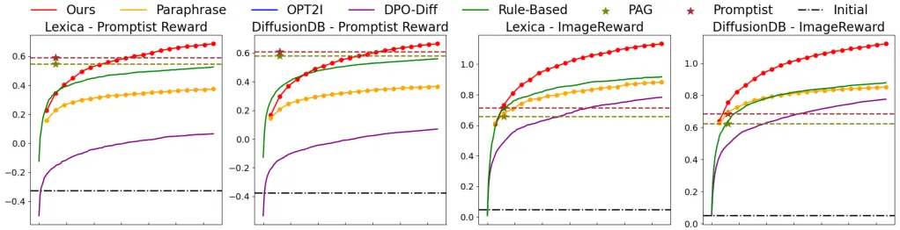

(a) Experiments on human preference rewards (Promptist Reward,
ImageReward)

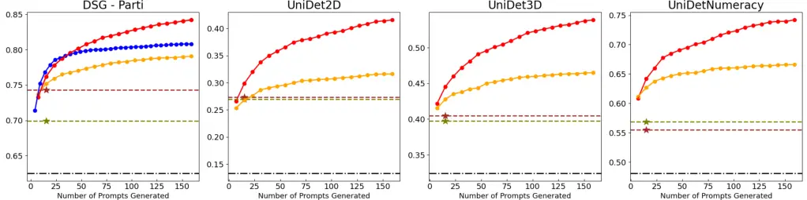

(b) Experiments on text-to-image consistency rewards (DSG, UniDet2D / 3D
/ Numeracy)

Figure 1: Optimization curves for human preference and text-to-image
consistency rewards. Each curve shows how the reward changes as the
number of generated prompts increases.

| Dataset     | Method     | Accuracy | Originality | Visual | Consistency | Emotional | Overall |
| ----------- | ---------- | -------- | ----------- | ------ | ----------- | --------- | ------- |
| Lexica      | Initial    | 67.85    | 62.84       | 80.11  | 83.93       | 69.59     | 72.49   |
|             | Paraphrase | 69.73    | 67.24       | 83.94  | 86.40       | 73.92     | 89.01   |
|             | Ours       | 75.11    | 72.44       | 85.96  | 88.44       | 77.97     | 89.69   |
| DiffusionDB | Initial    | 68.99    | 63.18       | 81.24  | 84.58       | 69.48     | 73.12   |
|             | Paraphrase | 69.65    | 66.56       | 84.35  | 86.81       | 72.75     | 88.25   |
|             | Ours       | 73.39    | 70.66       | 86.40  | 88.30       | 76.14     | 88.99   |

Table 1: Experimental results on LLMGrader reward in Lexica and
DiffusionDB datasets. Test-time search methods are evaluated at the
budget of 160 generated prompts. Full results in Tab. 14.

#### Baselines

We compare RATTPO with both learning-based and test-time search-based
methods. For the learning-based methods, we consider Promptist Hao
et al. (2023) and PAG Yun et al. (2025) which train language models to
directly enhance user-provided prompts. Following Yun et al. (2025), we
generate sixteen responses from their official checkpoint by beam search
and report the best one. Evaluations on reward setups other than the
Promptist Reward are performed by applying them without retraining
(_i.e._, in a zero-shot manner).

For test-time search-based methods, we consider DPO-Diff Wang et al.
(2024), OPT2I Mañas et al. (2024), and additionally two naive best-of-N
baselines that modify the initial prompt by using LLM to paraphrase
(denoted as Paraphrase) or in a rule-based manner (Rule-Based). Compared
to RATTPO, the Paraphrase baseline does not use history or hint. The
Rule-Based baseline randomly appends modifier words that are known to
improve image aesthetics, similar to the heuristic used in Hao et al.
(2023). Note that OPT2I is a reward-specific prompt engineer designed
for text-to-image consistency scores, and thus the comparison is done
only for the supported setup (DSG on PartiPrompt).

#### Implementation Details

We report averaged results across three runs with different seeds. Due
to space constraints, we present the full results with standard
deviations in App. F. We use the instruction-tuned Gemma 3 27B Team
et al. (2025) for all LLM components. We follow either PAG Yun et al.
(2025) or OPT2I Mañas et al. (2024) for diffusion sampling
hyperparameters. We conduct an ablation study on the choice of
different-sized LLMs and different hyperparameters, such as diffusion
sampler or history construction strategy for the hint-generator LLM, in
App. D. To reduce the computational burden, we select two representative
setups in our additional experiments: Promptist Reward and UniDet2D. We
provide more implementation details in App. A.

### 4.2 Main Result

#### Effectiveness of RATTPO for Diverse Rewards

As shown in Fig. 1 and Tab. 1, RATTPO consistently improves the initial
prompts, with performance gains scaling with the inference budget. At an
inference budget of 160 prompts, RATTPO achieves a significant
improvement over the initial scores across all rewards and datasets. The
qualitative results in Fig. 2 also showcase that RATTPO-optimized
prompts can generate both aesthetically pleasing and correctly composed
images depending on the target reward. Beyond human preference and image
composition, RATTPO is also capable of improving user prompts to
generate desired images on complex rubrics like originality and
emotional resonance, when optimized against the overall LLMGrader score
(Tab. 1).

As a test-time gradient-free prompt engineer, RATTPO effectively handles
both differentiable and non-differentiable rewards. While previous
learning-based methods and some test-time methods (_e.g.,_ DPO-Diff)
often rely on gradient-based optimization, many real-world rewards, such
as the LLMGrader, are non-differentiable. Taken together, these results
indicate that RATTPO is a reward-agnostic yet effective automated prompt
engineer, capable of enhancing user prompts for a wide range of rewards.

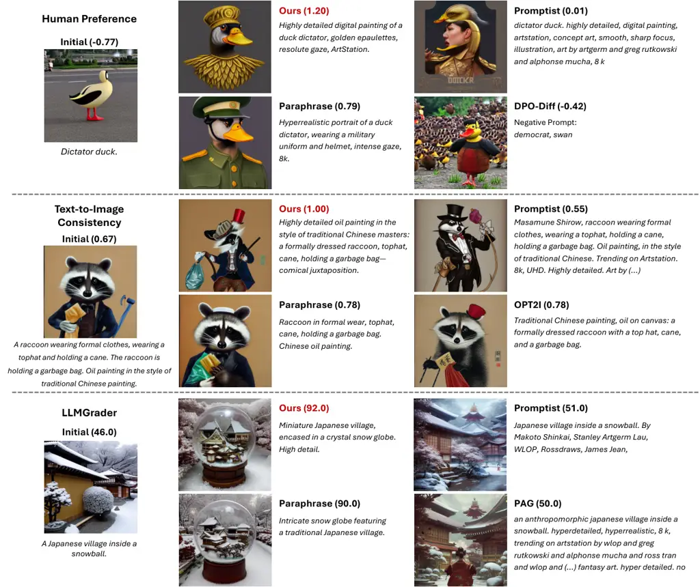

Figure 2: Qualitative results on diverse setups. As a reward-agnostic
prompt engineer, RATTPO can enhance user prompts with respect to a broad
range of reward functions.

#### Comparison to Learning-Based Baselines

With sufficient inference budgets (~100 prompts), Fig. 1 shows that
RATTPO can match the performance of learning-based methods on Promptist
Reward without requiring expensive reward-specific training (which
requires ~4 GPU days in Yun et al. (2025)). The result suggests a
well-designed reward-agnostic prompt engineer can be as effective as its
reward-specific counterparts, without the substantial cost of
reward-specific training.

When we directly apply learning-based methods to unseen rewards, we
observe significant performance drops. For instance, the results for
ImageReward (Fig. 1(a)) show that their performance is only comparable
to the simple Paraphrase baseline at the same inference cost, despite
the correlation between the trained and target rewards. The performance
degradation is more severe in text-to-image consistency setups, where
the correlation is weaker. These results indicate that the performance
of learning-based methods drops quickly as the test reward diverges from
the trained reward. This highlights the need for reward-agnostic prompt
engineers: learning-based reward-specific prompt engineers require
re-training for optimal performance, while reward-agnostic approaches
like RATTPO can handle diverse reward functions that are defined and
deployed at test-time.

| Method                | PR    | UniDet2D |
| --------------------- | ----- | -------- |
| RATTPO                | 0.683 | 0.416    |
| w/o Hint              | 0.565 | 0.395    |
| w/o Hint + Add. Hist. | 0.522 | 0.387    |

Table 2: Results for the ablation study on hint. Add. Hist. denotes the
variant using extra history instead of hint, and PR denotes Promptist
Reward. RATTPO outperforms w/o Hint variants.

Figure 3: Per-iteration average reward plots for the hint ablation
study.

#### Comparison to Test-Time Search Baselines

As shown in the optimization curve in Fig. 1, RATTPO outperforms other
test-time search methods (DPO-Diff, OPT2I, Paraphrase, and Rule-Based)
in terms of search efficiency. With an inference budget of 160 generated
prompts, RATTPO surpasses all baselines across all experiment setups.
When compared to the Rule-Based method, RATTPO shows a substantial
performance advantage on ImageReward, while the advantage is smaller for
Promptist Reward. This difference arises from the Rule-Based method’s
heuristics being specifically tailored for the Aesthetic Score component
used in Promptist Reward. Consequently, the Rule-Based method performs
only as well as simple paraphrasing on ImageReward, which highlights its
limited generalizability across different reward. In contrast, RATTPO
outperforms the Rule-Based method without relying on reward-specific
heuristics, by progressively evolving prompt candidates using in-context
learning from its optimization history.

When compared to OPT2I that employs an LLM as an optimizer with
reward-specific meta-prompt (Fig. 1(b)), we observe that RATTPO achieves
competitive scores at the early optimization stages but shows rapid
improvement over time, leading to much higher reward at the end. We
conjecture that the early saturation of OPT2I is due to heuristics in
its design, which may contain an implicit inductive bias towards local
optima. In contrast, RATTPO saturates slowly and achieves higher
rewards, possibly by replacing reward-specific task description with
hints, which are generated automatically from the optimization history
and thus evolve as the optimization proceeds.

|                     | PR             | UniDet2D       |
| ------------------- | -------------- | -------------- |
| Search cost at win  | 24             | 24             |
| Time, Paraphrase    | 447s           | 300s           |
| Time, RATTPO at win | 69s            | 51s            |
| Speedup             | 6.46$`\times`$ | 5.90$`\times`$ |

Table 3: Search efficiency of RATTPO considering wall-clock time.

To further analyze the search efficiency in practice, we measure
wall-clock time speedup of RATTPO over Paraphrase, the reward-agnostic
baseline. Despite the overhead from an additional hint-generator LLM,
RATTPO improves upon the Paraphrase baseline in terms of search
efficiency, achieving up to 6.46$`\times`$ wall-clock speedup as
detailed in Tab. 3. On average, RATTPO is 4.81$`\times`$ faster in
end-to-end wall-clock time across our eight experimental setups,
although specific speedups vary. Full results are in Tab. 8.

### 4.3 Analysis

#### Effectiveness of Hint

To validate our hint mechanism, we compare RATTPO against two variants:
one without hint and another replacing the hint generator with
additional random history context. As shown in Tab. 2, removing hints
degrades performance on both rewards, and simply adding more history
alone does not compensate for this performance loss. Also, Fig. 3
depicts that variants without the hint achieve lower per-iteration
average score. Based on the results, we claim that the hint mechanism in
RATTPO effectively guides the optimizer LLM to produce better prompts
every iteration, thereby improving the final reward. The performance
gain from hint is not simply a consequence of having more history in the
context window, but rather the result of an well-designed mechanism for
aggregating history to explicitly guide the search.

| Optimization Target       | Promptist Reward | UniDet2D |
| ------------------------- | ---------------- | -------- |
| Initial (No Opt.)         | -0.311           | 0.159    |
| RATTPO, optimize PR       | 1.021            | 0.164    |
| RATTPO, optimize UniDet2D | -0.017           | 0.461    |

Table 4: Cross-reward experiment results. Underlined numbers indicate
that RATTPO was not optimized for the evaluated reward.

| Method     | PR    | IR    |
| ---------- | ----- | ----- |
| RATTPO     | 0.683 | 1.132 |
| w/o Hint   | 0.565 | 1.081 |
| w/ IR Hint | 0.579 | \-    |
| w/ PR Hint | \-    | 1.065 |

Table 5: Inter-reward hint transfer results.

To further evaluate whether hint contains reward-specific optimization
signal, we design an inter-reward hint transfer experiment.
Specifically, we consider variants that use pre-generated hints from
other reward setup instead of generating hints during optimization. For
instance, w/IR Hint variant optimizes for Promptist Reward using hints
generated by RATTPO during ImageReward optimization. Since hint is
generated per-prompt, we consider the transfer within the same dataset
(Lexica). As shown in Tab. 5, these variants show degraded performance,
and do not meaningfully improve upon RATTPO without the hint. Thus, we
claim that hints indeed contain reward-specific information, thanks to
our explicit design that queries the hint-generator LLM about
optimization strategy.


(a) Human Preference (Promptist Reward)


(b) Text-to-Image Consistency (UniDet2D)

Figure 4: Case study of generated hints. Numbers in parentheses indicate
reward for corresponding prompts. The Hint-generator LLM summarizes the
search history to generate a "hint" that instructs the optimizer LLM. We
highlight the relevant parts and omit (…) some words for better
presentation.

Lastly, we conduct a case study on generated hints, exploiting their
human interpretability (Fig. 4, see App. H for more examples). As can be
seen, the hint-generator LLM is capable of recognizing high-scoring
patterns and summarizing them as textual descriptions. For instance,
highlighted parts in Fig. 4(a) shows that the hint-generator LLM
instructs the optimizer LLM to focus on "full-body portrait" and
"detailed hand positions", which can be inferred by comparing
high-scoring prompts with low-scoring prompts. Also, by comparing the
generated hints for different rewards, we observe that the
hint-generator can capture the information about the underlying reward
function. The hint-generator instructs the optimizer LLM to add
fine-grained details for improving image aesthetics (Fig. 4(a)), and to
explicitly mention both ‘left’ and ‘right’ keywords for better drawing
images with spatial object relationships (Fig. 4(b)). Hints are not only
an effective way to capture reward-aware optimization signals, but they
also provide a means to analyze the optimization process.

#### Cross-Reward Evaluation

While we extensively verify the effectiveness of RATTPO in optimizing
target rewards, it would be undesirable if the improved reward comes at
the cost of overall image quality. To validate that RATTPO does not fall
into such an over-optimization scenario, we conduct a cross-reward
experiment. Specifically, we optimize prompts for human preference
(Promptist Reward) and evaluate them on an uncorrelated reward for
spatial composition (UniDet2D), and vice versa. In Tab. 4, we observe
that the non-optimized rewards (underlined) remain at a similar level or
even slightly improved compared to their initial scores. This result
suggests that RATTPO does not over-optimize prompts for the target
reward. We hypothesize that RATTPO is robust to such over-optimization
for two main reasons. First, our optimization is performed in a discrete
text space without gradients, which may act as an implicit form of
regularization. Second, we explicitly instruct the LLM to restrict its
search space to prompts that preserve the semantics of the initial
prompt. This constraint makes over-optimization scenarios with degraded
faithfulness less feasible.

#### Robustness to Diffusion Backbone

|             | Human Preference |        |            |        | Text–to-Image Consistency |       |            |       |
| ----------- | ---------------- | ------ | ---------- | ------ | ------------------------- | ----- | ---------- | ----- |
| Method      | SD1.4            | SD2.1  | SDXL-Turbo | FLUX   | SD1.4                     | SD2.1 | SDXL-Turbo | FLUX  |
| Initial     | -0.325           | -0.373 | -0.327     | -0.480 | 0.123                     | 0.133 | 0.162      | 0.240 |
| Promptist\* | 0.591            | 0.345  | 0.257      | 0.104  | 0.255                     | 0.273 | 0.322      | 0.413 |
| PAG\*       | 0.545            | 0.219  | 0.193      | -0.013 | 0.275                     | 0.326 | 0.327      | 0.439 |
| DPO-Diff    | 0.066            | -0.037 | \-         | \-     | \-                        | \-    | \-         | \-    |
| Paraphrase  | 0.372            | 0.261  | 0.415      | 0.138  | 0.384                     | 0.316 | 0.419      | 0.536 |
| Ours        | 0.683            | 0.503  | 0.487      | 0.445  | 0.396                     | 0.416 | 0.454      | 0.578 |

Table 6: Experimental results with various diffusion backbones. Asterisk
denotes the baselines trained for Promptist Reward. Test-time search
methods are evaluated with a 160-prompt budget.

As a test-time search method, RATTPO is also agnostic to the choice of
T2I models. To validate this claim, we experiment with various T2I
diffusion backbones and report the results in Tab. 6. Specifically, we
consider SDXL-Turbo Sauer et al. (2024) and FLUX.1 Schnell Black Forest
Labs (2024) in addition to Stable Diffusion 1.4 and 2.1 that are used in
our main experiments. The results show that RATTPO is robust to the
choice of diffusion backbone, consistently improving the initial prompt
by a large margin. We also note that not all test-time methods are
agnostic to diffusion backbone, exemplified by DPO-Diff Wang et al.
(2024). DPO-Diff optimizes a negative prompt for improving image, where
negative prompts are often not used in timestep-distilled models
(SDXL-Turbo and FLUX.1 Schnell). In contrast, RATTPO directly optimizes
the user prompt and is applicable to these models.

#### RATTPO with Test-Time Alignment

| Method        | PR     |
| ------------- | ------ |
| Initial       | -0.325 |
| +DAS          | 0.411  |
| +DAS + RATTPO | 1.006  |
|               |        |

Table 7: Results of RATTPO combined with test-time alignment (DAS Kim
et al. (2025)). PR denotes Promptist Reward.

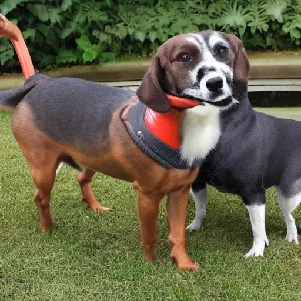

(a) Initial

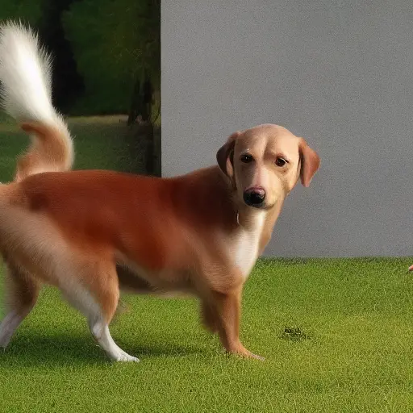

(b) DAS


(c) DAS+RATTPO

Figure 5: Qualitative examples of combining RATTPO with DAS Kim et al.
(2025). Prompts are in App. E

Since RATTPO is agnostic to denoising process, it is compatible with
test-time alignment methods that tweak sampling steps. For instance,
RATTPO can be combined with DAS Kim et al. (2025), a
sampling-as-alignment approach that effectively aligns a diffusion model
without training. We report the experimental results on Promptist Reward
in the Lexica dataset in Tab. 4.3 and Fig. 5. The results demonstrate
that our automated prompt engineer can be easily combined with other
test-time alignment methods to generate images with higher rewards.

## 5 Conclusion

We introduce RATTPO, a reward-agnostic prompt optimization framework
that can be applied to diverse reward functions without task-specific
modifications. Our approach employs an iterative optimization process
using two complementary LLMs: the optimizer LLM to propose enhanced
prompts and the hint-generator LLM to provide contextual feedback based
on reward signals. RATTPO is a reward-agnostic yet effective prompt
engineer, thanks to replacing the reward-specific task description in
the meta-prompt with a hint that is automatically generated by an LLM
on-the-fly. We validate the effectiveness of RATTPO in various reward
setups, categorized by human preference, text-to-image consistency, and
holistic MLLM assessment. Experimental results demonstrate that RATTPO
is applicable to a wide range of rewards and surpasses other test-time
approaches in terms of search efficiency.

#### Acknowledgments

This work was in part supported by the National Research Foundation of
Korea (RS-2024-00351212 and RS-2024-00436165) and the Institute of
Information & communications Technology Planning & Evaluation (IITP)
(RS-2022-II220926, RS-2024-00509279, RS-2021-II212068, RS-2022-II220959,
and RS-2019-II190075) funded by the Korea government (MSIT).

## Ethics Statement

We have carefully reviewed the Code of Ethics and confirm that we adhere
to the principles. To the best of our knowledge, this work raises no
ethical concerns. The use of LLMs in this paper is clarified in App. I.

## Reproducibility Statement

We have made our best efforts to ensure the reproducibility of our
experiments. We include the code in our submission to enable others to
replicate our results. We report all implementation details (App. A) for
the experiments, including meta-prompts used for LLMs (App. B). We
expect the numbers in main results to be reproducible, as we report the
average of three different runs. Except the LLMGrader experiment, we use
publicly available datasets and open-sourced models. For dataset, exact
lists/splits and preprocessing scripts for the datasets are included in
our attached code.

## References

- Black Forest Labs (2024) Black Forest Labs. Announcing Black Forest
  Labs. Blog post on Black Forest Labs website, August 2024. URL
  [https://blackforestlabs.ai/announcing-black-forest-labs/](https://blackforestlabs.ai/announcing-black-forest-labs/).
  Accessed: 2025-05-14.
- Brown et al. (2020) Tom Brown, Benjamin Mann, Nick Ryder, Melanie
  Subbiah, Jared D Kaplan, Prafulla Dhariwal, Arvind Neelakantan, Pranav
  Shyam, Girish Sastry, Amanda Askell, et al. Language models are
  few-shot learners. _Advances in neural information processing
  systems_, 33:1877–1901, 2020.
- Cao et al. (2023) Tingfeng Cao, Chengyu Wang, Bingyan Liu, Ziheng Wu,
  Jinhui Zhu, and Jun Huang. Beautifulprompt: Towards automatic prompt
  engineering for text-to-image synthesis. In _Proceedings of the 2023
  Conference on Empirical Methods in Natural Language Processing:
  Industry Track_, pp. 1–11, 2023.
- Chen et al. (2023) Yixiong Chen, Li Liu, and Chris Ding. X-iqe:
  explainable image quality evaluation for text-to-image generation with
  visual large language models. _arXiv preprint arXiv:2305.10843_, 2023.
- Cho et al. (2024) Jaemin Cho, Yushi Hu, Jason M Baldridge, Roopal
  Garg, Peter Anderson, Ranjay Krishna, Mohit Bansal, Jordi Pont-Tuset,
  and Su Wang. Davidsonian scene graph: Improving reliability in
  fine-grained evaluation for text-to-image generation. In _ICLR_, 2024.
- Diab et al. (2022) Mohamad Diab, Julian Herrera, Bob Chernow, and Coco
  Mao. Stable diffusion prompt book, 2022.
- Dong et al. (2022) Qingxiu Dong, Lei Li, Damai Dai, Ce Zheng, Jingyuan
  Ma, Rui Li, Heming Xia, Jingjing Xu, Zhiyong Wu, Tianyu Liu, et al. A
  survey on in-context learning. _arXiv preprint
  arXiv:2301.00234_, 2022.
- Du et al. (2024) Yingjun Du, Wenfang Sun, and Cees Snoek. Ipo:
  Interpretable prompt optimization for vision-language models.
  _Advances in Neural Information Processing Systems_,
  37:126725–126766, 2024.
- Fernando et al. (2023) Chrisantha Fernando, Dylan Banarse, Henryk
  Michalewski, Simon Osindero, and Tim Rocktäschel. Promptbreeder:
  Self-referential self-improvement via prompt evolution. _arXiv
  preprint arXiv:2309.16797_, 2023.
- Hao et al. (2023) Yaru Hao, Zewen Chi, Li Dong, and Furu Wei.
  Optimizing prompts for text-to-image generation. _Advances in Neural
  Information Processing Systems_, 36:66923–66939, 2023.
- He et al. (2024) Yutong He, Alexander Robey, Naoki Murata, Yiding
  Jiang, Joshua Nathaniel Williams, George J Pappas, Hamed Hassani, Yuki
  Mitsufuji, Ruslan Salakhutdinov, and J Zico Kolter. Automated
  black-box prompt engineering for personalized text-to-image
  generation. _arXiv preprint arXiv:2403.19103_, 2024.
- Hu et al. (2023) Yushi Hu, Benlin Liu, Jungo Kasai, Yizhong Wang, Mari
  Ostendorf, Ranjay Krishna, and Noah A Smith. Tifa: Accurate and
  interpretable text-to-image faithfulness evaluation with question
  answering. In _Proceedings of the IEEE/CVF International Conference on
  Computer Vision_, pp. 20406–20417, 2023.
- Huang et al. (2025) Kaiyi Huang, Chengqi Duan, Kaiyue Sun, Enze Xie,
  Zhenguo Li, and Xihui Liu. T2i-compbench++: An enhanced and
  comprehensive benchmark for compositional text-to-image generation.
  _IEEE Transactions on Pattern Analysis and Machine
  Intelligence_, 2025.
- Kim et al. (2025) Sunwoo Kim, Minkyu Kim, and Dongmin Park. Test-time
  alignment of diffusion models without reward over-optimization. In
  _The Thirteenth International Conference on Learning
  Representations_, 2025.
- Kirstain et al. (2023) Yuval Kirstain, Adam Polyak, Uriel Singer,
  Shahbuland Matiana, Joe Penna, and Omer Levy. Pick-a-pic: An open
  dataset of user preferences for text-to-image generation. _Advances in
  Neural Information Processing Systems_, 36:36652–36663, 2023.
- Lexica (2023) Lexica. The state of the art ai image generation engine.
  [https://lexica.art/](https://lexica.art/), 2023. Accessed:
  2024-11-15.
- Liu et al. (2022) Luping Liu, Yi Ren, Zhijie Lin, and Zhou Zhao.
  Pseudo numerical methods for diffusion models on manifolds. In
  _International Conference on Learning Representations_, 2022.
- Liu et al. (2023) Tennison Liu, Nicolás Astorga, Nabeel Seedat, and
  Mihaela van der Schaar. Large language models to enhance bayesian
  optimization. In _The Twelfth International Conference on Learning
  Representations_, 2023.
- Liu & Chilton (2022) Vivian Liu and Lydia B Chilton. Design guidelines
  for prompt engineering text-to-image generative models. In
  _Proceedings of the 2022 CHI conference on human factors in computing
  systems_, pp. 1–23, 2022.
- Lu et al. (2022) Cheng Lu, Yuhao Zhou, Fan Bao, Jianfei Chen,
  Chongxuan Li, and Jun Zhu. Dpm-solver: A fast ode solver for diffusion
  probabilistic model sampling in around 10 steps. _Advances in Neural
  Information Processing Systems_, 35:5775–5787, 2022.
- Ma et al. (2025) Nanye Ma, Shangyuan Tong, Haolin Jia, Hexiang Hu,
  Yu-Chuan Su, Mingda Zhang, Xuan Yang, Yandong Li, Tommi Jaakkola,
  Xuhui Jia, et al. Inference-time scaling for diffusion models beyond
  scaling denoising steps. _arXiv preprint arXiv:2501.09732_, 2025.
- Madaan et al. (2023) Aman Madaan, Niket Tandon, Prakhar Gupta, Skyler
  Hallinan, Luyu Gao, Sarah Wiegreffe, Uri Alon, Nouha Dziri, Shrimai
  Prabhumoye, Yiming Yang, et al. Self-refine: Iterative refinement with
  self-feedback. _Advances in Neural Information Processing Systems_,
  36:46534–46594, 2023.
- Mahajan et al. (2024) Shweta Mahajan, Tanzila Rahman, Kwang Moo Yi,
  and Leonid Sigal. Prompting hard or hardly prompting: Prompt inversion
  for text-to-image diffusion models. In _Proceedings of the IEEE/CVF
  Conference on Computer Vision and Pattern Recognition_, pp.
  6808–6817, 2024.
- Mañas et al. (2024) Oscar Mañas, Pietro Astolfi, Melissa Hall, Candace
  Ross, Jack Urbanek, Adina Williams, Aishwarya Agrawal, Adriana
  Romero-Soriano, and Michal Drozdzal. Improving text-to-image
  consistency via automatic prompt optimization. _CoRR_, 2024.
- Mo et al. (2024) Wenyi Mo, Tianyu Zhang, Yalong Bai, Bing Su, Ji-Rong
  Wen, and Qing Yang. Dynamic prompt optimizing for text-to-image
  generation. In _Proceedings of the IEEE/CVF Conference on Computer
  Vision and Pattern Recognition_, pp. 26627–26636, 2024.
- Oppenlaender (2024) Jonas Oppenlaender. A taxonomy of prompt modifiers
  for text-to-image generation. _Behaviour & Information Technology_,
  43(15):3763–3776, 2024.
- Ouyang et al. (2022) Long Ouyang, Jeffrey Wu, Xu Jiang, Diogo Almeida,
  Carroll Wainwright, Pamela Mishkin, Chong Zhang, Sandhini Agarwal,
  Katarina Slama, Alex Ray, et al. Training language models to follow
  instructions with human feedback. _Advances in neural information
  processing systems_, 35:27730–27744, 2022.
- Podell et al. (2024) Dustin Podell, Zion English, Kyle Lacey, Andreas
  Blattmann, Tim Dockhorn, Jonas Müller, Joe Penna, and Robin Rombach.
  Sdxl: Improving latent diffusion models for high-resolution image
  synthesis. In _The Twelfth International Conference on Learning
  Representations_, 2024.
- Qin et al. (2024) Yiwei Qin, Kaiqiang Song, Yebowen Hu, Wenlin Yao,
  Sangwoo Cho, Xiaoyang Wang, Xuansheng Wu, Fei Liu, Pengfei Liu, and
  Dong Yu. InFoBench: Evaluating instruction following ability in large
  language models. In Lun-Wei Ku, Andre Martins, and Vivek Srikumar
  (eds.), _Findings of the Association for Computational Linguistics:
  ACL 2024_, pp. 13025–13048, Bangkok, Thailand, August 2024.
  Association for Computational Linguistics. doi:
  10.18653/v1/2024.findings-acl.772. URL
  [https://aclanthology.org/2024.findings-acl.772/](https://aclanthology.org/2024.findings-acl.772/).
- Radford et al. (2021) Alec Radford, Jong Wook Kim, Chris Hallacy,
  Aditya Ramesh, Gabriel Goh, Sandhini Agarwal, Girish Sastry, Amanda
  Askell, Pamela Mishkin, Jack Clark, et al. Learning transferable
  visual models from natural language supervision. In _International
  conference on machine learning_, pp. 8748–8763. PmLR, 2021.
- Ramesh et al. (2022) Aditya Ramesh, Prafulla Dhariwal, Alex Nichol,
  Casey Chu, and Mark Chen. Hierarchical text-conditional image
  generation with clip latents. _arXiv preprint arXiv:2204.06125_, 2022.
- Rombach et al. (2022) Robin Rombach, Andreas Blattmann, Dominik
  Lorenz, Patrick Esser, and Björn Ommer. High-resolution image
  synthesis with latent diffusion models. In _Proceedings of the
  IEEE/CVF conference on computer vision and pattern recognition_, pp.
  10684–10695, 2022.
- Sanh et al. (2022) Victor Sanh, Albert Webson, Colin Raffel,
  Stephen H. Bach, Lintang Sutawika, Zaid Alyafeai, Antoine Chaffin,
  Arnaud Stiegler, Arun Raja, Manan Dey, M Saiful Bari, Canwen Xu,
  Urmish Thakker, Shanya Sharma Sharma, Eliza Szczechla, Taewoon Kim,
  Gunjan Chhablani, Nihal V. Nayak, Debajyoti Datta, Jonathan Chang,
  Mike Tian-Jian Jiang, Han Wang, Matteo Manica, Sheng Shen, Zheng Xin
  Yong, Harshit Pandey, Rachel Bawden, Thomas Wang, Trishala Neeraj, Jos
  Rozen, Abheesht Sharma, Andrea Santilli, Thibault Févry, Jason Alan
  Fries, Ryan Teehan, Teven Le Scao, Stella Biderman, Leo Gao, Thomas
  Wolf, and Alexander M. Rush. Multitask prompted training enables
  zero-shot task generalization. In _ICLR_. OpenReview.net, 2022.
- Sauer et al. (2024) Axel Sauer, Dominik Lorenz, Andreas Blattmann, and
  Robin Rombach. Adversarial diffusion distillation. In _European
  Conference on Computer Vision_, pp. 87–103. Springer, 2024.
- Schuhmann (2022) Christoph Schuhmann. Improved aesthetic predictor.
  [https://github.com/christophschuhmann/improved-aesthetic-predictor](https://github.com/christophschuhmann/improved-aesthetic-predictor), 2022.
  Accessed: 2025-05-13.
- Shinn et al. (2023) Noah Shinn, Federico Cassano, Ashwin Gopinath,
  Karthik Narasimhan, and Shunyu Yao. Reflexion: Language agents with
  verbal reinforcement learning. _Advances in Neural Information
  Processing Systems_, 36:8634–8652, 2023.
- Song et al. (2021) Jiaming Song, Chenlin Meng, and Stefano Ermon.
  Denoising diffusion implicit models. In _ICLR_. OpenReview.net, 2021.
- Sun et al. (2024) Jiao Sun, Deqing Fu, Yushi Hu, Su Wang, Royi Rassin,
  Da-Cheng Juan, Dana Alon, Charles Herrmann, Sjoerd van Steenkiste,
  Ranjay Krishna, et al. Dreamsync: Aligning text-to-image generation
  with image understanding feedback. In _Synthetic Data for Computer
  Vision Workshop@ CVPR 2024_, 2024.
- Team et al. (2024) Gemini Team, Petko Georgiev, Ving Ian Lei, Ryan
  Burnell, Libin Bai, Anmol Gulati, Garrett Tanzer, Damien Vincent,
  Zhufeng Pan, Shibo Wang, et al. Gemini 1.5: Unlocking multimodal
  understanding across millions of tokens of context. _arXiv preprint
  arXiv:2403.05530_, 2024.
- Team et al. (2025) Gemma Team, Aishwarya Kamath, Johan Ferret, Shreya
  Pathak, Nino Vieillard, Ramona Merhej, Sarah Perrin, Tatiana
  Matejovicova, Alexandre Ramé, Morgane Rivière, et al. Gemma 3
  technical report. _arXiv preprint arXiv:2503.19786_, 2025.
- Wang et al. (2024) Ruochen Wang, Ting Liu, Cho-Jui Hsieh, and Boqing
  Gong. On discrete prompt optimization for diffusion models. In
  _Proceedings of the 41st International Conference on Machine
  Learning_, pp. 50992–51011, 2024.
- Wang et al. (2023a) Xuezhi Wang, Jason Wei, Dale Schuurmans, Quoc V
  Le, Ed H Chi, Sharan Narang, Aakanksha Chowdhery, and Denny Zhou.
  Self-consistency improves chain of thought reasoning in language
  models. In _The Eleventh International Conference on Learning
  Representations_, 2023a.
- Wang et al. (2023b) Zijie Wang, Evan Montoya, David Munechka, Haoyang
  Yang, Benjamin Hoover, and Polo Chau. Diffusiondb: A large-scale
  prompt gallery dataset for text-to-image generative models. In _Annual
  Meeting of the Association for Computational Linguistics_, 2023b.
- Wei et al. (2022) Jason Wei, Xuezhi Wang, Dale Schuurmans, Maarten
  Bosma, Fei Xia, Ed Chi, Quoc V Le, Denny Zhou, et al. Chain-of-thought
  prompting elicits reasoning in large language models. _Advances in
  neural information processing systems_, 35:24824–24837, 2022.
- Wu et al. (2023) Xiaoshi Wu, Keqiang Sun, Feng Zhu, Rui Zhao, and
  Hongsheng Li. Human preference score: Better aligning text-to-image
  models with human preference. In _Proceedings of the IEEE/CVF
  International Conference on Computer Vision_, pp. 2096–2105, 2023.
- Xu et al. (2023) Jiazheng Xu, Xiao Liu, Yuchen Wu, Yuxuan Tong, Qinkai
  Li, Ming Ding, Jie Tang, and Yuxiao Dong. Imagereward: Learning and
  evaluating human preferences for text-to-image generation. _Advances
  in Neural Information Processing Systems_, 36:15903–15935, 2023.
- Yang et al. (2024) Chengrun Yang, Xuezhi Wang, Yifeng Lu, Hanxiao Liu,
  Quoc V Le, Denny Zhou, and Xinyun Chen. Large language models as
  optimizers. In _The Twelfth International Conference on Learning
  Representations_, 2024.
- Yu et al. (2022) Jiahui Yu, Yuanzhong Xu, Jing Yu Koh, Thang Luong,
  Gunjan Baid, Zirui Wang, Vijay Vasudevan, Alexander Ku, Yinfei Yang,
  Burcu Karagol Ayan, et al. Scaling autoregressive models for
  content-rich text-to-image generation. _Trans. Mach. Learn.
  Res._, 2022.
- Yun et al. (2025) Taeyoung Yun, Dinghuai Zhang, Jinkyoo Park, and Ling
  Pan. Learning to sample effective and diverse prompts for
  text-to-image generation. _arXiv preprint arXiv:2502.11477_, 2025.
- Zhang et al. (2023) Michael R Zhang, Nishkrit Desai, Juhan Bae,
  Jonathan Lorraine, and Jimmy Ba. Using large language models for
  hyperparameter optimization. In _NeurIPS 2023 Foundation Models for
  Decision Making Workshop_, 2023.
- Zhou et al. (2022) Xingyi Zhou, Vladlen Koltun, and Philipp
  Krähenbühl. Simple multi-dataset detection. In _Proceedings of the
  IEEE/CVF conference on computer vision and pattern recognition_, pp.
  7571–7580, 2022.

## Appendix

## Appendix A Implementation Details

#### Sampling from Diffusion Backbone

Following PAG Yun et al. (2025), we use Stable Diffusion 1.4 Rombach
et al. (2022) with DPM solver Lu et al. (2022) as a default diffusion
sampling setup. The inference is done in half precision (fp16). For
text-to-image consistency reward experiments, we follow OPT2I Mañas
et al. (2024) and use Stable Diffusion 2.1 Rombach et al. (2022) as a
diffusion backbone. We set the number of inference steps to 20 by
default. Furthermore, for the diffusion backbone robustness experiment,
SDXL-Turbo Sauer et al. (2024) and FLUX.1 Schnell Black Forest Labs
(2024) are timestep distilled models, and thus we use the PNDM Liu
et al. (2022) solver and Euler solver with the number of inference steps
set to one and four, respectively. For the experiment combining RATTPO
with test-time alignment method, DAS Kim et al. (2025), we use DDIM Song
et al. (2021) solver, as the official implementation¹¹ 1
https://github.com/krafton-ai/DAS is provided only for DDIM sampler. We
also evaluate RATTPO with various diffusion samplers (Tab. 11) and find
that it is robust to different sampler choices.

#### Hyperparameters

For RATTPO, we perform 20 iterations where each iteration proposes 8
prompts. We select the 8 best prompts from the history for the context
of the optimizer LLM, and 20 random prompts for the hint-generator LLM.
We use default hyperparameters when querying the LLM. For baselines, we
use the default setup if possible. To match the inference cost (_i.e._,
160 generated prompts), we increase the length of the evolutionary
search phase in DPO-Diff, resulting in 20 iterations of gradient-based
optimization and 140 iterations of evolutionary search. The evolutionary
search phase may terminate early if the search space contains fewer than
140 candidates. For OPT2I Mañas et al. (2024), we increase the
iteration, resulting in 32 optimization iterations where each iteration
generates 5 prompts. For the experiment combining RATTPO with DAS Kim
et al. (2025), the hyperparameters for DAS are set to default
($`\gamma=0.008`$, $`\alpha=0.005`$).

#### Rewards

In our experiment, we consider various rewards that can be categorized
into (1) Human Preference Reward (2) Text-Image Consistency Reward (3)
Holistic MLLM Assessment. Except for the LLMGrader used for the last
category, all other models are publicly available. We employ widely
adopted reward models for each category, namely Promptist Reward Hao
et al. (2023), ImageReward Xu et al. (2023), DSG Score Cho et al.
(2024), and UniDet Zhou et al. (2022) scorer from T2I-Compbench Huang
et al. (2025) benchmark. For LLMGrader, we follow the setup in Ma et al.
(2025); the prompt used for querying LLM is shown in Fig. 6. When
calculating rewards, we follow Yun et al. (2025) to estimate the
expectation in Eq. 1 by averaging rewards over generated images from
three different initial diffusion noise samples. The initial noises are
shared across methods and iterations.


Figure 6: The prompt used for LLMGrader reward. We follow the prompt
used in Ma et al. (2025).

#### Datasets

For the human preference and LLMGrader experiments, we directly use the
evaluation splits of Lexica Lexica (2023) and DiffusionDB Wang et al.
(2023b) used in PAG Yun et al. (2025). The datasets consist of 64 and
256 preprocessed prompts, respectively, obtained by extracting the main
content from human-engineered prompts. For PartiPrompt Yu et al. (2022)
dataset used for DSG Cho et al. (2024) reward setup, we prepare the
dataset following Mañas et al. (2024). Specifically, we use the first 50
prompts from four categories ("Properties and Positioning”, “Quantity”,
“Fine-grained Detail”, “Complex”). As the category "Properties and
Positioning" contains only 35 prompts, the resulting dataset has 185
initial prompts in total. Lastly, for UniDet-based evaluators, we use
accompanying datasets used in T2I-Compbench++ Huang et al. (2025)
benchmark. Each validation set for 2D, 3D and Numeracy category includes
300 prompts, and we use subset of 100 prompts in each category.

#### Baselines

We provide some additional details for baselines used in our
experiments.

- •
  DPO-Diff Wang et al. (2024) baseline in our experiment uses the
  default setting recommended in the original paper. Specifically, we
  optimize negative prompts with hybrid (gradient-based optimization
  with evolutionary search) search. Note that this setup is not
  applicable to both (1) non-differentiable rewards in text-to-image
  consistency and MLLM score, and (2) diffusion backbones like
  SDXL-Turbo Sauer et al. (2024) or FLUX.1 Schnell Black Forest
  Labs (2024) that do not use negative prompt. We exclude DPO-Diff
  baseline for such setups.
- •
  OPT2I Mañas et al. (2024) baseline in our experiment is implemented by
  using the exact hyperparameters and meta-prompt following the original
  paper. We use the same LLM (Gemma 3 27B) as RATTPO for fair
  comparison. While the paper claims that OPT2I can be used for
  arbitrary text-to-image consistency score, it uses different
  meta-prompts for each choice of the score. Among the experimental
  setups used in our paper, the DSG reward on PartiPrompt is the only
  setup for which the meta-prompt for OPT2I is provided, and thus we
  include OPT2I as a baseline only in that setup. As Gemma 3 does not
  use a system role, we include the system prompt in the user prompt.
- •
  The Rule-Based baseline is constructed in a similar way to the
  heuristic baseline used in Promptist Hao et al. (2023). Specifically,
  we collect the top 15 most frequent words appearing in
  human-engineered prompts, and randomly append three of them to the
  initial prompt. The word pool consists of: "concept art", "highly
  detailed", "sharp focus", "artstation", "digital painting",
  "intricate", "illustration", "trending on artstation", "smooth",
  "elegant", "octane render", "fantasy", "wlop", "digital art", and "8
  k". As this heuristic rule is targeted for enhancing image aesthetics,
  we only include it for experiments that contain human preference.

#### Computational Resources

We conduct the experiments with our internal GPU servers that consist of
two types of machines. We list their specifications below.

1.  1.  Intel Xeon Gold 6330 CPU and NVIDIA RTX A6000 GPU (with 48GB VRAM)
2.  2.  Intel Xeon Gold 6230 CPU and NVIDIA RTX 3090 GPU (with 24GB VRAM)

For LLM components, we either use (1) API provided by Google Generative
AI service²² 2 https://ai.google.dev/gemma/docs/core/gemma_on_gemini_api
(gemma-3-27b-it) or (2) self-hosted LLM server constructed with ollama³³
3 https://ollama.com/library/gemma3 (gemma3:27b) for using Gemma. When
implementing LLMGrader with Gemini-1.5-Flash Team et al. (2024), we use
the official API⁴⁴ 4
https://ai.google.dev/gemini-api/docs/models#gemini-1.5-flash.

Total running time depends on the GPU machine and also LLM API response
time. When using the machine with A6000 GPU and using Google GenAI API
for LLM inference, we expect a single optimization (20 iterations for
one initial prompt) to take about 10 minutes.

## Appendix B Meta-prompt


Figure 7: Meta-prompt used for the optimizer LLM. We highlight the
history-related part and hint-related part in colored texts.


Figure 8: Meta-prompt used for the hint-generator LLM.

Meta-prompts used for querying the optimizer LLM and the hint-generator
LLM can be found in Fig. 7 and Fig. 8, respectively. Note that history
and hint are not available for the first search iteration in RATTPO. In
this case, the meta-prompt for the optimizer LLM reduces to the prompt
for Paraphrase baseline, which uses neither optimization history nor
hint. This corresponds to a prompt that consists of uncolored texts in
Fig. 7.

## Appendix C Search Efficiency of RATTPO

For a practical analysis of search efficiency, we measure the wall-clock
time it takes RATTPO to achieve the peak score of the Paraphrase
baseline. We extend the analysis in Tab. 3 by averaging the results
across all eight experimental setups. As detailed in Tab. 8, RATTPO
achieves a net wall-clock speedup of 4.81$`\times`$ over the Paraphrase
baseline on average.

|                                    |        |      |             |      |       |                 |      |          |
| ---------------------------------- | ------ | ---- | ----------- | ---- | ----- | --------------- | ---- | -------- |
|                                    | Lexica |      | DiffusionDB |      | Parti | UniDet (reward) |      |          |
|                                    | PR     | IR   | PR          | IR   | DSG   | 2D              | 3D   | Numeracy |
| Average \# of prompts at win       | 24     | 40   | 24          | 32   | 40    | 24              | 40   | 32       |
| Wall clock time, Paraphrase (s)    | 447    | 383  | 410         | 355  | 1151  | 300             | 328  | 310      |
| Wall clock time, RATTPO at win (s) | 69     | 106  | 62          | 82   | 300   | 51              | 94   | 74       |
| Speedup ($`\times`$)               | 6.46   | 3.62 | 6.66        | 4.34 | 3.84  | 5.90            | 3.48 | 4.20     |

Table 8: Wall-clock time analysis of search efficiency, compared to
Paraphrase baseline

## Appendix D Additional Experiment Results

#### Ablation on LLM Size

| Method      | Promptist Reward    | UniDet2D           |
| ----------- | ------------------- | ------------------ |
| Initial     | -0.325 $`\pm`$0.013 | 0.133 $`\pm`$0.007 |
| Gemma 3 1B  | 0.558 $`\pm`$0.019  | 0.401 $`\pm`$0.002 |
| Gemma 3 12B | 0.563 $`\pm`$0.009  | 0.415 $`\pm`$0.011 |
| Gemma 3 27B | 0.683 $`\pm`$0.090  | 0.416 $`\pm`$0.015 |

Table 9: Ablation study on LLM capacity. Bold denotes our default
setting.

RATTPO relies on the ICL ability of LLMs for prompt optimization, where
larger LLMs are often better at Brown et al. (2020). To see how the
optimization performance changes with the choice of different-sized LLM,
we experiment with 1B, 12B and 27B variants of Gemma 3 Team et al.
(2025). Results in Tab. 9 shows that RATTPO, even with the smallest size
1B variant, can yield meaningful improvements over the initial prompt.
We use 27B model as default setting, which works the best in both
settings.

#### Ablation on Hint-Generator LLM Context

For the hint-generator LLM, we sample 20 random history prompts and
scores to use for its context. Tab. 10 shows an ablation study for this
choice. For the history selection strategy, we evaluate three methods:
(1) selecting random histories, (2) using a mix of the best and worst
histories, and (3) selecting only the best histories. For each method,
we also experiment with varying the number of histories provided as
context. As can be seen, our default setting performs the best in both
setups.

|                    |                    |                    |
| ------------------ | ------------------ | ------------------ |
| Selection Strategy | Promptist Reward   | UniDet2D           |
| Random             | 0.683 $`\pm`$0.090 | 0.416 $`\pm`$0.015 |
| Best               | 0.614 $`\pm`$0.045 | 0.411 $`\pm`$0.013 |
| Number of History  | Promptist Reward   | UniDet2D           |
| 0 (w/o hint)       | 0.565 $`\pm`$0.033 | 0.395 $`\pm`$0.038 |
| 4                  | 0.674 $`\pm`$0.030 | 0.409 $`\pm`$0.006 |
| 20                 | 0.683 $`\pm`$0.090 | 0.416 $`\pm`$0.015 |
| All                | 0.557 $`\pm`$0.023 | 0.406 $`\pm`$0.002 |

Table 10: Ablation study on hint history selection. Bold denotes our
default setting.

#### Ablation on Diffusion Sampler

As a test-time optimization method, RATTPO is robust to different
diffusion samplers. To empirically support this claim, we additionally
evaluate the performance of RATTPO using two different samplers
implemented in the diffusers library (DDIM and PNDM). As shown in
Tab. 11, our method is robust to the choice of diffusion sampler,
effectively improving user prompts across various sampler
configurations. As a test-time reward-agnostic prompt engineer, RATTPO
is compatible with both a broad set of rewards and diverse generation
setups, including different diffusion models (Tab. 6) and samplers
(Tab. 11).

|             | PR+Lexica |        |        | UniDet2D |       |       |
| ----------- | --------- | ------ | ------ | -------- | ----- | ----- |
| Sampler     | DPM       | DDIM   | PNDM   | DPM      | DDIM  | PNDM  |
| Initial     | -0.308    | -0.339 | -0.404 | 0.125    | 0.116 | 0.101 |
| Promptist\* | 0.540     | 0.571  | 0.518  | 0.279    | 0.272 | 0.272 |
| PAG\*       | 0.582     | 0.525  | 0.436  | 0.267    | 0.261 | 0.238 |
| Paraphrase  | 0.374     | 0.509  | 0.473  | 0.325    | 0.389 | 0.369 |
| Ours        | 0.662     | 0.644  | 0.594  | 0.429    | 0.430 | 0.382 |

Table 11: Experiment results with various diffusion samplers. Asterisk
denotes learning baselines trained for Promptist Reward. Test-time
search methods are evaluated with a 160-prompt budget.

## Appendix E Full prompts in DAS experiment

For the qualitative sample in Fig. 5, we use a prompt from Lexica
dataset. The initial prompt is "Duck and dog crossbreed", and the
RATTPO-optimized prompt is "Captivating digital art: a duck-dog hybrid
with flowing fur transitioning to feathers, bathed in golden light,
emphasizing an intelligent, inquisitive gaze".

## Appendix F Full Main Results Table with Standard Deviation

As we omit the standard deviations in main text (due to spatial
constraint), we present the full results here. See Tab. 12-15.

|             | Promptist Reward    |                     | ImageReward        |                    |
| ----------- | ------------------- | ------------------- | ------------------ | ------------------ |
| Method      | Lexica              | DiffusionDB         | Lexica             | DiffusionDB        |
| Initial     | -0.325 $`\pm`$0.013 | -0.375 $`\pm`$0.001 | 0.049 $`\pm`$0.143 | 0.052 $`\pm`$0.096 |
| Promptist\* | 0.591 $`\pm`$0.034  | 0.609 $`\pm`$0.020  | 0.714 $`\pm`$0.114 | 0.686 $`\pm`$0.108 |
| PAG\*       | 0.545 $`\pm`$0.014  | 0.581 $`\pm`$0.002  | 0.657 $`\pm`$0.144 | 0.623$`\pm`$0.103  |
| DPO-Diff    | 0.066 $`\pm`$0.009  | 0.070 $`\pm`$0.006  | 0.783 $`\pm`$0.024 | 0.775 $`\pm`$0.060 |
| Paraphrase  | 0.372 $`\pm`$0.004  | 0.365 $`\pm`$0.013  | 0.880 $`\pm`$0.170 | 0.850 $`\pm`$0.062 |
| Ours        | 0.683$`\pm`$0.090   | 0.663$`\pm`$0.020   | 1.132$`\pm`$0.049  | 1.121$`\pm`$0.036  |

Table 12: Full results for human preference reward experiments. Asterisk
denotes learning baselines trained for Promptist Reward. Test-time
search methods are evaluated at the budget of 160 generated prompts.

|             | DSG                | UniDet             |                    |                    |
| ----------- | ------------------ | ------------------ | ------------------ | ------------------ |
| Method      | Parti              | 2D                 | 3D                 | Numeracy           |
| Initial     | 0.625 $`\pm`$0.013 | 0.133 $`\pm`$0.007 | 0.324 $`\pm`$0.005 | 0.481 $`\pm`$0.004 |
| Promptist\* | 0.743 $`\pm`$0.010 | 0.273 $`\pm`$0.008 | 0.405$`\pm`$0.013  | 0.555$`\pm`$0.007  |
| PAG\*       | 0.693 $`\pm`$0.005 | 0.269 $`\pm`$0.002 | 0.397$`\pm`$0.007  | 0.569$`\pm`$0.004  |
| Paraphrase  | 0.791 $`\pm`$0.007 | 0.316 $`\pm`$0.008 | 0.465 $`\pm`$0.009 | 0.666$`\pm`$0.004  |
| Ours        | 0.842 $`\pm`$0.005 | 0.416 $`\pm`$0.015 | 0.539 $`\pm`$0.009 | 0.741 $`\pm`$0.006 |

Table 13: Full results for text-to-image consistency reward experiments.
Asterisk denotes learning baselines trained for Promptist Reward.
Test-time search methods are evaluated at the budget of 160 generated
prompts.

| Method      | Accuracy         | Originality      | Visual           | Consistency      | Emotional        | Overall          |
| ----------- | ---------------- | ---------------- | ---------------- | ---------------- | ---------------- | ---------------- |
| Initial     | 67.8 $`\pm`$1.12 | 62.8$`\pm`$1.52  | 80.1$`\pm`$0.41  | 83.9$`\pm`$0.66  | 69.6$`\pm`$1.39  | 72.5$`\pm`$0.85  |
| Promptist\* | 60.5 $`\pm`$1.94 | 64.7 $`\pm`$1.29 | 85.3 $`\pm`$0.52 | 85.9 $`\pm`$0.18 | 68.9 $`\pm`$0.85 | 85.8 $`\pm`$1.57 |
| PAG\*       | 57.7 $`\pm`$2.03 | 64.2 $`\pm`$2.46 | 84.7 $`\pm`$0.96 | 84.8 $`\pm`$0.39 | 68.2 $`\pm`$1.56 | 85.2 $`\pm`$1.61 |
| Rule-Based  | 68.4 $`\pm`$2.21 | 66.0 $`\pm`$2.68 | 83.8 $`\pm`$1.97 | 85.4 $`\pm`$1.56 | 71.5 $`\pm`$2.61 | 88.4 $`\pm`$0.87 |
| Paraphrase  | 69.7 $`\pm`$2.68 | 67.2 $`\pm`$1.24 | 83.9 $`\pm`$0.70 | 86.4 $`\pm`$1.23 | 73.9 $`\pm`$2.22 | 89.0 $`\pm`$0.44 |
| Ours        | 75.1$`\pm`$2.49  | 72.4 $`\pm`$1.52 | 86.0 $`\pm`$0.65 | 88.4 $`\pm`$0.09 | 78.0$`\pm`$1.30  | 89.7$`\pm`$0.40  |

Table 14: Full results for LLMGrader reward experiments in Lexica
dataset. Asterisk denotes learning baselines trained for Promptist
Reward. Test-time search methods are evaluated at the budget of 160
generated prompts.

| Method      | Accuracy         | Originality      | Visual           | Consistency      | Emotional        | Overall          |
| ----------- | ---------------- | ---------------- | ---------------- | ---------------- | ---------------- | ---------------- |
| Initial     | 69.0$`\pm`$0.13  | 63.2$`\pm`$0.16  | 81.2$`\pm`$0.12  | 84.6$`\pm`$0.02  | 69.5$`\pm`$0.22  | 73.1$`\pm`$0.13  |
| Promptist\* | 59.1$`\pm`$1.69  | 65.9$`\pm`$1.37  | 86.4$`\pm`$0.84  | 86.3$`\pm`$0.32  | 68.8$`\pm`$1.04  | 84.6$`\pm`$1.13  |
| PAG\*       | 52.5$`\pm`$0.38  | 62.9$`\pm`$0.22  | 85.7$`\pm`$0.51  | 84.7$`\pm`$0.13  | 64.2$`\pm`$0.22  | 83.6$`\pm`$0.04  |
| Rule-Based  | 68.1$`\pm`$1.95  | 67.0$`\pm`$2.41  | 84.9$`\pm`$0.96  | 86.6$`\pm`$0.83  | 71.3$`\pm`$2.13  | 87.2$`\pm`$0.58  |
| Paraphrase  | 69.7 $`\pm`$1.00 | 66.6 $`\pm`$0.77 | 84.3 $`\pm`$0.46 | 86.8 $`\pm`$0.53 | 72.8 $`\pm`$0.86 | 88.3 $`\pm`$0.31 |
| Ours        | 73.4$`\pm`$1.44  | 70.7$`\pm`$1.33  | 86.4 $`\pm`$0.51 | 88.3$`\pm`$0.40  | 76.1 $`\pm`$1.15 | 89.0$`\pm`$0.33  |

Table 15: Full results for LLMGrader reward experiments in DiffusionDB
dataset. Asterisk denotes learning baselines trained for Promptist
Reward. Test-time search methods are evaluated at the budget of 160
generated prompts.

## Appendix G Additional Qualitative Results

Additional qualitative examples, for all combinations of rewards and
datasets in our main experiment, can be found in Fig. 9-13.

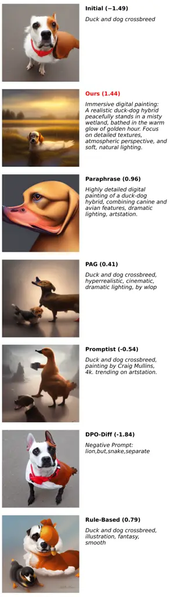

(a) Promptist Reward - Lexica

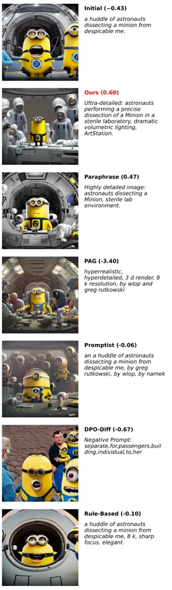

(b) Promptist Reward - DiffusionDB

Figure 9: Additional qualitative results for Promptist Reward in Lexica
(left) and DiffusionDB (right) datasets.

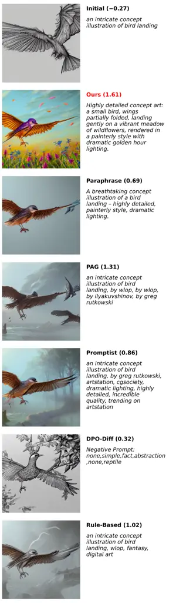

(a) ImageReward - Lexica

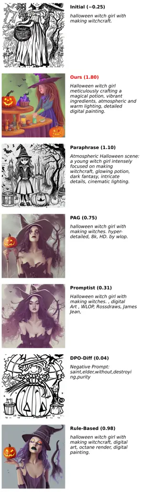

(b) ImageReward - DiffusionDB

Figure 10: Additional qualitative results for ImageReward in Lexica
(left) and DiffusionDB (right) datasets.

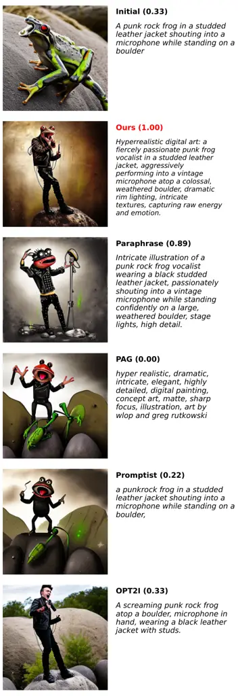

(a) DSG - PartiPrompt

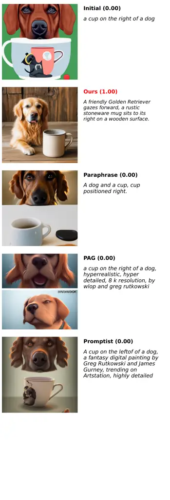

(b) UniDet2D

Figure 11: Additional qualitative results for DSG (left) and UniDet2D
(right),

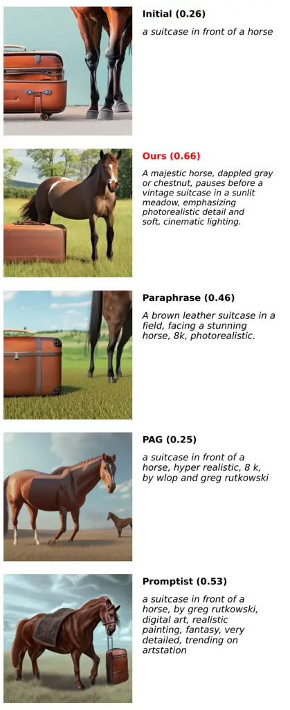

(a) UniDet3D

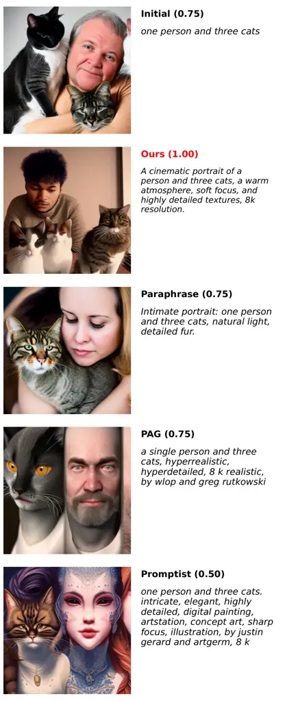

(b) UniDetNumeracy

Figure 12: Additional qualitative results for UniDet3D (left) and
UniDetNumeracy (right),

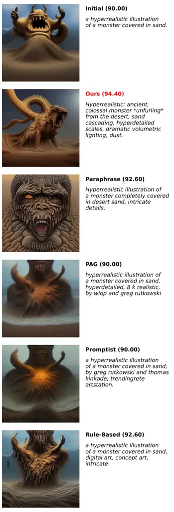

(a) Lexica - LLMGrader

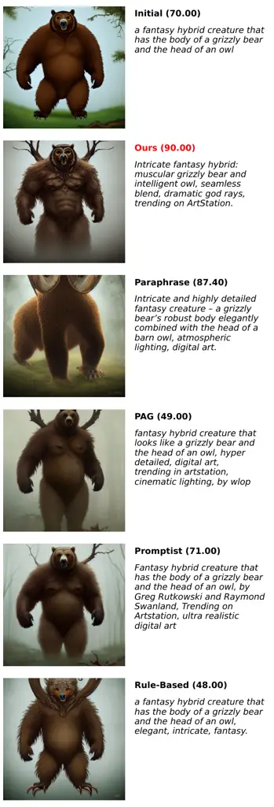

(b) DiffusionDB - LLMGrader

Figure 13: Additional qualitative results for LLMGrader in Lexica (left)
and DiffusionDB (right) datasets.

## Appendix H Additional Hint Case Study

Additional hint case study, for all combinations of rewards and datasets
in our main experiment, can be found in Fig. 14-23. Similar to the
figure in the main text, We highlight the relevant parts. Also note that
the hint sometimes suggests avoiding phrases that have negative effect,
visualized by underlined text. Numbers in parentheses indicate reward
for corresponding prompts.

## Appendix I Use of LLMs

We utilize LLMs to check grammar and improve the clarity of the
sentences in this paper. The authors draft all the original content, and
the role of the LLMs is strictly limited to language refinement. All
final contents are carefully verified by the authors.


Figure 14: Additional case study of generated hints for Promptist Reward
in Lexica dataset.


Figure 15: Additional case study of generated hints for Promptist Reward
in DiffusionDB dataset.


Figure 16: Additional case study of generated hints for ImageReward in
Lexica dataset.


Figure 17: Additional case study of generated hints for ImageReward in
DiffusionDB dataset.


Figure 18: Additional case study of generated hints for DSG in
PartiPrompt dataset.


Figure 19: Additional case study of generated hints for UniDet2D.


Figure 20: Additional case study of generated hints for UniDet3D.


Figure 21: Additional case study of generated hints for UniDetNumeracy.


Figure 22: Additional case study of generated hints for LLMGrader Reward
in Lexica Dataset.


Figure 23: Additional case study of generated hints for LLMGrader Reward
in DiffusionDB dataset.
