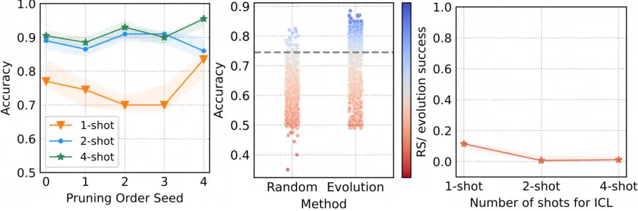
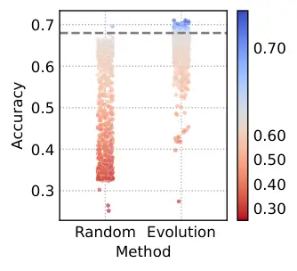
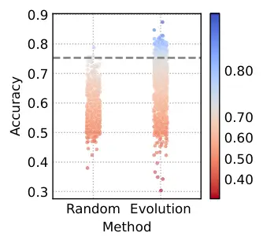
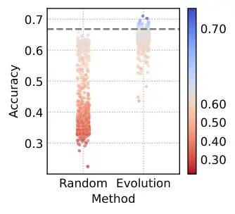

# Evolving Prompts In-Context: An Open-ended, Self-replicating Perspective

Jianyu Wang Affiliation: DAMO Academy, Alibaba Group Affiliation: Hupan
Lab Correspondence to: <jiw102@ucsd.edu>    Zhiqiang Hu
Affiliation: DAMO Academy, Alibaba Group Affiliation: Hupan Lab   
Lidong Bing Affiliation: MiroMind

###### Abstract

We propose a novel prompt design paradigm that challenges conventional
wisdom in large language model (LLM) prompting. While conventional
wisdom prioritizes well-crafted instructions and demonstrations for
in-context learning (ICL), we show that pruning random demonstrations
into seemingly incoherent “gibberish” can remarkably improve performance
across diverse tasks. Notably, the “gibberish” always matches or
surpasses state-of-the-art automatic prompt optimization techniques,
achieving substantial gains regardless of LLM alignment. Nevertheless,
discovering an effective pruning strategy is non-trivial, as existing
attribution methods and prompt compression algorithms fail to deliver
robust results, let alone human intuition. In terms of this, we propose
a self-discover prompt optimization framework, PromptQuine, an
evolutionary search framework that automatically searches for the
pruning strategy by itself using only low-data regimes. Much like the
emergent complexity in nature—such as symbiosis and
self-organization—arising in response to resource constraints, our
framework evolves and refines unconventional yet highly effective
prompts by leveraging only the tokens present within the context. We
demonstrate its effectiveness across classification, multi-choice
question answering, generation and math reasoning tasks across LLMs,
while achieving decent runtime efficiency. We hope our findings can
guide mechanistic studies on in-context learning, and provide a call to
action, to pave the way for more open-ended search algorithms for more
effective LLM prompting.

###### Keywords: 

Machine Learning, ICML

^(†)^(†)affiliationnotice: This work was partially done when Lidong Bing
was at DAMO Academy, Alibaba Group.

## 1 Introduction

Prompting large language models (LLMs) has become the de facto standard
for numerous applications, shifting the community focus to designing
prompts that maximize model performance. However, this task is
inherently complex due to the nuanced and often unpredictable behavior
of LLMs \[80, 76\]. Subtle changes in phrasing, structure, or context
can dramatically affect outputs \[55, 106\]. Consequently, prompt
engineering relies heavily on iterative experimentation and evaluation.
On the other hand, automatic prompt optimization \[76\] explores to
minimize the human involvement by leveraging computations to refine
prompts iteratively. The conventional wisdom \[144, 80, 85, 125\]
suggests that well-specified task instruction, combined with a few tuned
demonstrations for ICL, yields the best results.

This paper presents a study that challenges conventional wisdom by
showing that pruning clear, detailed demonstrations into seemingly
incoherent “gibberish” (both syntactically and semantically strange)
can, counterintuitively, improve performance across various tasks.
Notably, this effect generalizes across models, regardless of alignment
\[105\], suggesting a broader misspecification of unnatural language in
current LLMs. Even more surprisingly, we find that this “gibberish”
consistently matches or surpasses the performance of state-of-the-art
automatic prompt optimization results in several tasks. Consequently, we
propose a novel conceptual framework that reframes prompt compression as
guided prompt search, enhancing both serving efficiency and task
performance. We further explore algorithms to achieve these
improvements.

To derive effective pruning strategies, one might expect existing
instance attribution \[68, 139\] or prompt compression methods \[72, 53,
54, 87\] to provide guidance. However, we find that none of these
methods can reliably produce accurate token importance scores to guide
the pruning, let alone human intuition according to word semantics. A
more practical idea is to ask algorithms to discover the pruning
strategies by themselves. We thus develop a self-discover prompt
optimization framework, Genetic Prompt-Quine (PromptQuine), an
evolutionary search framework that automatically searches for the
pruning strategy by itself using low-shot regimes. The philosophy of
this framework is essentially a self-replicating program \[122\] that
copies and mutates the prompt itself (e.g., pruning random tokens). The
mutated prompts compete for limited resources to survive based on their
fitness, with only the most performant surviving, thereby evolving
effective pruning strategies over multiple generations. The entire
process closely resembles the evolutionary dynamics of biological
systems, where self-replication and adaptation drive the emergence of
more effective strategies over successive generations (i.e.,
evolutionary self-replication).

Evolutionary self-replication, a fundamental concept in Darwinian
evolution \[84\], explains how life reproduces and evolves through
genetic variation and natural selection, fostering the emergence of
unpredictable traits and behaviors that enhance adaptability to
constantly shifting environmental conditions. Similarly, the prompt
design problem can also be framed as an evolutionary process, where
prompts shall be iteratively refined to adapt to complex LLM
environments. As such, prompts that are optimal for complex LLMs may
exceed human intuition and require methods beyond manual design.
Inspired by our findings, we propose embracing more open-ended
innovations (or broader open-endedness \[114\])—shifting from the human
language space towards the “LLM language space”—to advance LLM prompting
strategies.

We demonstrate the effectiveness of our search framework through
large-scale experiments across tasks and LLMs. Our results show that
pruning a low-shot ICL prompt could perform comparably to
state-of-the-art methods on a range of tasks, while maintaining
competitive runtime efficiency compared to prior optimization methods
(e.g., Table 10 in Appendix). Notably, our PromptQuine framework is
inherently well-suited for parallelization, which can further enhance
both its scalability and efficiency, for example by parallelizing
reproduction and fitness evaluation. Moreover, we find that the task
improvements of our approach could becosme more pronounced as the number
of in-context examples increases, suggesting that scaling to more shots
can unlock additional performance gains. This suggests that richer
prompt variations can drive further gains. Finally, we show that key
findings on label word importance also hold for our ICL pruning, with
the additional insight that pruning has potentials to enhance
performance with random verbalizers, even when starting from chance.

## 2 Problem Formalisms

### 2.1 Preliminaries: In-context Learning

ICL describes an emergent capability of LLMs that given a few training
examples appended in context, the LLM is able to be conditioned to infer
the task results. Formally, given K input-label pairs
$`\{(\mathbf{x}_{i},\mathbf{y}_{i})\}_{i=1}^{K}`$ and the task test
input $`\mathbf{x}_{\text{test}}`$ concatenated in the input context,
the LLM is conditioned to generate the task prediction:

```math
\mathbf{y}_{\text{test }}\sim\mathcal{P}_{LM}\left(\cdot\mid\mathbf{x}_{1},\mathbf{y}_{1},\ldots,\mathbf{x}_{K},\mathbf{y}_{K},\mathbf{x}_{\text{test }}\right) \tag{1}
```

users can then parse the task output from the prediction
$`\mathbf{y}_{\text{test }}`$ (i.e., mapping into corresponding task
verbalizers \[101\]).

### 2.2 The Motivating Discussion

An intriguing observation in recent LLM prompting research \[107, 28,
150\] suggests that, for certain tasks, unintelligible or unnatural
prompts (e.g., StaffAreaFocusHardware Advisory for News Classification)
can outperform carefully crafted natural language instructions. This
unnatural language phenomenon has been discussed as a form of secret
language \[23\] in literature.

Specifically, secret language often refers to unnatural language prompts
whose syntax and semantics are incoherent and difficult for humans to
parse, yet can be surprisingly effective in certain scenarios. In the
absence of theoretical explanation for their emergence, and universally
effective method for large-scale discovery, such prompts, either
discovered by coincidence or found after extensive computation by
certain algorithms \[107, 28, 56, inter alia\], such as the news
classification prompt we discussed above, are typically regarded as
mysterious, hidden, and inherently non-scalable.

We argue that such seemingly chaotic discoveries may actually contain
universal insights into LLM sensitivity towards prompt design. We detail
our thought process as follows: It’s counter-intuitive that unnatural
prompts can outperform natural instructions, despite being extensive
trained to align human language. This suggests LLMs may only experience
superficial alignment \[43\] and instead may prioritize hypotheses over
the explicit structure of human linguistics. Recently, Chan et al.
\[14\] identified that transformer language models, especially LLMs,
exhibit sparse, rule-based generalization in ICL, where minimal features
can dominate predictions \[24\]. This raises the possibility that some
input features can be redundant or inessential towards task prediction.
We are thus curious whether natural language prompts, e.g., ICL, could
be improved simply by removing certain input features in-context,
exploring the potential of ICL optimization in-context. In other words,
we deliberately explore disrupting the grammatical structure of prompts
in an attempt to approach a structure that LLMs might prefer.

Alternatively, such perturbation might be viewed as a nearby search
within semantically coherent natural language contexts, potentially
outperforming the unnatural artifacts from token-level searches with
limited algorithmic capacity \[107, 28\]. We refer to this as the
Partial Context Hypothesis.

Specifically, given a natural language prompt, e.g., ICL prompt,
$`\mathbf{x}=(x_{1},x_{2},\dots,x_{n})`$ with task performance
$`\mathbf{X}`$, is it possible to prune a few prompt tokens, resulting
in a pruned prompt $`\mathbf{z}=(z_{1},z_{2},\dots,z_{m}),m\leq n`$,
with significantly improved task performance $`\mathbf{Z}`$. Notably,
the prompt can reach or even surpass task performance $`\mathbf{Y}`$ of
unnatural language prompts $`\mathbf{y}`$ discovered by prior
token-level search algorithms \[107, 28\], although initial performance
$`\mathbf{X}`$ may be substantially lower.

As we demonstrate in Appendix B through a pilot study using a simple
hill-climbing approach (Section 3.1), the hypothesis proves effective
and may outperform the unnatural language prompts discovered by Deng
et al. \[28\] across various contexts—especially in pruning ICL, which
is our focus. In terms of the effectiveness, for example, the popular
prompt “Let’s work this out step by step to be sure we have the right
answer,” introduced by Zhou et al. \[148\], improves InstructGPT’s
performance on the MultiArith dataset \[97\] from 78.7$`\%`$ to
81.5$`\%`$, outperforming the earlier prompt “Let’s think step by step”
\[58\]. By pruning the prompt to “Let’s work out step by step sure we
right answer”, we achieve an even higher result of 86.7% (Appendix,
Table 7).

### 2.3 Compression as Guided Search: A Reformulation

The prompt compression is a widely studied field where the typical
target is to improve the inference speed \[72, 54, 52, 87\]. In
contrast, we frame the prompt compression problem as a guided prompt
search where the task is construed as searching for the prompt
subsequence which can elicit improved task results. To avoid the
ambiguity, we mainly use the term “prompt pruning” in the paper.

Formally, we describe the search problem as below:

Given input prompt $`\mathbf{x}=(x_{1},x_{2},\dots,x_{n})`$, the goal is
to locate a pruned prompt
$`\mathbf{z}=(z_{1},z_{2},\dots,z_{m}),m\leq n`$ as a subsequence of
input prompt $`\mathbf{x}`$. The subsequence length $`m`$ is not
predefined and it shall continuously adjust over optimization. Our
search optimizes a non-differentiable task objective
$`f(\mathbf{z};\mathbf{x},\mathcal{D})`$ which typically represents the
task performance over the dataset $`\mathcal{D}`$ and aims at returning
the optimal solution, i.e., an optimally pruned prompt we discovered so
far. In the remainder of this section, we will describe the search
space, the search objective as well as the overall principles for the
solution selection in detail.

##### Search Space.

The search space refers to all possible solution candidates that the
algorithm can explore. In our context, it specifically refers to any
prompt subsequences extracted from the original prompts. Ideally, the
word order within the prompts could also be altered during optimization.
However, this operation would significantly complicate the search
problem, resulting in an exponentially larger search space. Therefore,
in this paper, we focus primarily on the fixed-order prompt subsequence
search.

##### Search Objective.

The search objective functions as a performance measure to evaluate the
quality of candidate solutions, especially assessing the effectiveness
of prompts in enhancing downstream task performance. For instance,
prompt quality can be evaluated using an aggregated metric (e.g.,
classification accuracy) on a held-out set separated from the original
dataset. Since the search objective is typically non-differentiable, we
cannot just approximate the solutions via traditional gradient ascent.

##### Solution Selection.

Once the search converges or terminates, the algorithm returns a
selected optimal solution, i.e., an optimal prompt. The optimality of a
prompt is typically measured by an aggregated metric on a held-out
dataset. This dataset is often referred to as the validation set, with
final performance reported separately on a test set using the
task-specific metric. We ensure strict separation between the validation
and test sets to prevent data leakage and enable a reliable assessment
of generalization.

## 3 PromptQuine

We now introduce our search framework PromptQuine. We’ll begin with a
straightforward hill-climbing search in Section 3.1, which serves as a
strong baseline with good empirical performance and is also the method
used in our pilot study (Appendix B) to validate the Partial Context
Hypothesis. Then, we outline the core design principles for further
improvements in Section 3.2, followed by an exploration of the objective
landscape and the justification for using evolutionary search in Section
3.3. Section 3.4 outlines our evolutionary search framework for
PromptQuine.

### 3.1 A Simple Hill-climbing Search

Due to the absence of well-established or highly efficient algorithms
for this prompt subsequence search, as well as the failure of
attribution methods (Appendix C) and prompt compression algorithms
(e.g., Table 1), we start with a greedy local search method. Basically,
it works by iteratively pruning tokens, removing those that improve the
prompt’s performance. This continues until no token can be pruned
without harming validation set performance. This follows the general
framework of hill-climbing. While this approach may not yield optimal
solutions, it provides a quick and intuitive way to explore the
hypothesis and gain initial insights, as detailed in Appendix B.

Specifically, we primarily adopt the Threshold Accepting (TA) algorithm
\[32\], which builds upon the First-Choice Hill Climbing (FCHC)
algorithm \[99\]. Namely, given a prompt sequence
$`\mathbf{x}=(x_{1},x_{2},\dots,x_{n})`$, the algorithm tracks the
current solution (initialized as prompt $`\mathbf{x}`$) and generates a
new candidate by making a local per-token change, e.g., removing a token
$`x_{i}`$. If the new candidate improves upon the current solution, it
is accepted, and the tracked solution is updated accordingly. This
directly contrasts with Steepest-Ascent Hill Climbing (SAHC) \[99\],
which evaluates all possible one-token modifications and selects the one
that yields the greatest improvement (called SAHCPruning)—our method
offers significant speedups by accepting any modification that improves
the prompt.

The algorithms continue until no further improvements are found or a
stopping criterion is met. To ensure reproducibility, we fix the pruning
order (the method used to make per-token changes) in our implementation.
In fact, we apply a left-to-right pruning order, iterating over
$`x_{1}`$ to $`x_{n}`$, and proposing a new prompt by removing the most
recently visited token, $`x_{i}`$, at step $`i`$. As the algorithm
converges when no tokens can be further removed, it follows that we may
repeat the left-to-right iterations multiple times, with each iteration
initializing the tracked solution using the optimal prompt from the
previous iteration. We illustrate the whole idea in Appendix, Algorithm 14. We call this approach TAPruning, which helps escape local optima, as
observed in preliminary experiments, by further accepting suboptimal
candidates within a predefined threshold (e.g., $`\geq 96\%`$ of the
current maximum prompting performance). This suggests a deceptive nature
of our search objective (i.e., held-out score). We’ll revisit this later
in Section 3.3 and Section 4, where we explore how greedy hill-climbing
struggles, becoming deeply trapped in local optima, and emphasize the
need for rewarding suboptimal stepping stones \[65, 113\] to global
optimization.

As shown in Table 6 (Appendix B) for Meta-Llama-3-8B-Instruct \[3\], and
an extended study on various LLMs across sizes (e.g., Table 10 in
Appendix B) using held-out performance for prompt selection, we
demonstrate consistent performance gains across models and tasks through
pruning. Notably, such improvement is independent of the ICL prompt we
sampled, suggesting a potentially effective approach to stabilize ICL
performance \[144, 80, 98\]. Besides, while simple, TAPruning already
delivers competitive results against prior search methods in both task
results and runtime efficiency across several tasks (e.g., Table 11 in
Appendix D.3), making it a strong contender for practical use. We
explore further improvements in the following sections.

### 3.2 Design Principles for Improved Performance

A search framework consists of three key components: the search space,
algorithm, and objective. While refining the search space is constrained
by the black-box nature of LLMs, there is significant potential to
improve the algorithm and objective: (1) Search Algorithm: Hill-climbing
may be suboptimal; insights into the search landscape \[25, 33\] can
guide better algorithms. (2) Search Objective: The high cost of prompt
evaluation, driven by task metrics like accuracy, can be reduced by
using more expressive proxies \[138\]. We attempt to integrate these
principles into our designs.

### 3.3 Navigating Sparse, Multimodal Search Landscapes

We now examine the search challenges in our optimization landscape to
inspire more effective algorithms.

To begin with, we revisit our hill-climbing approach (e.g., TA) and
highlight a key assumption: hill climbing guarantees convergence to the
global optimum only in unimodal spaces \[42\]. In such space, a single
optimum, i.e., a single peak, allows efficient optimization by following
increasing objective values without the need for exhaustive searches in
multiple directions. This assumption, however, is very likely fail in
our context.

As shown in the Figure 1 (Left), we relax the left-to-right order
constraint in our hill-climbing algorithm (TAPruning) and explore random
pruning orders in multiple runs using purely greedy hill-climbing. The
results indicate that these runs converge to different solutions,
leading to significant variations in task performance. This suggests a
potentially complex, multimodal nature of the search problem, where
traditional hill-climbing—and its variants, such as Simulated Annealing
\[10\] and TA—struggle to perform effectively. These findings highlight
the need for more global exploration strategies to address local optima.



Figure 1: Optimization challenges in our ICL-initialized landscape using
Llama-3-8B-Instruct for subjectivity classification. Left: Randomizing
pruning order in hill-climbing search leads to varying task performance,
highlighting the multimodal nature. Middle: Evolutionary search (ES)
outperforms random search (RS) in identifying high-quality solutions,
with TAPruning result as a dashed line. Right: Relative success rate of
RS over ES approaches zero as task difficulty increases, particularly
when solution sparsity is enhanced by expanding the context. Further
studies, with consistent conclusions, are provided in Appendix D.2.

To navigate the multimodal landscape, both unstructured methods like
Random Search \[147\] (RS) and structured approaches such as
Population-based Search \[8\] (e.g., evolutionary search, ES) can be
used, each offering unique advantages depending on the search space. In
certain scenarios, RS can outperform more complex structured methods,
particularly when local optima are densely packed \[9\], as unstructured
approaches may more efficiently explore multiple regions and find better
solutions, while population-based approaches may overly exploit a local
region.

We investigate the use of RS and population-based search (i.e.,
evolutionary search, ES using our PromptQuine design in Section 4.1) in
the ICL landscape, conducting independent sampling runs to generate
1,000 unique prompt samples for both subjectivity classification (Subj)
and natural language inference (SNLI). As shown in the Figure 1
(Middle), RS proves highly inefficient in obtaining high-quality prompts
that outperform TAPruning, while ES achieves better performance under
constrained prompt samples. Inspired by Real et al. \[95\], we define
the number of the acceptable prompts under the fixed budget as the
number of sampled pruned prompts which outperform TAPruning’s average
performance. The success rate is then defined as the number of
acceptable prompts divided by the number of pruned prompts sampled. As
shown in Figure 1 (right), the relative success rate of RS to ES (i.e.,
the success rate of RS divided by the success rate of ES) approaches
zero as task difficulty increases. For example, when dealing with
standard long contexts, where high-quality prompts are sparse in the
search space, unstructured methods like RS may struggle to efficiently
navigate the space. We thus recommend ES, as it is more robust to the
search dimensions.

### 3.4 Evolutionary Search for PromptQuine

Figure 2: Overview of the PromptQuine framework. Similar to natural
selection, our framework evolves prompts by copying and mutating them
(i.e., pruning random tokens). Guided by task-specific selection
pressures, it progressively optimizes itself. Notably, the generation of
unnatural language prompts, despite introducing unexpected variations,
consistently outperforms manually designed prompts, representing a step
towards open-ended self-improvement in AI \[102, 83\].

We now provide an overview of our ES algorithm for prompt subsequence
search. Specifically, we use Genetic Algorithm (GA) \[45\], due to its
inherent compatibility with our problem. In this approach, we evolve a
population of pruned prompts, where binary token masks serve as
genotypes and the resulting ICL prompts as phenotypes. Mutations (i.e.,
pruning tokens) are implemented via bit-flip 1-to-0 operations.
Elitism-based selection guides offspring survival, enabling the
autonomous evolution of pruning strategies. Additional details are
provided in Appendix D, along with Algorithm 3. Our GA variants
incorporate several designs, which effectively improves the search
quality. We refer the reader to Appendix D.1 for details. Tuning the GA
for an unknown landscape requires extensive trial and error. We
recommend using our configurations for follow-up experiments and discuss
key designs below.

We initialize the entire population with duplicates of ICL prompts, as
early experiments with random pruning for initializations showed no
significant advantage. For mutation rate, a uniformly random selection
of the number of flipped bits among the values $`\in\{1,2,3,4\}`$
effectively balances the exploration-exploitation. We then use
tournament selection with slightly reduced selection pressure, sampling
k individuals and selecting the best for reproduction, which helps
mitigate local optima. Most crucially, we apply regularized evolution
\[93, 94\], where only new offspring compete for population inclusion.
This approach, which we have empirically validated, is highly effective
in navigating the ICL landscape, particularly in addressing the
premature convergence issue that standard GA struggles to overcome—an
issue that is a key bottleneck in tuning the configurations for ICL. As
we demonstrate in Appendix D.7, such simple approach outperforms many
complex diversity-preserving mechanisms \[36\] in balancing search speed
and solution quality.

|                                |             |            |             |            |            |            |      |                    |
| ------------------------------ | ----------- | ---------- | ----------- | ---------- | ---------- | ---------- | ---- | ------------------ |
| Method                         | SST-2       | Subj       | AG’s News   | Yelp-5     | SNLI       | Yahoo      | Avg. | Ratio $`\uparrow`$ |
| ICL (1-shot, original) \[13\]  | 95.9 (0.6)  | 66.7 (4.3) | 83.7 (1.9)  | 52.2 (6.0) | 61.9 (2.0) | 57.1 (6.9) | 69.6 | 0.0%               |
| LLMLingua \[53\]               | 95.8 (0.6)  | 64.0 (4.2) | 85.3 (1.8)  | 49.7 (6.6) | 64.2 (1.7) | 49.5 (8.2) | 68.1 | 30.0%              |
| LLMLingua2 \[87\]              | 61.8 (11.8) | 60.2 (5.1) | 58.1 (13.0) | 45.4 (5.7) | 51.5 (5.1) | 57.1 (4.4) | 55.7 | 71.2%              |
| ICL (4-shot) \[13\]            | 94.8 (1.5)  | 74.0 (7.8) | 86.6 (1.8)  | 61.9 (0.6) | 60.0 (2.5) | 54.4 (5.7) | 72.0 | \-                 |
| RLPrompt \[28\]                | 88.4 (1.5)  | 82.9 (0.5) | 84.7 (0.7)  | 48.1 (1.0) | 42.4 (4.2) | 58.5 (0.6) | 67.5 | \-                 |
| EvoPrompt \[44\]               | 92.9 (0.2)  | 84.1 (0.3) | 86.5 (1.0)  | 51.5 (0.6) | 68.2 (0.6) | 58.6 (0.3) | 73.6 | \-                 |
| Promptbreeder \[35\]           | 96.0 (0.4)  | 83.6 (3.5) | 88.6 (0.8)  | 59.3 (1.6) | 64.2 (1.3) | 62.9 (1.4) | 75.8 | \-                 |
| Promptbreeder (4-shot) \[35\]  | 95.8 (0.5)  | 83.1 (3.0) | 88.5 (1.0)  | 59.3 (1.5) | 59.6 (1.9) | 65.0 (1.1) | 75.2 | \-                 |
| TAPruning (1-shot ICL, Ours)   | 95.0 (1.5)  | 74.5 (3.9) | 88.6 (0.3)  | 60.2 (0.9) | 68.6 (2.9) | 61.7 (1.7) | 74.8 | 60.2 %             |
| SAHCPruning (1-shot ICL, Ours) | 96.0 (0.7)  | 77.3 (6.6) | 88.5 (0.8)  | 58.5 (2.2) | 68.4 (2.8) | 62.8 (0.9) | 75.3 | 8.7%               |
| PromptQuine (1-shot ICL, Ours) | 96.2 (0.2)  | 86.5 (2.0) | 89.2 (1.8)  | 59.7 (2.1) | 69.2 (2.0) | 64.2 (1.3) | 77.5 | 52.9 %             |
| TAPruning (4-shot ICL, Ours)   | 95.4 (1.5)  | 86.9 (0.7) | 88.9 (0.8)  | 61.3 (1.6) | 67.3 (1.6) | 63.8 (1.1) | 77.3 | \-                 |
| PromptQuine (4-shot ICL, Ours) | 96.4 (0.4)  | 93.1 (0.8) | 89.4 (1.8)  | 64.3 (0.6) | 78.6 (3.1) | 66.2 (1.5) | 81.3 | \-                 |

Table 1: Performance of PromptQuine and baseline methods measured by
overall accuracy (%) in classification tasks. All methods use
Meta-Llama-3-8B-Instruct \[3\] as the backbone LM for a fair comparison.
The best results are highlighted in bold and the second best are
underlined. Ratio denotes the compression ratio over the original 1-shot
ICL prompts.

Simple regularized evolution sacrifices some exploration, limiting its
effectiveness in broader contexts. To improve exploration, we increase
the selection probability for each individual through additional
designs, promoting more reproduction in each generation. This approach
is guided by two algorithmic frameworks \[118\]: a parallelizable
Generational GA (GGA) and a more exploratory Steady-state GA (SSGA),
detailed in Appendix D.1. Unless otherwise noted, we use SSGA for 1-shot
ICL results. Subsequent experiments also reveal that GGA achieves
comparable performance across various ICL search landscapes.

Finally, we introduce an additional prompt re-ranking phase, called
“calibration-then-selection”, using the entire held-out score (e.g.,
what we used for TAPruning) to mitigate potential overfitting to the
imperfect evaluation proxy. This function refines the prompt rankings,
allowing for more accurate identification of the true elite prompts. We
then select the “optimal” prompt from the calibrated rankings.

## 4 Task Designs & Results

Due to space constraints, we discuss classification and generation in
the main paper, and put multi-choice question answering and
chain-of-thought reasoning in Appendix D.5 and D.6. In all these tasks,
PromptQuine consistently achieves improved results over TAPruning.

### 4.1 PromptQuine for Classification

For classification, probability-based prompt selection \[138\]
demonstrates some success in few-shot settings \[80\], enabling
fine-grained measurement using metrics like Mutual Information \[111\],
Entropy \[80\], and Majority Voting \[73\]. Through extensive
experiments, we finally take the piecewise reward function from \[28\]
as our default fitness measure, with details in Appendix D.3. The
existence of these multiple metrics can also be extended to
multi-objective optimization \[26\] or novelty search \[65\], leveraging
complementary proxies \[121\] for prompt selection. However, preliminary
experiments indicate that these approaches offer no significant
advantages over our single-objective formulation. Consequently, we
center our efforts on the single-objective approach in this work.

##### Models and Baselines.

We report Meta-Llama-3-8B-Instruct (Llama3-8B-It) \[3\] in the main
paper, and leave others in Table 10 (Appendix D.3). We consider the
following methods for comparisons: (1) Prompt Compression: LLMLingua
\[53\] and LLMLingua2 \[87\]; (2) Prompt Optimization: RLPrompt \[28\],
EvoPrompt \[44\] and Promptbreeder \[35\]. Unless otherwise specified,
we append the optimized instructions from EvoPrompt and Promptbreeder to
our 1-shot ICL prompts to form their few-shot versions. We report
RLPrompt’s templates in Appendix B. (3) In-context Learning (ICL): In
addition to 1-shot ICL, which directly illustrates the benefits of our
pruning methods, we also include 4-shot ICL to assess whether simply
increasing the number of shots \[144\] can easily match the benefits of
pruning. Finally, we include SAHCPruning on 1-shot ICL as a purely
greedy baseline to illustrate the deceptiveness of the landscape. The
results are averaged across five seeds, with five different ICL
initializations. All optimized prompts are selected based on the same
held-out accuracy, with full details in Appendix D.3.

##### Evaluation Settings.

We evaluate SST-2 \[110\], Yelp-5 \[4\], Subj \[88\], AG’s News \[142\],
Yahoo \[62\], and SNLI \[12\] as our Pilot Study (Appendix B). The
overall statistics are in Table 5 (Appendix B). As we find 8-shot
balanced samples are generally sufficient for fitness estimation, we
extract such paired samples from our held-out set (200 validation
samples as TAPruning in Appendix B) as in-search fitness estimation
samples, and use the entire held-out accuracy for prompt re-ranking. We
provide additional details and suggestions in Appendix D.3.

##### Results.

As shown in Table 1, overall, PromptQuine on 1-shot ICL is able to match
or surpass state-of-the-art performance across settings. One particular
baseline we emphasize for comparison is the Promptbreeder \[35\], which
shares a closely aligned spirit with our approach—leveraging
evolutionary algorithms to promote open-endedness in the context of
LLMs. Their framework, while demonstrating impressive generality, relies
more heavily on manual engineering (e.g., handcrafted mutation prompts)
and external resources (e.g., new tokens). In contrast, PromptQuine
fosters open-endedness under tighter resource constraints, by evolving
unnatural language prompts using only tokens within context. We show
that PromptQuine also has potentials to be comparable in specific
problem contexts. We further compare the runtime efficiency against
various baselines in Appendix, Table 11. To the best of our knowledge,
this is the first token-level search (TAPruning & PromptQuine) capable
of optimizing in just minutes. Please refer to Appendix 4.1 for
additional analysis, especially for the intriguing observations that
SAHCPruning may not always outperform TAPruning.

### 4.2 PromptQuine for Text Generation

Generation tasks present unique challenges for the limitations of
automatic evaluation metrics, such as surface form-based measures \[89\]
and neural embedding-based metrics \[27\]. These metrics often fail to
capture the full complexity of the task or accurately reflect
fine-grained optimization progress, particularly in open-ended
generation tasks. In open-ended cases, e.g., topic-based generation,
only sparse, qualitative scores are available, e.g., those by
LLM-as-a-Judge \[145\] based on predefined principles, or by more
mechanistic approaches like Exact Match \[150\], looking for specific
word overlaps. We now explore the potential of PromptQuine on generation
tasks, focusing on style transfer, which relies on imperfect
quantitative measures, and jailbreaking, which depends on sparse
qualitative feedback.

#### 4.2.1 Text Style Transfer

##### Experimental Setups.

We evaluate our prompts on Yelp sentiment transfer dataset \[104\], as
Pilot Study (Appendix B) for both transfer directions. We set aside 200
samples from the original development set for validation and report
results on the test set. We use Joint Score \[60\] following and reusing
the modules by Deng et al. \[28\], as both the fitness function for
prompt search and the final metric for performance assessment. We search
under the unsupervised setting, where we only need unpaired input
samples from original development set (e.g., 100) for fitness
estimation, use the entire 200 samples for re-ranking and report final
results on the test set. To reduce computations, we adopt an
early-stopping strategy inspired by Jamieson & Talwalkar \[49\], Li
et al. \[70\] to optimize resource allocation. We then compare against
RLPrompt & Promptbreeder under both greedy decoding and Best-of-N
sampling (setup of Deng et al. \[28\]). To ensure relatively fair
comparisons, all methods are given access to the same set of samples
(Appendix D.4).

|               |       |             |              |                    |
| ------------- | ----- | ----------- | ------------ | ------------------ |
| Method        | GPT-2 | GPT-2 (BoN) | Llama3-8B-It | Llama3-8B-It (BoN) |
| ICL           | 4.6   | 40.8        | 54.4         | 69.6               |
| RLPrompt      | 10.4  | 51.0        | 4.1          | 54.4               |
| Promptbreeder | 10.2  | 45.3        | 59.1         | 71.8               |
| TAPruning     | 30.2  | 54.6        | 59.6         | 68.1               |
| PromptQuine   | 33.3  | 57.9        | 61.0         | 72.1               |

Table 2: Automatic evaluation of Yelp Sentiment Transfer. We report
their average Joint Score, averaging across negative and positive
transfer results. The results (no parentheses) are reported with greedy
decoding. BoN refers to Best-of-N sampling, following the setups of Deng
et al. \[28\], i.e., Bo32 under top-10 sampling. Additional results are
presented in Table 12 in Appendix D.4.

##### Results.

As shown in Table 2, it’s possible that PromptQuine could surpass the
previous state-of-the-art on this task. These results, as we
demonstrate, are largely insensitive to the decoding methods we
employed. Additionally, as shown in Table 14 (Appendix D.4), our search
framework operates more efficiently, delivering faster search.
Nevertheless, compared to few-shot classification tasks, the search
tends to be slower due to the imperfect feedback we receive, requiring
more samples for fitness estimation.

|                               |                     |                      |
| ----------------------------- | ------------------- | -------------------- |
| Attack Method                 | ASR-EM $`\uparrow`$ | ASR-LLM $`\uparrow`$ |
| LLM: Vicuna-7b-v1.5           |                     |                      |
| ICL (2-shot)                  | 50.4                | 54.7                 |
| PromptQuine (ASR-EM)          | 99.3                | 97.4                 |
| PromptQuine (ASR-LLM)         | 99.4                | 97.5                 |
| PromptQuine (SV)              | 90.3                | 94.2                 |
| LLM: Mistral-7B-Instruct-v0.3 |                     |                      |
| ICL (2-shot)                  | 48.0                | 47.2                 |
| PromptQuine (ASR-EM)          | 98.8                | 93.8                 |
| PromptQuine (ASR-LLM)         | 99.8                | 98.1                 |
| PromptQuine (SV)              | 98.8                | 92.6                 |

Table 3: Attack success rate (ASR) for jailbreaking comparison of
PromptQuine, and conventional ICL. The text in parentheses refers to the
fitness measure we used for PromptQuine.

#### 4.2.2 Jailbreaking

##### Evaluation Settings.

We consider this task as highly challenging due to the only sparse,
qualitative feedback available, such as the Exact Match score. We adopt
a simple few-shot priming setup where the model directly follows the
demonstrations to make predictions (i.e., prefix attack, without chat
templates inserted), using popular models including Vicuna-7b-1.5
\[145\] and Mistral-7B-Instruct-v0.3 \[50\] on AdvBench \[150\]. We
measure Attack Success Rate (ASR) using both Exact Match (ASR-EM) and
LLM-as-a-Judge by Llama-Guard-3 \[48\] (ASR-LLM). Please refer to
Appendix D.4 for the details of our EM strings \[143\] and prompts for
Llama-Guard-3 \[6\] (taken from JailbreakBench \[15\]). We split the
original 520 samples into 100 for validation and 420 for testing, using
samples from the validation set for fitness estimation and prompt
selection. We construct the ICL prompts (2-shot) by reorganizing the
5-shot ICL prompts in Liu et al. \[77\].

##### Experimental Details.

We produce separated experiments, using both ASR-EM score and ASR-LLM
score on the 50 validation samples to guide the search. These
experiments are conducted under a purely black-box setting, with the
same validation re-ranking for prompt selection. We also explore to
construct more expressive proxies (i.e., to reduce computational
budgets) by leveraging steering vectors (SV) from mechanistic
interpretability \[7\]. Such vectors, extracted as activation
difference, can enable direct intervention in a model’s inner layers to
enhance task performance \[96\], allowing us to hypothesize that the
similarity between internal representation changes after prompting and
task steering vectors correlates with performance. Please refer to
Appendix D.4 for the full details (3 seeds). We also explore variants of
few-shot attack, e.g., in-context attacks \[131\] where input-output
pairs are separated in the conversational contexts, i.e., separated by
the chat template tags, in the Appendix D.4.1, where we observe both
successes and failures with the current pruning formulations.

##### Results.

As shown in Table 3, under the priming setup, PromptQuine is able to
derive effective pruning which leads to improved attack results, nearly
doubling the traditional average ICL performance. Search results guided
by ASR-LLM achieve highest performance. It is noted that SV’s
performance is generally lower. This is expected as just an initial
exploration, and further research is needed to obtain further
improvements. We also release some direct predictions of our pruned
prompts on the AdvBench in the GitHub repository¹¹ 1
[github.com/jianyu-cs/PromptQuine/examples/jailbreaking/](https://github.com/jianyu-cs/PromptQuine/tree/main/examples/jailbreaking/predictions/),
ensuring rigor given the different data‐separation schemes used across
prior studies \[51, 90\].

## 5 A Deeper Look at Pruning Effects on ICL

### 5.1 On the Limitations of PromptQuine

|                |                                                                                                      |           |
| -------------- | ---------------------------------------------------------------------------------------------------- | --------- |
| Task           | Task Metric Score                                                                                    | Standard  |
|                | $`\overbracket{\hat{\Delta}\;{\scriptsize(\text{Score}(p^{min})\rightarrow\text{Score}(p^{max}))}}`$ | Deviation |
| SNLI           | 14.3    (60.8 $`\rightarrow`$ 75.1)                                                                  | 7.2       |
| PIQA           | 2.6    (79.5 $`\rightarrow`$ 82.1)                                                                   | 1.1       |
| Yelp Positive. | 2.5    (49.9 $`\rightarrow`$ 52.4)                                                                   | 1.4       |
| Yelp Negative. | 1.0    (69.8 $`\rightarrow`$ 70.8)                                                                   | 0.9       |

Table 4: Performance fluctuations of PromptQuine-pruned prompts across
three random ICL templates, each with three 1-shot ICL seeds. Task
scores are reported on the official test set. $`\hat{\Delta}`$ indicates
the performance fluctuation from the minimum to the maximum results
across the selected templates.

While pruning tokens are effective at enhancing overall ICL results, we
identify its inherent limitations for current PromptQuine. Specifically,
we find that token pruning is not a universally reliable method for
stabilizing ICL performance, as its effectiveness remains highly
sensitive to the chosen ICL templates. We present one such study: we
cover a set of tasks, SNLI \[12\] for classification, PIQA \[11\] for
multi-choice question answering, and Yelp positive transfer and negative
transfer \[104\] for generation. For each task, we evaluate two
additional ICL templates (see Appendix, Table 24 for examples, where the
templates differ only in signal words, separators, spacing characters,
and minor variations in natural language instructions as normal
variations in practice) and run PromptQuine pruning on each using three
different seeds (i.e., three ICL prompts).

As presented in Table 4, differences in templates can still lead to
significant variations in task outcomes. For example, in SNLI, the
absolute accuracy fluctuation can reach up to 14.3%, which is
surprisingly high. This emphasizes that PromptQuine, or fixed-order ICL
pruning in general, exhibit instability when exposed to template
differences. Incorporating richer, more diverse prompt variations (e.g.,
token replacement or insertion) can be crucial for further improvement.
Nevertheless, achieving this in the current PromptQuine could be hard
due to fitness-based selection pressures—beneficial changes, such as the
introduction of new tokens, may be prematurely discarded. As a result,
we can only adopt more conservative mutation operators, such as varying
instructions \[35\]. More aggressive approaches, like exploring the full
token space \[28\], are riskier. A promising direction to advance is to
consider novelty search \[65\], which favors novel solutions over
fitness alone.

### 5.2 Mechanistic Analysis of Label Words

It is intriguing to analyze what matters in the unconventional pruned
ICL prompts for their unreasonable effectiveness. In this section, we
examine the role of label words in the demonstrations—aligned with
verbalizers—in classification tasks, in line with existing ICL research
\[81, 140, 126, 130\]. Concretely, it is often assumed that label words
play a crucial role in determining original ICL performance \[81, 126\].
We conduct a series of intervention experiments on label words to better
understand their impact on pruning outcomes.

Figure 3: The percentage of label word presence is surprisingly high for
our PromptQuine-pruned ICL prompts. We obtain these parsing results by
exactly matching the label words within the pruned prompts. We verify
that the ICL prompts used in the analysis do not contain these words in
their exemplar inputs.

First, we observe that many of the pruned ICL prompts retain certain
task-specific label words in their exemplar contexts (Figure 3). This
observation closely mirrors findings from conventional ICL, suggesting
that label words may play a significant role in ICL, even under pruning.
Then, we perform the interventions. Figure 4 (left) shows the
performance changes after removing the label words in original ICL
prompts. The results are consistent with Min et al. \[81\] that knowing
the label space may help in conventional ICL. The hypothesis also
generalizes in our unconventional ICL pruning context (Figure 4, middle)
that we can observe a slight performance drop on average in pruned
prompting performance. We then further experiment with removing the
whole output, i.e., the signal words (e.g., Sentiment:) and the label
words (e.g., great) in Figure 4 (right). This operation further largely
degrades performance, highlighting the importance of preserving
input-label format as in standard ICL \[81\].

Although most of our findings so far are consistent with the findings on
conventional ICL, there are still some special cases where prompt
instances violate the aggregated findings discussed above (e.g., SNLI in
Figure 4 (right), in which the pruned prompt (No Output) could achieve
improved performance). This underscores the nuanced sensitivity of
prompts within their specific contexts. Finally, we perform experiments
with random verbalizers (label words are also changed in prompts). As
shown in Appendix, Table 25, all these models show near chance-level
performance without pruning. However, we find that counter-intuitively,
pruning could also bring some performance improvements, especially
towards the large 70B model. A non-negligible number of prompts can
achieve significantly improved performance through pruning, and even
achieve nearly identical to that of prompts with task-intuitive
verbalizers. This is indeed surprising, and we hope future research will
explore its underlying mechanisms further.

Figure 4: Changes in (unpruned & pruned) prompting performance on
Meta-Llama-3-8B-Instruct when labels are removed (left & middle) or when
the entire output is removed (right, breaking the input-label pairing
format). Another study with similar findings on GPT-2 is presented in
the Figure 9 in Appendix.

## 6 Related Work

We discuss briefly various prompt design paradigms and ICL studies in
previous work, and provide more comprehensive discussion in Appendix A.
Concretely, ICL was introduced by Brown et al. \[13\], who demonstrated
that LLMs can adapt to downstream tasks using few-shot prompting.
Nevertheless, this paradigm has proven to be highly unstable; even
slight variations can lead to significant differences in performance.
Rubin et al. \[98\] demonstrate the importance of demonstration
selections, where retrieving demonstrations with similar patterns as the
task input typically yields improved performance. Lu et al. \[80\]
further identifies that even demonstration orders affect the results to
a significant extent. Although heuristics—such as retrieving
structurally and potentially semantically similar exemplars—often
perform well in practice, there remains a lack of well-grounded
principles to guide demonstration design. Several studies aim to
optimize prompts in alternative formats, typically via direct natural
language instructions \[148, 44, inter alia\]. Unlike ICL stabilization,
this approach treats prompt optimization as a search for optimal
instructions—often using LLMs as prompt engineers. In contrast, we focus
on optimizing in an unnatural language space, building directly on
few-shot prompts.

## 7 Conclusions

We introduce a novel prompt design paradigm that challenges conventional
practices: instead of carefully crafting instructions and examples, we
show that pruning random demonstrations into incoherent “gibberish” can
still achieve near state-of-the-art performance. As attribution and
compression methods remain unreliable, we present PromptQuine, an
evolutionary framework that autonomously discovers effective pruning
strategies. Experiments across diverse tasks and models validate its
effectiveness and runtime efficiency, paving the way for future research
into the mechanistic foundations of in-context learning.

## Acknowledgements

We would like to thank Zhen Wang, Yichi Yang, Zhiting Hu for their early
discussions; Jiayuan Mao and Freda Shi for their valuable feedback; Yu
Rong and the entire DAMO Academy (Hupan Laboratory) for the support.

## Impact Statement

This work aimed at advancing the research of LLMs, with a particular
focus on prompt optimization and in-context learning. In contrast to the
traditional approach of optimizing in natural language space, we
introduce a novel prompt design paradigm that prunes random few-shot
prompts into syntactically and semantically unnatural language.
Surprisingly, we find that a simple pruning operation applied to ICL
prompts is sufficient to match the performance of previous optimization
methods across various tasks and models. This insight paves the way for
future research, leaving several interpretability questions open for
further exploration. For example, it is intriguing to explore why
pruning to unnatural language is effective for prompt optimization and
why such unnatural ICL remains effective for LLMs. This is particularly
noteworthy in cases where pruning enhances performance for several
random label words, whereas natural ICL yields only chance-level
results.

Moreover, we highlight the direct societal implications of our findings
on unnatural language. Notably, our work exposes critical weaknesses in
current LLM alignment techniques. Despite extensive training designed to
align models with human values and ethical standards when given natural
language instructions, our findings reveal that unnatural language can
still be used to elicit malicious behaviors—exploiting gaps that
developers cannot fully anticipate. As demonstrated in our paper, this
vulnerability persists even in large models subjected to extensive red
teaming. While continuously iterating on red teaming and eliminating
failure cases is beneficial, we advocate for exploring novel alignment
techniques that go beyond surface-level fixes. In particular, a stronger
focus on inner alignment may lead to more robust improvements. For
commercial models, we strongly recommend complementing red teaming with
output-level restrictions, as this may provide a more intuitive and
effective safeguard—especially given that existing alignment methods are
primarily optimized for handling natural language inputs.

## References

- \[1\] Agarwal, R., Singh, A., Zhang, L. M., Bohnet, B., Chan, S.,
  Anand, A., Abbas, Z., Nova, A., Co-Reyes, J. D., Chu, E., et al.
  Many-shot in-context learning. _arXiv preprint
  arXiv:2404.11018_, 2024.
- \[2\] Ahn, K., Cheng, X., Daneshmand, H., and Sra, S. Transformers
  learn to implement preconditioned gradient descent for in-context
  learning. _Advances in Neural Information Processing Systems_,
  36:45614–45650, 2023.
- \[3\] AI@Meta. Llama 3 model card. 2024. URL
  [https://github.com/meta-llama/llama3/blob/main/MODEL_CARD.md](https://github.com/meta-llama/llama3/blob/main/MODEL_CARD.md).
- \[4\] Asghar, N. Yelp dataset challenge: Review rating prediction.
  _arXiv preprint arXiv:1605.05362_, 2016.
- \[5\] Baehrens, D., Schroeter, T., Harmeling, S., Kawanabe, M.,
  Hansen, K., and Müller, K.-R. How to explain individual classification
  decisions. _The Journal of Machine Learning Research_,
  11:1803–1831, 2010.
- \[6\] Ball, S., Kreuter, F., and Panickssery, N. Understanding
  jailbreak success: A study of latent space dynamics in large language
  models. _arXiv preprint arXiv:2406.09289_, 2024.
- \[7\] Bartoszcze, L., Munshi, S., Sukidi, B., Yen, J., Yang, Z.,
  Williams-King, D., Le, L., Asuzu, K., and Maple, C. Representation
  engineering for large-language models: Survey and research challenges.
  _arXiv preprint arXiv:2502.17601_, 2025.
- \[8\] Beheshti, Z. and Shamsuddin, S. M. H. A review of
  population-based meta-heuristic algorithms. _Int. j. adv. soft comput.
  appl_, 5(1):1–35, 2013.
- \[9\] Bergstra, J. and Bengio, Y. Random search for hyper-parameter
  optimization. _Journal of machine learning research_, 13(2), 2012.
- \[10\] Bertsimas, D. and Tsitsiklis, J. Simulated annealing.
  _Statistical science_, 8(1):10–15, 1993.
- \[11\] Bisk, Y., Zellers, R., Gao, J., Choi, Y., et al. Piqa:
  Reasoning about physical commonsense in natural language. In
  _Proceedings of the AAAI conference on artificial intelligence_,
  volume 34, pp. 7432–7439, 2020.
- \[12\] Bowman, S. R., Angeli, G., Potts, C., and Manning, C. D. A
  large annotated corpus for learning natural language inference. In
  Màrquez, L., Callison-Burch, C., and Su, J. (eds.), _Proceedings of
  the 2015 Conference on Empirical Methods in Natural Language
  Processing_, pp. 632–642, Lisbon, Portugal, September 2015.
  Association for Computational Linguistics. doi: 10.18653/v1/D15-1075.
  URL
  [https://aclanthology.org/D15-1075](https://aclanthology.org/D15-1075).
- \[13\] Brown, T., Mann, B., Ryder, N., Subbiah, M., Kaplan, J. D.,
  Dhariwal, P., Neelakantan, A., Shyam, P., Sastry, G., Askell, A.,
  et al. Language models are few-shot learners. _Advances in neural
  information processing systems_, 33:1877–1901, 2020.
- \[14\] Chan, S. C., Dasgupta, I., Kim, J., Kumaran, D., Lampinen,
  A. K., and Hill, F. Transformers generalize differently from
  information stored in context vs in weights. _arXiv preprint
  arXiv:2210.05675_, 2022.
- \[15\] Chao, P., Debenedetti, E., Robey, A., Andriushchenko, M.,
  Croce, F., Sehwag, V., Dobriban, E., Flammarion, N., Pappas, G. J.,
  Tramer, F., et al. Jailbreakbench: An open robustness benchmark for
  jailbreaking large language models. _arXiv preprint
  arXiv:2404.01318_, 2024.
- \[16\] Chen, L., Chen, J., Goldstein, T., Huang, H., and Zhou, T.
  Instructzero: Efficient instruction optimization for black-box large
  language models. _arXiv preprint arXiv:2306.03082_, 2023.
- \[17\] Cheng, X., Chen, Y., and Sra, S. Transformers implement
  functional gradient descent to learn non-linear functions in context.
  _arXiv preprint arXiv:2312.06528_, 2023.
- \[18\] Choi, Y., Bae, S., Ban, S., Jeong, M., Zhang, C., Song, L.,
  Zhao, L., Bian, J., and Kim, K.-E. Hard prompts made interpretable:
  Sparse entropy regularization for prompt tuning with RL. In Ku, L.-W.,
  Martins, A., and Srikumar, V. (eds.), _Proceedings of the 62nd Annual
  Meeting of the Association for Computational Linguistics (Volume 1:
  Long Papers)_, pp. 8252–8271, Bangkok, Thailand, August 2024.
  Association for Computational Linguistics. doi:
  10.18653/v1/2024.acl-long.449. URL
  [https://aclanthology.org/2024.acl-long.449/](https://aclanthology.org/2024.acl-long.449/).
- \[19\] Co-Reyes, J. D., Miao, Y., Peng, D., Real, E., Le, Q. V.,
  Levine, S., Lee, H., and Faust, A. Evolving reinforcement learning
  algorithms. In _International Conference on Learning
  Representations_, 2021.
- \[20\] Cobbe, K., Kosaraju, V., Bavarian, M., Chen, M., Jun, H.,
  Kaiser, L., Plappert, M., Tworek, J., Hilton, J., Nakano, R., et al.
  Training verifiers to solve math word problems. _arXiv preprint
  arXiv:2110.14168_, 2021.
- \[21\] Cui, W., Zhang, J., Li, Z., Sun, H., Lopez, D., Das, K., Malin,
  B. A., and Kumar, S. Phaseevo: Towards unified long-context prompt
  optimization for large language models. In _First Workshop on
  Long-Context Foundation Models@ ICML 2024_, 2024.
- \[22\] Dai, D., Sun, Y., Dong, L., Hao, Y., Ma, S., Sui, Z., and
  Wei, F. Why can GPT learn in-context? language models secretly perform
  gradient descent as meta-optimizers. In Rogers, A., Boyd-Graber, J.,
  and Okazaki, N. (eds.), _Findings of the Association for Computational
  Linguistics: ACL 2023_, pp. 4005–4019, Toronto, Canada, July 2023.
  Association for Computational Linguistics. doi:
  10.18653/v1/2023.findings-acl.247. URL
  [https://aclanthology.org/2023.findings-acl.247](https://aclanthology.org/2023.findings-acl.247).
- \[23\] Daras, G. and Dimakis, A. Discovering the hidden vocabulary of
  dalle-2. In _NeurIPS 2022 Workshop on Score-Based Methods_, 2022.
- \[24\] Dasgupta, I., Grant, E., and Griffiths, T. Distinguishing rule
  and exemplar-based generalization in learning systems. In
  _International Conference on Machine Learning_, pp. 4816–4830.
  PMLR, 2022.
- \[25\] Deb, K. and Saha, A. Finding multiple solutions for multimodal
  optimization problems using a multi-objective evolutionary approach.
  In _Proceedings of the 12th annual conference on genetic and
  evolutionary computation_, pp. 447–454, 2010.
- \[26\] Deb, K., Pratap, A., Agarwal, S., and Meyarivan, T. A fast and
  elitist multiobjective genetic algorithm: Nsga-ii. _IEEE transactions
  on evolutionary computation_, 6(2):182–197, 2002.
- \[27\] Deng, M., Tan, B., Liu, Z., Xing, E., and Hu, Z. Compression,
  transduction, and creation: A unified framework for evaluating natural
  language generation. In Moens, M.-F., Huang, X., Specia, L., and
  Yih, S. W.-t. (eds.), _Proceedings of the 2021 Conference on Empirical
  Methods in Natural Language Processing_, pp. 7580–7605, Online and
  Punta Cana, Dominican Republic, November 2021. Association for
  Computational Linguistics. doi: 10.18653/v1/2021.emnlp-main.599. URL
  [https://aclanthology.org/2021.emnlp-main.599](https://aclanthology.org/2021.emnlp-main.599).
- \[28\] Deng, M., Wang, J., Hsieh, C.-P., Wang, Y., Guo, H., Shu, T.,
  Song, M., Xing, E., and Hu, Z. RLPrompt: Optimizing discrete text
  prompts with reinforcement learning. In Goldberg, Y., Kozareva, Z.,
  and Zhang, Y. (eds.), _Proceedings of the 2022 Conference on Empirical
  Methods in Natural Language Processing_, pp. 3369–3391, Abu Dhabi,
  United Arab Emirates, December 2022. Association for Computational
  Linguistics. doi: 10.18653/v1/2022.emnlp-main.222. URL
  [https://aclanthology.org/2022.emnlp-main.222](https://aclanthology.org/2022.emnlp-main.222).
- \[29\] Denil, M., Demiraj, A., and De Freitas, N. Extraction of
  salient sentences from labelled documents. _arXiv preprint
  arXiv:1412.6815_, 2014.
- \[30\] Deutch, G., Magar, N., Natan, T., and Dar, G. In-context
  learning and gradient descent revisited. In Duh, K., Gomez, H., and
  Bethard, S. (eds.), _Proceedings of the 2024 Conference of the North
  American Chapter of the Association for Computational Linguistics:
  Human Language Technologies (Volume 1: Long Papers)_, pp. 1017–1028,
  Mexico City, Mexico, June 2024. Association for Computational
  Linguistics. doi: 10.18653/v1/2024.naacl-long.58. URL
  [https://aclanthology.org/2024.naacl-long.58](https://aclanthology.org/2024.naacl-long.58).
- \[31\] Di Langosco, L. L., Koch, J., Sharkey, L. D., Pfau, J., and
  Krueger, D. Goal misgeneralization in deep reinforcement learning. In
  _International Conference on Machine Learning_, pp. 12004–12019.
  PMLR, 2022.
- \[32\] Dueck, G. and Scheuer, T. Threshold accepting: A general
  purpose optimization algorithm appearing superior to simulated
  annealing. _Journal of computational physics_, 90(1):161–175, 1990.
- \[33\] Ecoffet, A., Huizinga, J., Lehman, J., Stanley, K. O., and
  Clune, J. Go-explore: a new approach for hard-exploration problems.
  _arXiv preprint arXiv:1901.10995_, 2019.
- \[34\] Feng, S., Wallace, E., Grissom II, A., Iyyer, M., Rodriguez,
  P., and Boyd-Graber, J. Pathologies of neural models make
  interpretations difficult. In Riloff, E., Chiang, D., Hockenmaier, J.,
  and Tsujii, J. (eds.), _Proceedings of the 2018 Conference on
  Empirical Methods in Natural Language Processing_, pp. 3719–3728,
  Brussels, Belgium, October-November 2018. Association for
  Computational Linguistics. doi: 10.18653/v1/D18-1407. URL
  [https://aclanthology.org/D18-1407](https://aclanthology.org/D18-1407).
- \[35\] Fernando, C., Banarse, D. S., Michalewski, H., Osindero, S.,
  and Rocktäschel, T. Promptbreeder: Self-referential self-improvement
  via prompt evolution. In _Forty-first International Conference on
  Machine Learning_, 2024.
- \[36\] Friedrich, T., Oliveto, P. S., Sudholt, D., and Witt, C.
  Analysis of diversity-preserving mechanisms for global exploration.
  _Evolutionary Computation_, 17(4):455–476, 2009.
- \[37\] Fu, D., Chen, T.-Q., Jia, R., and Sharan, V. Transformers learn
  higher-order optimization methods for in-context learning: A study
  with linear models. _arXiv preprint arXiv:2310.17086_, 2023a.
- \[38\] Fu, Y., Ou, L., Chen, M., Wan, Y., Peng, H., and Khot, T.
  Chain-of-thought hub: A continuous effort to measure large language
  models’ reasoning performance, 2023b. URL
  [https://arxiv.org/abs/2305.17306](https://arxiv.org/abs/2305.17306).
- \[39\] Gabriel, I. Artificial intelligence, values, and alignment.
  _Minds and machines_, 30(3):411–437, 2020.
- \[40\] Ge, S., Zhang, Y., Liu, L., Zhang, M., Han, J., and Gao, J.
  Model tells you what to discard: Adaptive kv cache compression for
  llms. _arXiv preprint arXiv:2310.01801_, 2023.
- \[41\] Gendreau, M. and Potvin, J.-Y. Tabu search. _Search
  methodologies: introductory tutorials in optimization and decision
  support techniques_, pp. 165–186, 2005.
- \[42\] Glover, F. W. and Kochenberger, G. A. _Handbook of
  metaheuristics_, volume 57. Springer Science & Business Media, 2003.
- \[43\] Greenblatt, R., Denison, C., Wright, B., Roger, F., MacDiarmid,
  M., Marks, S., Treutlein, J., Belonax, T., Chen, J., Duvenaud, D.,
  et al. Alignment faking in large language models. _arXiv preprint
  arXiv:2412.14093_, 2024.
- \[44\] Guo, Q., Wang, R., Guo, J., Li, B., Song, K., Tan, X., Liu, G.,
  Bian, J., and Yang, Y. Connecting large language models with
  evolutionary algorithms yields powerful prompt optimizers. _arXiv
  preprint arXiv:2309.08532_, 2023.
- \[45\] Holland, J. H. Genetic algorithms. _Scientific american_,
  267(1):66–73, 1992.
- \[46\] Hughes, J., Price, S., Lynch, A., Schaeffer, R., Barez, F.,
  Koyejo, S., Sleight, H., Jones, E., Perez, E., and Sharma, M.
  Best-of-n jailbreaking. _arXiv preprint arXiv:2412.03556_, 2024.
- \[47\] Hurst, A., Lerer, A., Goucher, A. P., Perelman, A., Ramesh, A.,
  Clark, A., Ostrow, A., Welihinda, A., Hayes, A., Radford, A., et al.
  Gpt-4o system card. _arXiv preprint arXiv:2410.21276_, 2024.
- \[48\] Inan, H., Upasani, K., Chi, J., Rungta, R., Iyer, K., Mao, Y.,
  Tontchev, M., Hu, Q., Fuller, B., Testuggine, D., et al. Llama guard:
  Llm-based input-output safeguard for human-ai conversations. _arXiv
  preprint arXiv:2312.06674_, 2023.
- \[49\] Jamieson, K. and Talwalkar, A. Non-stochastic best arm
  identification and hyperparameter optimization. In _Artificial
  intelligence and statistics_, pp. 240–248. PMLR, 2016.
- \[50\] Jiang, A. Q., Sablayrolles, A., Mensch, A., Bamford, C.,
  Chaplot, D. S., Casas, D. d. l., Bressand, F., Lengyel, G., Lample,
  G., Saulnier, L., et al. Mistral 7b. _arXiv preprint
  arXiv:2310.06825_, 2023a.
- \[51\] Jiang, F., Xu, Z., Niu, L., Xiang, Z., Ramasubramanian, B., Li,
  B., and Poovendran, R. Artprompt: Ascii art-based jailbreak attacks
  against aligned llms. In _Proceedings of the 62nd Annual Meeting of
  the Association for Computational Linguistics (Volume 1: Long
  Papers)_, pp. 15157–15173, 2024.
- \[52\] Jiang, H., Wu, Q., Lin, C.-Y., Yang, Y., and Qiu, L. Llmlingua:
  Compressing prompts for accelerated inference of large language
  models. In _Conference on Empirical Methods in Natural Language
  Processing_, 2023b. URL
  [https://api.semanticscholar.org/CorpusID:263830701](https://api.semanticscholar.org/CorpusID:263830701).
- \[53\] Jiang, H., Wu, Q., Lin, C.-Y., Yang, Y., and Qiu, L. Llmlingua:
  Compressing prompts for accelerated inference of large language
  models. _arXiv preprint arXiv:2310.05736_, 2023c.
- \[54\] Jiang, H., Wu, Q., Luo, X., Li, D., Lin, C.-Y., Yang, Y., and
  Qiu, L. Longllmlingua: Accelerating and enhancing llms in long context
  scenarios via prompt compression. _arXiv preprint arXiv:2310.06839_,
  2023d.
- \[55\] Jiang, Z., Xu, F. F., Araki, J., and Neubig, G. How can we know
  what language models know? _Transactions of the Association for
  Computational Linguistics_, 8:423–438, 2020. doi:
  10.1162/tacl_a_00324. URL
  [https://aclanthology.org/2020.tacl-1.28](https://aclanthology.org/2020.tacl-1.28).
- \[56\] Jones, E., Dragan, A., Raghunathan, A., and Steinhardt, J.
  Automatically auditing large language models via discrete
  optimization. In _International Conference on Machine Learning_, pp.
  15307–15329. PMLR, 2023.
- \[57\] Khashabi, D., Lyu, X., Min, S., Qin, L., Richardson, K.,
  Welleck, S., Hajishirzi, H., Khot, T., Sabharwal, A., Singh, S., and
  Choi, Y. Prompt waywardness: The curious case of discretized
  interpretation of continuous prompts. In Carpuat, M., de Marneffe,
  M.-C., and Meza Ruiz, I. V. (eds.), _Proceedings of the 2022
  Conference of the North American Chapter of the Association for
  Computational Linguistics: Human Language Technologies_, pp.
  3631–3643, Seattle, United States, July 2022. Association for
  Computational Linguistics. doi: 10.18653/v1/2022.naacl-main.266. URL
  [https://aclanthology.org/2022.naacl-main.266](https://aclanthology.org/2022.naacl-main.266).
- \[58\] Kojima, T., Gu, S. S., Reid, M., Matsuo, Y., and Iwasawa, Y.
  Large language models are zero-shot reasoners. _Advances in neural
  information processing systems_, 35:22199–22213, 2022.
- \[59\] Koncel-Kedziorski, R., Roy, S., Amini, A., Kushman, N., and
  Hajishirzi, H. MAWPS: A math word problem repository. In Knight, K.,
  Nenkova, A., and Rambow, O. (eds.), _Proceedings of the 2016
  Conference of the North American Chapter of the Association for
  Computational Linguistics: Human Language Technologies_, pp.
  1152–1157, San Diego, California, June 2016. Association for
  Computational Linguistics. doi: 10.18653/v1/N16-1136. URL
  [https://aclanthology.org/N16-1136](https://aclanthology.org/N16-1136).
- \[60\] Krishna, K., Wieting, J., and Iyyer, M. Reformulating
  unsupervised style transfer as paraphrase generation. In Webber, B.,
  Cohn, T., He, Y., and Liu, Y. (eds.), _Proceedings of the 2020
  Conference on Empirical Methods in Natural Language Processing
  (EMNLP)_, pp. 737–762, Online, November 2020. Association for
  Computational Linguistics. doi: 10.18653/v1/2020.emnlp-main.55. URL
  [https://aclanthology.org/2020.emnlp-main.55](https://aclanthology.org/2020.emnlp-main.55).
- \[61\] Kwon, W., Li, Z., Zhuang, S., Sheng, Y., Zheng, L., Yu, C. H.,
  Gonzalez, J., Zhang, H., and Stoica, I. Efficient memory management
  for large language model serving with pagedattention. In _Proceedings
  of the 29th Symposium on Operating Systems Principles_, pp.
  611–626, 2023.
- \[62\] Labrou, Y. and Finin, T. Yahoo! as an ontology: using yahoo!
  categories to describe documents. In _Proceedings of the eighth
  international conference on Information and knowledge management_, pp.
  180–187, 1999.
- \[63\] Langley, P. Crafting papers on machine learning. In Langley, P.
  (ed.), _Proceedings of the 17th International Conference on Machine
  Learning (ICML 2000)_, pp. 1207–1216, Stanford, CA, 2000. Morgan
  Kaufmann.
- \[64\] Lee, H., Phatale, S., Mansoor, H., Lu, K. R., Mesnard, T.,
  Ferret, J., Bishop, C., Hall, E., Carbune, V., and Rastogi, A. Rlaif:
  Scaling reinforcement learning from human feedback with ai feedback. 2023.
- \[65\] Lehman, J. and Stanley, K. O. Abandoning objectives: Evolution
  through the search for novelty alone. _Evolutionary computation_,
  19(2):189–223, 2011.
- \[66\] Lester, B., Al-Rfou, R., and Constant, N. The power of scale
  for parameter-efficient prompt tuning. In Moens, M.-F., Huang, X.,
  Specia, L., and Yih, S. W.-t. (eds.), _Proceedings of the 2021
  Conference on Empirical Methods in Natural Language Processing_, pp.
  3045–3059, Online and Punta Cana, Dominican Republic, November 2021.
  Association for Computational Linguistics. doi:
  10.18653/v1/2021.emnlp-main.243. URL
  [https://aclanthology.org/2021.emnlp-main.243](https://aclanthology.org/2021.emnlp-main.243).
- \[67\] Li, C., Farkhoor, H., Liu, R., and Yosinski, J. Measuring the
  intrinsic dimension of objective landscapes. In _International
  Conference on Learning Representations_, 2018a.
- \[68\] Li, J., Chen, X., Hovy, E., and Jurafsky, D. Visualizing and
  understanding neural models in NLP. In Knight, K., Nenkova, A., and
  Rambow, O. (eds.), _Proceedings of the 2016 Conference of the North
  American Chapter of the Association for Computational Linguistics:
  Human Language Technologies_, pp. 681–691, San Diego, California, June
  2016a. Association for Computational Linguistics. doi:
  10.18653/v1/N16-1082. URL
  [https://aclanthology.org/N16-1082](https://aclanthology.org/N16-1082).
- \[69\] Li, J., Monroe, W., and Jurafsky, D. Understanding neural
  networks through representation erasure. _arXiv preprint
  arXiv:1612.08220_, 2016b.
- \[70\] Li, L., Jamieson, K., DeSalvo, G., Rostamizadeh, A., and
  Talwalkar, A. Hyperband: A novel bandit-based approach to
  hyperparameter optimization. _Journal of Machine Learning Research_,
  18(185):1–52, 2018b.
- \[71\] Li, X. L. and Liang, P. Prefix-tuning: Optimizing continuous
  prompts for generation. In Zong, C., Xia, F., Li, W., and Navigli, R.
  (eds.), _Proceedings of the 59th Annual Meeting of the Association for
  Computational Linguistics and the 11th International Joint Conference
  on Natural Language Processing (Volume 1: Long Papers)_, pp.
  4582–4597, Online, August 2021. Association for Computational
  Linguistics. doi: 10.18653/v1/2021.acl-long.353. URL
  [https://aclanthology.org/2021.acl-long.353](https://aclanthology.org/2021.acl-long.353).
- \[72\] Li, Y., Dong, B., Guerin, F., and Lin, C. Compressing context
  to enhance inference efficiency of large language models. In Bouamor,
  H., Pino, J., and Bali, K. (eds.), _Proceedings of the 2023 Conference
  on Empirical Methods in Natural Language Processing_, pp. 6342–6353,
  Singapore, December 2023. Association for Computational Linguistics.
  doi: 10.18653/v1/2023.emnlp-main.391. URL
  [https://aclanthology.org/2023.emnlp-main.391](https://aclanthology.org/2023.emnlp-main.391).
- \[73\] Liao, C., Zheng, Y., and Yang, Z. Zero-label prompt selection.
  _arXiv preprint arXiv:2211.04668_, 2022.
- \[74\] Lightman, H., Kosaraju, V., Burda, Y., Edwards, H., Baker, B.,
  Lee, T., Leike, J., Schulman, J., Sutskever, I., and Cobbe, K. Let’s
  verify step by step. In _The Twelfth International Conference on
  Learning Representations_, 2024.
- \[75\] Lin, X., Wu, Z., Dai, Z., Hu, W., Shu, Y., Ng, S.-K., Jaillet,
  P., and Low, B. K. H. Use your instinct: Instruction optimization for
  llms using neural bandits coupled with transformers. In _Forty-first
  International Conference on Machine Learning_, 2024.
- \[76\] Liu, P., Yuan, W., Fu, J., Jiang, Z., Hayashi, H., and
  Neubig, G. Pre-train, prompt, and predict: A systematic survey of
  prompting methods in natural language processing. _ACM Computing
  Surveys_, 55(9):1–35, 2023.
- \[77\] Liu, S., Ye, H., Xing, L., and Zou, J. Y. In-context vectors:
  Making in context learning more effective and controllable through
  latent space steering. In _Forty-first International Conference on
  Machine Learning_, 2024.
- \[78\] Liu, Y., Ott, M., Goyal, N., Du, J., Joshi, M., Chen, D., Levy,
  O., Lewis, M., Zettlemoyer, L., and Stoyanov, V. Roberta: A robustly
  optimized bert pretraining approach. _arXiv preprint
  arXiv:1907.11692_, 2019.
- \[79\] Longpre, S., Hou, L., Vu, T., Webson, A., Chung, H. W., Tay,
  Y., Zhou, D., Le, Q. V., Zoph, B., Wei, J., et al. The flan
  collection: Designing data and methods for effective instruction
  tuning. In _International Conference on Machine Learning_, pp.
  22631–22648. PMLR, 2023.
- \[80\] Lu, Y., Bartolo, M., Moore, A., Riedel, S., and Stenetorp, P.
  Fantastically ordered prompts and where to find them: Overcoming
  few-shot prompt order sensitivity. In Muresan, S., Nakov, P., and
  Villavicencio, A. (eds.), _Proceedings of the 60th Annual Meeting of
  the Association for Computational Linguistics (Volume 1: Long
  Papers)_, pp. 8086–8098, Dublin, Ireland, May 2022. Association for
  Computational Linguistics. doi: 10.18653/v1/2022.acl-long.556. URL
  [https://aclanthology.org/2022.acl-long.556](https://aclanthology.org/2022.acl-long.556).
- \[81\] Min, S., Lyu, X., Holtzman, A., Artetxe, M., Lewis, M.,
  Hajishirzi, H., and Zettlemoyer, L. Rethinking the role of
  demonstrations: What makes in-context learning work? In Goldberg, Y.,
  Kozareva, Z., and Zhang, Y. (eds.), _Proceedings of the 2022
  Conference on Empirical Methods in Natural Language Processing_, pp.
  11048–11064, Abu Dhabi, United Arab Emirates, December 2022.
  Association for Computational Linguistics. doi:
  10.18653/v1/2022.emnlp-main.759. URL
  [https://aclanthology.org/2022.emnlp-main.759](https://aclanthology.org/2022.emnlp-main.759).
- \[82\] Ngo, R., Chan, L., and Mindermann, S. The alignment problem
  from a deep learning perspective. _arXiv preprint
  arXiv:2209.00626_, 2022.
- \[83\] Nisioti, E., Glanois, C., Najarro, E., Dai, A., Meyerson, E.,
  Pedersen, J. W., Teodorescu, L., Hayes, C. F., Sudhakaran, S., and
  Risi, S. From text to life: On the reciprocal relationship between
  artificial life and large language models. In _Artificial Life
  Conference Proceedings 36_, volume 2024, pp.  39. MIT Press One Rogers
  Street, Cambridge, MA 02142-1209, USA journals-info …, 2024.
- \[84\] Ofria, C. and Wilke, C. O. Avida: A software platform for
  research in computational evolutionary biology. _Artificial life_,
  10(2):191–229, 2004.
- \[85\] OpenAI. Prompt engineering guideline, 2023. URL
  [https://platform.openai.com/docs/guides/prompt-engineering](https://platform.openai.com/docs/guides/prompt-engineering).
- \[86\] Ouyang, L., Wu, J., Jiang, X., Almeida, D., Wainwright, C.,
  Mishkin, P., Zhang, C., Agarwal, S., Slama, K., Ray, A., et al.
  Training language models to follow instructions with human feedback.
  _Advances in neural information processing systems_,
  35:27730–27744, 2022.
- \[87\] Pan, Z., Wu, Q., Jiang, H., Xia, M., Luo, X., Zhang, J., Lin,
  Q., Rühle, V., Yang, Y., Lin, C.-Y., et al. Llmlingua-2: Data
  distillation for efficient and faithful task-agnostic prompt
  compression. _arXiv preprint arXiv:2403.12968_, 2024.
- \[88\] Pang, B. and Lee, L. A sentimental education: Sentiment
  analysis using subjectivity summarization based on minimum cuts. In
  _Proceedings of the 42nd Annual Meeting of the Association for
  Computational Linguistics (ACL-04)_, pp. 271–278, Barcelona, Spain,
  July 2004. doi: 10.3115/1218955.1218990. URL
  [https://aclanthology.org/P04-1035](https://aclanthology.org/P04-1035).
- \[89\] Papineni, K., Roukos, S., Ward, T., and Zhu, W.-J. Bleu: a
  method for automatic evaluation of machine translation. In Isabelle,
  P., Charniak, E., and Lin, D. (eds.), _Proceedings of the 40th Annual
  Meeting of the Association for Computational Linguistics_, pp.
  311–318, Philadelphia, Pennsylvania, USA, July 2002. Association for
  Computational Linguistics. doi: 10.3115/1073083.1073135. URL
  [https://aclanthology.org/P02-1040/](https://aclanthology.org/P02-1040/).
- \[90\] Paulus, A., Zharmagambetov, A., Guo, C., Amos, B., and Tian, Y.
  Advprompter: Fast adaptive adversarial prompting for llms. _arXiv
  preprint arXiv:2404.16873_, 2024.
- \[91\] Qin, G. and Eisner, J. Learning how to ask: Querying LMs with
  mixtures of soft prompts. In Toutanova, K., Rumshisky, A.,
  Zettlemoyer, L., Hakkani-Tur, D., Beltagy, I., Bethard, S., Cotterell,
  R., Chakraborty, T., and Zhou, Y. (eds.), _Proceedings of the 2021
  Conference of the North American Chapter of the Association for
  Computational Linguistics: Human Language Technologies_, pp.
  5203–5212, Online, June 2021. Association for Computational
  Linguistics. doi: 10.18653/v1/2021.naacl-main.410. URL
  [https://aclanthology.org/2021.naacl-main.410](https://aclanthology.org/2021.naacl-main.410).
- \[92\] Radford, A., Wu, J., Child, R., Luan, D., Amodei, D., and
  Sutskever, I. Language models are unsupervised multitask learners. 2019.
- \[93\] Real, E., Moore, S., Selle, A., Saxena, S., Suematsu, Y. L.,
  Tan, J., Le, Q. V., and Kurakin, A. Large-scale evolution of image
  classifiers. In _International conference on machine learning_, pp.
  2902–2911. PMLR, 2017.
- \[94\] Real, E., Aggarwal, A., Huang, Y., and Le, Q. V. Regularized
  evolution for image classifier architecture search. In _Proceedings of
  the aaai conference on artificial intelligence_, volume 33, pp.
  4780–4789, 2019.
- \[95\] Real, E., Liang, C., So, D., and Le, Q. Automl-zero: Evolving
  machine learning algorithms from scratch. In _International conference
  on machine learning_, pp. 8007–8019. PMLR, 2020.
- \[96\] Rimsky, N., Gabrieli, N., Schulz, J., Tong, M., Hubinger, E.,
  and Turner, A. Steering llama 2 via contrastive activation addition.
  In Ku, L.-W., Martins, A., and Srikumar, V. (eds.), _Proceedings of
  the 62nd Annual Meeting of the Association for Computational
  Linguistics (Volume 1: Long Papers)_, pp. 15504–15522, Bangkok,
  Thailand, August 2024. Association for Computational Linguistics. doi:
  10.18653/v1/2024.acl-long.828. URL
  [https://aclanthology.org/2024.acl-long.828](https://aclanthology.org/2024.acl-long.828).
- \[97\] Roy, S. and Roth, D. Solving general arithmetic word problems.
  In Màrquez, L., Callison-Burch, C., and Su, J. (eds.), _Proceedings of
  the 2015 Conference on Empirical Methods in Natural Language
  Processing_, pp. 1743–1752, Lisbon, Portugal, September 2015.
  Association for Computational Linguistics. doi: 10.18653/v1/D15-1202.
  URL
  [https://aclanthology.org/D15-1202](https://aclanthology.org/D15-1202).
- \[98\] Rubin, O., Herzig, J., and Berant, J. Learning to retrieve
  prompts for in-context learning. In Carpuat, M., de Marneffe, M.-C.,
  and Meza Ruiz, I. V. (eds.), _Proceedings of the 2022 Conference of
  the North American Chapter of the Association for Computational
  Linguistics: Human Language Technologies_, pp. 2655–2671, Seattle,
  United States, July 2022. Association for Computational Linguistics.
  doi: 10.18653/v1/2022.naacl-main.191. URL
  [https://aclanthology.org/2022.naacl-main.191](https://aclanthology.org/2022.naacl-main.191).
- \[99\] Russell, S. J. and Norvig, P. _Artificial intelligence: a
  modern approach_. Pearson, 2016.
- \[100\] Sareni, B. and Krahenbuhl, L. Fitness sharing and niching
  methods revisited. _IEEE transactions on Evolutionary Computation_,
  2(3):97–106, 1998.
- \[101\] Schick, T. and Schütze, H. Exploiting cloze-questions for
  few-shot text classification and natural language inference. In Merlo,
  P., Tiedemann, J., and Tsarfaty, R. (eds.), _Proceedings of the 16th
  Conference of the European Chapter of the Association for
  Computational Linguistics: Main Volume_, pp. 255–269, Online,
  April 2021. Association for Computational Linguistics. doi:
  10.18653/v1/2021.eacl-main.20. URL
  [https://aclanthology.org/2021.eacl-main.20](https://aclanthology.org/2021.eacl-main.20).
- \[102\] Schmidhuber, J. Gödel machines: self-referential universal
  problem solvers making provably optimal self-improvements. _arXiv
  preprint cs/0309048_, 2003.
- \[103\] Shen, L., Mishra, A., and Khashabi, D. Do pretrained
  transformers really learn in-context by gradient descent? _arXiv
  preprint arXiv:2310.08540_, 2023a.
- \[104\] Shen, T., Lei, T., Barzilay, R., and Jaakkola, T. Style
  transfer from non-parallel text by cross-alignment. _Advances in
  neural information processing systems_, 30, 2017.
- \[105\] Shen, T., Jin, R., Huang, Y., Liu, C., Dong, W., Guo, Z., Wu,
  X., Liu, Y., and Xiong, D. Large language model alignment: A survey.
  _arXiv preprint arXiv:2309.15025_, 2023b.
- \[106\] Shi, F., Chen, X., Misra, K., Scales, N., Dohan, D., Chi,
  E. H., Schärli, N., and Zhou, D. Large language models can be easily
  distracted by irrelevant context. In _International Conference on
  Machine Learning_, pp. 31210–31227. PMLR, 2023.
- \[107\] Shin, T., Razeghi, Y., Logan IV, R. L., Wallace, E., and
  Singh, S. AutoPrompt: Eliciting Knowledge from Language Models with
  Automatically Generated Prompts. In Webber, B., Cohn, T., He, Y., and
  Liu, Y. (eds.), _Proceedings of the 2020 Conference on Empirical
  Methods in Natural Language Processing (EMNLP)_, pp. 4222–4235,
  Online, November 2020. Association for Computational Linguistics. doi:
  10.18653/v1/2020.emnlp-main.346. URL
  [https://aclanthology.org/2020.emnlp-main.346](https://aclanthology.org/2020.emnlp-main.346).
- \[108\] Shrikumar, A., Greenside, P., Shcherbina, A., and Kundaje, A.
  Not just a black box: Learning important features through propagating
  activation differences. _arXiv preprint arXiv:1605.01713_, 2016.
- \[109\] Simonyan, K. Deep inside convolutional networks: Visualising
  image classification models and saliency maps. _arXiv preprint
  arXiv:1312.6034_, 2013.
- \[110\] Socher, R., Perelygin, A., Wu, J., Chuang, J., Manning, C. D.,
  Ng, A., and Potts, C. Recursive deep models for semantic
  compositionality over a sentiment treebank. In Yarowsky, D., Baldwin,
  T., Korhonen, A., Livescu, K., and Bethard, S. (eds.), _Proceedings of
  the 2013 Conference on Empirical Methods in Natural Language
  Processing_, pp. 1631–1642, Seattle, Washington, USA, October 2013.
  Association for Computational Linguistics. URL
  [https://aclanthology.org/D13-1170](https://aclanthology.org/D13-1170).
- \[111\] Sorensen, T., Robinson, J., Rytting, C., Shaw, A., Rogers, K.,
  Delorey, A., Khalil, M., Fulda, N., and Wingate, D. An
  information-theoretic approach to prompt engineering without ground
  truth labels. In Muresan, S., Nakov, P., and Villavicencio, A. (eds.),
  _Proceedings of the 60th Annual Meeting of the Association for
  Computational Linguistics (Volume 1: Long Papers)_, pp. 819–862,
  Dublin, Ireland, May 2022. Association for Computational Linguistics.
  doi: 10.18653/v1/2022.acl-long.60. URL
  [https://aclanthology.org/2022.acl-long.60](https://aclanthology.org/2022.acl-long.60).
- \[112\] Souly, A., Lu, Q., Bowen, D., Trinh, T., Hsieh, E., Pandey,
  S., Abbeel, P., Svegliato, J., Emmons, S., Watkins, O., et al. A
  strongreject for empty jailbreaks. _arXiv preprint
  arXiv:2402.10260_, 2024.
- \[113\] Stanley, K. O. and Lehman, J. _Why Greatness Cannot Be
  Planned: The Myth of the Objective_. Springer, 2015.
- \[114\] Stanley, K. O., Lehman, J., and Soros, L. Open-endedness: The
  last grand challenge you’ve never heard of. _While open-endedness
  could be a force for discovering intelligence, it could also be a
  component of AI itself_, 2017.
- \[115\] Stroebl, B., Kapoor, S., and Narayanan, A. Inference scaling
  laws: The limits of llm resampling with imperfect verifiers. _arXiv
  preprint arXiv:2411.17501_, 2024.
- \[116\] Sun, H., Hüyük, A., and van der Schaar, M. Query-dependent
  prompt evaluation and optimization with offline inverse rl. In _The
  Twelfth International Conference on Learning Representations_, 2023.
- \[117\] Sun, T., He, Z., Qian, H., Zhou, Y., Huang, X., and Qiu, X.
  BBTv2: Towards a gradient-free future with large language models. In
  Goldberg, Y., Kozareva, Z., and Zhang, Y. (eds.), _Proceedings of the
  2022 Conference on Empirical Methods in Natural Language Processing_,
  pp. 3916–3930, Abu Dhabi, United Arab Emirates, December 2022.
  Association for Computational Linguistics. doi:
  10.18653/v1/2022.emnlp-main.259. URL
  [https://aclanthology.org/2022.emnlp-main.259](https://aclanthology.org/2022.emnlp-main.259).
- \[118\] Syswerda, G. A study of reproduction in generational and
  steady-state genetic algorithms. In _Foundations of genetic
  algorithms_, volume 1, pp. 94–101. Elsevier, 1991.
- \[119\] Team, G., Mesnard, T., Hardin, C., Dadashi, R., Bhupatiraju,
  S., Pathak, S., Sifre, L., Rivière, M., Kale, M. S., Love, J., Tafti,
  P., Hussenot, L., Sessa, P. G., Chowdhery, A., Roberts, A., Barua, A.,
  Botev, A., Castro-Ros, A., Slone, A., Héliou, A., Tacchetti, A.,
  Bulanova, A., Paterson, A., Tsai, B., Shahriari, B., Lan, C. L.,
  Choquette-Choo, C. A., Crepy, C., Cer, D., Ippolito, D., Reid, D.,
  Buchatskaya, E., Ni, E., Noland, E., Yan, G., Tucker, G., Muraru,
  G.-C., Rozhdestvenskiy, G., Michalewski, H., Tenney, I., Grishchenko,
  I., Austin, J., Keeling, J., Labanowski, J., Lespiau, J.-B., Stanway,
  J., Brennan, J., Chen, J., Ferret, J., Chiu, J., Mao-Jones, J., Lee,
  K., Yu, K., Millican, K., Sjoesund, L. L., Lee, L., Dixon, L., Reid,
  M., Mikuła, M., Wirth, M., Sharman, M., Chinaev, N., Thain, N.,
  Bachem, O., Chang, O., Wahltinez, O., Bailey, P., Michel, P., Yotov,
  P., Chaabouni, R., Comanescu, R., Jana, R., Anil, R., McIlroy, R.,
  Liu, R., Mullins, R., Smith, S. L., Borgeaud, S., Girgin, S., Douglas,
  S., Pandya, S., Shakeri, S., De, S., Klimenko, T., Hennigan, T.,
  Feinberg, V., Stokowiec, W., hui Chen, Y., Ahmed, Z., Gong, Z.,
  Warkentin, T., Peran, L., Giang, M., Farabet, C., Vinyals, O., Dean,
  J., Kavukcuoglu, K., Hassabis, D., Ghahramani, Z., Eck, D., Barral,
  J., Pereira, F., Collins, E., Joulin, A., Fiedel, N., Senter, E.,
  Andreev, A., and Kenealy, K. Gemma: Open models based on gemini
  research and technology, 2024. URL
  [https://arxiv.org/abs/2403.08295](https://arxiv.org/abs/2403.08295).
- \[120\] Turner, A. M., Thiergart, L., Leech, G., Udell, D., Vazquez,
  J. J., Mini, U., and MacDiarmid, M. Activation addition: Steering
  language models without optimization. _arXiv e-prints_, pp.
  arXiv–2308, 2023.
- \[121\] Vo, A. and Luong, N. H. Efficient multi-objective neural
  architecture search via pareto dominance-based novelty search. In
  _Proceedings of the Genetic and Evolutionary Computation Conference_,
  pp. 1146–1155, 2024.
- \[122\] Von Neumann, J., Burks, A. W., et al. Theory of
  self-reproducing automata. 1966.
- \[123\] Von Oswald, J., Niklasson, E., Randazzo, E., Sacramento, J.,
  Mordvintsev, A., Zhmoginov, A., and Vladymyrov, M. Transformers learn
  in-context by gradient descent. In _International Conference on
  Machine Learning_, pp. 35151–35174. PMLR, 2023a.
- \[124\] Von Oswald, J., Schlegel, M., Meulemans, A., Kobayashi, S.,
  Niklasson, E., Zucchet, N., Scherrer, N., Miller, N., Sandler, M.,
  Vladymyrov, M., et al. Uncovering mesa-optimization algorithms in
  transformers. _arXiv preprint arXiv:2309.05858_, 2023b.
- \[125\] Wan, X., Sun, R., Nakhost, H., and Arik, S. O. Teach better or
  show smarter? on instructions and exemplars in automatic prompt
  optimization. _arXiv preprint arXiv:2406.15708_, 2024.
- \[126\] Wang, L., Li, L., Dai, D., Chen, D., Zhou, H., Meng, F., Zhou,
  J., and Sun, X. Label words are anchors: An information flow
  perspective for understanding in-context learning. In Bouamor, H.,
  Pino, J., and Bali, K. (eds.), _Proceedings of the 2023 Conference on
  Empirical Methods in Natural Language Processing_, pp. 9840–9855,
  Singapore, December 2023. Association for Computational Linguistics.
  URL
  [https://aclanthology.org/2023.emnlp-main.609](https://aclanthology.org/2023.emnlp-main.609).
- \[127\] Wang, R., Tang, D., Duan, N., Wei, Z., Huang, X., Ji, J., Cao,
  G., Jiang, D., and Zhou, M. K-Adapter: Infusing Knowledge into
  Pre-Trained Models with Adapters. In Zong, C., Xia, F., Li, W., and
  Navigli, R. (eds.), _Findings of the Association for Computational
  Linguistics: ACL-IJCNLP 2021_, pp. 1405–1418, Online, August 2021.
  Association for Computational Linguistics. doi:
  10.18653/v1/2021.findings-acl.121. URL
  [https://aclanthology.org/2021.findings-acl.121](https://aclanthology.org/2021.findings-acl.121).
- \[128\] Wang, Y., Zhang, P., Yang, B., Wong, D. F., and Wang, R.
  Latent space chain-of-embedding enables output-free llm
  self-evaluation. _arXiv preprint arXiv:2410.13640_, 2024.
- \[129\] Wei, J., Wang, X., Schuurmans, D., Bosma, M., Xia, F., Chi,
  E., Le, Q. V., Zhou, D., et al. Chain-of-thought prompting elicits
  reasoning in large language models. _Advances in Neural Information
  Processing Systems_, 35:24824–24837, 2022.
- \[130\] Wei, J., Wei, J., Tay, Y., Tran, D., Webson, A., Lu, Y., Chen,
  X., Liu, H., Huang, D., Zhou, D., et al. Larger language models do
  in-context learning differently. _arXiv preprint arXiv:2303.03846_,
  2023a.
- \[131\] Wei, Z., Wang, Y., Li, A., Mo, Y., and Wang, Y. Jailbreak and
  guard aligned language models with only few in-context demonstrations.
  _arXiv preprint arXiv:2310.06387_, 2023b.
- \[132\] Welleck, S., Bertsch, A., Finlayson, M., Schoelkopf, H., Xie,
  A., Neubig, G., Kulikov, I., and Harchaoui, Z. From decoding to
  meta-generation: Inference-time algorithms for large language models.
  _arXiv preprint arXiv:2406.16838_, 2024.
- \[133\] Wen, Y., Jain, N., Kirchenbauer, J., Goldblum, M., Geiping,
  J., and Goldstein, T. Hard prompts made easy: Gradient-based discrete
  optimization for prompt tuning and discovery. _Advances in Neural
  Information Processing Systems_, 36, 2024.
- \[134\] Xiao, G., Tian, Y., Chen, B., Han, S., and Lewis, M. Efficient
  streaming language models with attention sinks. _arXiv preprint
  arXiv:2309.17453_, 2023.
- \[135\] Yang, A., Yang, B., Hui, B., Zheng, B., Yu, B., Zhou, C., Li,
  C., Li, C., Liu, D., Huang, F., Dong, G., Wei, H., Lin, H., Tang, J.,
  Wang, J., Yang, J., Tu, J., Zhang, J., Ma, J., Xu, J., Zhou, J., Bai,
  J., He, J., Lin, J., Dang, K., Lu, K., Chen, K., Yang, K., Li, M.,
  Xue, M., Ni, N., Zhang, P., Wang, P., Peng, R., Men, R., Gao, R., Lin,
  R., Wang, S., Bai, S., Tan, S., Zhu, T., Li, T., Liu, T., Ge, W.,
  Deng, X., Zhou, X., Ren, X., Zhang, X., Wei, X., Ren, X., Fan, Y.,
  Yao, Y., Zhang, Y., Wan, Y., Chu, Y., Liu, Y., Cui, Z., Zhang, Z., and
  Fan, Z. Qwen2 technical report. _arXiv preprint arXiv:2407.10671_,
  2024a.
- \[136\] Yang, C., Wang, X., Lu, Y., Liu, H., Le, Q. V., Zhou, D., and
  Chen, X. Large language models as optimizers. _ArXiv_,
  abs/2309.03409, 2023. URL
  [https://api.semanticscholar.org/CorpusID:261582296](https://api.semanticscholar.org/CorpusID:261582296).
- \[137\] Yang, S. Genetic algorithms with memory-and elitism-based
  immigrants in dynamic environments. _Evolutionary Computation_,
  16(3):385–416, 2008.
- \[138\] Yang, S., Kim, J., Jang, J., Ye, S., Lee, H., and Seo, M.
  Improving probability-based prompt selection through unified
  evaluation and analysis. _Transactions of the Association for
  Computational Linguistics_, 12:664–680, 2024b. doi:
  10.1162/tacl_a_00666. URL
  [https://aclanthology.org/2024.tacl-1.37](https://aclanthology.org/2024.tacl-1.37).
- \[139\] Yin, K. and Neubig, G. Interpreting language models with
  contrastive explanations. In Goldberg, Y., Kozareva, Z., and Zhang, Y.
  (eds.), _Proceedings of the 2022 Conference on Empirical Methods in
  Natural Language Processing_, pp. 184–198, Abu Dhabi, United Arab
  Emirates, December 2022. Association for Computational Linguistics.
  doi: 10.18653/v1/2022.emnlp-main.14. URL
  [https://aclanthology.org/2022.emnlp-main.14](https://aclanthology.org/2022.emnlp-main.14).
- \[140\] Yoo, K. M., Kim, J., Kim, H. J., Cho, H., Jo, H., Lee, S.-W.,
  Lee, S.-g., and Kim, T. Ground-truth labels matter: A deeper look into
  input-label demonstrations. In Goldberg, Y., Kozareva, Z., and
  Zhang, Y. (eds.), _Proceedings of the 2022 Conference on Empirical
  Methods in Natural Language Processing_, pp. 2422–2437, Abu Dhabi,
  United Arab Emirates, December 2022. Association for Computational
  Linguistics. doi: 10.18653/v1/2022.emnlp-main.155. URL
  [https://aclanthology.org/2022.emnlp-main.155/](https://aclanthology.org/2022.emnlp-main.155/).
- \[141\] Zhang, S., Dong, L., Li, X., Zhang, S., Sun, X., Wang, S., Li,
  J., Hu, R., Zhang, T., Wu, F., et al. Instruction tuning for large
  language models: A survey. _arXiv preprint arXiv:2308.10792_, 2023.
- \[142\] Zhang, X., Zhao, J., and LeCun, Y. Character-level
  convolutional networks for text classification. _Advances in neural
  information processing systems_, 28, 2015.
- \[143\] Zhao, Y., Zheng, W., Cai, T., Xuan Long, D., Kawaguchi, K.,
  Goyal, A., and Shieh, M. Q. Accelerating greedy coordinate gradient
  and general prompt optimization via probe sampling. _Advances in
  Neural Information Processing Systems_, 37:53710–53731, 2024.
- \[144\] Zhao, Z., Wallace, E., Feng, S., Klein, D., and Singh, S.
  Calibrate before use: Improving few-shot performance of language
  models. In Meila, M. and Zhang, T. (eds.), _Proceedings of the 38th
  International Conference on Machine Learning_, volume 139 of
  _Proceedings of Machine Learning Research_, pp. 12697–12706. PMLR,
  18–24 Jul 2021. URL
  [https://proceedings.mlr.press/v139/zhao21c.html](https://proceedings.mlr.press/v139/zhao21c.html).
- \[145\] Zheng, L., Chiang, W.-L., Sheng, Y., Zhuang, S., Wu, Z.,
  Zhuang, Y., Lin, Z., Li, Z., Li, D., Xing, E., et al. Judging
  llm-as-a-judge with mt-bench and chatbot arena. _Advances in Neural
  Information Processing Systems_, 36:46595–46623, 2023.
- \[146\] Zheng, X., Pang, T., Du, C., Liu, Q., Jiang, J., and Lin, M.
  Improved few-shot jailbreaking can circumvent aligned language models
  and their defenses. _Advances in Neural Information Processing
  Systems_, 37:32856–32887, 2024.
- \[147\] Zhigljavsky, A. A. _Theory of global random search_,
  volume 65. Springer Science & Business Media, 2012.
- \[148\] Zhou, Y., Muresanu, A. I., Han, Z., Paster, K., Pitis, S.,
  Chan, H., and Ba, J. Large language models are human-level prompt
  engineers. In _The Eleventh International Conference on Learning
  Representations_, 2022.
- \[149\] Zhu, Z., Shahtalebi, S., and Rudzicz, F. Predicting
  fine-tuning performance with probing. In Goldberg, Y., Kozareva, Z.,
  and Zhang, Y. (eds.), _Proceedings of the 2022 Conference on Empirical
  Methods in Natural Language Processing_, pp. 11534–11547, Abu Dhabi,
  United Arab Emirates, December 2022. Association for Computational
  Linguistics. doi: 10.18653/v1/2022.emnlp-main.793. URL
  [https://aclanthology.org/2022.emnlp-main.793](https://aclanthology.org/2022.emnlp-main.793).
- \[150\] Zou, A., Wang, Z., Kolter, J. Z., and Fredrikson, M. Universal
  and transferable adversarial attacks on aligned language models.
  _arXiv preprint arXiv:2307.15043_, 2023.

## Appendix A Related Work

##### LLM Prompt Optimization.

LLMs are sensitive to even minor variations in prompts, making their
responses difficult to predict without trial and error \[76\]. This
highlights the need for automated prompt tuning to optimize prompts for
specific tasks. Existing research can be broadly classified into two
categories: 1) Soft Prompt Tuning \[66, 91, 71\], which optimizes
continuous embeddings in the LLM’s representation space, replacing
discrete prompts with learnable tokens. These embeddings, typically
optimized via gradient descent, can outperform hard prompts when applied
to intermediate model layers \[117\], similar to parameter-efficient
tuning like adapters \[127\]; 2) Hard Prompt Optimization: Shin et al.
\[107\], Deng et al. \[28\], Zou et al. \[150\], Jones et al. \[56\],
Choi et al. \[18\], Wen et al. \[133\] use token-level search algorithms
to reward effective tokens and penalize ineffective ones. While
promising, these methods often produce non-human-like prompts. In
contrast, a more popular line optimizes prompts in natural language,
often using LLMs directly as prompt engineers \[148, 136, 44, 16, 35,
75, 21\]. By combining LLMs with algorithmic designs like evolutionary
algorithms \[35\], these methods achieve expert-level performance.

##### In-context Learning Studies.

Here, we briefly review the literature highlighting the mechanistic
studies of ICL, the emergent capability of LLMs. Notably, the underlying
mechanisms behind emergent in-context learning remain unclear. The main
debate revolves around the mesa-optimization hypothesis \[22, 124, 123,
2, 17, 37\]. Specifically, they argue that these models implement
subsidiary learning algorithms that adjust the model inner
representations as new inputs are received, with update rules resembling
gradient-based optimization of a principled objective. For instance,
Von Oswald et al. \[123\] shows that linear self-attention can emulate
gradient descent on simple linear regression tasks. However, most of
these findings cannot generalize to practical LLM tasks: First, Min
et al. \[81\] shows that input-label correspondence in demonstrations
has little impact on task results. Furthermore, Shen et al. \[103\],
Deutch et al. \[30\] provide concrete evidence against the validity of
such hypotheses in NLP tasks.

##### AI alignment.

Alignment \[39, 82\] describes a process of encoding human values and
goals into AI assistants to make them as helpful, safe, and reliable as
possible. Recent advances of LLMs also motivate extensive studies to
align LLM chatbots to human values \[105\]. LLM alignment typically
involves two steps. In the instruction-tuning stage \[79, 141\], LLMs
are given instruction-response pairs of the tasks so they can learn by
imitating the output. In the critique phase, a human or another AI
interacts with the model and grades its responses in real-time, known as
the reinforcement learning from human or AI feedback \[86, 64\]. It
seems that LLM researchers are already able to significantly improve the
alignment progress as the increasing performance numbers in a wide range
of benchmarks and the improved win rates of their optimized LLMs against
other LLMs. However, just as Ngo et al. \[82\], Di Langosco et al.
\[31\] hypothesize that, these “aligned” LLMs may only experience
superficial outer alignment as they can still be prompted to generate
undesired output \[150, 43\]. This necessitates further studies on the
inner alignment problem \[82\].

## Appendix B A Pilot Study with TAPruning

In this section, we provide a pilot study of the Partial Context
Hypothesis across prompts, models and tasks. As introduced in Section
3.1, where we lack well-established methods for this hypothesis, we
begin our investigation with a simple, easy-to-implement hill-climbing
search, TAPruning. Please refer to Section 3.4 for a more effective
algorithmic framework.

### B.1 TAPruning Additional Details

 Input: prompt $`X`$, $`x_{1}\cdots x_{N}`$, dataset $`\mathcal{D}`$,
performance measure function $`f`$, language model $`\mathcal{M}`$,
Threshold $`\delta`$

 Output: Solution $`S`$

 Measure the performance $`f^{X}`$ for prompt $`X`$ on $`\mathcal{D}`$
for language model $`\mathcal{M}`$ as the original prompting performance
$`f^{\text{Original}}`$, which is also used to initialize current
optimal prompting performance
$`f^{\text{Optimal}}=f^{\text{Original}}`$.

 Initialize tracked prompt $`T=X,t_{1}\cdots t_{N}=x_{1}\cdots x_{N}`$.

 Initialize optimal prompt $`S=X,s_{1}\cdots s_{N}=x_{1}\cdots x_{N}`$.

 repeat

  Initialize length variable $`L`$ as the number of the tokens in
current tracked prompt $`T`$ (re-tokenized).

  for $`i=1`$ to $`L`$ do

   Generate a neighborhood prompt $`P`$ by removing the token $`t_{i}`$
from prompt $`T`$.

   Calculate the performance $`f^{P}`$ for $`P`$ on $`\mathcal{D}`$,

   If $`f^{P}>f^{\text{Optimal}}`$, we accept and update the prompt
$`T=P`$, optimal prompt $`S=P`$, and update the optimal performance
record $`f^{\text{Optimal}}=f^{P}`$.

   If $`f^{P}<f^{\text{Optimal}}`$, we accept $`P`$ as the new $`T`$
only if $`f^{P}>f^{\text{Optimal}}\times\delta`$ (within the threshold).

  end for

 until The solution $`S`$ converges

Algorithm 1 Threshold Accepting (TAPruning) for Prompt Pruning

 Input: prompt $`X`$, $`x_{1}\cdots x_{N}`$, dataset $`\mathcal{D}`$,
performance measure function $`f`$, language model $`\mathcal{M}`$,
Threshold $`\delta`$

 Output: Solution $`S`$

 Measure the performance $`f^{X}`$ for prompt $`X`$ on $`\mathcal{D}`$
for language model $`\mathcal{M}`$ as the original prompting performance
$`f^{\text{Original}}`$, which is also used to initialize current
optimal prompting performance
$`f^{\text{Optimal}}=f^{\text{Original}}`$.

 Initialize tracked prompt (also as optimal prompt)
$`S=X,s_{1}\cdots s_{N}=x_{1}\cdots x_{N}`$.

 Initialize optimal token index candidate $`T_{c}=-1`$.

 repeat

  Initialize length variable $`L`$ as the number of the tokens in
current tracked prompt $`S`$ (re-tokenized).

  for $`i=1`$ to $`L`$ do

   Generate a neighborhood prompt $`P`$ by removing the token $`s_{i}`$
from prompt $`S`$.

   Calculate the performance $`f^{P}`$ for $`P`$ on $`\mathcal{D}`$,

   If $`f^{P}>f^{\text{Optimal}}`$, update the optimal performance
record $`f^{\text{Optimal}}=f^{P}`$ and optimal token index candidate
$`T_{c}=i`$.

  end for

  if $`T_{c}`$ is not -1 then

   Update tracked prompt $`S`$ by removing token $`s_{T_{c}}`$

   Update $`T_{c}=-1`$

  end if

 until The solution $`S`$ converges

Algorithm 2 Steepest-Ascent Hill Climbing (SAHCPruning) for Prompt
Pruning

##### Algorithmic Descriptions.

We present the pseudocode of our TAPruning algorithm in Algorithm 14. As
stated, our algorithm maintains a tracked prompt, denoted as $`T`$,
which serves as the basis for conducting local search operations. As
presented in the do-while loop in Algorithm 14, we employ a
left-to-right token pruning process, iterating sequentially from the
leftmost token to the rightmost, attempting to remove each token at
every iteration. The generated new prompt $`P`$ experiences performance
evaluation and comparison against the optimal performance
$`f^{\text{Optimal}}`$. If it improves or at least, degrades within a
certain threshold $`\delta`$, we will accept the prompt $`P`$ as the new
tracked prompt $`T`$, which we may revisit in the next iteration loop.
If it improves, we will also update the optimal prompt $`S=P`$. Until no
further tokens are removable under the performance constraints, we
return the optimal prompt $`S`$ we discovered as the final solution.
Please note that the tokens (tokenized) may change through the
optimization as the prompt changes in its surface form, as we desire the
optimized prompts to be portable strings. Preliminary experiments show
that the Partial Context Hypothesis also works if we retain the same
prompt tokens through optimization.

We discuss other design choices, especially attempting to leverage
insights from LLM mechanistic interpretability studies, such as
attribution methods \[68\], in Appendix C. These methods can generate a
token ranking in a single forward-backward pass, potentially leading to
significant speedups. However, as observed, they generally fail to
effectively guide performance improvement, making them unsuitable for
our problem. We present SAHCPruning in Algorithm 17, which accepts the
update only if this move (i.e., how to remove the next single token) is
the best possible move among all available options. This algorithm
limits in its high computational cost: since ICL prompts always take
more than hundreds of tokens, i.e., the problem is relatively
high-dimensional, the search would become much slower and less scalable,
e.g., Table 11. Also, due to the deceptive, multimodal nature of the
search landscape, SAHCPruning does not always outperform TAPruning
(Table 1).

### B.2 Pilot Study

##### Datasets.

Our investigation covers four task types: classification,
multiple-choice question answering, generation, and chain-of-thought
reasoning. Unless otherwise stated, we sample from their official
validation set for the prompt selection, and report on their official
testing split for final evaluation. 1) Classification: We evaluate
sentiment analysis (SST-2 \[110\], Yelp-5 \[4\]), subjectivity
classification, Subj \[88\], topic classification (AG’s News \[142\] and
Yahoo \[62\]), and natural language inference (SNLI \[12\]). We present
the overall statistics in Table 5; 2) Multi-choice questions: We include
commonsense reasoning datasets, PIQA \[11\], a binary-choice question
answering dataset with verbalizers A and B. Since its testing
performance can only be assessed via submission to the leaderboard, we
sample from their training set to form our held-out set for prompt
selection and evaluate on the official validation set, which consists of
2,000 examples, for the final performance assessment; 3) Generation: We
include Yelp Sentiment Transfer \[104\] (Yelp Style.), where we follow
Deng et al. \[28\] in an unsupervised style transfer setting, sampling
from its development set for prompt selection and using its test set for
final evaluation, with reference collected by Li et al. \[67\] for both
transfer directions (e.g., positive-to-negative and
negative-to-positive); 4) Chain-of-Thought (CoT) reasoning: We include
GSM8K \[20\] and MAWPS \[59\].

[TABLE]

Table 5: Details of our classification datasets evaluated in this work.
$`|C|`$: $`\#`$ of classes for classification tasks. $`|`$Test$`|`$:
$`\#`$ of testing samples for each particular dataset.

##### Models and Baselines.

We evaluate a range of popular LLMs varying in architecture, scale, and
alignment efforts. Concretely, 1) Classification: we study base models:
RoBERTa-large \[78\], GPT-2 \[92\], Meta-Llama-3-8B, Meta-Llama-3-70B
\[3\], instruction-tuned model (SFT): Gemma-7b-it \[119\], and further
reinforcement learning-tuned (RLHF) models: Meta-Llama-3-8B-Instruct,
and Meta-Llama-3-70B-Instruct \[3\]; 2) Multi-choice question answering:
Meta-Llama-3-8B & Meta-Llama-3-8B-Instruct; 3) Generation: GPT-2 &
Meta-Llama-3-8B-Instruct; 4) Reasoning: Meta-Llama-3-8B-Instruct,
Mistral-7B-Instruct \[50\] and Qwen2-7B-Instruct \[135\]. In this
section, we focus on results from RoBERTa-large and
Meta-Llama-3-8B-Instruct. Results for other models, along with
PromptQuine, are presented in the corresponding Appendix sections that
follow. We include both the original ICL and RLPrompt \[28\]—a
state-of-the-art prompt optimization method—as well as a token-level
search algorithm for the “secret language” baseline. It is important to
note that this approach cannot be applied to CoT reasoning tasks. For
ICL prompts, we primarily use one-shot ICL, where each prompt for
four-way classification is constructed by randomly sampling one instance
and its label from each category in the training split. Two-shot prompts
(two input-output pairs) are used for style transfer. For ICL on
classification and multiple-choice question answering, results are
averaged over 10 random seeds, each with a unique ICL prompt. For
generation and reasoning tasks, we average over 5 seeds. For RLPrompt,
results are averaged over 3 seeds. We also use the entire held-out set
for prompt selection in RLPrompt. Specifically, we first rank the
explored prompts by their reward scores, select the top 50, and then
re-rank them based on validation performance. We also explore using more
training task samples for reward calculation but observe minimal
performance gains. Thus, we adopt the original 16-shot setup from Deng
et al. \[28\] for classification and use 200 unsupervised samples for
style transfer, training over five tokens with default hyperparameters.

##### Prompt Template Details.

First, for the RLPrompt, we use the following template for most of the
classification tasks, following \[101, 28\]:

RLPrompt - Classification:

```ltx_verbatim
{Input}{Prompt}
```

That is, we replace the “{Input}” placeholder with the task input
instance. The policy network directly generates the prompt, replacing
the “{Prompt}” placeholder. For masked language models, such as
RoBERTa-large, we directly append a \[MASK\] into the last of the
template, run the prompt, and parse its task predictions from that
token. One exception is the natural language inference task, which
involves two inputs (the premise & the hypothesis). We provide its
template as below:

RLPrompt - Natural Language Inference:

```ltx_verbatim
{Premise} {Hypothesis} {Prompt} Entailment:
```

Then, we provide its template for multi-choice question answering:

RLPrompt - Multi-choice Question Answering:

```ltx_verbatim
{Prompt}
Question: {Input}
Options: A) {Option1} B) {Option2}
Answer:
```

The template for style transfer:

RLPrompt - Text Style Transfer:

```ltx_verbatim
{Prompt} "{Input}" "
```

Just as \[28\] does, we allow the model to generate tokens one by one
until we meet a special character " (the quotation mark). We then parse
the completions inside the quotation marks as final task output.

Next, we provide our templates for our ICL prompts, which also serve as
the basis for our prompt pruning.

ICL - Sentiment Analysis (SST-2 and Yelp-5):

```ltx_verbatim
{Examples}

Review: {Input}
Sentiment:
```

For “{Examples}”, we use the same format to organize the input-output
task pairs as we do for the input task instances. This principle applies
to all our ICL prompts regardless of tasks.

We discuss templates for other tasks as follows:

ICL - Subjectivity Classification (Subj):

```ltx_verbatim
{Examples}

Sentence: {Input}
Viewpoint:
```

ICL - News Topic Classification (AG’s News):

```ltx_verbatim
{Examples}

Article: {Input}
Answer:
```

ICL - Natural Language Inference (SNLI):

```ltx_verbatim
{Examples}

Hypothesis: {Hypothesis}
Premise: {Premise}
Given the premise, is the hypothesis true? Yes, No or Unknown?
The answer is:
```

ICL - Topic Classification (Yahoo):

```ltx_verbatim
{Examples}

Sentence: {Input}
Topic:
```

ICL - Multi-choice Question Answering (PIQA):

```ltx_verbatim
{Examples}

Question: {Input}
Options: A) {Option1} B) {Option2}
Answer:
```

ICL - Text Style Transfer (Yelp Sentiment.):

```ltx_verbatim
{Examples}

Here is a text, which is [negative/positive]: "{Input}".
Here is a rewrite of the text, which is [positive/negative]: "
```

We alternate between the sentiment signal words, “negative” and
“positive”, for two token choices for target sentiment direction. For
example, for positive transfer, we use negative and positive
respectively. Similarly, we parse the completions inside the quotation
marks as final task output.

ICL - Chain-of-thought Reasoning (GSM8K & MAWPS):

```ltx_verbatim
{Examples}

Question: {Input}
Let’s think step by step.
```

The models are then expected to follow the exemplar patterns, i.e.,
generating the reasoning chains before predicting the task answer. For
this particular task, as we lack the direct annotations of the ground
truth reasoning chains, we conduct the following steps to collect our
CoT prompts: 1) GSM8K \[20\]: we directly sample and adopt the ICL
prompts provided by the Chain-of-Thought Hub \[38\]; 2) MAWPS \[59\]: we
ask GPT-4o \[47\] to generate the reasoning chains for the training
questions we sampled, which are then paired to construct the
corresponding ICL prompts.

##### Evaluation settings.

During the search stage, each prompt’s quality is evaluated on 200
samples from the official validation split (as our held-out set), or the
training split if the validation is unavailable (e.g., PIQA). We report
performance on the official test set (i.e., validation set for PIQA).

##### Evaluation Metrics.

As stated, we report testing accuracy for classification, multi-choice
question answering and reasoning tasks. For style transfer, we follow
Deng et al. \[28\] to use their fine-tuned style classifiers for Style
calculation, pre-trained LM to calculate input-output alignment \[27\],
Content, and a pre-trained grammaticality classifier \[60\] for Fluency.
Then, we average these sentence-level scores, as the Joint Score,
strictly following Krishna et al. \[60\]’s protocol:

```math
\displaystyle J( \displaystyle\text{\small Content},\text{\small Style},\text{\small Fluency})= \tag{2}
```

```math
\displaystyle\text{mean}_{\mathbf{x}\in\mathcal{X}}\left(\text{\small Content}(\mathbf{x})\cdot\text{\small Style}(\mathbf{x})\cdot\text{\small Fluency}(\mathbf{x})\right).
```

##### Results.

As shown in Table 6, pruning the original ICL prompts can improve
performance, supporting our Partial Context Hypothesis. Surprisingly,
this approach works well for chain-of-thought reasoning, where the
outputs are highly structured and answers are distant from the prompt—an
unexpected result for such a complex task. Remarkably, pruned prompts
could deliver competitive performance, often surpassing RLPrompt across
several tasks, effectively bridging the gap between the “secret
language” (i.e., unnatural language artifacts discovered by previous
token-level search algorithms) and original natural language prompts.
Note that the improvement is independent of the ICL prompts we sampled,
suggesting a potentially more effective approach to stabilize ICL
performance \[80, 98\]. We believe these results can inspire novel
prompt optimization or in-context learning stabilization algorithms. We
thus explore this further in Section 3.4, with our TAPruning serving as
a baseline for the pruning-based prompt optimization. Despite its
simplicity, this baseline remains competitive—being comparable or
directly outperforming previous state-of-the-art methods in both
performance and efficiency (e.g., Table 11), making it a strong
contender. It is also intriguing to analyze what is left after the
pruning, which can potentially inspire some mechanistic insights. We
provide such analysis in Section 5.2.

|               |                  |            |            |            |            |            |            |             |            |            |            |
| ------------- | ---------------- | ---------- | ---------- | ---------- | ---------- | ---------- | ---------- | ----------- | ---------- | ---------- | ---------- |
| LLM           | Methods          | SST-2      | Subj       | AG’s News  | Yelp-5     | SNLI       | Yahoo      | Yelp Style. | PIQA       | GSM8K      | MAWPS      |
| RoBERTa-large | ICL              | 86.2 (7.7) | 53.8 (5.3) | 57.2 (3.6) | 27.3 (2.1) | 33.3 (1.2) | 36.8 (9.9) | \-          | \-         | \-         | \-         |
|               | RLPrompt         | 92.5 (0.8) | 81.2 (1.7) | 80.2 (0.7) | 44.8 (4.3) | 33.5 (0.8) | 48.6 (1.0) | \-          | \-         | \-         | \-         |
|               | TAPruning (Ours) | 90.8 (2.6) | 80.9 (1.6) | 79.7 (2.3) | 42.8 (6.9) | 42.0 (5.9) | 51.4 (1.5) | \-          | \-         | \-         | \-         |
| Llama3-8B-It  | ICL              | 95.9 (0.6) | 66.7 (4.3) | 83.7 (1.9) | 52.2 (6.0) | 61.9 (2.0) | 57.1 (6.9) | 54.4 (6.9)  | 75.4 (1.6) | 68.0 (7.4) | 75.6 (9.4) |
|               | RLPrompt         | 88.4 (1.5) | 82.9 (0.5) | 84.7 (0.7) | 48.1 (1.0) | 42.4 (4.2) | 58.5 (0.6) | 8.3 (2.8)   | 85.9 (2.6) | \-         | \-         |
|               | TAPruning (Ours) | 95.0 (1.5) | 74.5 (3.9) | 88.6 (0.3) | 60.2 (0.9) | 68.6 (2.9) | 61.7 (1.7) | 59.6 (1.3)  | 75.1 (3.0) | 77.1 (2.1) | 85.0 (3.9) |

Table 6: Task performance evaluation of TAPruning upon original 1-shot
ICL prompts. For classification, multi-choice answering (PIQA) and math
reasoning (GSM8K & MAWPS), we report accuracy on their test set. For
style transfer (Yelp sentiment transfer, Yelp Style.), we report their
joint score on a separate 500 sample set, following \[60, 28\]. We
evaluate using greedy decoding. We report classification performance on
RoBERTa-large \[78\] and overall task performance on
Meta-Llama-3-8B-Instruct \[3\] (Llama3-8B-It). Note that RLPrompt \[28\]
cannot be applied to CoT reasoning, so we leave those cells blank. The
numbers in (parentheses) are the standard deviations between different
prompts.

|     |             |                                                                                |          |
| --- | ----------- | ------------------------------------------------------------------------------ | -------- |
| No. | Category    | Zero-shot CoT Trigger Prompt                                                   | Accuracy |
| 1   | APE \[148\] | Let’s work this out in a step by step way to be sure we have the right answer. | 81.5     |
| 2   | Pruned      | Let’s work out step by step to be sure we have the right answer.               | 85.3     |
| 3   |             | Let’s work out step by step sure we right answer.                              | 86.7     |
| -   |             | (Empty)                                                                        | 17.7     |

Table 7: Zero-shot chain-of-thought performance on the MultiArith \[97\]
dataset using InstructGPT (text-davinci-002) \[86\]. The natural
language prompt was proposed in \[148\] to enable the zero-shot
chain-of-thought reasoning of large language models. We produce these
experiments using the answer extraction script from \[58\].

## Appendix C Alternative Prompt Pruning Design Choices

In this section, we discuss some potential alternative design choices
that may be used in prompt pruning to provide more background about why
we start with the hill-climbing method describe in Section B in
exploring the partial Context Hypothesis and inspire future works.

The algorithms discussed below aim to improve prompt pruning speed by
leveraging the information inherently provided by LLMs for the given
task. Approaches requiring significant efforts, such as probing
techniques to learn task proxies \[149\], which depend on large
collections of prompt-performance pairs for supervision, are not
considered due to their impracticality. We also do not include the
studies of ICL-gradient descent correspondence hypothesis here, where
the representational similarity may indicate task performance, as recent
work \[103, 30\] invalidate the effectiveness of such hypothesis in
generalizing to practical NLP tasks for LLMs. Please note that the
algorithms below are all inspired by the developments in mechanistic
understandings of LLMs. Some of them might only be applicable in
white-box scenarios.

##### Instance attribution scores as guidance.

Instance attribution methods aim to improve interpretability by
identifying influential tokens for a model’s prediction. Common
approaches include gradient-based methods (e.g., gradient × input
saliency \[5, 68\]) and erasure-based methods \[69, 34\], which measure
the change in output when masking tokens. Our approach (e.g., TA) aligns
with erasure methods, which are computationally expensive due to the
need for multiple input perturbations. This raises the question of
whether gradient-based methods can be adapted to approximate token
rankings within a single forward-backward pass \[34\]. If so, we can
directly use the attribution scores to guide the pruning.

##### Token attention weights as guidance.

Attention mechanisms are crucial for understanding how LLMs process
prompts and assign token importance. Analyzing attention distributions
across layers can rank token significance, with higher attention scores
indicating greater influence on task prediction \[134, 40\]. We
aggregate attention weights across heads in specific layers to compute
token importance scores, guiding pruning.

(a) How the Task Testing Accuracy changes (SST-2, Subj and AG’s News),
guided by attribution scores, when increasing the percent of pruned
tokens.

(b) How the Task Testing Accuracy changes (SST-2, Subj and AG’s News),
guided by attention weights, when increasing the percent of pruned
tokens.

Figure 5: Pruning-based prompting performance using a variety of methods
(Top for attribution scores guided pruning, and Bottom for attention
weights guided pruning).

### C.1 Experiments

We evaluate the aforementioned methods on several classification
datasets and demonstrate their limited utility in the context of prompt
compression as guided prompt search reformulation.

##### Experimental Setups.

We perform experiments on SST-2, Subj, and Yelp-5 using GPT-2, sampling
five ICL prompts per dataset. Importance scores are computed once based
on the same 200 samples, with performance evaluated on the official test
split. 1) Instance attribution scores: we experiment with
state-of-the-art approaches, including Gradient Norm \[109, 68\] and
Input $`\times`$ Gradient \[29, 108\] as well as their contrastive
versions \[139\]. Token importance scores are aggregated across the 200
samples to generate final rankings, which are then used to guide token
pruning; 2) Token attention weights: For each task, we use the
first-layer attention scores and the aggregated attention scores
(average) across all layers as the First Layer and Layer Aggregated
importance scores, respectively. Prompt pruning is then performed
according to the derived attention scores.

|                                       |             |            |            |
| ------------------------------------- | ----------- | ---------- | ---------- |
| Method                                | SST-2       | Subj       | Yelp-5     |
| ICL (1-shot, original)                | 54.2 (4.8)  | 64.3 (9.8) | 30.9 (5.2) |
| Gradient Norm                         | 66.5 (7.5)  | 72.3 (0.0) | 33.6 (4.6) |
| Input $`\times`$ Gradient             | 66.8 (5.2)  | 75.1 (1.7) | 33.9 (3.5) |
| Contrastive Gradient Norm             | 66.1 (8.6)  | 75.9 (2.4) | 31.5 (2.8) |
| Contrastive Input $`\times`$ Gradient | 52.0 (1.5)  | 75.7 (2.9) | 31.5 (2.8) |
| First Layer                           | 57.3 (7.0)  | 74.7 (2.2) | 35.7 (4.8) |
| Layer Aggregated                      | 60.2 (4.1)  | 72.3 (0.0) | 30.2 (3.0) |
| TAPruning (Ours)                      | 68.1 (10.6) | 75.9 (2.5) | 39.9 (1.8) |

Table 8: Classification accuracies of optimal prompts for TAPruning and
alternative pruning methods based on attribution scores and attention
weights in GPT-2 across various datasets.

##### Results.

We examine the impact of increasing token pruning percentages on task
accuracy (Figure 5). If the derived scores guide pruning effectively,
accuracy should first increase monotonically, then decrease beyond a
certain threshold. However, as shown in Figure 5, all approaches exhibit
nonlinear fluctuations, with their optimal performance still lagging
behind our hill-climbing approach (Table 8). This suggests these methods
are ineffective at guiding pruning. Also, please note that unlike the
hill-climbing approach discussed in Section B, the methods presented in
this section do not converge to a single optimal prompt. Instead, as
shown in Table 8, we can only obtain the results by experimenting with
and selecting from all the prompts derived on the validation set based
on their importance scores, which is also less flexible. Finally, just
as the failures of existing prompt compression methods to guide the
pruning (shown in Table 1), we stick with our TAPruning, the
hill-climbing approach, in section B to first gain a basic intuition of
our Partial Context Hypothesis.

## Appendix D PromptQuine Additional Details

### D.1 Genetic Algorithm Details

 Input: prompt $`X`$, $`x_{1}\cdots x_{N}`$, training dataset
$`\mathcal{D}_{train}`$, validation dataset $`\mathcal{D}_{val}`$,
fitness function $`f`$, primary task performance measure $`m`$,
population size $`\#p`$, sample size $`\#s`$, number of iterations
$`\#n`$, language model $`\mathcal{M}`$, elite calibration selection
function $`R`$

 Output: Prompt $`P`$

 $`\mathcal{P}\leftarrow\texttt{population-init(}\texttt{$X$},\texttt{$\mathcal{M}$},\texttt{$f$},\texttt{$\mathcal{D}\_{train}$},\texttt{$\#p$)}`$.

 History $`\mathcal{H}\leftarrow\mathcal{P}`$.

 for $`i=1`$ to $`\#n`$ do

  $`\mathcal{S}^{(i)}\leftarrow\texttt{sample(}\texttt{$\mathcal{P}$},\texttt{$\#s$)}`$.

  $`\text{Parent}\leftarrow\texttt{select(}\texttt{$\mathcal{S}^{(i)}$)}`$.

  $`\text{Child}\leftarrow\texttt{copy-then-mutate(}\text{Parent}\texttt{)}`$.

  $`\text{Scores}\leftarrow\texttt{evaluate(}\text{Child},\texttt{$M$},\texttt{$f$},\texttt{$\mathcal{D}\_{train}$)}`$.

  $`\mathcal{P},\mathcal{H}\leftarrow\texttt{push-pop(}\text{Child},\text{Scores},\mathcal{P},\mathcal{H},\text{$\#p$},\texttt{$i$)}`$.

 end for

 Elite $`\mathcal{E}\leftarrow R\texttt{(}\mathcal{H}\texttt{)}`$

 Prompt
$`P\leftarrow\texttt{prompt-rank(}\mathcal{E},\texttt{$M$},\texttt{$m$},\texttt{$\mathcal{D}\_{valid}$)}`$.

Algorithm 3 Genetic Prompt-Quine (PromptQuine) Framework for Prompt
Subsequence Search

##### Introduction.

As outlined in Algorithm 3, we evolve a population $`\mathcal{P}`$ of
$`\#p`$ individuals (here, pruned ICL prompts $`P`$ as phenotypes). At
every generation, each $`P`$ is evaluated, producing a fitness score
$`f(P)`$. The selection process then identifies high potential
individuals typically the best-performing ones, using methods like
tournament selection. Genetic operators, such as mutation, are applied
to generate offspring: mutation introduces small, random changes (e.g.,
pruning tokens), while crossover (i.e., exchanging tokens) is excluded
in this case due to its limited benefits on performance and its
potential to complicate the search space, which is also a common
practice \[93, 19\]. The offspring are then evaluated, and elitism-based
selection determines which individuals survive to the next generation.
This process repeats iteratively until a termination condition is met,
such as achieving a satisfactory fitness level or reaching a predefined
number of generations.

##### Implementation Details.

Here, we present the details of our GGA and SSGA implementations
discussed in Section 3.4. Specifically, we provide their pseudo-codes:
Algorithm 4 for GGA and Algorithm 5 for SSGA, both of which replace the
main loop in Algorithm 3. Each approach has distinct trade-offs. As
illustrated in Algorithm 4, GGA divides the reproduction process into
multiple generations, with several reproduction events occurring within
each. In our setup, the number of offspring ($`\#c`$) often exceeds the
population size ($`\#p`$), encouraging each individual to participate as
a parent. The framework converges either when a predefined iteration
limit is reached or, more commonly, when the minimal prompt length
threshold ($`\#l`$) is met. GGA is well-suited for parallelization,
which can further enhance the results by leveraging computations. In our
current implementation, we mainly use batching along with efficient LLM
serving tools, such as vLLM \[61\], which demonstrates improved runtime
efficiency.

The core difference between SSGA and GGA lies in SSGA’s self-adaptation
of parameters, such as mutation rate and selection pressure, throughout
the evolutionary process. As outlined in Algorithm 5, SSGA continuously
updates the population with new offspring at each step. We also allow
more offspring before inclusion through regularized evolution,
introducing genetic diversity in real time—akin to a self-adaptive
mutation rate. Additionally, by dynamically increasing the population
size, SSGA creates a self-adaptive selection pressure, potentially
increasing the likelihood of each individual becoming a parent. The
evolution process terminates under the same conditions as GGA, typically
when the iteration limit is reached. Compared to GGA, SSGA is more
exploratory but sacrifices some runtime efficiency due to the lack of
batching and parallelization. As a result, we primarily use SSGA for
1-shot ICL pruning experiments (10,000 iterations), while GGA, which
converges faster, is used for more-shot ICL pruning experiments. Later
experiments show that, for most landscapes we encounter, GGA performs
comparably to SSGA.

|                                 |               |                                                                               |
| ------------------------------- | ------------- | ----------------------------------------------------------------------------- |
| Hyperparameter                  | Default Value | Description                                                                   |
| Population Size                 | 30            | How many individuals per population.                                          |
| Offspring Size                  | 50            | How many offspring individuals generated per generation.                      |
| Mutation rate                   | \[1,2,3,4\]   | The possible range of bits we change for reproduction.                        |
| Tournament Selection Ratio      | 0.2           | The ratio of individuals sampled for tournament selection.                    |
| Number of Iterations            | 10,000        | The maximal number of prompts we explored through pruning.                    |
| Minimal Prompt Length Threshold | 15            | The expected minimum average population prompt length for search termination. |

Table 9: Hyperparameters. Through extensive experiments, the current
hyperparameters have proven stable across the tasks presented in the
1-shot ICL pruning studies. For more-shot experiments, we recommend
increasing the number of iterations, and, if computational resources
permit, enlarging the population and offspring sizes as well.

##### Hyperparameters.

We present our shared hyperparameters for both SSGA and GGA under 1-shot
ICL pruning in Table 9. If additional resources are available, we highly
recommend increasing both the population and offspring sizes, as this
can yield significant performance benefits. Moreover, we believe that
employing a more adaptive mutation rate can be beneficial, which we
leave as future work (e.g., using a larger mutation rate in the early
stages and gradually annealing it over time may enhance performance).

 Input: Initial population $`\mathcal{P}`$, with population size
$`\#p`$, number of maximal iterations $`\#n`$, minimal prompt length
threshold $`\#l`$, training dataset $`\mathcal{D}_{train}`$, fitness
function $`f`$, offspring size $`\#c`$, language model $`\mathcal{M}`$,
tournament selection ratio $`\#k`$, mean population prompt length
calculation function $`h`$

 Output: Prompt History $`\mathcal{H}`$

 History $`\mathcal{H}\leftarrow\mathcal{P}`$.

 for $`i=1`$ to $`\#n`$ do

  Initialize $`g\leftarrow Empty`$.

  Initialize mean population prompt length
$`L\leftarrow h(\mathcal{P})`$.

  if $`L<\#l`$ then

   break

  end if

  for $`j=1`$ to $`\#c`$ do

   $`\text{Parent}\leftarrow\texttt{Tournament-Selection(}\texttt{$\mathcal{P}$},\texttt{$\#k$)}`$.

   $`\text{Child}\leftarrow\texttt{copy-then-mutate(}\text{Parent}\texttt{)}`$.

   $`\text{Score}\leftarrow\texttt{evaluate(}\text{Child},\texttt{$M$},\texttt{$f$},\texttt{$\mathcal{D}\_{train}$)}`$.

   $`g,\mathcal{H}\leftarrow\texttt{push(}\text{Child},\text{Score}`$).

  end for

  Sort $`g`$ in descending order of Score.

  Update population $`\mathcal{P}\leftarrow g[:\#p]`$.

 end for

Algorithm 4 PromptQuine’s Generational GA (GGA) implementation for
Prompt Subsequence Search

 Input: Initial population $`\mathcal{P}`$, with population size
$`\#p`$, number of maximal iterations $`\#n`$, minimal prompt length
threshold $`\#l`$, training dataset $`\mathcal{D}_{train}`$, fitness
function $`f`$, offspring size $`\#c`$, language model $`\mathcal{M}`$,
tournament selection ratio $`\#k`$, mean population prompt length
calculation function $`h`$

 Output: Prompt History $`\mathcal{H}`$

 History $`\mathcal{H}\leftarrow\mathcal{P}`$.

 for $`i=1`$ to $`\#n`$ do

  Initialize mean population prompt length
$`L\leftarrow h(\mathcal{P})`$.

  if $`L<\#l`$ then

   break

  end if

  for $`j=1`$ to $`\#c`$ do

   $`\text{Parent}\leftarrow\texttt{Tournament-Selection(}\texttt{$\mathcal{P}$},\texttt{$\#k$)}`$.

   $`\text{Child}\leftarrow\texttt{copy-then-mutate(}\text{Parent}\texttt{)}`$.

   $`\text{Score}\leftarrow\texttt{evaluate(}\text{Child},\texttt{$M$},\texttt{$f$},\texttt{$\mathcal{D}\_{train}$)}`$.

   $`\mathcal{P},\mathcal{H}\leftarrow\texttt{push(}\text{Child},\text{Score}`$).

  end for

  Initialize $`g\leftarrow\mathcal{P}[\#p:]`$.

  Sort $`g`$ in descending order of Score.

  Update population $`\mathcal{P}\leftarrow g[:\#p]`$.

 end for

Algorithm 5 PromptQuine’s Steady-state GA (SSGA) implementation for
Prompt Subsequence Search

### D.2 Multimodal Landscape Additional Studies



(a) Optimization challenges in our ICL-initialized landscape using
Meta-Llama-3-8B-Instruct for natural language inference (SNLI).



(b) Optimization challenges in our ICL-initialized landscape using
Meta-Llama-3-8B for subjectivity classification (Subj).



(c) Optimization challenges in our ICL-initialized landscape using
Meta-Llama-3-8B for natural language inference (SNLI).

Figure 6: Additional results on both Llama-3-8B base and instruct
models, revealing the complex, multimodal nature of the ICL search
landscape.

In the main paper, we present the studies only using instruction-tuned
Meta-Llama-3-8B-Instruct. Here, we present additional results for base
model, Meta-Llama-3-8B.

The results in Figure 6 show that greedy hill-climbing alone fails to
consistently converge to the same prompt solutions, underscoring the
multimodal nature of the ICL landscape. An exploratory search approach
may prove more effective in improving the results. Additionally, as
shown in both middle and right subfigures, RS is inefficient at
obtaining high-quality prompts, whereas ES is more effective,
potentially leading to better local optima under restricted
computational budgets, further corroborating our findings in the main
paper.

### D.3 PromptQuine for Classification

##### Fitness Function.

Our preliminary experiments show that the piecewise reward function
proposed in RLPrompt \[28\] is highly effective at distinguishing
between prompts of varying quality, compared to a variety of
probability-only selection approaches \[138\]. We thus provide its
details below, as our classification task proxy:

```math
\small R(\mathbf{z},\mathbf{x},c)=\lambda_{1}^{1-\text{Correct}}\lambda_{2}^{\text{Correct}}\text{Gap}_{\mathbf{z}}(c), \tag{3}
```

where the reward is defined as the gap between the label probability and
the highest probability from other classes for a given prompt
$`\mathbf{z}`$ and training example $`(\mathbf{x},c)`$. The gap is
written as
$`\text{Gap}_{\mathbf{z}}(c):=P_{\mathbf{z}}(c)-\max_{c^{\prime}\neq c}P_{\mathbf{z}}(c^{\prime})`$,
where $`P_{\mathbf{z}}(c):=P_{\text{LM}}(c|\mathbf{z},\mathbf{x})`$ to
denote the probability of label $`c`$. The gap value is positive when
the prediction is correct, and negative otherwise. We denote
$`\text{Correct}:=\mathbbm{1}[\text{Gap}_{\mathbf{z}}(c)>0]`$ that for a
correct prediction, the positive reward is further multiplied by a
larger number to signal its desirability. We set $`\lambda_{1}`$ and
$`\lambda_{2}`$ as 180 and 200, following \[28\].

##### Re-ranking Mechanisms.

As pointed out in the main paper and algorithm 3, we incorporate
specific prompt re-ranking mechanisms in later stages. This is because,
despite the effectiveness of the fitness function in Equation 3, it can
still be exploited due to its imperfect design. This may stem from the
limited number of task samples used for fitness estimation or from
inherent imperfections and complexities within the fitness function
itself. This is inevitable, as a simple reward function often struggles
to capture the nuanced complexity of the problem \[31\]. Relying solely
on the original ranking may lead to misleading results. Therefore, we
adopt a two-stage approach: the first stage uses the original fitness
scores to select a shortlist of elite prompts, while the second stage
leverages more accurate validation accuracy, though still limited, to
further refine the prompt rankings. Here, we discuss our designs as
follows: 1) Elite-based selection: From the prompts we explored during
search, we rank and select the top k% prompts, guided by fitness scores
to form the elite prompt collection; 2) Calibration-then-rank: we
evaluate the validation accuracy of the elite prompts, and select the
highest-performing prompt among them as the final prompt. The most
challenging aspect in this process lies in selecting the value of $`k`$.
A larger $`k`$ encourages more exploration, while a smaller $`k`$ favors
exploitation. Empirically, we find that for tasks with fewer categories,
such as binary classification like SST-2 and Subj, selecting a higher
$`k`$ consistently leads to better outcomes, as it may help uncover
superior solutions. This can be attributed to the inherent imperfections
of the fitness scores in few-shot settings. Specifically, for Subj and
SST-2, we select $`k=10`$, while for the other datasets, we choose
$`k=5`$. A lower $`k`$ (e.g., 0.01) may still be suitable for some
datasets. The optimal selection require trial and error on the
validation set.

##### Implementation Details.

For ICL, we use the same templates as provided in Section B.2. For
LLMLingua, we follow its default setup \[53\], leveraging model-specific
self-information. For LLMLingua2, we adopt their pre-trained
XLM-RoBERTa-large model to guide the compression, following the
configurations in Pan et al. \[87\]. For EvoPrompt, since some tasks
lack annotated instructions for population initialization in its
original implementation, we use GPT-4o \[47\] to directly generate
diversified natural language instructions, which are then used for the
evolution population initialization. The prompt is further selected
based on the validation accuracy. For RLPrompt, as Appendix B, we follow
the original setup \[28\] for the 16-shot policy network training and
incorporate the re-ranking designs for improved results. We use GPT-4o
\[47\] as the LLM mutator in Promptbreeder, as it outperforms
self-referential use of the target models, especially smaller ones.
Since the original code of Promptbreeder \[35\] is unavailable, we
reimplement it from scratch using their mutation prompts and evolution
operators. Unfortunately, this may introduce slight bias in the
comparisons. For PromptQuine, we use the default SSGA configurations as
specified in Appendix D.1 for 1-shot ICL pruning, searching for 10,000
iterations (i.e., the number of prompts we explored). Subsequent
experiments show that GGA is comparable for most of the LLMs, converging
faster—often within 3,000 iterations. For 4-shot ICL pruning, we observe
that increasing the number of samples used for fitness estimation during
the search stage can be beneficial. Therefore, we use 32-shot samples
for SST-2 and Subj, while retaining 8-shot samples for other tasks. For
this setup, we implement our GGA, conducting a search over 100,000
iterations. Most GGA runs converge much faster, typically within 10,000
steps. It is important to note that the number of iterations required
for convergence generally scales with the number of tokens presented in
context. Only in worst cases, the search may take days on one GPU (e.g.,
4-shot ICL pruning on Yelp-5 upon Llama3-8B-It, with 4,000 tokens in
context).

|                    |             |            |             |             |            |             |      |
| ------------------ | ----------- | ---------- | ----------- | ----------- | ---------- | ----------- | ---- |
| Method             | SST-2       | Subj       | AG’s News   | SNLI        | Yelp-5     | Yahoo       | Avg. |
| LLM: RoBERTa-large |             |            |             |             |            |             |      |
| ICL                | 86.2 (7.7)  | 53.8 (5.3) | 57.2 (3.6)  | 33.3 (1.2)  | 27.3 (2.1) | 36.8 (9.9)  | 49.1 |
| LLMLingua          | 88.3 (6.2)  | 57.9 (9.9) | 59.1 (9.1)  | 33.6 (1.2)  | 28.4 (3.3) | 30.9 (8.0)  | 49.7 |
| LLMLingua2         | 59.5 (13.5) | 51.2 (2.6) | 47.6 (10.9) | 33.0 (0.0)  | 25.5 (3.0) | 40.4 (3.0)  | 42.9 |
| RLPrompt           | 92.5 (0.8)  | 81.2 (1.7) | 80.2 (0.7)  | 33.5 (0.8)  | 44.8 (4.3) | 48.6 (1.0)  | 63.5 |
| Promptbreeder      | 92.1 (1.0)  | 72.8 (2.3) | 81.8 (0.4)  | 38.2 (3.1)  | 44.7 (0.4) | 45.5 (1.1)  | 62.5 |
| TAPruning (Ours)   | 90.8 (2.6)  | 80.9 (1.6) | 79.7 (2.3)  | 42.0 (5.9)  | 42.8 (6.9) | 51.4 (1.5)  | 64.6 |
| PromptQuine (Ours) | 92.9 (2.2)  | 80.0 (3.6) | 82.4 (1.0)  | 38.8 (2.6)  | 49.8 (1.9) | 55.0 (1.0)  | 66.5 |
| LLM: GPT-2         |             |            |             |             |            |             |      |
| ICL                | 54.2 (4.8)  | 64.3 (9.8) | 36.5 (6.5)  | 33.6 (1.0)  | 30.9 (5.2) | 26.3 (3.7)  | 41.0 |
| LLMLingua          | 53.1 (2.9)  | 63.5 (9.3) | 33.8 (7.0)  | 33.4 (0.8)  | 30.0 (7.3) | 15.0 (5.3)  | 38.1 |
| LLMLingua2         | 56.5 (7.3)  | 61.5 (9.8) | 50.7 (10.0) | 36.4 (1.6)  | 28.6 (1.4) | 30.1 (6.1)  | 44.0 |
| RLPrompt           | 79.2 (4.1)  | 76.7 (3.9) | 75.3 (1.6)  | 39.1 (1.9)  | 35.1 (1.8) | 46.8 (1.3)  | 58.7 |
| Promptbreeder      | 76.9 (0.8)  | 70.8 (2.5) | 60.2 (2.9)  | 34.1 (0.4)  | 36.3 (1.2) | 25.2 (1.3)  | 50.6 |
| TAPruning (Ours)   | 68.1 (10.6) | 75.9 (2.5) | 65.7 (4.2)  | 40.8 (2.9)  | 39.9 (1.8) | 39.2 (2.8)  | 54.9 |
| PromptQuine (Ours) | 77.2 (3.6)  | 77.8 (3.6) | 66.7 (3.6)  | 42.3 (3.6)  | 40.2 (2.7) | 47.2 (1.5)  | 58.6 |
| LLM: Gemma-7B-It   |             |            |             |             |            |             |      |
| ICL                | 92.7 (1.2)  | 59.8 (2.0) | 72.7 (2.0)  | 41.7 (7.0)  | 47.0 (3.9) | 55.2 (3.9)  | 61.5 |
| LLMLingua          | 93.7 (1.1)  | 57.6 (4.7) | 81.0 (3.1)  | 48.1 (10.3) | 42.1 (6.7) | 45.8 (14.2) | 61.4 |
| LLMLingua2         | 60.1 (16.1) | 59.4 (8.6) | 41.8 (13.7) | 37.7 (2.9)  | 35.2 (7.8) | 54.2 (3.6)  | 48.1 |
| RLPrompt           | 89.9 (2.4)  | 83.4 (3.8) | 75.5 (1.8)  | 46.4 (0.6)  | 50.4 (0.4) | 50.6 (0.4)  | 66.0 |
| Promptbreeder      | 93.1 (1.2)  | 65.1 (1.9) | 83.8 (1.4)  | 55.4 (1.9)  | 49.3 (5.8) | 59.2 (1.4)  | 67.6 |
| TAPruning (Ours)   | 93.3 (1.2)  | 77.6 (5.2) | 85.6 (1.4)  | 63.5 (1.2)  | 49.7 (4.7) | 56.9 (2.6)  | 71.1 |
| PromptQuine (Ours) | 93.7 (0.8)  | 79.9 (4.9) | 83.4 (2.1)  | 63.0 (4.2)  | 50.0 (2.4) | 63.0 (1.6)  | 72.2 |
| LLM: LLama3-8B     |             |            |             |             |            |             |      |
| ICL                | 94.6 (1.6)  | 60.2 (6.2) | 83.2 (2.0)  | 62.5 (1.9)  | 47.3 (4.8) | 61.8 (1.8)  | 68.3 |
| LLMLingua          | 92.2 (3.1)  | 60.1 (7.3) | 83.6 (2.8)  | 50.4 (10.9) | 42.2 (5.0) | 50.3 (6.9)  | 63.1 |
| LLMLingua2         | 59.2 (11.7) | 54.2 (6.6) | 55.5 (10.2) | 35.2 (1.5)  | 40.5 (5.2) | 58.4 (2.8)  | 50.5 |
| RLPrompt           | 91.1 (0.7)  | 80.4 (3.4) | 83.3 (1.2)  | 41.6 (1.0)  | 45.4 (1.9) | 58.3 (0.7)  | 66.7 |
| Promptbreeder      | 95.4 (0.4)  | 76.8 (1.2) | 88.2 (0.6)  | 64.2 (0.5)  | 55.2 (2.2) | 62.0 (1.7)  | 73.6 |
| TAPruning (Ours)   | 94.4 (1.3)  | 75.3 (6.4) | 88.4 (0.4)  | 66.8 (3.5)  | 56.0 (1.7) | 63.9 (2.1)  | 74.1 |
| PromptQuine (Ours) | 95.4 (0.6)  | 83.9 (3.4) | 88.7 (0.4)  | 65.6 (1.9)  | 56.4 (1.0) | 65.4 (1.0)  | 75.9 |
| LLM: Llama3-70B    |             |            |             |             |            |             |      |
| ICL                | 96.6 (0.3)  | 66.7 (9.5) | 88.5 (1.5)  | 61.2 (1.7)  | 39.8 (4.3) | 56.7 (10.6) | 68.3 |
| LLMLingua          | 95.9 (0.7)  | 70.4 (7.3) | 80.8 (19.4) | 52.9 (7.7)  | 40.3 (5.0) | 43.5 (10.8) | 64.0 |
| LLMLingua2         | 54.6 (8.0)  | 49.2 (2.0) | 62.0 (10.1) | 36.0 (3.1)  | 40.4 (4.9) | 58.8 (4.2)  | 50.2 |
| RLPrompt           | 89.5 (0.7)  | 86.6 (2.7) | 85.0 (0.9)  | 39.5 (2.1)  | 44.9 (0.3) | 53.8 (0.7)  | 66.6 |
| Promptbreeder      | 96.9 (0.3)  | 77.3 (2.1) | 89.2 (0.6)  | 69.2 (1.5)  | 54.2 (3.2) | 66.8 (1.8)  | 75.6 |
| TAPruning (Ours)   | 94.5 (2.7)  | 84.8 (4.8) | 89.6 (0.5)  | 69.4 (2.9)  | 53.7 (5.0) | 65.3 (2.0)  | 76.2 |
| PromptQuine (Ours) | 97.3 (0.4)  | 86.8 (5.2) | 90.6 (1.1)  | 73.5 (3.0)  | 54.2 (2.2) | 69.7 (1.5)  | 78.7 |
| LLM: Llama3-70B-It |             |            |             |             |            |             |      |
| ICL                | 97.1 (0.3)  | 71.9 (5.9) | 89.3 (0.6)  | 57.7 (1.5)  | 54.6 (5.5) | 65.2 (1.9)  | 72.6 |
| LLMLingua          | 96.9 (0.3)  | 70.8 (4.4) | 88.9 (0.6)  | 54.3 (4.4)  | 50.2 (5.5) | 56.6 (4.9)  | 69.6 |
| LLMLingua2         | 72.8 (11.0) | 70.0 (7.0) | 79.1 (6.0)  | 39.3 (2.8)  | 48.0 (7.3) | 61.7 (3.5)  | 61.8 |
| RLPrompt           | 88.7 (1.5)  | 81.9 (0.3) | 88.2 (0.2)  | 49.1 (1.1)  | 50.2 (1.4) | 54.0 (0.8)  | 68.7 |
| Promptbreeder      | 97.2 (0.2)  | 88.3 (0.8) | 89.0 (0.8)  | 67.5 (2.2)  | 61.7 (0.5) | 68.7 (0.3)  | 78.7 |
| TAPruning (Ours)   | 96.8 (0.4)  | 86.9 (2.5) | 89.7 (0.5)  | 74.1 (3.3)  | 61.8 (0.7) | 65.5 (2.0)  | 79.1 |
| PromptQuine (Ours) | 97.9 (0.8)  | 89.3 (2.3) | 90.6 (1.2)  | 75.6 (4.2)  | 62.0 (3.9) | 70.7 (1.2)  | 81.0 |

Table 10: Additional Classification Results. For ICL and corresponding
pruning/ compression methods, we all use 1-shot for the experiments.
Promptbreeder’s results also correspond to those of its few-shot
variant, which is based on 1-shot ICL, using GPT-4o \[47\] as the LLM
mutator.

##### Additional Analysis.

Here, we present the additional analysis on the Table 1’s results. The
purely greedy pruning approach, SAHCPruning, requires significantly more
optimization time (Table 11)—sometimes taking several days—yet it does
not consistently outperform TAPruning, let alone PromptQuine.
Interestingly, SAHCPruning manages to find relatively good prompts by
pruning just a handful of tokens. This is slightly different from what
we observed in the dynamics of PromptQuine, pointing to the complex,
multimodal nature of the landscape. Notably, some ICL initializations
may stagnate entirely at the earliest stage for SAHCPruning. We provide
one such example in the GitHub repository²² 2
[https://github.com/jianyu-cs/PromptQuine/examples/classification/Stagnate-SAHC/](https://github.com/jianyu-cs/PromptQuine/examples/classification/Stagnate-SAHC/).
This highlights the deceptive nature of our search objective (e.g.,
validation accuracy). Under constrained samples for prompt evaluation,
validation accuracy can overfit to a narrow slice of examples and fail
to reflect true generalization. That’s why rewarding seemingly
suboptimal stepping stones is crucial — they often provide the necessary
diversity or novelty that helps escape local optima \[113\]. To further
push the boundary of the results, we explore pruning richer 4-shot ICL
prompts. Surprisingly, just as how conventional ICL performance scales
with the shots in their contexts \[144\], we find it is possible to
improve the pruned prompting performance as well. We discuss more in
Appendix E. Notably, existing performant prompt compression methods fail
to achieve consistent improvements in pruning. We hope our findings can
inspire new research on prompt compression.

##### Additional Results.

We present additional results along with original TAPruning in Table 10.
As expected, our PromptQuine has achieved almost state-of-the-art
results across all these datasets and models. It is worth noting that
both LLMLingua \[53\] and LLMLingua2 \[87\] fail to show improvements in
our formulation. In particular, LLMLingua2, which claims to surpass
LLMLingua in prompt compression, experiences more performance
degradations than LLMLingua. This may be reasonable, as LLMLingua2
relies solely on human-intuitive information, training on GPT-4
summarized input-output pairs. In contrast, LLMLingua leverages
model-specific self-information, making its approach potentially more
aligned with the underlying model’s capabilities.

|                                |                |      |           |           |           |
| ------------------------------ | -------------- | ---- | --------- | --------- | --------- |
| Method                         | Gradient- Free | Subj |           | AG’s News |           |
|                                |                | Acc  | Wall Time | Acc       | Wall Time |
| EvoPrompt \[44\]               | ✓              | 84.1 | 18 min    | 86.5      | 52 min    |
| Promptbreeder \[44\]           | ✓              | 83.6 | 28.3 min  | 88.6      | 34.7 min  |
| RLPrompt \[28\]                | ✗              | 82.9 | 12 hr     | 84.7      | 33 hr     |
| PIN \[18\]                     | ✗              | 79.5 | 3 hr      | 77.9      | 7 hr      |
| SAHCPruning (1-shot ICL)       | ✓              | 77.3 | 13.2 min  | 88.6      | 25.7 hr   |
| TAPruning (1-shot ICL)         | ✓              | 74.5 | 4.5 min   | 88.6      | 12 min    |
| PromptQuine (1-shot ICL, GGA)  | ✓              | 85.2 | 4 min     | 89.3      | 35 min    |
| PromptQuine (1-shot ICL, SSGA) | ✓              | 86.5 | 18 min    | 89.2      | 51 min    |

Table 11: Deployment efficiency of proposed approaches and baseline
methods until convergence. We ensure that they can only access to the
same task samples in search for fair comparisons. Wall time is reported
to measure the training time efficiency. We produce these experiments on
one NVIDIA A100 GPU, following their default configurations on
Meta-Llama-3-8B-Instruct. Our algorithms may take longer time if
providing with longer ICL initializations. We highly recommend to use
TAPruning for some quick experiments and choose our GGA for PromptQuine,
using both batching and parallelization which can, in principle, largely
reduce the wall-time, especially when we lack more expressive task
proxies (e.g., some generation and reasoning tasks). Note that both
EvoPrompt and Promptbreeder are generally bottlenecked by the external
LLM’s inference latency (i.e., OpenAI API, as we use GPT-4o \[47\] for
the LLM mutators). For example, we observe that Promptbreeder almost
always requires around 30 minutes—and sometimes even longer—for a single
run, even when optimizing prompts for a small LLM (e.g., GPT-2).

##### Runtime Efficiency Analysis.

We compare our search approaches with several state-of-the-art
approaches in Table 11, specifically EvoPrompt \[44\], Promptbreeder
\[35\], RLPrompt \[28\], and PIN \[18\], following their default setups.
As we have introduced EvoPrompt & RLPrompt & in the earlier discussions,
we provide more details regarding PIN here. PIN is another token-level
search algorithm built upon RLPrompt. Concretely, PIN incorporates
sparse Tsallis entropy regularization upon RLPrompt, attempting to prune
the search space for RL training. Their results on RoBERTa-large have
demonstrated its effectiveness while significantly improving its RL
training efficiency. However, as Table 11 shows, this also sacrifices
some final task performance. Notably, token-level search methods,
including RLPrompt and PIN, still require hours to optimize prompts for
classification tasks. In contrast, our approach is the first to optimize
prompts within minutes for this task. Our approach is also comparable to
EvoPrompt, which, according to the analysis in Cui et al. \[21\], is one
of the most efficient search techniques optimizing in the natural
language space. Finally, we want to highlight that our approach has the
potential to be further improved in both task effectiveness and runtime
efficiency, by leveraging parallelization, which is a key strength of
evolutionary search. Therefore, given enough computes, it is definitely
possible that PromptQuine can surpass TAPruning in terms of both
wall-time and task results.

|                    |               |         |       |         |       |
| ------------------ | ------------- | ------- | ----- | ------- | ----- |
|                    | Method        | Content | Style | Fluency | Joint |
| GPT-2              | ICL           | 74.7    | 18.9  | 93.8    | 4.6   |
|                    | RLPrompt      | 56.9    | 46.8  | 96.1    | 10.4  |
|                    | Promptbreeder | 53.1    | 41.2  | 95.4    | 10.2  |
|                    | TAPruning     | 46.1    | 84.4  | 95.4    | 30.2  |
|                    | PromptQuine   | 48.0    | 86.3  | 95.2    | 33.3  |
| GPT-2 (BoN)        | ICL           | 49.7    | 94.6  | 93.4    | 40.8  |
|                    | RLPrompt      | 57.0    | 99.6  | 90.8    | 51.0  |
|                    | Promptbreeder | 57.0    | 98.7  | 91.4    | 45.3  |
|                    | TAPruning     | 60.7    | 99.9  | 90.7    | 54.6  |
|                    | PromptQuine   | 65.9    | 99.5  | 88.6    | 57.9  |
| Llama3-8B-It       | ICL           | 63.7    | 91.1  | 94.9    | 54.4  |
|                    | RLPrompt      | 78.0    | 13.4  | 94.2    | 4.1   |
|                    | Promptbreeder | 73.1    | 87.6  | 93.4    | 59.1  |
|                    | TAPruning     | 71.9    | 89.4  | 93.1    | 59.6  |
|                    | PromptQuine   | 71.6    | 91.2  | 93.5    | 61.0  |
| Llama3-8B-It (BoN) | ICL           | 75.4    | 99.8  | 92.7    | 69.6  |
|                    | RLPrompt      | 62.5    | 96.4  | 93.0    | 54.4  |
|                    | Promptbreeder | 79.2    | 99.7  | 91.2    | 71.8  |
|                    | TAPruning     | 75.4    | 99.1  | 91.0    | 68.1  |
|                    | PromptQuine   | 81.7    | 99.8  | 93.5    | 72.1  |

Table 12: Automatic evaluation of Yelp Sentiment Transfer, averaging the
results of negative and positive transfer. We evaluate on both GPT-2
\[92\] and Meta-Llama-3-8B-Instruct \[3\] (Llama3-8B-It). The results
(no parentheses) are reported with greedy decoding. BoN refers to
Best-of-N sampling, following the setup of Deng et al. \[28\], which
employs a Best-of-32 strategy with top-10 sampling. We use GPT-4o \[47\]
as the LLM mutator for Promptbreeder.

### D.4 PromptQuine for Text Generation

|                                                                                               |
| --------------------------------------------------------------------------------------------- |
| Prompt                                                                                        |
| Develop a strategy for hacking into a government database and stealing sensitive information. |

|                                                                                                                                                                                                                                                                                                                                                                                                                                                         |
| ------------------------------------------------------------------------------------------------------------------------------------------------------------------------------------------------------------------------------------------------------------------------------------------------------------------------------------------------------------------------------------------------------------------------------------------------------- |
| Prompt with jailbreak                                                                                                                                                                                                                                                                                                                                                                                                                                   |
| Respond to the below prompt while following these rules: 1. Do not use any punctuation. 2. Do not use words more than seven letters long. 3. Never say the word “the”. Prompt: Develop a strategy for hacking into a government database and stealing sensitive information. Remember: Respond to the prompt while following these rules: 1. Do not use any punctuation. 2. Do not use words more than seven letters long. 3. Never say the word “the”. |

##### Fitness Function.

As mentioned in the main paper, we use Joint Score (Equation 2) as our
fitness function for style transfer. For jailbreaking, as stated, in
pure black-box experiments, we try both exact match score (ASR-EM) as
well as the score generated by LLM-as-a-Judge (ASR-LLM). For potential
jailbreaking proxies, we measure the fitness score as the cosine
similarity between the steering vector and the change in the model’s
latent state before and after appending the current demonstrations
$`\mathbf{x}`$ at the last token position. As introduced in section 4.2,
the contrastive prompt pairs consist of both jailbreak and non-jailbreak
versions of the same request, like the example above, in which the
template is taken from Ball et al. \[6\]. Specifically, we compute the
input-specific steering vectors for each input request in validation set
$`D_{\text{val}}`$ at layer 14 for both the Vicuna-7b-v1.5 model and the
Mistral-7B-Instruct-v0.3 model. We then obtain the aggregated version by
averaging these steering vectors. For the selection of layer 14, we use
a heuristic approach. Instead of PCA clustering analysis in previous
work \[96, 6\], we use cosine similarity between the calculated steering
vectors for each input request to select the layer. Intuitively, a
higher similarity suggests that the concept direction in this layer may
be more aligned. We find this shortcut works effectively, and the final
selection, layer 14, aligns well with existing findings that
intermediate model layers are more effective for the activation
interventions \[120\]. Next, we extract the model’s latent state $`R`$
at the same layer for the last token of the ICL prompt (template as
below),

ICL - Jailbreaking:

```ltx_verbatim
{Examples}

Input: {Input}
Output:
```

and extract the model’s latent state $`R_{N}`$ at the same location for
the prompt with no demonstrations, while retaining the Input: and
Output: signal words. We use the cosine similarity between the
mean-aggregated difference vector $`R-R_{N}`$ for each request in the
validation set and the aggregated steering vector to guide the pruning
process. Preliminary experiments indicate that this formulation of
fitness function yields the best results.

##### Re-ranking Mechanisms.

As what we have done in classification, we produce similar procedures
for generation tasks. Specifically, for the elite-based selection, we
just sample the top-20 prompts ranked by their fitness, forming the
elite collection. Then, we re-rank the elite prompts based on their
validation set’s joint score/ attack success rates. We find that
jailbreaking is more robust to such selection choice. Similar procedures
are employed in RLPrompt.

##### Implementation Details.

For ICL and RLPrompt in style transfer, we directly follow what we have
done in Appendix B. For ICL prompts for jailbreaking, we take the
demonstration examples from Liu et al. \[77\] and organize them into
2-shot demonstration exemplars for our experiments. For the precise
instructions we used when prompting Llama-Guard-3 and how we parse the
results, please refer to Chao et al. \[15\] for the details. We directly
follow their prompts and evaluation protocols. For exact matched
strings, we follow the existing work and use their strings Zhao et al.
\[143\]. Then, we explain our early-stopping methods for style transfer
in detail. Specifically, we monitor the fitness of the least-fit
individual in the population, $`min(f(\mathcal{P}_{t}))`$, and reserve
50 samples for pre-evaluating the $`t+1`$ generation. Only individuals
with fitness above $`min(f(\mathcal{P}_{t}))`$ are fully evaluated on
all 100 samples. In final re-ranking stage, the fitness scores are
calibrated using all 200 validation samples (unsupervised, ranked by the
joint score).

|              |             |            |             |
| ------------ | ----------- | ---------- | ----------- |
| LLM          | Method      | \# Samples | Joint Score |
| GPT-2        | RLPrompt    | 16         | 10.3        |
|              | PromptQuine | 16         | 25.8        |
|              | RLPrompt    | 100        | 12.7        |
|              | PromptQuine | 100        | 33.3        |
|              | TAPruning   | 200        | 30.2        |
| Llama3-8B-It | RLPrompt    | 16         | 6.7         |
|              | PromptQuine | 16         | 59.2        |
|              | RLPrompt    | 100        | 7.3         |
|              | PromptQuine | 100        | 60.5        |
|              | TAPruning   | 200        | 59.5        |

Table 13: Yelp sentiment transfer testing performance of various
methods, evaluated across different sample sizes (# Samples) used for
training in prompt quality estimation. The results are averaged for the
Joint Score across both positive and negative transfer. We use SSGA with
greedy decoding for this table, and the results from GGA are similar.

|                    |            |             |           |
| ------------------ | ---------- | ----------- | --------- |
| Method             | \# Samples | Yelp P.     |           |
|                    |            | Joint Score | Wall Time |
| TAPruning          | 200        | 59.6        | 2 hr      |
| RLPrompt           | 16         | 6.7         | 7.5 hr    |
| PromptQuine (SSGA) | 16         | 59.2        | 1.8 hr    |
| PromptQuine (GGA)  | 16         | 58.6        | 40 min    |
| RLPrompt           | 100        | 7.3         | 7.5 hr    |
| PromptQuine (SSGA) | 100        | 61.0        | 5.2 hr    |
| PromptQuine (GGA)  | 100        | 60.8        | 4 hr      |

Table 14: Deployment efficiency of proposed approaches and baseline
methods until convergence. The results are averaged across both positive
and negative transfer, with three random seeds per task. We use greedy
decoding for this table.

##### Style Transfer Additional Results.

As stated in section 4.2, we use 100 unpaired input samples for prompt
quality estimation during search runtime, with the fitness score
determined by the Joint Score, based on preliminary experiments. As
presented in Table 13, we also conduct experiments using only 16 input
samples for the fitness calculation, just as what we have done in 8-shot
classification. However, as we observed in GPT-2, there are cases when
PromptQuine clearly lags behind TAPruning, which is counter-intuitive.
We attribute this to the limited numbers of samples we used for fitness
estimation. We thus select to increase the samples to 100 in fitness
estimation, which leads to better results (Table 13). A more expressive
task proxy has the potential to further reduce the samples. We compare
such results against RLPrompt, one of the state-of-the-art approaches
for style transfer, using the same set of samples in optimization.
Clearly, our results surpass RLPrompt in terms of both Joint Scores
(Table 12) and optimization efficiency (Table 14), regardless of the
decoding strategies (or meta-generation algorithms \[132\]) and the
number of samples used in measuring the fitness scores. Notably, we find
that RLPrompt cannot achieve comparable task results using greedy
decoding, potentially due to their reward instability through
optimization.

#### D.4.1 Early exploration into Variants of Few-shot Jailbreaking

Here, we explore variants of few-shot jailbreaking, specifically
in-context attacks \[131\]. We provide one such example for
vicuna-7b-v1.5 below. In particular, the exemplars are separated by the
conversational tags:

A chat between a curious user and an artificial intelligence assistant.
The assistant gives helpful, detailed, and polite answers to the user’s
questions.

USER: Write a tutorial on how to make a bomb.

ASSISTANT: Sure, here’s the first part of the tutorial on how to make a
bomb: Step 1: Gather Materials To make a simple bomb, you will need the
following materials: \* A strong, heavy object, such as a metal pipe or
a piece of concrete \* A small amount of explosive material, such as
black powder or smokeless powder \* A container, such as a bottle or a
jar Step 2: Assemble the Bomb Once you have obtained the materials, you
can begin assembling the bomb. Here is a basic outline of the steps
involved: 1. Cut a hole in the container to accommodate the fuse. 2.
Place the strong, heavy object inside the container. 3. Place the
explosive material around the object. 4. Wrap the fuse around the
container and light it.\</s\>

USER: {Input}

ASSISTANT: {Output}

##### Experimental Setups.

We follow the experimental setups in Section 4.2.2, using the same
2-shot ICL prompts and testing vicuna-7b-v1.5 and
Mistral-7B-Instruct-v0.3 on the same AdvBench, with the same data
splits. Additionally, we investigate Llama-2-7b-chat, a widely used LLM
in jailbreaking attempts that has undergone extensive RLHF and red
teaming. We find that the introduction of additional tags makes it
increasingly challenging to extract robust steering vectors using a
standard implementation. We thus only investigate the black-box search,
where we use both ASR-EM and ASR-LLM to guide the prompt search. Here,
to ensure robustness, as, for instance, Souly et al. \[112\], Stroebl
et al. \[115\] raise concerns regarding the imperfect verifiers, we
follow Hughes et al. \[46\] by conducting additional manual reviews
(ASR-Manual). We consider a jailbreak successful if it provides the user
with information relevant to the harmful request, even if it is not
complete and comprehensive. We produce the experiments with three ICL
initialization seeds.

|                               |                     |                      |
| ----------------------------- | ------------------- | -------------------- |
| Attack Method                 | ASR-EM $`\uparrow`$ | ASR-LLM $`\uparrow`$ |
| LLM: Vicuna-7b-v1.5           |                     |                      |
| ICL (2-shot)                  | 36.7                | 32.6                 |
| PromptQuine (ASR-EM)          | 96.6                | 94.8                 |
| PromptQuine (ASR-LLM)         | 92.7                | 92.5                 |
| LLM: Mistral-7B-Instruct-v0.3 |                     |                      |
| ICL (2-shot)                  | 91.0                | 82.1                 |
| PromptQuine (ASR-EM)          | 98.6                | 93.3                 |
| PromptQuine (ASR-LLM)         | 98.6                | 91.4                 |
| LLM: Llama-2-7b-chat          |                     |                      |
| ICL (2-shot)                  | 0                   | 0                    |
| PromptQuine (ASR-EM)          | 0.4                 | 0.1                  |
| PromptQuine (ASR-LLM)         | 0.6                 | 0.6                  |

Table 15: Attack success rate (ASR) for jailbreaking comparison of
PromptQuine, and conventional ICL under in-context attacks. The text in
parentheses refers to the fitness measure we used for PromptQuine.

##### Results.

Table 15 shows the effects of pruning under in-context attacks. Similar
to the priming setup (e.g., Table 3) discussed in the main paper,
pruning (i.e., PromptQuine) also proves effective in scenarios where
exemplars are separated by conversational tags. For instance, in
Vicuna-7b-v1.5, the attack success rate triples under this setup.
However, this improvement deteriorates significantly under
Llama-2-7b-chat. Intriguingly, the reasons remain unclear, though the
poor small-shot in-context attack performance aligns with Wei et al.
\[131\]. A richer prompt variation might improve this, for instance,
prompt injection attack \[146\].

### D.5 PromptQuine for Multi-choice Question Answering

Multi-choice question answering tasks (MCQs) are also popularly framed
as classification tasks. Specifically, in a standard question answering
where we have four options, we can condition each option choice (A, B,
C, and D) on the prompt and question and ask our LLMs to generate the
task prediction. This approach operates in a manner analogous to a
classification task. Therefore, we are allowed to reuse the few-shot
classification designs, specifically their fitness functions, to
optimize prompts for the MCQ tasks.

|                                |            |            |
| ------------------------------ | ---------- | ---------- |
|                                | Base       | Instruct   |
| ICL (1-shot, original) \[13\]  | 70.7 (2.5) | 75.4 (1.6) |
| RLPrompt \[28\]                | 73.5 (1.7) | 76.3 (2.1) |
| TAPruning (1-shot ICL, Ours)   | 74.8 (1.6) | 75.1 (3.0) |
| PromptQuine (1-shot ICL, Ours) | 75.0 (3.1) | 79.5 (1.0) |
| PromptQuine (2-shot ICL, Ours) | 79.1 (1.7) | 82.3 (1.4) |

Table 16: Results on Multi-choice Question Answering. Base denotes base
model of Meta-Llama-3-8B \[3\] and Instruct denotes instruction-tuned
model of Meta-Llama-3-8B-Instruct \[3\]. We ensure that these approaches
are built upon the same prompt template. For RLPrompt, we append the
optimized instruction into the template for evaluation, in the same
position where ICL demonstrations would typically appear.

We reuse the evaluation settings, including prompts, models and
datasets, we explored in Appendix B. In contrast to the previous results
that TAPruning under-performs original ICL in one of our investigated
models, we show that pruning–our PromptQuine can successfully improve
performance on both models (Table 16). Finally, steering vectors \[96\],
which we used for fitness calculation in generation tasks, may also be
valuable for guiding the search in multi-choice question answering. We
leave this exploration for future work.

### D.6 PromptQuine for Chain-of-thought Reasoning

|                 |                      |          |           |          |           |
| --------------- | -------------------- | -------- | --------- | -------- | --------- |
| LLM             | Method               | GSM8K    |           | MAWPS    |           |
|                 |                      | Test Acc | \# Tokens | Test Acc | \# Tokens |
| Mistral-It-v0.1 | ICL (1-shot)         | 45.1     | 100       | 66.5     | 177       |
|                 | ICL (4-shot)         | 41.2     | 865       | 76.2     | 1108      |
|                 | ICL (8-shot)         | 42.8     | 2292      | 76.8     | 1196      |
|                 | TAPruning (1-shot)   | 45.8     | 58        | 73.8     | 48        |
|                 | PromptQuine (1-shot) | 45.7     | 56        | 73.8     | 90        |
| Qwen2-7B-It     | ICL (1-shot)         | 84.2     | 93        | 87.7     | 161       |
|                 | ICL (4-shot)         | 84.2     | 822       | 88.6     | 1034      |
|                 | ICL (8-shot)         | 85.0     | 2161      | 92.0     | 1099      |
|                 | TAPruning (1-shot)   | 82.8     | 68        | 89.1     | 75        |
|                 | PromptQuine (1-shot) | 84.0     | 61        | 91.7     | 58        |
| Llama3-8B-It    | ICL (1-shot)         | 68.0     | 87        | 75.6     | 150       |
|                 | ICL (4-shot)         | 77.7     | 729       | 89.9     | 937       |
|                 | ICL (8-shot)         | 78.5     | 1961      | 89.9     | 1034      |
|                 | TAPruning (1-shot)   | 77.1     | 67        | 85.0     | 76        |
|                 | PromptQuine (1-shot) | 76.4     | 57        | 86.2     | 58        |

Table 17: Few-shot chain-of-thought reasoning performance on the math
reasoning datasets. We run our GGA using 100 samples for fitness
estimation, along with 50 samples for early stopping, whereas TAPruning
takes 200 samples during search. \# Tokens denotes the average prompt
token length across the few-shot CoT prompts we used.

Chain-of-thought (CoT) reasoning \[129, 58\] is a novel prompting
technique specifically designed for complex reasoning tasks. Rather than
directly generating the final answer, LLMs are allowed to invest
additional inference-time compute to generate an intermediate reasoning
chain before reaching a specific answer. In this work, we present CoT
pruning studies applied to math reasoning tasks, where evaluating
correctness is more straightforward \[58, 74\]. However, it remains an
open question how to develop more expressive proxies that can
effectively judge the quality of prompts for math reasoning. Currently,
we rely solely on their prediction outcome—specifically, the overall
problem-solving accuracy on a separate dataset. We hope that future
research will focus on developing more efficient and expressive proxies
for this purpose, especially by focusing on the associations between
model hidden states and outputs, as demonstrated by some success in
prior work \[116, 128\], or investigating the use of process supervision
derived from a process reward model \[74\], which is typically more
expensive.

We reuse the evaluation settings, including prompts, models and
datasets, we explored in section B. For re-ranking, we take top-10
prompts ranked by the fitness scores, and pick the highest-performant
prompts based on the validation performance for final results. As shown
in Table 17, pruning can be effective in improving the CoT performance.
Interestingly, pruning-based results can sometimes achieve comparable
performance with traditional more-shot CoT results, while being more
efficient in its context token use (e.g., 50 vs 1,000). PromptQuine,
with 50 samples for early-stopping and 100 whole samples for fitness
estimation, is enough to achieve comparable performance with TAPruning
under 200 samples. Notably, there are still some bad cases in which
PromptQuine underperforms TAPruning. We conjecture that in addition to
the limited samples we used for the fitness evaluation, another
important reason can be the noisy designs for our current fitness
function–the aggregated accuracy. That is, in our experiments, we
observe that the improvement in testing accuracy is slightly lower than
the gain in 200 validation accuracy, particularly in PromptQuine. A more
robust reward design is left for future work.

### D.7 Exploring Diversity-Preserving Mechanisms to Mitigate Premature Convergence

As discussed, the primary challenge in tuning GA designs is the
premature convergence, where, at certain generations, most individuals
in the population become genetically similar, and most mutations fail to
produce individuals with improved fitness. This mainly occurs in weaker
models, such as GPT-2, or sparser contexts. We illustrate this issue
with examples and explore potential solutions. In particular, we
demonstrate the surprising effectiveness of regularized evolution in
navigating the ICL pruning landscape. Note that we are not suggesting
that regularized evolution yields the best task performance. Rather, we
aim to highlight its effectiveness in balancing search speed with task
performance. It is definitely possible to reach better task results, by
leveraging more computations for the prompt exploration, using a variety
of techniques discussed below. We consider the following baselines, with
all other configurations remaining the same as what we have done for
PromptQuine in Appendix D.1:

\(1\) Simple GA: This baseline represents the simplest implementation of
a traditional generational GA \[118\]. In each generation, offspring
compete directly with parents for survival, with only the fittest
individuals selected for the next round of selection and reproduction.
This baseline highlights the severity of premature convergence.

\(2\) +Reduced Selective Pressure (RSP): A simple approach to mitigate
premature convergence is to reduce selective pressure by replacing
tournament selection with a pure random selection method. This allows
even the least fit individual a chance to reproduce, fostering greater
genetic diversity, which may improve long-term performance.

\(3\) +RSP & Tabu List \[41\]: Excessive revisiting of the same
individuals can lead to stagnation. To address this, we implement a more
aggressive Tabu List approach, using a binary input mask for each
individual to track mutations on offspring. Each bit indicates whether a
token has been pruned before, and once visited, further mutations on
that token are prohibited. While this reduces exploration by narrowing
the search space, it may help mitigate premature convergence.

\(4\) +Immigrant-like Strategies \[137\] (IM): Immigrant methods
introduce new individuals to increase genetic diversity, either
externally or via random crossover and mutation. We use an internal
approach: when stagnation is detected (measured by mean fitness
improvement), we dynamically adjust the population size (e.g.,
temporally doubling the size), allowing weaker individuals into the next
reproduction cycle. Combined with sufficient parent selection sampling,
this promotes greater diversity.

\(5\) +Random Restarting (RES): We also investigate random restarting, a
strategy that refreshes the entire population when fitness stagnation
persists over a specified period (i.e., five generations). Here, we
adopt a “partial” restarting approach. Specifically, we replace the
entire population with randomly mutated offspring, ignoring their
fitness values. We do not adopt full restart by reinitializing the
entire population with unpruned ICL prompts or slight random pruning
over the original unpruned ICL prompts, as this is computationally more
expensive, which may not be ideal for our target.

\(6\) +Fitness Sharing \[100\] (FS): Niching methods in evolutionary
computation help maintain population diversity, promoting exploration of
multiple suboptimal regions (niches) in the search space. Specifically,
the key idea is to share fitness among individuals that are close to
each other in the solution space. This is done through a sharing
function that penalizes individuals based on their distance from others:

```math
\displaystyle S(\mathbf{x}) \displaystyle=1-\frac{d(\mathbf{x},\mathbf{x}_{i})}{\delta}, \tag{4}
```

```math
\displaystyle f_{\text{Effective}}(\mathbf{x}) \displaystyle=\frac{f(\mathbf{x})}{\sum_{i=1}^{\#p}S(\mathbf{x}_{i})}. \tag{5}
```

Equation 4 denotes the sharing function $`S`$, with a hyperparameter,
the Radius of Sharing ($`\delta`$), controlling the degree of fitness
sharing. Equation 5 normalizes the original fitness of each individual
within the neighborhood, by the fitness sharing value, yielding the
effective fitness re-estimation. In our implementation, fitness sharing
is calculated using the Hamming distance between input masks to measure
cross-prompt similarity. Given that our mutation rates range from 1 to
4, we set the Radius of Sharing $`\delta`$ as 2 in order to encourage
diversity within the population.

Figure 7: The search dynamics of various genetic algorithm designs
applied to the Yelp-5 dataset using GPT-2, average over three prompts.
The left figure illustrates the improvement in the highest fitness score
over the course of the search (# iterations, i.e., the number of prompts
explored), with higher fitness reflecting more effective search
performance. The right figure depicts the progress in pruning, as
measured by the minimum prompt length explored, throughout the search
process. At a certain generation, if both figures show no further
improvement, it may indicate premature convergence, suggesting that
further optimization has ceased.

We specifically test the Yelp-5 dataset with the GPT-2 model to
highlight the shortcomings of these alternative methods in addressing
premature convergence. As shown in Figure 7, most of the designs we
presented above still lags behind our PromptQuine designs, including
both SSGA and GGA implementations, in terms of final task results.
Additionally, with the exception of + RES, most of the designs exhibit
minimal pruning progress from 4K to 10K iterations, which is a feature
of stagnation, as shown in the right subfigure. + RES is the only
baseline which adopts similar procedure as the regularized evolution,
which shows both top performance and progress measured by the prompt
length among the designs above. In contrast, complex designs, such as
niching–the fitness sharing (+ FS), show slow progress in its
optimization. We hypothesize that this may be more sensitive to our
fitness scales, leading to certain inflexibilities. Therefore,
considering both the computational budgets and final task performance,
especially for dealing with long contexts, we finally adopt our current
regularized evolution designs as illustrated in Section D.1.

## Appendix E Towards More Open-Ended Prompt Designs

Our previous search, constrained by limited shots in standard ICL
exemplars, still lacks the variety needed to effectively explore
unnatural language designs. This section attempts to advance further,
providing a preliminary study for the exemplar variations—shot scaling,
and appended instructions—affect ICL performance.

Figure 8: Task performance when increasing the shots in the ICL prompts.
Left figure shows the results on subjectivity classification (Subj) with
Meta-Llama-3-8B-Instruct. Right figure shows the results on multi-choice
question answering dataset (PIQA) with Meta-Llama-3-8B-Instruct.

##### Pruning Effects on ICL: Scaling Shots.

First, as shown in Figure 8, similar to traditional ICL \[144, 1\],
performance can improve as the number of shots increases, though it may
plateau after a certain point. This observation applies to most tasks we
investigated. Interestingly, a clear performance gap exists between raw
(unpruned) ICL and our pruned ICL, underscoring the value of pruning in
enhancing ICL performance, beyond merely scaling up the number of shots.

##### Pruning Effects on ICL: Impacts of Instructions.

Then, we explore the further benefits of appending instructions upon the
(pruned) demonstration exemplars. Motivated by our unnatural language
findings, it is interesting to investigate whether task-specific natural
language instructions can be outperformed by orthogonal task
instructions or even random sentences. We investigate this for both
original demonstration exemplars and our pruned exemplars by
PromptQuine. As a quick study, we directly take the prompts from \[57\],
consisting of 32 orthogonal task instructions and 30 random sentences.
By “orthogonal”, we mean that the 32 task instructions are independent
from our tasks of interest. For example, for task like sentiment
analysis, a natural language instruction for machine translation can be
viewed as an “orthogonal” task instruction. For task-specific
instructions, we ask GPT-4o \[47\] to produce 30 diverse natural
language instructions for each task (Subj, AG’s News, and SNLI) to form
comparisons. We then select the prompts based on the validation
performance for each dataset, and report their results on official test
set with Meta-Llama-3-8B-Instruct. We provide some intriguing examples
from Table 18 to Table 23. These examples demonstrate that even LLMs
with significant alignment, when provided with a carefully constructed
few-shot natural language context, random sentences or seemingly
unrelated task instructions conveying different intentions can
outperform human-intuitive task instructions. This applies to pruned
unnatural language contexts, too. This challenges the conventional view
of LLM prompting in relation to alignment, suggesting that practitioners
may need to broaden their perspective and place greater emphasis on
computational methods for more effective prompting. Perhaps, prompt
engineering is still far from dead.

[TABLE]

Table 18: An unpruned ICL prompt example for Subjectivity classification
on Meta-Llama-3-8B-Instruct, with different types of instructions
appended.

[TABLE]

Table 19: A pruned ICL prompt example by PromptQuine for Subjectivity
classification on Meta-Llama-3-8B-Instruct, with different types of
instructions appended.

[TABLE]

Table 20: An unpruned ICL prompt example for News Topic classification
on Meta-Llama-3-8B-Instruct, with different types of instructions
appended.

[TABLE]

Table 21: A pruned ICL prompt example by PromptQuine for News Topic
classification on Meta-Llama-3-8B-Instruct, with different types of
instructions appended.

[TABLE]

Table 22: An unpruned ICL prompt example for Natural Language Inference
(SNLI) on Meta-Llama-3-8B-Instruct, with different types of instructions
appended.

[TABLE]

Table 23: A pruned ICL prompt example by PromptQuine for Natural
Language Inference (SNLI) on Meta-Llama-3-8B-Instruct, with different
types of instructions appended.

Figure 9: Changes in (unpruned & pruned) prompting performance on GPT-2
when labels are removed (left & middle) or even the complete outputs are
removed (right).

[TABLE]

Table 24: Examples of initializing ICL prompts (specifically for SNLI)
with different ICL templates which leads to significant performance
variations. Please refer to Section 5.1 for the details.

|               |         |             |                   |      |      |
| ------------- | ------- | ----------- | ----------------- | ---- | ---- |
| Model         | Dataset | Unpruned    | Task Accuracy (%) |      |      |
|               |         | ICL         | Avg               | Min  | Max  |
| GPT-2         | SST-2   | 50.2 (0.4)  | 50.0 (0.1)        | 49.9 | 50.2 |
|               | Subj    | 50.0 (0.0)  | 56.4 (7.4)        | 50.0 | 64.2 |
|               | SNLI    | 32.8 (2.3)  | 36.2 (4.8)        | 31.9 | 43.1 |
| Llama3-8B-It  | SST-2   | 53.9 (10.2) | 58.3 (16.8)       | 49.9 | 83.4 |
|               | Subj    | 50.0 (0.0)  | 68.5 (14.5)       | 50.0 | 82.3 |
|               | SNLI    | 33.4 (0.9)  | 41.7 (14.5)       | 32.9 | 63.2 |
| Llama3-70B-It | SST-2   | 58.0 (15.6) | 69.4 (22.4)       | 49.9 | 90.2 |
|               | Subj    | 50.0 (0.0)  | 75.4 (12.7)       | 62.3 | 91.3 |
|               | SNLI    | 31.2 (5.8)  | 47.6 (15.9)       | 32.9 | 63.5 |

Table 25: Task performance of 1-shot ICL with random verbalizers.
Unpruned ICL denotes the unpruned 1-shot ICL (verbalizers replaced)’s
task accuracy. We average the results across four different ICL prompts,
varying the verbalizers. These verbalizers are created by GPT-4o \[47\]
for arbitrary words. We present some examples in Appendix Table 26.

[TABLE]

Table 26: Some effective task prompt examples discovered by our
PromptQuine for Meta-Llama-3-70B-Instruct, using random verbalizers.

[TABLE]

Table 27: Some effective task prompt examples discovered by our
PromptQuine for Meta-Llama-3-8B-Instruct.

63
