# Automated Image Recognition Framework

Quang-Binh
Nguyen
   Trong-Vu
Hoang
Affiliation: University of Science, VNU-HCM, Ho Chi Minh City, Vietnam
Affiliation: Vietnam National University, Ho Chi Minh City, Vietnam   
Ngoc-Do
Tran
Affiliation: University of Science, VNU-HCM, Ho Chi Minh City, Vietnam
Affiliation: Vietnam National University, Ho Chi Minh City, Vietnam   
Tam V.
Nguyen
Affiliation: University of Dayton, Ohio, United States    Minh-Triet
Tran
Affiliation: University of Science, VNU-HCM, Ho Chi Minh City, Vietnam
Affiliation: Vietnam National University, Ho Chi Minh City, Vietnam   
Trung-Nghia
Le
^(†)^(†)thanks: Corresponding author. Email: ltnghia@fit.hcmus.edu.vn
Affiliation: University of Science, VNU-HCM, Ho Chi Minh City, Vietnam
Affiliation: Vietnam National University, Ho Chi Minh City, Vietnam

###### Abstract

While the efficacy of deep learning models heavily relies on data,
gathering and annotating data for specific tasks, particularly when
addressing novel or sensitive subjects lacking relevant datasets, poses
significant time and resource challenges. In response to this, we
propose a novel Automated Image Recognition (AIR) framework that
harnesses the power of generative AI. AIR empowers end-users to
synthesize high-quality, pre-annotated datasets, eliminating the
necessity for manual labeling. It also automatically trains deep
learning models on the generated datasets with robust image recognition
performance. Our framework includes two main data synthesis processes,
AIR-Gen and AIR-Aug. The AIR-Gen enables end-users to seamlessly
generate datasets tailored to their specifications. To improve image
quality, we introduce a novel automated prompt engineering module that
leverages the capabilities of large language models. We also introduce a
distribution adjustment algorithm to eliminate duplicates and outliers,
enhancing the robustness and reliability of generated datasets. On the
other hand, the AIR-Aug enhances a given dataset, thereby improving the
performance of deep classifier models. AIR-Aug is particularly
beneficial when users have limited data for specific tasks. Through
comprehensive experiments, we demonstrated the efficacy of our generated
data in training deep learning models and showcased the system’s
potential to provide image recognition models for a wide range of
objects. We also conducted a user study that achieved an impressive
score of 4.4 out of 5.0, underscoring the AI community’s positive
perception of AIR.

###### Keywords: 

Generative AI Image Recognition Dataset Generation Data Augmentation

## 1 Introduction

In the era of AI, particularly within deep learning research, data plays
a crucial role, serving as a pivotal factor in both the academic and
industrial arenas. Nevertheless, collecting and annotating data for
specific tasks frequently demands extensive time and effort \[7\],
especially when dealing with new concepts or sensitive subjects lacking
relevant existing datasets. For example, we consider a task called early
forest fire recognition. Collecting a sufficient quantity of
high-quality images of early forest fires for training deep learning
models presents a significant challenge. Most images available on the
Internet depict fires that have already spread widely. Additionally,
creating our own dataset by starting small fires in forest and capturing
images carries potential risks, time-consuming and often does not
accurately represent real world situations. Therefore, it is essential
to develop a system capable of generating pre-annotated datasets
tailored to user specifications, producing images of a sufficiently high
level of realism to be applicable in real-world scenarios without manual
human labeling costs.

As Generative AI continues to advance significantly in both computer
vision and natural language processing fields  \[3, 13, 12\], we
acknowledge its potential in building solutions for generating datasets
customized to the user’s specific demands. Regarding image generation,
numerous robust models have emerged, capable of generating images based
on textual descriptions \[5\]. Notably, diffusion models \[13\] have
garnered attention for their ability to produce images of remarkable
quality and realism.

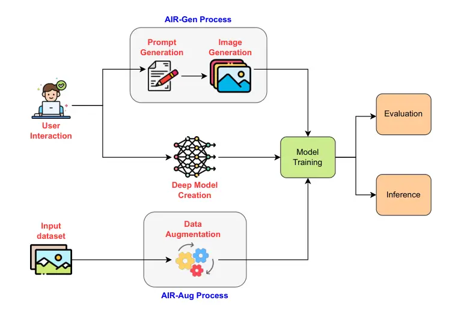

Figure 1: Overall pipeline of our proposed AIR framework with two
primary processes for data synthesis: AIR-Gen creating new datasets and
AIR-Aug generating augmented data for a given dataset.

With these advancements in mind, we harness cutting-edge generative AI
technologies to introduce a novel system called Automated Image
Recognition framework (AIR), comprising two primary data synthesis
processes: AIR Generation (AIR-Gen) and AIR Augmentation (AIR-Aug) (see
Fig. 1). AIR is specifically designed to cater to a wide spectrum of
end-users to train deep models for image classification. Even without
extensive AI expertise as well as available appropriate datasets, users
can simply describe what they seek to recognize. The AIR-Gen module
subsequently generates realistic image datasets and then autonomously
trains deep classifiers, empowering users to leverage trained models for
predictions on their own images. Meanwhile, AIR-Aug augments a given
dataset, thereby boosting the performance of deep classifier models,
which is especially advantageous when users have limited data for
specific tasks.

While text-to-image diffusion models \[14, 1, 9\] can create impressive
images from textual descriptions, the formulation of descriptive
sentences with specific structures can significantly affect to the
quality of the generated images. To address this issue, we employ
in-context learning techniques in conjunction with powerful large
language models, such as GPT-3.5-Turbo, to develop an automated prompt
engineering module. This novel module streamlines the fine-tuning of
input prompts for text-to-image models, resulting in the production of
higher-quality, realistic images in the module AIR-Gen.

In the data augmentation process of AIR-Aug, we focus on creating a
simulated dataset that captures the essential characteristics of the
original dataset, thereby maintaining the dataset’s diversity and
providing a contextually accurate environment for model training.
Particularly, we directly extract textual prompts from the images in the
given dataset using the CLIP \[11\] text decoder and use these prompts
for the image generation process. Furthermore, we incorporate a style
transfer step optionally by training CycleGAN \[17\] model to help
lessen the difference in image quality and visual attributes (_e.g_.,
noise, blurriness, brightness, and color temperature) between the
provided dataset and the images created by the text-to-image model.

To demonstrate the real-world utility of our system, extensive
experiments are conducted to evaluate the usability of generated
datasets. The efficacy of AIR-Gen in the context of early forest fire
recognition is evaluated, resulting in a dataset exhibiting an
appropriate distribution compared to real images on the Internet,
leading to an impressive accuracy of 95.48% in training image
classification models. In addition, to assess the capacity of AIR-Aug in
providing augmented images to improve the performance of image
recognition models, we augment the MIT Indoor Scene dataset \[10\] and
integrate it with the original dataset for training a deep classifier
model. The experimental findings reveal the potential of AIR-Aug in
enhancing the training of deep models when authentic data is limited,
resulting in a boost in recognition accuracy of approximately 4%.
Furthermore, to gauge the effectiveness of our method, we conduct a user
study by letting participants experience AIR, especially AIR-Gen. The
outcome of our survey demonstrates a high overall user satisfaction,
resulting in an impressive overall score of 4.4 out of 5.0. This
reflects exceedingly positive user experiences with our AIR. In summary,
our main contributions are as follows:

- •
  We introduce the novel AIR framework, including AIR-Gen, an approach
  that empowers users to effortlessly create custom datasets tailored to
  their specific requirements, and AIR-Aug, a data augmentation method
  designed to further enhance limited datasets in real-world scenarios.
  This obviates the extensive human labeling process and facilitates the
  automatic training of deep learning models.
- •
  We propose a novel automated prompt engineering module, simplifying
  the process of generating well-designed prompts for text-to-image
  tasks.
- •
  We showcase the real-world applicability of our generated data in deep
  learning model training, highlighting the effectiveness of our method
  in providing deep models for a wide range of image recognition tasks.

## 2 Related Work

Generative model-based text-to-image, driven by large-scale datasets ,
is rapidly evolving, drawing widespread attention from scientists and
the public alike. Notably, these advancements center around two dominant
approaches: GANs \[3, 17\] known for high-fidelity image synthesis and
fast inference but contend with training instability and diversity
issues, diffusion models \[14, 1, 9\] excelling in producing
high-quality, realistic images. Pioneering works \[9\] integrated
diffusion model with classifier guidance to improve image quality. After
that, to balance efficiency and fidelity, novel techniques have emerged,
such as the coarse-to-fine generation \[14, 1\] and latent space
exploration \[13\]. Built on the latent diffusion concept, Stable
Diffusion \[13\] became a pivotal open-source model, expanding
text-to-image synthesis capabilities. Our system adopts Stable Diffusion
for the text-to-image generation module, drawn to its remarkable image
quality and the availability of robust pre-trained weights.

Image recognition, a fundamental task in computer vision, involves
assigning input images to predefined classes, enabling machines to
interpret visuals and make informed decisions, serving as a linchpin for
AI applications. In recent years, the field of image recognition has
witnessed a transformative revolution driven by the emergence of deep
learning models \[4, 16, 6, 8\] . These models have demonstrated
remarkable capabilities in learning intricate features and patterns from
large datasets, substantially improving our capacity to recognize and
categorize objects, scenes, and patterns within images. Our system
introduces a novel perspective by combining text-to-image generation
with image recognition model training. This integration enables users to
create customized datasets for training image classifiers, meeting the
demand for high-quality, domain-specific data crucial for real-world AI
performance. Our system also supports various standout backbone
architectures \[4, 16, 6, 8\], enhancing the flexibility and
adaptability of the image recognition pipeline, enabling users to
harness the potential of their data for precise and context-aware image
recognition.

## 3 Proposed Method

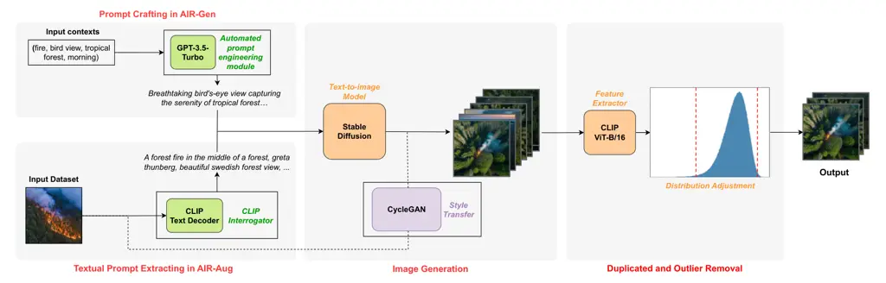

Figure 2: The dataset synthesis process consists of three key phases:
prompt generation, image generation, and duplicated and outlier removal.
The two processes AIR-Gen and AIR-Aug share the two latter phases while
differing in the prompt generation phase. Also, in AIR-Aug, we include
an optional style transfer step to minimize disparities in image quality
and visual attributes between the provided dataset and images generated
by the text-to-image model.

### 3.1 Dataset Synthesis Pipeline

The dataset synthesis processes of AIR-Gen and AIR-Aug are illustrated
in Fig. 2 with three main phases: prompt generation, image generation,
and duplicated and outlier removal. For AIR-Gen, first of all, the
prompt generation phase processes the user-provided description and
transforms it to relevant prompts which helps a text-to-image model to
generate corresponding images in the image generation phase. On the
other hand, the prompt generation phase for AIR-Aug involves extracting
textual prompts directly from the original given dataset. These prompts
are then passed to the image generation phase. We also incorporate a
style transfer phase in AIR-Aug as an optional choice to minimize the
disparity in image quality (_e.g_., noise, blurriness, brightness, and
color temperature) between the images in the provided dataset and those
generated by the text-to-image model. Finally, to ensure the quality of
the generated dataset in both modules, the duplicated and outlier
removal phase filters out all the unqualified images. The user interface
for this pipeline is presented in the supplementary.

#### Prompt Crafting in AIR-Gen

The quality and realisticness of images generated by the text-to-image
model, particularly Stable Diffusion, relies heavily on the input
prompts. Recently, the Civitai community  ¹¹ 1
[https://civitai.com/](https://civitai.com/) demonstrated that highly
detailed prompts, including terms like “4K" and “high resolution",
significantly enhance image quality. They also suggested using terms
within parentheses to guide the model’s attention (_e.g_. (word:1.4)
indicating an attention weight of 140%. However, crafting effective
prompts has traditionally been labor-intensive for users).

To tackle this challenge, we introduce an automated prompt engineering
module, alleviating the burden of manual prompt crafting. Users now need
only provide essential keywords describing the dataset’s context and
content. Instead of supervised fine-tuning a pre-trained model on
engineered prompts, we adopt an in-context learning approach by
providing task descriptions and examples to GPT-3.5-Turbo. Subsequently,
the model adeptly transforms context keywords into well-designed
prompts, enhancing prompt quality while minimizing user effort. The
template for prompt generation is provided in the supplementary.

|          |                                                                                                                                                                                                                                                 |
| -------- | ----------------------------------------------------------------------------------------------------------------------------------------------------------------------------------------------------------------------------------------------- |
| Context  | Input options                                                                                                                                                                                                                                   |
| Category | small fire and smoke, normal                                                                                                                                                                                                                    |
| Location | tropical forest, boreal forest                                                                                                                                                                                                                  |
| View     | drone’s view                                                                                                                                                                                                                                    |
| Time     | morning                                                                                                                                                                                                                                         |
| ID       | Generated well-designed prompt                                                                                                                                                                                                                  |
| 01       | A captivating drone’s view of a tropical forest at dawn, with a medium-intensity fire burning amidst the lush greenery, (dramatic:1.4), (serene:1.2), (vivid:1.3), (medium-intensity fire:1.4), 4K UHD image, Photorealistic, Intricate details |
| 02       | A mesmerizing aerial perspective of a boreal forest at sunrise, featuring a moderately intense fire blazing amidst the vibrant foliage, (captivating:1.4), (serense:1.3), 4K UHD image, Cinematic, Realistic                                    |
| 03       | An evocative drone’s view of a tropical forest at sunrise, (mysterious:1.3), (captivating:1.4), (intense:1.2), (lush:1.3), 4K UHD image, Realistic, Fine-tuned, Moody                                                                           |
| 04       | An enchanting top-down perspective of a temperate forest in the morning, (serene:1.3), (captivating:1.4), (intricate:1.3), 8K resolution, Cinematic, Fine-tuned, Intricate details                                                              |

Table 1: Example of input context options and completed prompts
generated for the task of early forest fire recognition.

To illustrate the process, we walk through the steps using the task of
early forest fire recognition as an illustrative example in Table 1:

- •
  Context options: To generate prompts related to desirable datasets, we
  define a set of contexts and their corresponding options, which we
  request from users. The “category" context is mandatory, determining
  the dataset’s class label. Additional contexts, such as “location”,
  “view captured”, and “times” are also provided, each with its
  respective options.
- •
  Context combinations: From the provided context options, we create
  context combinations, each comprising one choice from each context.
- •
  Context weights: The order of contexts in a combination affects prompt
  quality and image generation. The earlier a context appears, the more
  it influences the prompt. This order can be considered a weight for
  the combination.

Afterward, each combination is converted into a well-designed prompt.
This process repeats for all combinations, resulting in a set of
prompts, as shown in Table 1.

#### Extracting Textual Prompts in AIR-Aug

For this module, our approach centers on the creation of a simulated
dataset that effectively encapsulates the core characteristics of the
given dataset.

In ensuring the contextual fidelity of each image to its class, our
methodology involves using the CLIP \[11\] text decoder to extract
textual prompts directly from the given dataset, which is based on CLIP
Interrogator technique ²² 2
[https://github.com/pharmapsychotic/clip-interrogator](https://github.com/pharmapsychotic/clip-interrogator).
Furthermore, it is important to highlight that we do not utilize the
automated prompt engineering module for the prompts extracted in
AIR-Aug. These steps are deliberately chosen to avoid the unintended
generalization of context across all classes that may occur with
auto-generated prompts from our framework. By using extracted prompts
derived from the original dataset, we maintain the dataset’s diversity
and offer a fair, contextually accurate environment for model training.

To this end, we extract prompts from a given image dataset, ensuring
that prompts correspond to the same number of images. These prompts are
then utilized as inputs to the Stable Diffusion model. By leveraging
these prompts, the proposed method generates replicated images that
closely resemble those found within the original dataset.

#### Image Generation

Generated prompts are fed into Stable Diffusion, a cutting-edge
text-to-image model, to produce relevant images. The growing interest in
generative AI models has led to the emergence of powerful checkpoints
for impressive image generation using Stable Diffusion in various
domains. Among these, we specifically utilize the Realistic Vision
checkpoint ³³ 3
[https://civitai.com/models/4201/realistic-vision-v51](https://civitai.com/models/4201/realistic-vision-v51)
due to its ability to produce exceptionally strikingly realistic images.
Additionally, we employ techniques like CPU offloading and attention
layer acceleration⁴⁴ 4
[https://github.com/facebookresearch/xformers](https://github.com/facebookresearch/xformers)
to optimize memory and time consumption during the image generation
process.

#### Style Transfer in AIR-Aug

By employing text prompts extracted from the input dataset, the AIR-Aug
module facilitates the generation of images that align with the
dataset’s content. However, certain aspects of image quality and visual
characteristics (_e.g_., noise, blurriness, brightness, and color
temperature), which we refer to as “style”, may not be captured by
textual prompts and are difficult to faithfully recreate with a
pre-trained generative model (see the first two rows in Fig. 6). Hence,
we integrate a style transfer stage into AIR-Aug to bridge the stylistic
disparity between images in the provided dataset and those generated by
the Stable Diffusion model.

Specifically, the generated images are merged with the provided image
dataset to train a style transfer model. This model is then utilized to
transform the generated images into the same stylistic domain as the
provided images. Furthermore, given the unpaired structure of the data
for training, we employ CycleGAN \[17\], a well-known and strong model
within the realm of unpaired image-to-image translation. The output of
this phase can be seen in the last row in Fig. 6. It is important to
highlight that the training process for CycleGAN can be time-consuming.
As a result, we make the style transfer phase in the AIR-Aug module an
optional choice.

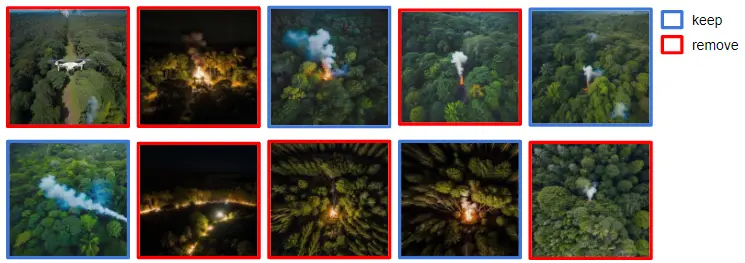

(a) Before

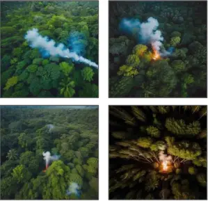

(b) After

Figure 3: Effectiveness of duplicated and outlier removal.

#### Duplicated and Outlier Removal

Upon examining the generated images stemming from the same prompt, we
observe variations in their resemblance to one another. This discovery
instigates a post-processing phase (_i.e_., duplicated and outlier
removal) aimed at ensuring the coherence among the images within the
dataset. This process is crucial for enhancing the accuracy and
reliability of subsequent data-driven models and is achieved through a
dataset distribution adjustment operation (see Fig. 2).

To facilitate the distribution adjustment process, we compute feature
vectors for the generated images using CLIP \[11\], a robust
vision-language model, specifically the B-L/16 version. Each generated
image is associated with a corresponding feature vector comprising 512
dimensions. Afterward, in the distribution adjustment process, we assess
the image similarity of every image pair using the cosine similarity
metric between their extracted features. Let $`\mathbf{u}_{i}`$ be the
feature vector of image $`i`$. The similarity score between a pair of
images $`i`$ and $`j`$ is denoted by
$`\text{sim}(\mathbf{u}_{i},\mathbf{u}_{j})=\frac{\mathbf{u}_{i}\cdot\mathbf{u}_{j}}{\left\|\mathbf{u}_{i}\right\|\left\|\mathbf{u}_{j}\right\|}`$.
We also define the number of neighbors of an image $`i`$ as the number
of image $`j`$ ($`j\neq i`$) by considering their similarity scores in
the range $`[\alpha,\beta]`$.

Our aim is to ensure that the similarity score between any pair of
generated images falls within the acceptable range $`[\alpha,\beta]`$.
If a pair fails to meet this condition, the image with fewer neighbors
is eliminated. This process effectively eliminates duplicates (whose
scores are greater than $`\beta`$) and irrelevant images (whose scores
are less than $`\alpha`$), illustrated in Fig. 3. We empirically set
$`\beta=0.9825`$ and finding $`\alpha`$ such that the retaining ratio is
$`0.9`$.

### 3.2 Deep Model Management

In addition to the dataset generation service, our AIR offers a
dedicated platform for deep learning model training, evaluation, and
inference. This comprehensive service is particularly advantageous for
end-users who may lack in-depth expertise in the intricacies of the
training process. Our platform streamlines and simplifies the creation
of custom high-accuracy deep image classification models, ensuring a
quick and user-friendly experience tailored for specific purposes. We
offer a range of backbone architectures, spanning from lightweight
options to state-of-the-art (SOTA) designs, such as ResNet \[4\],
EfficientNetV2 \[16\], Vision Transformer  \[6\], Swin
Transformer \[8\], and more. The backbone architecture chosen by users
serves as the feature extraction module for the model. Subsequently,
users can personalize their models by adding fully connected layers
following the feature extraction module.

Once the model is created, it becomes ready for training using the
generated dataset. Users can tailor various training configurations,
encompassing data ratio for training and validation, random seed for
result reproducibility, optimizer selection, learning rate adjustment,
and the number of training epochs. Furthermore, our platform features a
visual interface that offers real-time monitoring and analytical
capabilities throughout the training phase (see the user interface in
the supplementary). This tool empowers users to track model training
progress, visualize learning curves, and make informed decisions to
optimize training outcomes. Upon the completion of the training process,
our platform provides valuable insights into model performance, such as
training accuracy, validation accuracy, and a confusion matrix on the
validation set.

The final phase seamlessly supports model deployment and inference on
new data, enabling users to apply their trained models to real-world
tasks and make predictions effortlessly.

## 4 Experiments

### 4.1 Early Forest Fire Data Generation

Forest fires devastate the environment, human health, and ecosystems,
causing extensive damage like ecosystem degradation, soil erosion, and
air pollution. An early forest fire alert system is crucial for swift
control and mitigation, but collecting quality images of early fires for
training deep models is challenging. These images should be captured
from devices such as drones when the fire intensity is at its lowest,
resembling minimal smoke or a small fire. FLAME dataset \[15\], derived
from prescribed pile burns in Northern Arizona, is popular for this
task. Although images are valuable, their creation is time-consuming,
costly, and poses potential natural risks. They lack diversity in forest
types and natural conditions. On the other hand, the images of forest
fires available on the Internet are predominantly captured when the
fires have spread widely. Meanwhile, our AIR-Gen shows promise in
overcoming these hurdles.

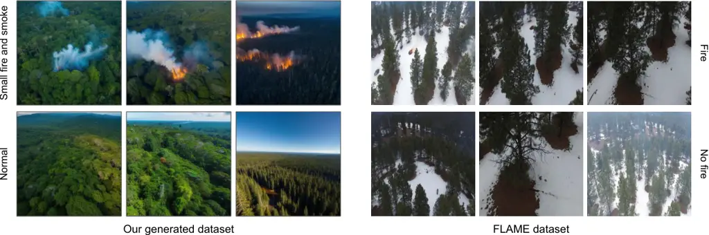

Figure 4: Samples from our generated dataset and the FLAME
dataset \[15\] for the task early forest fire recognition. Our dataset
encompasses a diverse range of forest types and natural conditions.

#### Dataset Generation

To accurately replicate drone-captured perspectives of early forest
fires, we utilized AIR-Gen to create a dataset encompassing two distinct
categories: “small fire and smoke” (4494 images) and “normal” (4361
images). This dataset offers a substantial volume of data for robust
training and evaluation. To ensure the dataset’s comprehensiveness, we
generate images aligning with the variety of context settings as
detailed in Table 1. Figure 4 showcases the diversity and realism of the
generated dataset compared to the FLAME dataset \[15\]. It is noteworthy
that we classify “small fire and smoke” as warning situations.
Meanwhile, the FLAME dataset only differentiates between “fire” and “no
fire”, which results in images with smoke not being marked as warning
situations in their dataset. Additionally, Figure 5(a) compares
generated images to actual forest fire images collected from the
Internet by ourselves, emphasizing a notable distinction that arises in
the representation of “small fire and smoke", a crucial indicator for
early warning.

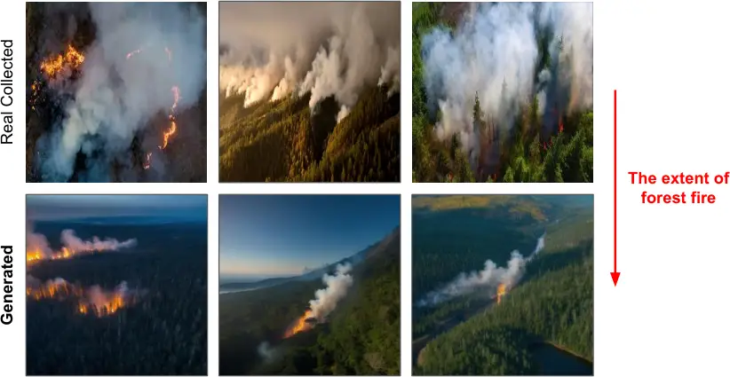

(a) Image visualization

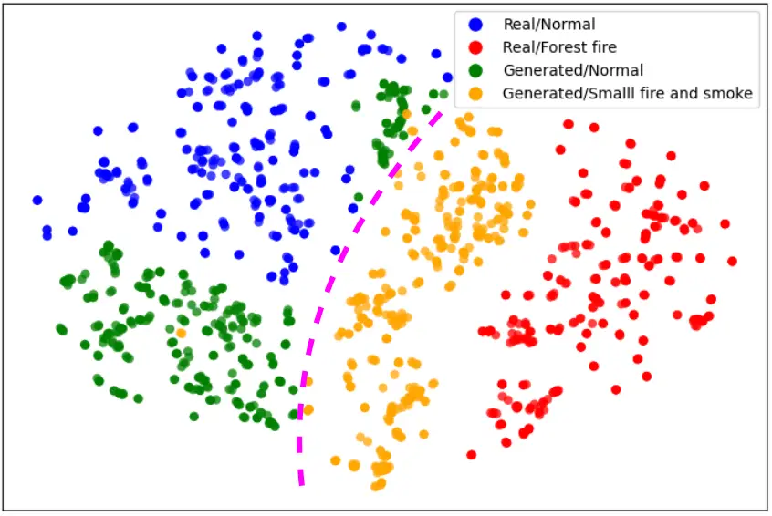

(b) Feature space visualization

Figure 5: Comparison of real images collected from the Internet about
forest fire (which mostly depict fires that have already spread widely)
and our generated images for early forest fire.

To validate the fidelity of the generated images in our dataset, we
conducted a feature space visualization involving four distinct image
collections: generated early forest fire, generated normal forest, real
collected forest fire, and real collected normal forest. Employing CLIP
image features \[11\] for visualization, Figure 5(b) reveals two
distinct clusters: normal forest and forest fire. Real and generated
images within the normal forest cluster nearly overlap, indicating high
resemblance. Conversely, forest fire images, both real (widely spead
fire) and generated (early fire), differ considerably. The generated
early fire images align more closely with the normal forest than the
real forest fire images, emphasizing their dissimilarity to extensive
fire images. This visualization underscores the quality and suitability
of our generated dataset for training a model for the task early forest
fire recognition.

We further utilize the deep model management in AIR to train
classification models on our generated dataset (The training details are
presented in the supplementary). To rigorously evaluate the model’s
performance and its ability to generalize across different subsets of
the dataset, we implemented $`k`$-fold cross-validation with $`k=5`$.
Our model’s performance was assessed using various metrics, including
weighted accuracy, precision, recall, and F1 score. Table  2 summarizes
our training results from each fold, indicating strong overall
performance, achieving a mean accuracy of 95.48%.

| Fold | Accuracy (%) | Precision (%) | Recall (%) | F1 Score (%) |
| ---- | ------------ | ------------- | ---------- | ------------ |
| 1    | 95.49        | 95.58         | 95.49      | 95.48        |
| 2    | 96.61        | 96.70         | 96.61      | 96.61        |
| 3    | 95.32        | 95.42         | 95.32      | 95.32        |
| 4    | 95.49        | 95.61         | 95.49      | 95.48        |
| 5    | 94.51        | 94.66         | 94.51      | 94.51        |
| Mean | 95.48        | 95.59         | 95.48      | 95.48        |

Table 2: Results for the task early forest fire recognition using 5-fold
protocol.

### 4.2 MIT Indoor Scene Dataset Augmentation

This experiment aims to utilize AIR-Aug to simulate a well-known dataset
for image recognition, MIT Indoor Scene dataset \[10\] (MIT-67 in
short), then leveraging generated images as valuable augmented data to
enhance deep model training, in conjunction with the original dataset.
Through the full data synthesis process of AIR-Aug, we obtain a
replicated dataset derived from the MIT-67 dataset. All replicated
images are synthesized to be of size $`512\times 512`$, mirroring the
number of images present in the original training set. Figure 6 presents
a comparison of images from the MIT-67 dataset and their corresponding
replicated versions.

Our primary focus in the evaluation is training EfficientNetV2 \[16\]
models, pre-trained on ImageNet \[2\] and fine-tuned for 25 epochs, on
different training image sets: only real images, hybrid images with both
replicated images and real images. We used a learning rate of
$`10^{-3}`$, a batch size of 64, the AdamW optimizer, and employed
Sparse Categorical Cross-entropy as the loss function.

Our evaluation process entails experiments to investigate how the
quantity of replicated datasets used as augmented data influences the
performance of classification metrics on the original test set of
MIT-67. Regarding the combination of the original dataset and replicated
dataset, we consider two options for the original dataset: utilizing 50%
of its dataset and utilizing the entire 100% dataset. We note that using
50% of the dataset aims to simulate the scenario where the original
dataset is limited and difficult to collect. For the augmented dataset,
we explore four options: 10%, 20%, 50%, and 100%. Figure 7 shows the
potential benefits of including generated data from the AIR-Aug module
in the training process. Particularly, we can boost the accuracy metric
on the test set by roughly 4% when the augmented dataset is fully
aggregated to the original training set.

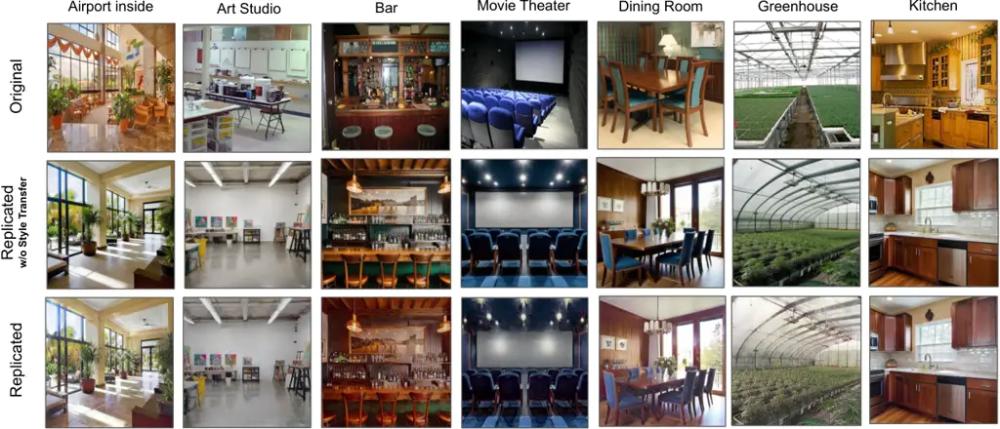

Figure 6: Examples of original MIT-67 dataset \[10\] (top), replicated
results without Style Transfer (middle), and our replicated results
(bottom).

Figure 7: Evaluation results of augmenting dataset \[10\] with AIR-Aug
on the original test set of MIT-67. The blue lines and the orange lines
respectively indicate the utilization of 100% and 50% number of images
of the original train set to perform the augmentation.

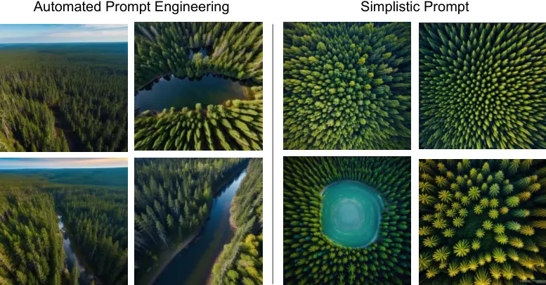

(a) Image visualization

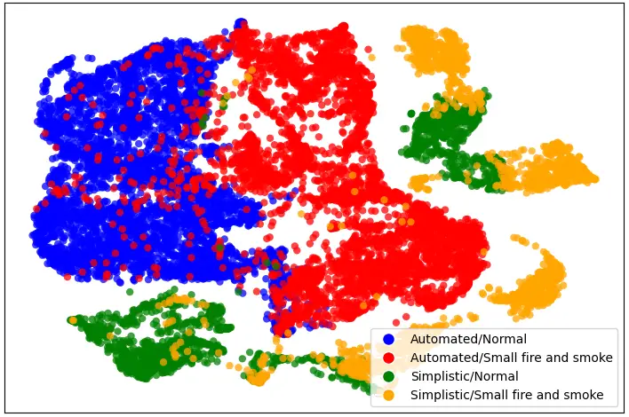

(b) Feature space visualization

Figure 8: Visual comparison of generated forest images using our
proposed automated prompt engineering module compared with simplistic
prompts.

### 4.3 Ablation Study

Automated Prompt Engineering: To demonstrate the effectiveness of our
proposed automated prompt engineering compared to simplistic prompts
(_i.e_., combinations of context keywords), we visualize the feature
space of generated images with the context given in Table 1, using
CLIP \[11\] image features (see Fig. 8(b)). When simplistic prompts are
utilized, the text-to-image model often produces visually similar
images, resulting in numerous small clusters of green and yellow points
in Fig. 8(b). In contrast, our proposed automated prompt engineering
module leads to a more reasonable and spread-out distribution. We also
provide the example of generated images in Fig. 8(a). This enhancement
can increase the usefulness of the generated dataset.

Style Transfer: As shown in Table 3, style transfer is crucial in data
augmentation. Utilizing CycleGAN for style transfer can notably enhance
the top-1 accuracy by 3.2% on the fully replicated dataset, resulting in
an accuracy of 81.72%.

|  | 0     | 10            | 20            | 50            | 100           |
| ---------------------------------------------------------- | ----- | ------------- | ------------- | ------------- | ------------- |
| Ours                                                       | 77.54 | 79.18         | 79.18         | 80.00         | 81.72         |
| w/o Removal                                                | –     | 77.15 (-2.03) | 78.58 (-0.6)  | 79.10 (-0.9)  | 80.00 (-1.72) |
| w/o Style Transfer                                         | –     | 77.83 (-1.35) | 77.76 (-1.42) | 78.06 (-1.94) | 78.50 (-3.22) |

Table 3: The top-1 accuracy (%) using the original training set of MIT
combined with our augmented data on the original test set of MIT-67
between our method, without duplicated and outlier removal, and without
style transfer.

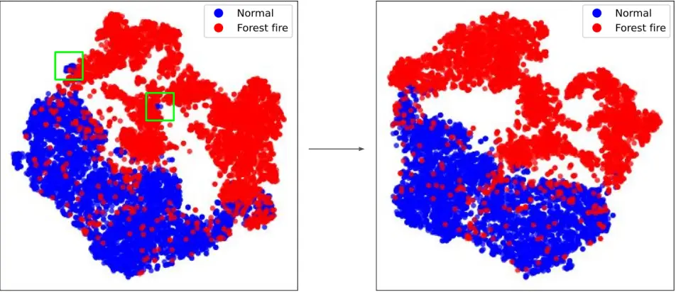

Figure 9: Feature space visualization of our generated images before and
after using duplicated and outlier removal.

Duplicated and Outlier Removal: Regarding AIR-Gen, Figure 9 visualizes
the feature space before and after eliminating duplicates and outliers
with the context provided in Table 1. This process eliminates some local
clusters of the "Normal" class that were too far away from the major
cluster. Meanwhile, for AIR-Aug, we conduct experiments to determine the
effectiveness of our module in improving the quality of the replicated
dataset used for data augmentation. Table 3 indicate that the removal
module can improve the top-1 accuracy by 1.72%, achieving an accuracy of
81.72% on the fully replicated dataset.

### 4.4 User Study

We conducted a user study to evaluate the effectiveness of AIR,
especially AIR-Gen, in supporting Computer Science (CS) students and
experts in their projects. Our study involved 20 participants, of which
half of them (55%) were CS undergraduates with limited AI expertise,
still in the process of early learning AI. The remaining participants
consisted of those with actual AI experience by practically working in
the field, including CS graduate students (15%), AI researchers, and AI
engineers (30%).

We launched AIR and invited participants to experience and rate its
performance across various aspects. Our study primarily aims to measure
users’ satisfaction in five criteria, namely, ease of usage, synthesized
image quality, dataset usefulness, trained model performance and
reproducibility portability. Table 4 summarizes the Mean Opinion Score
(MOS) and the Median Interquartile Range (IQR) of each factor on a scale
of 1 to 5 (1: least satisfied, 5: most satisfied) from the user study
evaluation. Our system obtains an impressive overall score of 4.4 out of
5.0, reflecting highly positive overall user experiences.

By enabling users to download their trained models and offering an
easy-to-use Google Colab running script, we achieve a high score on the
reproducibility of model predictions. However, our users often request
datasets focused on very specific topics, such as anime, game styles, or
landmarks in certain countries. These preferences might not match the
strengths of the Realistic Vision checkpoint used in our Stable
Diffusion model for image generation. This mismatch results in lower
scores for image photorealism and the alignment of the generated dataset
with their expectations.

| Evaluated Features                              | MOS  | Median (IQR) |
| ----------------------------------------------- | ---- | ------------ |
| Ease of interaction even without AI familiarity | 4.20 | 4 (1)        |
| Photorealistic image generation                 | 3.95 | 4 (0.5)      |
| Alignment with dataset expectations             | 3.95 | 4 (0.5)      |
| Trained models performance                      | 4.40 | 5 (1)        |
| Reproducibility of model’s predictions          | 4.75 | 5 (1)        |
| Overall                                         | 4.40 | -            |

Table 4: Summary of user study results, using Mean Opinion Score (MOS)
and Median Interquartile Range (IQR). Scores range from 1 (least
satisfied) to 5 (most satisfied).

## 5 Conclusion and Future Work

In this paper, we introduced AIR, a comprehensive solution tailored for
automated image recognition. Our proposed method comprises a data
generation pipeline for crafting customized high-quality datasets and a
data augmentation process to further enhance given datasets effectively,
alongside a complete framework for training, evaluating, and inferring
image recognition models. Through extensive experiments, we demonstrated
the effectiveness of our generated and augmented data in training deep
learning models, and showcased the system’s capability to produce image
recognition models for a wide variety of concepts. The user study
reveals that AIR can empower a broad spectrum of users, including those
without extensive expertise in AI.

It is also noteworthy that the data generation process of AIR is still
limited by the capability of the Stable Diffusion model. Consequently,
AIR does not perform well in certain specific domains, such as medical
image or non-realistic image synthesis. To broaden AIR’s applications,
we aim to expand its potential by incorporating more Stable Diffusion
checkpoints and automatically switching between them to optimize
performance for specific dataset requirements.

Acknowledgments. This research is funded by Vietnam National
University - Ho Chi Minh City (VNU-HCM) under Grant Number C2024-18-25.

## References

- \[1\] Balaji, Y., Nah, S., Huang, X., Vahdat, A., Song, J., Kreis, K.,
  Aittala, M., Aila, T., Laine, S., Catanzaro, B., et al.: ediffi:
  Text-to-image diffusion models with an ensemble of expert denoisers.
  arXiv preprint arXiv:2211.01324 (2022)
- \[2\] Deng, J., Dong, W., Socher, R., Li, L.J., Li, K., Fei-Fei, L.:
  Imagenet: A large-scale hierarchical image database. In: CVPR. pp.
  248–255 (2009)
- \[3\] Goodfellow, I., Pouget-Abadie, J., Mirza, M., Xu, B.,
  Warde-Farley, D., Ozair, S., Courville, A., Bengio, Y.: Generative
  adversarial networks. Communications of the ACM 63(11), 139–144 (2020)
- \[4\] He, K., Zhang, X., Ren, S., Sun, J.: Deep residual learning for
  image recognition. In: CVPR. pp. 770–778 (2016)
- \[5\] Kang, M., Zhu, J.Y., Zhang, R., Park, J., Shechtman, E., Paris,
  S., Park, T.: Scaling up gans for text-to-image synthesis. In: CVPR.
  pp. 10124–10134 (2023)
- \[6\] Kolesnikov, A., Dosovitskiy, A., Weissenborn, D., Heigold, G.,
  Uszkoreit, J., Beyer, L., Minderer, M., Dehghani, M., Houlsby, N.,
  Gelly, S., Unterthiner, T., Zhai, X.: An image is worth 16x16 words:
  Transformers for image recognition at scale. In: ICLR (2021)
- \[7\] Le, T.N., Sugimoto, A., Ono, S., Kawasaki, H.: Toward
  interactive self-annotation for video object bounding box: Recurrent
  self-learning and hierarchical annotation based framework. In:
  WACV (2020)
- \[8\] Liu, Z., Lin, Y., Cao, Y., Hu, H., Wei, Y., Zhang, Z., Lin, S.,
  Guo, B.: Swin transformer: Hierarchical vision transformer using
  shifted windows. In: CVPR. pp. 10012–10022 (2021)
- \[9\] Nichol, A., Dhariwal, P., Ramesh, A., Shyam, P., Mishkin, P.,
  McGrew, B., Sutskever, I., Chen, M.: Glide: Towards photorealistic
  image generation and editing with text-guided diffusion models. arXiv
  preprint arXiv:2112.10741 (2021)
- \[10\] Quattoni, A., Torralba, A.: Recognizing indoor scenes. In:
  CVPR. pp. 413–420 (2009)
- \[11\] Radford, A., Kim, J.W., Hallacy, C., Ramesh, A., Goh, G.,
  Agarwal, S., Sastry, G., Askell, A., et al.: Learning transferable
  visual models from natural language supervision. In: ICML. pp.
  8748–8763 (2021)
- \[12\] Radford, A., Narasimhan, K., Salimans, T., Sutskever, I.,
  et al.: Improving language understanding by generative
  pre-training (2018)
- \[13\] Rombach, R., Blattmann, A., Lorenz, D., Esser, P., Ommer, B.:
  High-resolution image synthesis with latent diffusion models. In:
  CVPR. pp. 10684–10695 (2022)
- \[14\] Saharia, C., Chan, W., Saxena, S., Li, L., Whang, J., Denton,
  E.L., Ghasemipour, K., Gontijo Lopes, R., Karagol Ayan, B., Salimans,
  T., et al.: Photorealistic text-to-image diffusion models with deep
  language understanding. NeurIPS 35, 36479–36494 (2022)
- \[15\] Shamsoshoara, A., Afghah, F., Razi, A., Zheng, L., Fulé, P.Z.,
  Blasch, E.: Aerial imagery pile burn detection using deep learning:
  The flame dataset. Computer Networks 193, 108001 (2021)
- \[16\] Tan, M., Le, Q.: Efficientnetv2: Smaller models and faster
  training. In: ICML. pp. 10096–10106 (2021)
- \[17\] Zhu, J.Y., Park, T., Isola, P., Efros, A.A.: Unpaired
  image-to-image translation using cycle-consistent adversarial
  networks. In: ICCV. pp. 2223–2232 (2017)
