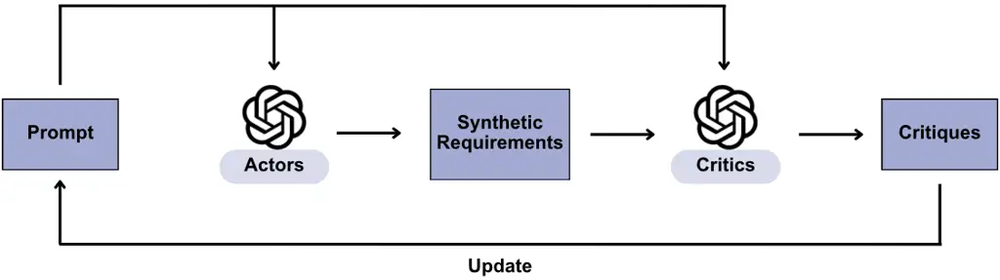
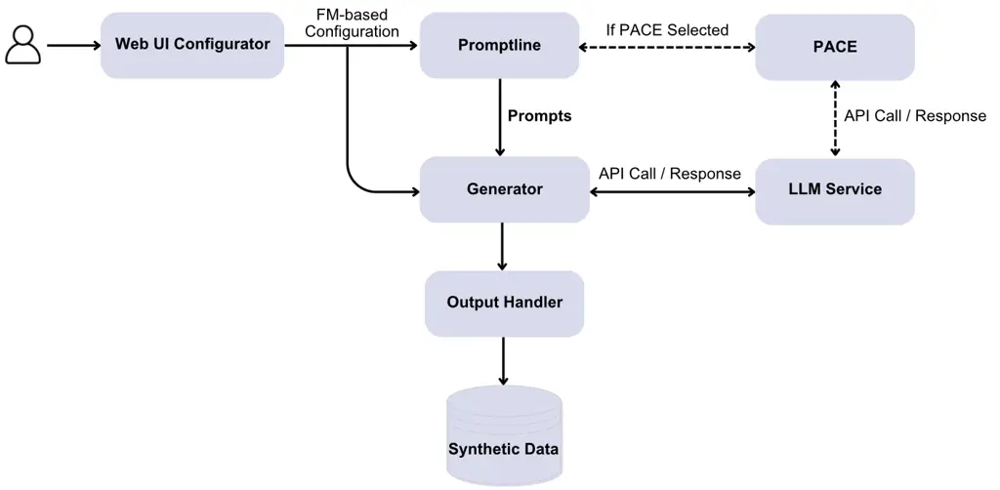

# Multi-Sample Prompting and Actor-Critic Prompt Optimization for Diverse Synthetic Data Generation

Abdelkarim El-Hajjami

   Camille Salinesi

Affiliation: Paris 1 Panthéon–Sorbonne University, Paris, France
E-mail [{abdelkarim.el-hajjami,
camille.salinesi}@univ-paris1.fr](mailto:%7Babdelkarim.el-hajjami,%20camille.salinesi%7D@univ-paris1.fr)

###### Abstract

High-quality labeled datasets are fundamental for training and
evaluating machine learning models, yet domains such as healthcare and
Requirements Engineering (RE) face persistent barriers due to data
scarcity, privacy constraints, or proprietary restrictions. While Large
Language Models (LLMs) offer a promising avenue for Synthetic Data
Generation (SDG), LLM-generated data tends to be repetitive and low in
diversity, reducing its effectiveness for downstream tasks. Two
approaches show potential for addressing this limitation: (1)
multi-sample prompting, which generates multiple samples per prompt to
reduce repetition, and (2) Prompt with Actor-Critic Editing (PACE),
which iteratively refines prompts to maximize diversity. We integrate
both mechanisms into Synthline, a Feature Model-based configurable
synthetic data generator, and assess their effects on diversity and
downstream utility across four RE classification tasks. Multi-sample
prompting consistently improves both diversity and utility, with
F1-score gains of 6 to 43.8 percentage points. PACE-based prompt
optimization consistently improves lexical diversity but produces
task-dependent utility effects, revealing the risks of optimizing for
diversity alone. Most notably, synthetic data can match or surpass
human-authored data for tasks where real labeled data is limited, with
improvements of up to 15.4 percentage points in F1-score.

###### Keywords: 

Synthetic Data Generation Large Language Models Prompt Optimization
Requirements Engineering

## 1 Introduction

High-quality labeled datasets are fundamental for training and
evaluating machine learning models, yet acquiring such data remains
costly, time-consuming, and often restricted by privacy or proprietary
constraints \[1\]. Large Language Models (LLMs) have emerged as a
practical tool for Synthetic Data Generation (SDG), offering the ability
to produce labeled training examples on demand \[3\].

LLM-based SDG, however, faces a core limitation: the generated data
tends to be repetitive and low in diversity, reducing its effectiveness
for downstream tasks \[1, 7\]. Early SDG approaches relied on zero-shot
prompting \[4\], where an LLM generates task-specific data without
examples. Few-shot prompting \[1\] improved control by conditioning
generation on a small set of labeled samples. Attributed prompting \[5\]
improves diversity over simple class-conditional prompting by specifying
data attributes (e.g., domain, style, length) in the prompt. Our prior
work on Synthline \[6\], a Feature Model (FM)-based configurable
synthetic data generator, systematized this approach by enabling
fine-grained control over generation attributes. However, despite this,
the generated data still exhibited lower diversity than real data,
indicating that attribute-based approaches alone are insufficient to
address the diversity limitation. Zhang et al. \[7\] trace this
limitation to post-training alignment, which introduces typicality bias:
human annotators favor familiar text, causing LLMs to converge toward
stereotypical outputs and leading to mode collapse. The problem we
address in this paper is: how can we improve the diversity of
LLM-generated synthetic data while preserving or improving its
downstream utility for classification tasks?

Two approaches show potential for addressing this limitation. First,
multi-sample prompting, requesting multiple data points within a single
prompt, has been shown to improve diversity in paraphrase
generation \[9\]. Second, automatic prompt optimization techniques such
as Prompt with Actor-Critic Editing (PACE) \[10\] offer a promising
direction for SDG \[11\]. Neither approach has been evaluated for SDG.

In this paper, we address this gap. We integrate multi-sample prompting
and PACE into Synthline, and evaluate their effects on both the
diversity and the downstream classification utility of the generated
data. We formulate the following research questions:

- •
  RQ1: How does multi-sample prompting impact the diversity and utility
  of synthetic data for classification tasks?
- •
  RQ2: How does PACE-based prompt optimization influence the diversity
  and utility of synthetic data for classification tasks?
- •
  RQ3: To what extent can synthetic data replace or surpass
  human-authored data for classification tasks?

We evaluate both diversity and utility because they capture
complementary quality dimensions of synthetic training data \[1, 3\].
Diversity measures whether the LLM produces varied outputs—necessary
because repetitive synthetic data underrepresents the variability of
real-world instances, which can limit the effectiveness of classifiers
trained on it \[1, 7\]. Utility measures whether the generated data
actually improves downstream task performance, which is the ultimate
goal of SDG. Evaluating both is essential because they do not always
align: increasing diversity through techniques such as temperature
sampling can degrade label accuracy \[8\], while low-diversity data may
overfit to narrow patterns.

We ground our study in the domain of Requirements Engineering (RE),
where data scarcity is a well-documented challenge. The shortage of
publicly available, labeled datasets remains a major barrier to
advancing AI-based RE research \[12, 2, 13\]. This persistent scarcity,
combined with common issues such as small scale, class imbalance, and
narrow domain coverage \[12, 14, 13\], makes RE a relevant domain for
studying SDG. While we use RE classification tasks for evaluation, the
approaches themselves are domain-agnostic and applicable wherever
synthetic training data is needed.

Our experimental findings show that multi-sample prompting substantially
improves both diversity and downstream utility, with F1-score gains of 6
to 43.8 percentage points across tasks. PACE consistently improves
lexical diversity but has task-dependent effects on utility,
highlighting the risks of optimizing for diversity alone. Most notably,
synthetic data can match or surpass human-authored data for specific
classification tasks, with improvements of up to 15.4 percentage points
in F1-score.

Contributions. (1) We provide an empirical evaluation of multi-sample
prompting and PACE-based prompt optimization for SDG, revealing that
multi-sample prompting consistently improves both diversity and utility,
while PACE yields diversity gains with task-dependent utility effects.
(2) We present Synthline, an FM-based configurable synthetic data
generator that integrates these mechanisms, released publicly for
reproducibility.¹¹ 1
[https://github.com/abdelkarim-elhajjami/synthline/tree/v0.1.0](https://github.com/abdelkarim-elhajjami/synthline/tree/v0.1.0)

The paper is structured as follows: Section 2 presents Synthline and the
two diversity mechanisms. Section 3 describes the experimental setup.
Section 4 presents the results. Section 5 discusses the findings, their
implications, and threats to validity. Section 6 concludes.

## 2 Synthline Overview

Synthline is a FM-based generator for synthetic data \[6\]. Its
configurable architecture allows users to control the variability of
generated data through feature selection. In this paper, we extend
Synthline with two mechanisms designed to address a core challenge of
LLM-based SDG: the lack of output diversity caused by post-training
typicality bias \[7\]. The first mechanism, multi-sample prompting,
exploits within-context awareness to reduce repetition without any
additional infrastructure. The second mechanism, PACE-based prompt
optimization, automates the search for diversity-maximizing prompts
through iterative actor-critic refinement, removing the burden of manual
prompt engineering. We describe the FM that structures Synthline’s
configuration space, then detail each mechanism and the overall
architecture.

### 2.1 Feature Model

Synthline is organized around four feature groups. The Generator feature
controls data generation through LLM configuration (model selection,
temperature, top-p) and the prompting approach: samplesPerPrompt sets
the number of samples requested per prompt, while promptApproach selects
between Default template-based prompting and PACE automated prompt
optimization. When PACE is selected, additional parameters become
available: paceIterations, paceActors, and paceCandidates. The Artifact
feature specifies characteristics of the generated data (requirement
type, specification level, source, format, domain, and language). The
MLTask feature defines the target classification task through a label
and its description. The Output feature specifies the format and size of
the generated dataset.

### 2.2 Multi-sample Prompting

When an LLM generates a single sample per prompt, post-training
alignment drives it toward the most stereotypical output for that
prompt \[7\]. Multi-sample prompting counteracts this by requesting
multiple samples within a single prompt, leveraging within-context
awareness to reduce repetition \[9\]. In Synthline, the number of
samples per prompt is configurable via samplesPerPrompt. This required
developing two distinct prompt templates: a single-sample template, and
a multi-sample template that explicitly requests multiple items and
instructs the LLM to return a JSON array. Beyond diversity, this
approach offers an efficiency advantage: generating $`n`$ samples per
prompt requires $`1/n`$ the number of API calls compared to
single-sample generation \[15\].

### 2.3 PACE-based Prompt Optimization

To move beyond manual prompt engineering, we integrated PACE \[10\]
directly into the generation workflow. As illustrated in Figure 1, PACE
operates as a pre-generation optimization loop. An Actor LLM generates a
batch of samples, and a Critic LLM evaluates them and provides feedback
to iteratively refine the prompt before the main generation phase
begins. More specifically, the process works as follows: (1) the Actor
receives the current prompt and generates a batch of candidate samples;
(2) each sample is scored using a configurable scoring function; (3) the
Critic receives the scored batch along with the current prompt and
produces natural-language feedback identifying weaknesses and suggesting
specific modifications; (4) the Actor incorporates this feedback to
generate revised prompt candidates. This cycle repeats for a fixed
number of iterations, after which the highest-scoring prompt is selected
for the main generation phase.

Figure 1: The PACE optimization process integrated into Synthline. The
Actor LLM generates candidate samples from the current prompt; a scoring
function evaluates the batch; the Critic LLM provides natural-language
feedback; and the Actor produces a revised prompt. After the final
iteration, the best-scoring prompt is forwarded to the main generation
phase.

In our implementation, the scoring function was configured to maximize
the average pairwise cosine distance between the Sentence-BERT
embeddings \[22\] of generated samples within a batch, thereby
encouraging diversity. This purely diversity-oriented objective allows
us to empirically test whether maximizing diversity at the prompt level
translates into improved downstream utility.

### 2.4 Architecture

As illustrated in Figure 2, the workflow begins with the Web UI
Configurator processing user-selected features and generating an
FM-based configuration that flows to the Promptline component.
Promptline interprets this configuration, produces all valid
combinations (termed atomic configurations), then constructs
corresponding prompts using single-sample or multi-sample templates
based on the samplesPerPrompt parameter.

Figure 2: Synthline architecture with conditional PACE optimization
branch.

When PACE optimization is enabled, Promptline invokes the PACE module,
which coordinates with the LLM Service to perform iterative refinement
before large-scale generation. When default prompting is selected,
prompts bypass PACE and flow directly to the Generator. Once prompts are
finalized, the Generator module orchestrates the main data generation
phase, managing large-scale interaction with the LLM Service. The
requested number of samples is distributed evenly across atomic
configurations, ensuring systematic coverage of the specified
variability space.

## 3 Experimental Setup

This section describes the experimental setup used to evaluate the two
diversity mechanisms presented in Section 2. The overall experimental
design is as follows: we compare three synthetic dataset
variants—single-sample generation (synthetic_1), multi-sample generation
(synthetic_20), and PACE-optimized multi-sample generation
(synthetic_20_pace)—against real-data baselines across four RE
classification tasks. For each variant, we evaluate both the diversity
of the generated data (using lexical and semantic metrics) and its
downstream utility (by training BERT classifiers and measuring their
performance on real test data). We first present the RE classification
tasks and real-world datasets used as evaluation benchmarks, then detail
the SDG configurations, and finally outline the evaluation protocol for
assessing diversity and utility.

### 3.1 Requirements Classification Tasks and Datasets

This study evaluates Synthline across four distinct RE classification
tasks. Each task uses established real-world datasets to provide
baselines for comparison.

#### Requirements Defects Classification

This task involves identifying common defects in requirement
specifications, crucial for early quality assurance \[16\]. We adopt the
six defect categories and definitions from Fazelnia et al. \[17\]:
Ambiguous, Directive, Non-Atomic, Non-Measurable, Optional, and
Uncertain. The corresponding real dataset contains 131 samples.

#### Functional vs. Non-Functional Classification

This binary classification task distinguishes between functional and
non-functional requirements. We use the Functional-Quality dataset from
Dalpiaz et al. \[18\], which contains 956 requirements from multiple
open-source and closed-source projects. The dataset contains 587
functional requirements and 369 non-functional requirements.

#### Quality vs. Non-Quality Classification

This task focuses on identifying quality requirements. Using the same
Functional-Quality dataset, a requirement is classified as Quality when
it possesses quality aspects (quality goals or quality
constraints) \[18\]. The dataset distribution for this task includes 522
quality requirements and 434 non-quality requirements.

#### Security vs. Non-Security Classification

This binary classification task identifies security-related
requirements. We use the SecReq dataset created by Knauss et al. \[19\],
containing 510 requirements collected from three security-focused
projects. The dataset contains 187 security-related requirements and 323
non-security related requirements.

### 3.2 Synthetic Data Generation

We configured Synthline to generate datasets for each of the four tasks.
As the backend LLM generator, we used the OpenAI model
gpt-4.1-nano-2025-04-14, selected for its optimal trade-off between
performance, speed, and cost as of our experimentation period in late
April 2025²² 2 OpenAI, Introducing GPT-4.1,
[https://openai.com/index/gpt-4-1/](https://openai.com/index/gpt-4-1/).
The base configuration used for generation is outlined in Table 1.

| Feature              | Value(s)                                                          |
| -------------------- | ----------------------------------------------------------------- |
| LLM                  | gpt-4.1-nano-2025-04-14                                           |
| Temperature          | 1.0                                                               |
| TopP                 | 1.0                                                               |
| Specification Level  | High-Level, Detailed                                              |
| Requirement Source   | End Users, Business Managers, Development Team, Regulatory Bodies |
| Specification Format | NL, Constrained NL, User Story                                    |
| Language             | English                                                           |
| Domain               | Telecommunications, Healthcare, Enterprise Data Management        |
| Output Format        | CSV                                                               |

Table 1: Base Configuration Parameters for SDG.

To investigate our RQs, we created different dataset variants by
manipulating specific generator features:

- •
  synthetic_1: Generated using samplesPerPrompt = 1 and the default
  prompt approach.
- •
  synthetic_20: Generated using samplesPerPrompt = 20 and the default
  prompt approach.
- •
  synthetic_20_pace: Generated using samplesPerPrompt = 20 and the PACE
  prompt approach. The PACE parameters (Table 2) follow the
  recommendations from \[10\]. The same LLM (gpt-4.1-nano-2025-04-14)
  was used for both Actor and Critic roles. We configured the scoring
  function to maximize the average pairwise cosine distance between
  Sentence-BERT embeddings (using all-MiniLM-L6-v2) of generated samples
  within each batch, thereby encouraging diversity.

For each variant and classification task, 500 synthetic samples were
generated per label. These samples were evenly distributed across all
atomic configurations, ensuring coverage of the specified feature space.

| Parameter                                 | Value           |
| ----------------------------------------- | --------------- |
| Number of Actor-Critic Pairs (n)          | 4               |
| Number of Iterations                      | 3               |
| Number of Candidate Prompts per Iteration | 2               |
| Temperature (Actor, Critic & Update)      | 0               |
| Top-p (Actor, Critic & Update)            | 1               |
| Scoring Function                          | Cosine distance |

Table 2: PACE parameters used for synthetic_20_pace generation
following \[10\].

### 3.3 Evaluation Setup

Our evaluation focuses on the quality of synthetic data as training data
for ML models. We evaluate along two complementary quality dimensions:
diversity and utility. Both dimensions are necessary because they can
diverge in practice: a dataset with high diversity but poor label
fidelity will not produce effective classifiers, while a dataset with
low diversity may overfit to narrow patterns and fail to generalize. By
measuring both, we can determine whether a given mechanism genuinely
improves the generated data or merely trades one quality dimension for
another.

#### Diversity Evaluation

We calculated diversity metrics for all dataset variants (real and
synthetic) for each classification task. The metrics include:

- •
  INGF (Inter-sample N-gram Frequency): This metric assesses lexical and
  phrase-level diversity by measuring how frequently the same n-grams
  (contiguous sequences of n words; we use trigrams, n=3) appear across
  different samples in the dataset. A high INGF score means the dataset
  contains repeated phrases across multiple samples, suggesting lower
  diversity at the expression level. Conversely, a lower INGF score
  reflects greater lexical variety and less phrase repetition between
  samples.
- •
  APS (Average Pairwise Similarity): This metric captures semantic
  diversity by computing the average cosine similarity between
  Sentence-BERT embeddings (using all-MiniLM-L6-v2) of text pairs. A
  higher APS indicates that samples tend to convey semantically similar
  content, while a lower APS suggests richer semantic diversity.

#### Utility Evaluation

To evaluate utility, we adopted the standard train-on-synthetic,
test-on-real paradigm. Specifically, for each synthetic dataset variant
(synthetic_1, synthetic_20, synthetic_20_pace), classifiers were trained
exclusively using that variant. These models, along with a baseline
model trained solely on 70% of the available real data, were then
consistently evaluated on a held-out test set comprising the remaining
30% of the real data specific to each classification task. We used
BERT-base-uncased \[20\] as the downstream model for all experiments. To
obtain statistically reliable performance estimates and mitigate the
effects of stochasticity inherent in model training, we conducted 5
independent runs for each dataset configuration, varying the random seed
for each run. For each configuration, hyperparameter optimization was
performed initially using Optuna \[21\] (32 trials) on a 90%/10%
stratified train/validation split derived from the first run’s data.
This process identified the optimal learning rate, batch size, weight
decay, and number of training epochs by maximizing the weighted F1-score
on the validation set. These best hyperparameters were then held
constant across all 5 runs for that configuration, ensuring consistency
while assessing performance variability. Model performance was
quantified using weighted Precision, Recall, and F1-score. We use
weighted F1-score as the primary summary metric because it balances
precision and recall while accounting for class imbalance through
class-frequency weighting, making it appropriate for datasets with
uneven label distributions. The final reported values represent the mean
and standard deviation calculated across the 5 independent runs for each
configuration.

## 4 Results

This section presents the experimental results addressing our three
research questions. We first examine the impact of multi-sample
prompting on synthetic data quality (RQ1), then evaluate the effect of
PACE-based prompt optimization (RQ2), and finally compare synthetic data
against human-authored requirements for classification tasks (RQ3).

Reading guide for tables. In all results tables, wP, wR, and wF1 denote
weighted Precision, Recall, and F1-score respectively (mean $`\pm`$
standard deviation across 5 runs). INGF is the Inter-sample N-gram
Frequency and APS is the Average Pairwise Similarity (both defined in
Section 3). For utility metrics, lower standard deviation indicates more
stable performance; for INGF and APS, lower values indicate higher
diversity. Bold values indicate the best result for each metric within
each task comparison.

### 4.1 RQ1: How does multi-sample prompting impact the diversity and utility of synthetic data for classification tasks?

We compared datasets generated with one sample per prompt (synthetic_1)
versus twenty samples per prompt (synthetic_20).

| Task       | Dataset      | wP                 | wR                 | wF1                | INGF  | APS   |
| ---------- | ------------ | ------------------ | ------------------ | ------------------ | ----- | ----- |
| Security   | Synthetic_1  | 0.649 $`\pm`$ 0.27 | 0.419 $`\pm`$ 0.07 | 0.325 $`\pm`$ 0.12 | 2.420 | 0.409 |
|            | Synthetic_20 | 0.808 $`\pm`$ 0.02 | 0.756 $`\pm`$ 0.04 | 0.763 $`\pm`$ 0.04 | 1.817 | 0.293 |
| Quality    | Synthetic_1  | 0.673 $`\pm`$ 0.17 | 0.581 $`\pm`$ 0.00 | 0.430 $`\pm`$ 0.01 | 2.194 | 0.392 |
|            | Synthetic_20 | 0.700 $`\pm`$ 0.03 | 0.650 $`\pm`$ 0.01 | 0.590 $`\pm`$ 0.03 | 1.571 | 0.281 |
| Functional | Synthetic_1  | 0.841 $`\pm`$ 0.01 | 0.369 $`\pm`$ 0.02 | 0.365 $`\pm`$ 0.04 | 2.152 | 0.393 |
|            | Synthetic_20 | 0.819 $`\pm`$ 0.01 | 0.413 $`\pm`$ 0.07 | 0.425 $`\pm`$ 0.10 | 1.626 | 0.305 |
| Defects    | Synthetic_1  | 0.481 $`\pm`$ 0.05 | 0.415 $`\pm`$ 0.04 | 0.414 $`\pm`$ 0.04 | 2.252 | 0.372 |
|            | Synthetic_20 | 0.621 $`\pm`$ 0.04 | 0.535 $`\pm`$ 0.03 | 0.526 $`\pm`$ 0.02 | 1.619 | 0.268 |

Table 3: Comparison of Utility (Weighted Metrics) and Diversity Between
Single-Sample (synthetic_1) and Multi-Sample (synthetic_20) Datasets.

Requesting multiple samples per prompt (synthetic_20) improves the
synthetic data across both quality dimensions: utility and diversity
(Table 3).

Utility. The multi-sample approach consistently outperforms
single-sample generation in nearly all metrics, with F1-score
improvements ranging from 6 to 43.8 percentage points across
classification tasks. The largest gain appears for Security (+43.8 pp),
followed by Defects (+11.2 pp) and Quality (+16 pp). The only exception
is in the functional classification task where synthetic_1 achieved
higher precision, but synthetic_20 still delivered better overall
utility with higher recall and F1-scores.

Diversity. Synthetic_20 datasets show substantially lower INGF values
(25–28% reduction) indicating less repetitive phrasing, and lower APS
scores (22–28% reduction) demonstrating greater semantic diversity
between samples. These improvements are consistent across all four
tasks.

These findings demonstrate that generating multiple samples in a single
prompt leads to synthetic datasets with both higher utility for training
classifiers and greater linguistic diversity.

### 4.2 RQ2: How does PACE-based prompt optimization influence the diversity and utility of synthetic data for classification tasks?

We compared standard multi-sample generation (synthetic_20) with
PACE-optimized multi-sample generation (synthetic_20_pace).

| Task       | Dataset           | wP                 | wR                 | wF1                | INGF  | APS   |
| ---------- | ----------------- | ------------------ | ------------------ | ------------------ | ----- | ----- |
| Security   | Synthetic_20      | 0.808 $`\pm`$ 0.02 | 0.756 $`\pm`$ 0.04 | 0.763 $`\pm`$ 0.04 | 1.817 | 0.293 |
|            | Synthetic_20_pace | 0.798 $`\pm`$ 0.02 | 0.713 $`\pm`$ 0.06 | 0.718 $`\pm`$ 0.06 | 1.467 | 0.290 |
| Quality    | Synthetic_20      | 0.700 $`\pm`$ 0.03 | 0.650 $`\pm`$ 0.01 | 0.590 $`\pm`$ 0.03 | 1.571 | 0.281 |
|            | Synthetic_20_pace | 0.743 $`\pm`$ 0.02 | 0.668 $`\pm`$ 0.02 | 0.609 $`\pm`$ 0.04 | 1.387 | 0.267 |
| Functional | Synthetic_20      | 0.819 $`\pm`$ 0.01 | 0.413 $`\pm`$ 0.07 | 0.425 $`\pm`$ 0.10 | 1.626 | 0.305 |
|            | Synthetic_20_pace | 0.858 $`\pm`$ 0.01 | 0.723 $`\pm`$ 0.06 | 0.750 $`\pm`$ 0.05 | 1.512 | 0.309 |
| Defects    | Synthetic_20      | 0.621 $`\pm`$ 0.04 | 0.535 $`\pm`$ 0.03 | 0.526 $`\pm`$ 0.02 | 1.619 | 0.268 |
|            | Synthetic_20_pace | 0.460 $`\pm`$ 0.05 | 0.465 $`\pm`$ 0.02 | 0.448 $`\pm`$ 0.03 | 1.442 | 0.276 |

Table 4: Comparison of Utility (Weighted Metrics) and Diversity Between
Standard Multi-Sample (synthetic_20) and PACE-Optimized
(synthetic_20_pace) Datasets.

The impact of PACE optimization on synthetic data quality varies across
classification tasks (Table 4). For diversity, PACE consistently
improves phrase-level diversity with lower INGF values across all tasks
(10–19% reduction), indicating less repetitive phrasing. However, its
effect on semantic diversity (APS) is minimal, with only slight
improvements in two tasks. Regarding utility, PACE produces mixed
results: it dramatically improves classification performance for
Functional requirements (F1-score increase of 32.5 percentage points)
and moderately improves Quality classification (1.9 percentage point
gain). However, it negatively impacts Security and Defects
classification performance, with F1-score decreases of 4.5 and 7.8
percentage points respectively. These findings suggest that while PACE
consistently enhances lexical diversity based on its cosine distance
objective, its impact on downstream classification utility is
task-dependent.

### 4.3 RQ3: To what extent can synthetic data replace or surpass human-authored data for classification tasks?

We compared the performance of models trained on the best performing
synthetic dataset variant for each task against models trained on the
real dataset.

| Task       | Dataset           | wP                  | wR                  | wF1                 |
| ---------- | ----------------- | ------------------- | ------------------- | ------------------- |
| Security   | Real              | 0.720 $`\pm`$ 0.031 | 0.682 $`\pm`$ 0.038 | 0.685 $`\pm`$ 0.035 |
|            | Synthetic_20      | 0.808 $`\pm`$ 0.022 | 0.756 $`\pm`$ 0.044 | 0.763 $`\pm`$ 0.043 |
| Quality    | Real              | 0.712 $`\pm`$ 0.007 | 0.688 $`\pm`$ 0.014 | 0.688 $`\pm`$ 0.015 |
|            | Synthetic_20_pace | 0.743 $`\pm`$ 0.024 | 0.668 $`\pm`$ 0.018 | 0.609 $`\pm`$ 0.036 |
| Functional | Real              | 0.891 $`\pm`$ 0.009 | 0.830 $`\pm`$ 0.017 | 0.845 $`\pm`$ 0.015 |
|            | Synthetic_20_pace | 0.858 $`\pm`$ 0.010 | 0.723 $`\pm`$ 0.061 | 0.750 $`\pm`$ 0.053 |
| Defects    | Real              | 0.372 $`\pm`$ 0.050 | 0.410 $`\pm`$ 0.034 | 0.372 $`\pm`$ 0.034 |
|            | Synthetic_20      | 0.621 $`\pm`$ 0.044 | 0.535 $`\pm`$ 0.025 | 0.526 $`\pm`$ 0.022 |

Table 5: Comparison of Best Synthetic Datasets vs Human-Authored
Requirements for Classification Tasks.

Synthetic data can match or surpass human-authored data in specific
classification tasks (Table 5). For Security and Defects, the best
synthetic data configurations outperform human-authored requirements,
with F1-score improvements of 7.8 and 15.4 percentage points
respectively. The improvement is most pronounced for Defects
classification, where synthetic data delivers 41.4% better F1-score
performance. For Quality requirements, synthetic data offers stronger
precision (+3.1 points) but results in a weaker F1-score ($`-`$7.9
points). Only for Functional requirements do human-authored examples
remain definitively superior, outperforming the best synthetic dataset
by 9.5 percentage points in F1-score. These results establish that
synthetic data can match or exceed human-authored data for certain
classification tasks, particularly when real labeled data is limited.

## 5 Discussion

Our results demonstrate that multi-sample prompting consistently
improves both the diversity and utility of synthetic data, that
PACE-based prompt optimization yields consistent diversity gains with
task-dependent effects on utility, and that synthetic data can match or
exceed human-authored data for certain classification tasks. We now
discuss the originality of these findings in light of existing work,
their implications for research and practice, and potential limitations.

### 5.1 Empirical Contributions

This paper presents an empirical evaluation of two mechanisms for SDG.

##### Multi-sample Prompting.

Multi-sample prompting, requesting multiple data points within a single
prompt, was shown to improve diversity in paraphrase generation by Berro
et al. \[9\]. Our results extend this finding to SDG for text
classification: multi-sample prompting reduces both lexical repetition
(25–28% lower INGF) and semantic similarity (22–28% lower APS) while
simultaneously improving downstream classifier performance by 6–43.8
percentage points in F1-score. This dual improvement in diversity and
utility is notable, as increasing diversity through standard techniques
such as temperature sampling often degrades label accuracy \[8\].

Beyond diversity, multi-sample prompting offers a practical efficiency
advantage. As demonstrated by Cheng et al. \[15\], batching multiple
generation requests within a single prompt reduces both token usage and
API call overhead compared to issuing separate prompts for each sample.
However, this efficiency comes with a trade-off in parsing robustness:
multi-sample prompts require the LLM to return structured JSON arrays,
which may occasionally be malformed or incomplete, introducing a small
risk of data loss during parsing.

##### Automated Prompt Optimization.

While Freise et al. \[11\] reviewed the potential of automated prompt
optimization techniques for SDG, empirical evaluation was lacking. Our
experiments provide this evaluation for PACE \[10\], revealing a more
nuanced picture than anticipated. PACE consistently improves lexical
diversity across all tasks (10–19% lower INGF), confirming that
iterative prompt refinement guided by a diversity-oriented scoring
function is effective at the phrase level. However, the impact on
downstream utility is task-dependent: PACE substantially improves
functional requirements classification (+32.5 percentage points F1)
while degrading performance on security ($`-`$4.5 points) and defects
($`-`$7.8 points) tasks.

This divergence highlights a fundamental limitation of optimizing
prompts solely for diversity. Our PACE scoring function maximizes the
average pairwise cosine distance between generated samples, a purely
diversity-oriented objective that does not account for what the
downstream classifier actually needs to learn. This suggests that
effective prompt optimization for SDG requires scoring functions that
balance diversity with task-specific utility signals.

This limitation also raises a cost-effectiveness concern. PACE
introduces additional computational overhead through its iterative
actor-critic loop: each optimization cycle requires multiple LLM calls
for sample generation, embedding computation, and prompt refinement
before the main generation phase even begins. When this overhead yields
clear utility gains (as in functional requirements), the investment is
justified. However, when the result is degraded classifier performance
(as in security and defects), the additional cost produces a net
negative outcome.

### 5.2 Implications

These findings carry implications beyond the RE domain in which we
conducted our evaluation. The diversity-utility challenge is not
specific to requirements data: any domain where LLMs are used to
generate training data faces the same tension between producing varied
outputs and maintaining label accuracy. Multi-sample prompting addresses
this challenge at the prompting level itself, without requiring
specialized infrastructure. Similarly, the lesson from PACE, that
diversity-only optimization is insufficient, applies broadly to any
automated prompt optimization approach for SDG, regardless of the target
domain.

From a practical standpoint, the finding that synthetic data can match
or exceed human-authored data for certain tasks (with improvements up to
15.4 percentage points for defects classification) demonstrates a viable
path for domains where labeled data is scarce, expensive, or subject to
privacy constraints. The magnitude of this improvement is partly
explained by two inherent advantages of synthetic generation: the
ability to produce balanced class distributions and to scale dataset
size on demand. The defects dataset contains only 131 imbalanced real
samples, whereas our synthetic variant provides 500 balanced samples per
label. We consider these advantages not as confounding variables but as
practical benefits of SDG: in real-world usage, practitioners would
naturally leverage the ability to generate balanced, large-scale
datasets. In contrast, tasks with larger real datasets (e.g., functional
and quality with 956 samples) show that real data retains an advantage
when sufficient labeled examples are already available. Even in these
cases, the ability to generate large, balanced, and configurable
datasets on demand, at substantially lower cost than manual annotation,
makes synthetic generation a compelling complement to traditional data
collection.

### 5.3 Threats to Validity

Internal validity threats come from our experimental design choices. The
selection of gpt-4.1-nano-2025-04-14 as the sole LLM backend introduces
potential model-specific biases; results may differ with other LLMs. Our
PACE parameter configuration followed recommendations from the original
paper \[10\] but was not optimized specifically for SDG tasks.

External validity is limited by our focus on English-language
requirements and four classification tasks, which represent only a
subset of possible applications. While we argue that the mechanisms are
domain-agnostic, empirical validation in other domains (e.g.,
healthcare, legal) remains necessary. The real datasets used are
relatively small (131 to 956 samples), and our evaluation using
BERT-base-uncased may not generalize to other model architectures.

Construct validity concerns arise from our diversity metrics (INGF and
APS), which capture lexical and semantic diversity respectively but may
not encompass all dimensions of meaningful diversity for training data.
A dataset could score well on both metrics while still lacking coverage
of important edge cases or decision boundaries relevant to
classification. Additionally, using cosine distance as the sole PACE
scoring function may not capture all aspects of diversity relevant to
downstream classification, as discussed above.

Conclusion validity is affected by the limited number of experimental
runs (5 per configuration). While we report means and standard
deviations to account for stochasticity in model training, larger-scale
experiments with formal statistical significance testing would
strengthen the reliability of our findings.

## 6 Conclusion

This paper presented an empirical evaluation of multi-sample prompting
and PACE-based automated prompt optimization for SDG. Through
experiments across four RE classification tasks, we demonstrated that
multi-sample prompting consistently improves both the diversity and the
downstream utility of synthetic data, with F1-score gains of 6 to 43.8
percentage points over single-sample generation. This mechanism requires
no additional infrastructure and offers inference efficiency advantages
through reduced API calls. PACE-based prompt optimization consistently
improves lexical diversity but produces task-dependent effects on
utility, highlighting that optimizing prompts solely for diversity is
insufficient and that effective scoring functions must balance diversity
with task-specific utility signals. Most notably, synthetic data can
match or surpass human-authored data for tasks where real labeled data
is limited, with improvements of up to 15.4 percentage points in
F1-score.

These contributions extend beyond the RE domain used for our evaluation.
The effectiveness of multi-sample prompting and the limitations of
diversity-only optimization are relevant to any domain such as
healthcare, legal, or financial where LLMs are used to generate training
data.

Future work should explore utility-aware scoring functions for prompt
optimization and extend evaluation to other domains and languages.

#### Disclosure of Interests.

The authors have no competing interests to declare that are relevant to
the content of this article.

## References

- \[1\] Li, Z., Zhu, H., Lu, Z., Yin, M.: Synthetic Data Generation with
  Large Language Models for Text Classification: Potential and
  Limitations. In: Bouamor, H., Pino, J., Bali, K. (eds.) Proceedings of
  the 2023 Conference on Empirical Methods in Natural Language
  Processing, pp. 10443–10461. Association for Computational
  Linguistics, Singapore (2023). \doi10.18653/v1/2023.emnlp-main.647
- \[2\] Abualhaija, S., Aydemir, F.B., Dalpiaz, F., Dell’Anna, D.,
  Ferrari, A., Franch, X., Fucci, D.: Replication in Requirements
  Engineering: The NLP for RE Case. ACM Trans. Softw. Eng. Methodol.
  33(6), 151 (2024). \doi10.1145/3658669
- \[3\] Long, L., Wang, R., Xiao, R., Zhao, J., Ding, X., Chen, G.,
  Wang, H.: On LLMs-driven Synthetic Data Generation, Curation, and
  Evaluation: A Survey. In: Ku, L.-W., Martins, A., Srikumar, V. (eds.)
  Findings of the Association for Computational Linguistics: ACL 2024,
  pp. 11065–11082. Association for Computational Linguistics, Bangkok
  (2024). \doi10.18653/v1/2024.findings-acl.658
- \[4\] Ye, J., Gao, J., Li, Q., Xu, H., Feng, J., Wu, Z., Yu, T., Kong,
  L.: ZeroGen: Efficient Zero-shot Learning via Dataset Generation. In:
  Goldberg, Y., Kozareva, Z., Zhang, Y. (eds.) Proceedings of the 2022
  Conference on Empirical Methods in Natural Language Processing, pp.
  11653–11669. Association for Computational Linguistics, Abu Dhabi
  (2022). \doi10.18653/v1/2022.emnlp-main.801
- \[5\] Yu, Y., Zhuang, Y., Zhang, J., Meng, Y., Ratner, A., Krishna,
  R., Shen, J., Zhang, C.: Large Language Model as Attributed Training
  Data Generator: A Tale of Diversity and Bias. In: Proceedings of the
  37th International Conference on Neural Information Processing Systems
  (NeurIPS ’23). Curran Associates Inc., New Orleans (2023)
- \[6\] El-Hajjami, A., Salinesi, C.: Synthline: A Product Line Approach
  for Synthetic Requirements Engineering Data Generation Using Large
  Language Models. In: Grabis, J., Vos, T.E.J., Escalona, M.J.,
  Pastor, O. (eds.) Research Challenges in Information Science. RCIS
  2025, LNBIP, vol. 547, pp. 208–225. Springer, Cham (2025).
  \doi10.1007/978-3-031-92474-3_13
- \[7\] Zhang, J., Yu, S., Chong, D., Sicilia, A., Tomz, M.R., Manning,
  C.D., Shi, W.: Verbalized Sampling: How to Mitigate Mode Collapse and
  Unlock LLM Diversity. arXiv:2510.01171 (2025).
  \doi10.48550/arXiv.2510.01171
- \[8\] Chung, J.J.Y., Kamar, E., Amershi, S.: Increasing Diversity
  While Maintaining Accuracy: Text Data Generation with Large Language
  Models and Human Interventions. In: Rogers, A., Boyd-Graber, J.,
  Okazaki, N. (eds.) Proceedings of the 61st Annual Meeting of the
  Association for Computational Linguistics (Volume 1: Long Papers), pp.
  575–593. Association for Computational Linguistics, Toronto (2023).
  \doi10.18653/v1/2023.acl-long.34
- \[9\] Berro, A., Gaboardi dos Santos, V., Benatallah, B., Benabdeslem,
  K.: LLMs to Replace Crowdsourcing in Generating Syntactically Diverse
  Paraphrases for Task-Oriented Chatbots. In: Advanced Information
  Systems Engineering (CAiSE 2025). LNCS, vol. 15701, pp. 145–162.
  Springer, Cham (2025). \doi10.1007/978-3-031-94569-4_9
- \[10\] Dong, Y., Luo, K., Jiang, X., Jin, Z., Li, G.: PACE: Improving
  Prompt with Actor-Critic Editing for Large Language Model. In: Ku,
  L.-W., Martins, A., Srikumar, V. (eds.) Findings of the Association
  for Computational Linguistics: ACL 2024, pp. 7304–7323. Association
  for Computational Linguistics, Bangkok (2024).
  \doi10.18653/v1/2024.findings-acl.436
- \[11\] Freise, N., Heitlinger, M., Nuredini, R., Meixner, G.:
  Automatic Prompt Optimization Techniques: Exploring the Potential for
  Synthetic Data Generation. In: Kurosu, M., Hashizume, A. (eds.)
  Human-Computer Interaction, pp. 190–201. Springer Nature Switzerland,
  Cham (2025). \doi10.1007/978-3-031-93965-5_13
- \[12\] Ghaisas, S., Singhal, A.: Dealing with Data for RE: Mitigating
  Challenges While Using NLP and Generative AI. In: Ferrari, A.,
  Ginde, G. (eds.) Handbook on Natural Language Processing for
  Requirements Engineering, pp. 457–486. Springer Nature Switzerland,
  Cham (2025). \doi10.1007/978-3-031-73143-3_17
- \[13\] Zhao, L., Alhoshan, W., Ferrari, A., Letsholo, K.J., Ajagbe,
  M.A., Chioasca, E.-V., Batista-Navarro, R.T.: Natural Language
  Processing for Requirements Engineering: A Systematic Mapping Study.
  ACM Comput. Surv. 54(3), 55 (2021). \doi10.1145/3444689
- \[14\] El-Hajjami, A., Fafin, N., Salinesi, C.: Which AI Technique Is
  Better to Classify Requirements? An Experiment with SVM, LSTM, and
  ChatGPT. In: Mendez, D., Moreira, A., Frattini, J. et al. (eds.) Joint
  Proceedings of REFSQ 2024 Workshops, Doctoral Symposium, Posters &
  Tools Track, and Education and Training Track, CEUR Workshop
  Proceedings, vol. 3672. CEUR-WS, Winterthur (2024).
  [https://ceur-ws.org/Vol-3672/NLP4RE-paper2.pdf](https://ceur-ws.org/Vol-3672/NLP4RE-paper2.pdf)
- \[15\] Cheng, Z., Kasai, J., Yu, T.: Batch Prompting: Efficient
  Inference with Large Language Model APIs. In: Proceedings of the 2023
  Conference on Empirical Methods in Natural Language Processing:
  Industry Track, pp. 792–810. Singapore (2023).
  \doi10.18653/v1/2023.emnlp-industry.74
- \[16\] Lauesen, S., Vinter, O.: Preventing Requirement Defects: An
  Experiment in Process Improvement. Requirements Engineering 6(1),
  37–50 (2001). \doi10.1007/PL00010355
- \[17\] Fazelnia, M., Koscinski, V., Herzog, S., Mirakhorli, M.:
  Lessons from the Use of Natural Language Inference (NLI) in
  Requirements Engineering Tasks. In: Proceedings of the 2024 IEEE 32nd
  International Requirements Engineering Conference (RE), pp. 103–115.
  IEEE Computer Society, Los Alamitos (2024).
  \doi10.1109/RE59067.2024.00020
- \[18\] Dalpiaz, F., Dell’Anna, D., Aydemir, F.B., Çevikol, S.:
  Requirements Classification with Interpretable Machine Learning and
  Dependency Parsing. In: 2019 IEEE 27th International Requirements
  Engineering Conference (RE), pp. 142–152. IEEE, Jeju (2019).
  \doi10.1109/RE.2019.00025
- \[19\] Knauss, E., Houmb, S.H., Islam, S., Jürjens, J., Schneider, K.:
  SecReq. Zenodo (2021). \doi10.5281/zenodo.4530183
- \[20\] Devlin, J., Chang, M.-W., Lee, K., Toutanova, K.: BERT:
  Pre-training of Deep Bidirectional Transformers for Language
  Understanding. In: Burstein, J., Doran, C., Solorio, T. (eds.)
  Proceedings of the 2019 Conference of the North American Chapter of
  the Association for Computational Linguistics: Human Language
  Technologies, Volume 1 (Long and Short Papers), pp. 4171–4186.
  Association for Computational Linguistics, Minneapolis (2019).
  \doi10.18653/v1/N19-1423
- \[21\] Akiba, T., Sano, S., Yanase, T., Ohta, T., Koyama, M.: Optuna:
  A Next-generation Hyperparameter Optimization Framework. In:
  Proceedings of the 25th ACM SIGKDD International Conference on
  Knowledge Discovery and Data Mining, pp. 2623–2631. Association for
  Computing Machinery, New York (2019). \doi10.1145/3292500.3330701
- \[22\] Reimers, N., Gurevych, I.: Sentence-BERT: Sentence Embeddings
  using Siamese BERT-Networks. In: Proceedings of the 2019 Conference on
  Empirical Methods in Natural Language Processing and the 9th
  International Joint Conference on Natural Language Processing
  (EMNLP-IJCNLP), pp. 3982–3992. Association for Computational
  Linguistics, Hong Kong (2019). \doi10.18653/v1/D19-1410
