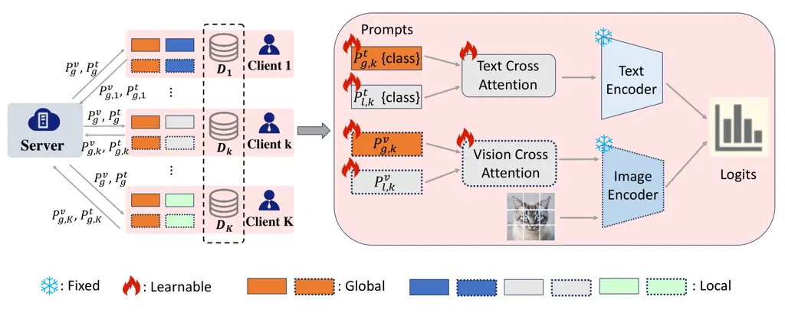
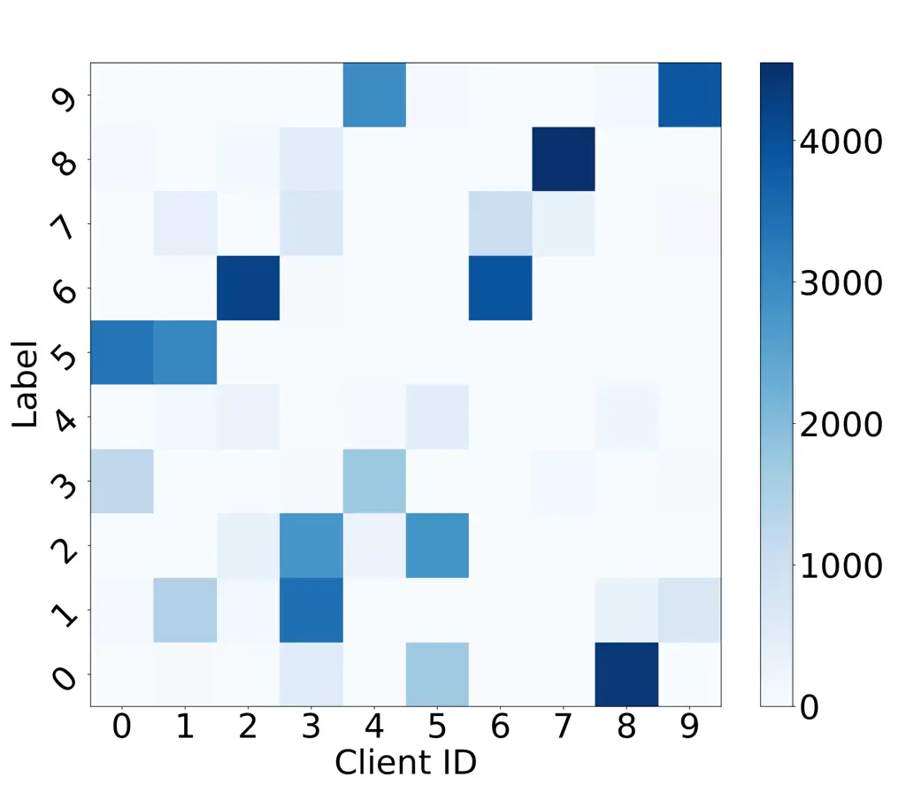
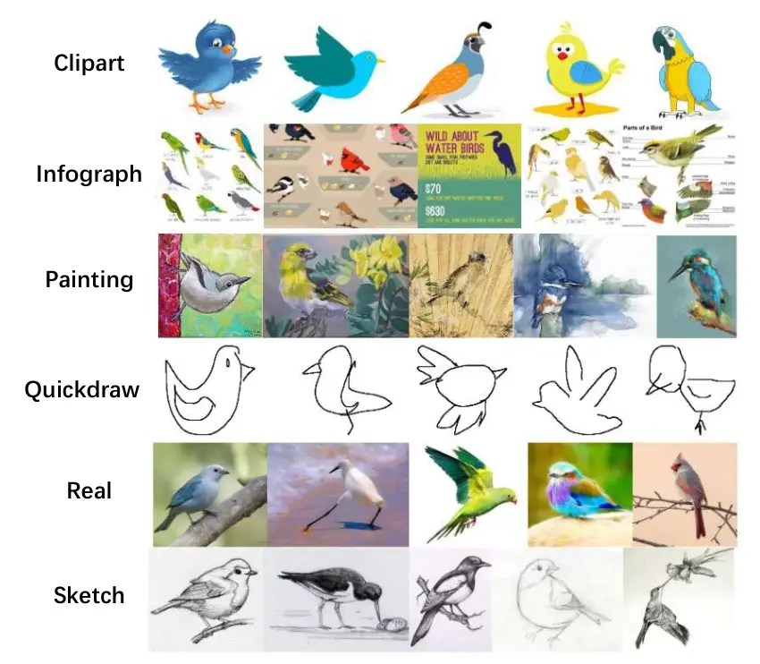

2021

# Personalized Federated Learning via Dual-Prompt Optimization and Cross Fusion

Yuguang Zhang Affiliation: Institute of Automation, Chinese Academy of
Sciences, China Affiliation: University of Chinese Academy of Sciences,
China    Kuangpu Guo Affiliation: Institute of Automation, Chinese
Academy of Sciences, China    Zhihe Lu Affiliation: Hamad Bin Khalifa
University, Qatar    Yunbo Wang Affiliation: Central South University,
China    Jian Liang Affiliation: Institute of Automation, Chinese
Academy of Sciences, China Affiliation: University of Chinese Academy of
Sciences, China

###### Abstract

Federated learning (FL) enables collaborative model training across
decentralized clients without sharing local data, but is challenged by
heterogeneity in data, computation, and communication. Pretrained
vision-language models (VLMs), with their strong generalization and
lightweight tuning via prompts, offer a promising solution. However,
existing federated prompt-learning methods rely only on text prompts and
overlook joint label–domain distribution shifts. In this paper, we
propose a personalized FL framework based on dual-prompt learning and
cross fusion, termed pFedDC. Specifically, each client maintains both
global and local prompts across vision and language modalities: global
prompts capture common knowledge shared across the federation, while
local prompts encode client-specific semantics and domain
characteristics. Meanwhile, a cross-fusion module is designed to
adaptively integrate prompts from different levels, enabling the model
to generate personalized representations aligned with each client’s
unique data distribution. Extensive experiments across nine datasets
with various types of heterogeneity show that pFedDC consistently
outperforms state-of-the-art methods.

###### keywords

Federated learning, Personalization, Dual-prompt optimization, Cross
fusion

## 1 Introduction

With the increasing emphasis on data privacy, federated learning
(FL) \[5\] has emerged as a promising paradigm that enables
decentralized model training without requiring participants to share
their local data. Despite its advantages, FL faces significant
challenges due to data heterogeneity—such as label and domain
shifts—which hinder model convergence and degrade performance \[9, 4, 6,
8, 48, 49, 58\]. Furthermore, conventional FL approaches often incur
substantial computational and communication overhead owing to frequent
parameter updates exchanged with the central server \[4\]. These
limitations have generally confined FL applications to lightweight model
architectures, resulting in suboptimal performance and training
instability \[10\].

Recently, pre-trained vision-language models, such as CLIP \[1\] and
ALIGN \[11\], have demonstrated strong generalization across downstream
tasks, making them well-suited for integration with FL. This synergy
enables privacy-preserving, communication-efficient training while
benefiting from the representational strength of foundation models \[9,
4\]. However, full model fine-tuning in FL settings introduces
prohibitive communication costs and risks of overfitting, especially on
the condition of client data is limited. Prompt learning \[13\] adapts
large pre-trained models via a small set of tunable parameters and
offers a lightweight alternative. Consequently, recent studies have
explored incorporating prompt learning into FL frameworks to enhance
efficiency and performance \[12, 2, 4, 9\]. For example, PromptFL \[2\]
directly applies FedAvg \[5\] to aggregate prompt parameters from
clients.

In real-world scenarios, client data often exhibits domain shift \[14\]
and label shift \[15\], posing significant challenges to federated
learning. Directly applying FedAvg \[5\] to prompt tuning frequently
results in divergence from local data distributions and suboptimal
performance. To this end, personalized federated prompt learning
approaches are necessary to effectively manage data heterogeneity.
pFedPrompt \[16\] introduces personalization by maintaining
client-specific attention modules for generating localized spatial
visual features, while leveraging shared text prompts to capture global
consensus. Similarly, FedOTP \[4\] employs unbalanced optimal transport
to align local visual features with both global and local text prompts,
enabling the model to represent diverse category characteristics across
clients. However, existing federated prompt learning methods
predominantly focus on text prompt adaptation and lack comprehensive
strategies to systematically address complex and multifaceted data
heterogeneity.

To address this issue, we propose Personalized FL framework Based on
Dual- prompt Learning and Cross Fusion (pFedDC). In heterogeneous data
environments—particularly under domain shift—visual features
corresponding to the same category may vary significantly across
clients, impeding global model learning \[18\]. To mitigate the effects
of label and domain shifts, pFedDC simultaneously learns shared global
text and vision prompts, along with personalized local text and vision
prompts for each client during the local training phase. The vision
prompts enhance robustness to visual misalignment and support domain
adaptation, while the text prompts capture category-level
semantics \[17\]. After local training, local prompts are retained on
each client, whereas global prompts are transmitted to the server and
aggregated using FedAvg \[5\]. This strategy enables clients to acquire
shared knowledge via global prompts while maintaining local adaptability
through personalized prompts.

To further integrate global and local information in a personalized and
effective manner, pFedDC employs cross-attention modules for both text
and vision prompts. The text cross-attention module takes global and
local text prompts as input and generates fused text representations,
which are then fed into the text encoder to extract discriminative
category-specific features. Similarly, the vision cross-attention module
operates on vision prompts to produce refined visual representations
that reflect both global context and local domain characteristics. These
cross-attention modules are updated jointly with the prompts and are
maintained locally to preserve client-specific adaptations. Extensive
experiments on federated prompt learning benchmarks involving various
types of data heterogeneity—including both label and domain
shifts—demonstrate that pFedDC achieves superior performance compared to
existing methods. The results validate the effectiveness of our
dual-prompt design and cross-attention mechanism, providing a scalable
and privacy-preserving solution for real-world FL deployments. Our main
contributions are summarized as follows:

- •
  We are the first to investigate the mechanism of dual-mode prompt
  tuning in federated learning under complex data heterogeneity.
  Specifically, we train text prompts to capture class information and
  vision prompts to learn domain-specific information simultaneously.
- •
  We propose a federated learning framework termed pFedDC, which
  leverages cross-attention modules to enhance the cooperation between
  global and local prompts across text and vision modalities. By fusing
  the local and global prompts, pFedDC learns personalized prompts that
  are better suited to the local data distribution.
- •
  We carried out comprehensive and thorough experiments on several
  widely recognized datasets, which encompass different forms of data
  heterogeneity, such as domain shift and label shift. The significant
  improvement in results demonstrates the superiority of our pFedDC.

## 2 Related Work

### 2.1 Personalized Federated Learning

Personalized federated learning (PFL) is a highly regarded research
field because of its potential to address statistical and systemic
heterogeneity across clients. Various approaches \[59, 22, 7, 23, 24,
25, 26, 14, 27, 50, 52, 57, 51\] have been proposed in prior works to
achieve PFL. FedPAC \[22\] and FedDisco \[7\] introduce novel weighted
aggregation techniques to promote intensive collaboration among similar
clients. FedPer \[23\], FedRep \[24\], and FedBABU \[25\] learn
personalized classifier heads locally while sharing the base layers, and
FedTP \[26\] learns personalized self-attention layers for each client.
FedBN \[14\] employs local batch normalization to mitigate the feature
shift before model averaging and PartialFed \[27\] extends this strategy
by selecting personalized parameters according to distinct feature
traits of different clients. Moreover, Ditto \[50\] further incorporates
a regularization term to encourage local models to retain information
from the global model. FedCP \[52\] takes a data-centric perspective by
decoupling features into global information features and personalized
information features, which are processed by a global head and a
personalized head for different tasks. The latest pFedMoAP \[57\]
personalizes the prompt learning process through the lens of Mixture of
Experts. Similarly, pFedMe \[51\] employs Moreau envelopes as a
regularization technique, enabling each client to learn an additional
personalized model. The methods mentioned above primarily target label
shift or domain shift data heterogeneity. However, they may not perform
well when label shift and domain shift exist at the same time. Our
pFedDC explores the cooperation between global and local prompts for
both text and vision modalities to effectively address both label shift
and feature shift.

### 2.2 Federated Prompt Learning

In recent years, prompt learning with vision–language models (VLMs) has
been incorporated into the federated learning paradigm to reduce
per-client computational overhead while simultaneously addressing two
core challenges: robustness across heterogeneous domains and the non-IID
nature of decentralized data \[28, 29, 31, 32, 10\]. Early
adaptations—such as FedPrompt \[12\] and PromptFL \[2\]—extend the
standard fine-tuning procedure of CLIP \[1\] to the federated setting,
demonstrating that prompt-based adaptation can achieve performance on
par with or superior to full-model updates. Building on these
foundations, subsequent works have advanced federated prompt learning in
diverse application contexts. FedPR \[53\] constrains visual-prompt
updates to lie within the null space of the global prompt for
accelerated MRI reconstruction. FedAPT \[32\] introduces an adaptive
prompt-tuning algorithm for cross-domain image classification, whereas
FedCLIP \[30\] employs an attention-based adapter to better leverage
pre-trained model features in each client. To mitigate statistical
heterogeneity, pFedPrompt \[16\] equips each client with a
non-parametric personalized attention module that synthesizes spatially
adaptive visual prompts, and pFedPG \[10\] delegates prompt generation
to a server-side client-specific generator for tailored local
adaptation. More recently, FedOTP \[4\] applies unbalanced optimal
transport to align local visual embeddings with both global and local
textual prompt embeddings, thereby capturing fine-grained, per-client
category characteristics. Despite these advances, nearly all existing
federated prompt-learning frameworks focus exclusively on tuning textual
prompts, with minimal exploration of vision-prompt adaptation. This
limitation hinders their ability to accommodate substantial label shifts
or pronounced feature distribution drifts across clients, an important
direction for future research.

### 2.3 Attention Module

It is well known that attention plays a crucial role in human
perception. Recently, numerous studies \[54, 33, 47, 55, 35, 36\] have
integrated attention mechanisms into convolutional neural networks
(CNNs) to enhance performance on large-scale classification tasks.
RAN \[54\] proposes a Residual Attention Network, which uses an
encoder-decoder style attention module to iteratively refine feature
representations. The Squeeze-and-Excitation (SE) block \[33\] uses a
lightweight gating mechanism to model inter-channel dependencies and
boost representational power. CBAM \[55\] exploits both spatial and
channel-wise attention based on an efficient architecture and
empirically verifies that exploiting both is superior to using only the
channel-wise attention. There has also been a lot of interest in
combining CNNs with different forms of self-attention. The non-local
neural network \[47\] introduces a global attention operation by
computing pairwise correlations across all spatial locations for dense
contextual aggregation. Local self-attention variants such as
Stand-Alone Self-Attention (SASA) \[35\] and the Self-Attention Network
(SAN) \[36\] replace standard convolutions with attention layers
confined to local neighborhoods, capturing fine-grained spatial
interactions. In this paper, we propose to incorporate cross-attention
modules that fuse global consensus and local personalization across both
vision and language modalities, thereby achieving an optimal balance
between shared context and client-specific adaptation.



Figure 1: The overview of our pFedDC. On the left, clients transmit
global text and vision prompts to the server for aggregation while
retaining local text and vision prompts locally. The right shows the
workflow of global and local prompts cooperation with the
cross-attention mechanism.

## 3 Methods

In this section, we present a detailed overview of the research problem
and our proposed method. First, in Sec. 3.1, we review foundational
concepts related to CLIP \[1\] with prompt tuning and a standard
federated learning framework. We then introduce our proposed method,
pFedDC, which is built upon dual prompt learning and cross-attention for
global and local prompts, detailed in Sec. 3.2 and Sec. 3.3
respectively.

### 3.1 Preliminaries

In this paper, we adopt CLIP \[1\] as the foundational model. CLIP
employs a dual-branch architecture comprising an image encoder,
$`f^{v}(\cdot)`$, and a text encoder, $`f^{t}(\cdot)`$, with each
encoder designed to process data from its respective modality. For
zero-shot predictions in downstream tasks, CLIP \[1\] utilizes a
human-designed prompt (e.g., “a photo of a \[CLASS\]”) for each class.
Taking a C-way classification task as an example, the textual embeddings
of all classes $`\{f^{t}_{c}\}_{c=1}^{C}`$ and the embedding of the test
image $`f^{v}(x)`$ are generated by the text and image encoders,
respectively. The probability that a given image $`x`$ belongs to the
$`c`$-th category is determined by applying the softmax operation as
follows:

```math
p_{c}(x)=\frac{\exp(\text{sim}(f^{v}(x),f^{t}_{c}))/\tau)}{\sum_{j=1}^{C}\exp(\text{sim}(f^{v}(x),f^{t}_{j}))/\tau)}, \tag{1}
```

where $`\tau`$ is a temperature parameter and C is the total number of
categories. To improve performance in downstream tasks, prompt tuning
has been widely adopted as a parameter-efficient fine-tuning
approach \[19\]. This involves introducing additional learnable textual
tokens, $`P^{t}`$, and visual tokens, $`P^{v}`$ (referred to as
text/vision prompts) into the corresponding encoders, thereby optimizing
the original CLIP model for specific downstream tasks \[20, 21\].

In federated learning, we consider a scenario with $`K`$ clients, where
$`\mathcal{D}_{k}`$ represents the local training data of client $`k`$
and contains $`n_{k}`$ samples. The combined data
$`\mathcal{D}=\bigcup_{k=1}^{K}\mathcal{D}_{k}`$ comprises the local
data from all clients and the number of samples in $`\mathcal{D}`$ is
$`n=\sum_{k=1}^{K}n_{k}`$. These data distributions might differ across
clients, encompassing label and domain shift as shown in Fig. 2.

|                                                             |                                                             |
| ----------------------------------------------------------- | ----------------------------------------------------------- |
|  |  |
| (a) Label shift.                                            | (b) Domain shift.                                           |

Figure 2: Illustration of data heterogeneities. (a) Label distribution
shift among 10 clients with 10 classes. Darker colors indicate that a
client holds a larger number of training samples for the corresponding
class. (b) Domain shift of Domainnet.

### 3.2 Personalized Federated Dual Prompts Learning

Data heterogeneities, including label shift and domain shift, present
significant challenges in federated learning. Previous federated prompt
learning methods have primarily focused on text prompt tuning,
overlooking vision prompt tuning, which is insufficient for addressing
complex data heterogeneity. To overcome this, we propose personalized
federated learning with dual prompts and cross-attention, where each
client learns both vision and text prompts, and cross-attention is used
to fuse global and local prompts.

The process of feeding the text prompt into the text encoder can be
viewed as synthesizing a classifier, while the image encoder extracts
the visual features \[21\]. The prompting mechanism aims to query the
relevant information, which is beneficial to the downstream tasks, from
the pre-trained model. However, previous methods adjust only the
classifier while keeping the highlighted visual features unchanged.
Therefore, we believe that using prompt tuning only for the text encoder
while keeping the image encoder fixed in federated learning with data
heterogeneity is suboptimal, particularly in environments with complex
domain shifts.

Therefore, we propose that clients simultaneously learn both the text
prompt and the vision prompt. To obtain a model that is better adapted
to the client’s local data distribution, personalization is also
crucial. During local training, each client learns both shared global
text and vision prompts, as well as local text and vision prompts. This
approach enables clients to extract more individualized insights while
maintaining a level of consensus among them. Specifically, for client
$`k`$, the prompt $`P_{k}`$ comprises a global text prompt
$`P_{g,k}^{t}`$, a local text prompt $`P_{l,k}^{t}`$, a global vision
prompt $`P_{g,k}^{v}`$, and a local vision prompt $`P_{l,k}^{v}`$,
denoted as $`P_{k}=[P_{g,k}^{t},P_{l,k}^{t},P_{g,k}^{v},P_{l,k}^{v}]`$.
During each communication round $`r`$, client $`k`$ initializes the
prompts as
$`P_{k}^{r}=[P_{g}^{t,r-1},P_{l,k}^{t,r-1},P_{g}^{v,r-1},P_{l,k}^{v,r-1}]`$.
Then the global and local prompts are jointly updated through gradient
descent $`P_{k}^{r}=P_{k}^{r}-\eta\nabla\mathcal{L}_{D_{i}}(P_{k}^{r})`$
for E iterations locally. After local training, only the updated global
prompts $`[P_{g,k}^{t,r},P_{g,k}^{v,r}]`$ will be transmitted to the
server for aggregation to learn global consensus among clients, while
the local prompts $`[P_{l,k}^{t,r},P_{l,k}^{v,r}]`$ are retained locally
to capture client-specific category characteristics.

In the server, we follow FedAvg \[5\] to aggregate global prompts as
follows:

```math
\displaystyle P_{g}^{t,r+1}=\sum\limits_{k=1}^{K}\frac{n_{k}}{n}\cdot P_{g,k}^{t,r}, \tag{2}
```

```math
\displaystyle P_{g}^{v,r+1}=\sum\limits_{k=1}^{K}\frac{n_{k}}{n}\cdot P_{g,k}^{v,r}. \tag{3}
```

where $`n_{k}`$ is the number of samples in client $`k`$ and $`n`$ is
the number of total samples in all clients. We then transmit the
aggregated global text and visual prompts to each client to initialize
the client’s local prompts.

1: communication rounds $`T`$, client number $`K`$, local datasets
$`\{D_{k}\}_{i=k}^{K}`$, sample counts $`\{n_{k}\}_{k=1}^{K}`$, client
participating rate $`R`$, learning rate $`\eta`$, Softmax temperature
$`\tau`$

2: global text and vision prompts $`P^{t,T}_{g}`$ and $`P^{v,T}_{g}`$,
personalized local text and vision prompts
$`\{P^{t,T}_{l,k}\}^{K}_{k=1}`$ and $`\{P^{v,T}_{l,k}\}^{K}_{k=1}`$,
personalized local text and vision cross-attention
$`\{A^{t}_{k}\}^{K}_{k=1}`$ and $`\{A^{v}_{k}\}^{K}_{k=1}`$

3: Initialize
$`P_{k}^{0}\leftarrow[P_{g}^{t,0},P_{l,k}^{t,0},P_{g}^{v,0},P_{l,k}^{v,0}]`$,
$`A^{0}_{k}\leftarrow[A^{t,0}_{k},A^{v,0}_{k}]`$ for all $`k=1,\dots,K`$

4: $`m\leftarrow\max(\lfloor R\cdot K\rfloor,1)`$

5: for communication round $`r=1,2,\cdots,T`$ do

6:   $`M\leftarrow`$ Randomly select a subset containing $`m`$ clients.

7:   \# Local update

8:   for each client $`k\in M`$ do

9:    Initialize local states:

10:     $`P_{k}^{r}\leftarrow P_{k}^{r-1}`$ \# $`P_{k}^{r}`$ denotes the
set of prompts in client k

11:     $`A_{k}^{r}\leftarrow A_{k}^{r-1}`$ \# $`A_{k}^{r}`$ denotes the
set of cross-attention modules in

12:            client k

13:    for each batch
$`\mathcal{B}_{i}=\{\textit{x},{\textit{y}}\}\in{D}_{k}`$ do

14:      Obtain fused local text/vision

15:      prompts with Eq. (4)/Eq. (5).

16:
     $`P^{r}_{k}\leftarrow P^{r}_{k}-\eta\nabla{\mathcal{L}({P^{r}_{k};\mathcal{B}_{i})}}`$

17:
     $`A^{r}_{k}\leftarrow A^{r}_{k}-\eta\nabla{\mathcal{L}({A^{r}_{k};\mathcal{B}_{i})}}`$

18:      \# $`\mathcal{L}`$ is cross-entropy loss

19:    end for

20:   end for

21:   \# Global aggregation

22:   Obtain aggregated text and vision prompts

23:   $`P_{g}^{t,r}`$ and $`P_{g}^{v,r}`$ with Eq. (2) and Eq. (3).

24: end for

Algorithm 1 pFedDC

### 3.3 Fusing Global and Local Prompts with Cross-attention

To further balance global consensus and local personalization, we
introduce cross-attention modules for each client to fuse global and
local prompts across both vision and text modalities. Specifically,
during local training, client $`k`$ is equipped with a text
cross-attention module $`A^{t}_{k}`$ and a vision cross-attention module
$`A^{v}_{k}`$, which are combined as $`A_{k}=[A^{t}_{k},A^{v}_{k}]`$. In
each cross-attention module, the keys (K), queries (Q), and values (V)
are computed through a linear transformation. The fused personalized
text and vision prompts in client $`k`$ are computed as follows:

```math
\displaystyle P_{k}^{t,r} \displaystyle=A^{t}_{k}(P_{g,k}^{t,r},P_{l,k}^{t,r}), \tag{4}
```

```math
\displaystyle P_{k}^{v,r} \displaystyle=A^{v}_{k}(P_{g,k}^{v,r},P_{l,k}^{v,r}). \tag{5}
```

The fused prompts are fed into the frozen text and vision encoder to
obtain the text and vision embeddings. To adapt the fused prompts to the
client’s label distribution and domain characteristics, the text
cross-attention module $`A^{t}_{k}`$ and vision cross-attention module
$`A^{v}_{k}`$ are updated with the prompts and retained locally.
Moreover, keeping the cross-attention module local and personalized
helps reduce communication overhead. As a result, the objective function
of our proposed pFedDC can be formulated as follows:

```math
\min\limits_{\{P_{k},A_{k}\}_{k=1}}\sum\limits_{k=1}^{K}\frac{n_{k}}{n}\mathcal{L}_{\mathcal{D}_{k}}(P_{k},A_{k}), \tag{6}
```

with
$`\mathcal{L}_{\mathcal{D}_{k}}(P_{k},A_{k})=\mathbb{E}_{(x,{y})\in{D}_{k}}{\ell}_{ce}(f(P_{k},A_{k};x),y)`$,
where $`{\ell}_{ce}`$ denotes the cross-entropy loss function.

## 4 Experiments

In this section, we conduct comprehensive experiments to numerically
evaluate pFedDC in scenarios involving complex data heterogeneity,
including label and domain shifts. First, in Sec.4.1, we provide a
detailed introduction to our datasets, baselines, and experimental
implementation details. Then, in Sec.4.2, we present our experimental
results along with an ablation study for cross-attention modules.

### 4.1 Experimental Setup

Datasets. We evaluate the performance of our method on nine public
benchmark datasets characterized by three types of data heterogeneity:
label shift, domain shift, and both shifts exist simultaneously.
Building on previous researchs \[4, 9\], we utilize seven representative
visual classification datasets: Caltech101 \[37\], Flowers102 \[38\],
OxfordPets \[39\], DTD \[42\], CUB \[43\], UCF101 \[41\], and
EuroSAT \[40\] to simulate label shift with Dirichlet distribution.
Specifically, clients receive samples for each class based on a
Dirichlet distribution in the case of label shift. Here, the parameter
$`\beta`$ controls the degree of label skew, with lower values
indicating severe label skew. For domain shift, we evaluate our
framework on the following two datasets, each containing multiple
domains: DomainNet \[45\] with 6 domains including Clipart (C),
Infograph (I), Painting (P), Quickdraw (Q), Real (R), Sketch (S) and
OfficeCaltech10 \[46\] with 4 domains including Amazon (A), Caltech (C),
DSLR (D), Webcam (W), where data from one of these distinct domains is
assigned to one client. For label and domain shifts, we use a Dirichlet
distribution with $`(\beta=0.1)`$ to distribute the samples of each
domain across 5 clients in both the DomainNet and Office-Caltech10
datasets.

| Datasets             | Caltech101 | Flowers102 | OxfordPets | DTD   | CUB   | UCF101 | EuroSAT | Avg.  |
| -------------------- | ---------- | ---------- | ---------- | ----- | ----- | ------ | ------- | ----- |
| Zero shot CLIP \[1\] | 86.95      | 65.72      | 85.02      | 44.22 | 51.28 | 61.00  | 53.79   | 60.57 |
| PromptFL \[2\]       | 90.51      | 73.62      | 91.55      | 52.10 | 68.63 | 84.03  | 90.83   | 78.75 |
| Promptprox \[3\]     | 89.96      | 73.20      | 91.06      | 52.83 | 68.77 | 84.98  | 90.17   | 78.71 |
| pFedPrompt \[16\]    | 96.02      | 86.75      | 92.30      | 80.59 | 83.04 | 86.22  | 92.49   | 88.20 |
| FedOTP \[4\]         | 96.44      | 97.28      | 98.94      | 92.77 | 85.09 | 87.56  | 93.33   | 93.06 |
| pFedDC               | 99.27      | 99.45      | 99.24      | 91.42 | 87.19 | 89.63  | 94.79   | 94.43 |

Table 1: The results (%) of pFedDC and the benchmark methods on various
datasets with Dirichlet-based ($`\beta=0.1`$) label shift. Bold and
underline represent the best and second-best results, respectively.

| Datasets             | Caltech101 | Flowers102 | OxfordPets | DTD   | CUB   | UCF101 | EuroSAT | Avg.  |
| -------------------- | ---------- | ---------- | ---------- | ----- | ----- | ------ | ------- | ----- |
| Zero shot CLIP \[1\] | 86.95      | 65.72      | 85.02      | 44.22 | 51.28 | 61.00  | 53.79   | 60.57 |
| PromptFL \[2\]       | 88.72      | 70.02      | 89.26      | 50.46 | 68.41 | 82.72  | 88.76   | 86.90 |
| Promptprox \[3\]     | 88.10      | 70.41      | 88.79      | 51.11 | 68.60 | 83.70  | 88.02   | 86.96 |
| pFedPrompt \[16\]    | 95.88      | 82.90      | 91.27      | 77.92 | 82.86 | 85.49  | 91.60   | 86.84 |
| FedOTP \[4\]         | 97.12      | 96.50      | 98.45      | 91.86 | 85.11 | 87.74  | 92.69   | 92.78 |
| pFedDC               | 99.31      | 99.28      | 99.30      | 91.95 | 87.03 | 90.51  | 94.85   | 94.60 |

Table 2: The results (%) of pFedDC and the benchmark methods on various
datasets with Dirichlet-based ($`\beta=0.05`$) label shift. Bold and
underline represent the best and second-best results, respectively.

Baselines. In our experiments, we compare pFedDC with five baselines:
(1) Zero-shot CLIP \[1\] with hand-crafted text prompt templates “a
photo of a \[CLASS\]”; (2) PromptFL \[2\] using unified prompts learned
across clients using FedAvg \[5\]; (3) Promptprox \[3\] integrate
PromptFL \[2\] with Fedprox \[3\]; (4) pFedPrompt \[16\] equips each
client with a non-parametric personalized attention module that
synthesizes spatially adaptive visual prompts. (5) FedOTP \[4\] employs
unbalanced optimal transport to align local visual features with textual
features. PromptFL \[2\] and Promptprox \[3\] simultaneously optimize
both the text and vision prompts, whereas FedOTP \[4\] optimizes only
the text prompts.

Implementation details. We adopt the widely recognized vision-language
model CLIP ViT-B/16 as our base model. For label shift, we set the
number of clients K to 10; for domain shift, we assign 1 client per
domain; and for label and domain shift, we assign 5 clients per domain.
We conduct 20 communication rounds for all experimental datasets,
regenerating pseudo labels using the updated local model every 5
communication rounds. We optimize the prompts and cross-attention
modules using mini-batch Stochastic Gradient Descent (SGD) with a
learning rate of 0.01. For each experimental setting, we conduct three
trials and report the mean accuracy. All experiments are conducted with
Pytorch \[56\] on NVIDIA 3090 GPUs.

| Datasets             | Office-Caltech10 |       |        |        |       | DomainNet |       |       |       |       |       |       |
| -------------------- | ---------------- | ----- | ------ | ------ | ----- | --------- | ----- | ----- | ----- | ----- | ----- | ----- |
| Domains              | A                | C     | D      | W      | Avg.  | C         | I     | P     | Q     | R     | S     | Avg.  |
| Zero shot CLIP \[1\] | 9.05             | 7.23  | 15.45  | 7.92   | 9.91  | 11.82     | 8.80  | 14.29 | 5.44  | 10.17 | 14.34 | 10.81 |
| PromptFL \[2\]       | 95.57            | 95.38 | 97.48  | 100.00 | 97.11 | 98.62     | 79.33 | 97.60 | 85.79 | 97.76 | 97.71 | 92.82 |
| Promptprox \[3\]     | 96.14            | 95.84 | 98.62  | 100.00 | 97.65 | 98.58     | 78.39 | 98.00 | 81.92 | 98.06 | 97.14 | 92.02 |
| pFedPrompt \[16\]    | 97.01            | 96.31 | 100.00 | 100.00 | 98.33 | 98.63     | 81.25 | 98.42 | 88.57 | 98.11 | 98.30 | 93.88 |
| FedOTP \[4\]         | 96.42            | 96.38 | 100.00 | 100.00 | 98.20 | 97.95     | 78.57 | 98.44 | 84.43 | 97.60 | 97.87 | 92.48 |
| pFedDC               | 97.46            | 97.89 | 100.00 | 100.00 | 98.84 | 98.70     | 84.49 | 99.10 | 93.08 | 98.25 | 98.76 | 95.40 |

Table 3: The results (%) of pFedDC and the benchmark methods on
Office-Caltech10 and DomainNet datasets with domain shift. Bold and
underline represent the best and second-best results, respectively.

| Datasets             | Office-Caltech10 |       |       |       |       | DomainNet |       |       |       |       |       |       |
| -------------------- | ---------------- | ----- | ----- | ----- | ----- | --------- | ----- | ----- | ----- | ----- | ----- | ----- |
| Domains              | A                | C     | D     | W     | Avg.  | C         | I     | P     | Q     | R     | S     | Avg.  |
| Zero shot CLIP \[1\] | 9.05             | 7.23  | 15.45 | 7.92  | 9.91  | 11.82     | 8.80  | 14.29 | 5.44  | 10.17 | 14.34 | 10.81 |
| PromptFL \[2\]       | 15.01            | 14.33 | 23.16 | 19.29 | 17.95 | 9.98      | 17.06 | 8.07  | 13.31 | 19.06 | 10.66 | 13.02 |
| Promptprox \[3\]     | 16.97            | 17.13 | 24.74 | 18.72 | 19.39 | 10.62     | 16.47 | 7.84  | 12.86 | 18.75 | 17.32 | 13.98 |
| pFedPrompt \[16\]    | 23.88            | 28.98 | 36.81 | 30.64 | 30.07 | 37.58     | 50.19 | 35.32 | 33.19 | 41.27 | 39.75 | 39.55 |
| FedOTP \[4\]         | 25.54            | 31.26 | 41.95 | 37.76 | 34.13 | 45.22     | 55.62 | 47.06 | 36.46 | 48.64 | 45.95 | 46.49 |
| pFedDC               | 27.36            | 35.34 | 46.33 | 40.29 | 37.33 | 46.31     | 56.89 | 46.42 | 37.17 | 50.08 | 49.93 | 47.80 |

Table 4: The results (%) of pFedDC and the benchmark methods on
Office-Caltech10 and DomainNet datasets with domain $`\&`$ label shifts.
Bold and underline represent the best and second-best results,
respectively.

### 4.2 Experimental Results

Model evaluation on label shift. Table 1 and Table 2 show the
performance results of various methods under Dirichlet-based label
shift. Except for the DTD \[42\] dataset under Dirichlet-based label
shift with $`\beta=0.1`$, our method performs better than the baseline
on other datasets. This demonstrates that our cross-attention module
effectively fuses global and local prompts. Notably, the performance of
the personalized methods FedOTP \[4\] and the proposed pFedDC
significantly exceeds that of the traditional FL method, highlighting
the substantial advantage of personalized federated learning approaches
in the case of label shift.

Model evaluation on domain shift. Table 3 presents the performance
results of various methods on Office-Caltech10 and DomainNet datasets
under domain shift conditions. Although FedOTP \[4\] achieves better
accuracy under the label-shift setting, it still underperforms compared
to pFedPrompt \[16\], which utilizes personalized local visual
embeddings to assist with prediction. This indicates a significant gap
between the visual embeddings generated by the frozen image encoder and
the personalized text embeddings, highlighting the necessity of
personalized processing of visual information. However, our method
significantly outperforms state-of-the-art algorithms on both datasets,
demonstrating the effectiveness of our dual prompts tuning. In
particular, on the DomainNet \[45\] dataset, our method improves upon
pFedPrompt \[16\] by approximately $`2.5\%`$.

Model evaluation on label and domain shifts. In this experiment, we
evaluate the performance of pFedDC in more challenging scenarios
involving simultaneous label and domain shifts. Specifically, we
partition the data within each domain into five clients using a
Dirichlet distribution with a concentration parameter $`\beta=0.1`$,
introducing both inter-client label imbalance and domain-level feature
variation. The evaluation is conducted on two benchmark datasets:
DomainNet \[45\] and OfficeCaltech10 \[46\], with results summarized in
Table 4. Conventional federated learning methods suffer from substantial
accuracy degradation due to their limited capacity to adapt to both
semantic and distributional divergences across clients. In contrast,
pFedDC demonstrates strong resilience, consistently outperforming
baseline methods. Notably, our approach achieves an average accuracy
improvement of $`1.3\%`$ across all domains, underscoring its
effectiveness in complex federated learning environments.

Figure 3: Experimental results under label skew settings with varying
numbers of clients, client participation rates, and communication
rounds.

### 4.3 Analysis

Results under different client numbers. We evaluate the performance of
the proposed pFedDC method in comparison with baseline approaches under
varying numbers of participating clients. Unless otherwise specified,
all experiments are conducted using Dirichlet-based data partitioning
with a concentration parameter of $`\beta=0.1`$ to simulate non-IID data
distributions. Specifically, we partition the Caltech10, CUB, UCF101,
and EuroSAT datasets among 5, 10, 30, and 50 clients, respectively. The
resulting classification accuracies are reported in the first row of
Fig. 3. As shown in the results, baseline methods exhibit a notable
decline in performance as the number of clients increases, highlighting
their sensitivity to data fragmentation and heightened heterogeneity. In
contrast, the proposed pFedDC consistently maintains high accuracy
across all settings, demonstrating strong resilience to increasing
client diversity. This performance stability underscores the robustness
of our dual-prompt learning strategy and cross-attention design, which
effectively balances global knowledge sharing with local
personalization. These findings confirm the scalability and adaptability
of pFedDC in realistic federated learning scenarios involving large and
diverse client populations.

Results under different client participation rates. To investigate the
robustness of the proposed method under varying client participation
levels, we evaluate performance across participation rates of
$`\{0.5,0.8,1.0\}`$. As illustrated in the second row of Fig. 3, pFedDC
consistently outperforms all competing methods across different rates. A
general decline in performance is observed for all approaches as the
participation rate decreases, which is expected since reduced
participation amplifies the divergence between the models of selected
clients and the global model, leading to slower and less stable
convergence. Despite this challenge, our method exhibits significantly
better stability and accuracy, demonstrating its resilience to partial
client availability—a common scenario in practical federated
deployments.

Results under different communication rounds. In real-world federated
learning scenarios, the number of available communication rounds is
often constrained due to limited bandwidth, energy consumption, or time
restrictions on client devices. To evaluate the communication efficiency
of the proposed pFedDC framework, we conduct experiments with varying
communication rounds, specifically $`T\in\{5,10,20,50\}`$. As presented
in the third row of Fig. 3, pFedDC consistently achieves superior
performance compared to baseline methods across all communication
budgets. Notably, even under severely restricted conditions (e.g.,
$`T=5`$), our approach demonstrates a clear performance advantage,
indicating its ability to converge more effectively and efficiently with
fewer communication rounds. This robustness is attributed to the
lightweight nature of prompt tuning and the design of our dual-prompt
learning with cross-attention, which enables faster knowledge alignment
between local and global models. These results underscore the practical
applicability of pFedDC in real-world deployments, where communication
efficiency is critical.

| Datasets             | Caltech101 | Flowers102 | OxfordPets | DTD   | CUB   | UCF101 | EuroSAT | Avg.  |
| -------------------- | ---------- | ---------- | ---------- | ----- | ----- | ------ | ------- | ----- |
| Zero shot CLIP \[1\] | 81.10      | 64.91      | 84.24      | 40.79 | 48.75 | 60.29  | 44.73   | 60.57 |
| PromptFL \[2\]       | 82.23      | 72.74      | 90.52      | 50.60 | 65.48 | 80.73  | 88.23   | 78.75 |
| Promptprox \[3\]     | 81.84      | 71.93      | 90.90      | 50.57 | 65.39 | 80.81  | 87.55   | 78.71 |
| pFedPrompt \[16\]    | 87.50      | 86.25      | 91.79      | 77.39 | 80.22 | 81.29  | 89.93   | 88.20 |
| FedOTP \[4\]         | 88.87      | 96.10      | 98.01      | 90.12 | 83.17 | 82.80  | 91.42   | 93.06 |
| pFedDC               | 90.64      | 98.36      | 98.72      | 90.26 | 85.73 | 85.29  | 92.04   | 94.43 |

Table 5: The results (%) of pFedDC and the benchmark methods on various
datasets under Dirichlet-based ($`\beta=0.1`$) label shift with RN50 as
the image encoder backbone. Bold and underline represent the best and
second-best results, respectively.

| T.Att. | I.Att. | Caltech101 | Flowers102 | OxfordPets | DTD   | CUB   | UCF101 | EuroSAT | Avg.  |
| ------ | ------ | ---------- | ---------- | ---------- | ----- | ----- | ------ | ------- | ----- |
| \-     | \-     | 90.51      | 73.62      | 91.55      | 52.10 | 68.63 | 84.03  | 90.83   | 78.75 |
| \-     | ✓      | 98.25      | 98.69      | 99.04      | 91.05 | 87.01 | 89.49  | 94.55   | 94.01 |
| ✓      | \-     | 98.06      | 98.28      | 98.89      | 89.83 | 86.64 | 88.90  | 94.02   | 93.51 |
| ✓      | ✓      | 99.27      | 99.45      | 99.24      | 91.42 | 87.19 | 89.63  | 94.79   | 94.43 |

Table 6: Ablation study. Accuracies (%) under Dirichlet-based label
shift. T.Att. and I.Att. denote the text cross-attention and the image
cross-attention.

Results under different image encoder backbones. To assess the
generalizability and practical applicability of pFedDC, we conduct
additional experiments using different image encoder architectures. In
particular, we evaluate model performance when employing the ResNet-50
(RN50) backbone, which is widely adopted in resource-constrained
environments due to its moderate computational cost. The comparison
results under this setting are reported in Table 5. Across all evaluated
datasets, pFedDC consistently outperforms competing methods, even when
deployed with a relatively lightweight encoder. This performance
advantage highlights the adaptability of our dual-prompt learning
strategy, which effectively enhances feature representation and learning
stability despite the limited expressive capacity of smaller backbones.

Ablation study. To investigate the contribution of the proposed
cross-attention modules, we conduct an ablation study focusing on their
impact during local training. Specifically, we evaluate the performance
under three settings: using only the text cross-attention module, using
only the vision cross-attention module, and disabling both modules. All
experiments are performed under Dirichlet-based label shift conditions
to simulate realistic non-IID scenarios. The results, summarized in
Table 6, indicate that introducing cross-attention in either modality
leads to a notable improvement in accuracy compared to the setting
without any cross-attention. Furthermore, applying cross-attention in
both text and vision modalities simultaneously yields the highest
performance, confirming the complementary benefits of modality-specific
fusion. These findings validate the effectiveness of our cross-attention
design in integrating global and local prompts, thereby enhancing model
personalization and generalization in federated learning environments.

## 5 Conclusion

This work addresses the challenge of complex data heterogeneity in
federated learning, where domain shift and label shift occur
simultaneously. We propose personalized federated learning with
dual-prompt learning and cross fusion module (pFedDC), which
incorporates both text and vision prompt learning along with
personalized local cross-attention modules for each modality. Our pFedDC
enhances efficient collaborative prompt learning, enabling it to capture
diverse categories and domain traits on a per-client basis while
effectively learning valuable knowledge from other clients. Extensive
experiments on datasets with various types of heterogeneity demonstrate
that our pFedDC outperforms state-of-the-art methods. In the future, we
will conduct a theoretical analysis of pFedDC, focusing on convergence,
privacy, fairness, and other relevant considerations.

## References

- (1) A. Radford, J. W. Kim, C. Hallacy, A. Ramesh, G. Goh, S. Agarwal,
  G. Sastry, A. Askell, P. Mishkin, J. Clark _et al._, “Learning
  transferable visual models from natural language supervision,” in
  _Proc. ICML_, 2021.
- (2) T. Guo, S. Guo, J. Wang, X. Tang, and W. Xu, “Promptfl: Let
  federated participants cooperatively learn prompts instead of
  models-federated learning in age of foundation model,” _IEEE
  Transactions on Mobile Computing_, pp. 5179–5194, 2023.
- (3) T. Li, A. K. Sahu, M. Zaheer, M. Sanjabi, A. Talwalkar, and
  V. Smith, “Federated optimization in heterogeneous networks,”
  _Proceedings of Machine learning and systems_, pp. 429–450, 2020.
- (4) H. Li, W. Huang, J. Wang, and Y. Shi, “Global and local prompts
  cooperation via optimal transport for federated learning,” in _Proc.
  CVPR_, 2024.
- (5) B. McMahan, E. Moore, D. Ramage, S. Hampson, and B. A. y Arcas,
  “Communication-efficient learning of deep networks from decentralized
  data,” in _Proc. AISTATS_, 2017.
- (6) S. Yu, J. P. Muñoz, and A. Jannesari, “Federated foundation
  models: Privacy-preserving and collaborative learning for large
  models,” _arXiv:2305.11414_, 2023.
- (7) R. Ye, M. Xu, J. Wang, C. Xu, S. Chen, and Y. Wang, “Feddisco:
  Federated learning with discrepancy-aware collaboration,” in _Proc.
  ICML_, 2023.
- (8) K. Guo, Y. Ding, J. Liang, R. He, Z. Wang, and T. Tan, “Not all
  minorities are equal: Empty-class-aware distillation for heterogeneous
  federated learning,” in _Proc. AAAI_, 2025.
- (9) T. Cui, H. Li, J. Wang, and Y. Shi, “Harmonizing generalization
  and personalization in federated prompt learning,” in _Proc.
  ICML_, 2024.
- (10) F.-E. Yang, C.-Y. Wang, and Y.-C. F. Wang, “Efficient model
  personalization in federated learning via client-specific prompt
  generation,” in _Proc. CVPR_, 2023.
- (11) C. Jia, Y. Yang, Y. Xia, Y.-T. Chen, Z. Parekh, H. Pham, Q. Le,
  Y.-H. Sung, Z. Li, and T. Duerig, “Scaling up visual and
  vision-language representation learning with noisy text supervision,”
  in _Proc. ICML_, 2021.
- (12) H. Zhao, W. Du, F. Li, P. Li, and G. Liu, “Reduce communication
  costs and preserve privacy: Prompt tuning method in federated
  learning,” _arXiv:2208.12268_, 2022.
- (13) P. Liu, W. Yuan, J. Fu, Z. Jiang, H. Hayashi, and G. Neubig,
  “Pre-train, prompt, and predict: A systematic survey of prompting
  methods in natural language processing,” _ACM Computing Surveys_, pp.
  1–35, 2023.
- (14) X. Li, M. Jiang, X. Zhang, M. Kamp, and Q. Dou, “Fedbn: Federated
  learning on non-iid features via local batch normalization,” in _Proc.
  ICLR_, 2021.
- (15) Q. Li, B. He, and D. Song, “Model-contrastive federated
  learning,” in _Proc. CVPR_, 2021.
- (16) T. Guo, S. Guo, and J. Wang, “Pfedprompt: Learning personalized
  prompt for vision-language models in federated learning,” in
  _Proceedings of the ACM Web Conference 2023_, 2023.
- (17) G. Wei, F. Wang, A. Shah, and R. Chellappa, “Dual prompt tuning
  for domain-aware federated learning,” _arXiv:2310.03103_, 2023.
- (18) S. Bai, J. Zhang, S. Guo, S. Li, J. Guo, J. Hou, T. Han, and
  X. Lu, “Diprompt: Disentangled prompt tuning for multiple latent
  domain generalization in federated learning,” in _Proc. CVPR_, 2024.
- (19) K. Zhou, J. Yang, C. C. Loy, and Z. Liu, “Learning to prompt for
  vision-language models,” _International Journal of Computer Vision_,
  pp. 2337–2348, 2022.
- (20) M. Jia, L. Tang, B.-C. Chen, C. Cardie, S. Belongie,
  B. Hariharan, and S.-N. Lim, “Visual prompt tuning,” in _Proc.
  ECCV_, 2022.
- (21) Y. Xing, Q. Wu, D. Cheng, S. Zhang, G. Liang, P. Wang, and
  Y. Zhang, “Dual modality prompt tuning for vision-language pre-trained
  model,” in _Proc. ACM-MM_, 2023.
- (22) J. Xu, X. Tong, and S.-L. Huang, “Personalized federated learning
  with feature alignment and classifier collaboration,”
  _arXiv:2306.11867_, 2023.
- (23) M. G. Arivazhagan, V. Aggarwal, A. K. Singh, and S. Choudhary,
  “Federated learning with personalization layers,”
  _arXiv:1912.00818_, 2019.
- (24) L. Collins, H. Hassani, A. Mokhtari, and S. Shakkottai,
  “Exploiting shared representations for personalized federated
  learning,” in _Proc. ICML_, 2021.
- (25) J. Oh, S. Kim, and S.-Y. Yun, “Fedbabu: Towards enhanced
  representation for federated image classification,”
  _arXiv:2106.06042_, 2021.
- (26) H. Li, Z. Cai, J. Wang, J. Tang, W. Ding, C.-T. Lin, and Y. Shi,
  “Fedtp: Federated learning by transformer personalization,” _IEEE
  Transactions on Neural Networks and Learning Systems_, pp. 13 426 –
  13 440, 2023.
- (27) B. Sun, H. Huo, Y. Yang, and B. Bai, “Partialfed: Cross-domain
  personalized federated learning via partial initialization,” _Proc.
  NeurIPS_, 2021.
- (28) C. Qiu, X. Li, C. K. Mummadi, M. R. Ganesh, Z. Li, L. Peng, and
  W.-Y. Lin, “Text-driven prompt generation for vision-language models
  in federated learning,” _arXiv:2310.06123_, 2023.
- (29) X. Li and J. Wang, “Position paper: Assessing robustness,
  privacy, and fairness in federated learning integrated with foundation
  models,” _arXiv:2402.01857_, 2024.
- (30) W. Lu, X. Hu, J. Wang, and X. Xie, “Fedclip: Fast generalization
  and personalization for clip in federated learning,”
  _arXiv:2302.13485_, 2023.
- (31) S. Halbe, J. S. Smith, J. Tian, and Z. Kira, “Hepco: Data-free
  heterogeneous prompt consolidation for continual federated learning,”
  _arXiv:2306.09970_, 2023.
- (32) S. Su, M. Yang, B. Li, and X. Xue, “Federated adaptive prompt
  tuning for multi-domain collaborative learning,” _Proc. AAAI_, 2024.
- (33) J. Hu, L. Shen, and G. Sun, “Squeeze-and-excitation networks,” in
  _Proc. CVPR_, 2018.
- (34) Q. Wang, B. Wu, P. Zhu, P. Li, W. Zuo, and Q. Hu, “Eca-net:
  Efficient channel attention for deep convolutional neural networks,”
  in _Proc. CVPR_, 2020.
- (35) P. Ramachandran, N. Parmar, A. Vaswani, I. Bello, A. Levskaya,
  and J. Shlens, “Stand-alone self-attention in vision models,” _Proc.
  NeurIPS_, 2019.
- (36) H. Zhao, J. Jia, and V. Koltun, “Exploring self-attention for
  image recognition,” in _Proc. CVPR_, 2020.
- (37) L. Fei-Fei, R. Fergus, and P. Perona, “Learning generative visual
  models from few training examples: An incremental bayesian approach
  tested on 101 object categories,” in _Proc. CVPR Workshops_, 2004.
- (38) M.-E. Nilsback and A. Zisserman, “Automated flower classification
  over a large number of classes,” in _Proc. ICVGIP_, 2008.
- (39) O. M. Parkhi, A. Vedaldi, A. Zisserman, and C. Jawahar, “Cats and
  dogs,” in _Proc. CVPR_, 2012.
- (40) P. Helber, B. Bischke, A. Dengel, and D. Borth, “Eurosat: A novel
  dataset and deep learning benchmark for land use and land cover
  classification,” _IEEE Journal of Selected Topics in Applied Earth
  Observations and Remote Sensing_, pp. 2217–2226, 2019.
- (41) K. Soomro, “Ucf101: A dataset of 101 human actions classes from
  videos in the wild,” _arXiv:1212.0402_, 2012.
- (42) M. Cimpoi, S. Maji, I. Kokkinos, S. Mohamed, and A. Vedaldi,
  “Describing textures in the wild,” in _Proc. CVPR_, 2014.
- (43) C. Wah, S. Branson, P. Welinder, P. Perona, and S. Belongie, “The
  caltech-ucsd birds-200-2011 dataset,” _Technical Report
  CNS-TR-2011-001, California Institute of Technology_, 2011.
- (44) A. Krizhevsky, G. Hinton _et al._, “Learning multiple layers of
  features from tiny images,” _Technical report, University of
  Toronto_, 2009.
- (45) X. Peng, Q. Bai, X. Xia, Z. Huang, K. Saenko, and B. Wang,
  “Moment matching for multi-source domain adaptation,” in _Proc.
  ICCV_, 2019.
- (46) B. Gong, Y. Shi, F. Sha, and K. Grauman, “Geodesic flow kernel
  for unsupervised domain adaptation,” in _Proc. CVPR_, 2012.
- (47) X. Wang, R. Girshick, A. Gupta, and K. He, “Non-local neural
  networks,” in _Proc. CVPR_, 2018.
- (48) M. Luo, F. Chen, D. Hu, Y. Zhang, J. Liang, and J. Feng, “No fear
  of heterogeneity: Classifier calibration for federated learning with
  non-iid data,” in _Proc. NeurIPS_, 2021.
- (49) Y. Shi, J. Liang, W. Zhang, V. Y. Tan, and S. Bai, “Towards
  understanding and mitigating dimensional collapse in heterogeneous
  federated learning,” in _Proc. ICLR_, 2022.
- (50) T. Li, S. Hu, A. Beirami, and V. Smith, “Ditto: Fair and robust
  federated learning through personalization,” in _Proc. ICML_, 2021.
- (51) C. T Dinh, N. Tran, and J. Nguyen, “Personalized federated
  learning with moreau envelopes,” in _Proc. NeurIPS_, 2020.
- (52) J. Zhang, Y. Hua, H. Wang, T. Song, Z. Xue, R. Ma, and H. Guan,
  “Fedcp: Separating feature information for personalized federated
  learning via conditional policy,” in _Proc. KDD_, 2023.
- (53) C.-M. Feng, B. Li, X. Xu, Y. Liu, H. Fu, and W. Zuo, “Learning
  federated visual prompt in null space for mri reconstruction,” in
  _Proc. CVPR_, 2023.
- (54) F. Wang, M. Jiang, C. Qian, S. Yang, C. Li, H. Zhang, X. Wang,
  and X. Tang, “Residual attention network for image classification,” in
  _Proc. CVPR_, 2017.
- (55) S. Woo, J. Park, J.-Y. Lee, and I. S. Kweon, “Cbam: Convolutional
  block attention module,” in _Proc. ECCV_, 2018.
- (56) A. Paszke, “Pytorch: An imperative style, high-performance deep
  learning library,” _arXiv:1912.01703_, 2019.
- (57) J. Luo, C. Chen, and S. Wu, “Mixture of experts made
  personalized: Federated prompt learning for vision-language models,”
  in _Proc. ICLR_, 2025.
- (58) S. Guo, H. Wang, and X. Geng, “Dynamic heterogeneous federated
  learning with multi-level prototypes,” _Pattern Recognition_, p.
  110542, 2024.
- (59) S. Guo, H. Wang, S. Lin, Z. Kou, and X. Geng, “Addressing skewed
  heterogeneity via federated prototype rectification with
  personalization,” _IEEE Transactions on Neural Networks and Learning
  Systems_, pp. 8442 – 8454, 2024.
