# VisualPrompter: Semantic-Aware Prompt Optimization with Visual Feedback for Text-to-Image Synthesis

Shiyu Wu ^(†)^(†)thanks: Equal Contribution. Affiliation: Institute of
Automation, Chinese Academy of Sciences Affiliation: Beijing Academy of
Artificial Email: [wushiyu2022@ia.ac.cn](mailto:)    Mingzhen
Sun¹¹footnotemark: 1 Affiliation: Institute of Automation, Chinese
Academy of Sciences Email: [tshwangyequan@gmail.com](mailto:)    Weining
Wang Affiliation: Institute of Automation, Chinese Academy of Sciences
Email: [jliu@nlpr.ia.ac.cn](mailto:)    Yequan Wang ^(†)^(†)thanks:
Corresponding Authors. Affiliation: Beijing Academy of Artificial   
Jing Liu²²footnotemark: 2 Affiliation: Institute of Automation, Chinese
Academy of Sciences    Intelligence University of Chinese Academy of
Sciences Peking University

###### Abstract

The notable gap between user-provided and model-preferred prompts poses
a significant challenge for generating high-quality images with
text-to-image models, compelling the need for prompt engineering.
Current studies on prompt engineering can effectively enhance the style
and aesthetics of generated images. However, they often neglect the
semantic alignment between generated images and user descriptions,
resulting in visually appealing but content-wise unsatisfying outputs.
In this work, we propose VisualPrompter, a novel training-free prompt
engineering framework that refines user inputs to model-preferred
sentences. VisualPrompter utilizes an automatic self-reflection module
that identifies absent concepts in the generated images, followed by a
target-specific prompt optimization mechanism that revises the prompts
in a fine-grained manner. By deconstructing prompts, introducing new
elements at the atomic semantic level, and then reassembling them, our
framework is able to maintain semantic consistency and integrity
throughout the optimization process. Extensive experiments demonstrate
the effectiveness of VisualPrompter, which achieves new state-of-the-art
performance on multiple benchmarks for text-image alignment evaluation.
Additionally, our framework features a plug-and-play design, making it
highly adaptable to various generative models. Our code is available at
[https://github.com/teheperinko541/VisualPrompter](https://github.com/teheperinko541/VisualPrompter).

|     |
| --- |
|     |

## 1 Introduction

Text-to-image (T2I) generation task requires generating realistic images
that are consistent with textual descriptions. Recently, diffusion-based
generative models (Ho et al., 2020; Rombach et al., 2022) have
demonstrated remarkable capabilities in generating vivid images from
textual descriptions. However, they still face challenges in correctly
representing key concepts within user inputs, as shown in Figure 1(a).
This issue arises from the significant discrepancy between user input
prompts and the prompts preferred by the models Hei et al. (2024). To be
specific, novice users often provide brief, coarse-grained descriptions,
whereas models tend to perform better with detailed, fine-grained
prompts, as such data are commonly used during training. Thus, T2I
models may struggle to generate satisfactory results when directly fed
with user inputs.

Given that a well-crafted prompt can significantly enhance the quality
of generated images (Brown et al., 2020), researchers have explored
prompt engineering to automatically refine user input prompts (Hao et
al., 2023; Rosenman et al., 2024). For instance, Best Prompts
(Pavlichenko and Ustalov, 2023) simply appends a few empirically
effective keywords to improve image quality. BeautifulPrompt (Cao et
al., 2023) finetunes a large language model to serve as a prompt
engineer and incorporate reinforcement learning to leverage visual
feedback. Despite effectiveness, these methods suffer from three major
limitations. First, current studies on T2I prompt engineering (Hao et
al., 2023; Rosenman et al., 2024) primarily focus on enhancing the style
and aesthetics of generated images, neglecting or even compromising the
alignment between texts and images. Second, most works (Liu and Chilton,
2022; Pavlichenko and Ustalov, 2023) apply similar modification to all
prompts, lacking fine-grained, case-specific adjustments tailored to
individual inputs, resulting in limited performance improvement. Third,
existing methods exhibit limited generality (Cao et al., 2023; Rosenman
et al., 2024), as they are typically designed for a single specific
diffusion model. However, as illustrated in Figure 1(b), different
models have varying prompt preferences and may interpret the same prompt
in different incorrect ways, making these methods difficult to extend to
other models. These limitations highlight the importance of leveraging
the outputs of generative models as model-specific feedback for
effective optimization.

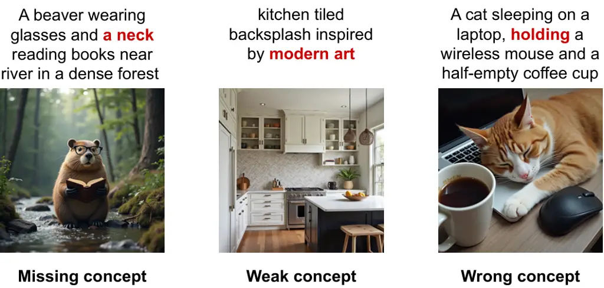

(a)

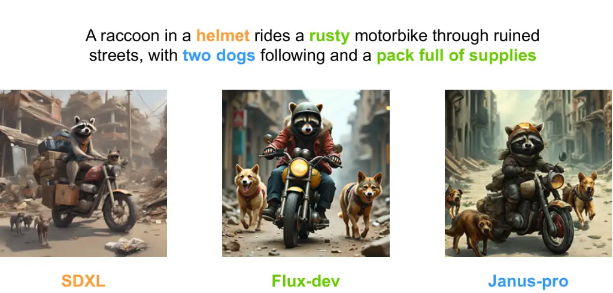

(b)

Figure 1: Existing T2I generative models often fail to correctly draw
key concepts within the provided prompts. Different models also fail
differently on the same prompt.

In this paper, we introduce VisualPrompter, a novel and training-free
framework that provides fine-grained, case-specific, and model-preferred
optimization for distinct user inputs. To make clear the optimization
target, our model incorporates a SElf-REflection module (SERE) to
identify the missing concepts that are included in the input prompts but
not reflected in the generated images. SERE breaks down the prompts into
atomic concepts using a large language model and verifies if each
concept is reflected in the generated images using a Visual-Language
Model (VLM). Subsequently, with the missing concepts as targets, a
Target-Specific Prompt Optimization module (TSPO) is employed to refine
the user prompts. By enriching the missing concepts while preserving the
existing concepts, TSPO ensures that the refined prompts are both
model-preferred and semantically faithful to the user’s original intent.
Furthermore, we introduce another LLM to incorporate appropriate
aesthetic keywords into sentences, thereby improving the visual quality
of optimized images.

Notably, by breaking down the user prompts into fine-grained concepts,
our method allows case-specific detailed prompt optimization, which is
not only more interpretable but also more powerful. This capability
enables the model to assess key attributes like objects, properties, and
relations, thereby refining and expanding vague or fragmented user
inputs into well-structured, model-preferred prompts. Moreover, our
method allows different prompt optimizations for different diffusion
models according to the distinct answers based on their generated
images. In this way, our VisualPrompter can be compatible with various
generative models, obtaining a universal and robust performance
improvement.

Experiments show that VisualPrompter outperforms prior prompt
engineering works on two text-image alignment evaluation benchmarks,
demonstrating the effectiveness of our approach. Images generated from
texts optimized by VisualPrompter also achieve higher CLIP Score (Hessel
et al., 2021) than those produced by previous prompt engineering
methods. Besides this improved semantic fidelity, our optimization also
enhances the aesthetic quality, contributing to more visually appealing
results. Furthermore, our model exhibits notable performance
improvements across various diffusion models, highlighting its extensive
applicability and adaptability.

Our contributions are summarized as follows:

- •
  We propose an innovative text-to-image prompt engineering method,
  named VisualPrompter. Our approach is capable of generating prompts
  that effectively align with both model preferences and user intent.
- •
  We propose a feedback-driven optimization system that leverages the
  visual feedback from the VLM to strategically enhance outputs from
  diverse generative models.
- •
  Our method operates at the atomic semantic level to analyze and refine
  the prompt, fully preserving its original meaning while incorporating
  appropriate new content.
- •
  Extensive experiments demonstrate the effectiveness of our
  VisualPrompter, which significantly outperforms current
  state-of-the-art prompt engineering methods in multiple benchmarks.

## 2 Related Work

### 2.1 Text-to-Image Synthesis

Diffusion models (Ho et al., 2020; Song et al., 2021) have recently
attained unprecedented success in image synthesis. These models generate
images from random noise through a series of denoising steps, achieving
high visual fidelity and diversity. The introduction of classifier-free
guidance (Ho and Salimans, 2022) facilitates the generation of images
from brief text descriptions by leveraging text encoders such as CLIP
(Radford et al., 2021), making text-to-image synthesis possible within
the diffusion framework. Another significant innovation is the Latent
Diffusion Model (LDM) (Rombach et al., 2022), which implements the
diffusion process in latent space. LDM is capable of generating images
with exceptional visual fidelity, while significantly reducing the
required computational resources. Furthermore, the emergence of
open-source diffusion models (Esser et al., 2024; Podell et al., 2024)
has brought text-to-image generation into the public spotlight.
Consequently, a well-designed prompt engineering framework can be
immensely beneficial for novice users.

### 2.2 Prompt Engineering

Prompt engineering aims to optimize the interaction between humans and
AI systems by crafting effective input prompts that elicit desired
outputs (Liu et al., 2023; Sahoo et al., 2024). In the field of
text-to-image generation, prompt engineering involves carefully
selecting and combining phrases to achieve high-quality and satisfactory
synthesized images. Early studies (Liu and Chilton, 2022; Pavlichenko
and Ustalov, 2023) have focused on automatically searching for keywords
that significantly influence the style and quality of generated images
through mining techniques. With the rapid advancement of large language
models, several studies (Cao et al., 2023; Wang et al., 2023a; Rosenman
et al., 2024) have explored their utilization as prompt engineers,
particularly through fine-tuning and reinforcement learning. These
models are capable of producing detailed and varied content prompts,
based on short phrases provided by users.

To achieve precise control, other methods (Brade et al., 2023; Feng et
al., 2024) focus on the interaction with humans. PromptCharm (Wang et
al., 2024b) provides convenient attention adjustments for the keywords
within prompts. Prompt Expansion (Datta et al., 2024) outputs a set of
expanded text prompts and images, providing users with multiple
optimization directions for selection. Although these methods can
improve the visual quality of generated images, they often neglect the
semantic consistency with user-provided descriptions, which
significantly limits their practicality in real-world scenarios.

## 3 VisualPrompter

In this section, we present our VisualPrompter in detail, which is a
semantic-aware, plug-and-play prompt engineering method for the
text-to-image generation task.

### 3.1 Overview

The target of our VisualPrompter is to automatically optimize user input
prompts into model-preferred prompts. The principal strength of our
approach stems from its atomic semantic-level prompt optimization, which
offers more precise and reliable control over semantics compared to
direct expansion by models. Figure 2 illustrates the overall framework
of our proposed method.

Given a user input prompt, a SElf-REflection module (SERE) is employed
to identify the specific aspects that require enhancement. It analyzes
the image generated by the diffusion model based on the input text. By
thoroughly evaluating the semantic information in the prompt through
question generation and answering, we can effectively identify the
missing concepts. Notably, the missing concepts are those textual
descriptions that are included in user inputs but are not reflected in
the generated images. To obtain prompts that remain faithful to user
inputs while aligning with model preferences, we employ a
Target-Specific Prompt Optimization module (TSPO) to refine the user
prompt based on the identified missing concepts. TSPO first
strategically enriches the attributes of the missing concepts to
simulate model-preferred patterns. It then combines these expanded
atomic concepts to form a syntactically complete and semantically fluent
result.

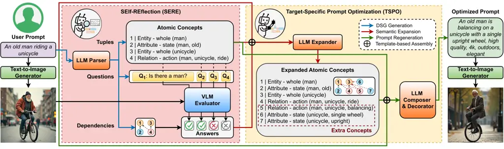

Figure 2: The refinement pipeline of our VisualPrompter. The
optimization starts with LLM-driven VLM-verified semantic evaluation,
followed by LLM-controlled concept expansion and sentence composition.
Our approach emulates the chain-of-thought reasoning in human prompt
refinement. All utilized models do not require any extra training.

### 3.2 Self-reflection Module

Our self-reflection module utilizes multi-step reasoning to obtain
explicit visual feedback by evaluating the generated images against
sentence-derived atomic concept questions. This mechanism ensures a
fine-grained evaluation of the alignment between textual descriptions
and visual content, effectively pinpointing discrepancies where the
generative model fails to capture specific aspects of the user input. An
example of this fine-grained evaluation is shown in Figure 2.

Question Generation. For detailed question generation, we adopt
Davidsonian Scene Graph (DSG) (Cho et al., 2024) to identify atomic
concepts within the input prompts. A DSG is a structured representation
comprising a set of general questions. Each question corresponds to an
atomic concept in the given prompt. These questions are interconnected
through directed edges, which capture the entailment dependencies among
them. We employ a Large Language Model (LLM) to generate the DSG, and
its detailed construction process is elaborated in Appendix A.

Question Answering. Upon completing the construction of DSG, we employ a
Visual-Language Model (VLM) as the visual question answering model to
evaluate the generated image against the questions in DSG. The VLM is
instructed to provide a binary response for each question, determining
if the corresponding concept appears in the generated image. The
dependency relationships within the DSG are utilized for question
pruning, a process that eliminates the need for redundant assessments.
Specifically, if a particular concept is judged to be missing, all
subsequent concepts dependent on it are automatically regarded as
missing as well. The answers enable a comprehensive and fine-grained
semantic analysis of the generated images, which will be employed as
semantic-aware information to refine the prompt.

### 3.3 Target-Specific Prompt Optimization

With these identified missing concepts by our self-reflection module, we
can perform targeted optimization of the input texts, reducing
unnecessary modifications and expansions. We introduce a novel,
training-free optimization approach that effectively manages prompt
adjustments.

Prompt Regeneration. Rather than directly rewriting the sentences,
VisualPrompter first utilizes an LLM to expand the generated atomic
concepts based on the responses to the questions from the SERE module.
This expansion process specifically targets the identified missing
concepts, enriching them with additional detail such as attributes,
actions, and spatial relationships. Our observations reveal that
augmenting the missing concepts can nudge the user input toward the
distribution of model-preferred prompts, providing a plug-and-play lever
for optimizing various generative models. These additional elements are
also expressed as atomic concepts, ensuring consistency and clarity in
representation. Notably, if no missing concepts are detected, no further
modifications will be made.

Subsequently, VisualPrompter generates a new prompt from the expanded
atomic concepts with an LLM. The original prompts and concepts are also
provided to guide the synthesis, ensuring that the generated prompt
remains contextually aligned with the initial input. The TSPO module
retains textual descriptions that are already accurately reflected in
the generated images to avoid unnecessary modifications, thereby
preserving original user intent. By adopting this two-step optimization
methodology, our framework is able to produce more accurate and reliable
prompts.

Prompt Decoration. To further enrich the diversity and aesthetic quality
of the generated content, we augment the optimized results with several
aesthetic keywords that are automatically selected by an LLM. By
providing example keywords such as high-quality, detailed, and fantasy,
we leverage the LLM to automatically generate rich and diverse keywords
that do not conflict with the input sentences. These stylistic keywords
are seamlessly integrated into the texts or appended at the end in a
comma-separated format.

## 4 Experiments

In this section, we first present the benchmarks involved and our
experimental configurations. Then, we compare VisualPrompter with three
previous SOTA prompt engineering works both quantitatively and
qualitatively. Human evaluation is conducted to underscore the
preeminence of our approach. Furthermore, we select several widely-used
text-to-image generation applications to demonstrate the effectiveness
of our model in open-world scenarios.

### 4.1 Benchmarks and Evaluation Metrics

Benchmarks. For our evaluation, we utilize two comprehensive benchmarks:
DSG-1k (Cho et al., 2024) and TIFA v1.0 (Hu et al., 2023). Both of them
contain human-written prompts from various established text-to-image
benchmarks. The DSG-1k benchmark comprises $`1,060`$ prompts from $`10`$
publicly available prompt datasets, encompassing a wide range of skills
and writing styles. It provides $`8,182`$ questions associated with
these prompts, facilitating a multifaceted evaluation of generated
images. Meanwhile, TIFA v1.0 contains $`4,081`$ diverse prompts from
$`4`$ datasets. As the original TIFA v1.0 benchmark contains
multiple-choice and free-form questions, we further refine these
questions and represent them in the DSG structure. Ultimately, the TIFA
benchmark used in our experiments contains $`19,233`$ general questions.

Metrics. To evaluate the text-image alignment, we adopt a robust and
innovative approach (Yarom et al., 2023; Cho et al., 2023), which
leverages question generation and answering techniques (Deutsch et al.,
2021; Min et al., 2023). This VLM-as-judge metric demonstrates strong
correlations with human judgments (Hu et al., 2023), making it
particularly suitable for fine-grained evaluation tasks. We also employ
the CLIP Score (Hessel et al., 2021) to evaluate the semantic alignment
between textual descriptions and generated images at the feature level.
For aesthetic assessment, we employ the Aesthetic Score (Schuhmann et
al., 2022), a well-established metric for objective image quality
assessment, reducing subjectivity in human judgments.

### 4.2 Experimental Settings

Our VisualPrompter leverages a dual-model architecture that requires an
LLM for DSG generation and prompt optimization, connected by a VLM for
comprehensive image semantic evaluation. We employ the state-of-the-art
open-source Qwen2 (Yang et al., 2024) as our primary language model and
the Qwen2-VL (Wang et al., 2024a) as our visual question answering
model. Each language generation task in our pipeline is initiated by
feeding Qwen2 with a meticulously designed preamble and $`23`$ manually
curated samples from the TIFA dataset, ensuring consistent model output.

To thoroughly evaluate our framework’s performance, we conduct extensive
testing across three prominent diffusion models and one autoregressive
generative model, including Stable Diffusion v1.5, Stable Diffusion v2.1
(Rombach et al., 2022), Flux-dev (BlackForestLabs, 2024), and Janus-Pro
(Chen et al., 2025). Our evaluation utilizes prompts from both the
DSG-1k and TIFA benchmarks. We compare our method with several
open-source prompt engineering methods, including NeuroPrompts (Rosenman
et al., 2024), Promptist (Hao et al., 2023), and BeautifulPrompt (Cao et
al., 2023). All of these methods utilize supervised fine-tuning and
reinforcement learning to adjust LLMs for optimizing prompts. Our
approach is implemented using PyTorch. All experiments are conducted on
a single A100 with 40GB memory.

### 4.3 Semantic Accuracy Evaluation

Methods DSG benchmark TIFA benchmark Average SD 1.5 SD 2.1 Flux-dev
Janus-Pro SD 1.5 SD 2.1 Flux-dev Janus-Pro Baseline 67.5 72.1 79.1 79.5
75.0 80.4 87.9 85.7 78.4 NeuroPrompts 58.4 68.7 75.5 81.7 62.8 75.5 84.0
89.8 74.6 Promptist 65.1 68.7 76.9 78.0 71.4 77.2 85.3 86.9 76.2
BeautifulPrompt 47.9 49.6 51.5 55.3 50.9 53.6 57.4 62.0 53.5
VisualPrompter 69.5 77.0 84.3 82.6 80.7 82.8 93.8 93.7 83.0

Table 1: Summarized results on the DSG and TIFA benchmark. Reported
scores are based on the percentage of “yes” answers to the questions,
while the best scores are highlighted in boldface. Our VisualPrompter
demonstrates notable improvements in semantic consistency evaluations.

We compare VisualPrompter with several state-of-the-art prompt
engineering methods on two semantic consistency evaluation benchmarks,
and summarize the results in Table 1. We refine the original text
prompts with each method, and use the refined prompts to generate images
with different generative models. We then use Qwen2-VL-7B to assess
whether the generated images contain the specified semantic information.
We quantify the results by measuring the average answering accuracy,
which has been demonstrated to be effective by DSG (Cho et al., 2024).

As illustrated in Table 1, our model achieves significant improvements
across all evaluation benchmarks and all generative models. Notably,
VisualPrompter consistently outperforms the four baseline generative
models in terms of average performance scores. The results also show
that VisualPrompter achieves higher performance gains when integrated
with Flux-dev and Janus-Pro, which can be attributed to their
state-of-the-art generative capabilities, particularly in handling long
sentences and intricate details. This indicates that VisualPrompter can
better collaborate with high-capacity generators to produce results with
more accurate semantics. It also demonstrates the strong adaptability of
VisualPrompter, enabling its effective application across various
scenarios.

Surprisingly, previous methods not only fail to preserve the semantic
consistency during optimization but also exhibit varying degrees of
decline in this aspect. Our analysis reveals that both NeuroPrompts and
Promptist are unable to modify the original descriptions, even though
they utilize an LLM for prompt optimization. This limitation prevents
them from effectively refining those model-dispreferred sentences.
Additionally, they often introduce irrelevant keywords that are
inconsistent with the overall context of the prompts, thereby
compromising the semantic fidelity of the generated images. In contrast,
BeautifulPrompt is able to adjust the original prompts and add
contextually relevant details. However, it tends to omit critical
information during the modification process, which significantly
deviates from the user intent.

Model Category of source texts whoops localized posescript vrd
countbench midjourney tifa160 draw text stanford diffusion db Flux 82.2
85.1 73.3 85.8 72.1 56.7 88.6 83.3 89.1 68.9 NeuroPrompts 75.3 86.1 74.8
84.8 70.3 49.6 85.7 75.6 88.2 58.5 Promptist 79.1 84.1 75.4 81.9 73.3
56.6 85.4 81.2 85.2 61.4 BeautifulPrompt 56.4 53.0 61.2 64.5 44.7 38.6
58.2 40.1 45.7 48.7 VisualPrompter 86.5 (+4.3) 89.7 (+3.6) 75.9 (+0.5)
92.4 (+6.6) 81.7 (+8.4) 65.7 (+9.0) 93.1 (+4.5) 88.1 (+4.8) 92.8 (+3.7)
72.1 (+3.2)

Table 2: Semantic evaluation across all categories of the DSG benchmark
using Flux-dev.

In Table 2, we present the semantic evaluation results across all
categories of the DSG benchmark using Flux-Dev. Additional results from
other generative models, as well as those from the TIFA benchmark, can
be found in Appendix E. These results confirm that our approach
effectively reinforces semantic components in the input prompts and
ensures their accurate representation in the generated images. Our model
demonstrates consistent improvements across specific categories,
indicating its strong capability to comprehend and enhance key elements
such as objects, attributes, and relationships.

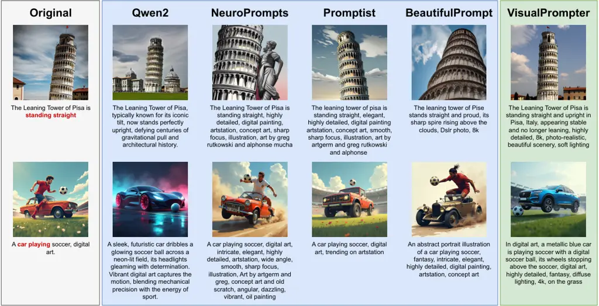

Figure 3: Comparison of prompts generated by large language model and
different prompt engineering methods. Images in the two rows correspond
to outputs from Stable Diffusion v2.1 and Flux-dev, respectively.

We visualize the generation results of various generative models, as
shown in Figure 3. We also use Qwen2 for zero-shot prompt optimization
as a comparison. The results demonstrate that our model is capable of
producing more elegant prompts that result in more visually compelling
images. It successfully corrects the deficiencies of the original
images, indicating that our optimized prompts are preferred by
generative models. Additional visual examples are presented in Appendix
F.

### 4.4 Text-Image Relevence Evaluation

Methods Generative Models Mean SD v1.5 SD v2.1 Flux Janus-Pro Baseline
31.53 31.88 31.58 31.83 31.71 NeuroPrompts 25.61 25.26 24.56 26.21 25.41
Promptist 32.14 31.61 31.49 31.85 31.77 BeautifulPrompt 31.70 31.38
31.35 32.10 31.63 VisualPrompter 32.21 32.50 33.81 32.22 32.69

Table 3: Results of CLIP Score between optimized prompts and generated
images on DSG benchmark. Baseline represents the results on images from
original prompts.

To further validate the effectiveness of VisualPrompter, we evaluate the
CLIP Score between the optimized prompts and their corresponding
generated images. We report the mean scores of all the prompts from the
DSG benchmark, generating images with those different generative models.
The results are illustrated in Table 3.

As shown in Table 3, prompts optimized by VisualPrompter achieve the
highest scores across all the generative models. The results indicate
that the prompts produced by VisualPrompter can be effectively
understood by the generative models, generating images with improved
semantic coherence. Optimized prompts from Promptist and BeautifulPrompt
also achieve a relatively high CLIP Score compared to baselines, whereas
NeuroPrompts performs the worst. This is primarily because NeuroPrompts
offers only limited keyword options, which significantly restricts the
diversity of the resulting prompts. In contrast, we leverage LLMs to
generate aesthetic keywords that align well with the sentence content,
leading to greater overall coherence and harmony in the prompts.

Additionally, we also notice that Promptist and BeautifulPrompt achieve
higher CLIP Score than the baseline with Stable Diffusion v1.5 and
Janus-Pro, while their performance drops with Stable Diffusion v2.1 and
Flux-dev. The performance gap arises from their specific optimization
for Stable Diffusion v1.5. Another reason is that Janus-Pro’s
autoregressive design enables stronger semantic understanding, allowing
it to better handle complex sentences. The discrepancy highlights their
limited generalization capability across different generative models. In
contrast, our prompt engineering framework functions in a model-agnostic
way, which does not rely on any specific generative model, demonstrating
the broad compatibility and robustness of VisualPrompter.

### 4.5 Aesthetic Evaluation

Recent studies (Hao et al., 2023; Podell et al., 2024) have revealed
that conventional image quality metrics, such as FID (Heusel et al., 2017) and CLIP Score (Hessel et al., 2021), do not exhibit a positive
correlation with visual aesthetics. To alleviate the burden of
labor-intensive human evaluation, the Aesthetic Score (Podell et al., 2024) has emerged as an effective metric, as it is specifically designed
to align with human perceptions of beauty, leveraging insights from
large-scale datasets. Thus, previous studies have placed greater
emphasis on this metric and integrated it into their reinforcement
learning frameworks. We also evaluate our method with the Aesthetic
Score to show the visual elegance of optimized images. The results are
summarized in Section 4.5.

Methods Generative Models Mean SD v1.5 SD v2.1 Flux Baseline 5.30 5.48
5.77 5.52 NeuroPrompts 6.21 6.03 6.40 6.21 Promptist 5.93 5.86 6.25 6.01
BeautifulPrompt 5.97 5.98 6.48 6.14 VisualPrompter 5.66 5.73 6.03 5.81
Ours + NeuroPrompts 6.13 6.15 6.44 6.24

Table 4: Results of Aesthetic Score for generated images on DSG
benchmark. Baseline represents the results on images from original
prompts.

Figure 4: Human evaluation results. From left to right, the segments
indicate preference for images from optimized prompts, equal preference
for both results, and preference for images from original prompts.

The experimental results on aesthetics show that VisualPrompter achieves
modest improvements in aesthetic quality, which are not as substantial
as those in previous studies. This discrepancy primarily stems from the
tendency of our method to classify the original prompts as descriptions
of realistic photographs, which results in an inherent lack of
imaginative or fantastical elements among the optimized prompts. This
also indicates that our prompt decorator is overly simplistic for
enhancing aesthetics. To address this problem, we employ NeuroPrompts as
a replacement for our decorator, which adds additional stylistic
keywords while preserving the original sentence. This integrated
approach achieves optimal performance on average in the aesthetic
evaluation. However, we observe a notable decline in semantic
consistency, compared to the results without the involvement of
NeuroPrompts. It implies that adopting the Aesthetic Score as a training
metric may inadvertently encourage the model to optimize for superficial
features at the expense of semantic integrity, highlighting the need for
more balanced and semantically meaningful training guidance.

### 4.6 User Study

To enhance the credibility of the above quantitative results, we
additionally conduct a human evaluation experiment based on Stable
Diffusion v1.5 and Flux-dev. We compute the average preference
distribution and report the results in Figure 4. In detail, we generate
image pairs using both the original prompts and the optimized prompts
derived from VisualPrompter. A panel of $`10`$ independent annotators is
tasked with selecting the most desirable images from semantic and
aesthetic aspects. Each annotator is provided with $`50`$ samples
randomly selected from both benchmarks.

The results of human evaluation indicate that annotators generally
prefer images generated by optimized prompts in both semantic and
aesthetic aspects, which demonstrates the superiority of our approach.
The optimized prompts slightly outperform the original prompts in terms
of aesthetics on Flux-dev, owing to its robust generative capability,
which can effectively fill in intricate details.

### 4.7 Ablation Study

Visual Feedback Prompt Modification Approach None Qwen DSG w/o 72.1 /
5.48 67.8 / 5.32 71.9 / 5.69 w/ 73.8 / 5.54 73.0 / 5.45 77.0 / 5.73

Table 5: Impact of different modules in VisualPrompter. We report the
Semantic Accuracy / Aesthetic Score based on the DSG benchmark.

T2I Models Prompt Modification Approach NeuroPrompts Promptist Qwen3-32B
Ours SD v1.5 8.5s 7.0s 21.3s 10.7s FLUX-dev 20.3s 18.8s 33.1s 34.3s

Table 6: Inference time comparison.

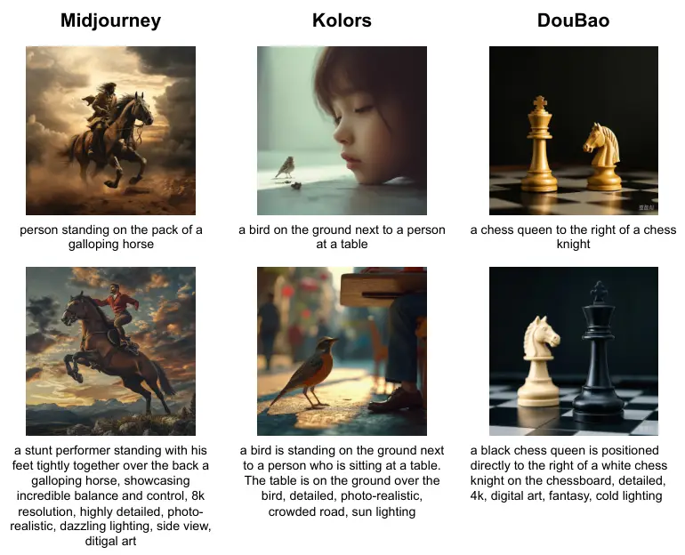

Figure 5: Adaptation for online generators. The second row presents
results optimized by VisualPrompter.

Module Impact Evaluation. To systematically analyze the impact of
different components in VisualPrompter, we conduct an ablation study to
evaluate the individual contributions of the self-reflection module and
the target-specific optimization module in Figure 2. Specifically, we
compare two approaches for prompt refinement: direct prompt optimization
using Qwen and constructing prompts from expanded concepts based on DSG.
For the self-reflection module, visual feedback is leveraged to refine
the targeted location of the given prompts. Additionally, we account for
the impact of regeneration, where visual feedback is employed to
evaluate the original images. Prompts that result in defective images
will be used to regenerate images without any modifications.

As shown in Table 6, our fine-grained semantic extraction and
composition approach achieves better results than directly using LLM for
optimization. We observe that Qwen often produces prompts with
semantically irrelevant details. These long sentences increase the
difficulty for the diffusion models to comprehend them, leading to worse
results than the original prompts. Another observation is that the
regeneration of images actually exerts a non-negligible impact on the
semantic evaluation metric. Despite this influence, our VisualPrompter
achieves superior results, demonstrating its outstanding capability in
enhancing semantic consistency.

Inference time. We compare the inference times of several optimization
methods and summarize the results in Table 6. We calculate the total
time from when a prompt is provided to when a complete image is
generated. Our model uses Qwen2 $`1.5`$ B for fast DSG generation and
concept integration. As shown in Table 6, while our VisualPrompter is
marginally slower compared with existing optimization models, the
difference falls within tolerable limits for practical applications.

Online Generation Evaluation. To show the robust adaptability of
VisualPrompter, we select several online generative models, including
Midjourney (Midjourney, 2021), Kolors (Kolors, 2024), and DouBao
(DouBao, 2023). We provide them with human-written prompts and utilize
the feedback to further optimize the prompts. The results are presented
in Figure 5. Each image is selected from three samples with the same
prompts.

## 5 Conclusion

In this paper, we propose VisualPrompter, a training-free prompt
engineering framework that improves text-to-image generation by refining
user prompts to model-preferred sentences. We reveal that prompts
generated by existing LLM-based methods often struggle to maintain
semantic consistency with the original intent and consequently produce
images that deviate semantically. To tackle this issue, VisualPrompter
operates at the atomic semantic level to analyze and revise the prompt.
It leverages model-specific insights obtained through visual reflection
to perform targeted expansion and modification of the initial input,
thereby ensuring semantic consistency throughout the optimization
process. Extensive experiments demonstrate the effectiveness of our
VisualPrompter, which achieves state-of-the-art performance in enhancing
semantic consistency while maintaining superior aesthetic quality.
Compared with previous methods, VisualPrompter exhibits better
generalization capabilities, which can be easily adapted to various
diffusion models. We intend to extend this feedback-driven optimization
system to multimodal generative models in our future work.

## Acknowledgements

This research is supported by Artificial Intelligence-National Science
and Technology Major Project (2023ZD0121200), and the National Natural
Science Foundation of China (62531026, 62437001, 62436001), and the
Natural Science Foundation of Jiangsu Province under Grant BK20243051,
and the Strategic Priority Research Program of Chinese Academy of
Sciences under Grant XDA04080400.

## References

- BlackForestLabs (2024) BlackForestLabs FLUX. Note:
  [https://github.com/black-forest-labs/flux](https://github.com/black-forest-labs/flux)Accessed:
  2025-03-01 Cited by: §4.2.
- Brade et al. (2023) S. Brade, B. Wang, M. Sousa, S. Oore, and T.
  Grossman Promptify: text-to-image generation through interactive
  prompt exploration with large language models. In Proceedings of the
  36th Annual ACM Symposium on User Interface Software and Technology,
  UIST 2023, pp. 96:1–96:14. Cited by: §2.2.
- Brown et al. (2020) T. B. Brown, B. Mann, N. Ryder, M. Subbiah, J.
  Kaplan, P. Dhariwal, A. Neelakantan, P. Shyam, G. Sastry, A.
  Askell, S. Agarwal, A. Herbert-Voss, G. Krueger, T. Henighan, R.
  Child, A. Ramesh, D. M. Ziegler, J. Wu, C. Winter, C. Hesse, M.
  Chen, E. Sigler, M. Litwin, S. Gray, B. Chess, J. Clark, C. Berner, S.
  McCandlish, A. Radford, I. Sutskever, and D. Amodei Language models
  are few-shot learners. In Advances in Neural Information Processing
  Systems 33, NeurIPS 2020, Cited by: §1.
- Cao et al. (2023) T. Cao, C. Wang, B. Liu, Z. Wu, J. Zhu, and J. Huang
  BeautifulPrompt: towards automatic prompt engineering for
  text-to-image synthesis. In Proceedings of the 2023 Conference on
  Empirical Methods in Natural Language Processing: EMNLP 2023,
  pp. 1–11. Cited by: §1, §2.2, §4.2.
- Chen et al. (2023) S. Chen, H. Li, Q. Wang, Z. Zhao, M. Sun, X. Zhu,
  and J. Liu VAST: A vision-audio-subtitle-text omni-modality foundation
  model and dataset. In Annual Conference on Neural Information
  Processing Systems 2023, NeurIPS 2023, Cited by: Appendix M.
- Chen et al. (2025) X. Chen, Z. Wu, X. Liu, Z. Pan, W. Liu, Z. Xie, X.
  Yu, and C. Ruan Janus-pro: unified multimodal understanding and
  generation with data and model scaling. CoRR abs/2501.17811. External
  Links: 2501.17811 Cited by: §4.2.
- Cho et al. (2024) J. Cho, Y. Hu, J. M. Baldridge, R. Garg, P.
  Anderson, R. Krishna, M. Bansal, J. Pont-Tuset, and S. Wang
  Davidsonian scene graph: improving reliability in fine-grained
  evaluation for text-to-image generation. In The Twelfth International
  Conference on Learning Representations, ICLR 2024, Cited by: Appendix
  A, Appendix D, Appendix E, §3.2, §4.1, §4.3.
- Cho et al. (2023) J. Cho, A. Zala, and M. Bansal Visual programming
  for step-by-step text-to-image generation and evaluation. In Advances
  in Neural Information Processing Systems, NeurIPS 2023, Cited by:
  §4.1.
- Datta et al. (2024) S. Datta, A. Ku, D. Ramachandran, and P. Anderson
  Prompt expansion for adaptive text-to-image generation. In Proceedings
  of the 62nd Annual Meeting of the Association for Computational
  Linguistics, ACL 2024, pp. 3449–3476. Cited by: §2.2.
- Deutsch et al. (2021) D. Deutsch, T. Bedrax-Weiss, and D. Roth Towards
  question-answering as an automatic metric for evaluating the content
  quality of a summary. Trans. Assoc. Comput. Linguistics 9,
  pp. 774–789. Cited by: §4.1.
- DouBao (2023) DouBao DouBao. Note:
  [https://www.doubao.com/chat/create-image](https://www.doubao.com/chat/create-image)Accessed:
  2025-03-01 Cited by: §4.7.
- Esser et al. (2024) P. Esser, S. Kulal, A. Blattmann, R. Entezari, J.
  Müller, H. Saini, Y. Levi, D. Lorenz, A. Sauer, F. Boesel, D.
  Podell, T. Dockhorn, Z. English, and R. Rombach Scaling rectified flow
  transformers for high-resolution image synthesis. In Forty-first
  International Conference on Machine Learning, ICML 2024, Cited by:
  §2.1.
- Fan et al. (2023) L. Fan, H. J. Wang, K. Zhang, Z. Pei, and A. Li
  Towards an automatic prompt optimization framework for AI image
  generation. In 25th International Conference on Human-Computer
  Interaction, HCII 2023, Communications in Computer and Information
  Science, Vol. 1836, pp. 405–410. Cited by: Appendix M.
- Feng et al. (2024) Y. Feng, X. Wang, K. Wong, S. Wang, Y. Lu, M.
  Zhu, B. Wang, and W. Chen PromptMagician: interactive prompt
  engineering for text-to-image creation. IEEE Trans. Vis. Comput.
  Graph. 30 (1), pp. 295–305. Cited by: §2.2.
- Gao et al. (2021) T. Gao, A. Fisch, and D. Chen Making pre-trained
  language models better few-shot learners. In Proceedings of the 59th
  Annual Meeting of the Association for Computational Linguistics and
  the 11th International Joint Conference on Natural Language
  Processing, ACL/IJCNLP 2021, pp. 3816–3830. Cited by: Appendix M.
- Hao et al. (2023) Y. Hao, Z. Chi, L. Dong, and F. Wei Optimizing
  prompts for text-to-image generation. In Advances in Neural
  Information Processing Systems 36, NeurIPS 2023, Cited by: §1, §4.2,
  §4.5.
- Hei et al. (2024) N. Hei, Q. Guo, Z. Wang, Y. Wang, H. Wang, and W.
  Zhang A user-friendly framework for generating model-preferred prompts
  in text-to-image synthesis. In Thirty-Eighth AAAI Conference on
  Artificial Intelligence, AAAI 2024, pp. 2139–2147. Cited by: Appendix
  M, §1.
- Hessel et al. (2021) J. Hessel, A. Holtzman, M. Forbes, R. L. Bras,
  and Y. Choi CLIPScore: A reference-free evaluation metric for image
  captioning. In Proceedings of the 2021 Conference on Empirical Methods
  in Natural Language Processing, EMNLP 2021, pp. 7514–7528. Cited by:
  §1, §4.1, §4.5.
- Heusel et al. (2017) M. Heusel, H. Ramsauer, T. Unterthiner, B.
  Nessler, and S. Hochreiter GANs trained by a two time-scale update
  rule converge to a local nash equilibrium. In Advances in Neural
  Information Processing Systems 30: Annual Conference on Neural
  Information Processing Systems 2017, pp. 6626–6637. Cited by: §4.5.
- Ho et al. (2020) J. Ho, A. Jain, and P. Abbeel Denoising diffusion
  probabilistic models. In Advances in Neural Information Processing
  Systems 33, NeurIPS 2020, Cited by: §1, §2.1.
- Ho and Salimans (2022) J. Ho and T. Salimans Classifier-free diffusion
  guidance. Vol. abs/2207.12598. External Links: 2207.12598 Cited by:
  §2.1.
- Hu et al. (2023) Y. Hu, B. Liu, J. Kasai, Y. Wang, M. Ostendorf, R.
  Krishna, and N. A. Smith TIFA: accurate and interpretable
  text-to-image faithfulness evaluation with question answering. In
  IEEE/CVF International Conference on Computer Vision, ICCV 2023,
  pp. 20349–20360. Cited by: Appendix E, §4.1, §4.1.
- Kirstain et al. (2023) Y. Kirstain, A. Polyak, U. Singer, S.
  Matiana, J. Penna, and O. Levy Pick-a-pic: an open dataset of user
  preferences for text-to-image generation. In Advances in Neural
  Information Processing Systems 36, NeurIPS 2023, Cited by: Appendix M.
- Kolors (2024) Kolors Kolors. Note:
  [https://app.klingai.com/cn/](https://app.klingai.com/cn/)Accessed:
  2025-03-01 Cited by: Figure 17, Appendix K, §4.7.
- Li and Liang (2021) X. L. Li and P. Liang Prefix-tuning: optimizing
  continuous prompts for generation. In Proceedings of the 59th Annual
  Meeting of the Association for Computational Linguistics and the 11th
  International Joint Conference on Natural Language Processing,
  ACL/IJCNLP 2021, pp. 4582–4597. Cited by: Appendix M.
- Liang et al. (2025) Z. Liang, Y. Yuan, S. Gu, B. Chen, T. Hang, M.
  Cheng, J. Li, and L. Zheng Aesthetic post-training diffusion models
  from generic preferences with step-by-step preference optimization. In
  IEEE/CVF Conference on Computer Vision and Pattern Recognition, CVPR
  2025, pp. 13199–13208. Cited by: Appendix M.
- Liu et al. (2025) J. Liu, S. Chen, X. He, L. Guo, X. Zhu, W. Wang,
  and J. Tang VALOR: vision-audio-language omni-perception pretraining
  model and dataset. IEEE Trans. Pattern Anal. Mach. Intell. 47 (2),
  pp. 708–724. Cited by: Appendix M.
- Liu et al. (2023) P. Liu, W. Yuan, J. Fu, Z. Jiang, H. Hayashi, and G.
  Neubig Pre-train, prompt, and predict: A systematic survey of
  prompting methods in natural language processing. ACM Comput. Surv. 55
  (9), pp. 195:1–195:35. Cited by: §2.2.
- Liu and Chilton (2022) V. Liu and L. B. Chilton Design guidelines for
  prompt engineering text-to-image generative models. In CHI ’22: CHI
  Conference on Human Factors in Computing Systems, New Orleans, 2022,
  pp. 384:1–384:23. Cited by: §1, §2.2.
- Midjourney (2021) Midjourney Midjourney. Note:
  [https://www.midjourney.com/home/](https://www.midjourney.com/home/)Accessed:
  2024-12-01 Cited by: §4.7.
- Min et al. (2023) S. Min, K. Krishna, X. Lyu, M. Lewis, W. Yih, P. W.
  Koh, M. Iyyer, L. Zettlemoyer, and H. Hajishirzi FActScore:
  fine-grained atomic evaluation of factual precision in long form text
  generation. In Proceedings of the 2023 Conference on Empirical Methods
  in Natural Language Processing, EMNLP 2023, pp. 12076–12100. Cited by:
  §4.1.
- Pavlichenko and Ustalov (2023) N. Pavlichenko and D. Ustalov Best
  prompts for text-to-image models and how to find them. In Proceedings
  of the 46th International ACM SIGIR Conference on Research and
  Development in Information Retrieval, SIGIR 2023, pp. 2067–2071. Cited
  by: §1, §2.2.
- Podell et al. (2024) D. Podell, Z. English, K. Lacey, A. Blattmann, T.
  Dockhorn, J. Müller, J. Penna, and R. Rombach SDXL: improving latent
  diffusion models for high-resolution image synthesis. In The Twelfth
  International Conference on Learning Representations, ICLR 2024, Cited
  by: §2.1, §4.5.
- Radford et al. (2021) A. Radford, J. W. Kim, C. Hallacy, A. Ramesh, G.
  Goh, S. Agarwal, G. Sastry, A. Askell, P. Mishkin, J. Clark, G.
  Krueger, and I. Sutskever Learning transferable visual models from
  natural language supervision. In Proceedings of the 38th International
  Conference on Machine Learning, ICML 2021, Cited by: §2.1.
- Rombach et al. (2022) R. Rombach, A. Blattmann, D. Lorenz, P. Esser,
  and B. Ommer High-resolution image synthesis with latent diffusion
  models. In IEEE/CVF Conference on Computer Vision and Pattern
  Recognition, CVPR 2022, pp. 10674–10685. Cited by: §1, §2.1, §4.2.
- Rosenman et al. (2024) S. Rosenman, V. Lal, and P. Howard
  NeuroPrompts: an adaptive framework to optimize prompts for
  text-to-image generation. In Proceedings of the 18th Conference of the
  European Chapter of the Association for Computational Linguistics,
  EACL 2024, pp. 159–167. Cited by: §1, §2.2, §4.2.
- Saharia et al. (2022) C. Saharia, W. Chan, S. Saxena, L. Li, J.
  Whang, E. L. Denton, S. K. S. Ghasemipour, R. G. Lopes, B. K. Ayan, T.
  Salimans, J. Ho, D. J. Fleet, and M. Norouzi Photorealistic
  text-to-image diffusion models with deep language understanding. In
  Advances in Neural Information Processing Systems 35, NeurIPS 2022,
  Cited by: Appendix M.
- Sahoo et al. (2024) P. Sahoo, A. K. Singh, S. Saha, V. Jain, S.
  Mondal, and A. Chadha A systematic survey of prompt engineering in
  large language models: techniques and applications. Vol.
  abs/2402.07927. External Links: 2402.07927 Cited by: §2.2.
- Schuhmann et al. (2022) C. Schuhmann, R. Beaumont, R. Vencu, C.
  Gordon, R. Wightman, M. Cherti, T. Coombes, A. Katta, C. Mullis, M.
  Wortsman, P. Schramowski, S. Kundurthy, K. Crowson, L. Schmidt, R.
  Kaczmarczyk, and J. Jitsev LAION-5B: an open large-scale dataset for
  training next generation image-text models. In Advances in Neural
  Information Processing Systems 35, NeurIPS 2022, Cited by: §4.1.
- Song et al. (2021) J. Song, C. Meng, and S. Ermon Denoising diffusion
  implicit models. In 9th International Conference on Learning
  Representations, ICLR 2021, Cited by: §2.1.
- Wang et al. (2025) F. Wang, Y. Shui, J. Piao, K. Sun, and H. Li
  Diffusion-npo: negative preference optimization for better preference
  aligned generation of diffusion models. In The Thirteenth
  International Conference on Learning Representations, ICLR 2025, Cited
  by: Appendix M.
- Wang et al. (2024a) P. Wang, S. Bai, S. Tan, S. Wang, Z. Fan, J.
  Bai, K. Chen, X. Liu, J. Wang, W. Ge, Y. Fan, K. Dang, M. Du, X.
  Ren, R. Men, D. Liu, C. Zhou, J. Zhou, and J. Lin Qwen2-vl: enhancing
  vision-language model’s perception of the world at any resolution.
  Vol. abs/2409.12191. External Links: 2409.12191 Cited by: §4.2.
- Wang et al. (2023a) Y. Wang, S. Shen, and B. Y. Lim RePrompt:
  automatic prompt editing to refine ai-generative art towards precise
  expressions. In Proceedings of the 2023 CHI Conference on Human
  Factors in Computing Systems, CHI 2023, pp. 22:1–22:29. Cited by:
  §2.2.
- Wang et al. (2024b) Z. Wang, Y. Huang, D. Song, L. Ma, and T. Zhang
  PromptCharm: text-to-image generation through multi-modal prompting
  and refinement. In Proceedings of the CHI Conference on Human Factors
  in Computing Systems, CHI 2024, pp. 185:1–185:21. Cited by: §2.2.
- Wang et al. (2023b) Z. J. Wang, E. Montoya, D. Munechika, H. Yang, B.
  Hoover, and D. H. Chau DiffusionDB: A large-scale prompt gallery
  dataset for text-to-image generative models. In Proceedings of the
  61st Annual Meeting of the Association for Computational Linguistics,
  ACL 2023, pp. 893–911. Cited by: Appendix M.
- Wu et al. (2024) T. Wu, L. Lian, J. E. Gonzalez, B. Li, and T. Darrell
  Self-correcting llm-controlled diffusion models. In IEEE/CVF
  Conference on Computer Vision and Pattern Recognition, CVPR 2024,
  pp. 6327–6336. Cited by: Appendix M.
- Wu et al. (2023) X. Wu, K. Sun, F. Zhu, R. Zhao, and H. Li Human
  preference score: better aligning text-to-image models with human
  preference. In IEEE/CVF International Conference on Computer Vision,
  ICCV 2023, pp. 2096–2105. Cited by: Appendix M.
- Yang et al. (2024) A. Yang, B. Yang, B. Hui, B. Zheng, B. Yu, C.
  Zhou, C. Li, C. Li, D. Liu, F. Huang, G. Dong, H. Wei, H. Lin, J.
  Tang, J. Wang, J. Yang, J. Tu, J. Zhang, J. Ma, J. Yang, J. Xu, J.
  Zhou, J. Bai, J. He, J. Lin, K. Dang, K. Lu, K. Chen, K. Yang, M.
  Li, M. Xue, N. Ni, P. Zhang, P. Wang, R. Peng, R. Men, R. Gao, R.
  Lin, S. Wang, S. Bai, S. Tan, T. Zhu, T. Li, T. Liu, W. Ge, X.
  Deng, X. Zhou, X. Ren, X. Zhang, X. Wei, X. Ren, X. Liu, Y. Fan, Y.
  Yao, Y. Zhang, Y. Wan, Y. Chu, Y. Liu, Z. Cui, Z. Zhang, Z. Guo,
  and Z. Fan Qwen2 technical report. Vol. abs/2407.10671. External
  Links: 2407.10671 Cited by: §4.2.
- Yarom et al. (2023) M. Yarom, Y. Bitton, S. Changpinyo, R. Aharoni, J.
  Herzig, O. Lang, E. Ofek, and I. Szpektor What you see is what you
  read? improving text-image alignment evaluation. In Advances in Neural
  Information Processing Systems 36, NeurIPS 2023, Cited by: §4.1.
- Zhang et al. (2023) L. Zhang, A. Rao, and M. Agrawala Adding
  conditional control to text-to-image diffusion models. In IEEE/CVF
  International Conference on Computer Vision, ICCV 2023, Paris, France,
  October 1-6, 2023, pp. 3813–3824. Cited by: Appendix I.
- Zhang et al. (2019) W. Zhang, K. Ma, J. Yan, D. Deng, and Z. Wang
  Blind image quality assessment using A deep bilinear convolutional
  neural network. Vol. abs/1907.02665. External Links: 1907.02665 Cited
  by: Appendix M.
- Zhou et al. (2021) K. Zhou, J. Yang, C. C. Loy, and Z. Liu Learning to
  prompt for vision-language models. Vol. abs/2109.01134. External
  Links: 2109.01134 Cited by: Appendix M.

## Appendix A Automatic Construction of DSG

Davidsonian Scene Graph (DSG) (Cho et al., 2024) is a set of questions
in the form of a directed acyclic graph, which has been used for
text-image alignment evaluation. As shown on the right side of Figure 6,
each question in DSG is about an atomic concept, which represents a
specific and indivisible semantic unit through a tuple. By feeding the
generated images and the related questions into a visual question
answering model, we can effectively identify and analyze the missing
concepts present in the images.

Figure 6: The automatic construction of DSG with an LLM.

Large language models (LLMs) have been employed to construct DSG from
textual descriptions automatically. To meticulously construct a DSG that
is both comprehensive and non-redundant, our approach adopts a
three-step pipeline for the overall generation process, as illustrated
in Figure 6. Specifically, an input prompt is first decomposed into
detailed concepts represented as tuples, which include entities,
attributes, relations, and actions in the text. Based on these tuples of
atomic concepts, LLMs are able to generate corresponding general
interrogative sentences and determine the dependency relationships among
them. Finally, the questions and dependencies are combined to form the
DSG for further use.

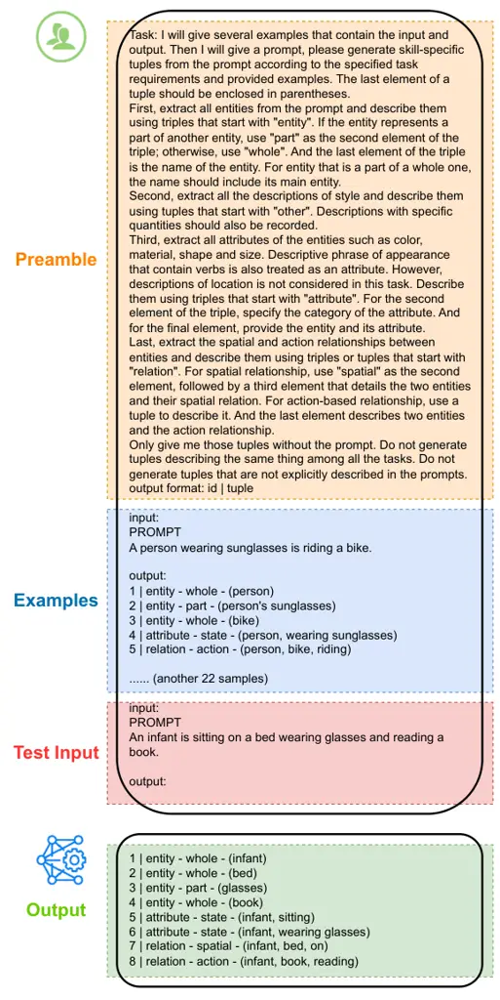

Figure 7: Example of tuple generation.

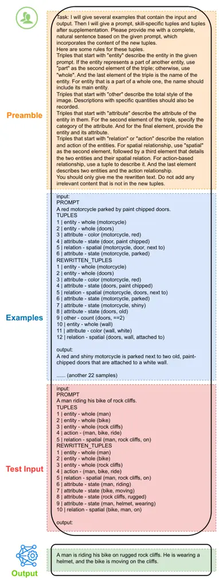

Figure 8: Example of prompt regeneration.

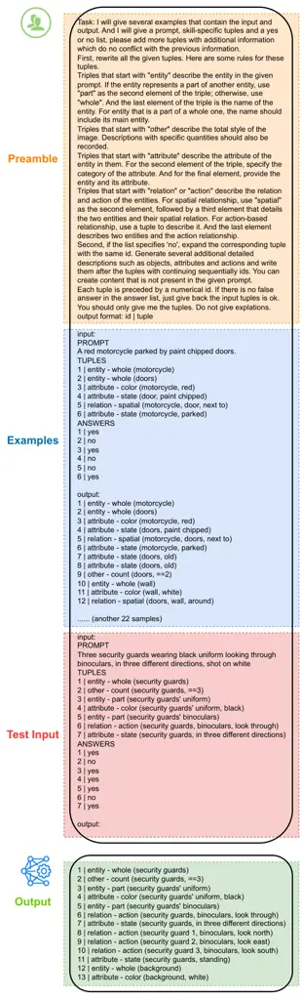

Figure 9: Example of concepts expansion.

To ensure consistent and standardized outputs from the large language
model (LLM), for each step in the process, we provide the LLM with a
well-designed preamble and multiple manually annotated samples. This
methodology guides the LLM to generate tuple annotations in a uniform
format for new inputs, thereby enhancing the reliability and scalability
of DSG generation across diverse textual inputs. We assign a numerical
identifier to each tuple to distinguish between them and ensure the
integrity of data. An example of tuple generation is shown in Figure 9.
The preambles and annotated examples for other tasks will be included in
our code release.

For the generation of questions and dependencies, we provide the LLM
with both the prompts and tuples to enhance comprehension. Any invalid
results will be regenerated multiple times to ensure accuracy.

## Appendix B Target-Specific Optimization

Here we provide examples for the two key technologies in our
target-specific optimization module: concept expansion and prompt
regeneration. We utilize the LLM engineering method used in DSG
generation above. Examples of prompt templates are shown in Figure 9 and
Figure 9.

## Appendix C Keywords for Decoration

To enhance the aesthetics of generated images, we employ an LLM
decorator to incorporate keywords, which have been demonstrated to
substantially improve the aesthetic appeal of the images. To constrain
the generation scope of the LLM, we provide several keyword examples in
the task preamble and instruct the LLM decorator to select appropriate
keywords that align with the prompt content. These suitable keywords are
appended at the end of the input sentence, separated by commas. We
collect some keywords from the results of NeuroPrompts and
BeautifulPrompt. These keywords are systematically organized according
to their descriptive categories, including image quality, artistic
style, background description, environmental illumination, and
perspective. A selection of examples is illustrated in Table 7.

class Samples quality best quality, 4k, 8k, highres, masterpiece,
fantasy art, highly detailed style photo-realistic, oil painting,
portraits, digital art, landscape, impressionist, anime, concept
artists, cyberpunk background blue sky, crowded road, beautifully
decorated wall, high mountain light studio lighting, soft lighting, sun
lighting, diffuse lighting, cold lighting aesthetics beautiful, elegant,
stunning, lovely, majestic, charming, graceful

Table 7: Class and examples of aesthetic keywords.

For each class of keywords, we guide the LLM to select or create $`0`$
to $`2`$ words and incorporate them into the input prompts. This
approach yields sentences that are both detailed and enriched with
aesthetic keywords. Our experimental findings indicate that the
inclusion of these aesthetic keywords does not substantially affect the
semantic consistency between generated images and textual descriptions.

## Appendix D Evaluation Reliability with DSG

We adopt the Davidsonian Scene Graph (DSG) (Cho et al., 2024) as a
stable metric for text-image alignment. DSG decomposes prompts into
atomic, dependency-structured questions whose accuracy yields a precise
measurement of semantic consistency. The alignment score is computed as
the proportion of ”yes” responses from a VLM, ensuring that images with
stronger textual fidelity receive higher scores. Notably, DSG
demonstrates near-perfect reliability: questions achieve $`98.3`$%
precision and $`96.0`$% recall against human annotations, while
state-of-the-art VLMs answer these questions with $`82.6`$% accuracy in
entity judgments. These results substantiate the reliability of DSG,
enabling our VisualPrompter to deliver dependable defect detection and
targeted optimization. Furthermore, DSG’s dependency-aware design
inherently prunes invalid queries such as asking about an attribute when
the object is absent, thereby reducing noise and reinforcing measurement
stability across diverse prompts and models. For additional experiments
and implementation details validating DSG’s stability, please refer to
Cho et al. (2024).

Model Category of source texts Average coco drawbench partiprompt
paintskill SD v1.5 81.8 65.2 72.5 58.5 75.0 NeuroPrompts 69.7 49.5 58.2
52.4 62.8 Promptist 78.1 62.4 67.9 57.8 71.4 BeautifulPrompt 56.3 50.8
45.9 43.1 50.9 VisualPrompter 87.5 (+5.7) 70.5 (+5.3) 77.0 (+4.5) 66.8
(+8.3) 80.7 (+5.7)

(a) Semantic evaluation on Stable Diffusion v1.5.

Model Category of source texts Average coco drawbench partiprompt
paintskill SD v2.1 86.2 69.1 77.9 67.5 80.4 NeuroPrompts 81.4 64.5 72.5
64.3 75.5 Promptist 82.3 67.1 74.8 67.3 77.2 BeautifulPrompt 58.9 50.3
48.9 46.8 53.6 VisualPrompter 89.0 (+2.8) 74.5 (+5.4) 79.6 (+1.7) 69.7
(+2.2) 82.8 (+2.4)

(b) Semantic evaluation on Stable Diffusion v2.1.

Model Category of source texts Average coco drawbench partiprompt
paintskill Flux 92.4 80.8 86.2 77.2 87.9 NeuroPrompts 88.6 74.2 80.3
79.2 84.0 Promptist 90.0 75.6 82.3 78.2 85.3 BeautifulPrompt 63.2 56.1
49.8 56.3 57.4 VisualPrompter 96.2 (+3.8) 87.6 (+6.8) 90.8 (+4.6) 94.7
(+5.5) 93.8 (+5.9)

(c) Semantic evaluation on Flux-dev.

Model Category of source texts Average coco drawbench partiprompt
paintskill Janus-Pro 90.8 85.4 80.2 81.1 85.7 NeuroPrompts 92.9 85.2
87.9 83.9 89.7 Promptist 90.4 79.4 84.8 81.1 86.9 BeautifulPrompt 67.1
60.3 56.6 57.4 62.0 VisualPrompter 95.4 (+2.5) 88.2 (+2.8) 91.9 (+4.0)
93.8 (+9.9) 93.7 (+4.0)

(d) Semantic evaluation on Janus-Pro.

Table 8: Detailed results on the TIFA benchmark. Reported scores
represent the percentage of “yes” answers.

Model Category of source texts Average whoops localized posescript vrd
countbench midjourney tifa160 draw text stanford diffusion db SD v1.5
69.8 70.9 65.9 66.7 68.0 61.5 77.1 55.2 65.6 68.6 67.5 NeuroPrompts 57.8
62.9 58.3 62.2 54.1 50.3 64.6 47.6 62.0 60.6 58.4 Promptist 73.7 68.0
61.8 64.7 66.2 57.9 70.5 56.1 65.1 63.3 65.1 BeautifulPrompt 48.0 48.3
52.8 53.7 43.7 46.3 50.1 41.5 38.9 54.5 47.9 VisualPrompter 76.5 (+2.8)
75.7 (+4.8) 61.5 (-4.4) 71.4 (+4.7) 72.3 (+4.3) 63.4 (+1.9) 77.8 (+0.7)
54.5 (-1.6) 63.6 (-2.0) 73.2 (+4.6) 69.5 (+2.0)

(a) Semantic evaluation on Stable Diffusion v1.5.

Model Category of source texts Average whoops localized posescript vrd
countbench midjourney tifa160 draw text stanford diffusion db SD v2.1
76.9 77.7 66.9 70.6 69.5 63.0 81.6 64.1 73.3 71.6 72.1 NeuroPrompts 70.8
76.4 62.2 74.5 66.4 58.7 74.5 63.8 66.1 70.1 68.7 Promptist 71.5 73.3
65.8 68.1 71.2 59.8 75.9 67.1 64.6 65.7 68.7 BeautifulPrompt 54.7 47.3
55.2 56.4 47.1 44.6 52.4 41.3 43.4 52.1 49.6 VisualPrompter 82.0 (+5.1)
80.6 (+2.9) 71.1 (+4.2) 77.5 (+3.0) 79.1 (+9.6) 69.6 (+6.6) 83.8 (+2.2)
73.3 (+6.2) 74.2 (+0.9) 74.9 (+3.3) 77.0 (+4.9)

(b) Semantic evaluation on Stable Diffusion v2.1.

Model Category of source texts Average whoops localized posescript vrd
countbench midjourney tifa160 draw text stanford diffusion db Janus-Pro
86.1 87.2 69.8 82.4 73.7 65.6 87.2 79.9 85.9 72.1 79.5 NeuroPrompts 86.2
88.7 76.7 86.4 76.0 68.3 88.1 85.9 86.8 70.0 81.7 Promptist 84.6 80.4
68.1 80.3 76.2 65.6 88.3 78.9 82.5 69.2 78.0 BeautifulPrompt 66.3 54.2
59.1 62.4 54.7 45.2 61.0 45.5 44.3 56.8 55.3 VisualPrompter 91.2 (+5.0)
86.6 (-2.1) 74.2 (-2.5) 86.9 (+0.5) 79.0 (+2.8) 69.8 (+1.5) 90.8 (+2.5)
85.8 (-0.1) 80.1 (-6.7) 76.9 (+4.8) 82.6 (+0.9)

(c) Semantic evaluation on Janus-Pro.

Table 9: Detailed results on the DSG benchmark. The best scores are
highlighted in boldface. Our VisualPrompter stands out as the only
method that demonstrates notable improvement in semantic consistency
evaluation.

## Appendix E Detailed Results on Benchmarks

The benchmarks used in our study, namely TIFA v1.0 (Hu et al., 2023) and
DSG (Cho et al., 2024) (as introduced in the paper), consist of multiple
constituent datasets. We have systematically evaluated VisualPrompter’s
performance across all sub-datasets and compiled the comprehensive
results in Table 8(d) and Table 9(c).

From Table 9(c), our model demonstrates more pronounced improvements
across prompts from whoops, localized, and countbench datasets, which
care more about object attributes and spatial relationships. The results
demonstrate that our model is capable of effectively enhancing semantic
elements in the prompt, ensuring their representation in the generated
images. We also notice that there are still $`3`$ sub-datasets in the
detailed tables on which our method exhibits a slight performance
decline. We attribute this fact to the limitation of Stable Diffusion
v1.5, which is not sufficiently capable of comprehending human poses and
processing long textual descriptions.

The experimental results demonstrate that our method achieves
significant improvements across all subcategories of the TIFA benchmark,
indicating its strong capability in optimizing naturally described
sentences. On the DSG benchmark, our model shows consistent performance
gains in most subcategories, which further validates its generalization
ability across different evaluation metrics.

While our approach delivers robust performance overall, we observe
marginal performance decreases when applied to SD v1.5 and Janus-Pro
models on the DSG benchmark. This can be attributed to two main factors:
(1) SD v1.5’s limited capacity in processing moderately complex
sentences often leads to substantial detail loss, and (2) Janus-Pro’s
superior language understanding capability makes it particularly
responsive to NeuroPrompt-optimized sentences, yielding slightly higher
scores. We plan to conduct more in-depth investigations to develop
better optimization strategies in our future work.

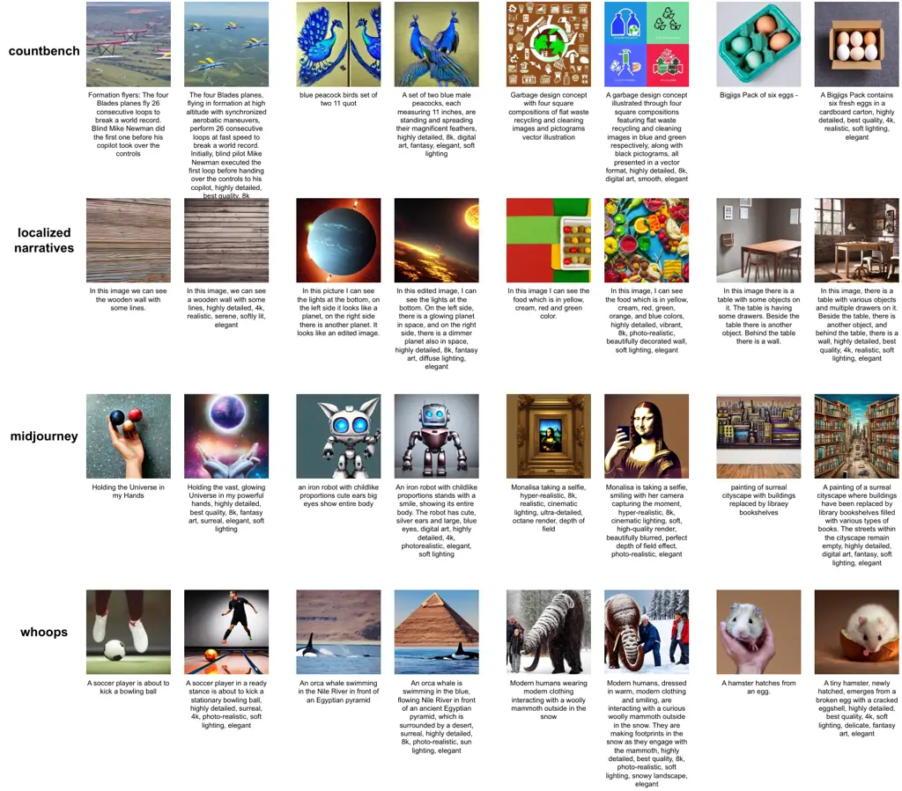

Figure 10: Examples of images generated by Stable Diffusion v1.5. Each
line corresponds to the results of prompts derived from distinct
sub-datasets. The right image in each pair is generated from the prompt
optimized by VisualPrompter, as detailed below the image.

## Appendix F More Cases of VisualPrompter

Additional results for our optimization approach are shown in Figure 10,
Figure 11, and Figure 12. Each image pair consists of one generated from
the original prompt and another from the prompt optimized by our
VisualPrompter, with the corresponding prompt text displayed beneath
each image. The visualization results convincingly demonstrate that our
VisualPrompter exhibits robust adaptability to various prompts and
substantiates superior performance in rectifying multiple types of
generation artifacts.

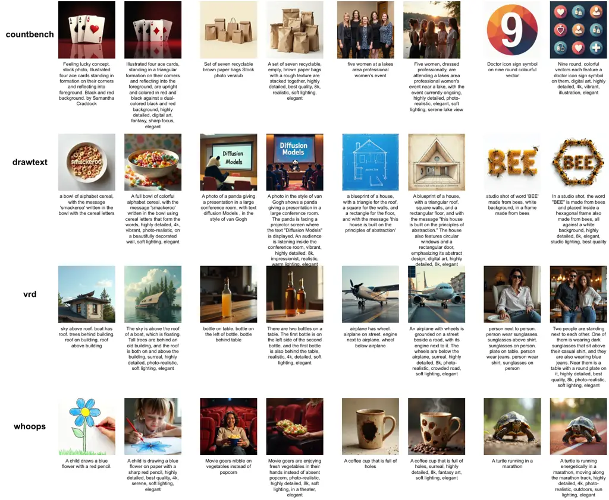

Figure 11: Examples of images generated by FLUX-dev. Each line
corresponds to the results of prompts derived from distinct
sub-datasets. The right image in each pair is generated from the prompt
optimized by VisualPrompter, as detailed below the image.

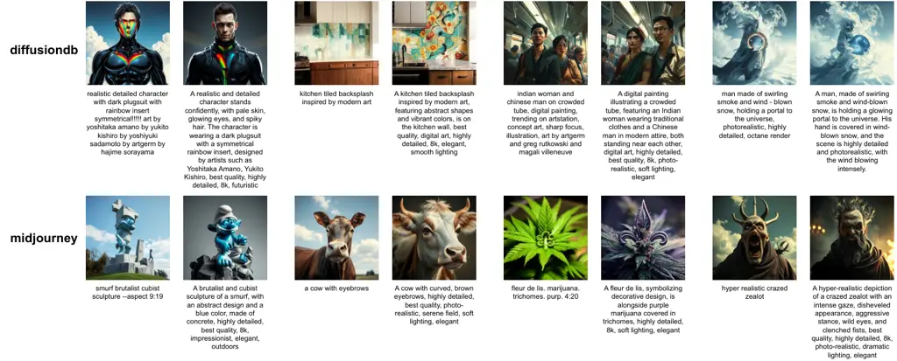

Figure 12: Examples of images generated by Janus-Pro. Each line
corresponds to the results of prompts derived from distinct
sub-datasets. The right image in each pair is generated from the prompt
optimized by VisualPrompter, as detailed below the image.

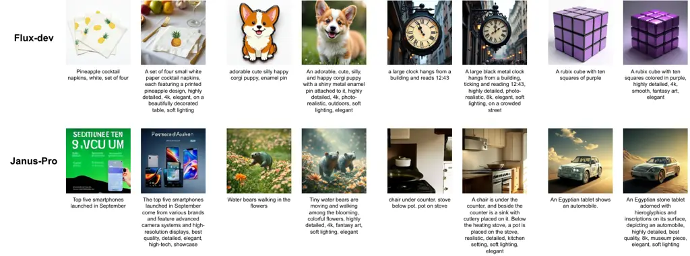

Figure 13: Some failure cases of VisualPrompter. The two rows of images
are from Flux-dev and Janus-pro, respectively.

## Appendix G Failure Cases of VisualPrompter

Despite its effectiveness, our VisualPrompter still exhibits certain
limitations. A few typical failure cases are shown in Figure 13. Most
failure cases stem from the inherent constraints of the generative
model, particularly its suboptimal accuracy in multi-object generation,
which occasionally leads to irrecoverable artifacts in the final output.
Additionally, some errors arise from the VLM’s judgment, where
semantically subtle or ambiguous prompts are incorrectly validated,
preventing VisualPrompter from identifying and optimizing these issues.
Nevertheless, we anticipate that advancements in VLM capabilities will
progressively mitigate these challenges, further enhancing the
robustness of our model.

## Appendix H Influence of Random Seed

To investigate the impact of random seeds, we conduct extensive
experiments on two text-to-image generative models using five different
random seeds and present the comprehensive results in Table 10. The
experimental outcomes show remarkably consistent performance across all
trials, with only minimal deviations observed. This stability clearly
demonstrates that the influence of random seeds on our results is
statistically negligible.

The observed robustness can be attributed to two key factors. First, the
DSG benchmark incorporates an extensive set of over a thousand diverse
prompts, providing sufficient data volume to effectively average out any
potential randomness. Second, while random variations might affect
certain aspects like layout generation, they have minimal impact on
semantic content representation. This is particularly relevant as our
VisualPrompter framework is specifically designed to enhance and
complement semantic information processing, further mitigating any
potential variability from random initialization.

| T2I Models | Prompt Modification Approach |                   |                   |
| ---------- | ---------------------------- | ----------------- | ----------------- |
|            | None                         | Qwen3-32B         | VisualPrompter    |
| SD v1.5    | 67.4 $`\pm`$ 0.13            | 60.9 $`\pm`$ 0.43 | 69.8 $`\pm`$ 0.56 |
| FLUX-dev   | 79.2 $`\pm`$ 0.08            | 79.7 $`\pm`$ 0.21 | 84.3 $`\pm`$ 0.12 |

Table 10: Impact of random seed. We report the mean and standard
deviation of semantic accuracy based on the DSG benchmark.

## Appendix I Potential Toward Multimodal Analysis

To evaluate the broader applicability of our approach, we integrate
ControlNet (Zhang et al., 2023) with human pose estimation, enabling
image generation conditioned on both skeletal inputs and textual
prompts. We quantitatively assess skeleton-to-image consistency using
our VisualPrompter’s VLM module, which additionally provides refinement
suggestions for improved alignment.

As illustrated in Figure 15, our framework demonstrates promising
potential for multimodal analysis—effectively bridging visual structural
data (skeletons) and linguistic descriptions. This multimodal capability
suggests significant versatility in handling diverse input modalities.
We identify this as a pivotal research direction and plan to
systematically explore: (a) cross-modal interaction mechanisms, (b)
scalability to additional modalities, and (c) quantitative evaluation
frameworks, which will constitute a cornerstone of our future work.

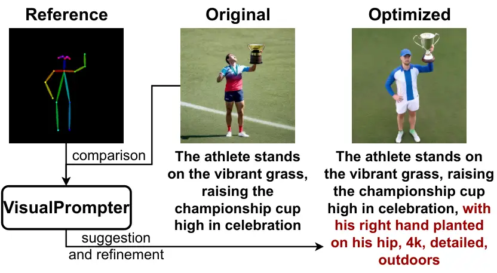

Figure 14: Multimodal application of VisualPrompter.

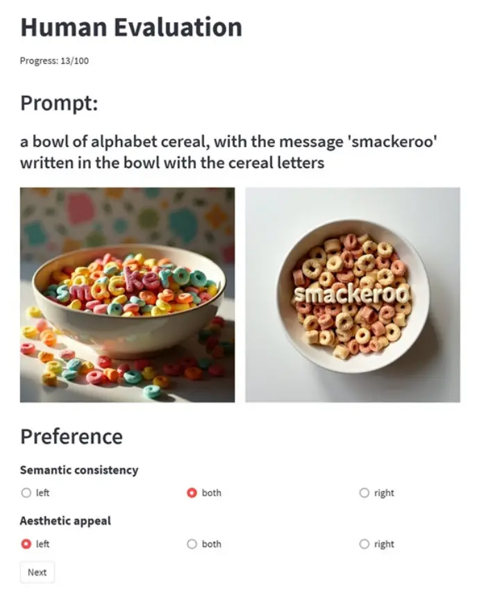

Figure 15: Screenshot of human evaluation interface.

## Appendix J User Study Settings and More Comparison

We provide a simple test system for our human evaluation experiment
based on streamlit, as shown in Figure 15. Departing from the
experiments in previous text-to-image prompt engineering studies that
only focus on aesthetic evaluation, our assessment framework
specifically incorporates an analysis of semantic alignment between
generated visual content and the corresponding textual prompts, which
measures how well the generated images align with the user intent.

As shown in Figure 15, a raw prompt and a pair of images are given to
the participants for each test. The images pair consists of an image
generated by the original prompt above and another image generated by
the optimized prompt. In our experiment, the optimized prompts are
invisible to the participants. To eliminate potential bias, images in
each pair are randomly assigned to left or right positions. Participants
are required to evaluate two key aspects individually: the visual
consistency with the given prompt and the aesthetic appeal of each
image. These evaluations provide essential insights into the overall
quality of the visual representation.

| T2I Models | Aspects    | Methods in Comparison |                 |                 |
| ---------- | ---------- | --------------------- | --------------- | --------------- |
|            |            | NeuroPrompts          | Promptist       | BeautifulPrompt |
| SD v1.5    | Semantic   | 58% / 24% / 18%       | 52% / 27% / 21% | 60% / 26% / 14% |
|            | Aesthetics | 41% / 43% / 16%       | 44% / 39% / 17% | 35% / 46% / 19% |
| FLUX-dev   | Semantic   | 44% / 30% / 26%       | 43% / 39% / 18% | 44% / 31% / 25% |
|            | Aesthetics | 34% / 46% / 20%       | 37% / 41% / 22% | 27% / 49% / 24% |

Table 11: Comparison of VisualPrompter with other optimized methods.
User preferences are measured as the percentage of choices for
VisualPrompter, the competing model, or a tie, respectively.

To evaluate the semantic consistency and aesthetic quality of our model,
we conduct the user study above based on Stable Diffusion v1.5 and
Flux-dev, comparing it with other optimized models rather than the
original generators. As illustrated in Table 11, the results demonstrate
a clear user preference for our model in terms of semantic consistency.
Furthermore, it achieves competitive performance on aesthetic metrics,
underscoring its comprehensive capability.

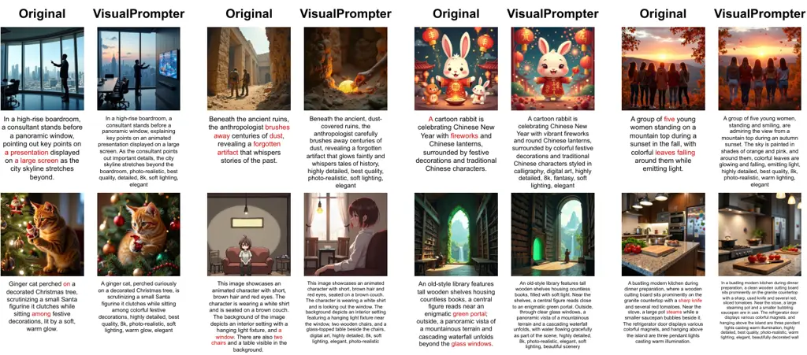

Figure 16: Visual comparison between the original Flux-dev (left) and
our optimized framework (right) on complex prompts.

## Appendix K Comparison on Complex Prompts

To investigate performance on complex prompts, we collected additional
prompts describing intricate scenes and generated images using Flux-dev,
a generative model capable of handling complex scenarios. We then
compared these results with outputs from our VisualPrompter-optimized
prompts. As shown in Figure 16, our model demonstrates a clear ability
to correct missing or erroneous semantics in the generated images. We
also observed that the capability of the underlying generative model is
crucial. Since long prompts already contain substantial detail, our
optimization approach remains constrained when dealing with structures
that are inherently challenging for the base generative model. We plan
to continue research in this direction.

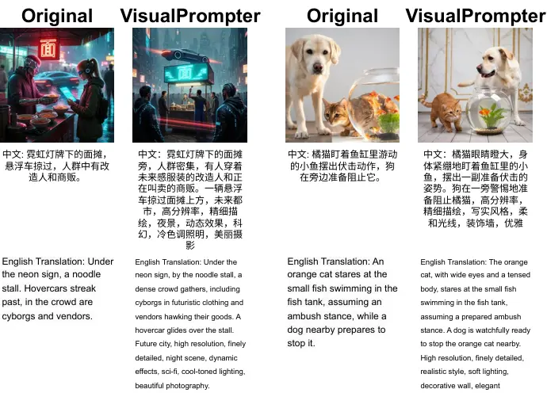

Figure 17: Examples of multilingual optimization based on Chinese,
validating the effectiveness of the proposed method across languages. We
employ Kolors (Kolors, 2024) as the image generator.

To validate the effectiveness of our method in optimizing multilingual
text-to-image generation, we use Chinese text accepted by Qwen for
testing. Since Stable Diffusion v1.5 and FLux-dev do not support
Chinese, we select the text-to-image model Kolors (Kolors, 2024) as our
subject and modify the prompt templates in VisualPrompter to support
Chinese input. Visualization examples are shown in Figure 17. The
results indicate that our method can also enhance Chinese text-to-image
generation. This effectiveness stems from our language-agnostic atomic
semantic structures and analytical approach, allowing for the processing
of different languages supported by the underlying LLM.

Methods DSG benchmark Average SD 1.5 SD 2.1 Flux-dev Janus-Pro Baseline
67.2 72.0 79.4 79.5 74.5 NeuroPrompts 59.0 69.5 77.2 81.4 71.8 Promptist
65.9 68.9 77.6 78.2 72.7 BeautifulPrompt 49.4 51.1 53.4 57.0 52.7
VisualPrompter 70.1 77.9 85.4 82.9 79.1

Table 12: Summarized results on the DSG benchmark using Llama-Vision.
Reported scores are based on the percentage of “yes” answers to the
questions, while the best scores are highlighted in boldface.

## Appendix L Robustness of Evaluation

We notice that the use of the same VLM for both the internal
optimization feedback and the final evaluation may introduce potential
bias. To address this concern and validate the robustness of our
reported performance, we conduct an additional experiment where the
results are re-evaluated using another VLM. We employ
Llama-3.2-11B-Vision for a comparative analysis, as it is both
open-source and readily accessible. As summarized in Table 12 and
Table 13, the evaluation scores between the two VLMs are highly
consistent. Despite minor fluctuations in evaluation scores, the
relative performance ranking of all optimization methods remains
identical under both VLM assessors, underscoring that our comparative
conclusions are robust to the choice of evaluator.

Methods TIFA benchmark Average SD 1.5 SD 2.1 Flux-dev Janus-Pro Baseline
76.1 81.0 88.4 85.6 82.8 NeuroPrompts 64.3 77.2 85.5 89.8 79.2 Promptist
72.7 79.0 86.9 86.8 81.4 BeautifulPrompt 53.0 55.9 62.8 63.5 58.8
VisualPrompter 81.7 83.4 94.3 94.5 88.5

Table 13: Summarized results on the TIFA benchmark using Llama-Vision.
Reported scores are based on the percentage of “yes” answers to the
questions, while the best scores are highlighted in boldface.

## Appendix M Disclosure of LLM Use

The authors confirm that the use of LLMs, which was limited exclusively
to polishing sentence structures and correcting grammatical errors
without being involved in generating ideas, contributions, data, or any
substantive content.

23, 47, 15, 25, 37, 45, 51, 52, 17, 46, 13, 26, 41, 27, 5
