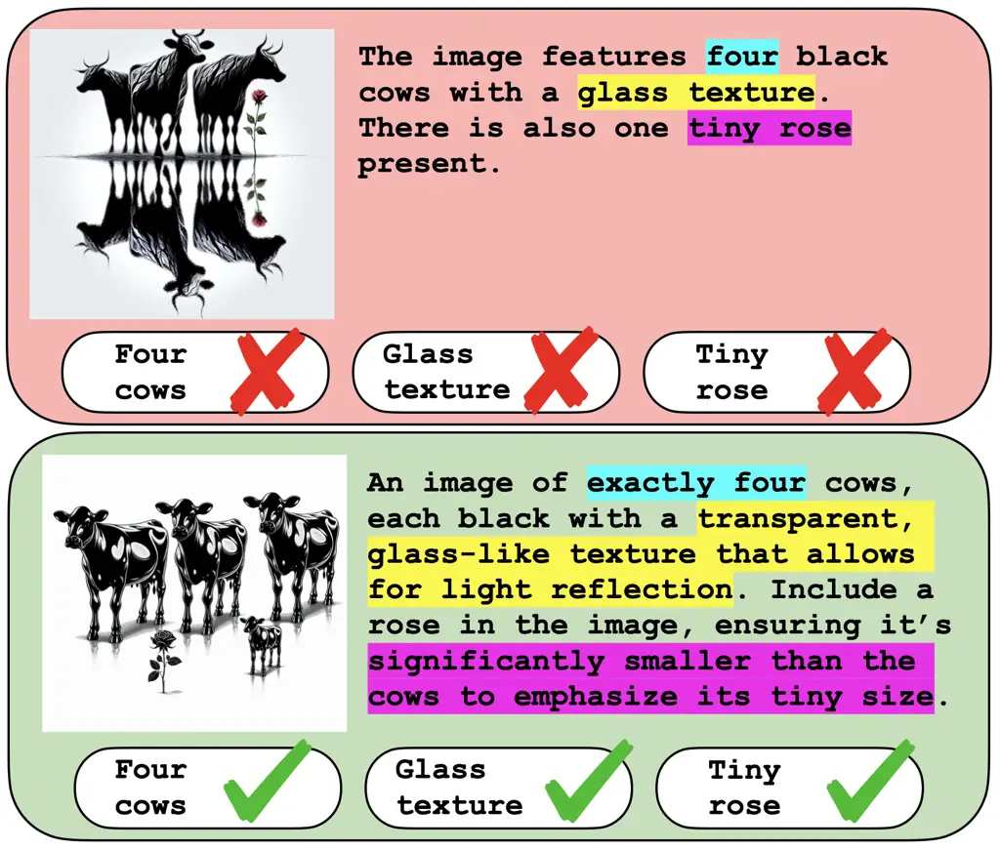
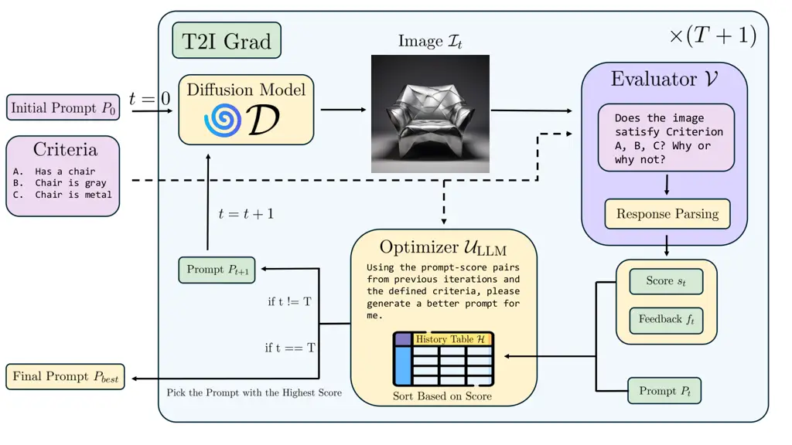
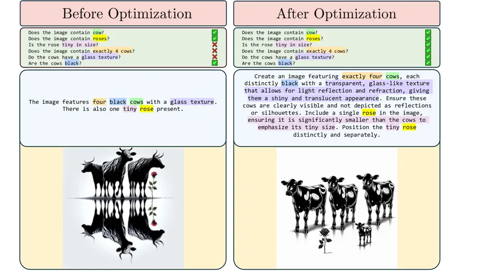

# ConceptMix++: Leveling the Playing Field in Text-to-Image Benchmarking via Iterative Prompt Optimization

Haosheng Gan    Berk Tinaz    Mohammad Shahab Sepehri    Zalan Fabian   
Mahdi Soltanolkotabi Affiliation: University of Southern California
Affiliation: Los Angeles, CA 90089 Affiliation: {woodygan, tinaz,
sepehri, zfabian, soltanol}@usc.edu

###### Abstract

Current text-to-image (T2I) benchmarks evaluate models on rigid prompts,
potentially underestimating true generative capabilities due to prompt
sensitivity and creating biases that favor certain models while
disadvantaging others. We introduce ConceptMix++, a framework that
disentangles prompt phrasing from visual generation capabilities by
applying iterative prompt optimization. Building on ConceptMix, our
approach incorporates a multimodal optimization pipeline that leverages
vision-language model feedback to refine prompts systematically. Through
extensive experiments across multiple diffusion models, we show that
optimized prompts significantly improve compositional generation
performance, revealing previously hidden model capabilities and enabling
fairer comparisons across T2I models. Our analysis reveals that certain
visual concepts – such as spatial relationships and shapes – benefit
more from optimization than others, suggesting that existing benchmarks
systematically underestimate model performance in these categories.
Additionally, we find strong cross-model transferability of optimized
prompts, indicating shared preferences for effective prompt phrasing
across models. These findings demonstrate that rigid benchmarking
approaches may significantly underrepresent true model capabilities,
while our framework provides more accurate assessment and insights for
future development.

## 1 Introduction

Text-to-image (T2I) generation aims to synthesize images based on
user-specified textual descriptions. Diffusion models (DM) \[5, 26\]
have established state-of-the-art in image \[3, 14, 24, 22, 6\], audio
\[10\], and video generation \[7\]. In the specific domain of T2I
generation, DM-based approaches have become the dominant paradigm \[22,
23\], achieving remarkable progress in both visual quality and semantic
fidelity.

To enable systematic evaluation and comparison of DM-based T2I models,
several benchmarks have been proposed \[29, 8, 2\]. These benchmarks
typically employ fixed prompt formulations to assess model capabilities
across various visual concepts and compositional complexities. However,
evaluating and comparing these models remains challenging due to their
inherent prompt sensitivity \[28\]. This sensitivity creates a
fundamental disconnect between a model’s true generative capabilities
and what current benchmarks measure.



Figure 1: Text-to-image models are sensitive to the specific phrasing of
the input prompt, thus using a rigid prompt format may underestimate
generation capabilities.

For example, as illustrated in Figure 1, two prompts expressing the same
scene (”four cows”, ”glass texture”, ”tiny rose”) yield drastically
different results depending on how they are phrased. One prompt produces
a successful generation (bottom), while the other fails entirely (top).
This phenomenon suggests that existing evaluation methodologies may
systematically underestimate model performance, creating biases that
favor certain models while disadvantaging others based on their
sensitivity to specific prompt formulations rather than their actual
visual synthesis abilities.

To address this limitation, we propose ConceptMix++, a framework that
disentangles prompt understanding from visual generation capabilities
via systematic prompt optimization. Building on ConceptMix \[29\], our
approach incorporates a multimodal optimization module that leverages
feedback from vision-language models to iteratively refine prompts. This
enables us to assess models under conditions that better reflect their
maximum potential rather than their sensitivity to arbitrary prompt
formulations.

Through extensive experiments with multiple state-of-the-art diffusion
models, we demonstrate that:

- •
  Optimized prompts substantially improve compositional generation
  performance across architectures, revealing hidden capabilities that
  standard benchmarks miss.
- •
  Visual concept categories (e.g., spatial relations, shapes) benefit
  unevenly from optimization, highlighting category-specific bottlenecks
  and suggesting areas for targeted architectural improvements.
- •
  Optimized prompts exhibit remarkable cross-model transferability,
  suggesting shared preferences in effective prompting and common
  underlying representations across different architectures.

ConceptMix++ offers a more nuanced lens for evaluating T2I models,
surfacing capabilities that conventional benchmarks may overlook while
simultaneously exposing fundamental limitations in current evaluation
methodologies. By providing both a fairer comparison framework and
insights into model-specific strengths and weaknesses, our approach
contributes to a more accurate understanding of the current state and
future directions of text-to-image generation research.

## 2 Related Work

Diffusion Models for Text-to-Image Generation. Denoising diffusion
probabilistic models \[5, 26\] have revolutionized text-to-image
synthesis. Early works like DALL·E \[21\] and GLIDE \[15\] demonstrated
large-scale generative potential, while latent diffusion models \[22\]
improved efficiency by operating in compressed latent spaces. Recent
advances include transformer-based architectures \[18\] and specialized
models like DALL·E 3 \[17\].

Text-to-Image Benchmarking. Comprehensive benchmarks assess both visual
quality and semantic alignment in T2I models. While early benchmarks
like MS-COCO \[13\] focused on basic object recognition, recent
specialized frameworks evaluate specific capabilities: DrawBench \[24\]
uses human evaluation for compositional generation, T2I-CompBench \[8\]
measures compositional abilities across multiple dimensions, and
ConceptMix \[29\] targets compositional generation with varying
complexity levels. However, current benchmarks use fixed prompt
formulations, potentially underestimating model capabilities due to
inherent prompt sensitivity.

Vision-Language Models. Vision-language models have emerged as powerful
multimodal understanding tools. CLIP \[20\] marked a breakthrough with
zero-shot capabilities through contrastive learning, followed by
developments like BLIP \[12\] and large-scale models like GPT-4V \[16\].
In text-to-image evaluation, VLMs serve as automated evaluators for
assessing semantic alignment between generated images and descriptions
\[4\], making them essential for scalable benchmarking.

Prompt Optimization and Engineering. Prompt design significantly impacts
language model effectiveness, spurring research in optimization
techniques. While manual engineering \[27\] and automated methods like
AutoPrompt \[25\] have shown improvements, TextGrad \[30\] introduced
gradient-like feedback optimization. In the text-to-image domain, prompt
engineering has been explored through manual techniques \[28\] and
style-specific optimization methods. However, systematic automated
prompt optimization using feedback-based approaches like TextGrad
remains underexplored for T2I generation, which we address in this work.

## 3 Method

### 3.1 Overview of our framework

ConceptMix++ is a framework designed to disentangle prompt phrasing from
visual synthesis abilities of T2I models. Our key insight is that by
adapting and optimizing prompts for each model individually, we can more
accurately assess their true visual generation potential.

Our framework operates in three-stages:

1.  1.  Baseline prompt evaluation: Evaluate model performance using
        standard benchmark prompts.
2.  2.  Prompt optimization: Use our prompt optimization module to
        iteratively refine prompts tailored to each model.
3.  3.  Capability analysis: Assess each model’s full visual synthesis
        ability under optimized prompting.

This methodology allows for a more nuanced analysis of model
capabilities, revealing: (1) performance gains (2) persistent
limitations that remain even with optimized prompts.

### 3.2 ConceptMix Baseline

For baseline evaluation, we adopt the ConceptMix \[29\] benchmark, which
measures compositional generation capabilities across a broad range of
visual concept categories. This benchmark is particularly well-suited
for capability analysis because:

- •
  It provides fine-grained evaluations across 8 diverse visual concept
  categories.
- •
  It supports scalable compositional complexity denoted with complexity
  level $`k`$ ($`k`$ ranges between $`1`$ and $`7`$).

At each complexity level $`k`$, ConceptMix specifies $`k+1`$ criteria,
each corresponding to one of the 8 visual concept categories. The
initial prompt $`p_{0}`$ is generated by GPT-4o by providing it with
full list of criteria. The diffusion model then synthesizes an image
$`\mathcal{I}`$ from this prompt. To evaluate the generated image,
ConceptMix utilizes GPT-4o acting as a verifier $`\mathcal{V}`$ which
answers a yes/no question for each criterion to determine whether it has
been satisfied. The image receives a score of 1 only if all criteria are
met:

```math
s(\mathcal{I})=\prod_{i=1}^{k+1}\mathbbm{1}(\mathcal{V}(\text{``Is criteria $i$ satisfied ?"}|\mathcal{I})=\texttt{"Yes"})
```

where $`\mathbbm{1}`$ is the indicator function that equals 1 if the
verifier thinks the criteria is satisfied and 0 otherwise.

### 3.3 Multimodal prompt optimization

To systematically enhance prompts, we introduce a prompt optimization
module inspired by TextGrad \[30\], tailored specifically for the
text-to-image (T2I) domain. As illustrated in Figure 2, our module
operates end-to-end across the T2I generation and evaluation pipeline,
refining prompts based on visual outcomes.



Figure 2: Overview of our prompt optimization framework. Starting with
an initial prompt, our iterative process first generates images using a
diffusion model. Next, an evaluator scores and provides feedback.
Finally, LLM optimizer proposes improved prompts based on past
prompt-score pairs.

Given a T2I diffusion model $`\mathcal{D}`$ and a vision-language
evaluator $`\mathcal{V}`$, the goal is to find an optimal prompt
$`p^{*}`$ that maximizes the evaluation score:

```math
p^{*}=\arg\max_{p}\mathcal{V}(\mathcal{D}(p))
```

Here, $`\mathcal{D}(p)`$ denotes the image generated by the diffusion
model from prompt $`p`$, and $`\mathcal{V}(\mathcal{I})`$ returns a
scalar score assessing how well image $`\mathcal{I}`$ satisfies the
specified visual concepts.

The optimization process (Figure 2) follows an iterative loop:

1.  1.  Generate an image $`\mathcal{I}_{t}=\mathcal{D}(p_{t})`$ from the
        current prompt.
2.  2.  Evaluate $`\mathcal{I}_{t}`$ using the VLM to obtain a score
        $`s_{t}=\mathcal{V}(\mathcal{I}_{t})`$ and feedback $`f_{t}`$.
3.  3.  Store the prompt, score, and feedback tuple $`(p_{t},s_{t},f_{t})`$
        in a history buffer $`H`$, sorted by score.
4.  4.  Update the prompt $`p_{t+1}=\mathcal{U}_{\text{LLM}}(p_{best},H)`$,
        where $`\mathcal{U}_{\text{LLM}}(\cdot)`$ is an LLM-based update
        function.

Unlike gradient-based optimization in continuous spaces, our method
exploits the LLM’s capability to learn from qualitative feedback and
historical patterns, generating refined prompts in natural language.

To enable more fine-grained and stable updates, we extend ConceptMix’s
binary evaluation to a probabilistic one. Specifically, we use the
likelihood of the affirmative answer (”Yes”) predicted by the
vision-language model for each criterion:

```math
\mathbbm{E}[s(\mathcal{I})]=\prod_{i=1}^{k+1}P(\mathcal{V}(\text{``Is criteria $i$ satisfied ?"}|\mathcal{I})=\texttt{"Yes"})
```

We provide further implementation details and analysis of the
optimization loop in Appendix A.

## 4 Experiments

### 4.1 Setup

We apply our ConceptMix++ framework to benchmark three state-of-the-art
diffusion models: DALL·E 3 \[17\], stable-diffusion-3.5-medium \[1\],
and playground-v2.5-1024px-aesthetic \[11\]. In this setup, we use
GPT-4o (2024-08-06) \[9\] as both the evaluator and the optimizer.

For each complexity level $`k=1`$ to $`k=7`$, we select 300 datapoints
from the ConceptMix benchmark. To reduce the effect of randomness, we
generate 5 images per prompt and evaluate performance based on two
metrics. The average score is the average across the 5 generations,
while best-of-5 score is the highest score among them.

### 4.2 Performance Analysis

| Model                      | $`k=1`$       | $`k=2`$       | $`k=3`$       | $`k=4`$       | $`k=5`$       | $`k=6`$       | $`k=7`$       |
| -------------------------- | ------------- | ------------- | ------------- | ------------- | ------------- | ------------- | ------------- |
| DALL·E 3 (Avg Orig)        | 0.824 ± 0.021 | 0.621 ± 0.015 | 0.460 ± 0.025 | 0.292 ± 0.025 | 0.207 ± 0.024 | 0.139 ± 0.028 | 0.085 ± 0.012 |
| DALL·E 3 (Avg Opt)         | 0.882 ± 0.009 | 0.723 ± 0.023 | 0.605 ± 0.024 | 0.415 ± 0.028 | 0.313 ± 0.029 | 0.218 ± 0.009 | 0.127 ± 0.019 |
| DALL·E 3 ($`\Delta`$ Avg)  | +0.058        | +0.102        | +0.145        | +0.123        | +0.106        | +0.079        | +0.042        |
| DALL·E 3 (Best Orig)       | 0.945         | 0.853         | 0.668         | 0.537         | 0.449         | 0.306         | 0.191         |
| DALL·E 3 (Best Opt)        | 0.996         | 0.943         | 0.868         | 0.761         | 0.648         | 0.505         | 0.364         |
| DALL·E 3 ($`\Delta`$ Best) | +0.051        | +0.090        | +0.200        | +0.224        | +0.199        | +0.199        | +0.173        |
| SD 3.5 (Avg Orig)          | 0.736 ± 0.018 | 0.503 ± 0.024 | 0.351 ± 0.010 | 0.226 ± 0.020 | 0.157 ± 0.009 | 0.089 ± 0.009 | 0.067 ± 0.006 |
| SD 3.5 (Avg Opt)           | 0.877 ± 0.006 | 0.662 ± 0.008 | 0.512 ± 0.020 | 0.356 ± 0.019 | 0.277 ± 0.017 | 0.172 ± 0.016 | 0.123 ± 0.016 |
| SD 3.5 ($`\Delta`$ Avg)    | +0.141        | +0.159        | +0.161        | +0.130        | +0.120        | +0.083        | +0.056        |
| SD 3.5 (Best Orig)         | 0.913         | 0.762         | 0.595         | 0.483         | 0.360         | 0.232         | 0.201         |
| SD 3.5 (Best Opt)          | 0.973         | 0.856         | 0.776         | 0.678         | 0.579         | 0.423         | 0.298         |
| SD 3.5 ($`\Delta`$ Best)   | +0.060        | +0.094        | +0.181        | +0.195        | +0.219        | +0.191        | +0.097        |
| PG v2.5 (Avg Orig)         | 0.732 ± 0.017 | 0.451 ± 0.023 | 0.241 ± 0.020 | 0.117 ± 0.010 | 0.062 ± 0.009 | 0.017 ± 0.004 | 0.003 ± 0.002 |
| PG v2.5 (Avg Opt)          | 0.831 ± 0.010 | 0.572 ± 0.006 | 0.351 ± 0.014 | 0.199 ± 0.009 | 0.116 ± 0.013 | 0.047 ± 0.009 | 0.019 ± 0.005 |
| PG v2.5 ($`\Delta`$ Avg)   | +0.099        | +0.121        | +0.110        | +0.082        | +0.054        | +0.030        | +0.016        |
| PG v2.5 (Best Orig)        | 0.856         | 0.640         | 0.440         | 0.233         | 0.167         | 0.047         | 0.014         |
| PG v2.5 (Best Opt)         | 0.936         | 0.783         | 0.601         | 0.373         | 0.278         | 0.128         | 0.057         |
| PG v2.5 ($`\Delta`$ Best)  | +0.080        | +0.143        | +0.161        | +0.140        | +0.111        | +0.081        | +0.043        |

Table 1: Performance comparison between original and optimized prompts
across different complexity levels $`k`$. For each model, we report both
Average Score and Best-of-5 Score to show the capability gap revealed
through prompt optimization. Green intensity indicates the magnitude of
improvement.

Table 1 presents the performance comparison between original and
optimized prompts across all diffusion models and complexity levels. We
observe substantial improvements following optimization – up to
$`\approx 20\%`$ absolute gains in both average and best-of-5 scores for
mid-range complexity levels ($`k=3`$ to $`k=5`$) across all models.
These gains reflect the significant value of prompt optimization in
unlocking true capabilities, particularly for compositions that require
understanding and generating multiple visual concepts simultaneously.

Interestingly, the performance gap between original and optimized
prompts widens with increasing $`k`$ in the low-to-mid range, suggesting
that prompt refinement becomes increasingly beneficial as compositional
complexity grows. However, at the highest complexity levels ($`k=6`$,
$`k=7`$), the gains taper off. This diminishing return likely stems from
an upper bound imposed by the model’s capacity itself: the prompts may
become too detailed or domain-shifted compared to the model’s training
distribution, limiting the effectiveness of optimization.

While the numerical results are summarized in Table 1, we present
additional model-wise performance visualizations in Appendix B
(Figure 8) that show both the mean score and best-of-5 score metrics for
each model before and after prompt optimization across varying
complexity levels ($`k=1`$ to $`k=7`$). These plots clearly illustrate
the performance gaps and reveal model-specific improvement patterns
discussed above.

These results highlight the importance of more flexible evaluation
frameworks in benchmarking text-to-image models. The substantial
performance differences between standard and optimized prompts across
all models demonstrate that conventional rigid benchmarking approaches
may significantly underrepresent actual model capabilities, particularly
for certain architectures like SD 3.5. Conversely, the persistent
decline at higher complexity levels reveals fundamental limitations that
require architectural innovations beyond prompt engineering.

(a) DALL·E 3

(b) Stable Diffusion 3.5

(c) Playground v2.5

Figure 3: Heatmaps showing improvement magnitude across visual concept
categories and complexity levels. Darker red indicates higher
improvements, while blue indicates a decline in performance.

### 4.3 Category-wise Analysis

To gain deeper insight into the impact of our optimization framework, we
conduct a category-wise analysis across eight visual concept categories
defined in the ConceptMix benchmark: color, number, object, shape, size,
spatial, style, and texture. This analysis allows us to examine how
prompt optimization influences specific dimensions of compositional
generation and to identify which aspects of diffusion model capabilities
benefit most from our framework.

For each diffusion model and complexity level, we compute
category-specific scores by evaluating performance on questions
associated with each visual concept category. Formally, for a model
$`M`$, complexity level $`k`$, and category $`c`$ with its corresponding
set of questions $`Q_{c}`$, the score $`S_{M,k,c}`$ for an image
$`\mathcal{I}`$ is defined as:

```math
S_{M,k,c}(\mathcal{I})=\frac{1}{|Q_{c}|}\sum_{q\in Q_{c}}\mathbbm{1}(\mathcal{V}(q|\mathcal{I})=\texttt{"yes"})
```

Figure 3 presents heatmap visualizations of category-wise improvement
achieved by our optimization framework across all complexity levels for
the three tested models.

For DALL·E 3, the most improvement happens for shape with an average
improvement of $`11.5\%`$. Meanwhile, for Stable Diffusion 3.5, the most
significant improvements are observed in spatial and size categories,
each showing an average gain exceeding $`12\%`$. For Playground v2.5,
texture shows the strongest consistent gains ($`+11.9\%`$ average).
These observations highlight that these specific categories require
precise prompt formulations for optimal performance.

On the other hand, the object category exhibits the least improvement
for all models, with an average gain of $`1.2\%`$ for DALL·E 3, $`3\%`$
for Stable Diffusion 3.5 and, and $`1.9\%`$ for Playground v2.5. This is
mainly because the original prompts already perform well in this
category, leaving limited room for further gains.

Additionally, the number category shows relatively marginal improvements
across all models. This can be attributed to the well-known challenge
that generative models have with accurately representing specific
quantities \[8, 19, 24\], compounded by the fact that specifying a
number offers little flexibility for refinement. As a result, the
performance in this category remains low both before and after
optimization, suggesting that prompt refinement alone is insufficient to
overcome this limitation.

The detailed radar chart analysis for each complexity level is provided
in Appendix C.

### 4.4 Cross-Model Prompt Transferability

A key question about our framework is whether the prompts optimized for
one model can effectively generalize to another. To investigate this, we
design a comprehensive transferability experiment across all model
pairs. For each pair of models $`(M_{src},M_{tgt})`$, we:

1.  1.  Run our prompt optimization framework using $`M_{src}`$ as the
        backbone diffusion model to obtain optimized prompts $`p^{*}_{src}`$
2.  2.  Evaluate these transferred prompts $`p^{*}_{src}`$ on target model
        $`M_{tgt}`$
3.  3.  Compare the performance against both the original prompt $`p_{0}`$
        and $`M_{tgt}`$’s self-optimized prompts $`p^{*}_{tgt}`$

This experimental design allows us to systematically assess whether
optimized prompts capture universal phrasing patterns that are effective
across different model architectures, or if they are model-specific
optimizations.

Figure 4: Average score of Stable Diffusion 3.5 using original prompts,
prompts optimized for Stable Diffusion 3.5 itself, and prompts optimized
for DALL·E 3.

As a representative example, Figure 4 shows the results of evaluating
Stable Diffusion 3.5 when using prompts that were optimized for DALL·E 3. The results compare the average scores of Stable Diffusion 3.5 using
original prompts, prompts optimized for Stable Diffusion 3.5 itself, and
prompts optimized for DALL·E 3. We observe that Stable Diffusion 3.5
performs significantly better with DALL·E 3-optimized prompts compared
to original prompts, and its performance closely approaches that
achieved with prompts optimized for itself. This indicates a high degree
of cross-model transferability, suggesting that the optimized prompts
capture phrasing patterns that are effective among all models.

Our comprehensive transferability analysis across all model pairs
(presented in Appendix D) demonstrates that transferred prompts
consistently achieve better performance than original prompts in most
cases. These findings imply that different diffusion models may share
underlying prompt preferences, making cross-model prompt reuse a viable
strategy for enhancing generation quality with reduced optimization
overhead.

The transferability results also have important practical implications,
suggesting that practitioners can leverage a cost-effective optimization
workflow: (1) optimize prompts using more accessible or computationally
efficient models, and (2) apply these enhanced prompts to more powerful
models for final generation. This approach significantly reduces the
computational overhead and API costs associated with prompt optimization
while maintaining substantial performance improvements.

### 4.5 Ablation Study: Optimization Iteration Count

A key hyperparameter in our prompt optimization framework is the number
of optimization iterations $`T`$. While more iterations intuitively seem
beneficial, they also increase computational cost and potentially risk
overfitting to the evaluation metric. To investigate the impact of this
parameter, we conducted an ablation study on DALL·E 3 with varying
numbers of iterations: $`T\in\{0,1,2,3,4,5,10,15\}`$, where $`T=0`$
means we use the original prompt. For this experiment, we fix $`k=4`$.

(a) Average Score

(b) Best-of-5 Score

Figure 5: Performance comparison of different iteration numbers ($`T`$)
in our prompt optimization framework on DALL·E 3 with fixed complexity
$`k=4`$. The x-axis represents the number of iterations, while the
y-axis shows scores.

From Figure 5, we observe that higher iteration numbers do not
necessarily yield better prompts. This counterintuitive finding can be
attributed to several factors:

1.  1.  Inherent Stochasticity: Diffusion models like DALL·E 3 have inherent
        randomness in their generation process. A prompt that produces
        high-quality images during optimization may not consistently yield
        the same quality during test time, even with the same sampling
        parameters.
2.  2.  Overfitting to Specific Instances: Later iterations may overfit to
        the specific random seed or generation parameters used during
        optimization, reducing generalizability to new generation instances.

Based on these results, we find that $`T=5`$ represents an optimal
choice that balances performance gains with computational efficiency for
most applications. This finding is particularly valuable for deployment
scenarios where optimization time is a concern.

### 4.6 Alternative VLM Judge to Mitigate Preference Leakage

A potential concern with our optimization framework is preference
leakage – the possibility that using the same vision-language model
(GPT-4o) for both prompt optimization and final evaluation could
introduce bias. Specifically, the optimization process might favor
prompts that align with GPT-4o’s particular evaluation preferences
rather than genuinely improving visual generation quality. To address
this concern and validate that our observed improvements reflect true
visual synthesis enhancement, we conduct an additional experiment using
InternVL3-8B \[31\] as the optimization judge while maintaining GPT-4o
as the final evaluator.

We repeat our optimization process for all three models (DALL·E 3,
Stable Diffusion 3.5, and Playground v2.5) at complexity level $`k=4`$
using InternVL3-8B to provide scores and feedback during the iterative
refinement process. All other experimental conditions remain identical
to our main setup. The optimized prompts are then evaluated using GPT-4o
to maintain consistency with our evaluation protocol.

Figure 6 presents the results of this experiment. The key finding is
that prompts optimized using InternVL3-8B as the judge still achieve
substantial performance improvements, which are nearly identical to
prompts optimized by GPT-4o when evaluated by GPT-4o. Specifically,
across all three models, InternVL3-8B-optimized prompts achieve
performance levels that closely match or exceed GPT-4o-optimized
prompts, with DALL·E 3 showing 0.386 vs 0.419, Stable Diffusion 3.5
showing 0.358 vs 0.354, and Playground v2.5 showing 0.197 vs 0.199.

These results demonstrate that the performance improvements from prompt
optimization are not merely artifacts of evaluator bias or preference
leakage. The fact that prompts optimized with a different VLM
(InternVL3-8B) still yield substantial improvements when evaluated by
GPT-4o provides strong evidence that our framework genuinely enhances
visual synthesis capabilities rather than simply exploiting
evaluation-specific preferences. The slight performance differences
between GPT-4o-optimized and InternVL3-8B-optimized prompts are
expected, as different VLMs may have varying strengths in identifying
specific visual concepts. However, the remarkably similar performance
levels validate that our optimization framework reveals genuine model
capabilities that are underestimated by rigid prompt formulations,
regardless of the specific evaluator used during optimization.

Figure 6: Performance comparison between prompts optimized using GPT-4o
versus InternVL3-8B as the optimization judge, evaluated on GPT-4o.
Results show substantial improvements persist even when using a
different VLM for optimization.

## 5 Discussion

Our comprehensive evaluation through ConceptMix++ reveals several
important insights about the current state of text-to-image generation
and evaluation methodologies.

### 5.1 Implications for Model Evaluation

The substantial performance gains achieved through prompt optimization
across all tested models highlight a fundamental issue with current
benchmarking practices. The fact that optimized prompts can improve
performance by up to 20% suggests that existing benchmarks may be
systematically underestimating model capabilities. This finding has
significant implications for how we understand progress in the field –
models that appear inferior under rigid benchmarking may actually
possess comparable or superior visual synthesis abilities when evaluated
under optimal conditions.

The category-wise analysis further emphasizes this point. Our results
show that spatial relationships, shapes, and textures are particularly
sensitive to prompt formulation, with these categories showing the
largest improvements after optimization. This suggests that previous
comparative studies may have drawn inaccurate conclusions about model
strengths and weaknesses in these specific domains. For instance, a
model that appears to struggle with spatial reasoning under standard
prompts might actually excel in this area when provided with
appropriately optimized instructions.

### 5.2 Cross-Model Insights and Transferability

The remarkable transferability of optimized prompts across different
model architectures reveals shared underlying preferences for effective
prompt phrasing. This finding suggests that despite architectural
differences, modern diffusion models may have converged on similar
representations of visual concepts and language understanding. The
transferability also has practical implications, enabling cost-effective
optimization workflows where prompts can be optimized on more accessible
models and then applied to more powerful or expensive alternatives.

However, the asymmetric nature of transfer effectiveness shown in
Appendix D provides insights into model-specific capabilities. The
observation that DALL·E 3-optimized prompts transfer less effectively to
other models suggests that this model may have developed more
specialized prompt understanding mechanisms, potentially due to its
architectural choices or capability difference.

### 5.3 Persistent Limitations and Future Directions

While prompt optimization significantly improves performance across most
categories, certain limitations persist. The marginal improvements in
the number category across all models confirm that counting remains a
fundamental challenge that cannot be easily addressed through better
prompting alone. This suggests that architectural innovations
specifically targeting numerical reasoning may be necessary.

The diminishing returns at higher complexity levels ($`k=6`$, $`k=7`$)
reveal another important limitation. Even with optimal prompting, models
struggle with highly complex compositional scenes, indicating that
current architectures may have inherent capacity constraints that limit
their ability to handle multiple simultaneous requirements.

## 6 Limitations

While ConceptMix++ provides valuable insights into text-to-image model
capabilities, several limitations should be acknowledged:

### 6.1 Evaluation Methodology Constraints

Our framework relies on GPT-4o as both the optimizer and evaluator,
which introduces potential biases. Although our transferability
experiments suggest that improvements are genuine rather than artifacts
of evaluator preferences, the use of a single VLM for evaluation may not
capture all aspects of visual quality that human evaluators would
consider. Future work could incorporate multiple evaluation models or
human assessment to provide more comprehensive validation.

### 6.2 Computational Overhead

The prompt optimization process requires additional computational
resources compared to standard benchmarking. While our
budget-constrained experiments demonstrate that optimization can be
beneficial even with limited resources, the iterative nature of our
approach does increase evaluation time and cost. This may limit the
practical applicability of our framework for large-scale benchmarking
studies.

### 6.3 Prompt Distribution Bias

Our optimization process may push prompts toward distributions that
differ significantly from typical user inputs. While this reveals model
capabilities, it may not reflect real-world usage patterns. The
optimized prompts might become overly technical or artificial,
potentially limiting their relevance for practical applications.

### 6.4 Limited Model Coverage

Our experiments focus on three state-of-the-art diffusion models. While
these represent different architectural approaches, the generalizability
of our findings to other model families (e.g., autoregressive models,
GANs) remains unclear. Additionally, our analysis is limited to the
ConceptMix benchmark, and the effectiveness of our approach on other
evaluation frameworks requires further investigation.

### 6.5 Category Definition Constraints

The eight visual concept categories defined in ConceptMix, while
comprehensive, may not capture all relevant aspects of visual
generation. Our category-wise analysis is inherently limited by these
predefined categories, and important capabilities or limitations might
exist outside this framework.

## 7 Conclusion

In this work, we introduce ConceptMix++, a novel framework for fair
benchmarking of text-to-image diffusion models through iterative prompt
optimization. Our experiments show that ConceptMix++ consistently
enhances model performance, revealing their true compositional
generation capabilities. We further analyze the impact of our framework
across different visual concept categories, identifying which aspects
benefit most from prompt refinement. Additionally, we demonstrate that
optimized prompts exhibit strong cross-model transferability, suggesting
shared prompt preferences among models. These findings indicate that
fixed-prompt benchmarks substantially underestimate the capabilities of
text-to-image models and highlight the critical role of prompt
formatting in fully realizing their generative potential.

## 8 Acknowledgements

We would like to thank Microsoft for an Accelerating Foundation Models
Research grant that provided the OpenAI credits enabling this work.

## References

- \[1\] Stability AI. Stable diffusion 3.5, 2024.
- \[2\] Eslam Mohamed Bakr, Pengzhan Sun, Xiaoqian Shen, Faizan Farooq
  Khan, Li Erran Li, and Mohamed Elhoseiny. Hrs-bench: Holistic,
  reliable and scalable benchmark for text-to-image models. In
  _Proceedings of the IEEE/CVF International Conference on Computer
  Vision_, pages 20041–20053, 2023.
- \[3\] Prafulla Dhariwal and Alex Nichol. Diffusion Models Beat GANs on
  Image Synthesis. _arXiv preprint arXiv:2105.05233_, 2021.
- \[4\] Jack Hessel, Ari Holtzman, Maxwell Forbes, Ronan Le Bras, and
  Yejin Choi. Clipscore: A reference-free evaluation metric for image
  captioning. _arXiv preprint arXiv:2104.08718_, 2021.
- \[5\] Jonathan Ho, Ajay Jain, and Pieter Abbeel. Denoising Diffusion
  Probabilistic Models. _arXiv preprint arXiv:2006.11239_, 2020.
- \[6\] Jonathan Ho, Chitwan Saharia, William Chan, David J Fleet,
  Mohammad Norouzi, and Tim Salimans. Cascaded diffusion models for high
  fidelity image generation. _J. Mach. Learn. Res._, 23(47):1–33, 2022a.
- \[7\] Jonathan Ho, Tim Salimans, Alexey Gritsenko, William Chan,
  Mohammad Norouzi, and David J Fleet. Video diffusion models. _arXiv
  preprint arXiv:2204.03458_, 2022b.
- \[8\] Kaiyi Huang, Kaiyue Sun, Enze Xie, Zhenguo Li, and Xihui Liu.
  T2i-compbench: A comprehensive benchmark for open-world compositional
  text-to-image generation. _Advances in Neural Information Processing
  Systems_, 36:78723–78747, 2023.
- \[9\] Aaron Hurst, Adam Lerer, Adam P Goucher, Adam Perelman, Aditya
  Ramesh, Aidan Clark, AJ Ostrow, Akila Welihinda, Alan Hayes, Alec
  Radford, et al. Gpt-4o system card. _arXiv preprint
  arXiv:2410.21276_, 2024.
- \[10\] Zhifeng Kong, Wei Ping, Jiaji Huang, Kexin Zhao, and Bryan
  Catanzaro. Diffwave: A versatile diffusion model for audio synthesis.
  _arXiv preprint arXiv:2009.09761_, 2020.
- \[11\] Daiqing Li, Aleks Kamko, Ehsan Akhgari, Ali Sabet, Linmiao Xu,
  and Suhail Doshi. Playground v2.5: Three insights towards enhancing
  aesthetic quality in text-to-image generation. _arXiv preprint
  arXiv:2402.17245_, 2024.
- \[12\] Junnan Li, Dongxu Li, Caiming Xiong, and Steven Hoi. Blip:
  Bootstrapping language-image pre-training for unified vision-language
  understanding and generation. In _International conference on machine
  learning_, pages 12888–12900. PMLR, 2022.
- \[13\] Tsung-Yi Lin, Michael Maire, Serge Belongie, James Hays, Pietro
  Perona, Deva Ramanan, Piotr Dollár, and C Lawrence Zitnick. Microsoft
  coco: Common objects in context. In _Computer vision–ECCV 2014: 13th
  European conference, zurich, Switzerland, September 6-12, 2014,
  proceedings, part v 13_, pages 740–755. Springer, 2014.
- \[14\] Alex Nichol and Prafulla Dhariwal. Improved Denoising Diffusion
  Probabilistic Models. _arXiv preprint arXiv:2102.09672_, 2021.
- \[15\] Alex Nichol, Prafulla Dhariwal, Aditya Ramesh, Pranav Shyam,
  Pamela Mishkin, Bob McGrew, Ilya Sutskever, and Mark Chen. Glide:
  Towards photorealistic image generation and editing with text-guided
  diffusion models. _arXiv preprint arXiv:2112.10741_, 2021.
- \[16\] OpenAI. Gpt-4v(ision) system card. Technical report,
  OpenAI, 2023.
- \[17\] OpenAI. Dall·e 3, 2024.
- \[18\] William Peebles and Saining Xie. Scalable diffusion models with
  transformers. In _Proceedings of the IEEE/CVF international conference
  on computer vision_, pages 4195–4205, 2023.
- \[19\] Vitali Petsiuk, Alexander E Siemenn, Saisamrit Surbehera, Zad
  Chin, Keith Tyser, Gregory Hunter, Arvind Raghavan, Yann Hicke,
  Bryan A Plummer, Ori Kerret, et al. Human evaluation of text-to-image
  models on a multi-task benchmark. _arXiv preprint
  arXiv:2211.12112_, 2022.
- \[20\] Alec Radford, Jong Wook Kim, Chris Hallacy, Aditya Ramesh,
  Gabriel Goh, Sandhini Agarwal, Girish Sastry, Amanda Askell, Pamela
  Mishkin, Jack Clark, et al. Learning transferable visual models from
  natural language supervision. In _International conference on machine
  learning_, pages 8748–8763. PmLR, 2021.
- \[21\] Aditya Ramesh, Mikhail Pavlov, Gabriel Goh, Scott Gray, Chelsea
  Voss, Alec Radford, Mark Chen, and Ilya Sutskever. Zero-shot
  text-to-image generation. In _International conference on machine
  learning_, pages 8821–8831. Pmlr, 2021.
- \[22\] Robin Rombach, Andreas Blattmann, Dominik Lorenz, Patrick
  Esser, and Björn Ommer. High-resolution image synthesis with latent
  diffusion models. In _Proceedings of the IEEE/CVF conference on
  computer vision and pattern recognition_, pages 10684–10695, 2022.
- \[23\] Chitwan Saharia, Jonathan Ho, William Chan, Tim Salimans,
  David J. Fleet, and Mohammad Norouzi. Image Super-Resolution via
  Iterative Refinement. _arXiv:2104.07636 \[cs, eess\]_, 2021.
- \[24\] Chitwan Saharia, William Chan, Saurabh Saxena, Lala Li, Jay
  Whang, Emily L Denton, Kamyar Ghasemipour, Raphael Gontijo Lopes,
  Burcu Karagol Ayan, Tim Salimans, et al. Photorealistic text-to-image
  diffusion models with deep language understanding. _Advances in neural
  information processing systems_, 35:36479–36494, 2022.
- \[25\] Taylor Shin, Yasaman Razeghi, Robert L Logan IV, Eric Wallace,
  and Sameer Singh. Autoprompt: Eliciting knowledge from language models
  with automatically generated prompts. _arXiv preprint
  arXiv:2010.15980_, 2020.
- \[26\] Yang Song and Stefano Ermon. Generative Modeling by Estimating
  Gradients of the Data Distribution. _arXiv:1907.05600 \[cs,
  stat\]_, 2020.
- \[27\] Jason Wei, Xuezhi Wang, Dale Schuurmans, Maarten Bosma, Fei
  Xia, Ed Chi, Quoc V Le, Denny Zhou, et al. Chain-of-thought prompting
  elicits reasoning in large language models. _Advances in neural
  information processing systems_, 35:24824–24837, 2022.
- \[28\] Sam Witteveen and Martin Andrews. Investigating prompt
  engineering in diffusion models, 2022.
- \[29\] Xindi Wu, Dingli Yu, Yangsibo Huang, Olga Russakovsky, and
  Sanjeev Arora. Conceptmix: A compositional image generation benchmark
  with controllable difficulty. _arXiv preprint arXiv:2408.14339_, 2024.
- \[30\] Mert Yuksekgonul, Federico Bianchi, Joseph Boen, Sheng Liu, Zhi
  Huang, Carlos Guestrin, and James Zou. Textgrad: Automatic”
  differentiation” via text. _arXiv preprint arXiv:2406.07496_, 2024.
- \[31\] Jinguo Zhu, Weiyun Wang, Zhe Chen, Zhaoyang Liu, Shenglong Ye,
  Lixin Gu, Hao Tian, Yuchen Duan, Weijie Su, Jie Shao, et al.
  Internvl3: Exploring advanced training and test-time recipes for
  open-source multimodal models. _arXiv preprint
  arXiv:2504.10479_, 2025.

Supplementary Material

## Appendix A Additional details on prompt optimization module

### A.1 Algorithm

Algorithm 1 outlines the complete prompt optimization framework:

0:  Initial prompt $`p_{0}`$, diffusion model $`\mathcal{D}`$, VLM
$`\mathcal{V}`$, LLM $`\mathcal{U}_{\text{LLM}}`$, maximum iterations
$`T`$

0:  Optimized prompt $`p^{*}`$

 Initialize history table $`\mathcal{H}\leftarrow\emptyset`$

 Initialize best score $`s_{\text{best}}\leftarrow-\infty`$

 Initialize best prompt $`p_{\text{best}}\leftarrow p_{0}`$

 for $`t=0`$ to $`T`$ do

  Generate image $`\mathcal{I}_{t}\leftarrow\mathcal{D}(p_{t})`$

  Evaluate image and generate feedback
$`(s_{t},f_{t})\leftarrow\mathcal{V}(\mathcal{I}_{t})`$

  Update history
$`\mathcal{H}\leftarrow\mathcal{H}\cup\{(p_{t},s_{t},f_{t})\}`$

  if $`s_{t}>s_{\text{best}}`$ then

   $`s_{\text{best}}\leftarrow s_{t}`$

   $`p_{\text{best}}\leftarrow p_{t}`$

  end if

  if $`t==T`$ then

   break

  end if

  Generate improved prompt
$`p_{t+1}\leftarrow\mathcal{U}_{\text{LLM}}(p_{\text{best}},\mathcal{H})`$

 end for

 return $`p_{\text{best}}`$

Algorithm 1 Text2Image Grad

### A.2 Analogy with traditional Gradient Descent

Traditional gradient descent optimization iteratively updates parameters
using the gradient of the objective function according to the following
update rule:

```math
\theta_{t+1}=\theta_{t}-\eta\nabla f(\theta_{t}) \tag{1}
```

where $`\theta_{t}`$ represents the parameters at iteration $`t`$,
$`\eta`$ is the learning rate, and $`\nabla f(\theta_{t})`$ is the
gradient of the objective function $`f`$ with respect to $`\theta_{t}`$.

In the context of text-to-image generation, our objective is to maximize
the score function $`\mathcal{V}(\mathcal{D}(p))`$, where $`p`$ is the
prompt, $`\mathcal{D}`$ is the diffusion model, and $`\mathcal{V}`$ is
the VLM evaluation. However, we cannot directly compute the gradient
$`\nabla_{p}\mathcal{V}(\mathcal{D}(p))`$ for several reasons:

- •
  The prompt $`p`$ exists in a discrete, non-Euclidean space rather than
  a continuous parameter space.
- •
  The diffusion process $`\mathcal{D}`$ involves complex,
  non-differentiable stochastic sampling procedures.
- •
  The VLM evaluation $`\mathcal{V}`$ is similarly complex and not
  directly differentiable with respect to its inputs.

To address these challenges, our prompt optimization framework draws
inspiration from numerical optimization methods to approximate the
gradient and update direction. The key insight is that we can view our
optimization process through the lens of zeroth-order optimization
methods, particularly finite-difference approximations of gradients.

Consider how traditional finite-difference methods approximate
gradients:

```math
\nabla f(\theta)\approx\frac{f(\theta+\delta)-f(\theta)}{\delta} \tag{2}
```

In our context, we generalize this approach to work with a collection of
prompt-score pairs $`\{(p_{i},s_{i})\}`$ that represent different points
in the prompt space. Each pair provides information about the evaluation
function $`\mathcal{V}(\mathcal{D}(p))`$ at different locations.

Instead of just using point-wise differences, we leverage the entire
history $`\mathcal{H}`$ of prompt-score-feedback tuples to approximate a
more robust update direction. The LLM, acting as a sophisticated
non-parametric estimator, analyzes this historical data to infer the
direction in the prompt space that is most likely to increase the
objective function.

Conceptually, the prompt update process at time step $`t`$ can be
represented as:

```math
p_{t+1}=p_{\text{best}}+\Delta p_{\text{best}} \tag{3}
```

where

```math
\quad\Delta p_{\text{best}}\approx\mathcal{U}_{\text{LLM}}(p_{\text{best}},\mathcal{H}) \tag{4}
```

and $`p_{\text{best}}`$ is the best prompt at time step $`t`$ based on
scores.

Here, $`\mathcal{U}_{\text{LLM}}`$ serves as both the gradient
approximator and the update direction determiner. By analyzing the
relationship between previous prompts and their resulting scores, the
LLM effectively constructs a local approximation of the prompt-score
landscape and generates a new prompt that is likely to achieve a higher
score.

A key distinction from standard gradient descent is our use of
$`p_{\text{best}}`$ rather than $`p_{t}`$ as the base for updates. In
the context of discrete prompt optimization, unlike continuous
optimization where small steps can be taken with controlled learning
rates, a single prompt update may result in significant performance
degradation due to the stochasticity of diffusion models and the
discrete nature of language. Therefore, we will need a more conservative
strategy of updating the prompt. By always starting from the
best-performing prompt, we establish a reliable foundation for
exploration.

Moreover, even iterations that do not improve upon $`p_{\text{best}}`$
contribute valuable information to $`\mathcal{H}`$, enriching the LLM’s
understanding of the prompt-performance landscape. This accumulated
knowledge enhances the accuracy of subsequent update steps, effectively
implementing a form of trust-region optimization that balances
exploitation and exploration.

This strategy mitigates the risk of divergence in the optimization
process while still allowing for thorough exploration of the prompt
space. Although this approach may theoretically limit escape from local
optima, the high dimensionality of the prompt space and the relatively
small number of iterations ($`T=5`$) make this a favorable trade-off,
prioritizing stable improvement over potentially unstable exploration.

### A.3 Prompt update process

In our framework, we combine the gradient approximation and update steps
into a single operation performed by an LLM. This design choice is
motivated by the observation that separating these steps—first
determining how to improve the prompt and then implementing those
improvements—introduces unnecessary complexity and potential information
loss.

By unifying these steps, we enable the LLM to reason holistically about
the optimization process:

```math
p_{t+1}=\mathcal{U}_{\text{LLM}}(p_{\text{best}},\mathcal{H}) \tag{5}
```

The LLM receives the best-performing prompt so far and the complete
history of previous prompt-score-feedback tuples. It then analyzes
patterns in this data to identify what aspects of successful prompts
contributed to their high scores and what aspects of unsuccessful
prompts led to lower scores. Based on this analysis, it generates a new
prompt that incorporates successful elements while addressing identified
shortcomings.

This approach leverages the LLM’s capabilities in several ways:

- •
  Pattern recognition: The LLM can identify subtle patterns in the
  relationship between prompt characteristics and resulting scores.
- •
  Contextual understanding: The LLM can interpret feedback in the
  context of specific prompts and images.
- •
  Generative capability: The LLM can produce entirely new prompt
  formulations rather than being limited to predefined update rules.

### A.4 Hyperparameters and example of optimizing ConceptMix

#### A.4.1 Hyperparameters

Following the TextGrad approach \[30\], we fix the number of iterations
to 5 for all experiments, which provides a good balance between
computational efficiency and optimization effectiveness. For our
implementation of the framework, we use GPT-4o in two critical roles:
first, as the VLM ($`\mathcal{V}`$) that evaluates generated images and
provides feedback through concept-specific scoring; and second, as the
LLM ($`\mathcal{U}_{\text{LLM}}`$) that generates improved prompts based
on the accumulated history of previous iterations. This dual application
of GPT-4o creates a unified optimization framework where both evaluation
and improvement processes leverage the same multimodal understanding
capabilities.



Figure 7: Example of the our prompt optimization process. Left: Before
optimization, the image shows 3 black cows with reflections and a rose
that is not tiny. The corresponding prompt satisfies only 3 out of 6
criteria. Right: After optimization, the image shows exactly 4 black
cows with glass texture and a tiny rose, satisfying all 6 criteria.

#### A.4.2 Example of optimizing ConceptMix

Here we provide a detailed example of the our prompt optimization
process applied to a prompt from the ConceptMix dataset. This example
illustrates our implementation of Algorithm 1 in practice. The
visualization is shown in Figure 7.

##### Criteria

We begin with the criteria:


##### Initial Prompt Evaluation

We then pick the initial prompt $`p_{0}`$ from the ConceptMix dataset:


After generating an image $`\mathcal{I}_{0}=\mathcal{D}(p_{0})`$ using
our diffusion model, for each criterion $`c_{i}\in C`$ we score the
image using GPT-4o as our VLM $`\mathcal{V}`$ with the following prompt:


For each criterion $`c_{i}`$ at timestep $`t`$, we get a score
$`s_{t,i}=P(\mathcal{V}(c_{i}+\text{``Respond `Yes' or `No'."}|\mathcal{I})=\texttt{"Yes"})`$
using the probability distribution of the first new token, and feedback
$`f_{t,i}`$. The overall score $`s_{t}`$ for the current timestep is
calculated as the product of all individual criterion scores:

```math
s_{t}=\prod_{i=1}^{k+1}s_{t,i} \tag{6}
```

where $`k`$ is the number of criteria $`-1`$ (in this case, $`k=5`$).
Similarly, for each criterion $`c_{i}\in C`$, we get the feedback with
the following prompt:


The overall feedback $`f_{t}`$ is the string produced by concatenating
each criterion $`c_{i}`$ and its corresponding feedback $`f_{t,i}`$ for
all criteria. Here’s an example of combined feedback for the initial
prompt ($`t=0`$):


We then add the tuple $`(p_{0},s_{0},f_{0})`$ to the history table
$`\mathcal{H}`$ and prompt the LLM to generate an improved prompt:


##### Iterative Optimization

This prompt optimization process continues for a total of $`T=5`$
iterations, with each new prompt $`p_{t}`$ being evaluated to produce a
score $`s_{t}`$ and feedback $`f_{t}`$. The history table
$`\mathcal{H}`$ is updated at each iteration, and the LLM uses this
accumulated information to generate increasingly refined prompts.

##### Final Result

After the iterative optimization process, we obtain our final optimized
prompt $`p^{*}`$:


This example demonstrates how our prompt optimization framework
systematically improves the initial prompt through targeted feedback and
iterative optimization, resulting in increasingly accurate
representations of the desired concepts. At each stage, the algorithm
leverages both visual evaluation and linguistic refinement capabilities
of the LLM to navigate the complex prompt space effectively.

## Appendix B Extended Model Performance Analysis

Figure 8 provides comprehensive visualization for performance
comparisons across all tested diffusion models, showing both mean score
and best-of-5 score metrics before and after prompt optimization across
complexity levels ($`k=1`$ to $`k=7`$).

(a) DALL·E 3: Average Score

(b) DALL·E 3: Best-of-5 Score

(c) SD 3.5: Average Score

(d) SD 3.5: Best-of-5 Score

(e) Playground v2.5: Average Score

(f) Playground v2.5: Best-of-5 Score

Figure 8: Performance comparison across models and complexity levels,
showing original vs. optimized prompt performance. Left column: Average
Score; Right column: Best-of-5 Score. Top row: DALL·E 3; Middle row:
Stable Diffusion 3.5; Bottom row: Playground v2.5.

## Appendix C Additional radar graph for Category-wise analysis

Figures 9 through 15 present detailed radar graphs comparing the three
models at each complexity level, supplementing the category-wise
heatmaps presented in the main paper.

(a) DALL·E 3

(b) Stable Diffusion 3.5

(c) Playground v2.5

Figure 9: Radar graphs showing category improvements for complexity
level $`k=1`$ across all three models.

(a) DALL·E 3

(b) Stable Diffusion 3.5

(c) Playground v2.5

Figure 10: Radar graphs showing category improvements for complexity
level $`k=2`$ across all three models.

(a) DALL·E 3

(b) Stable Diffusion 3.5

(c) Playground v2.5

Figure 11: Radar graphs showing category improvements for complexity
level $`k=3`$ across all three models.

(a) DALL·E 3

(b) Stable Diffusion 3.5

(c) Playground v2.5

Figure 12: Radar graphs showing category improvements for complexity
level $`k=4`$ across all three models.

(a) DALL·E 3

(b) Stable Diffusion 3.5

(c) Playground v2.5

Figure 13: Radar graphs showing category improvements for complexity
level $`k=5`$ across all three models.

(a) DALL·E 3

(b) Stable Diffusion 3.5

(c) Playground v2.5

Figure 14: Radar graphs showing category improvements for complexity
level $`k=6`$ across all three models.

(a) DALL·E 3

(b) Stable Diffusion 3.5

(c) Playground v2.5

Figure 15: Radar graphs showing category improvements for complexity
level $`k=7`$ across all three models.

## Appendix D Complete Cross-model Transferability Results

This section provides comprehensive transferability results across all
model pairs, extending the analysis presented in Section D of the main
paper. Figures 16 through 21 present the complete set of transferability
experiments across all model pairs, following the experimental setup
described in the main paper.

(a) Average Score

(b) Best-of-5 Score

Figure 16: DALL·E 3 performance with SD 3.5 optimized prompts compared
to original prompts and self-optimized prompts.

(a) Average Score

(b) Best-of-5 Score

Figure 17: DALL·E 3 performance with Playground v2.5 optimized prompts
compared to original prompts and self-optimized prompts.

(a) Average Score

(b) Best-of-5 Score

Figure 18: Stable Diffusion 3.5 performance with DALL·E 3 optimized
prompts compared to original prompts and self-optimized prompts.

(a) Average Score

(b) Best-of-5 Score

Figure 19: Stable Diffusion 3.5 performance with Playground v2.5
optimized prompts compared to original prompts and self-optimized
prompts.

(a) Average Score

(b) Best-of-5 Score

Figure 20: Playground v2.5 performance with DALL·E 3 optimized prompts
compared to original prompts and self-optimized prompts.

(a) Average Score

(b) Best-of-5 Score

Figure 21: Playground v2.5 performance with Stable Diffusion 3.5
optimized prompts compared to original prompts and self-optimized
prompts.

The effectiveness of prompt transfer varies depending on the source and
target models. Some key observations:

- •
  SD 3.5 $`\rightarrow`$ DALL·E 3: Prompts optimized for Stable
  Diffusion 3.5 transfer effectively to DALL·E 3, achieving
  approximately 85% of the performance gain of DALL·E 3’s self-optimized
  prompts.
- •
  Playground v2.5 $`\rightarrow`$ DALL·E 3: Similarly,
  Playground-optimized prompts transfer well to DALL·E 3, suggesting
  these models share similar prompt understanding mechanisms.
- •
  Asymmetric Transfer: Interestingly, transfer effectiveness is not
  always symmetric. Prompts optimized for DALL·E 3 transfer less
  effectively to other models, suggesting it may have developed more
  specialized prompt understanding capabilities.

These transfer patterns provide insights into the shared conceptual
understanding across different model architectures. The transferability
suggests that different diffusion models may learn similar
representations of visual concepts and share underlying prompt
preferences, enabling the remarkable transferability observed in our
experiments.

## Appendix E Ablation study on computational budget

An important practical consideration for prompt optimization is the
computational budget, particularly the number of image generations
required. In our main experiments, we compared the performance of
optimized prompts (which required 1 initial image + 5 optimization
iterations + 5 final test generations) against baseline approaches that
generated 5 images with the original prompt. This comparison, while
demonstrating the effectiveness of our framework, does not account for
the additional computational cost of the optimization process itself. To
address this concern, we conduct a controlled computational budget
experiment where both the baseline and our method are limited to exactly
5 image generations in total. For the baseline, we maintain the same
approach of generating 5 images with the original prompt and selecting
the best one. For our prompt optimization approach, we modify the
procedure as follows:

1.  1.  We generate an initial image with the original prompt $`p_{0}`$
2.  2.  We run 4 iterations of our optimization process, generating one
        image with each improved prompt $`p_{1},p_{2},p_{3},p_{4}`$
3.  3.  We select the best image from these 5 generations
        $`(p_{0},p_{1},p_{2},p_{3},p_{4})`$ based on our evaluation metric

This approach maintains strict budget parity between the methods, with
both generating exactly 5 images. The key difference is that our
approach generates images from a sequence of progressively optimized
prompts, while the baseline generates multiple images from the same
initial prompt.

As shown in Figures 22, 23, and 24, even with the same computational
budget, our prompt optimization approach consistently outperforms the
baseline across all complexity levels for all three models. This
highlights another practical application of prompt optimization
framework beyond benchmarking model capabilities: improving
resource-constrained generation. When users have a fixed compute budget
(e.g., limited to 5 DALL·E 3 API calls) and specific image criteria to
meet, our framework can efficiently allocate these resources by
progressively updating prompts based on previous generations, rather
than repeatedly sampling from the same initial prompt.

Figure 22: Comparison of DALL·E 3 performance under equal computational
budget (5 images). The graph shows Best-of-5 Score for the baseline
approach (5 images with the original prompt) versus our approach (5
images with progressively optimized prompts) across different complexity
levels ($`k=1`$ to $`k=7`$).

Figure 23: Comparison of Stable Diffusion 3.5 performance under equal
computational budget (5 images). The graph shows Best-of-5 Score for the
baseline approach (5 images with the original prompt) versus our
approach (5 images with progressively optimized prompts) across
different complexity levels ($`k=1`$ to $`k=7`$).

Figure 24: Comparison of Playground v2.5 performance under equal
computational budget (5 images). The graph shows Best-of-5 Score for the
baseline approach (5 images with the original prompt) versus our
approach (5 images with progressively optimized prompts) across
different complexity levels ($`k=1`$ to $`k=7`$).
