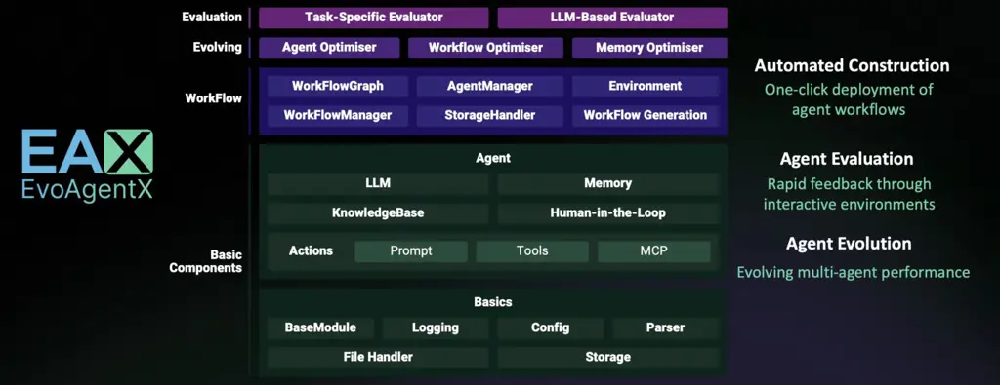
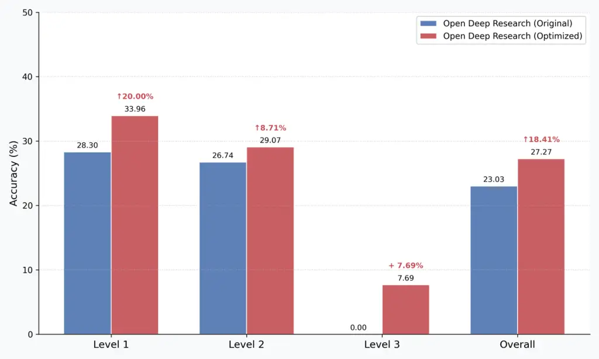
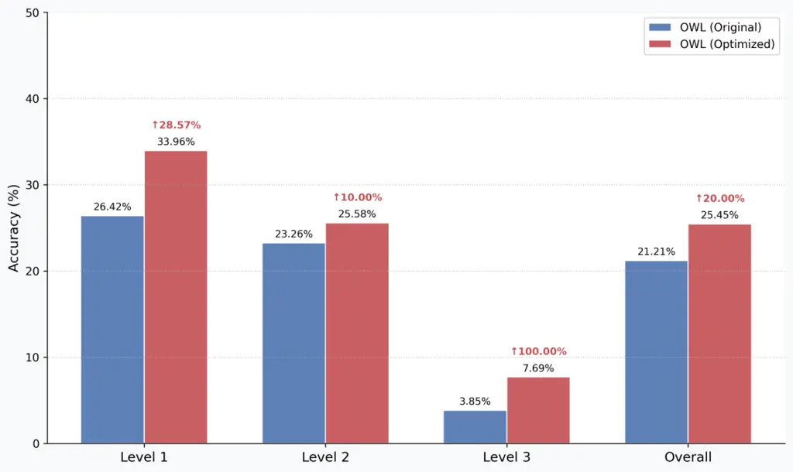

# EvoAgentX: An Automated Framework for Evolving Agentic Workflows

 Corresponding author.

Yingxu Wang Affiliation: Mohamed bin Zayed University of Artificial
Intelligence Email: [yingxv.wang@gmail.com](mailto:)    Siwei Liu
Affiliation: University of Aberdeen
Email: [siwei.liu@abdn.ac.uk](mailto:)    Jinyuan Fang
Affiliation: University of Glasgow
Email: [j.fang.2@research.gla.ac.uk](mailto:)    Zaiqiao Meng
Affiliation: University of Glasgow
Email: [zaiqiao.meng@glasgow.ac.uk](mailto:)

###### Abstract

Multi-agent systems (MAS) have emerged as a powerful paradigm for
orchestrating large language models (LLMs) and specialized tools to
collaboratively address complex tasks. However, existing MAS frameworks
often require manual workflow configuration and lack native support for
dynamic evolution and performance optimization. In addition, many MAS
optimization algorithms are not integrated into a unified framework. In
this paper, we present EvoAgentX, an open-source platform that automates
the generation, execution, and evolutionary optimization of multi-agent
workflows. EvoAgentX employs a modular architecture consisting of five
core layers: the basic components, agent, workflow, evolving, and
evaluation layers. Specifically, within the evolving layer, EvoAgentX
integrates three MAS optimization algorithms, TextGrad, AFlow, and
MIPRO, to iteratively refine agent prompts, tool configurations, and
workflow topologies. We evaluate EvoAgentX on HotPotQA, MBPP, and MATH
for multi-hop reasoning, code generation, and mathematical problem
solving, respectively, and further assess it on real-world tasks using
GAIA. Experimental results show that EvoAgentX consistently achieves
significant performance improvements, including a 7.44% increase in
HotPotQA F1, a 10.00% improvement in MBPP pass@1, a 10.00% gain in MATH
solve accuracy, and an overall accuracy improvement of up to 20.00% on
GAIA. The source code is available at:
[https://github.com/EvoAgentX/EvoAgentX](https://github.com/EvoAgentX/EvoAgentX).

## 1 Introduction

Multi-agent systems (MAS) are emerging as a powerful paradigm for
orchestrating large language models (LLMs) and specialized tools to
solve complex tasks collaboratively Hong et al. (2023); Gao et al.
(2024); Fang et al. (2025). By coordinating multiple agents with
distinct capabilities, such as planning, reasoning, or code generation,
MAS decompose intricate problems into controllable subtasks and assign
them to agents capable of solving them Yuan et al. (2024); Zhang et al.
(2025a). This flexible and modular architecture makes MAS well-suited
for addressing complex real-world problems. As a result, MAS have been
widely deployed in applications such as multi-hop question
answering Hong et al. (2023), software engineering automation Li et al.
(2023), code generation Liu et al. (2025), mathematical problem
solving Gao et al. (2024), and dialogue systems Shi et al. (2024).

Despite these promising developments, constructing a multi-agent system
typically requires manual efforts in defining the roles of agents,
specifying task decomposition strategies, designing agent interactions,
and configuring execution workflows Tang et al. (2024); Xiao et al.
(2024). Frameworks like CrewAI ¹¹ 1 https://www.crewai.com/, CAMEL AI Li
et al. (2023), and LangGraph ²² 2 https://www.langchain.com/langgraph
have provided general-purpose frameworks for building such multi-agent
systems, but they primarily rely on hand-crafted configurations or
rule-based orchestration. This reliance limits scalability and
usability, especially when adapting workflows to new tasks or domains.
As the complexity of multi-agent systems grows, there is an urgent need
for automating workflow construction to reduce manual efforts and
facilitate the rapid development of agent-based applications.

Another challenge lies in enabling MAS to evolve and optimize themselves
dynamically rather than relying on static, predefined configurations
Zhang et al. (2025a). Real-world tasks, such as multi-hop question
answering or software debugging, often involve changing inputs,
intermediate outcomes, or increasing task complexities Xu et al. (2024).
These characteristics make it essential for multi-agent systems to
support workflow evolution and optimization to continuously adapt
strategies to meet task requirements and respond to varying conditions.
By adjusting workflow topologies, modifying prompt templates, and
choosing the most suitable tools, MAS can iteratively refine their
workflows for improved problem-solving effectiveness Zhou et al. (2024).
However, most existing MAS frameworks lack mechanisms for dynamic
workflow evolution or optimization. Although some multi-agent
optimization methods like DSPy Khattab et al. (2023) and
TextGrad Yuksekgonul et al. (2024) provide approaches for prompt
refinement or agent orchestration, they remain fragmented and are not
integrated into unified platforms, making it difficult for practitioners
to apply and compare them consistently and effectively across diverse
tasks.

To this end, we propose EvoAgentX, an open-source platform designed for
the automated generation and evolutionary optimization of multi-agent
workflows. As illustrated in Figure 1, EvoAgentX employs a modular
architecture consisting of five core layers: basic components, agent,
workflow, evolving, and evaluation. The central feature of EvoAgentX is
the evolving layer, which seamlessly integrates three state-of-the-art
optimization algorithms, TextGrad Yuksekgonul et al. (2024), AFlow Zhang
et al. (2024b), and MIPRO Opsahl-Ong et al. (2024), to iteratively
refine agent prompts, tool configurations, and workflow topologies. We
evaluate EvoAgentX comprehensively across diverse benchmarks, including
HotPotQA for multi-hop reasoning Yang et al. (2018), MBPP for code
generation Austin et al. (2021a), MATH for mathematical
problem-solving Hendrycks et al. (2021), and the GAIA benchmark for
real-world multi-agent tasks Mialon et al. (2023). Experimental results
demonstrate that EvoAgentX achieves substantial performance improvements
through dynamic workflow evolution, including improvements of 7.44% in
HotPotQA F1, 10.00% in MBPP pass@1, 10.00% in MATH solve accuracy, and
up to 20.00% overall accuracy on GAIA.



Figure 1: The framework of EvoAgentX. It illustrates the modular
architecture including the basic components, agent, workflow, evolving,
and evaluation layers.

The contributions of our demo are as follows:

- •
  We present EvoAgentX, an open-source platform that enables easy
  customization and automatic generation of multi-agent workflows from
  high-level goal descriptions, reducing manual efforts in system
  design.
- •
  EvoAgentX integrates three optimization algorithms, TextGrad, AFlow,
  and MIPRO, to enable evolutionary workflow optimization.
- •
  EvoAgentX provides built-in benchmarks and standardized evaluation
  metrics, supporting dynamic workflow evolution that consistently
  improves performance on datasets such as HotPotQA, MBPP, and MATH, as
  well as on real-world benchmarks like GAIA.

## 2 Related Work

### 2.1 Multi-Agent Systems

Recent research on multi-agent systems (MAS) has explored how multiple
language model agents can collaborate to solve complex tasks by
distributing subtasks across specialized components Wang et al. (2024);
Kapoor et al. (2024). Frameworks such as CAMEL AI, CrewAI, and LangGraph
provide general-purpose infrastructures that allow users to define
agents with distinct roles, specify communication protocols, and design
execution logic and interaction patterns. These systems have enabled
significant progress in areas such as multi-hop reasoning, dialogue
simulation, tool-augmented reasoning, and software engineering
automation Ma et al. (2024). However, most existing MAS frameworks rely
on hand-crafted workflows or rule-based orchestration, requiring users
to manually predefine agent hierarchies, interactions, and execution
strategies for each task Gao et al. (2024); Islam et al. (2024). This
places a substantial burden on users and limits the scalability and
adaptability of such systems, particularly when workflows need to be
adjusted for new tasks or changing conditions. To address this
limitation, EvoAgentX introduces automatic workflow generation from
high-level task descriptions, eliminating the need for manual workflow
design and significantly reducing human effort in building multi-agent
systems.

### 2.2 Multi-Agent Optimization

Recent work on multi-agent optimization aims to enhance task performance
by refining agent prompts, execution strategies, and communication
structures Agarwal et al. (2024); Zhou et al. (2025). Early studies
focused on prompt optimization, with methods such as DSPy Khattab et al.
(2023) and TextGrad Yuksekgonul et al. (2024) demonstrating that
prompt-level refinement improves orchestration efficiency. In parallel,
frameworks like DyLAN Liu et al. (2023) and Captain Agent Song et al.
(2024) explored dynamic topology adjustments through reactive
modifications to agent sets or communication links. A significant
advancement was achieved when multi-agent topology was formalized as a
search and optimization problem. Approaches such as AutoFlow Li et al.
(2024) and GPTSwarm Zhuge et al. (2024) defined topological search
spaces using natural language programs or computational graphs and
applied reinforcement learning to optimize agent connections. Building
on this, ScoreFlow Wang et al. (2025) and G-Designer Zhang et al.
(2024a) introduced preference learning and deep generative models to
produce task-adaptive communication structures. Recent work has further
unified prompt and topology optimization, as in ADAS Hu et al. (2024),
FlowReasoner Gao et al. (2025), and MaAS Zhang et al. (2025b), which
jointly optimize agent configurations, prompts, and execution graphs
using meta-search, reinforcement learning, or probabilistic supernets.
Despite these advances, most existing frameworks rely on fragmented
toolchains or require manual setup, making them difficult to apply
consistently across diverse tasks. EvoAgentX addresses this gap by
providing an integrated platform that automates multi-agent workflow
generation and unifies optimization techniques in a single end-to-end
system.

## 3 System Design

EvoAgentX is an open-source framework designed to automate the
generation, execution, evaluation, and evolutionary optimization of
agentic workflows. It supports automatic multi-agent workflow generation
from high-level task descriptions, seamless integration of evolutionary
optimization algorithms such as TextGrad Yuksekgonul et al. (2024),
AFlow Zhang et al. (2024b), and MIPRO Opsahl-Ong et al. (2024), and
built-in benchmarks with standardized evaluation metrics for systematic
performance assessment. To enable these capabilities, as shown in
Figure 1, EvoAgentX adopts a modular architecture comprising five core
layers: the basic components, agent, workflow, evolving, and evaluation
layers.

### 3.1 Basic Component Layer

The basic components layer forms the foundation of EvoAgentX, providing
essential services that ensure the system’s stability, scalability, and
extensibility. It simplifies infrastructure management, supporting
high-level agent design and workflow construction. Core modules include
configuration management, logging, file handling, and storage. The
configuration manager validates system parameters from structured files
(e.g., YAML or JSON), while the logging module tracks system events and
performance metrics. File handling components manage workflow states and
agent checkpoints, ensuring experiment reproducibility. The storage
manager supports both persistent and temporary storage, including
caching and checkpointing.

To further enhance the system’s flexibility and adaptability, EvoAgentX
integrates with a variety of LLMs through frameworks such as
OpenRouter ³³ 3 https://openrouter.ai/ and LiteLLM ⁴⁴ 4
https://www.litellm.ai/ in the basic component layer, enabling seamless
integration of LLMs from diverse sources.

### 3.2 Agent Layer

The agent layer serves as the core functional unit of EvoAgentX,
enabling the construction of modular, intelligent entities that
integrate reasoning, memory, and action execution capabilities in a
seamless and flexible manner. Each agent is designed as a composition of
a LLM, action modules, and memory components, together supporting
flexible, context-aware decision-making and tools.

At the center of the agent architecture, the LLM is responsible for
high-level reasoning, response generation, and context interpretation.
It is specified through direct instantiation or configuration files and
serves as the foundation for all agent operations. Actions define the
operational logic of agents. Each action encapsulates a specific task
(e.g., summarization, retrieval, API invocation) and consists of a
prompt template, input-output format specifications, and optional tool
integrations. Formally, an agent $`a_{i}`$ is represented as:

```math
a_{i}=\langle\text{LLM}_{i},\text{Mem}_{i},\{\text{Act}_{i}^{(j)}\}_{j=1}^{M}\rangle, \tag{1}
```

where $`\text{Mem}_{i}`$ denotes the memory module, and
$`\text{Act}_{i}^{(j)}`$ denotes the set of action components.

An example in A.1 illustrates how to create an agent within EvoAgentX.

### 3.3 Workflow Layer

The workflow layer is another core component of EvoAgentX, supporting
the construction, orchestration, and execution of multi-agent workflows
in a structured and flexible manner. It provides a formal representation
for capturing task dependencies, execution flows, and communication
between agents. Each workflow is modeled as a directed graph:

```math
\mathcal{W}=(\mathcal{V},\mathcal{E}), \tag{2}
```

where $`\mathcal{V}`$ denotes the set of nodes (tasks) and
$`\mathcal{E}`$ represents directed edges encoding dependencies and data
flow between tasks. Each node $`v\in\mathcal{V}`$ corresponds to a
WorkFlowNode, defining a specific task, its inputs, outputs, associated
agents, and execution status (PENDING, RUNNING, COMPLETED, or FAILED).
Nodes can encapsulate either a set of agents, allowing dynamic selection
of optimal actions during execution, or an ActionGraph specifying an
explicit sequence of operations. Edges $`(v_{i},v_{j})\in\mathcal{E}`$
capture task dependencies, execution order, and optional priority
weights for scheduling.

The workflow layer supports both general-purpose workflows
(WorkFlowGraph) and streamlined linear workflows
(SequentialWorkFlowGraph). The former provides a flexible framework for
explicitly defining complex task graphs, including custom nodes, edges,
conditional branches, and parallel execution patterns. It allows users
to specify detailed task dependencies and exercise fine-grained control
over data flow and execution logic. In contrast, the latter is designed
for simplicity, automatically inferring graph connections based on task
input-output dependencies and generating nodes, agents, and edges
without the need for manual graph specification. This dual design
facilitates rapid prototyping while preserving the expressiveness needed
to model complex structures.

An example in A.2 illustrates how to create a workflow within EvoAgentX.

### 3.4 Evolving Layer

The evolving layer of EvoAgentX consists of three core components: agent
optimizer, workflow optimizer, and memory optimizer. These optimizers
provide a unified mechanism for iteratively refining agent
configurations, workflow topologies, and memory management strategies.
This architecture enables the system to dynamically adapt to changing
task requirements, optimize multi-agent coordination, and improve
overall performance.

\(1\) The agent optimizer aims to refine agent prompt templates, tool
configurations, and action strategies to enhance each agent’s
performance across diverse tasks. Formally, for an agent $`a_{i}`$
parameterized by its prompt $`\text{Prompt}_{i}`$ and configuration
$`\theta_{i}`$, the optimizer seeks to compute

```math
(\text{Prompt}_{i}^{(t+1)},\theta_{i}^{(t+1)})=\mathcal{O}_{\text{agent}}(\text{Prompt}_{i}^{(t)},\theta_{i}^{(t)},\mathcal{E}), \tag{3}
```

where $`\mathcal{O}_{\text{agent}}(\cdot)`$ denotes the agent-level
optimization operator that updates prompts and configurations based on
evaluation feedback, and $`\mathcal{E}`$ denotes evaluation feedback.
The TextGrad Yuksekgonul et al. (2024) and MIPRO Opsahl-Ong et al.
(2024) optimizers are employed for agent optimization, jointly applying
gradient-based prompt tuning, in-context learning, and preference-guided
refinement to iteratively align prompts, tool configurations, and agent
outputs with task-specific objectives based on the performance signal.

\(2\) The workflow optimizer focuses on improving task decomposition and
execution flow by adjusting the structure of the workflow graph
$`\mathcal{W}=(\mathcal{V},\mathcal{E})`$. Formally, its objective is to
compute

```math
\mathcal{W}^{(t+1)}=\mathcal{O}_{\text{workflow}}(\mathcal{W}^{(t)},\mathcal{E}), \tag{4}
```

where $`\mathcal{O}_{\text{workflow}}(\cdot)`$ denotes the
workflow-level optimization operator that updates the graph structure
based on evaluation feedback, and $`\mathcal{E}`$ denotes evaluation
feedback. The SEW Liu et al. (2025) and AFlow Zhang et al. (2024b)
optimizers are employed for workflow optimization, iteratively
restructuring workflow graphs by reordering nodes, modifying
dependencies, and exploring alternative execution strategies guided by
the task performance signal and convergence criteria.

\(3\) The memory optimizer remains under active development. Its
objective is to provide structured, persistent memory modules
$`\mathcal{M}_{i}`$ that enable selective retention, dynamic pruning,
and priority-based retrieval Zeng et al. (2024). Formally, it aims to
compute

```math
\mathcal{M}_{i}^{(t+1)}=\mathcal{O}_{\text{memory}}(\mathcal{M}_{i}^{(t)},\mathcal{E}), \tag{5}
```

where $`\mathcal{O}_{\text{memory}}(\cdot)`$ denotes the memory-level
optimization operator that updates the agent’s memory module based on
evaluation feedback, and $`\mathcal{E}`$ denotes evaluation feedback.

An example in A.3 demonstrates how to use the optimizer within
EvoAgentX.



(a) Performance of Open Deep Research.



(b) Performance of OWL Agent.

Figure 2: Performance improvements of Open Deep Research and OWL Agent
on the GAIA benchmark.

| Task                   | Dataset Name                 | \# Train | \# Dev | \# Test        |
| ---------------------- | ---------------------------- | -------- | ------ | -------------- |
| QA                     | NQ                           | 79,168   | 8,757  | 3,610          |
| Multi-Hop QA           | HotPotQA                     | 90,447   | 7,405  | /              |
| Math                   | GSM8K                        | 7,473    | /      | 1,319          |
| Math                   | MATH                         | 7,500    | /      | 5,000          |
| Code Generation        | HumanEval                    | /        | /      | 164            |
| Code Generation        | MBPP                         | /        | /      | 427            |
| Code Generation        | LiveCodeBench (v1$`\sim`$v5) | /        | /      | 400$`\sim`$880 |
| Code Execution         | LiveCodeBench                | /        | /      | 479            |
| Test Output Prediction | LiveCodeBench                | /        | /      | 442            |

Table 1: Statistics of different benchmarks. We denote Question
Answering and Natural Questions as QA and NQ, respectively.

### 3.5 Evaluation Layer

The evaluation layer of EvoAgentX provides a modular and extensible
framework for systematically assessing workflow performance across tasks
and benchmarks. It integrates two complementary components: (1) the
task-specific evaluator and the LLM-based evaluator. The task-specific
evaluator computes domain-relevant metrics by comparing workflow outputs
against ground truth labels, supporting validation on datasets such as
HotPotQA, MBPP, and MATH. More details about the benchmarks provided in
EvoAgentX are shown in Table 1; (2) the LLM-based evaluator leverages
the reasoning and generation capabilities of large language models to
deliver flexible and context-aware evaluations. It supports qualitative
assessments, consistency checking, and dynamic criteria that are not
easily captured by static metrics.

Formally, given a workflow $`\mathcal{W}`$ and dataset $`\mathcal{D}`$,
the evaluation process is defined as

```math
\mathcal{P}=\mathcal{T}(\mathcal{W},\mathcal{D}), \tag{6}
```

where $`\mathcal{T}(\cdot)`$ maps workflow executions to aggregated
performance metrics $`\mathcal{P}`$. The design supports both
WorkFlowGraph and ActionGraph structures, allowing evaluation at various
abstraction levels.

## 4 Experiments

We evaluate EvoAgentX across three tasks: (1) Evolution Algorithms,
which optimize agent configurations and workflow topologies to improve
performance; (2) Applications, where EvoAgentX is applied to enhance
multi-agent systems on real-world benchmarks; and (3) Case Study,
demonstrating EvoAgentX’s capability to optimize workflows and enhance
agent performance through practical examples.

### 4.1 Evolution Algorithms

Experimental Settings. We evaluate EvoAgentX’s evolutionary optimization
capabilities by applying three integrated algorithmsm, TextGrad, MIPRO,
and AFlow, to iteratively refine agent prompts, tool configurations, and
workflow topologies, using metrics such as F1 score for multi-hop
reasoning, pass@1 accuracy for code generation, and solve rate for
mathematical problem solving.

Datasets. We assess EvoAgentX on HotPotQA for multi-hop question
answering requiring compositional reasoning Yang et al. (2018), MBPP for
Python code generation from natural language descriptionsAustin et al.
(2021b), and MATH for solving high-school level mathematical
problems Hendrycks et al. (2021).

|          |          |            |           |
| -------- | -------- | ---------- | --------- |
| Method   | HotPotQA | MBPP       | MATH      |
|          | (F1%)    | (Pass@1 %) | (Solve %) |
| Original | 63.58    | 69.00      | 66.00     |
| TextGrad | 71.02    | 71.00      | 76.00     |
| AFlow    | 65.09    | 79.00      | 71.00     |
| MIPRO    | 69.16    | 68.00      | 72.30     |

Table 2: Performance comparison across different benchmarks. Bold
indicates the best performance.

Results Analysis. As shown in Table 2, EvoAgentX’s optimization
algorithms consistently enhance performance across all benchmarks.
Specifically, TextGrad substantially improves multi-hop reasoning,
increasing the HotPotQA F1 score from 63.58% to 71.02%. AFlow
significantly boosts code generation accuracy, raising MBPP pass@1 from
69.00% to 79.00%. Similarly, TextGrad strengthens mathematical
reasoning, improving the MATH solve rate from 66.00% to 76.00%. These
results demonstrate the EvoAgentX can effectively refine multi-agent
workflow topologies to align with task-specific objectives across
domains.

### 4.2 Applications

Experimental Settings. We apply EvoAgentX to optimize existing
multi-agent systems on a real-world benchmark. Specifically, We select
two representative open-source frameworks from the GAIA
leaderboard Mialon et al. (2023), Open Deep Research ⁵⁵ 5
https://github.com/langchain-ai/open_deep_research and OWL ⁶⁶ 6
https://github.com/camel-ai/owl, and refine their agent prompts and
workflow configurations using EvoAgentX, evaluating performance based on
accuracy, which measures the correctness of generated answers against
the ground truth.

Results Analysis. As shown in Figure 2, EvoAgentX significantly improves
the performance of both Open Deep Research and OWL across all evaluation
levels on the GAIA benchmark. For Open Deep Research, the overall
accuracy increases by 18.41%, with notable improvements of 20.00% at
Level 1, 8.71% at Level 2, and 7.69% at Level 3. Similarly, OWL achieves
an overall accuracy improvement of 20.00%, driven by gains of 28.57% at
Level 1, 10.00% at Level 2, and a remarkable 100.00% at Level 3. These
results demonstrate the effectiveness of EvoAgentX in enhancing
real-world multi-agent systems through automated prompt and topology
optimization.

### 4.3 Case Study

We present a case study to illustrate the practical application of
EvoAgentX in refining agent prompts and workflow configurations within
existing multi-agent systems, including examples from AFlow, TextGrad,
and MIPRO. More detailed analysis and results are presented in Appendix
A.4.

## 5 Conclusion

We present EvoAgentX, an open-source platform that automates the
generation, execution, evaluation and optimization of multi-agent
workflows. It addresses key limitations of existing frameworks by
eliminating the need for manual workflow design and providing support
for dynamic, task-specific optimization. By integrating multiple
optimization algorithms, including TextGrad, AFlow, and MIPRO, EvoAgentX
enables the iterative refinement of agent prompts, tool configurations,
and workflow topologies with minimal manual intervention. Experiments on
diverse benchmarks, such as HotPotQA, MBPP, MATH and GAIA, demonstrate
that EvoAgentX consistently achieves substantial performance
improvements in multi-hop reasoning, code generation, mathematical
problem solving, and real-world multi-agent applications. In the future,
we will extend EvoAgentX with more optimization algorithms, richer tool
integration, and long-term memory to further enhance agent adaptability
and contextual awareness. We also plan to explore advanced evolution
strategies Fang et al. (2025), including MASS Zhou et al. (2025),
AlphaEvolve Novikov et al. (2025), and Darwin Gödel Machine Zhang et al.
(2025c), to advance the strategies of multi-agent optimization.

## References

- Agarwal et al. (2024) Eshaan Agarwal, Vivek Dani, Tanuja Ganu, and
  Akshay Nambi. 2024. Promptwizard: Task-aware agent-driven prompt
  optimization framework. _arXiv preprint arXiv:2405.18369_.
- Austin et al. (2021a) Jacob Austin, Augustus Odena, Maxwell Nye,
  Maarten Bosma, Henryk Michalewski, David Dohan, Ellen Jiang, Carrie
  Cai, Michael Terry, Quoc Le, and 1 others. 2021a. Program synthesis
  with large language models. _arXiv preprint arXiv:2108.07732_.
- Austin et al. (2021b) Jacob Austin, Augustus Odena, Maxwell Nye,
  Maarten Bosma, Henryk Michalewski, David Dohan, Ellen Jiang, Carrie
  Cai, Michael Terry, Quoc Le, and 1 others. 2021b. Program synthesis
  with large language models. _arXiv preprint arXiv:2108.07732_.
- Fang et al. (2025) Jinyuan Fang, Yanwen Peng, Xi Zhang, Yingxu Wang,
  Xinhao Yi, Guibin Zhang, Yi Xu, Bin Wu, Siwei Liu, Zihao Li, and 1
  others. 2025. A comprehensive survey of self-evolving ai agents: A new
  paradigm bridging foundation models and lifelong agentic systems.
  _arXiv preprint arXiv:2508.07407_.
- Gao et al. (2024) Dawei Gao, Zitao Li, Xuchen Pan, Weirui Kuang,
  Zhijian Ma, Bingchen Qian, Fei Wei, Wenhao Zhang, Yuexiang Xie,
  Daoyuan Chen, and 1 others. 2024. Agentscope: A flexible yet robust
  multi-agent platform. _arXiv preprint arXiv:2402.14034_.
- Gao et al. (2025) Hongcheng Gao, Yue Liu, Yufei He, Longxu Dou, Chao
  Du, Zhijie Deng, Bryan Hooi, Min Lin, and Tianyu Pang. 2025.
  Flowreasoner: Reinforcing query-level meta-agents. _arXiv preprint
  arXiv:2504.15257_.
- Hendrycks et al. (2021) Dan Hendrycks, Collin Burns, Saurav Kadavath,
  Akul Arora, Steven Basart, Eric Tang, Dawn Song, and Jacob
  Steinhardt. 2021. Measuring mathematical problem solving with the math
  dataset. _arXiv preprint arXiv:2103.03874_.
- Hong et al. (2023) Sirui Hong, Xiawu Zheng, Jonathan Chen, Yuheng
  Cheng, Jinlin Wang, Ceyao Zhang, Zili Wang, Steven Ka Shing Yau,
  Zijuan Lin, Liyang Zhou, and 1 others. 2023. Metagpt: Meta programming
  for multi-agent collaborative framework. _arXiv preprint
  arXiv:2308.00352_.
- Hu et al. (2024) Shengran Hu, Cong Lu, and Jeff Clune. 2024. Automated
  design of agentic systems. _arXiv preprint arXiv:2408.08435_.
- Islam et al. (2024) Md Ashraful Islam, Mohammed Eunus Ali, and
  Md Rizwan Parvez. 2024. Mapcoder: Multi-agent code generation for
  competitive problem solving. In _Proceedings of the 62nd Annual
  Meeting of the Association for Computational Linguistics (Volume 1:
  Long Papers)_, pages 4912–4944.
- Kapoor et al. (2024) Raghav Kapoor, Yash Parag Butala, Melisa Russak,
  Jing Yu Koh, Kiran Kamble, Waseem AlShikh, and Ruslan
  Salakhutdinov. 2024. Omniact: A dataset and benchmark for enabling
  multimodal generalist autonomous agents for desktop and web. In
  _European Conference on Computer Vision_, pages 161–178. Springer.
- Khattab et al. (2023) Omar Khattab, Arnav Singhvi, Paridhi Maheshwari,
  Zhiyuan Zhang, Keshav Santhanam, Sri Vardhamanan, Saiful Haq, Ashutosh
  Sharma, Thomas T Joshi, Hanna Moazam, and 1 others. 2023. Dspy:
  Compiling declarative language model calls into self-improving
  pipelines. _arXiv preprint arXiv:2310.03714_.
- Li et al. (2023) Guohao Li, Hasan Hammoud, Hani Itani, Dmitrii
  Khizbullin, and Bernard Ghanem. 2023. Camel: Communicative agents for"
  mind" exploration of large language model society. _Advances in Neural
  Information Processing Systems_, 36:51991–52008.
- Li et al. (2024) Zelong Li, Shuyuan Xu, Kai Mei, Wenyue Hua, Balaji
  Rama, Om Raheja, Hao Wang, He Zhu, and Yongfeng Zhang. 2024. Autoflow:
  Automated workflow generation for large language model agents. _arXiv
  preprint arXiv:2407.12821_.
- Liu et al. (2025) Siwei Liu, Jinyuan Fang, Han Zhou, Yingxu Wang, and
  Zaiqiao Meng. 2025. Sew: Self-evolving agentic workflows for automated
  code generation. _arXiv preprint arXiv:2505.18646_.
- Liu et al. (2023) Zijun Liu, Yanzhe Zhang, Peng Li, Yang Liu, and Diyi
  Yang. 2023. Dynamic llm-agent network: An llm-agent collaboration
  framework with agent team optimization. _arXiv preprint
  arXiv:2310.02170_.
- Ma et al. (2024) Chang Ma, Junlei Zhang, Zhihao Zhu, Cheng Yang, Yujiu
  Yang, Yaohui Jin, Zhenzhong Lan, Lingpeng Kong, and Junxian He. 2024.
  Agentboard: An analytical evaluation board of multi-turn llm agents.
  _arXiv preprint arXiv:2401.13178_.
- Mialon et al. (2023) Grégoire Mialon, Clémentine Fourrier, Thomas
  Wolf, Yann LeCun, and Thomas Scialom. 2023. Gaia: a benchmark for
  general ai assistants. In _The Twelfth International Conference on
  Learning Representations_.
- Novikov et al. (2025) Alexander Novikov, Ngân Vũ, Marvin Eisenberger,
  Emilien Dupont, Po-Sen Huang, Adam Zsolt Wagner, Sergey Shirobokov,
  Borislav Kozlovskii, Francisco JR Ruiz, Abbas Mehrabian, and 1
  others. 2025. AlphaEvolve: A coding agent for scientific and
  algorithmic discovery. _arXiv preprint arXiv:2506.13131_.
- Opsahl-Ong et al. (2024) Krista Opsahl-Ong, Michael J Ryan, Josh
  Purtell, David Broman, Christopher Potts, Matei Zaharia, and Omar
  Khattab. 2024. Optimizing instructions and demonstrations for
  multi-stage language model programs. _arXiv preprint
  arXiv:2406.11695_.
- Shi et al. (2024) Juanming Shi, Qinglang Guo, Yong Liao, and Shenglin
  Liang. 2024. Legalgpt: Legal chain of thought for the legal large
  language model multi-agent framework. In _International Conference on
  Intelligent Computing_, pages 25–37. Springer.
- Song et al. (2024) Linxin Song, Jiale Liu, Jieyu Zhang, Shaokun Zhang,
  Ao Luo, Shijian Wang, Qingyun Wu, and Chi Wang. 2024. Adaptive
  in-conversation team building for language model agents. _arXiv
  preprint arXiv:2405.19425_.
- Tang et al. (2024) Xunzhu Tang, Kisub Kim, Yewei Song, Cedric
  Lothritz, Bei Li, Saad Ezzini, Haoye Tian, Jacques Klein, and
  Tegawendé F Bissyandé. 2024. Codeagent: Autonomous communicative
  agents for code review. _arXiv preprint arXiv:2402.02172_.
- Wang et al. (2024) Jize Wang, Ma Zerun, Yining Li, Songyang Zhang,
  Cailian Chen, Kai Chen, and Xinyi Le. 2024. Gta: a benchmark for
  general tool agents. In _The Thirty-eight Conference on Neural
  Information Processing Systems Datasets and Benchmarks Track_.
- Wang et al. (2025) Yinjie Wang, Ling Yang, Guohao Li, Mengdi Wang, and
  Bryon Aragam. 2025. Scoreflow: Mastering llm agent workflows via
  score-based preference optimization. _arXiv preprint
  arXiv:2502.04306_.
- Xiao et al. (2024) Yihang Xiao, Jinyi Liu, Yan Zheng, Xiaohan Xie,
  Jianye Hao, Mingzhi Li, Ruitao Wang, Fei Ni, Yuxiao Li, Jintian Luo,
  and 1 others. 2024. Cellagent: An llm-driven multi-agent framework for
  automated single-cell data analysis. _arXiv preprint
  arXiv:2407.09811_.
- Xu et al. (2024) Yao Xu, Shizhu He, Jiabei Chen, Zihao Wang, Yangqiu
  Song, Hanghang Tong, Guang Liu, Kang Liu, and Jun Zhao. 2024.
  Generate-on-graph: Treat llm as both agent and kg in incomplete
  knowledge graph question answering. _arXiv preprint arXiv:2404.14741_.
- Yang et al. (2018) Zhilin Yang, Peng Qi, Saizheng Zhang, Yoshua
  Bengio, William W Cohen, Ruslan Salakhutdinov, and Christopher D
  Manning. 2018. Hotpotqa: A dataset for diverse, explainable multi-hop
  question answering. _arXiv preprint arXiv:1809.09600_.
- Yuan et al. (2024) Siyu Yuan, Kaitao Song, Jiangjie Chen, Xu Tan,
  Dongsheng Li, and Deqing Yang. 2024. Evoagent: Towards automatic
  multi-agent generation via evolutionary algorithms. _arXiv preprint
  arXiv:2406.14228_.
- Yuksekgonul et al. (2024) Mert Yuksekgonul, Federico Bianchi, Joseph
  Boen, Sheng Liu, Zhi Huang, Carlos Guestrin, and James Zou. 2024.
  Textgrad: Automatic" differentiation" via text. _arXiv preprint
  arXiv:2406.07496_.
- Zeng et al. (2024) Ruihong Zeng, Jinyuan Fang, Siwei Liu, and Zaiqiao
  Meng. 2024. On the structural memory of llm agents. _arXiv preprint
  arXiv:2412.15266_.
- Zhang et al. (2025a) Guibin Zhang, Kaijie Chen, Guancheng Wan, Heng
  Chang, Hong Cheng, Kun Wang, Shuyue Hu, and Lei Bai. 2025a. Evoflow:
  Evolving diverse agentic workflows on the fly. _arXiv preprint
  arXiv:2502.07373_.
- Zhang et al. (2025b) Guibin Zhang, Luyang Niu, Junfeng Fang, Kun Wang,
  Lei Bai, and Xiang Wang. 2025b. Multi-agent architecture search via
  agentic supernet. _arXiv preprint arXiv:2502.04180_.
- Zhang et al. (2024a) Guibin Zhang, Yanwei Yue, Xiangguo Sun, Guancheng
  Wan, Miao Yu, Junfeng Fang, Kun Wang, Tianlong Chen, and Dawei Cheng.
  2024a. G-designer: Architecting multi-agent communication topologies
  via graph neural networks. _arXiv preprint arXiv:2410.11782_.
- Zhang et al. (2025c) Jenny Zhang, Shengran Hu, Cong Lu, Robert Lange,
  and Jeff Clune. 2025c. Darwin godel machine: Open-ended evolution of
  self-improving agents. _arXiv preprint arXiv:2505.22954_.
- Zhang et al. (2024b) Jiayi Zhang, Jinyu Xiang, Zhaoyang Yu, Fengwei
  Teng, Xionghui Chen, Jiaqi Chen, Mingchen Zhuge, Xin Cheng, Sirui
  Hong, Jinlin Wang, and 1 others. 2024b. Aflow: Automating agentic
  workflow generation. _arXiv preprint arXiv:2410.10762_.
- Zhou et al. (2025) Han Zhou, Xingchen Wan, Ruoxi Sun, Hamid Palangi,
  Shariq Iqbal, Ivan Vulić, Anna Korhonen, and Sercan Ö Arık. 2025.
  Multi-agent design: Optimizing agents with better prompts and
  topologies. _arXiv preprint arXiv:2502.02533_.
- Zhou et al. (2024) Wangchunshu Zhou, Yixin Ou, Shengwei Ding, Long Li,
  Jialong Wu, Tiannan Wang, Jiamin Chen, Shuai Wang, Xiaohua Xu, Ningyu
  Zhang, and 1 others. 2024. Symbolic learning enables self-evolving
  agents. _arXiv preprint arXiv:2406.18532_.
- Zhuge et al. (2024) Mingchen Zhuge, Wenyi Wang, Louis Kirsch,
  Francesco Faccio, Dmitrii Khizbullin, and Jürgen Schmidhuber. 2024.
  Gptswarm: Language agents as optimizable graphs. In _Forty-first
  International Conference on Machine Learning_.

## Appendix A Appendix

### A.1 Creating a Simple Agent in EvoAgentX

In EvoAgentX, a simple agent can be created using the CustomizeAgent
class, which enables the quick configuration of agents with a specific
prompt. To create such an agent, the first step is to configure the
large language model (LLM) that will be used by the agent. This is done
by defining the LLM settings, such as the model type and API key, using
the OpenAILLMConfig class. After configuring the LLM, the agent is
instantiated by specifying its name, description, and prompt, which
defines the task the agent will perform.

The following code demonstrates the process of creating and using a
simple agent in EvoAgentX, where the agent is tasked with printing
"hello world." The agent is then executed, and the result is retrieved
as a message object, with the content of the response extracted and
displayed.

from evoagentx.models import OpenAILLMConfig

from evoagentx.agents import CustomizeAgent

\# Configure LLM

openai_config = OpenAILLMConfig(

model="gpt-4o-mini",

openai_key="YOUR_API_KEY",

stream=True

)

\# Create a simple agent

first_agent = CustomizeAgent(

name="FirstAgent",

description="A simple agent that prints ’hello world’",

prompt="Print ’hello world’",

llm_config=openai_config

)

\# Execute the agent

message = first_agent()

print(f"Response from {first_agent.name}: {message.content.content}")

This approach showcases how a basic agent can be constructed and
executed with minimal configuration in EvoAgentX.

### A.2 Creating a Simple Workflow in EvoAgentX

In EvoAgentX, workflows enable multiple agents to collaborate
sequentially on tasks. A basic sequential workflow involves defining
tasks, each with a name, description, input-output specifications, and a
prompt. To create such a workflow, the SequentialWorkFlowGraph class is
used to define and link tasks. An agent manager oversees the agents
responsible for executing each task. The workflow is executed by
providing the necessary inputs, and the results are collected as
outputs.

The following code illustrates the process of creating and using a
simple workflow in EvoAgentX, where the workflow includes two tasks:
"Planning," in which the agent creates a detailed implementation plan
for a given problem, and "Coding," in which the agent implements the
solution based on the plan. The workflow is then executed with a
specified problem, and the results are retrieved as outputs, with the
content of each task’s result extracted and displayed sequentially.

import os

from dotenv import load_dotenv

from evoagentx.workflow import SequentialWorkFlowGraph

from evoagentx.agents import AgentManager

from evoagentx.models import OpenAILLMConfig, OpenAILLM

\# Load environment variables

load_dotenv()

OPENAI_API_KEY = os.getenv("OPENAI_API_KEY")

\# Configure the LLM

llm_config = OpenAILLMConfig(model=

"gpt-4o-mini", openai_key=OPENAI_API_KEY, stream=True)

llm = OpenAILLM(llm_config)

\# Define tasks in the sequential workflow

tasks = \[

{

"name": "Planning",

"description": "Create a detailed plan for code generation",

"inputs": \[{"name": "problem", "type": "str", "required": True}\],

"outputs": \[{"name": "plan", "type": "str", "required": True}\],

"prompt": "You are a software architect. Create a detailed
implementation plan for the given problem.\n\nProblem: {problem}",

"parse_mode": "str"

},

{

"name": "Coding",

"description": "Implement the code based on the plan",

"inputs": \[{"name": "problem", "type": "str", "required": True}\],

"outputs": \[{"name": "code", "type": "str", "required": True}\],

"prompt": "You are a developer. Implement the code based on the provided
plan.\n\nProblem: {problem}\nImplementation Plan: {plan}",

"parse_mode": "str"

}

\]

\# Create the sequential workflow graph

graph = SequentialWorkFlowGraph(goal=

"Generate code to solve programming problems", tasks=tasks)

\# Initialize the agent manager and add agents

agent_manager = AgentManager()

agent_manager.add_agents_from_workflow

(graph, llm_config=llm_config)

\# Create the workflow instance

workflow = WorkFlow(graph=graph, agent_manager=agent_manager, llm=llm)

\# Execute the workflow with inputs

output = workflow.execute(inputs={"problem": "Write a function to find
the longest palindromic substring in a given string."})

print("Workflow completed!")

print("Workflow output:\n", output)

This example demonstrates how a simple sequential workflow can be
created and executed in EvoAgentX, where agents collaborate in a defined
sequence to accomplish a task.

### A.3 A Simple Example about using Optimizer within EvoAgentX

In EvoAgentX, the AFlow optimizer optimizes multi-agent workflows for
tasks like code generation. To use the optimizer, the first step is
configuring the LLMs for both optimization and execution, one for
optimizing the workflow (e.g., Claude 3.5 Sonnet) and one for task
execution (e.g., GPT-4o-mini). The task configuration specifies
operators (e.g., Custom, CustomCodeGenerate, ScEnsemble), and the
workflow is created using the SequentialWorkFlowGraph class. The
optimizer is initialized with the paths to the workflow, LLM
configurations, and optimization parameters.

The following code demonstrates the process of creating and using an
AFlow Zhang et al. (2024b) optimizer in EvoAgentX, where the optimizer
refines a multi-agent workflow for code generation. The optimizer is
configured with specific settings, including the selection of LLMs for
both optimization and execution. The process begins by configuring the
optimizer_llm for optimizing the workflow and the executor_llm for
executing the tasks. The optimizer is run with a benchmark (e.g., the
HumanEval benchmark), and the results are retrieved as outputs, with
each optimization step and its corresponding result displayed
sequentially.

import os

from dotenv import load_dotenv

from evoagentx.optimizers import AFlowOptimizer

from evoagentx.models import LiteLLMConfig, LiteLLM, OpenAILLMConfig,
OpenAILLM

from evoagentx.benchmark import AFlowHumanEval

\# Load environment variables

load_dotenv()

OPENAI_API_KEY = os.getenv("OPENAI_API_KEY")

ANTHROPIC_API_KEY = os.getenv("ANTHROPIC_API_KEY")

\# Configure LLMs

claude_config = LiteLLMConfig(model=

"anthropic/

claude-3-5-sonnet-20240620", anthropic_key=ANTHROPIC_API_KEY)

optimizer_llm = LiteLLM(config=claude_config)

openai_config = OpenAILLMConfig(model="gpt-4o-mini",
openai_key=OPENAI_API_KEY)

executor_llm = OpenAILLM(config=openai_config)

\# Initialize the benchmark

humaneval = AFlowHumanEval()

\# Set up the optimizer

optimizer = AFlowOptimizer(

graph_path=

"examples/aflow/code_generation", \# Path to the initial workflow graph

optimized_path=

"examples/

aflow/humaneval/optimized", \# Path to save optimized workflows

optimizer_llm=optimizer_llm, \# LLM for optimization

executor_llm=executor_llm, \# LLM for execution

validation_rounds=3, \# Number of validation rounds

eval_rounds=3, \# Number of evaluation rounds

max_rounds=20, \# Maximum optimization rounds

task_config=

EXPERIMENTAL_CONFIG\["humaneval"\] \# Task configuration

)

\# Optimize and test the workflow

optimizer.optimize(humaneval)

optimizer.test(humaneval)

This illustrates how EvoAgentX dynamically optimizes workflows to
improve performance through multiple evaluation rounds.

### A.4 Case study

#### A.4.1 AFlow for Workflow Optimization

In this task, we aim to enhance the efficiency and effectiveness of
multi-agent workflows for mathematical problem-solving by optimizing
workflows using AFlow, as shown in the Example 1 and Example 2.

The initial workflow used a basic agent configuration to solve
mathematical problems with a simple prompt. After optimization with
AFlow within EvoAgentX, the workflow was significantly enhanced by
incorporating detailed problem analysis, Python code generation, and
solution refinement through an ensemble approach. The workflow now
involves multiple agents for problem analysis, code generation, and
solution refinement, improving both accuracy and clarity. This
optimization results in a more comprehensive and precise problem-solving
process.

class Workflow:

def \_\_init\_\_(

self,

name: str,

llm_config: LLMConfig,

benchmark: Benchmark

):

self.name = name

self.llm = create_llm_instance(llm_config)

self.benchmark = benchmark

self.custom = operator.Custom(self.llm)

async def \_\_call\_\_(self, problem: str):

"""

Implementation of the workflow

"""

solution = await self.custom(input=problem, instruction = prompt_custom.

SOLVE_MATH_PROBLEM_PROMPT)

return solution\[’response’\]

Example 1: The workflow before optimization.

SOLVE_MATH_PROBLEM_PROMPT = r"""

Given the math problem, its analysis, and a Python code solution,
provide a detailed step-by-step solution. Ensure your explanation is
clear and thorough. If the code solution is relevant, incorporate its
logic into your explanation.

Problem, Analysis, and Code Solution: """

FORMAT_ANSWER_PROMPT = r"""

Given the problem and its solution, extract the final numerical answer
and format it in a box using LaTeX notation \boxed{}. Ensure the answer
is accurate and properly formatted.

Problem and Solution: """

class Workflow:

def \_\_init\_\_(

self,

name: str,

llm_config: LLMConfig,

benchmark: Benchmark

):

self.name = name

self.llm = create_llm_instance(llm_config)

self.benchmark = benchmark

self.custom = operator.Custom(self.llm)

self.programmer = operator.Programmer(self.llm)

self.sc_ensemble = operator.ScEnsemble(self.llm)

async def \_\_call\_\_(self, problem: str):

"""

Implementation of the workflow

"""

analysis = await self.programmer(problem=problem, analysis="Analyze the
math problem and provide a step-by-step approach to solve it.")

code_solution = await self.programmer(problem=problem,
analysis=f"Generate Python code to solve this problem: {problem}")

solutions = \[\]

for \_ in range(3):

solution = await self.custom(input=problem + f"\nAnalysis:
{analysis\[’output’\]}\nCode Solution: {code_solution\[’output’\]}",
instruction=

prompt_custom.

SOLVE_MATH_PROBLEM_PROMPT)

solutions.

append(solution\[’response’\])

best_solution = await self.

sc_ensemble(solutions=solutions, problem=problem)

final_answer = await self.custom(input=f"Problem: {problem}\nSolution:
{best_solution\[’response’\]}", instruction=

prompt_custom.FORMAT_ANSWER_PROMPT)

return final_answer\[’response’\]

Example 2: The workflow after AFlow optimization.

#### A.4.2 TextGrad for Prompt Optimization

In this task, we aim to improve the efficiency and effectiveness of
multi-agent workflows for mathematical problem-solving by optimizing
prompts using TextGrad, as demonstrated in Example 5 and Example 6.

The initial prompt employed a minimalistic instruction, directing the
agent to solve mathematical problems by simply providing the final
answer in a boxed format. Following optimization with TextGrad within
EvoAgentX, the prompt was substantially refined to support a structured,
step-by-step reasoning process. The enhanced prompt guides the agent to
assess problem complexity, apply appropriate mathematical principles,
and generate executable Python code. It further emphasizes logical
coherence, justification of each solution step, and the use of
explanatory transitions to enhance interpretability. These improvements
lead to increased solution accuracy and significantly improve the
clarity and transparency of the reasoning process.

"""

Answer the math question. The answer should be in box format, e.g.,
\\boxed{{123}}\n

"""

Example 3: The prompt before optimization.

"""

Begin by assessing the complexity of the math problem to determine the
appropriate level of detail required. For complex problems, provide a
brief introduction to set the context and explain the relevance of key
mathematical concepts. For simpler problems, focus on delivering a
direct and concise solution.

Identify and apply relevant mathematical properties or theorems that can
simplify the problem-solving process, such as the arithmetic sequence
property. Prioritize methods that offer a concise and efficient
solution, minimizing unnecessary steps while maintaining clarity.

Solve the problem using the most direct and appropriate mathematical
methodologies, ensuring each calculation step is accurate. Clearly
explain the reasoning behind each step, enhancing understanding by
providing brief explanations of why specific mathematical properties or
methods are applicable.

Maintain a smooth and coherent logical flow throughout the solution,
using transitional phrases to connect different parts of the
problem-solving process. Where applicable, compare alternative methods
to solve the problem, discussing the benefits of each approach to
provide a comprehensive understanding.

Encourage the use of visual aids, such as diagrams or charts, to
illustrate complex concepts and enhance comprehension when necessary.
Explicitly state and verify any assumptions made during the
problem-solving process, clarifying why certain methodologies are
chosen.

Conclude with a verification step to confirm the solution’s correctness,
and present the final answer in a consistent format, such as
\\boxed{{answer}}. Ensure that the final expression is in its simplest
form and that all calculations are accurate and justified.

Problem: \<input\>{problem}\</input\>

"""

Example 4: The prompt after TextGrad optimization.

#### A.4.3 MIPRO for Prompt Optimization

In this task, we aim to improve the efficiency and effectiveness of
multi-agent workflows for mathematical problem-solving by optimizing
prompts using MIPRO, as demonstrated in Example 5 and Example 6.

The initial prompt was designed to provide a mathematical solution in a
simple boxed format, without elaborating on the solution steps or
offering detailed explanations. Following optimization with MIPRO within
EvoAgentX, the prompt was significantly improved to guide the agent
through a comprehensive, step-by-step solution process. The enhanced
prompt now incorporates intermediate steps, clear explanations of
relevant mathematical concepts, and a thorough breakdown of the
problem-solving approach. Each step is carefully articulated, ensuring a
deeper understanding of the solution. This optimization not only
improves the accuracy of the solution but also enhances the clarity and
transparency of the reasoning process.

"""

Answer the math question. The answer should be in box format, e.g.,
\\boxed{{123}}\n

"""

Example 5: The prompt before optimization.

"""

Please solve the following math problem, providing a detailed and clear
solution process for better understanding. Ensure that the final answer
is presented in a boxed format, according to the LaTeX convention (e.g.,
\\\boxed{{123}}\\).

Make sure to include any necessary intermediate steps, calculations, or
explanations that lead you to the final answer.

\*\*Problem:\*\* {problem}

Examples:

1. Problem: The function \$f(x)\$ satisfies\n\\\[f(x + y) = f(x) +
   f(y) + 2xy\\\]for all real numbers \$x\$ and \$y.\$ If \$f(1) = 4,\$
   then find \$f(8).\$

Output:

Setting \$x = y,\$ we get

\[f(2x) = 2f(x) + 2x^2.\]Then

\begin{align\*}

f(2) &= 2f(1) + 2 \cdot 1^2 = 10,

f(4) &= 2f(2) + 2 \cdot 2^2 = 28,

f(8) &= 2f(4) + 2 \cdot 4^2 = \boxed{88}.

\end{align\*}

2. Problem: The product \$ab = 1200\$, \$a\$ is an integer, and \$b\$ is
   an odd integer. What is the largest possible value of \$b\$?

Output:

Factoring out the highest power of 2 from 1200, we find that
\$1200=2^4\cdot75\$. Therefore, the largest possible value of \$b\$ is
\$\boxed{75}\$.

3. Problem: What is the product (in base 10) of the first and last
   digits of the base-6 representation of \$682\_{10}\$?

Output:

We begin by converting \$682\_{10}\$ into base-6. We see that
\$6^3=216\$ is the largest power of 6 that is less than 682, and that
\$3\cdot216=648\$ is the largest multiple of 216 that is less than 682.
This leaves us with a remainder of \$682-648=34\$, which we can express
as \$5\cdot6^1+4\cdot6^0\$. So, \$682\_{10}=3\cdot6^3+0\cdot6^2+

5\cdot{6^1}+4\cdot6^0=3054_6\$. The first and last digits are 3 and 4,
respectively, making the product of the two equal to \$\boxed{12}\$.

4. Problem: Compute \$817_9 - 145_9 - 266_9\$. Express your answer in
   base 9.

Output:

\$817_9 - 145_9 - 266_9 = 817_9 - (145_9 + 266_9) = 817_9 - 422_9 =
\boxed{385_9}\$.

"""

Example 6: The prompt after MIPRO optimization.
