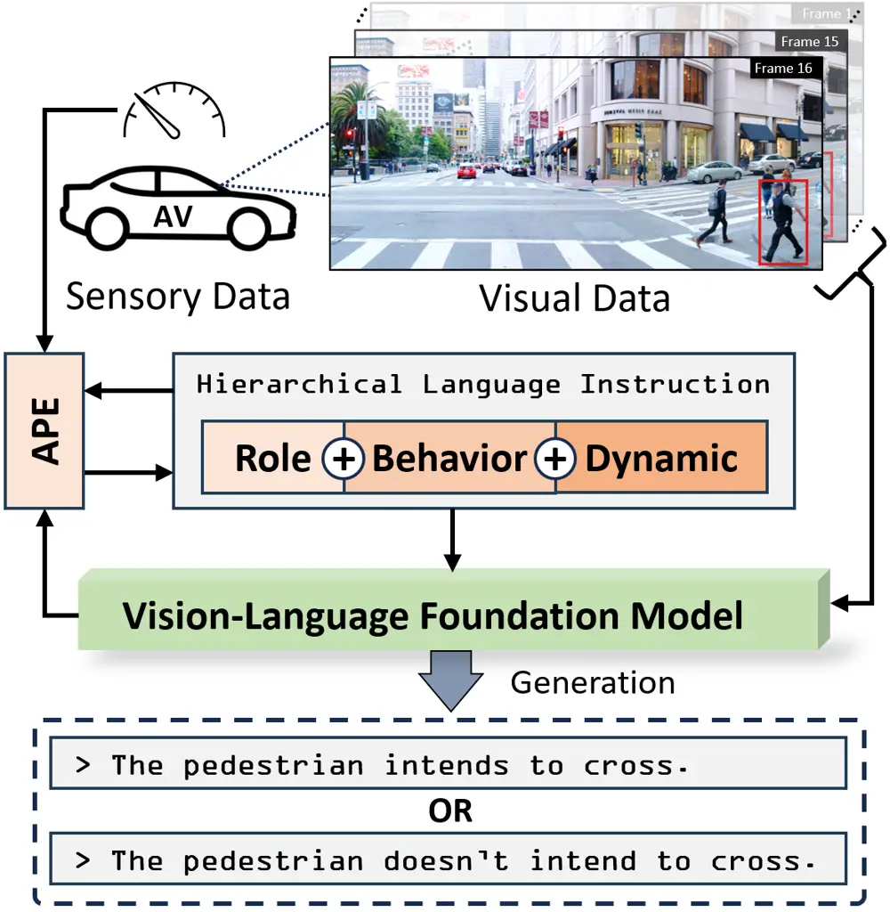
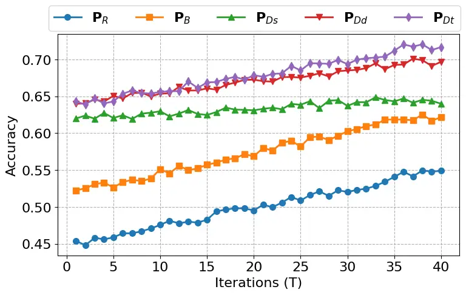

# Pedestrian Intention Prediction via Vision-Language Foundation Models

Mohsen Azarmi Affiliation: M. Azarmi and M. Rezaei are with the
Institute for Transport Studies, Faculty of Environment, Computer Vision
and Machine Learning Group, University of Leeds, LS2 9JT, United Kingdom
tsmaz@leeds.ac.uk and m.rezaei@leeds.ac.uk    Mahdi Rezaei
Affiliation: M. Azarmi and M. Rezaei are with the Institute for
Transport Studies, Faculty of Environment, Computer Vision and Machine
Learning Group, University of Leeds, LS2 9JT, United Kingdom
tsmaz@leeds.ac.uk and m.rezaei@leeds.ac.uk    He Wang ^(†)^(†)thanks:
\$ˆ†\$Corresponding author: M. Rezaei m.rezaei@leeds.ac.uk
Affiliation: H. Wang is with AI Centre, Department of Computer Science,
University College London, London, WC1E 6BT, United Kingdom
he_wang@ucl.ac.uk

###### Abstract

Prediction of pedestrian crossing intention is a critical function in
autonomous vehicles. Conventional vision-based methods of crossing
intention prediction often struggle with generalizability, context
understanding, and causal reasoning. This study explores the potential
of vision-language foundation models (VLFMs) for predicting pedestrian
crossing intentions by integrating multimodal data through hierarchical
prompt templates. The methodology incorporates contextual information,
including visual frames, physical cues observations, and ego-vehicle
dynamics, into systematically refined prompts to guide VLFMs effectively
in intention prediction. Experiments were conducted on three common
datasets—JAAD, PIE, and FU-PIP. Results demonstrate that incorporating
vehicle speed, its variations over time, and time-conscious prompts
significantly enhances the prediction accuracy up to 19.8%.
Additionally, optimised prompts generated via an automatic prompt
engineering framework yielded 12.5% further accuracy gains. These
findings highlight the superior performance of VLFMs compared to
conventional vision-based models, offering enhanced generalisation and
contextual understanding for autonomous driving applications.

## I Introduction

The safe and efficient operation of autonomous vehicles (AVs) relies on
understanding pedestrian crossing intentions. Accurate intention
prediction enhances safety by enabling AVs to anticipate actions and
adjust their speed and trajectory accordingly. However, this task
remains challenging due to the complexity of pedestrian behaviour,
influenced by individual attributes, social interactions, and
environmental factors \[1\].

Conventional computer vision-based models for crossing intention
prediction often use deep learning techniques, such as CNNs \[2, 3, 4\],
RNNs \[5, 6, 7\], GCNs \[8, 9\], and Transformers \[10, 11, 12\],
focusing on visual features like body pose \[13, 14\], spatio-temporal
relationships \[15, 16\], and pedestrian-vehicle dynamics \[17\]. While
effective, these models struggle with generalizability, context
understanding, and causal reasoning in dynamic traffic environments
\[18\].



Fig. 1: Overview of vision-language crossing intention prediction model.
Automatic Prompt Engineer (APE) generates hierarchical prompts based on
task role, pedestrian behaviour, and dynamic motion cues (e.g., vehicle
speed).

Vision-language foundation models (VLFMs) are large-scale, pre-trained
machine learning models that integrate visual and textual modalities to
achieve a unified understanding of multimodal data. By combining
multimodal data, VLFMs address some limitations of conventional
vision-based models, improving cross-modal comprehension tasks \[19\].
While some recent works have explored the use of VLFMs for pedestrian
intention prediction tasks \[20, 21, 22\], they exhibit key limitations.
Firstly, these approaches often fail to effectively capture temporal
dependencies critical for dynamic pedestrian behaviour, relying instead
on static or limited contextual cues. Secondly, their performance is
sensitive to prompt variations, as prompts are often designed in an
arbitrary or ad hoc manner, lacking a systematic structure. Finally,
these studies frequently overlook the significant role of vehicle
dynamics—such as speed and acceleration—on pedestrian intent, which are
crucial for understanding traffic scenes \[10, 23, 24\].

This study explores the use of four state-of-the-art VLFMs for
pedestrian crossing intention prediction, with a particular focus on
prompt engineering and the integration of vehicle speed variations and
time-conscious prompts into the intent-predictive framework.

This research introduces structured hierarchical templates for prompt
development. The hierarchy progresses from simpler to more complex
prompts, each designed to capture different levels of contextual
information. This progressive approach reflects human reasoning, which
often builds on foundational knowledge before addressing more intricate
details \[25\]. These prompts are subsequently optimised using the
Automatic Prompt Engineer (APE) framework \[26\], which iteratively
refines them to identify the high-score prompts. The study also
investigates how varying levels of contextual information influence
crossing intention prediction performance against three task-specific
datasets. Then our contributions can be summarised as follows:

- •
  VLFMs Adaptation: We integrate vehicle speed variations and refine
  prompts to improve the understanding of temporal and physical cues in
  pedestrian intention prediction.
- •
  Hierarchical Prompt Design: We propose a structured series of
  progressively complex prompts to evaluate VLFMs’ predictive
  capabilities.
- •
  Prompt Optimisation: We employ the APE framework to systematically
  optimise prompt templates, balancing accuracy and confidence, and
  improving the overall performance of the VLFMs in pedestrian crossing
  intention prediction.

## II Methodology

This section describes our approach to pedestrian crossing intention
prediction using vision-language foundation models (VLFMs). We integrate
vehicle dynamics into the prompt structure through hierarchical
templates and optimise prompts to enhance VLFMs’ effectiveness for the
task.

### II-A Input Data Preparation

The data we utilised to input to the VLFMs comprises both visual and
textual components as detailed below.

#### II-A1 Visual Data

The visual data consists of a series of frames,
$`\mathbf{V}_{i}={frame_{1},frame_{2},\ldots,frame_{N}}`$, with $`N=16`$
frames captured at a rate of 30 fps. Following the same framework
employed by other conventional vision-based benchmark models for
performance evaluation, the model is configured to analyse information
from the previous 16 frames and generate predictions for the next 16
frames \[27\]. To guide the model in understanding temporal sequences,
each frame includes annotations with timestamps and a red bounding box
highlighting the target ($`i`$-th) pedestrian (as illustrated in Figure
1).

#### II-A2 Textual Data

The textual data consists of a set of prompt templates
$`\mathbf{P}=\{\rho_{1},\rho_{2},\ldots,\rho_{n}\}`$. These prompts
direct the VLFMs to predict the pedestrian’s crossing intention based on
visual frames and prompts, which are detailed below.

### II-B Hierarchical Prompt Templates

To systematically evaluate the impact of contextual richness on the
performance of VLFMs in pedestrian crossing intention prediction, we
propose a series of progressively complex prompt templates as suggested
by \[25\]. Each level of these templates builds upon the previous one,
incrementally incorporating additional information to guide the model
more effectively. This hierarchical structure ensures a comprehensive
analysis of how varying degrees of context affect the model’s
understanding of the scene.

#### II-B1 Role Templates ($`\mathbf{P}_{R}`$)

The system role initially is based on definitions suggested in the study
\[21\], where the model acts as an autonomous vehicle equipped with a
front-view dashboard camera capturing traffic scenes, including
pedestrians and vehicles. The task requires predicting a pedestrian’s
behaviour 16 frames into the future based on visual inputs and
ego-vehicle speed information. The defined role helps the VLFM focus on
the task effectively, as supported by \[28\].

The baseline prompt poses a simple question to establish a control for
performance evaluation: ”Does the pedestrian in the red bounding box
intend to cross the street?”. This minimal template serves as a
benchmark for comparison with more contextually rich prompts. Moreover,
referring to the bounding box in the prompt reduces ambiguity by
ensuring the model targets the correct individual. Providing this
localised visual reference enables the model to focus on the pedestrian
more accurately, avoiding inaccuracies that may arise from textual
descriptions of bounding box coordinates \[29\].

#### II-B2 Physical Cues Observation ($`\mathbf{P}_{B}`$)

This adds a layer of behavioural insight by specifying ”Observe the
pedestrian’s posture, limb positions, and body orientation”. By
explicitly focusing on these micro-level features, this template
provides critical insights into the pedestrian’s readiness and intent to
cross \[30\].

#### II-B3 Vehicle Dynamics Aware

The template integrates ego-vehicle dynamics, incorporating vehicle
speed as a key contextual element in pedestrian intention prediction
\[24\]. Three different representations of vehicle speeds are designed
to evaluate the effect of varying levels of detail in dynamic
information on intention prediction. The first representation
($`\mathbf{P}_{Ds}`$) provides a straightforward numeric value, offering
the model a precise but contextually limited input. The second
representation ($`\mathbf{P}_{Dd}`$) adds interpretability by describing
the vehicle’s motion state qualitatively, helping the model infer
broader situational awareness, as used by \[21\]. Finally, the third
representation ($`\mathbf{P}_{Dt}`$) introduces a time-conscious
element, enabling the model to consider dynamic changes in vehicle speed
over a given time interval, which closely aligns with real-world traffic
scenarios. For example: ”Over the past {time interval} seconds, the
vehicle’s speed {increased / decreased} from {initial speed} mph to
{final speed} mph.”

### II-C Prompt Optimization

To optimise prompt templates, we use the Automatic Prompt Engineer (APE)
framework \[26\], which systematically generates and evaluates prompts.
Each prompt $`\rho_{j}`$ is scored using:

```math
f_{\text{score}}(\rho_{j})=\alpha f_{\text{exec}}(\rho_{j})+(1-\alpha)f_{\text{logprob}}(\rho_{j}),
```

where:

- •
  Execution Accuracy:

  ```math
  f_{\text{exec}}(\rho_{j})=\frac{1}{M}\sum_{i=1}^{M}\mathbb{I}(\hat{y}_{i}=y_{i}),
  ```

  measures the proportion of correct predictions, where
  $`\mathbb{I}(\cdot)`$ is the indicator function, $`y_{i}`$ is the
  ground-truth label, $`\hat{y}_{i}`$ is the predicted label, and $`M`$
  is the number of samples.

- •
  Log Probability:

  ```math
  f_{\text{logprob}}(\rho_{j})=\frac{1}{M}\sum_{i=1}^{M}\log P_{\text{VLFM}}(y_{i}\mid\rho_{j},\mathbf{V}_{i}),
  ```

  computes the average confidence of the VLFM for the correct label
  $`y_{i}`$, given the sequence of images $`\mathbf{V}_{i}`$ and the
  prompt $`\rho_{j}`$.

The weighting parameter $`\alpha\in[0,1]`$ balances accuracy and
confidence.

The employed Monte Carlo search in the framework iteratively refines
prompts:

1.  1.  Initialisation: Start with the initial set of templates
        ($`\mathbf{P}`$).
2.  2.  Perturbation: Generate new candidate prompts (via ChatGPT \[31\]) by
        modifying existing ones, such as rephrasing, or using synonyms.
3.  3.  Evaluation: Score the new prompts using
        $`f_{\text{score}}(\rho_{j})`$ to identify high-performing
        candidates.
4.  4.  Selection: Retain the top $`K`$ prompts for the next iteration.

This process repeats for $`T`$ iterations or until convergence, yielding
the optimized prompt $`\rho^{*}`$:

```math
\rho^{*}=\arg\max_{\rho_{j}}f_{\text{score}}(\rho_{j}).
```

The optimised prompt $`\rho^{*}`$, which is both linguistically diverse
and contextually relevant, is used as the input query for the VLFM to
predict pedestrian crossing intentions effectively.

## III Experiment

This section details the experimental results of assessing the impact of
hierarchical prompt templates and the incorporation of vehicle speed
variations on the performance of VLFMs using the APE framework. Then, it
provides comparative results on three task-specific datasets using four
state-of-the-art VLFMs and conventional vision-based intent-predictive
models.

### III-A Datasets

Our study utilizes three benchmark datasets: JAAD \[32\], PIE \[33\],
and Frontal Urban-PIP (FU-PIP) \[4\], each providing diverse pedestrian
scenarios for intention prediction. For all datasets, both test and
validation sets are fully annotated with pedestrian intention labels.

JAAD consists of 126 test samples and 32 validation samples, including
behavioural annotations essential for pedestrian intention prediction.
The dataset captures varied weather conditions (sunny, rainy, snowy) and
unpredictable pedestrian movements, such as sudden stops or changes in
direction, increasing task complexity.

PIE includes 719 test samples and 243 validation samples, covering
diverse urban environments like motorways, parking lots, and
intersections. Frequent occlusions and dynamic interactions with
vehicles introduce additional challenges for intention prediction
models.

Frontal Urban-PIP (FU-PIP) contains 94 test samples and 90 validation
samples, featuring complex traffic interactions at intersections with
high vehicle flow. The dataset evaluates the model’s ability to
recognise subtle pedestrian intent cues in busy urban settings.

All datasets consist of RGB video sequences recorded from frontal
vehicle-mounted cameras, annotated with pedestrian bounding boxes,
ego-vehicle speeds, and binary intention labels (”Crossing” or ”Not
Crossing”).

### III-B Hierarchical Optimization

To explore the effectiveness of the hierarchical prompt templates, we
utilize five distinct language instruction pools, which include two
pools for Role Templates ($`\mathbf{P}_{R}`$) and Physical Cues
Observation Templates ($`\mathbf{P}_{B}`$), and three for Vehicle
Dynamics ($`\mathbf{P}_{Ds}`$, $`\mathbf{P}_{Dd}`$,
$`\mathbf{P}_{Dt}`$). Each of these pools contains placeholders for
speed information to guide the VLFMs in predicting pedestrians’ crossing
intentions.

Each instruction pool initially includes 13 manually crafted templates,
inspired by \[20, 21, 22\] prompts. These templates are modified and
developed to ensure diversity in grammar, structure, and lexical
richness while maintaining the original semantic meaning. This diversity
ensures the prompts effectively probe the capabilities of the models
under varied linguistic constructions.

We employ the APE framework using GPT-4V for task evaluation and
leverage ChatGPT-4 \[34\] to refine and optimise these templates. The
optimisation process is conducted with $`M=365`$ (number of samples) and
$`T=40`$ (number of iterations) across the validation sets of all three
datasets. Optimising the prompt templates across these three datasets
ensures that the prompts are effective and well-tuned for diverse
scenarios, covering various environments, pedestrian behaviours, and
levels of complexity.

The optimisation procedure involves the following stages:

1.  1.  Role Templates ($`\mathbf{P}_{R}`$): Using the validation samples,
        we first run APE on the Role Templates to identify the most
        effective template for guiding the VLFMs. From this step, we select
        the top 5 ($`K`$=5) high-score prompts for further analysis.
2.  2.  Physical Cues Observation Templates ($`\mathbf{P}_{B}`$): Building
        upon the top 5 prompts from $`\mathbf{P}_{R}`$, we evaluate the
        observation templates ($`\mathbf{P}_{B}`$). This step incorporates
        behavioural cues into the prompts to enhance the contextual
        understanding of pedestrian actions. The optimisation process yields
        the most effective prompt for this pool.
3.  3.  Vehicle Dynamics Templates ($`\mathbf{P}_{Ds}`$,
        $`\mathbf{P}_{Dd}`$, $`\mathbf{P}_{Dt}`$): Finally, using the top 5
        high-score prompts from $`\mathbf{P}_{B}`$, we evaluate the three
        representations of ego-vehicle speed to determine their contribution
        to the overall performance. However, due to the limitations of the
        JAAD dataset, which only provides descriptive speed information, the
        experiments on this dataset are restricted to descriptive speed
        templates ($`\mathbf{P}_{Dd}`$).



Fig. 2: The measured performance of GPT-4V during the prompt
optimisation process of hierarchical prompt templates on validation sets
of JAAD, PIE, and FU-PIP datasets.

Figure 2 shows the optimisation process of prompt templates, with
stability achieved after iteration 34, indicating convergence on the
validation sets and the identification of the best-performing templates
for pedestrian crossing intention prediction across three task-specific
datasets. Notably, including the ego-vehicle’s speed value alone
resulted in a +2% improvement in validation performance. In contrast,
both descriptive speed and time-conscious descriptive speed showed a
similar trend prior to iteration 20, with subsequent refinements
yielding accuracy improvements of +8% and +10%, respectively. This
emphasises the importance of temporal and dynamic context in scene
understanding.

Table I represents the evaluation of the best-performing prompt in each
template pool using accuracy, F1 score, and log probability. As the
complexity of the templates increases, both accuracy and F1 scores
improve, while log probabilities decrease, indicating more confident
predictions. The $`\mathbf{P}_{Dt}`$ template, which includes
time-conscious vehicle dynamics, performs best with an accuracy of 0.72,
F1 score of 0.71, and a log probability of -1.52. In contrast, the
$`\mathbf{P}_{R}`$ template, with minimal context, performs the worst
with an accuracy of 0.54, an F1 score of 0.51, and a log probability of
-2.05.

|                     |                       |                       |                                |
| ------------------- | --------------------- | --------------------- | ------------------------------ |
| Prompt Template     | Accuracy $`\uparrow`$ | F1 Score $`\uparrow`$ | Log Probability $`\downarrow`$ |
| $`\mathbf{P}_{R}`$  | 0.54                  | 0.51                  | -2.05                          |
| $`\mathbf{P}_{B}`$  | 0.62                  | 0.60                  | -1.92                          |
| $`\mathbf{P}_{Ds}`$ | 0.64                  | 0.62                  | -1.60                          |
| $`\mathbf{P}_{Dd}`$ | 0.70                  | 0.69                  | -1.54                          |
| $`\mathbf{P}_{Dt}`$ | 0.72                  | 0.71                  | -1.52                          |
|                     |                       |                       |                                |

TABLE I: Performance Evaluation for Different Prompt Templates.

To address potential bias toward GPT-4V, we extended the optimisation
process to other VLFMs, including GPT-4 mini\[35\], LLaVA-Next (7B)
\[36\], and LLaVA-Next (3B) \[36\]. Specifically, we continued refining
the optimised prompt templates on these models for an additional 10
iterations. However, this extended tuning process did not yield any
improvements on the top-10 high-scoring prompts, indicating that the
optimised templates were already well-aligned with the models’
capabilities. This suggests that the observed performance differences
across models stem from inherent variations in their architectures
rather than any prompt-specific bias favouring GPT-4V.

### III-C Effectiveness of Prompts and Structures

We evaluate the utility and relevance of high-performing and
low-performing keywords, phrases, and grammar structures based on
experimental results.

#### III-C1 High-Performing Keywords and Phrases

Our analysis reveals that prompts incorporating specific behavioural,
contextual, and temporal keywords consistently achieve higher prompt
scores. For example, keywords such as “posture”, “movement”, and
“orientation” were instrumental in directing the model’s attention to
observable pedestrian features. Similarly, terms like “road”,
“crosswalk”, “traffic light”, and “proximity to the” effectively framed
the spatial relationships between the pedestrian and their environment,
providing crucial context for intention prediction.

Temporal references, such as “over the last {X} seconds” and “in the {X}
frames”, enabled the model to analyse dynamic changes in behaviour,
enhancing its ability to predict intentions accurately. Additionally,
phrases that explicitly described vehicle dynamics, including
“ego-vehicle speed”, “slowing down”, and “deceleration”, facilitated a
better understanding of interactions between the vehicle and the
pedestrian. For instance, prompts like “given the ego-vehicle’s
deceleration, consider the pedestrian’s movement and proximity to the
crosswalk” consistently yielded high performance, specifically on the
FU-PIP dataset, which over presents the designated intersection
scenarios.

From a grammatical perspective, direct and concise question structures
proved to be ineffective. On the other hand, the integration of
sub-problems seems to provide chain-of-thought reasoning, standing as
the most effective template. For instance, a prompt such as “First,
observe the pedestrian in the red bounding box and their proximity to
the road over the sequence of 16 given frames. Then, consider
pedestrian’s movements and posture across frames, and determine if there
is enough evidence for the pedestrian to cross the road”. This stepwise
breakdown encourages the model to focus on key factors sequentially.
This aligns with \[25\], where breaking the task into sub-problems helps
the VLFM focus on granular aspects of behaviour before forming a
conclusion. In the second place, comparative structures such as “Compare
the pedestrian’s movements in the first and last frames” encouraged the
model to analyse temporal dependencies, further improving prediction
accuracy in JAAD and PIE datasets.

#### III-C2 Low-Performing Keywords and Phrases

Prompts containing vague or ambiguous keywords demonstrated
significantly lower prompt scores. Terms like “acting” and “behaving”,
lacked the specificity needed to guide the model effectively. Similarly,
abstract descriptors such as “tendency”, “desire”, and ”feel” introduce
uncertainty, as they imply a degree of probability rather than a
definitive observation, which hinders the model’s ability to generate
accurate predictions.

Redundant or irrelevant keywords, such as “background elements” and
“objects around”, diluted the model’s focus on pedestrian behaviour,
negatively impacting the prompt score. Furthermore, non-actionable
temporal references like “in the past” failed to provide sufficient
temporal context, reducing their utility in dynamic scenes.

In terms of grammar structures, overly complex sentences were found to
hinder the model’s comprehension. For instance, a prompt like “Analyse
the pedestrian’s movements, body pose, and posture to determine whether
they are likely to cross, but also take into account the vehicle is
moving fast” overloaded the model with information and reduced
prediction accuracy. Similarly, the use of passive voice, as in “The
intention to cross is being assessed”, was less effective than active
constructions. Open-ended or unstructured prompts, such as “What do you
think about the pedestrian’s behaviour?”, also performed poorly due to
their lack of focus on the task.

### III-D Comparison Results

Using the optimized prompts, we evaluate four VLFMs, including GPT-4V
(1.8T) \[34\], GPT-4 mini (8B) \[35\], LLaVA-Next (7B) \[36\], and
LLaVA-Next (3B) \[36\], against the test sets of the three datasets.
Each dataset presents a variety of real-world scenarios, ranging from
urban streets to residential areas, with varying levels of complexity in
terms of pedestrian behaviour and environmental factors.

The average results of the top 5 highest-scoring optimized prompts are
presented in Table II, using task-specific metrics proposed by \[27\],
such as Accuracy (Acc), Area Under the Curve (AUC), F1-score (F1),
Precision (Pr), and Recall (Re), for each model and dataset.

Vision-based models, such as MultiRNN, SingleRNN, and StakedRNN, show
strong performance on the PIE dataset, with MultiRNN achieving the
highest precision and recall on JAAD (0.64 and 0.86, respectively).
However, these models show relatively poor results on the FU-PIP
dataset, indicating their limited ability to handle more complex or
diverse pedestrian behaviours. PCPA and GraphPlus, while performing well
on PIE (0.87 Acc, 0.86 AUC, 0.77 F1 for PCPA), struggle on FU-PIP, where
their accuracy drops to around 0.62 and F1 remains low. PIP-Net
outperforms other vision-based models, achieving the highest accuracy
and F1 score on PIE (0.91 Acc, 0.84 F1) and FU-PIP (0.73 Acc, 0.69 F1),
highlighting its robustness across datasets.

|                                   |         |      |      |      |      |      |
| --------------------------------- | ------- | ---- | ---- | ---- | ---- | ---- |
|                                   |         |      |      |      |      |      |
| Model                             | Dataset | Acc  | AUC  | F1   | Pr   | Re   |
|                                   |         |      |      |      |      |      |
| Vision-Based Models               |         |      |      |      |      |      |
| MultiRNN \[7\]                    | JAAD    | 0.61 | 0.50 | 0.74 | 0.64 | 0.86 |
|                                   | PIE     | 0.83 | 0.80 | 0.71 | 0.69 | 0.73 |
|                                   | FU-PIP  | 0.64 | 0.63 | 0.49 | 0.51 | 0.48 |
| SingleRNN \[6\]                   | JAAD    | 0.58 | 0.54 | 0.67 | 0.67 | 0.68 |
|                                   | PIE     | 0.81 | 0.75 | 0.64 | 0.67 | 0.61 |
|                                   | FU-PIP  | 0.65 | 0.64 | 0.54 | 0.57 | 0.53 |
| StakedRNN \[5\]                   | JAAD    | 0.58 | 0.54 | 0.69 | 0.67 | 0.61 |
|                                   | PIE     | 0.82 | 0.79 | 0.69 | 0.67 | 0.70 |
|                                   | FU-PIP  | 0.65 | 0.65 | 0.55 | 0.58 | 0.53 |
| PCPA \[27\]                       | JAAD    | 0.58 | 0.50 | 0.71 | 0.61 | 0.58 |
|                                   | PIE     | 0.87 | 0.86 | 0.77 | 0.75 | 0.79 |
|                                   | FU-PIP  | 0.62 | 0.60 | 0.58 | 0.51 | 0.47 |
| CAPformer \[10\]                  | PIE     | 0.88 | 0.80 | 0.71 | 0.69 | 0.74 |
|                                   | FU-PIP  | 0.64 | 0.60 | 0.55 | 0.58 | 0.54 |
| GraphPlus \[8\]                   | JAAD    | 0.70 | 0.70 | 0.76 | 0.77 | 0.75 |
|                                   | PIE     | 0.89 | 0.90 | 0.81 | 0.83 | 0.79 |
|                                   | FU-PIP  | 0.64 | 0.61 | 0.57 | 0.59 | 0.56 |
| PIP-Net \[4\]                     | PIE     | 0.91 | 0.90 | 0.84 | 0.85 | 0.84 |
| FU-PIP                            | 0.73    | 0.71 | 0.69 | 0.70 | 0.68 |      |
|                                   |         |      |      |      |      |      |
| Vision-Language Foundation Models |         |      |      |      |      |      |
| GPT4V-PBP \[20\]                  | JAAD    | 0.57 | 0.61 | 0.65 | 0.82 | 0.54 |
| GPT4V-PBP Skip \[20\]             | JAAD    | 0.55 | 0.59 | 0.64 | 0.81 | 0.53 |
| OmniPredict \[21\]                | JAAD    | 0.67 | 0.65 | 0.65 | 0.66 | 0.65 |
| LLaVA-Next (3B)                   | JAAD    | 0.65 | 0.55 | 0.54 | 0.56 | 0.53 |
|                                   | PIE     | 0.72 | 0.62 | 0.61 | 0.63 | 0.60 |
|                                   | FU-PIP  | 0.66 | 0.59 | 0.58 | 0.60 | 0.57 |
| LLaVA-Next (7B)                   | JAAD    | 0.68 | 0.59 | 0.58 | 0.60 | 0.57 |
|                                   | PIE     | 0.75 | 0.66 | 0.65 | 0.67 | 0.64 |
|                                   | FU-PIP  | 0.68 | 0.62 | 0.61 | 0.63 | 0.60 |
| GPT-4 mini (8B)                   | JAAD    | 0.70 | 0.62 | 0.61 | 0.63 | 0.60 |
|                                   | PIE     | 0.77 | 0.69 | 0.68 | 0.70 | 0.67 |
|                                   | FU-PIP  | 0.70 | 0.64 | 0.63 | 0.65 | 0.62 |
| GPT-4V (1.8T)                     | JAAD    | 0.74 | 0.67 | 0.66 | 0.68 | 0.65 |
|                                   | PIE     | 0.81 | 0.74 | 0.73 | 0.75 | 0.72 |
| FU-PIP                            | 0.74    | 0.69 | 0.68 | 0.70 | 0.67 |      |
|                                   |         |      |      |      |      |      |

Top values are indicated in bold and colour-coded as blue for JAAD, teal
for PIE, and purple for FU-PIP; second-top values are only colour-coded
without bold style.

TABLE II: Comparison of VLFMs on Test Sets of JAAD, PIE, and FU-PIP.

In contrast, the VLFMs, particularly the larger models, consistently
outperform their vision-based counterparts. GPT-4V (1.8T) demonstrates
superior performance across all datasets, achieving the highest accuracy
(0.74 on JAAD, 0.81 on PIE, 0.74 on FU-PIP) and F1 scores (0.66 on JAAD,
0.73 on PIE, 0.68 on FU-PIP). This suggests that the incorporation of
vision and language processing enables better contextual understanding
and prediction, enhancing model effectiveness. GPT-4 mini (8B) and
LLaVA-Next (7B) also show competitive performance, particularly on PIE,
with GPT-4 mini achieving a high F1 score of 0.73. However, smaller
models like LLaVA-Next (3 billion parameters) show lower performance,
especially on the JAAD dataset, where it struggles with accuracy (0.65)
and F1 (0.54), highlighting the limitations of smaller models in
pedestrian intention prediction tasks.

In scenarios involving complex pedestrian behaviour, such as at
designated environments like traffic lights and crosswalks, partial
occlusion at intersections, or hesitation in parking lots, most VLFMs,
particularly GPT-4V, demonstrate superior performance over conventional
vision-based models. These models can reason about the relationships
between traffic infrastructure, pedestrians, and surrounding vehicles,
providing a more comprehensive and context-aware understanding of
pedestrian situations and their potential crossing intentions.

## IV Conclusion

This study investigated the adaptation of vision-language foundation
models (VLFMs) for pedestrian crossing intention prediction, focusing on
the impact of context-rich prompts and vehicle dynamics. Experimental
results demonstrated that integrating hierarchical prompts and vehicle
speed information significantly enhanced the prediction performance.
Specifically, time-conscious representations of vehicle dynamics, which
incorporate changes in speed over time, resulted in a 12.5% increase in
prediction accuracy compared to the baseline templates with no vehicle
speed information. Body orientation- and pose-based prompts also
contributed to an 8.7% improvement, emphasising the importance of
physical cues in predicting pedestrian intentions.

The Automatic Prompt Engineer (APE) framework proved to be effective in
optimising prompt design, achieving an additional 5.3% gain in execution
accuracy by refining linguistic and contextual diversity. To mitigate
bias toward GPT-4V, we extended optimisation to other VLFMs for 20
iterations but found no further improvements in the top-10 prompts,
suggesting performance differences stem from model architecture.
Overall, the combination of contextually enriched prompts, vehicle
dynamics, and systematic optimisation techniques enabled VLFMs to
outperform previous works on VLFMs and most vision-based benchmark
models in task-specific metrics.

## Declarations

The authors declare no conflicts of interest and no financial or
personal relationships that could potentially influence the
interpretation or presentation of the findings.

## Acknowledgment

This research has received funding from the European Union’s Horizon
2020 research and innovation programme, for the Hi-Drive project under
grant Agreement No 101006664. The article reflects only the author’s
view, and neither the European Commission nor CINEA is responsible for
any use that may be made of the information this document contains.

## References

- \[1\] A. Rasouli and J. K. Tsotsos, “Autonomous vehicles that interact
  with pedestrians: A survey of theory and practice,” _IEEE transactions
  on intelligent transportation systems_, vol. 21, no. 3, pp.
  900–918, 2019.
- \[2\] H. Razali, T. Mordan, and A. Alahi, “Pedestrian intention
  prediction: A convolutional bottom-up multi-task approach,”
  _Transportation research part C: emerging technologies_, vol. 130, p.
  103259, 2021.
- \[3\] X. Zhang, P. Angeloudis, and Y. Demiris, “St crossingpose: A
  spatial-temporal graph convolutional network for skeleton-based
  pedestrian crossing intention prediction,” _IEEE Transactions on
  Intelligent Transportation Systems_, vol. 23, no. 11, pp.
  20 773–20 782, 2022.
- \[4\] M. Azarmi, M. Rezaei, H. Wang, and S. Glaser, “Pip-net:
  Pedestrian intention prediction in the wild,” _arXiv preprint
  arXiv:2402.12810_, 2024.
- \[5\] A. Rasouli, I. Kotseruba, and J. K. Tsotsos, “Pedestrian action
  anticipation using contextual feature fusion in stacked rnns,” in
  _British Machine Vision Conference_, 2020.
- \[6\] I. Kotseruba, A. Rasouli, and J. K. Tsotsos, “Do they want to
  cross? understanding pedestrian intention for behavior prediction,” in
  _2020 IEEE Intelligent Vehicles Symposium (IV)_, 2020, pp. 1688–1693.
- \[7\] A. Rasouli, T. Yau, M. Rohani, and J. Luo, “Multi-modal hybrid
  architecture for pedestrian action prediction,” in _2022 IEEE
  Intelligent Vehicles Symposium (IV)_. IEEE, 2022, pp. 91–97.
- \[8\] P. R. G. Cadena, Y. Qian, C. Wang, and M. Yang, “Pedestrian
  graph+: A fast pedestrian crossing prediction model based on graph
  convolutional networks,” _IEEE Transactions on Intelligent
  Transportation Systems_, vol. 23, no. 11, pp. 21 050–21 061, 2022.
- \[9\] T. Chen, R. Tian, and Z. Ding, “Visual reasoning using graph
  convolutional networks for predicting pedestrian crossing intention,”
  in _Proceedings of the IEEE/CVF international conference on computer
  vision_, 2021, pp. 3103–3109.
- \[10\] J. Lorenzo, I. Parra, R. Izquierdo, A. L. Ballardini,
  Á. Hernández-Saz, D. F. Llorca, and M. Á. Sotelo, “CAPformer:
  Pedestrian crossing action prediction using transformer,” _Sensors
  (Basel, Switzerland)_, vol. 21, 2021.
- \[11\] Y. Zhou, G. Tan, R. Zhong, Y. Li, and C. Gou, “Pit: Progressive
  interaction transformer for pedestrian crossing intention prediction,”
  _IEEE Transactions on Intelligent Transportation Systems_, 2023.
- \[12\] N. Sharma, C. Dhiman, and S. Indu, “Predicting pedestrian
  intentions with multimodal intentformer: A co-learning approach,”
  _Pattern Recognition_, vol. 161, p. 111205, 2025.
- \[13\] J. Yang, A. Gui, J. Wang, and J. Ma, “Pedestrian behavior
  interpretation from pose estimation,” in _IEEE International
  Intelligent Transportation Systems Conference (ITSC)_, 2021, pp.
  3110–3115.
- \[14\] S. Ahmed, A. Al Bazi, C. Saha, S. Rajbhandari, and M. N. Huda,
  “Multi-scale pedestrian intent prediction using 3d joint information
  as spatio-temporal representation,” _Expert Systems With
  Applications_, vol. 225, p. 120077, 2023.
- \[15\] B. Liu, E. Adeli, Z. Cao, K.-H. Lee, A. Shenoi, A. Gaidon, and
  J. C. Niebles, “Spatiotemporal relationship reasoning for pedestrian
  intent prediction,” _IEEE Robotics and Automation Letters_, vol. 5,
  no. 2, pp. 3485–3492, 2020.
- \[16\] K. Saleh, M. Hossny, and S. Nahavandi, “Real-time intent
  prediction of pedestrians for autonomous ground vehicles via
  spatio-temporal densenet,” in _2019 International Conference on
  Robotics and Automation (ICRA)_, 2019, pp. 9704–9710.
- \[17\] L. Xu, S. You, G. He, and Y. Li, “Pedestrian-vehicle
  information modulation for pedestrian crossing intention prediction,”
  _IEEE Transactions on Intelligent Vehicles_, 2024.
- \[18\] K. Zhang, Q. Sun, C. Zhao, and Y. Tang, “Causal reasoning in
  typical computer vision tasks,” _Science China Technological
  Sciences_, vol. 67, no. 1, pp. 105–120, 2024.
- \[19\] X. Zhou, M. Liu, E. Yurtsever, B. L. Zagar, W. Zimmer, H. Cao,
  and A. C. Knoll, “Vision language models in autonomous driving: A
  survey and outlook,” _IEEE Transactions on Intelligent
  Vehicles_, 2024.
- \[20\] J. Huang, P. Jiang, A. Gautam, and S. Saripalli, “Gpt-4v takes
  the wheel: Promises and challenges for pedestrian behavior
  prediction,” in _Proceedings of the AAAI Symposium Series_, vol. 3,
  no. 1, 2024, pp. 134–142.
- \[21\] J.-S. Ham, J. Huang, P. Jiang, J. Moon, Y. Kwon, S. Saripalli,
  and C. Kim, “Omnipredict: Gpt-4o enhanced multi-modal pedestrian
  crossing intention prediction.”
- \[22\] F. Munir, S. Azam, T. Mihaylova, V. Kyrki, and T. P. Kucner,
  “Pedvlm: Pedestrian vision language model for intentions
  prediction,” 2024. \[Online\]. Available:
  https://openreview.net/forum?id=RAX45dcfA2
- \[23\] C. Zhang, A. H. Kalantari, Y. Yang, Z. Ni, G. Markkula,
  N. Merat, and C. Berger, “Cross or wait? predicting pedestrian
  interaction outcomes at unsignalized crossings,” in _2023 IEEE
  Intelligent Vehicles Symposium (IV)_. IEEE, 2023, pp. 1–8.
- \[24\] M. Azarmi, M. Rezaei, H. Wang, and A. Arabian, “Feature
  importance in pedestrian intention prediction: A context-aware
  review,” _arXiv preprint arXiv:2409.07645_, 2024.
- \[25\] D. Budagam, S. KJ, A. Kumar, V. Jain, and A. Chadha,
  “Hierarchical prompting taxonomy: A universal evaluation framework for
  large language models,” _arXiv preprint arXiv:2406.12644_, 2024.
- \[26\] Y. Zhou, A. I. Muresanu, Z. Han, K. Paster, S. Pitis, H. Chan,
  and J. Ba, “Large language models are human-level prompt engineers,”
  _arXiv preprint arXiv:2211.01910_, 2022.
- \[27\] I. Kotseruba and A. Rasouli, “Benchmark for evaluating
  pedestrian action prediction,” _IEEE Winter Conference on Applications
  of Computer Vision (WACV)_, pp. 1257–1267, 2021.
- \[28\] A. Kong, S. Zhao, H. Chen, Q. Li, Y. Qin, R. Sun, X. Zhou,
  E. Wang, and X. Dong, “Better zero-shot reasoning with role-play
  prompting,” _arXiv preprint arXiv:2308.07702_, 2023.
- \[29\] C. Zhang and S. Wang, “Good at captioning, bad at counting:
  Benchmarking gpt-4v on earth observation data,” _arXiv preprint
  arXiv:2401.17600_, 2024.
- \[30\] Z. Fang and A. M. López, “Is the pedestrian going to cross?
  answering by 2d pose estimation,” in _2018 IEEE Intelligent Vehicles
  symposium (IV)_. IEEE, 2018, pp. 1271–1276.
- \[31\] OpenAI, “Chatgpt: Generative pre-trained transformer,” 2023,
  accessed: 2025-01-18. \[Online\]. Available:
  https://openai.com/chatgpt
- \[32\] A. Rasouli, I. Kotseruba, and J. K. Tsotsos, “Agreeing to
  cross: How drivers and pedestrians communicate,” in _IEEE Intelligent
  Vehicles Symposium (IV)_, 2017, pp. 264–269.
- \[33\] A. Rasouli, I. Kotseruba, T. Kunic, and J. K. Tsotsos, “PIE: A
  large-scale dataset and models for pedestrian intention estimation and
  trajectory prediction,” in _Proceedings of the IEEE/CVF International
  Conference on Computer Vision_, 2019, pp. 6262–6271.
- \[34\] J. Achiam, S. Adler, S. Agarwal, L. Ahmad, I. Akkaya, F. L.
  Aleman, D. Almeida, J. Altenschmidt, S. Altman, S. Anadkat _et al._,
  “Gpt-4 technical report,” _arXiv preprint arXiv:2303.08774_, 2024.
- \[35\] D. Zhu, J. Chen, X. Shen, X. Li, and M. Elhoseiny, “Minigpt-4:
  Enhancing vision-language understanding with advanced large language
  models,” _arXiv preprint arXiv:2304.10592_, 2023.
- \[36\] F. Li, R. Zhang, H. Zhang, Y. Zhang, B. Li, W. Li, Z. Ma, and
  C. Li, “Llava-next-interleave: Tackling multi-image, video, and 3d in
  large multimodal models,” _arXiv preprint arXiv:2407.07895_, 2024.
