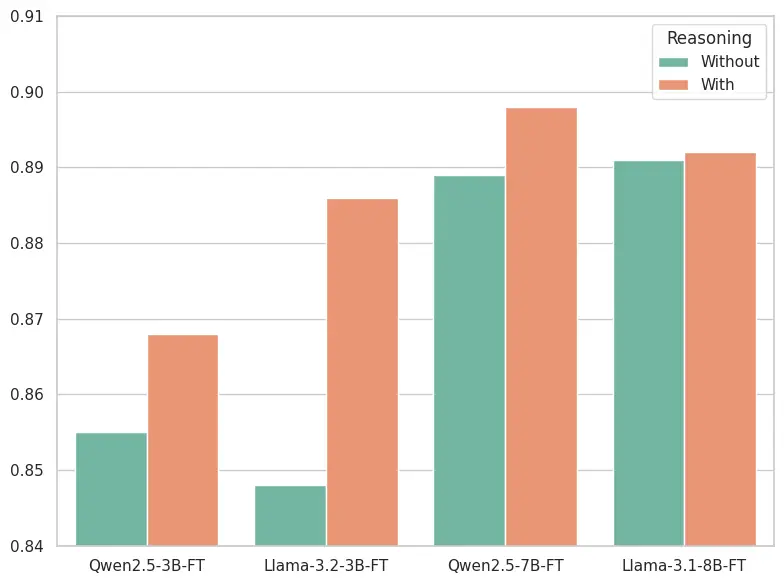
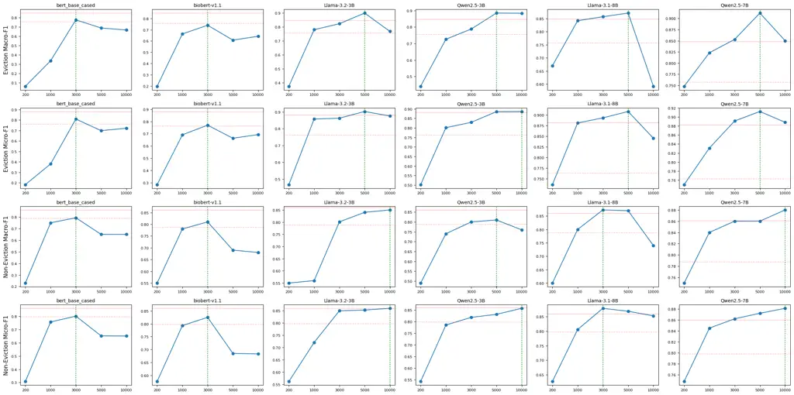
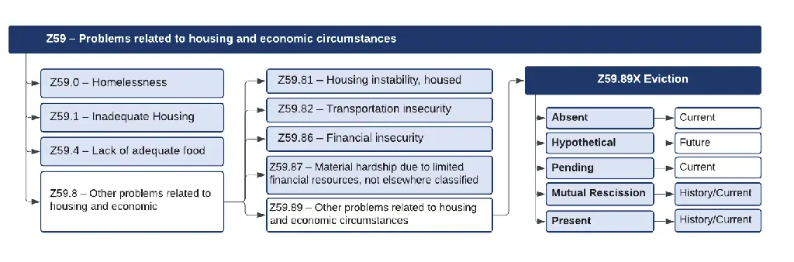
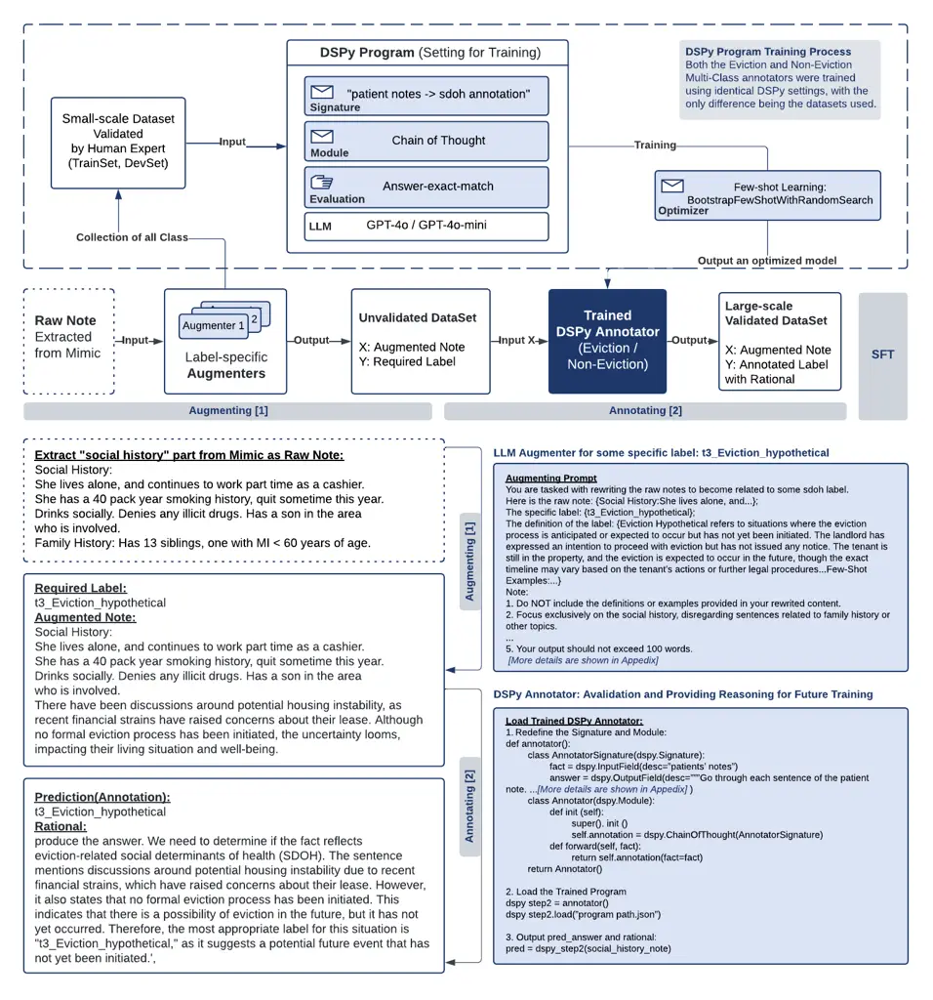
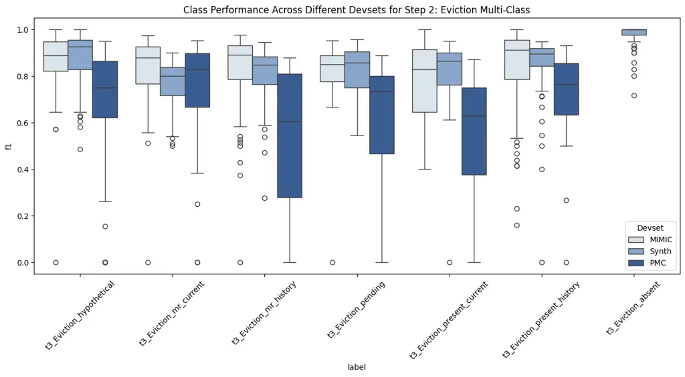

# SynthEHR-Eviction: Enhancing Eviction SDoH Detection with LLM-Augmented Synthetic EHR Data

Zonghai Yao, MSc Affiliation: Center for Healthcare Organization and
Implementation Research, VA Bedford Health Care, MA, USA    Youxia Zhao,
MSc    Avijit Mitra, MSc Affiliation: Center for Healthcare Organization
and Implementation Research, VA Bedford Health Care, MA, USA
Affiliation: Manning College of Information and Computer Sciences, UMass
Amherst, MA, USA    David A. Levy, MD Affiliation: Department of
Medicine, University of Massachusetts Medical School, Worcester, MA, USA
   Emily Druhl, MPH Affiliation: Center for Healthcare Organization and
Implementation Research, VA Bedford Health Care, MA, USA    Jack Tsai,
PhD, MSCP Affiliation: National Center on Homelessness among Veterans,
VA Homeless Programs Office, Washington, DC, USA Affiliation: School of
Public Health, University of Texas Health Science Center at Houston,
Houston, TX, USA Affiliation: Department of Psychiatry, Yale University
School of Medicine, New Haven, CT, USA    Hong Yu, PhD Affiliation:
Center for Healthcare Organization and Implementation Research, VA
Bedford Health Care, MA, USA Affiliation: Manning College of Information
and Computer Sciences, UMass Amherst, MA, USA Affiliation: Department of
Medicine, University of Massachusetts Medical School, Worcester, MA, USA
Affiliation: Miner School of Computer and Information Sciences, UMass
Lowell, MA, USA Affiliation: Corresponding author: Hong Yu
(Hong_Yu@uml.edu) Affiliation: these authors contributed equally to this
work

###### Abstract

Eviction is a significant yet understudied social determinants of health
(SDoH), linked to housing instability, unemployment, and mental health.
While eviction appears in unstructured electronic health records (EHRs),
it is rarely coded in structured fields, limiting downstream
applications. We introduce SynthEHR-Eviction, a scalable pipeline
combining LLMs, human-in-the-loop annotation, and automated prompt
optimization (APO) to extract eviction statuses from clinical notes.
Using this pipeline, we created the largest public eviction-related SDoH
dataset to date, comprising 14 fine-grained categories. Fine-tuned LLMs
(e.g., Qwen2.5, LLaMA3) trained on SynthEHR-Eviction achieved Macro-F1
scores of 88.8% (eviction) and 90.3% (other SDoH) on human validated
data, outperforming GPT-4o-APO (87.8%, 87.3%), GPT-4o-mini-APO (69.1%,
78.1%), and BioBERT (60.7%, 68.3%), while enabling cost-effective
deployment across various model sizes. The pipeline reduces annotation
effort by over 80%, accelerates dataset creation, enables scalable
eviction detection, and generalizes to other information extraction
tasks.

## 1 Introduction

In modern healthcare systems, advancing individualized, whole-person
care and promoting access to comprehensive healthcare and social
services have become key goals of global healthcare movements \[1, 2\].
Beyond clinical indicators, environmental and social actors can also
greatly influence health outcomes. The World Health Organization (WHO)
has recognized the wide ranging influence of social determinants of
health (SDoH) as ”the conditions in which people are born, grow, live,
work, and age,” \[3\] and notes that they contribute to as much as
80%–90% of health outcomes \[4\]. Accurately and systematically
integrating SDoH into clinical decision-making is a critical step toward
achieving personalized care, promoting health and well-being, and
enhancing the effectiveness of public health interventions \[5, 6\]. For
example, individuals who are unstably housed may live in precarious,
unsafe conditions that can affect their physical and mental health \[7,
8\]. Lack of transportation can affect access to healthcare and daily
necessities, such as healthy foods \[9, 10\].

Yet, in current electronic health records (EHRs), SDoH information is
often embedded within unstructured free-text clinical notes, lacking
systematic, structured documentation \[11\]. This results in
”information silos”, where crucial social risk factors are underutilized
in real-world healthcare delivery, limiting clinicians’ ability to
assess patients’ broader health risks and restricting healthcare
institutions and policymakers from designing proactive, targeted
intervention strategies \[12\].

Among various categories of SDoH, eviction is a highly impactful but
long-overlooked factor affecting patient health. Eviction can trigger a
chain reaction of adverse outcomes, including housing instability,
unemployment, homelessness, mental health issues, and long-term poverty
\[13, 14\]. Its impact extends beyond individuals, affecting entire
communities and exacerbating social inequality \[15\]. Studies have
shown that marginalized populations—such as racial minorities, women,
and low-income renters—face a significantly higher risk of eviction
\[16\]. Particularly during the Coronavirus Disease-2019 (COVID-19)
pandemic, eviction was directly associated with over 430,000 additional
cases and more than 10,000 deaths in the United States, prompting the
CDC to enact a federal eviction moratorium between 2020 and 2021 \[17\].
Despite its profound public health implications, the current healthcare
system’s ability to identify and address eviction-related risks remained
severely limited. Mainstream public EHR datasets, such as MIMIC-III
\[18\] and MIMIC-IV \[19\], contain extremely sparse documentation of
eviction-related information, with relevant terms appearing in fewer
than 1 in 1,000 records. Furthermore, standardized coding systems, such
as relying on the International Classification of Diseases, Version 10
(ICD-10), lack specific codes for eviction, contributing to fragmented
and underutilized eviction data in clinical practice \[20\]. Unlocking
and systematically incorporating eviction-related SDoH data can
transform healthcare delivery by enabling comprehensive health risk
assessments, integrating social work, housing support, and psychological
interventions into patient care workflows, and providing real-time,
high-quality data to support targeted public health interventions,
particularly benefiting marginalized populations and advancing
accessible healthcare and social service systems.

In response to these challenges and transformative demands, we develop a
novel, scalable information extraction (IE) pipeline tailored for
eviction-related SDoH annotation. IE has long been a central goal in
clinical NLP \[21\], with traditional approaches relying on rule-based
extraction \[22\] or small model fine-tuning methods \[23\] that are
time-consuming, difficult to scale, and often institution-specific.
Recent advances in large language models (LLMs) have shown promise in
scaling IE development through synthetic data generation and
prompt-based learning \[24\]. These techniques can significantly reduce
annotation costs and improve generalization, yet their use in complex,
underrepresented SDoH domains remains limited \[11, 25, 26\]. Eviction,
as a high-impact but rarely modeled SDoH \[27\], exemplifies the need
for clinically grounded, low-cost annotation solutions.

We introduce SynthEHR-Eviction—a scalable and modular pipeline that
integrates LLM-based data augmentation, automated prompt optimization
(APO) \[28\], and human-in-the-loop (HITL) validation to support
large-scale, consistent annotation. During the augmentation phase,
expert feedback is incorporated to refine prompts and balance label
distributions. For annotation, we adopt the DSPy framework \[29\], which
enables chain-of-thought (CoT) annotation, automated reasoning trace
generation, and fine-grained label refinement. The pipeline involves two
iterative stages: First, the augmenter generates new examples for
underrepresented categories; Second, the annotator verifies and labels
the generated notes while producing structured reasoning. Compared to
full manual rewriting and annotation, this workflow reduces human labor
by over 80% while maintaining high data quality and interpretability.
Moreover, its modular structure generalizes to other SDoH domains such
as food insecurity, utility shutoff, or intimate partner violence
\[30\].

Using this pipeline, we constructed the SynthEHR-Eviction dataset, the
largest publicly available dataset of SDoH related to evictions to date.
It covered 14 carefully defined SDoH categories, including fine-grained
eviction statuses such as ”Eviction Absent,” ”Eviction Pending,” and
”Mutual Rescission History,” (see Table 6) as well as related ICD-10
Z.59 categories like housing instability and homelessness (see Table 7).
In total, the dataset comprises 8,000 synthetic training and development
instances, alongside 616 expert-annotated test instances that encompass
both synthetic and real-world clinical notes, drawn from sources such as
MIMIC-IV \[19\] and PMC-Patients \[31\] (see Table 4). This publicly
available dataset not only fills a critical gap in eviction-related
benchmarks but also demonstrates strong adaptability by enabling the
fine-tuning of open-source LLMs for downstream use. It offers a
practical and efficient foundation for building SDoH recognition systems
and integrating social care into routine clinical workflows.

## 2 Results

|                                                                                                                                       |                                   |                                   |                                  |                                  |
| ------------------------------------------------------------------------------------------------------------------------------------- | --------------------------------- | --------------------------------- | -------------------------------- | -------------------------------- |
| Models                                                                                                                                | Synth                             | Mimic                             | PMC                              | Avg                              |
| Performance Results of Various Models for Step 1: Binary Classification (this is a balanced dataset, so we only report Micro-F1 here) |                                   |                                   |                                  |                                  |
| GPT-4o-mini                                                                                                                           | 0.761 (0.757-0.764) p $`<`$ 0.05  | 0.735 (0.732-0.739) p $`<`$ 0.05  | 0.889 (0.879-0.900) p $`<`$ 0.05 | 0.795 (0.790-0.801) p $`<`$ 0.05 |
| GPT-4o-mini-APO                                                                                                                       | 0.796 (0.781-0.811) p $`<`$ 0.05  | 0.706 (0.653-0.759) p $`<`$ 0.05  | 0.876 (0.860-0.892) p $`<`$ 0.05 | 0.793 (0.770-0.816) p $`<`$ 0.05 |
| GPT-4o                                                                                                                                | 0.880 (0.867-0.894) p $`<`$ 0.05  | 0.860 (0.847-0.872) p $`<`$ 0.05  | 0.839 (0.826-0.851) p $`<`$ 0.05 | 0.859 (0.850-0.869) p $`<`$ 0.05 |
| SynthEHR-Eviction (bert_base_cased)                                                                                                   | 0.976 (0.961-0.991) p $`<`$ 0.01  | 0.821 (0.780-0.861) p $`<`$ 0.05  | 0.857 (0.836-0.878) p $`<`$ 0.05 | 0.885 (0.870-0.899) p $`<`$ 0.05 |
| SynthEHR-Eviction (biobert-v1.1)                                                                                                      | 0.987 (0.979-0.995) p $`<`$ 0.01  | 0.916 (0.890-0.942)               | 0.892 (0.854-0.930) p $`<`$ 0.05 | 0.931 (0.916-0.947)              |
| SynthEHR-Eviction (Bio_ClinicalBERT)                                                                                                  | 0.978 (0.960-0.995) p $`<`$ 0.01  | 0.756 (0.706-0.806) p $`<`$ 0.05  | 0.805 (0.718-0.893) p $`<`$ 0.05 | 0.846 (0.813-0.880) p $`<`$ 0.05 |
| SynthEHR-Eviction (LLama-3.1-8B)                                                                                                      | 0.966 (0.956-0.976) p $`<`$ 0.01  | 0.866 (0.850-0.882) p $`<`$ 0.05  | 0.891 (0.875-0.907) p $`<`$ 0.05 | 0.908 (0.897-0.919) p $`<`$ 0.05 |
| SynthEHR-Eviction (LLama-3.2-3B)                                                                                                      | 0.934 (0.929-0.938)               | 0.868 (0.858-0.877) p $`<`$ 0.05  | 0.824 (0.813-0.834) p $`<`$ 0.05 | 0.875 (0.871-0.879) p $`<`$ 0.05 |
| SynthEHR-Eviction (Qwen2.5-7B)                                                                                                        | 0.963 (0.955-0.981) p $`<`$ 0.01  | 0.912 (0.904-0.920) p $`<`$ 0.05  | 0.891 (0.882-0.900) p $`<`$ 0.05 | 0.922 (0.918-0.926)              |
| SynthEHR-Eviction (Qwen2.5-3B)                                                                                                        | 0.987 (0.976-0.997) p $`<`$ 0.001 | 0.850 (0.840-0.859) p $`<`$ 0.05  | 0.834 (0.820-0.848) p $`<`$ 0.05 | 0.890 (0.884-0.896) p $`<`$ 0.05 |
| GPT-4o-APO (baseline)                                                                                                                 | 0.939 (0.912-0.965)               | 0.938 (0.926-0.949)               | 0.947 (0.936-0.958)              | 0.941 (0.931-0.951)              |
| Performance Results of Various Models for Step 2: Eviction Multi-Class (Macro-F1 shown above, Micro-F1 shown below)                   |                                   |                                   |                                  |                                  |
| GPT-4o-mini                                                                                                                           | 0.337 (0.331-0.343) p $`<`$ 0.05  | 0.238 (0.217-0.260) p $`<`$ 0.05  | 0.243 (0.217-0.269) p $`<`$ 0.05 | 0.273 (0.263-0.283) p $`<`$ 0.05 |
| GPT-4o-mini-APO                                                                                                                       | 0.760 (0.696-0.823) p $`<`$ 0.05  | 0.672 (0.652-0.692) p $`<`$ 0.05  | 0.641 (0.547-0.735) p $`<`$ 0.05 | 0.691 (0.640-0.742) p $`<`$ 0.05 |
| GPT-4o                                                                                                                                | 0.670 (0.629-0.711) p $`<`$ 0.05  | 0.521 (0.502-0.539) p $`<`$ 0.05  | 0.352 (0.302-0.403) p $`<`$ 0.05 | 0.515 (0.489-0.540) p $`<`$ 0.05 |
| SynthEHR-Eviction (bert_base_cased)                                                                                                   | 0.806 (0.790-0.822) p $`<`$ 0.05  | 0.784 (0.734-0.834) p $`<`$ 0.05  | 0.384 (0.248-0.519) p $`<`$ 0.05 | 0.658 (0.604-0.712) p $`<`$ 0.05 |
| SynthEHR-Eviction (biobert-v1.1)                                                                                                      | 0.811 (0.792-0.831) p $`<`$ 0.05  | 0.668 (0.585-0.752) p $`<`$ 0.05  | 0.342 (0.300-0.384) p $`<`$ 0.05 | 0.607 (0.568-0.646) p $`<`$ 0.05 |
| SynthEHR-Eviction (Bio_ClinicalBERT)                                                                                                  | 0.790 (0.762-0.818) p $`<`$ 0.05  | 0.658 (0.630-0.686) p $`<`$ 0.05  | 0.346 (0.321-0.371) p $`<`$ 0.05 | 0.598 (0.584-0.611) p $`<`$ 0.05 |
| SynthEHR-Eviction (LLama-3.1-8B)                                                                                                      | 0.881 (0.820-0.942)               | 0.935 (0.907-0.962) p $`<`$ 0.01  | 0.848 (0.821-0.876)              | 0.888 (0.872-0.904)              |
| SynthEHR-Eviction (LLama-3.2-3B)                                                                                                      | 0.909 (0.895-0.922)               | 0.812 (0.665-0.958)               | 0.801 (0.774-0.828)              | 0.840 (0.784-0.897)              |
| SynthEHR-Eviction (Qwen2.5-7B)                                                                                                        | 0.920 (0.903-0.938)               | 0.939 (0.933-0.944) p $`<`$ 0.001 | 0.804 (0.767-0.842)              | 0.888 (0.869-0.907)              |
| SynthEHR-Eviction (Qwen2.5-3B)                                                                                                        | 0.889 (0.824-0.954)               | 0.850 (0.827-0.873)               | 0.825 (0.745-0.905)              | 0.855 (0.824-0.886)              |
| GPT-4o-APO (baseline)                                                                                                                 | 0.918 (0.912-0.925)               | 0.878 (0.846-0.911)               | 0.836 (0.750-0.923)              | 0.878 (0.842-0.914)              |
| GPT-4o-mini                                                                                                                           | 0.504 (0.496-0.512) p $`<`$ 0.05  | 0.357 (0.331-0.383) p $`<`$ 0.05  | 0.438 (0.410-0.465) p $`<`$ 0.05 | 0.433 (0.421-0.444) p $`<`$ 0.05 |
| GPT-4o-mini-APO                                                                                                                       | 0.840 (0.791-0.889) p $`<`$ 0.05  | 0.772 (0.752-0.792) p $`<`$ 0.05  | 0.681 (0.609-0.754) p $`<`$ 0.05 | 0.764 (0.722-0.807) p $`<`$ 0.05 |
| GPT-4o                                                                                                                                | 0.754 (0.741-0.767) p $`<`$ 0.05  | 0.583 (0.567-0.600) p $`<`$ 0.05  | 0.502 (0.459-0.545) p $`<`$ 0.05 | 0.613 (0.595-0.631) p $`<`$ 0.05 |
| SynthEHR-Eviction (bert_base_cased)                                                                                                   | 0.810 (0.795-0.825) p $`<`$ 0.05  | 0.880 (0.842-0.918)               | 0.444 (0.285-0.603) p $`<`$ 0.05 | 0.711 (0.647-0.775) p $`<`$ 0.05 |
| SynthEHR-Eviction (biobert-v1.1)                                                                                                      | 0.829 (0.790-0.868) p $`<`$ 0.05  | 0.745 (0.700-0.790) p $`<`$ 0.05  | 0.434 (0.289-0.579) p $`<`$ 0.05 | 0.669 (0.603-0.736) p $`<`$ 0.05 |
| SynthEHR-Eviction (Bio_ClinicalBERT)                                                                                                  | 0.791 (0.765-0.818) p $`<`$ 0.05  | 0.775 (0.730-0.820) p $`<`$ 0.05  | 0.390 (0.343-0.437) p $`<`$ 0.05 | 0.652 (0.623-0.682) p $`<`$ 0.05 |
| SynthEHR-Eviction (LLama-3.1-8B)                                                                                                      | 0.906 (0.888-0.923)               | 0.925 (0.909-0.941) p $`<`$ 0.01  | 0.861 (0.834-0.888)              | 0.897 (0.882-0.913)              |
| SynthEHR-Eviction (LLama-3.2-3B)                                                                                                      | 0.908 (0.896-0.921)               | 0.882 (0.848-0.916)               | 0.824 (0.796-0.853)              | 0.871 (0.849-0.893)              |
| SynthEHR-Eviction (Qwen2.5-7B)                                                                                                        | 0.921(0.905-0.938)                | 0.938(0.932-0.945) p $`<`$ 0.001  | 0.824 (0.789-0.860)              | 0.895 (0.877-0.912)              |
| SynthEHR-Eviction (Qwen2.5-3B)                                                                                                        | 0.911 (0.901-0.921)               | 0.853 (0.832-0.875) p $`<`$ 0.05  | 0.857 (0.801-0.914)              | 0.874 (0.856-0.892)              |
| GPT-4o-APO (baseline)                                                                                                                 | 0.909(0.886-0.931)                | 0.883(0.856-0.911)                | 0.868(0.806-0.929)               | 0.886(0.858-0.915)               |
| Performance Results of Various Models for Step 3: Non-Eviction Multi-Class (Macro-F1 shown above, Micro-F1 shown below)               |                                   |                                   |                                  |                                  |
| GPT-4o-mini                                                                                                                           | 0.830 (0.823-0.837) p $`<`$ 0.05  | 0.672 (0.666-0.678) p $`<`$ 0.05  | 0.645 (0.586-0.704) p $`<`$ 0.05 | 0.716 (0.696-0.735) p $`<`$ 0.05 |
| GPT-4o-mini-APO                                                                                                                       | 0.881 (0.875-0.887)               | 0.737 (0.716-0.757) p $`<`$ 0.05  | 0.724 (0.695-0.754) p $`<`$ 0.05 | 0.781 (0.771-0.791) p $`<`$ 0.05 |
| GPT-4o                                                                                                                                | 0.850 (0.838-0.862) p $`<`$ 0.05  | 0.795 (0.769-0.820) p $`<`$ 0.05  | 0.746 (0.713-0.779) p $`<`$ 0.05 | 0.797 (0.782-0.812) p $`<`$ 0.05 |
| SynthEHR-Eviction (bert_base_cased)                                                                                                   | 0.865 (0.858-0.873) p $`<`$ 0.05  | 0.600 (0.486-0.714) p $`<`$ 0.05  | 0.507 (0.303-0.711) p $`<`$ 0.05 | 0.658 (0.581-0.735) p $`<`$ 0.05 |
| SynthEHR-Eviction (biobert-v1.1)                                                                                                      | 0.863 (0.851-0.874) p $`<`$ 0.05  | 0.623 (0.478-0.767) p $`<`$ 0.05  | 0.564 (0.418-0.711) p $`<`$ 0.05 | 0.683 (0.611-0.756) p $`<`$ 0.05 |
| SynthEHR-Eviction (Bio_ClinicalBERT)                                                                                                  | 0.857 (0.847-0.867) p $`<`$ 0.05  | 0.646 (0.601-0.692) p $`<`$ 0.05  | 0.423 (0.395-0.451) p $`<`$ 0.05 | 0.642 (0.631-0.654) p $`<`$ 0.05 |
| SynthEHR-Eviction (LLama-3.1-8B)                                                                                                      | 0.968 (0.962-0.973) p $`<`$ 0.001 | 0.847 (0.821-0.874)               | 0.833 (0.798-0.868)              | 0.883 (0.866-0.900)              |
| SynthEHR-Eviction (LLama-3.2-3B)                                                                                                      | 0.914 (0.840-0.988)               | 0.642 (0.559-0.725) p $`<`$ 0.05  | 0.782 (0.723-0.841) p $`<`$ 0.05 | 0.780 (0.736-0.824) p $`<`$ 0.05 |
| SynthEHR-Eviction (Qwen2.5-7B)                                                                                                        | 0.965 (0.958-0.973) p $`<`$ 0.001 | 0.864 (0.852-0.877)               | 0.879 (0.835-0.923)              | 0.903 (0.888-0.918) p $`<`$ 0.05 |
| SynthEHR-Eviction (Qwen2.5-3B)                                                                                                        | 0.950 (0.942-0.958) p $`<`$ 0.001 | 0.727 (0.646-0.808) p $`<`$ 0.05  | 0.785 (0.749-0.821) p $`<`$ 0.05 | 0.821 (0.787-0.855) p $`<`$ 0.05 |
| GPT-4o-APO (baseline)                                                                                                                 | 0.900 (0.877-0.923)               | 0.850 (0.837-0.863)               | 0.870 (0.827-0.913)              | 0.873 (0.852-0.894)              |
| GPT-4o-mini                                                                                                                           | 0.836 (0.830-0.842) p $`<`$ 0.05  | 0.703 (0.698-0.708) p $`<`$ 0.05  | 0.685 (0.669-0.701) p $`<`$ 0.05 | 0.741 (0.734-0.748) p $`<`$ 0.05 |
| GPT-4o-mini-APO                                                                                                                       | 0.923 (0.904-0.942)               | 0.783 (0.725-0.840) p $`<`$ 0.05  | 0.852 (0.806-0.898)              | 0.852 (0.827-0.878) p $`<`$ 0.05 |
| GPT-4o                                                                                                                                | 0.858 (0.851-0.866) p $`<`$ 0.05  | 0.851 (0.839-0.864) p $`<`$ 0.05  | 0.804 (0.791-0.817) p $`<`$ 0.05 | 0.838 (0.831-0.844) p $`<`$ 0.05 |
| SynthEHR-Eviction (bert_base_cased)                                                                                                   | 0.965 (0.958-0.973) p $`<`$ 0.01  | 0.600 (0.486-0.714) p $`<`$ 0.05  | 0.589 (0.415-0.763) p $`<`$ 0.05 | 0.718 (0.621-0.815) p $`<`$ 0.05 |
| SynthEHR-Eviction (biobert-v1.1)                                                                                                      | 0.963 (0.951-0.974) p $`<`$ 0.01  | 0.623 (0.478-0.767) p $`<`$ 0.05  | 0.604 (0.443-0.765) p $`<`$ 0.05 | 0.730 (0.627-0.833) p $`<`$ 0.05 |
| SynthEHR-Eviction (Bio_ClinicalBERT)                                                                                                  | 0.961 (0.956-0.966) p $`<`$ 0.01  | 0.630 (0.612-0.648) p $`<`$ 0.05  | 0.478 (0.459-0.497) p $`<`$ 0.05 | 0.690 (0.683-0.696) p $`<`$ 0.05 |
| SynthEHR-Eviction (LLama-3.1-8B)                                                                                                      | 0.968(0.963-0.973) p $`<`$ 0.01   | 0.850(0.820-0.880)                | 0.926 (0.910-0.942) p $`<`$ 0.05 | 0.915(0.901-0.929)               |
| SynthEHR-Eviction (LLama-3.2-3B)                                                                                                      | 0.939 (0.917-0.960)               | 0.817 (0.787-0.847) p $`<`$ 0.05  | 0.874 (0.844-0.904)              | 0.876 (0.856-0.897)              |
| SynthEHR-Eviction (Qwen2.5-7B)                                                                                                        | 0.965 (0.958-0.973) p $`<`$ 0.01  | 0.866 (0.854-0.877)               | 0.907 (0.871-0.944)              | 0.913 (0.900-0.925) p $`<`$ 0.05 |
| SynthEHR-Eviction (Qwen2.5-3B)                                                                                                        | 0.951 (0.944-0.959) p $`<`$ 0.01  | 0.800 (0.769-0.831) p $`<`$ 0.05  | 0.837 (0.818-0.856) p $`<`$ 0.05 | 0.863 (0.849-0.877) p $`<`$ 0.05 |
| GPT-4o-APO (baseline)                                                                                                                 | 0.910(0.877-0.943)                | 0.878(0.853-0.904)                | 0.878(0.833-0.922)               | 0.889(0.867-0.911)               |

Table 1: Performance comparison of various models across all steps and
datasets. We report both Macro-F1 and Micro-F1 scores with 95%
confidence intervals for Step 1 (Binary Classification), Step 2
(Eviction Multi-Class Classification), and Step 3 (Non-Eviction
Multi-Class Classification). SynthEHR-Eviction refers to models
fine-tuned using the SynthEHR-Eviction dataset created via our
Augmenter + Annotator pipeline. GPT-4o-APO serves as the baseline for
statistical comparisons in each subtask. Blue cells indicate scores that
are significantly lower than the baseline, orange cells indicate scores
that are not significantly different from the baseline (i.e., at a
similar level as GPT-4o-APO), red cells indicate scores that are
significantly higher than the baseline, and bold underlined values
represent the best performance within each column (i.e., the highest
Micro-F1 or Macro-F1 for that dataset/subtask).

Our experimental results demonstrate several key findings across
different classification tasks.

### 2.1 Step 1: Main Results for Eviction Mention Detection via Binary Classification

As shown in Table 1, the binary classification task—distinguishing
between eviction and non-eviction instances—was relatively
straightforward across all model architectures. GPT-4o, when equipped
with our APO pipeline, consistently achieved the highest F1 scores
across all datasets—0.939 on Synth, 0.938 on MIMIC, and 0.947 on
PMC—with an overall average of 0.941. This clearly outperformed the
vanilla GPT-4o without APO (average: 0.859), highlighting the benefit of
its self-prompt optimization. In contrast, GPT-4o-mini showed no clear
gain from APO, suggesting that this smaller LLM may be less capable of
benefiting from its self-reflective prompt adjustments for this task.

Open-source LLMs fine-tuned on the SynthEHR-Eviction dataset also
demonstrated strong performance. Qwen2.5-7B maintained robust results
across all datasets (Synth: 0.963, MIMIC: 0.912, PMC: 0.891), achieving
an average F1 of 0.922. LLaMA-3.1-8B performed similarly well, with an
average score of 0.908, and achieved particularly strong results on the
Synth dataset (0.966). Although 3B-scale models (e.g., LLaMA-3.2-3B,
Qwen2.5-3B) performed competitively on Synth, they lagged behind on PMC,
indicating that smaller models may struggle with longer or more complex
clinical texts.

BERT-based models fine-tuned with our SynthEHR-Eviction pipeline also
yielded strong results on the Synth dataset. Notably, bert_base_cased
(0.976), biobert-v1.1 (0.987), and Bio_ClinicalBERT (0.978) all
outperformed GPT-4o-APO on this dataset. While their performance was
less consistent on MIMIC (ranging from 0.756 to 0.916) and generally
lower than GPT-4o-APO on PMC, their overall averages remained
competitive. For instance, biobert-v1.1 achieved an average F1 of
0.931—slightly surpassing Qwen2.5-7B. This strong performance is likely
due to the relative simplicity of the binary classification task and the
domain alignment of these biomedical encoders, which are well-suited for
short-span eviction cue detection.

### 2.2 Step 2: Main Results for Multi-Class Classification of Eviction Subcategories

Eviction multi-class classification is substantially more challenging
than binary classification because it requires distinguishing between
seven fine-grained categories of eviction-related social risk. In this
more challenging setup, two strategies demonstrated clear value:
fine-tuning with the SynthEHR-Eviction dataset and DSPy-based automated
prompt optimization.

First, APO brought significant improvements to GPT-4o and GPT-4o-mini.
Since the eviction task is likely not covered in the pretraining corpus
of these closed-source models, this represents a classic cold-start
scenario. For GPT-4o, APO lifted the average Macro-F1 from 0.515 to
0.878 and Micro-F1 from 0.613 to 0.886. Similarly, GPT-4o-mini showed
large gains—Macro-F1 improved from 0.273 to 0.691, and Micro-F1 from
0.433 to 0.764. These results confirm that prompt optimization enables
better task alignment and more reliable multi-class reasoning, even in
the absence of model fine-tuning.

Meanwhile, models fine-tuned on SynthEHR-Eviction achieved competitive
and often stronger performance than the GPT-4o-APO baseline. Qwen2.5-7B
reached a Macro-F1 of 0.920 and a Micro-F1 of 0.921 on the Synth
dataset, slightly surpassing GPT-4o-APO’s 0.918 and 0.909. On MIMIC, it
scored 0.939 (Macro-F1) and 0.938 (Micro-F1), again marginally higher
than GPT-4o-APO’s 0.878 and 0.883. On PMC, Qwen2.5-7B’s performance was
more comparable, with a Macro-F1 of 0.804 vs. 0.836 and Micro-F1 of
0.824 vs. 0.868. Averaged across datasets, Qwen2.5-7B achieved 0.888
(Macro-F1) and 0.895 (Micro-F1), slightly exceeding GPT-4o-APO’s 0.878
and 0.886. LLaMA-3.1-8B also performed robustly, with Macro-F1/Micro-F1
scores of 0.881/0.906 (Synth), 0.935/0.925 (MIMIC), and 0.848/0.861
(PMC), leading to averages of 0.888 and 0.897—again on par with or
better than GPT-4o-APO. Importantly, 3B-scale models such as
LLaMA-3.2-3B and Qwen2.5-3B performed competitively as well, suggesting
that SynthEHR-Eviction enables scalable fine-tuning across model sizes.
These 3B models achieved average Micro-F1 scores of 0.871 and 0.874,
respectively, demonstrating their deployment potential in
resource-constrained environments without sacrificing much performance.

In contrast, BERT-based biomedical models like BioBERT and
Bio_ClinicalBERT struggled to generalize across datasets. Their average
Macro-F1 and Micro-F1 scores remained below 0.70 and 0.72, respectively,
with especially poor results on PMC. This suggests that while these
models may encode biomedical terminology, they lack the representational
flexibility needed for nuanced, fine-grained classification tasks like
eviction status detection.

### 2.3 Step 3: Main Results for Multi-Class Classification of Non-Eviction Subcategories

Unlike the eviction-specific classification in Step 2, the Step 3 task
encompasses a broader range of social risk categories, including
homelessness, housing instability, food insecurity, transportation
insecurity, and others. Many of these categories are commonly documented
in public health and clinical records, making them more familiar to
general-purpose LLMs. This is reflected in the relatively strong
performance of GPT-4o even without APO, which achieved average scores of
0.797 Macro-F1 and 0.838 Micro-F1—significantly higher than its
performance in Step 2.

Nonetheless, prompt optimization continued to enhance closed-source
models. GPT-4o-APO reached 0.873 Macro-F1 and 0.889 Micro-F1, improving
over the non-optimized version. The GPT-4o-mini also benefited from APO,
with Macro-F1 increasing from 0.716 to 0.781, and Micro-F1 from 0.741 to
0.852.

Fine-tuned models based on SynthEHR-Eviction also demonstrated excellent
performance. Most notably, Qwen2.5-7B achieved a Macro-F1 of 0.903 and a
Micro-F1 of 0.913, both significantly outperforming the GPT-4o-APO
baseline (p ¡ 0.05). LLaMA-3.1-8B matched this strong performance with
0.883 and 0.915, respectively. These results highlight that even when
tasks are not strictly “cold-start,” fine-tuning with task-specific
high-quality data remains valuable for enhancing performance.

Encouragingly, 3B-scale models also performed well. Qwen2.5-3B achieved
0.821 (Macro-F1) and 0.863 (Micro-F1), while LLaMA-3.2-3B followed with
0.780 and 0.876, respectively—both clearly surpassing GPT-4o-mini-APO.
These results demonstrate that SynthEHR-Eviction facilitates efficient
scaling, enabling smaller models to reach production-quality performance
without reliance on massive human annotation resources.

Finally, the biomedical BERT variants again underperformed across
metrics (Macro-F1 ¡ 0.69, Micro-F1 ¡ 0.74), with particularly weak
results on MIMIC and PMC. These models may lack the generative
flexibility and contextual reasoning needed for multi-class prediction
across heterogeneous SDoH categories.

In summary, while Step 3 categories are more likely to have been seen
during LLM pretraining, SynthEHR-Eviction still offers substantial
fine-tuning benefits. When combined with its superior performance on
unseen (eviction-specific) categories, this suggests that our solution
serves as a robust and broadly applicable resource for improving SDoH
modeling in both known and novel scenarios.

|              |                                |       |             |       |             |      |             |      |             |
| ------------ | ------------------------------ | ----- | ----------- | ----- | ----------- | ---- | ----------- | ---- | ----------- |
|              |                                | Synth |             | Mimic |             | PMC  |             | Avg  |             |
| Model        | Class                          | MCC   | F1          | MCC   | F1          | MCC  | F1          | MCC  | F1          |
| GPT-4o-APO   | Eviction_absent                | 1.00  | 1.00        |       |             |      |             | 1.00 | 1.00        |
|              | Eviction_hypothetical          | 1.00  | 1.00        | 0.75  | 0.75        | 0.83 | 0.84        | 0.86 | 0.86        |
|              | Eviction_mr_current            | 0.82  | 0.84        | 0.89  | 0.90        | 0.95 | 0.96        | 0.89 | 0.90        |
|              | Eviction_mr_history            | 0.81  | 0.81        | 0.88  | 0.89        | 0.89 | 0.89        | 0.86 | 0.86        |
|              | Eviction_pending               | 0.95  | 0.96        | 0.81  | 0.83        | 0.81 | 0.83        | 0.86 | 0.87        |
|              | Eviction_present_current       | 0.91  | 0.93        | 0.97  | 0.97        | 0.88 | 0.89        | 0.92 | 0.93        |
|              | Eviction_present_history       | 0.94  | 0.94        | 0.97  | 0.98        | 0.95 | 0.96        | 0.95 | 0.96        |
|              | Overall\_(macro_f1 / micro_f1) | 0.92  | 0.93 / 0.93 | 0.88  | 0.89 / 0.89 | 0.88 | 0.89 / 0.90 | 0.89 | 0.90 / 0.91 |
| Llama-3.1-8B | Eviction_absent                | 1.00  | 1.00        |       |             |      |             | 1.00 | 1.00        |
|              | Eviction_hypothetical          | 0.97  | 0.98        | 0.94  | 0.95        | 0.91 | 0.92        | 0.94 | 0.95        |
|              | Eviction_mr_current            | 0.77  | 0.80        | 0.94  | 0.95        | 0.89 | 0.90        | 0.87 | 0.88        |
|              | Eviction_mr_history            | 0.87  | 0.89        | 0.94  | 0.95        | 0.76 | 0.80        | 0.86 | 0.88        |
|              | Eviction_pending               | 0.87  | 0.88        | 0.94  | 0.95        | 0.81 | 0.83        | 0.87 | 0.89        |
|              | Eviction_present_current       | 0.88  | 0.90        | 1.00  | 1.00        | 0.74 | 0.76        | 0.88 | 0.89        |
|              | Eviction_present_history       | 0.91  | 0.92        | 1.00  | 1.00        | 0.85 | 0.87        | 0.92 | 0.93        |
|              | Overall\_(macro_f1 / micro_f1) | 0.89  | 0.80 / 0.91 | 0.96  | 0.97 / 0.97 | 0.82 | 0.85 / 0.85 | 0.89 | 0.87 / 0.91 |
| Llama-3.2-3B | Eviction_absent                | 1.00  | 1.00        |       |             |      |             | 1.00 | 1.00        |
|              | Eviction_hypothetical          | 1.00  | 1.00        | 0.94  | 0.95        | 0.94 | 0.95        | 0.96 | 0.97        |
|              | Eviction_mr_current            | 0.81  | 0.83        | 0.90  | 0.92        | 0.88 | 0.89        | 0.86 | 0.88        |
|              | Eviction_mr_history            | 0.87  | 0.89        | 0.92  | 0.93        | 0.79 | 0.82        | 0.86 | 0.88        |
|              | Eviction_pending               | 0.89  | 0.91        | 0.92  | 0.93        | 0.83 | 0.85        | 0.88 | 0.90        |
|              | Eviction_present_current       | 0.89  | 0.89        | 0.80  | 0.81        | 0.75 | 0.76        | 0.81 | 0.82        |
|              | Eviction_present_history       | 0.91  | 0.92        | 0.92  | 0.93        | 0.89 | 0.91        | 0.91 | 0.92        |
|              | Overall (macro_f1 / micro_f1)  | 0.91  | 0.92 / 0.92 | 0.90  | 0.91 / 0.92 | 0.84 | 0.86 / 0.87 | 0.89 | 0.90 / 0.90 |
| Qwen2.5-7B   | Eviction_absent                | 1.00  | 1.00        |       |             |      |             | 1.00 | 1.00        |
|              | Eviction_hypothetical          | 0.97  | 0.98        | 0.91  | 0.92        | 0.88 | 0.89        | 0.92 | 0.93        |
|              | Eviction_mr_current            | 0.87  | 0.88        | 0.94  | 0.95        | 0.94 | 0.95        | 0.91 | 0.93        |
|              | Eviction_mr_history            | 0.94  | 0.94        | 0.94  | 0.95        | 0.85 | 0.87        | 0.91 | 0.92        |
|              | Eviction_pending               | 0.89  | 0.91        | 0.87  | 0.89        | 0.77 | 0.80        | 0.85 | 0.87        |
|              | Eviction_present_current       | 0.91  | 0.93        | 0.94  | 0.94        | 0.71 | 0.73        | 0.85 | 0.87        |
|              | Eviction_present_history       | 0.91  | 0.92        | 1.00  | 1.00        | 0.88 | 0.90        | 0.93 | 0.94        |
|              | Overall (macro_f1 / micro_f1)  | 0.93  | 0.94 / 0.94 | 0.93  | 0.94 / 0.94 | 0.84 | 0.86 / 0.86 | 0.90 | 0.91 / 0.91 |
| Qwen2.5-3B   | Eviction_absent                | 1.00  | 1.00        |       |             |      |             | 1.00 | 1.00        |
|              | Eviction_hypothetical          | 0.91  | 0.93        | 0.81  | 0.82        | 0.88 | 0.89        | 0.87 | 0.88        |
|              | Eviction_mr_current            | 0.84  | 0.86        | 0.87  | 0.89        | 0.92 | 0.93        | 0.88 | 0.89        |
|              | Eviction_mr_history            | 0.87  | 0.88        | 0.88  | 0.90        | 0.85 | 0.86        | 0.87 | 0.88        |
|              | Eviction_pending               | 0.87  | 0.89        | 0.79  | 0.82        | 0.77 | 0.80        | 0.81 | 0.84        |
|              | Eviction_present_current       | 0.91  | 0.93        | 0.84  | 0.85        | 0.78 | 0.79        | 0.84 | 0.85        |
|              | Eviction_present_history       | 0.91  | 0.92        | 0.95  | 0.95        | 0.92 | 0.93        | 0.92 | 0.93        |
|              | Overall (macro_f1 / micro_f1)  | 0.90  | 0.91 / 0.91 | 0.86  | 0.87 / 0.88 | 0.85 | 0.87 / 0.87 | 0.87 | 0.88 /0.89  |

Table 2: Model performance comparison across different datasets (Synth,
Mimic, PMC) with MCC and F1 scores (including Macro-F1 and Micro-F1 in
Overall) for each eviction class. Results present four models:
GPT-4o-APO, Llama-3.1-8B-FT, Llama-3.2-3B-FT, Qwen2.5-7B-FT, and
Qwen2.5-3B-FT, with overall average metrics. Note that ”Eviction_absent”
appears exclusively in the Synth dataset as it functions as a critical
negative class that establishes decision boundaries between
eviction-relevant and irrelevant content during model training. Mimic
and PMC datasets deliberately omit this class to focus evaluation
specifically on discrimination capabilities between different positive
eviction scenarios. Importantly, this omission is not due to data
scarcity. On the contrary, most real-world clinical notes in MIMIC and
PMC would fall under the ”Eviction_absent” category. However, including
such easy negatives would inflate overall accuracy and obscure the
model’s ability to distinguish among nuanced positive classes, so they
were excluded by design.

### 2.4 Class Performance Variations Across Eviction Categories

Table 2 reports the class-wise performance of five models—GPT-4o-APO,
Llama-3.1-8B, Llama-3.2-3B, Qwen2.5-7B, and Qwen2.5-3B—on seven nuanced
eviction-related categories across three datasets (Synth, Mimic, PMC).
These classes vary in eviction status (e.g., present, pending,
hypothetical), legal framing (e.g., mutual rescission), and temporal
cues (e.g., current vs. history).

All models achieved perfect classification (F1 = 1.00) on
Eviction_absent in the Synthetic dataset. This class was excluded from
Mimic and PMC to prevent dominance of trivial negatives and to emphasize
the model’s ability to differentiate among positive cases.

Eviction_hypothetical, representing projected or threatened eviction,
posed moderate challenges. GPT-4o-APO reached an average F1 of 0.86,
while several fine-tuned open-source LLMs—specifically Qwen2.5-7B and
Llama-3.2-3B—surpassed this benchmark with Synth scores of 0.98 and
1.00, and solid generalization in Mimic (0.92 and 0.95), highlighting
the benefit of domain-specific fine-tuning on SynthEHR-Eviction.

Eviction_mr_current and Eviction_mr_history, which capture mutually
agreed lease terminations, were consistently well-handled. Qwen2.5-7B-FT
achieved 0.93 and 0.92 on Macro-F1 and Micro-F1, respectively, slightly
outperforming GPT-4o-APO (F1 = 0.90 and 0.86). Notably, fine-tuned 3B
models also maintained high accuracy in these categories (F1 is about
0.88), suggesting strong transfer of structured legal signals even in
smaller models after fine-tuning.

Eviction_pending, indicating formal but unresolved eviction processes,
remained somewhat ambiguous. Qwen2.5-7B and Llama-3.1-8B achieved F1 =
0.91 and 0.95 in Synth and Mimic respectively, surpassing GPT-4o-APO’s
average of 0.87. However, smaller models showed more variance across
datasets, especially in PMC.

Eviction_present_current and Eviction_present_history, which rely on
subtle differences in recency and documentation of completed evictions,
remained the most challenging. In PMC, for example, Llama-3.1-8B dropped
to 0.76 on ”present_current”, while GPT-4o-APO maintained a stronger F1
of 0.93. These results highlight that while fine-tuned LLMs can excel in
categories grounded in legal constructs, temporal ambiguity still
presents difficulties.

In summary, class-level comparisons reveal that fine-tuned open-source
LLMs—especially Qwen2.5-7B and Llama-3.2-3B—can match or exceed
GPT-4o-APO in multiple eviction categories after training on
SynthEHR-Eviction. Larger models (7B/8B) showed better generalization
across datasets, while smaller models (3B) still offered strong
performance on well-defined categories. GPT-4o-APO provided a
competitive baseline with consistent performance across the board,
though not uniformly superior to well-trained open models.

Figure 1: Performance comparison of LLMs trained with and without
reasoning annotations on the Eviction Multi-Class task.

### 2.5 Impact of Reasoning in Training Data

To evaluate the effect of explicit reasoning annotations in training
data, we prepared two versions of each model’s training set: one with
reasoning explanations and one without, keeping the labels identical. As
shown in Figure 1, smaller models benefit more noticeably from reasoning
annotations. For instance, Llama-3.2-3B-FT improved from 0.848 to 0.886
(+3.8), and Qwen2.5-3B-FT improved from 0.855 to 0.868 (+1.3). In
contrast, larger models like Qwen2.5-7B-FT and Llama-3.1-8B-FT
maintained stable performance with or without reasoning, with minimal
differences (less than 0.01). These findings suggest that the reasoning
annotations generated through the SynthEHR-Eviction pipeline can provide
varying degrees of structured guidance, especially for smaller models
that benefit from clearer decision logic in complex classification
tasks. Additionally, models trained with these annotations are capable
of generating their own reasoning during inference, improving
transparency and interpretability. This makes them more amenable to
expert review and downstream validation, moving beyond black-box
eviciton prediction.

Figure 2: Impact of training set size on model performance across
eviction and non-eviction classification tasks. Each subplot illustrates
how model performance varies with different training set sizes (x-axis)
across four classification scenarios: eviction (top two rows) and
non-eviction (bottom two rows), evaluated using two metrics—Macro-F1
(first and third rows) and Micro-F1 (second and fourth rows). The y-axis
represents the corresponding F1 score. Green vertical dashed lines
indicate the training data size at which each model achieves its highest
performance. Red solid and Red dashed horizontal lines denote the
performance of GPT-4o-APO and GPT-4o-mini-APO, serving as a reference
here.

### 2.6 Training Data Size Impact on Finetuning

To examine how training data size affects model performance, we
conducted systematic experiments on two traditional BERT-based models
(BERT and BioBERT) and four open-source LLMs (two 3B-scale and two
7B/8B-scale LLMs). We evaluated both the Eviction Multi-Class and
Non-Eviction Multi-Class tasks using training datasets of varying sizes
(200 to 10,000 samples) and reported both Macro-F1 and Micro-F1 scores
(Figure 2).

Across both tasks, models demonstrated substantial gains when the
training data was increased from 200 to 3,000 samples. For instance,
Qwen2.5-7B improved its Macro-F1 on the Eviction task from 0.748 to
0.853, and on the Non-Eviction task from 0.75 to 0.891. Similarly,
LLaMA-3.1-8B increased from 0.670 to 0.857 (Eviction) and from 0.736 to
0.893 (Non-Eviction). Performance gains typically plateaued beyond 5,000
samples, and several models exhibited signs of overfitting at 10,000
samples. For example, Qwen2.5-7B reached its peak Macro-F1 of 0.912 on
the Eviction task at 5,000 samples, then dropped to 0.850 at 10,000
samples.

Optimal dataset sizes varied by task. For Step 2 (Eviction), LLMs such
as Qwen2.5-7B required larger datasets to reach optimal performance
(e.g., 0.912 Macro-F1 at 5,000 samples). In Step 3 (Non-Eviction), most
models converged earlier, reaching their peak performance around 3,000
samples (e.g., Qwen2.5-7B at 0.891).

For practical fine-tuning, training with 3,000–5,000 samples provides a
strong balance between performance and efficiency, since several LLMs
trained on just 3,000–5,000 samples reached performance levels
comparable to GPT-4o-APO. Accordingly, we used 5,000 samples for LLMs
and 3,000 samples for traditional BERT models in Step 2. For Step 3, we
used 3,000 samples for both model types, as performance had largely
converged at this size.

## 3 Discussion

Eviction is a critical yet underrepresented SDoH, associated with
cascading adverse outcomes such as homelessness, chronic stress, and
emergency care overuse \[13, 14, 32, 15, 17, 27\]. While prior NLP
efforts have focused on broader housing-related issues, such as
homelessness or housing instability \[11, 26\], the status of eviction
has been largely neglected in public clinical datasets and benchmarks.
Only very recently has this issue received direct attention—for
instance, Yao et al. (2023) introduced an eviction classifier trained on
a private Veterans Affairs dataset \[27\]. To help fill this gap, we
present SynthEHR-Eviction: a scalable and clinically grounded data
generation pipeline that produces high-fidelity, eviction-labeled
clinical notes aligned with real-world documentation practices. The
pipeline combines LLM-based data augmentation, automated prompt
optimization, and human-in-the-loop validation to synthesize
instruction-style notes paired with labels derived from ICD-10 Z59 codes
(e.g., Z59.0–Z59.9, covering housing and economic instability). This
label schema enhances semantic precision and interoperability with
structured health data systems \[20, 11\]. Furthermore, our taxonomy
goes beyond binary classification by capturing nuanced eviction
subtypes—such as pending status, mutual rescission, and temporal
distinctions (e.g., current vs. history)—allowing for more accurate
model training and more actionable risk detection. By releasing both the
annotated dataset and labeling guidelines, we support the development
and evaluation of eviction-aware NLP tools that generalize across
institutions and reflect realistic documentation variability.

One of the most practical contributions of SynthEHR-Eviction lies in its
efficiency: it dramatically reduces the human effort required to
construct large-scale, high-quality annotated datasets. Manual
annotation of complex SDoH categories—particularly those like eviction
that involve temporal ambiguity, legal framing, and implicit cues—is
notoriously labor-intensive. In our controlled study, full manual
rewriting of 8,000 EHR notes took over 266 hours, and even direct
annotation of labels consumed 33 hours. In contrast, our GPT-assisted,
human-in-the-loop workflow—with targeted prompt engineering, batch
validation, and automated reasoning trace generation—achieved comparable
data quality with less than 6 hours of human effort, representing an
over 80% reduction in annotation time. These findings align with recent
work showing the scalability and reliability of weak supervision,
prompt-based augmentation, and LLM-powered data generation in other
domains \[33, 34, 35, 36\]. More importantly, our pipeline offers
structured reasoning alongside each label, allowing smaller models to
learn decision rationales explicitly—an advantage not typically found in
weakly labeled or distant supervision setups. Because the pipeline is
built on modular components (e.g., task-adaptive prompt optimization,
reasoning-based CoT supervision, and human verification loops), it
generalizes to other low-resource SDoH domains where fine-grained
annotation is scarce but clinically significant (e.g., utility shutoff,
food insecurity, or intimate partner violence). As large-scale clinical
NLP increasingly shifts toward low-cost, explainable, and
domain-adaptable solutions, SynthEHR-Eviction provides a blueprint for
scaling up dataset construction without compromising semantic depth or
real-world alignment \[11, 30\].

To systematically evaluate model generalization in eviction-related SDoH
classification, we tested performance across three distinct clinical
datasets—Synth, MIMIC, and PMC—that vary substantially in linguistic
style, narrative density, and documentation patterns (Table 9). Our
results reveal a consistent domain shift: models achieved their highest
performance on the synthetic data (Synth), performed moderately on
real-world EHRs (MIMIC), and worst on academic case reports (PMC). While
all three datasets adopt instruction-style formatting, they differ in
vocabulary, structure, and contextual framing of eviction signals. The
Synth dataset, generated using our LLM-based pipeline, closely mirrors
the model’s generation style and served as the primary training source,
explaining its strong in-domain performance. In contrast, MIMIC
notes—written by clinicians—feature more heterogeneous phrasing (e.g.,
“forced to remove from the rented house”) and exhibit subtle lexical
shifts. The PMC notes pose the greatest challenge, as eviction
information is often deeply embedded in long diagnostic narratives and
may only appear incidentally in unrelated sections, requiring
fine-grained relevance detection and temporal disambiguation (As shown
in Table 9). This distributional mismatch explains the observed drop in
generalization: for example, Qwen2.5-7B’s Macro-F1 fell from 0.920
(Synth) to 0.804 (PMC). These findings are consistent with prior SDoH
extraction studies documenting performance degradation when models are
evaluated on free-text narratives \[25, 37, 38\]. Notably, a simple data
composition intervention—replacing just 30% of synthetic training data
with real PMC notes—led to substantial gains in out-of-domain
performance. On the PMC portion of the Step 2 task, Qwen2.5-7B’s
Micro-F1 improved by +0.302 (Table 5). This result reinforces a growing
consensus in clinical NLP: while synthetic data offers scale and
control, it is insufficient on its own for achieving robust
generalization. Incorporating even a small proportion of real-world
examples into training is essential for building models that transfer
reliably to naturalistic clinical settings \[11\]. Moreover, because
SynthEHR-Eviction spans synthetic and real-world document styles, it
enabled us to evaluate how different model families generalize across
varied clinical documentation settings. On the challenging PMC
multi-class classification task, a general-domain LLaMA-3.1-8B model
achieved a Micro-F1 of 0.861, while the BERT-base-cased model fell to
just 0.444—a difference of over 40 percentage points. This substantial
gap underscores LLMs’ superior ability to handle diverse and noisy
clinical narratives, likely due to their larger parameter counts,
broader pretraining corpora, and emergent reasoning capabilities \[11\].
These findings are in line with recent benchmarks showing that
state-of-the-art LLMs, such as GPT-4 and Flan-T5-XXL, consistently
outperform domain-specific biomedical models like BioBERT and
ClinicalBERT across SDoH extraction and other fine-grained clinical NLP
tasks \[39, 11\]. However, we also recognize that LLM deployment in
real-world settings presents nontrivial challenges: inference latency,
compute costs, and limited GPU infrastructure may hinder adoption in
under-resourced health systems \[40\]. Thus, future work should explore
hybrid strategies such as model distillation, dynamic inference control,
or task-specific adapter modules to achieve a more practical balance
between performance and feasibility. A nuanced understanding of this
tradeoff is critical to ensuring that SDoH-aware NLP tools are not only
accurate but also equitable and deployable at scale.

Our fine-grained eviction label schema—distinguishing between categories
such as Eviction_present_current and Eviction_present_history—allowed us
to examine one of the most persistent challenges in clinical NLP:
temporal reasoning errors arising from implicit event timelines in
free-text notes. Temporal ambiguity emerged as a consistent source of
classification error during model evaluation. A closer inspection of
eviction status classification errors (Cases 1 and 2, Table 12) reveals
a critical challenge: the models’ difficulty in distinguishing between
historical and current eviction events due to implicit temporal
ambiguities in clinical notes. In Case 1, the phrase ”resides now”
prompted the Llama-3.1-8B model to incorrectly classify a historical
eviction (Eviction_present_history) as ongoing
(Eviction_present_current). Conversely, in Case 2, the model incorrectly
labeled a recent eviction (”two months ago”) as historical, heavily
influenced by the initial lexical cue ”history,” despite the explicit
recent temporal context. These bidirectional error patterns emphasize
temporal ambiguity, where historical events can have ongoing impacts or
be conflated with current circumstances. Notably, our observations align
with known challenges in clinical NLP: reasoning about the timing of
events in narratives is difficult for models to accurately capture
\[41\]. Even advanced LLMs have been reported to struggle with temporal
relation extraction, performing worse than fine-tuned models and showing
inconsistent handling of event order. This persistent ambiguity has been
documented since earlier efforts, such as THYME \[42\] and the Clinical
TempEval challenges \[43\], and remains a focus of current research. Our
findings reinforce that temporal context (e.g., distinguishing a
resolved eviction in the past from a patient’s current housing crisis)
is a critical source of error. Future improvements may require
incorporating explicit temporal tagging or leveraging note
timestamps—potentially guided by recent time-aware training frameworks
\[44\]—to help models disambiguate event timelines. Addressing these
temporal reasoning issues is vital, as accurately determining whether an
eviction is ongoing or historical is crucial for effective risk
assessment and intervention.

We also explored the use of structured reasoning annotations—i.e.,
chain-of-thought explanations provided during training—to examine their
utility in enhancing model performance and interpretability,
particularly for smaller, resource-efficient models. Our experiments
showed that smaller models benefit disproportionately from this form of
supervision: LLaMA-3.2-3B improved by +3.8 Macro-F1 and Qwen2.5-3B by
+1.3, compared to their counterparts trained on labels alone. In
contrast, larger models (Llama-3.1-8B, Qwen2.5-7B) showed minimal
improvements under the same setup, indicating that extensive pretraining
had already endowed them with strong inherent reasoning abilities. These
findings are consistent with prior observations on chain-of-thought
prompting \[45\]: smaller models often struggle to exhibit complex
reasoning capabilities unless explicitly guided, while larger models
tend to benefit less from such supervision. SynthEHR-Eviction
operationalizes this insight by pairing each label with interpretable
reasoning traces, allowing smaller models to learn not just what the
correct answer is, but why it is correct. Our results reinforce this
trend, demonstrating that reasoning-guided training can substantially
improve the performance of smaller models, while offering limited
additional value for larger ones. This performance disparity helps
explain why our 3B-scale models required explicit reasoning supervision
to accurately distinguish fine-grained eviction categories, while the
7–8B models performed comparably well without it. Qualitative analysis
further supports this conclusion. In Case 3 (Table 12), the Llama-3.2-3B
model trained with reasoning annotations correctly classified a complex
eviction situation as Eviction_pending, clearly articulating the active
and unresolved nature of the eviction process. In contrast, the same
model trained without reasoning annotations misclassified the scenario
as Eviction_present_current, failing to capture the subtle temporal and
procedural cues. This example illustrates how structured reasoning
guidance can help smaller models develop more precise and interpretable
decision boundaries in semantically challenging cases. From a deployment
perspective, these results highlight the practical value of reasoning
annotations in improving both the performance and interpretability of
smaller, more resource-efficient models \[46\]. By leveraging the
reasoning-enhanced supervision provided in SynthEHR-Eviction, smaller
models can match or exceed the performance of much larger LLMs, while
remaining compatible with edge deployments and low-resource clinical
infrastructures. This is particularly relevant in real-world clinical
environments where compute budgets are constrained, such as community
hospitals, mobile health units, or edge devices operating in
under-resourced settings \[40\]. Reasoning-augmented training, as
implemented in our pipeline, thus enables scalable and equitable NLP
solutions for SDoH extraction.

While structured reasoning annotations improved model transparency, our
evaluation further revealed limitations in reasoning fidelity—that is,
whether a model’s explanation faithfully reflects its underlying
decision process. Our case studies (Cases 4–6, Table 13) revealed
interpretability challenges even when the final classification was
correct. In several instances, the model produced an explanation that
was partially incorrect or conceptually misaligned, despite outputting
the right label. For example, the Llama-3.1-8B model correctly labeled a
case as Eviction_mr_current (mutual rescission current), but its
explanation erroneously stated that the mutual lease rescission was
unrelated to eviction, indicating a misunderstanding of the concept
(Case 4). In another case (Case 5), the model correctly identified the
eviction as Eviction_pending but described it using language that
suggests a historical context (“so we will label it as ‘history’”),
which deviates from the annotation guidelines. Similarly, a note
properly labeled as Eviction_present_current was explained as if the
eviction process were still ongoing, failing to recognize it had been
completed. These examples demonstrate that the presence of a reasoning
chain does not guarantee its fidelity—that is, alignment with the
model’s actual decision boundary or reasoning strategy. Recent studies
\[47, 48\] on LLM explainability have similarly noted that models often
generate plausible-sounding rationales that are not fully faithful to
their internal computations, or even inconsistent with their final
outputs. In other words, an AI can be “right for the wrong reasons,”
\[49, 50, 51\] as seen in our case analyses. This reinforces the need
for rigorous human oversight and domain-informed evaluation when
reasoning annotations are used for interpretability. SynthEHR-Eviction
provides such a platform, where both correctness and explanation quality
can be jointly assessed. Our findings echo growing efforts to measure
and improve the faithfulness of chain-of-thought explanations in LLMs
\[52\]. Ensuring that the model’s explanations are not only present but
also correct and useful is an important direction for future work,
especially in high-stakes clinical applications \[53\]. This aligns with
broader efforts in clinical NLP to reduce hallucinations and improve
factual alignment in model-generated outputs \[54, 55, 56, 57\].
Continual refinement of the reasoning templates and collaboration with
clinical experts will be needed to close these gaps \[51, 50\].

Finally, our experiments suggest that model performance tends to level
off between 3,000 and 5,000 training examples, with little
improvement—and in some cases, slight overfitting—when more data is
added. This threshold may reflect either the high informational density
of our pipeline-generated data, where critical semantic cues are
well-covered early, or diminishing marginal returns from increasingly
repetitive synthetic notes. These hypotheses warrant further
investigation. Nonetheless, our results suggest that 3,000–5,000
examples may offer a practical trade-off between data curation effort
and fine-tuning performance for this task.

While our results demonstrate the promise of SynthEHR-Eviction, several
limitations remain. First, the synthetic training data, although
grounded in real EHR patterns, may not capture the full variability and
sociolinguistic nuance found in actual clinical documentation across all
institutions and populations. This raises potential concerns about
distributional bias and overfitting to synthetic patterns. Second, we
did not exhaustively explore all methods for generating synthetic data.
We focused on prompt optimization and high-precision augmentation
strategies that are reproducible and low-cost, which may exclude
higher-recall alternatives. Third, although the initial results are
promising, additional clinical validation will be necessary to establish
the model’s performance in real-world environments. Finally, as with any
annotation effort, the quality of the output is contingent upon the
guidelines and decisions of human annotators. Even with structured
reasoning supervision, SDoH annotation remains a complex task subject to
ambiguity and inter-annotator variability. Future work should
investigate how to balance synthetic and real data, address biases
introduced by LLM pretraining, and assess the downstream utility of
eviction detection in improving health outcomes and promoting equity.

Taken together, SynthEHR-Eviction provides a scalable and clinically
grounded foundation for enhancing the detection of eviction-related SDoH
in unstructured clinical notes. With its structured reasoning
supervision, domain-diverse testbed, and interpretable outputs, the
benchmark is particularly well-suited for evaluating and refining NLP
models in socially sensitive, high-stakes settings. Beyond its
methodological contributions, SynthEHR-Eviction introduces two broadly
applicable design principles—domain-specific abstraction and
task-aligned supervision—that can be extended to other underrepresented
SDoH domains, such as legal hardship or caregiving burden. Its automated
and modular pipeline supports low-cost construction of semantically rich
datasets, enabling scalable integration of diverse social contexts into
downstream clinical NLP applications. For example, when applied to AI
hospital simulations, these SDoH-aware datasets can enrich the
behavioral profiles of patient agents \[58\], making model evaluations
more holistic and socially grounded. By openly releasing our dataset,
annotation schema, and reasoning templates, we further promote
transparency, reproducibility, and community adoption. From a deployment
perspective, the inclusion of structured reasoning outputs facilitates
integration into real-world clinical workflows. For instance, coupling
an “eviction risk” flag with a concise model-generated rationale could
help social workers and care teams quickly interpret and act upon risk
signals. With appropriate clinical validation, such NLP-based
surveillance tools could be integrated into existing national
infrastructures, such as the U.S. Veterans Affairs data ecosystem, where
they would complement structured resources like the Homelessness
Management Information System (HOMES) and enhance population-level
dashboards such as USVETS, as demonstrated by our previous nationwide
study on NLP-identified eviction rates among over 7 million veterans
\[59\]. Other studies have shown that enriching structured fields with
NLP-derived factors improves the identification of at-risk patients
\[11\]. In this context, SynthEHR-Eviction could help operationalize
timely referrals to social services, housing aid, or financial
counseling—interventions that may avert escalation to homelessness or
emergency medical crises. By enabling early and interpretable surfacing
of eviction risk, SynthEHR-Eviction bridges a critical gap between
clinical documentation and actionable care pathways. The structured
rationales it produces not only improve transparency but also build
clinician trust, two requirements for safe deployment in health systems.
Looking forward, we envision this work as a stepping stone toward
broader SDoH-focused informatics innovations, including fine-grained
ICD-Z code modeling, hybrid symbolic–neural architectures for social
reasoning, and equitable NLP systems tailored to population health.
Ultimately, SynthEHR-Eviction demonstrates how modern LLM pipelines can
be adapted to low-resource, high-impact clinical domains, advancing the
broader agenda of embedding social medicine into the digital
infrastructure of healthcare—a direction that is increasingly central to
both health equity and precision public health.

## 4 Methods

As illustrated in Figure 4, our approach focuses on developing a highly
effective and reusable pipeline for multi-class annotation, which can be
adapted to other SDoH annotation tasks. In this study, eviction serves
as the primary experimental focus, showcasing the pipeline’s ability to
generate high-quality annotations across multiple eviction-related
categories. The system is divided into three primary components: a
training process for DSPy, data augmentation pipeline, and annotation
system. The training process utilizes a small-scale human-validated
dataset to optimize the DSPy program; the data augmentation pipeline
generates labeled samples from raw clinical records; and the annotation
system applies the trained models to classify augmented data and provide
reasoning.

### 4.1 Data Augmentation Pipeline

#### 4.1.1 Raw Note Extraction

We selected over 30,000 discharge notes from the MIMIC-III and MIMIC-IV
databases. The selection criteria focused on notes that contained a
”social history” section. This was based on our observation that most
descriptions of patients’ social circumstances—such as housing,
financial status, and other social determinants—were concentrated within
this part of the discharge notes. We then extracted the ”social history”
section from each note, using it as the raw note input for further
augmentation.

#### 4.1.2 Data Construction

Based on SDoH data with ICD-10-CM Z Codes \[20\], we categorize eviction
as a new SDoH, classified under Z59.89, which addresses problems related
to housing and economic circumstances. This classification positions
eviction alongside other related classes under the Z59 category, as
illustrated in Figure 3.

We classify eviction-related categories into 7 specific ones based on
two key factors: presence (Absent, Hypothetical, Present, Pending,
Mutual Rescission (MR)) and period (Current, History, Future)\[27\]:

- •
  Eviction Absent: No history or indication of eviction.
- •
  Eviction Present History, Eviction Present Current: Eviction has
  already been completed. ”Current” refers to ongoing eviction impacts
  within the current natural year, not related to eviction. ”History”
  refers to past without a specific time or that occurred more than one
  year ago.
- •
  Eviction Hypothetical: Refers to possible eviction based on
  hypothetical scenarios.
- •
  Eviction Pending: Eviction has been noticed but is not yet completed.
- •
  Eviction MR History, Eviction MR Current: MR is a legal agreement
  between the landlord and tenant to terminate a lease.

In addition to eviction-related categories, we included tier 1
categories: Homelessness (Z59.0), Inadequate housing (Z59.1) and Lack of
adequate food (Z59.4). We also incorporated tier 2 categories including
Housing instability (Z59.81), Transportation insecurity (Z59.82),
Financial insecurity (Z59.86), and Material hardship (Z59.87).

In total, we defined 14 classes. For each class, experts provided
precise definitions and a few-shot examples to guide data augmentation.
The detailed definitions and examples for each category can be found in
the Appendix Table 6 and 7.

Figure 3: Relationships between Eviction and other housing and economic
challenges, providing a comprehensive framework for understanding its
broader implications within the SDoH context.

Figure 4: A complete DSPy-based system for training annotators to
identify potential eviction cases from clinical notes. Upper Section
(Training Process): A small-scale human-validated dataset feeds into the
DSPy Program training process, which employs GPT-4 or GPT-4o-mini
models. The framework uses Chain of Thought reasoning and
answer-exact-match evaluation, with few-shot learning optimization to
produce a trained annotator model. Lower Section (Pipeline Flow):
Augmentation Stage \[1\]: Raw clinical notes extracted from MIMIC
database undergo augmentation through label-specific augmenters to be
the augmented notes dataset. Annotation Stage \[2\]: The trained DSPy
Annotators (supporting Eviction/Non-Eviction classification separately)
processes these augmented notes, outputting a large-scale validated
dataset with annotated labels and accompanying rationales. Bottom
Section (Examples) demonstrates a sample augmentation process for the
t3_Eviction_hypothetical label and a detailed DSPy Annotator
implementation and output format. Quality Control: The example shown
represents a case where the annotated label matches the required label
from augmentation, allowing direct inclusion in the final validated
dataset. However, the system also handles annotation inconsistencies: If
the annotated label differs from the required label, the system performs
two additional annotation passes. When all three annotation outputs are
consistent, the case is included in the final dataset with the annotated
label (even if different from the original augmented label). If
annotation outputs remain inconsistent, the case is discarded from the
current validation cycle and the augmented note is returned to the raw
note pool for potential future use. The entire framework maintains
consistent settings across both Eviction and Non-Eviction Multi-Class
annotators, with the only difference being the specific datasets used
for training and test.

#### 4.1.3 Augmenter Construction Process

As shown in Algorithm 10, we systematically developed an augmenter for
each SDoH class. An augmenter in our context is essentially an LLM
enhanced with an optimized prompt. Once the prompt is fully optimized,
the augmenter takes raw notes as input and generates augmented notes
that accurately reflect the target SDoH class.

For every SDoH class, the process starts by defining the SDoH category
and providing raw notes to guide the LLM in generating relevant
augmented notes.

HITP Evaluation: The output generated by the augmenter in each iteration
undergoes human verification. Human experts verify if each output note
accurately reflects the target SDoH. Verified notes are added to the
augmented dataset, while incorrect outputs are logged with feedback.

Assessment of Performance: Accuracy is calculated as the proportion of
correct annotations out of total outputs. If accuracy exceeds 90%, the
augmenter is deemed successful for that class. For augmenters not
meeting the accuracy threshold, incorrect cases and feedback are
returned to the LLM. The feedback is used to refine the prompt. The
updated prompt is re-evaluated, and the cycle continues until the
accuracy criterion is satisfied.

We conducted three optimization rounds to finalize augmenters for all 14
SDoH classes. For classes with clear distinctions and well-defined
criteria (e.g., Tier 1 and Tier 2 SDoH categories), most augmenters
reached the desired accuracy within a single iteration. For
eviction-related classes, which involved finer granularity and ambiguous
definitions, multiple iterations were required. This iterative process
significantly improved the accuracy and reliability of the augmenters.

Each finalized augmenter demonstrated the capability to consistently
generate augmented notes reflecting the target SDoH class. The optimized
prompts for all classes are available in the Appendix.

### 4.2 DSPy Annotator Setting and Training Process

Inspired by the systematic survey of APO techniques \[28\], the
practical implementation of APO via DSPy \[29\], and our prior work
demonstrating structured prompt optimization in healthcare settings
\[60\], we design our annotator module as a critical component to ensure
precise and efficient classification of notes into multiple SDoH
categories.

#### 4.2.1 Annotator Setup and Design

The dataset contains overlapping categories, particularly between Tier
1, Tier 2, and eviction-related classes. For instance, eviction can lead
to homelessness or financial insecurity can lead to eviction, causing
ambiguity in multi-class annotation. To address these overlaps, we first
used a binary classification to determine whether content is related to
eviction, and then divided the dataset into two groups, corresponding to
three separate annotators, as outlined in Algorithm 10. The second
annotator handles notes related to eviction-specific categories,
including the following 7 labels: Eviction Absent, Eviction Present
History, Eviction Present Current, Eviction Hypothetical, Eviction
Pending, Eviction MR History, Eviction MR Current. The third annotator
manages notes that do not directly pertain to eviction, covering the
remaining 7 labels: Homelessness, Inadequate Housing, Lack of Adequate
Food, Housing Instability, Transportation Insecurity, Financial
Insecurity, and Material Hardship. This division ensures better class
separation and significantly improves annotation accuracy.

#### 4.2.2 DSPy Training Workflows

|                   |                                                                                                                                                                                                                                                                                                                                                             |
| ----------------- | ----------------------------------------------------------------------------------------------------------------------------------------------------------------------------------------------------------------------------------------------------------------------------------------------------------------------------------------------------------- |
| Component         | Description                                                                                                                                                                                                                                                                                                                                                 |
| Signature         | Defines input-output behavior for DSPy modules. Input: Patient Social History Note, Output: SDoH Annotation.                                                                                                                                                                                                                                                |
| Modules           | Each built-in module abstracts a prompting technique to handle signature. Use Chain-of-Thought (CoT) module being step-by-step inference for accurate SDoH annotations.                                                                                                                                                                                     |
| Evaluation Metric | Uses Answer-Exact-Match to evaluate output correctness. Ensures that each predicted label aligns precisely with the ground truth.                                                                                                                                                                                                                           |
| Optimizer         | A DSPy optimizer is an algorithm that can tune the parameters of a DSPy program (i.e., prompts and/or LM weights) to maximize the metrics. We use BootstrapFewShotWithRandomSearch, which is building datasets for our modules and using them to finetune the LM weights in our system to iteratively select and evaluate example sets to optimize prompts. |

Table 3: Overview of DSPy Design in Annotation Pipeline

The training process (upper section of Figure 4) is founded on a
small-scale human-validated dataset, annotated by domain experts and
divided into training and development sets. Our DSPy program employs
either GPT-4 or GPT-4o-mini as the underlying language models,
implementing some key components shown as Table 3:

The output of the training process is an optimized DSPy model capable of
accurately identifying potential eviction situations and providing
corresponding reasoning. Any notes are input into this annotation tool
to produce structured annotation results (annotation and detail
reasoning), ensuring that the output dataset is high-quality,
well-structured, and ready for downstream analysis.

#### 4.2.3 Trainset and Devset

For each DSPy program, the trainset consists of data generated by the
augmenter, specifically GPT-rewritten notes that have been verified by
human evaluators. The trainset is carefully balanced, with 8 examples
for each label category to ensure equal representation across all
classification targets.

For the devset, we designed a more comprehensive evaluation to ensure
the model’s robustness and performance, with each label category
represented by 48 examples. The devset includes three groups of data:

- •
  Synth clinical notes: Similar to the trainset, this group consists of
  notes generated by GPT-4o-mini and verified by human experts, used to
  test the model’s ability to generalize to data created by the
  augmenter.
- •
  MIMIC-IV \[19\] clinical notes: To assess the model’s performance on
  real-world data, we included raw notes from the MIMIC dataset. These
  notes primarily cover tier 1 and tier 2 SDoH categories but do not
  initially contain any references to eviction. To introduce
  eviction-related content, we first used a set of keywords (listed in
  Table 11) to filter the raw notes. For cases where this filtering
  process did not yield sufficient results, we employed human experts to
  rewrite a subset of these raw notes. The rewriting process was done
  carefully, ensuring that the original structure and characteristics of
  the notes were preserved while selectively adding eviction
  information.
- •
  PMC-Patient \[31\] case reports: The third group comprises raw notes
  from PMC articles, following a similar strategy as the MIMIC raw
  notes. These notes were rewritten by humans to include targeted
  eviction-related scenarios without altering the inherent structure and
  characteristics of the original text.

By testing the model across these three distinct groups, we ensure that
it can effectively handle both augmented and real-world data, as well as
notes that have been selectively modified to introduce eviction
scenarios. This diverse evaluation helps validate the model’s
performance and generalizability across various SDoH contexts.

### 4.3 Leveraging Augmenters and Annotators for Fine-Tuning Open-Source Models

Our fine-tuning process leverages the augmenter-annotator pipeline,
which is instrumental in generating large volumes of high-quality
labeled data. Label-specific augmenters were used to generate augmented
notes tailored to the target labels. Each augmenter outputs synthetic
data related to a specific SDoH category. The output from the augmenters
was further annotated by the multi-label annotator. This annotator
assigns the correct label along with corresponding reasoning.

In our fine-tuning process, we iteratively improved the model’s
performance through two phases. Initially, we exclusively used
GPT-augmented sentences, which performed well on shorter texts but
showed limited generalization on PMC long notes, highlighting the need
for more diverse data. In the second phase, we enriched the training set
by adding 30% PMC long notes, significantly enhancing the model’s
ability to handle complex inputs.

For the selection of open-source models, we conducted extensive
experiments with multiple model architectures. We fine-tuned various
models including BERT-based models (bert_base_cased-FT,
biobert-v1.1-FT), domain-specific models (Bio_ClinicalBERT-FT), and
their SBDH-adapted variants (sdh_bert_base_cased-FT,
sdh_biobert-v1.1-FT, etc.). We also explored LLMs such as
LLaMA-3.1-8B-FT, LLaMA-3.2-3B-FT, Qwen2.5-7B-FT, and Qwen2.5-3B-FT,
along with their SBDH-adapted versions. While all models demonstrated
improvements after fine-tuning, the larger models (particularly the 7B
and 8B variants) showed superior capacity for generalization and
performance compared to the 3B-level models, which had more limited
gains. This comprehensive approach allowed us to identify the most
effective model architectures for our specific task.

|                          |                    |                   |                |            |            |            |          |
| ------------------------ | ------------------ | ----------------- | -------------- | ---------- | ---------- | ---------- | -------- |
| Label                    | DSPy-train (Synth) | DSPy-eval (Synth) | SFT-train+eval | Test-total | Test-Synth | Test-Mimic | Test-PMC |
| Eviction_absent          | 8                  | 12                | 500            | 20         | 20         |            |          |
| Eviction_hypothetical    | 8                  | 12                | 750            | 48         | 20         | 20         | 8        |
| Eviction_mr_current      | 8                  | 12                | 750            | 48         | 20         | 20         | 8        |
| Eviction_mr_history      | 8                  | 12                | 750            | 48         | 20         | 20         | 8        |
| Eviction_pending         | 8                  | 12                | 750            | 48         | 20         | 20         | 8        |
| Eviction_present_current | 8                  | 12                | 750            | 48         | 20         | 20         | 8        |
| Eviction_present_history | 8                  | 12                | 750            | 48         | 20         | 20         | 8        |
| Eviction_total           | 56                 | 84                | 5000           | 308        | 140        | 120        | 48       |
| Homelessness             | 8                  | 12                | 450            | 20         | 20         |            |          |
| InadequateHousing        | 8                  | 12                | 450            | 48         | 20         | 20         | 8        |
| LackOfAdequateFood       | 8                  | 12                | 450            | 48         | 20         | 20         | 8        |
| FinancialInsecurity      | 8                  | 12                | 450            | 48         | 20         | 20         | 8        |
| HousingInstability       | 8                  | 12                | 450            | 48         | 20         | 20         | 8        |
| MaterialHardship         | 8                  | 12                | 450            | 48         | 20         | 20         | 8        |
| TransportationInsecurity | 8                  | 12                | 300            | 48         | 20         | 20         | 8        |
| Non-Eviction_total       | 56                 | 84                | 3000           | 308        | 140        | 120        | 48       |

Table 4: Data statistics across training and evaluation splits for APO
(for close-source models) and SFT (for open-source models).

### 4.4 Experimental Settings

#### 4.4.1 Main Experimental Setup

We conducted a comprehensive evaluation across three sequential steps
(Step 1: Binary Classification, Step 2: Eviction Multi-Class
Classification, and Step 3: Non-Eviction Multi-Class Classification).
For each model, we performed 5 independent runs to calculate 95%
confidence intervals, ensuring the statistical reliability of our
results.

For language models like GPT-4o and GPT-4o-mini, we initially used
temperature$`=0`$ for the annotation task to minimize uncertainty.
However, to compute reliable confidence intervals, we performed 4
additional runs with temperature$`=0.5`$. For models utilizing dspy
frameworks and other LM/LLM architectures, we maintained consistency by
using different random seeds across the 5 runs. Throughout all
experiments, we kept the fine-tuning process consistent, with identical
fine-tuning parameters across all models and training set sizes. To
ensure compliance with MIMIC-IV data usage requirements ¹¹ 1
[https://physionet.org/news/post/gpt-responsible-use](https://physionet.org/news/post/gpt-responsible-use),
we exclusively used the Azure OpenAI service for GPT-4o and GPT-4o-mini,
with human review explicitly disabled, following PhysioNet’s guidelines
for responsible use of credentialed data. We introduce the detailed
experimental settings in the appendix.

Each model was evaluated on three distinct development sets (Synth,
Mimic, and PMC), with the average performance calculated by simply
taking the arithmetic mean across these three datasets. This approach
allows us to assess model generalization across different data
distributions.

The overall performance metric was derived from the best-performing
model configuration for each step. Importantly, we consider a prediction
correct only when Step 1 (Binary Classification) is correct, and either
Step 2 (Eviction Multi-Class Classification) or Step 3 (Non-Eviction
Multi-Class Classification) is also correct for the same clinical note.
This evaluation approach reflects the cascading nature of our
classification task, where Step 1 determines whether a note contains
eviction class, while Steps 2 and 3 classify non-overlapping subsets of
notes.

This evaluation framework ensures that models must perform well across
the entire classification pipeline to achieve high overall scores,
providing a realistic assessment of their practical utility in clinical
document analysis.

#### 4.4.2 Training Data Size Impact Experiment

We tested a diverse set of models including traditional LMs (BERT
variants) and LLMs (Llama and Qwen families) on both Eviction and
Non-Eviction Multi-Class Classification. We used five different training
set sizes (200, 1000, 3000, 5000, and 10000 samples) to establish clear
performance trends. As the dataset size increased, the number of
examples in each class increased proportionally. The datasets for
BERT-based models contained only labels without reasoning, while LLM
datasets included both labels and reasoning. Each training set was run
only once, with consistent fine-tuning parameters across all
experiments.

#### 4.4.3 Reasoning in Trainset Experiment

We trained LLMs (Llama-3.1-8B, Llama-3.2-3B, Qwen2.5-7B, and Qwen2.5-3B)
using two distinct training approaches: (1) With Reasoning: Models were
trained on datasets containing both classification labels and explicit
reasoning steps. (2) Without Reasoning: Models were trained on identical
datasets but with only classification labels (reasoning steps removed).
All models were evaluated on both Eviction and Non-Eviction Multi-Class
tasks using Micro-F1 scores as the primary performance metric. All
fine-tuning hyperparameters were kept consistent between the
with-reasoning and without-reasoning training conditions to isolate the
specific impact of reasoning annotations.

### 4.5 Metrics

Following Yao et al. (2023) \[27\], we calculate the confusion matrix C
for both tasks, which are True Positives (TP), True Negatives (TN),
False Positives (FP), and False Negatives (FN) for each class. We use
both Micro-F1 and Macro-F1 in our evaluation. We also report the
Matthews Correlation Coefficient (MCC) score, a metric that yields a
high score only if the prediction yields good results in all four
confusion matrix categories (TP, TN, FP, and FN).

## 5 Data Availability

Synth :
[https://huggingface.co/datasets/youxiazhao/eviction-devset-synth](https://huggingface.co/datasets/youxiazhao/eviction-devset-synth)  
PMC-Patients:
[https://huggingface.co/datasets/youxiazhao/eviction-devset-pmc](https://huggingface.co/datasets/youxiazhao/eviction-devset-pmc)  
Only individuals who have signed the MIMIC Data Use Agreement may
contact us to obtain the MIMIC-based version of the dataset.

## 6 Code Availability

The code is publicly available on Github:
[https://github.com/youxiazhao/sdoh_annotation](https://github.com/youxiazhao/sdoh_annotation)

## 7 Acknowledgements

Research reported in this study was supported by the National Center on
Homelessness Among Veterans (NCHAV) and by the National Institutes of
Health (NIH) under award number 1R01NR020868, and 1I01HX003711-01A1.
This study was also in part supported by NIH under award numbers
R01DA056470-A1 and 1R01AG080670-01, and by the U.S. Department of
Veterans Affairs (VA) Health Systems Research. The content is solely the
responsibility of the authors and does not necessarily represent NIH,
VA, or the US government.

## 8 Author contributions statement

Z.Y., H.Y. and J.T. designed the study. Z.Y. and Y.Z. performed the data
collection. Z.Y. and Y.Z. implemented the code, and conducted
experiments. Z.Y., Y.Z., J.T., A.M. and H.Y. drafted the manuscript.
H.Y. supervised the study. D.L. and E.D. performed manual annotation and
human evaluation. All authors contributed to the research discussion,
manuscript revision, and approval of the manuscript for submission.

## 9 Competing Interests

The authors declare no competing interests.

## Declaration of generative AI and AI-assisted technologies in the writing process

During the preparation of this work, the author(s) used ChatGPT to
improve the language and readability. Following the use of this tool,
the author(s) carefully reviewed and edited the content as necessary and
take full responsibility for the final version of the manuscript.

## References

- \[1\] National Center for Complementary and Integrative Health. Whole
  person health: What it is and why it’s important.
  [https://www.nccih.nih.gov/health/whole-person-health-what-it-is-and-why-its-important](https://www.nccih.nih.gov/health/whole-person-health-what-it-is-and-why-its-important)
  (n.d.). Accessed: 2025-03-17.
- \[2\] Bokhour, B. G., Haun, J. N., Hyde, J., Charns, M. & Kligler, B.
  Transforming the veterans affairs to a whole health system of care:
  time for action and research. _Medical Care_ 58, 295–300 (2020).
- \[3\] Organization, W. H. Social determinants of health.
  [http://www.who.int/social_determinants/sdh_definition/en/](http://www.who.int/social_determinants/sdh_definition/en/)
  (n.d.). Accessed: 2025-03-17.
- \[4\] Hood, C. M., Gennuso, K. P., Swain, G. R. & Catlin, B. B. County
  health rankings: relationships between determinant factors and health
  outcomes. _American journal of preventive medicine_ 50, 129–135
  (2016).
- \[5\] Craig, K. J. T. _et al._ Leveraging data and digital health
  technologies to assess and impact social determinants of health
  (sdoh): a state-of-the-art literature review. _Online Journal of
  Public Health Informatics_ 13, E14 (2021).
- \[6\] Rangachari, P. & Thapa, A. Impact of hospital and health system
  initiatives to address social determinants of health (sdoh) in the
  united states: a scoping review of the peer-reviewed literature. _BMC
  Health Services Research_ 25, 342 (2025).
- \[7\] Tsai, J., Jones, N., Szymkowiak, D. & Rosenheck, R. A.
  Longitudinal study of the housing and mental health outcomes of
  tenants appearing in eviction court. _Social psychiatry and
  psychiatric epidemiology_ 56, 1679–1686 (2021).
- \[8\] Chen, K. L. _et al._ Association of promoting housing
  affordability and stability with improved health outcomes: a
  systematic review. _JAMA Network Open_ 5, e2239860–e2239860 (2022).
- \[9\] Tsai, J., Szymkowiak, D., Beydoun, H. & Dasilva, L.
  Transportation as a determinant of health: Evaluating the veterans
  affairs rideshare program for homeless patients: Article examines the
  veterans affairs rideshare program for homeless patients. _Health
  Affairs_ 43, 1090–1099 (2024).
- \[10\] Losada-Rojas, L. L., Pyrialakou, D., Waldorf, B. S.,
  Banda, J. A. & Gkritza, K. Understanding transportation-related health
  determinants and their interrelationships in rural us. _Journal of
  Transport & Health_ 38, 101887 (2024).
- \[11\] Guevara, M. _et al._ Large language models to identify social
  determinants of health in electronic health records. _NPJ digital
  medicine_ 7, 6 (2024).
- \[12\] Wikipedia contributors. Eviction in the united states.
  [https://en.wikipedia.org/wiki/Eviction_in_the_United_States](https://en.wikipedia.org/wiki/Eviction_in_the_United_States)
  (n.d.). Accessed: 2025-03-17.
- \[13\] Desmond, M. & Kimbro, R. T. Eviction’s fallout: housing,
  hardship, and health. _Social Forces_ 94, 295–324 (2015).
- \[14\] Desmond, M. _Evicted: Poverty and Profit in the American City_
  (Crown, New York City, USA, 2016).
- \[15\] Tsai, J. & Huang, M. Systematic review of psychosocial factors
  associated with evictions. _Health and Social Care in the Community_
  27, e1–e9 (2019).
- \[16\] Hepburn, P., Louis, R. & Desmond, M. Racial and gender
  disparities among evicted americans. _Sociological Science_ 7, 649–662
  (2020).
- \[17\] Tsai, J. Theorizing pathways between eviction filings and
  increased mortality risk. _JAMA_ 331, 570–571, DOI:
  [10.1001/jama.2023.27978](https://doi.org/10.1001/jama.2023.27978)
  (2024).
- \[18\] Johnson, A. E. _et al._ Mimic-iii, a freely accessible critical
  care database. _Scientific data_ 3, 1–9 (2016).
- \[19\] Johnson, A. _et al._ Mimic-iv. _PhysioNet. Available online at:
  https://physionet. org/content/mimiciv/1.0/(accessed August 23, 2021)_
  49–55 (2020).
- \[20\] for Medicare & Medicaid Services (CMS), C. Improving the
  collection of social determinants of health (sdoh) data with icd-10-cm
  z codes (2023). Retrieved from
  [https://go.cms.gov/OMH](https://go.cms.gov/OMH).
- \[21\] Sivarajkumar, S. _et al._ Clinical information retrieval: a
  literature review. _Journal of healthcare informatics research_ 8,
  313–352 (2024).
- \[22\] Savova, G. K. _et al._ Mayo clinical text analysis and
  knowledge extraction system (ctakes): architecture, component
  evaluation and applications. _Journal of the American Medical
  Informatics Association_ 17, 507–513 (2010).
- \[23\] Hahn, U. & Oleynik, M. Medical information extraction in the
  age of deep learning. _Yearbook of medical informatics_ 29, 208–220
  (2020).
- \[24\] Hu, Y. _et al._ Information extraction from clinical notes: Are
  we ready to switch to large language models? _arXiv preprint
  arXiv:2411.10020_ (2024).
- \[25\] Keloth, V. K. _et al._ Social determinants of health extraction
  from clinical notes across institutions using large language models.
  _npj Digital Medicine_ 8, 1–13 (2025).
- \[26\] Patra, B. G. _et al._ Extracting social determinants of health
  from electronic health records using natural language processing: a
  systematic review. _Journal of the American Medical Informatics
  Association_ 28, 2716–2727, DOI:
  [10.1093/jamia/ocab170](https://doi.org/10.1093/jamia/ocab170) (2021).
- \[27\] Yao, Z. _et al._ Automated identification of eviction status
  from electronic health record notes. _Journal of the American Medical
  Informatics Association_ 30, 1429–1437, DOI:
  [10.1093/jamia/ocad081](https://doi.org/10.1093/jamia/ocad081) (2023).
- \[28\] Ramnath, K. _et al._ A systematic survey of automatic prompt
  optimization techniques. _arXiv preprint arXiv:2502.16923_ (2025).
- \[29\] Khattab, O. _et al._ Dspy: Compiling declarative language model
  calls into self-improving pipelines. _arXiv preprint arXiv:2310.03714_
  (2023).
- \[30\] Magister, L. C., Mallinson, J., Adamek, J., Malmi, E. &
  Severyn, A. Teaching small language models to reason. _arXiv preprint
  arXiv:2212.08410_ (2022).
- \[31\] Zhao, Z., Jin, Q., Chen, F., Peng, T. & Yu, S. A large-scale
  dataset of patient summaries for retrieval-based clinical decision
  support systems. _Scientific data_ 10, 909 (2023).
- \[32\] Desmond, M. & Gershenson, C. Who gets evicted? assessing
  individual, neighborhood, and network factors. _Social Science
  Research_ 62, 362–377 (2017).
- \[33\] Hsu, E. & Roberts, K. Leveraging large language models for
  knowledge-free weak supervision in clinical natural language
  processing. _Scientific reports_ 15, 8241 (2025).
- \[34\] Zhang, J., Hsieh, C.-Y., Yu, Y., Zhang, C. & Ratner, A. A
  survey on programmatic weak supervision. _arXiv preprint
  arXiv:2202.05433_ (2022).
- \[35\] Zha, D. _et al._ Data-centric artificial intelligence: A
  survey. _ACM Computing Surveys_ 57, 1–42 (2025).
- \[36\] Wang, Y. _et al._ Promda: Prompt-based data augmentation for
  low-resource nlu tasks. _arXiv preprint arXiv:2202.12499_ (2022).
- \[37\] Han, S. _et al._ Classifying social determinants of health from
  unstructured electronic health records using deep learning-based
  natural language processing. _Journal of Biomedical Informatics_ 127,
  103984 (2022).
- \[38\] Mitra, A. _et al._ Associations between natural language
  processing–enriched social determinants of health and suicide death
  among us veterans. _JAMA Network Open_ 6, e233079–e233079 (2023).
- \[39\] Majid, I., Mishra, V., Ravindranath, R. & Wang, S. Y.
  Evaluating the performance of large language models for named entity
  recognition in ophthalmology clinical free-text notes. In _AMIA Annual
  Symposium Proceedings_, vol. 2024, 778 (2025).
- \[40\] Dennstädt, F., Hastings, J., Putora, P. M., Schmerder, M. &
  Cihoric, N. Implementing large language models in healthcare while
  balancing control, collaboration, costs and security. _npj Digital
  Medicine_ 8, 143 (2025).
- \[41\] Kougia, V., Sedova, A., Stephan, A., Zaporojets, K. & Roth, B.
  Analysing zero-shot temporal relation extraction on clinical notes
  using temporal consistency. _arXiv preprint arXiv:2406.11486_ (2024).
- \[42\] Styler IV, W. F. _et al._ Temporal annotation in the clinical
  domain. _Transactions of the association for computational
  linguistics_ 2, 143–154 (2014).
- \[43\] Bethard, S. _et al._ SemEval-2016 task 12: Clinical TempEval.
  In Bethard, S. _et al._ (eds.) _Proceedings of the 10th International
  Workshop on Semantic Evaluation (SemEval-2016)_, 1052–1062, DOI:
  [10.18653/v1/S16-1165](https://doi.org/10.18653/v1/S16-1165)
  (Association for Computational Linguistics, San Diego, California,
  2016).
- \[44\] Liu, Z., Han, P., Yu, H., Li, H. & You, J. Time-r1: Towards
  comprehensive temporal reasoning in llms. _arXiv preprint
  arXiv:2505.13508_ (2025).
- \[45\] Wei, J. _et al._ Chain-of-thought prompting elicits reasoning
  in large language models. _Advances in neural information processing
  systems_ 35, 24824–24837 (2022).
- \[46\] Mitra, A. _et al._ Orca 2: Teaching small language models how
  to reason. _arXiv preprint arXiv:2311.11045_ (2023).
- \[47\] Yeo, W. J., Satapathy, R., Goh, R. S. M. & Cambria, E. How
  interpretable are reasoning explanations from prompting large language
  models? _arXiv preprint arXiv:2402.11863_ (2024).
- \[48\] Bilal, A., Ebert, D. & Lin, B. Llms for explainable ai: A
  comprehensive survey. _arXiv preprint arXiv:2504.00125_ (2025).
- \[49\] Agarwal, C., Tanneru, S. H. & Lakkaraju, H. Faithfulness vs.
  plausibility: On the (un) reliability of explanations from large
  language models. _arXiv preprint arXiv:2402.04614_ (2024).
- \[50\] Jin, Q. _et al._ Hidden flaws behind expert-level accuracy of
  multimodal gpt-4 vision in medicine. _npj Digital Medicine_ 7, 190
  (2024).
- \[51\] Yang, Z. _et al._ Unveiling gpt-4v’s hidden challenges behind
  high accuracy on usmle questions: Observational study. _Journal of
  Medical Internet Research_ 27, e65146 (2025).
- \[52\] Paul, D., West, R., Bosselut, A. & Faltings, B. Making
  reasoning matter: Measuring and improving faithfulness of
  chain-of-thought reasoning. In _Findings of the Association for
  Computational Linguistics: EMNLP 2024_, 15012–15032 (2024).
- \[53\] Abgrall, G., Holder, A. L., Chelly Dagdia, Z., Zeitouni, K. &
  Monnet, X. Should ai models be explainable to clinicians? _Critical
  Care_ 28, 301 (2024).
- \[54\] Kim, Y. _et al._ Medical hallucinations in foundation models
  and their impact on healthcare. _arXiv preprint arXiv:2503.05777_
  (2025).
- \[55\] Ji, Z. _et al._ Survey of hallucination in natural language
  generation. _ACM computing surveys_ 55, 1–38 (2023).
- \[56\] Mishra, P. _et al._ Synfac-edit: Synthetic imitation edit
  feedback for factual alignment in clinical summarization. In
  _Proceedings of the 2024 Conference on Empirical Methods in Natural
  Language Processing_, 20061–20083 (2024).
- \[57\] Yao, Z., Schloss, B. & Selvaraj, S. Improving summarization
  with human edits. In _Proceedings of the 2023 Conference on Empirical
  Methods in Natural Language Processing_, 2604–2620 (2023).
- \[58\] Yao, Z. & Yu, H. A survey on llm-based multi-agent ai hospital.
  _OSF_ (2025).
- \[59\] Tsai, J. _et al._ Development of a surveillance system to
  identify incidence of evictions among patients in veterans affairs
  medical centers across the united states. _Journal of Community
  Health_ 1–10 (2025).
- \[60\] Yao, Z., Jaafar, A., Wang, B., Yang, Z. & Yu, H. Do clinicians
  know how to prompt? the need for automatic prompt optimization help in
  clinical note generation. In _Proceedings of the 23rd Workshop on
  Biomedical Natural Language Processing_, 182–201 (2024).

## Appendix

|                              |              |                 |               |
| ---------------------------- | ------------ | --------------- | ------------- |
| Step 2: Eviction Multi-Class |              |                 |               |
| Training Set                 | GPT-4o-APO   | Llama-3.1-8B-FT | Qwen2.5-7B-FT |
| 100% Synth                   | 0.835(0.692) | 0.797(0.606)    | 0.800(0.558)  |
| 70% Synth 30% PMC            | 0.915(0.929) | 0.913(0.888)    | 0.912(0.860)  |

|                                  |                 |               |
| -------------------------------- | --------------- | ------------- |
| Step 3: Non-Eviction Multi-Class |                 |               |
| GPT-4o-APO                       | Llama-3.1-8B-FT | Qwen2.5-7B-FT |
| 0.863(0.789)                     | 0.870(0.800)    | 0.864(0.793)  |
| 0.911(0.922)                     | 0.929(0.942)    | 0.925(0.944)  |

Table 5: Comparison of model performance across different training data
compositions.

##### Training Set Composition

Our initial training approach utilized purely synthetic data for model
training. However, this configuration demonstrated suboptimal
performance on PMC note evaluations, revealing limitations in the
synthetic data’s ability to capture the nuances of real-world medical
documentation. To address this limitation, we modified our training set
composition by replacing 30% of synthetic data with actual PMC notes.
This hybrid approach yielded substantial improvements across different
experimental settings. As shown in Table 5, the introduction of PMC data
led to an increase of 0.237 in Micro-F1 score on the PMC development set
in our DSPy-based experiments, while achieving an overall average
improvement of 0.08 across all evaluation metrics. Similarly, in the LLM
fine-tuning experiments, such as with Qwen2.5-7B, the hybrid training
set demonstrated even more pronounced benefits, with performance on
PMC-specific tasks improving by 0.302 while overall performance
increased by 0.112.

##### Fine-tuneing Settings

Our fine-tuning methodology was tailored to each model architecture to
optimize performance while maintaining computational efficiency. For
large language models (LLaMA and Qwen variants), we employed Unsloth ²²
2
[https://github.com/unslothai/unsloth](https://github.com/unslothai/unsloth),
a parameter-efficient fine-tuning framework that enables significantly
faster training and inference compared to conventional methods.

For LLaMA and Qwen models, we implemented the following configuration
using Unsloth:

- •
  Maximum sequence length of 1024 tokens with 4-bit quantization
  (load_in_4bit=True) to reduce memory usage
- •
  LoRA (Low-Rank Adaptation) with rank (r) of 16 and alpha value of 16
  Target modules included query, key, value projections (’q_proj’,
  ’k_proj’, ’v_proj’, ’o_proj’, ’gate_proj’, ’up_proj’, ’down_proj’)
- •
  LoRA dropout set to 0 and bias configuration set to ’none’ for
  optimized performance
- •
  Learning rate of 2e-4 with a linear scheduler
- •
  Training for 2 epochs with gradient accumulation steps of 4
- •
  Warmup steps of 5 and weight decay of 0.01
- •
  Per-device batch size of 2 with AdamW 8-bit optimizer

Our training dataset was split into training and test sets with an 80/20
ratio (test_size=0.2), using a seed of 42 for reproducibility. For data
formatting, we employed a chat template structure with a system prompt
instructing the model to act as a healthcare annotator specifically
focused on eviction-related content. This approach helped align the
model’s responses with our annotation requirements.

For BERT-based models (bert_base_cased, biobert, etc.), we utilized the
standard fine-tuning approach from Hugging Face’s Transformers library.
These models were trained with the same learning rate (2e-4) and epochs
(2) as the LLMs for consistency, but with appropriate modifications to
accommodate their architectural differences. The fine-tuning was
performed on a Tesla T4 GPU with 14.748 GB of memory.

The hyperparameters for each model were determined through preliminary
experiments, with optimal configurations selected based on Micro-F1
scores for our target SBDH categories. This comprehensive approach
allowed us to identify the most effective model architectures while
maintaining computational efficiency through parameter-efficient
fine-tuning techniques.

Figure 5: Class Performance Across Different Devsets for Step 2:
Eviction Multi-Class. Box plot revealing $`F1`$ scores across three
datasets (Synth, MIMIC, and PMC) for all evaluated models, including
GPT-4o-APO, GPT-4o-mini-APO, fine-tuned Qwen, Llama, SBDH-LLM, BERT,
Clinical-Bert and SDoH-BERT. Each model was evaluated across 5
independent runs, revealing both inter-dataset variations and
substantial performance differences between eviction-related labels

##### Performance Variations Across Different Devsets

Our comprehensive analysis compared performance across three distinct
datasets: Synth, MIMIC, and PMC in the Eviction Multi-Class task (Figure
5). The Synth dataset consistently demonstrated the most stable
performance characteristics, exhibiting high and uniform $`F1`$ scores
across eviction classes. Similarly, the MIMIC dataset showed minimal
variability, with stable and reliable performance across most classes.
In contrast, the PMC dataset demonstrated the most significant
performance heterogeneity, characterized by the widest performance
ranges and lower median scores. This performance degradation aligns with
the trends observed in Table 1, where models exhibited substantially
lower micro-F1 scores on PMC data compared to Synth and MIMIC datasets.
These results highlight notable inter-dataset variations, particularly
emphasizing the challenges posed by PMC notes.

##### Interpretation of Inter-Dataset Variability

The performance discrepancies between datasets, particularly the
pronounced heterogeneity in PMC results, can be attributed to both
structural differences in the clinical notes and model limitations.
Specifically, PMC notes tend to be significantly longer and more
detailed, leading to truncation due to our 512-token input limit, which
likely eliminates crucial contextual information. Moreover, unlike the
Synth and MIMIC datasets, where eviction-related information is often
explicitly stated and follows a structured format, PMC notes embed
relevant details within complex, narrative clinical discussions. This
structural complexity complicates the model’s ability to generalize,
especially when it has been primarily trained on more structured
datasets.

[TABLE]

Table 6: Eviction-related Class Definitions

|                          |                                                                                                                                                                                                                                                                                                                                                                                                                                                                                                                                                                                                                                                                                                                                                                                                                                                                                                                                                                                                              |
| ------------------------ | ------------------------------------------------------------------------------------------------------------------------------------------------------------------------------------------------------------------------------------------------------------------------------------------------------------------------------------------------------------------------------------------------------------------------------------------------------------------------------------------------------------------------------------------------------------------------------------------------------------------------------------------------------------------------------------------------------------------------------------------------------------------------------------------------------------------------------------------------------------------------------------------------------------------------------------------------------------------------------------------------------------ |
| SDoH                     | Definition (/Examples)                                                                                                                                                                                                                                                                                                                                                                                                                                                                                                                                                                                                                                                                                                                                                                                                                                                                                                                                                                                       |
| Homelessness             | An individual or family who lacks a fixed, regular, and adequate nighttime residence, such as those living in emergency shelters, transitional housing, or places not meant for habitation. Here are some few-shot examples: ”…is homeless and lives in a shelter…”, “…contact one of the homeless shelters….”, “…found it difficult to secure housing and ended up living in his car…”, “…relying on friends and temporary shelters for support…”, “…is actively seeking employment and more permanent housing but has faced numerous obstacles…”, “living on the streets…”, “…living in a homeless encampment…”, “…couch surfing…”                                                                                                                                                                                                                                                                                                                                                                         |
| InadequateHousing        | Inadequate housing is defined as an occupied housing unit that has moderate or severe physical problems (e.g., deficiencies in plumbing, heating, electricity, hallways, and upkeep). Examples of moderate physical problems in a unit include two or more breakdowns of the toilets that lasted more than 6 months, unvented primary heating equipment, or lack of a complete kitchen facility in the unit. Severe physical problems include lack of running hot or cold water, lack of a working toilet, and exposed wiring. Here are some few-shot examples: “…lives in an old apartment building with severe structural issues…”, “…live in an apartment that lacks a functioning heating system…”, “…a family, consisting of six members spanning three generations, lives in a cramped two-bedroom apartment…”, “…unsafe housing situation…”, “…unsanitary living conditions…”, “…polluted living environment…”, “…lead and toxic exposures in home…”                                                  |
| LackOfAdequateFood       | Food insecurity is the limited or inadequate access to food because of insufficient money and other resources for food. Food security, at the individual, household, national, regional, and global levels \[is achieved\] when all people, at all times, have physical and economic access to sufficient, safe, and nutritious food to meet their dietary needs and food preferences for an active and healthy life. This definition suggests that food insecurity is the absence of one or more of these conditions. Here are some few-shot examples: “…lack the variety and nutrients… “, “…frequently goes hungry or eats whatever is available…”, “…no supermarkets…”, “…difficult to access better food sources outside the neighborhood…”, “…uses food pantries/soup kitchens for food…”, “…does not have stable food sources…”, “…lives in a food desert…”                                                                                                                                           |
| FinancialInsecurity      | Economic insecurity can be defined as “the anxiety produced by the possible exposure to adverse economic events and by the anticipation of the difficulty to recover from them”. Examples could include a fear of unemployment, an expectation of a worsening financial situation, money mismanagement, or being financially exploited or a victim of financial scam. Here are some few-shot examples: “…has been having a lot of stress recently due to financial concerns.”, “…was very concerned about the financial burden of hospitalization, medications and potential surgery.”, “Rising living costs, including healthcare and housing, have made it difficult for them to cover their monthly expenses.”, “The irregular income and lack of benefits make it difficult to budget and plan for the future.”, “…has experienced several months of financial difficulty due to job loss.”, “…not managing money well…”, “…lacks financial literacy…”, “…mismanaging funds.”, “…lack of stable income…” |
| HousingInstability       | Housing instability is variably defined as having difficulty paying rent, spending more than 50% of household income on housing, having frequent moves, living in overcrowded conditions, or doubling up with friends and relatives. Unstably housed, housing insecure, or in a temporary housing situation. At risk of being homeless or at imminent risk of being homeless. Here are some few-shot examples: “…has moved three times…”, “…fell behind on his rent payments…”, “…live together with three families to share…”, “…couch surfing…”, “…temporarily staying with friends/family…”, “…staying in a motel/hotel…”, “…in a temporary housing situation…”, “…at risk of losing their housing…”                                                                                                                                                                                                                                                                                                      |
| MaterialHardship         | Material hardships, defined as difficulty meeting basic needs such as food, housing or medical care, are common among low-income households. Here are some few-shot examples: “Their electricity was cut off because they couldn’t make the payments.”, “…cannot afford to buy winter coats or shoes that fit correctly.”, “…cannot afford the necessary school supplies and textbooks for their three children.”, “…cannot afford to participate in health and wellness activities such as exercise classes, which are essential for managing his chronic conditions.”                                                                                                                                                                                                                                                                                                                                                                                                                                      |
| TransportationInsecurity | Transportation insecurity occurs when a person is regularly unable to get from place to place in a safe or timely manner because of a lack of resources. This can limit a person’s access to work, school, medical care, social activities, and more. Here are some few-shot examples: “…lives in a rural area where there are no public transportation options. The nearest town with essential services such as grocery stores, schools, and healthcare facilities is 20 miles away.”, “Buses and trains are often delayed or overcrowded, making it difficult for her to get to work on time.”, “…can’t afford the transportation fare, he and his children have to walk long distances, often in unsafe conditions.”, “…uses a wheelchair and often finds that public transportation in her city is not fully accessible.”, “…does not own a car…”, “…does not have bus passes…”                                                                                                                         |

Table 7: Non-Eviction-related Class Definition

[TABLE]

Table 8: Human Instructions / LLM Prompt

|              |                                                                                                                                                                                                                                                                                                                                                                                                                                                                                                                                                                                                                                                                                                                                                                                                                                                                                                                                                                                                                                                                                                                                                                                                                                                                                                                                                                                                                                                                                                                                                                                                                                                                                                                                                                                                                                                                                                                                                                                                                                                                                                                                                                                                                                                                                                                                                                                                                                                                                                                                                                                                                                                                                                                                                                                                                                                                                                                                                                                                                                                                                                                                                                    |
| ------------ | ------------------------------------------------------------------------------------------------------------------------------------------------------------------------------------------------------------------------------------------------------------------------------------------------------------------------------------------------------------------------------------------------------------------------------------------------------------------------------------------------------------------------------------------------------------------------------------------------------------------------------------------------------------------------------------------------------------------------------------------------------------------------------------------------------------------------------------------------------------------------------------------------------------------------------------------------------------------------------------------------------------------------------------------------------------------------------------------------------------------------------------------------------------------------------------------------------------------------------------------------------------------------------------------------------------------------------------------------------------------------------------------------------------------------------------------------------------------------------------------------------------------------------------------------------------------------------------------------------------------------------------------------------------------------------------------------------------------------------------------------------------------------------------------------------------------------------------------------------------------------------------------------------------------------------------------------------------------------------------------------------------------------------------------------------------------------------------------------------------------------------------------------------------------------------------------------------------------------------------------------------------------------------------------------------------------------------------------------------------------------------------------------------------------------------------------------------------------------------------------------------------------------------------------------------------------------------------------------------------------------------------------------------------------------------------------------------------------------------------------------------------------------------------------------------------------------------------------------------------------------------------------------------------------------------------------------------------------------------------------------------------------------------------------------------------------------------------------------------------------------------------------------------------------ |
| Training Set | Sample Note                                                                                                                                                                                                                                                                                                                                                                                                                                                                                                                                                                                                                                                                                                                                                                                                                                                                                                                                                                                                                                                                                                                                                                                                                                                                                                                                                                                                                                                                                                                                                                                                                                                                                                                                                                                                                                                                                                                                                                                                                                                                                                                                                                                                                                                                                                                                                                                                                                                                                                                                                                                                                                                                                                                                                                                                                                                                                                                                                                                                                                                                                                                                                        |
| Synth        | The patient, a widowed immigrant living with her daughter, faces potential housing instability. Having lived in the country for about 50 years, her current housing situation may be threatened, necessitating discussions about mutual rescission to ensure she can voluntarily vacate her rental early if needed, which reflects her vulnerabilities related to social determinants of health.                                                                                                                                                                                                                                                                                                                                                                                                                                                                                                                                                                                                                                                                                                                                                                                                                                                                                                                                                                                                                                                                                                                                                                                                                                                                                                                                                                                                                                                                                                                                                                                                                                                                                                                                                                                                                                                                                                                                                                                                                                                                                                                                                                                                                                                                                                                                                                                                                                                                                                                                                                                                                                                                                                                                                                   |
| MIMIC        | Social History: + Tob, 1.5 ppy X many years, no EtOH, was forced to remove from the rented house, has a 25yo son                                                                                                                                                                                                                                                                                                                                                                                                                                                                                                                                                                                                                                                                                                                                                                                                                                                                                                                                                                                                                                                                                                                                                                                                                                                                                                                                                                                                                                                                                                                                                                                                                                                                                                                                                                                                                                                                                                                                                                                                                                                                                                                                                                                                                                                                                                                                                                                                                                                                                                                                                                                                                                                                                                                                                                                                                                                                                                                                                                                                                                                   |
| PMC          | Our 13-year-old patient is a Caucasian girl with an unremarkable medical history, yet her family history is significant for allergies and asthma. She initially presented, to another institute, with multiple pruritic facial skin lesions and a pruritic left intranasal lump. Apart from having two erythematous pruritic plaques in the left suborbital region and a yellowish pruritic lump occupying the left nasal vestibule, her physical examination proved to be insignificant without any lymphadenopathies or salivary gland enlargements. Consequently, a laboratory workup was conducted in addition to an excisional biopsy of one dermatologic lesion and a needle biopsy of the nasal lesion. Both biopsies exhibited nonspecific inflammation with granulation, necrosis, and no signs of malignancy. No specific diagnosis was made. The patient was started on hydrogen peroxide treatment for the skin lesions, which resolved completely with no recurrence. Simultaneously, another lump started growing in the right nasal vestibule. Suspecting an inflammatory etiology, she was started on oral prednisolone 1 mg/kg/day by mouth twice a day. Despite therapy, these nasal lumps continued growing. Hence, prednisolone was discontinued after 10 days of therapy to start an indomethacin trial of 1.5 mg/kg/day by mouth twice a day for 14 days, which was also discontinued due to its inefficacy. Then a decision to perform surgery was taken, and the presurgical computed tomography (CT) scan revealed bilateral soft tissue masses arising from the right and left nasal vestibules. Although she had undergone many surgical attempts to remove the lumps, none of them succeeded and both lumps flared in size. After a couple of months, our patient presented to our institution with bilateral nasovestibular lumps; they were massive in size, occluding nasal entrance and protruding outside the nose (Fig. ). We did an extensive laboratory workup to exclude any comorbidities (Table ). We did a fine-needle aspiration (FNA) biopsy of the lesion, which was diagnostic of ALHE (Fig. ). Our following surgical attempt included complete mass resection. Despite surgery and postsurgical treatment with topical steroid creams, the lesion recurred. Consequently, we started the patient on intralesional prednisolone twice a month and topical 0.1% tacrolimus ointment twice daily. This latter regimen seemed to slightly control the lesion’s growth, causing a limited regression in size after 4 months of treatment (Fig. ). A timeline of the patient’s case can be seen in (Fig. ). Our patient’s parents reported her full adherence to treatment. The patient herself reported decreased quality of life and impaired social interactions due to the disfiguring lesions. She also reported marked fear and distress because of the ineffectiveness of multiple therapeutic regimens and surgeries. The patient’s family reported severe financial burden due to the high costs of the treatments. The patient was evicted from the rented house due to a seires of late rent payments recently. |

Table 9: Sample Patient Notes Across Different Training Datasets

|                                                                                                                                                                                                                                                                                                                                                                                                                                                                                                                                                                                                                                                                                                                                                                                                                                                                                                                                                                                                          |
| -------------------------------------------------------------------------------------------------------------------------------------------------------------------------------------------------------------------------------------------------------------------------------------------------------------------------------------------------------------------------------------------------------------------------------------------------------------------------------------------------------------------------------------------------------------------------------------------------------------------------------------------------------------------------------------------------------------------------------------------------------------------------------------------------------------------------------------------------------------------------------------------------------------------------------------------------------------------------------------------------------- |
| Algorithm 1: Pipeline for Each Augmenter                                                                                                                                                                                                                                                                                                                                                                                                                                                                                                                                                                                                                                                                                                                                                                                                                                                                                                                                                                 |
| 1: Definition of SDoH category $`D`$, Raw note $`N`$ 2: Optimized prompt, Verified augmented notes 3: Model: LLM 4: $`input\_prompt\leftarrow D`$ $`\triangleright`$ Initialize with category definition 5: while True do 6:   $`augmented\_notes\leftarrow\{\}`$ 7:   $`output\leftarrow`$ LLM($`input\_prompt`$) $`\triangleright`$ Generate notes based on $`D`$ and $`N`$ 8:   for each note $`n`$ in $`output`$ do 9:    $`verification,feedback\leftarrow`$ HumanVerify($`n`$) 10:    if $`verification==\text{True}`$ then 11:      $`augmented\_notes\leftarrow augmented\_notes\cup\{n\}`$ 12:    else 13:      Save $`feedback`$ 14:    end if 15:   end for 16:   $`accuracy\leftarrow\frac{\text{Number of True verifications}}{\text{Total number of notes}}`$ 17:   if $`accuracy\geq 0.90`$ then 18:    break 19:   else 20:    $`input\_prompt\leftarrow`$ OptimizePrompt($`input\_prompt`$, $`feedback`$) 21:   end if 22: end while 23: return $`input\_prompt`$, $`augmented\_notes`$ |
| Algorithm 2: Pipeline for Annotators                                                                                                                                                                                                                                                                                                                                                                                                                                                                                                                                                                                                                                                                                                                                                                                                                                                                                                                                                                     |
| 1: Training set $`(notes,labels)`$, Development set $`(notes,labels)`$ 2: Trained DSPy models, Classification of SDoH categories 3: Model: DSPy 4: Step 1: Binary Classification 5: $`trainset_{1}\leftarrow(notes,labels)`$ $`\triangleright`$ Eviction-related (Yes/No) 6: $`model_{1}\leftarrow`$ TrainDSPy($`trainset_{1}`$) 7: $`accuracy_{1}\leftarrow`$ ValidateModel($`model_{1}`$, $`devset`$) 8: Step 2: Eviction Multi-Class 9: $`trainset_{2}\leftarrow(notes,labels)`$ $`\triangleright`$ 7 eviction-related classes 10: $`model_{2}\leftarrow`$ TrainDSPy($`trainset_{2}`$) 11: $`accuracy_{2}\leftarrow`$ ValidateModel($`model_{2}`$, $`devset`$) 12: Step 3: Non-Eviction Multi-Class 13: $`trainset_{3}\leftarrow(notes,labels)`$ $`\triangleright`$ 7 non-eviction classes 14: $`model_{3}\leftarrow`$ TrainDSPy($`trainset_{3}`$) 15: $`accuracy_{3}\leftarrow`$ ValidateModel($`model_{3}`$, $`devset`$) 16: return $`model_{1},model_{2},model_{3}`$                               |

Table 10: Pipelines for Augmenters and Annotators

|                             |                                                                                                                                                                                                                                                                                                                                    |
| --------------------------- | ---------------------------------------------------------------------------------------------------------------------------------------------------------------------------------------------------------------------------------------------------------------------------------------------------------------------------------- |
| SDoH                        | Keywords                                                                                                                                                                                                                                                                                                                           |
| t1_Homelessness             | homeless, homelessness, shelter, transitional housing, living in car, living on streets, couch surfing, lacks housing, no fixed residence, no permanent home                                                                                                                                                                       |
| t1_InadequateHousing        | inadequate housing, structural issues, structural problems, deficiencies in plumbing, heating problems, no heating, electrical problems, lack of running water, broken toilet, no toilet, no kitchen, cramped apartment, overcrowded, unsafe housing, unsanitary living, polluted environment, lead exposure, toxic exposure, mold |
| t1_LackOfAdequateFood       | food insecurity, limited access to food, insufficient food, lacks variety, lacks nutrients, no supermarkets, difficult to access food, unstable food sources, cannot afford food, malnutrition, undernourished, skipping meals, reliance on food assistance                                                                        |
| t2_FinancialInsecurity      | financial insecurity, economic insecurity, financial concerns, financial stress, financial burden, affordability issues, rising living costs, difficulty covering expenses, budget difficulties, lacks financial literacy, no stable income, debt, financial hardship                                                              |
| t2_HousingInstability       | housing instability, difficulty paying rent, frequent moves, multiple moves, families sharing housing                                                                                                                                                                                                                              |
| t2_MaterialHardship         | material hardship, difficulty meeting basic needs, utilities cut off, cannot afford clothing, winter coats, cannot afford school supplies, cannot afford health activities, limited resources for essentials, unable to afford medications, basic needs not met, lacks essential household items                                   |
| t2_TransportationInsecurity | transportation insecurity, lack of transportation, no public transportation, transportation issues, cannot afford transportation fare, long walking distances, inaccessible transportation, no car, unreliable transportation, limited mobility, transportation costs prohibitive                                                  |

Table 11: Keywords

[TABLE]

Table 12: Error Analysis - Case 1-3

[TABLE]

Table 13: Error Analysis - Case 4-6
