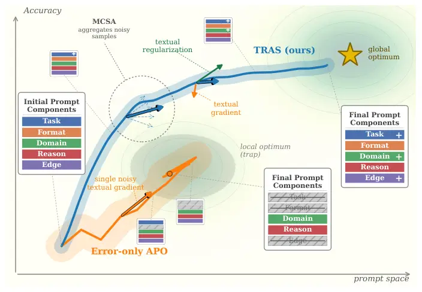

# Stabilizing Black-Box Prompt Optimization with Textual Regularization and Signal Aggregation

###### Abstract.

An increasing number of NLP applications interact with large language
models (LLMs) through black-box APIs, making prompt engineering critical
for controlling model behavior. Recent Automatic Prompt Optimization
(APO) methods iteratively refine prompts using model-generated critiques
(often called as _textual gradients_), but they predominantly optimize
from failures and underutilize information contained in correct
predictions, leading to instability and semantic drift. We propose TRAS
(Textual Regularization with Aggregated Signals), a feedback-centric
framework that is plug-and-play with existing APO search backbones. It
retains the standard textual gradient signal from prior work for error
correction, and introduces a complementary _textual regularizer_ derived
from successful predictions to preserve beneficial prompt components.
Because both signals are stochastic and can be noisy, we further
introduce _Monte Carlo Signal Aggregation (MCSA)_, which samples
multiple gradients or regularizers and aggregates them into a single
actionable directive, emphasizing consistent, actionable advice while
filtering out outliers. Motivated by rapid model churn, we also
formalize _Automatic Prompt Migration (APM)_, the practical problem of
adapting an expert prompt across model versions or API providers without
losing critical instructions. Across standard APO and APM scenarios, our
approach consistently outperforms strong baselines, yielding higher
accuracy, faster convergence, and lower query cost, while substantially
reducing the degradation observed under naive prompt migration.¹¹ 1 Code
is available at
[https://github.com/rezazzr/TRAS](https://github.com/rezazzr/TRAS).

###### keywords

Keywords: Textual Regularization, Black-box Prompt Optimization, Prompt
Migration, Large Language Models

|                                                                                                                                                                             |
| --------------------------------------------------------------------------------------------------------------------------------------------------------------------------- |
| MohammadReza Davari\upstairs\affilone\affiltwo\affilthree\*, Utkarsh Garg\upstairs\affilthree, Weixin Cai\upstairs\affilthree, Eugene Belilovsky\upstairs\affilone\affiltwo |
| \upstairs\affilone Concordia University  \upstairs\affiltwo Mila – Quebec AI Institute  \upstairs\affilthree Microsoft                                                      |

\emails\upstairs

\*mohammadreza.davari@concordia.ca

## 1. Introduction



Figure 1. TRAS preserves prompt structure across optimization.
Error-only APO (orange) updates prompts from failures alone; the
trajectory oscillates with a wide variance band and working prompt
components get erased (_instruction loss_). TRAS (blue) adds a textual
regularizer from successes and aggregates multiple samples per signal
(MCSA), producing a smoother trajectory with a narrower variance band
that better approaches the global optimum while preserving and refining
components. Illustrative of the APM regime (GPT-3.5-turbo$`\to`$GPT-4o);
full results in Table 3.

Traditionally, NLP tasks have relied on fine-tuning pretrained
models \[3, 19, 31, 41, 42\] on downstream datasets \[14, 20, 15, 60,
37, 16\], leveraging internal representations such as hidden
states \[44, 9\], gradients, and attention patterns \[29, 43, 13, 12\]
to drive methods like prompt tuning \[33, 30\], LoRA \[24\], and other
parameter-efficient approaches \[10, 58, 11, 61\]. However, the
landscape is increasingly shifting toward closed-weight LLMs accessed
via black-box APIs \[38, 4\], where internal representations are
unavailable and prompt design becomes the primary mechanism for
controlling model behavior \[34, 27, 54, 64, 36, 2, 7\]. Manual prompt
engineering remains costly, requiring domain expertise and substantial
trial-and-error \[26, 56, 28\].

Recent _Automatic Prompt Optimization_ (APO) methods \[53, 59, 65, 39\]
iteratively refine prompts using feedback from model behavior. In many
such approaches, the dominant signal is an LLM-generated critique from
incorrect predictions, a *textual gradient* \[53, 39\]. While effective
for error correction, this view underutilizes information from
successful predictions and can lead to _semantic drift_: edits that fix
local failures may inadvertently degrade globally useful prompt
components (Figure 1). Importantly, correct predictions carry
information about _which parts of a prompt are working_, and ignoring
this signal makes optimization less stable.

In this paper, we focus on the quality and reliability of the textual
update signal, an axis orthogonal to the choice of search strategy \[53,
39, 45\] (which selects _which_ prompt to refine). We introduce a
complementary _textual regularization_ signal derived from successes
that encourages preserving beneficial prompt components, and _Monte
Carlo Signal Aggregation (MCSA)_ which samples multiple independent
signals and aggregates them to reduce variance while managing dilution.

Prompt optimization becomes especially challenging under rapid model
churn, where practitioners must migrate optimized prompts across model
versions or providers. We formalize this as *Automatic Prompt Migration
(APM)* \[17\]: adapting an expert source prompt to a target model while
avoiding _instruction loss_, the inadvertent deletion of load-bearing
prompt components during re-optimization \[27, 65, 63, 35, 5\]. This
mirrors the _continual learning_ setting of adapting to new tasks while
preserving prior knowledge without access to past data \[1\], and
motivates a regularization-centric update rule rather than aggressive
re-optimization. Our method targets this failure mode by using textual
regularization to preserve transferable structure and MCSA to reduce
noisy updates.

We combine these ideas into TRAS (Textual Regularization with Aggregated
Signals), a unified framework for robust black-box prompt optimization
and migration that consistently improves accuracy, accelerates
convergence, and reduces API usage across standard APO and APM
scenarios.

Our contributions are:

1.  (1)
    We formalize _Automatic Prompt Migration (APM)_ as a practical
    black-box setting, highlighting instruction loss as a key failure
    mode of naïve migration and re-optimization.
2.  (2)
    We propose TRAS, augmenting textual-gradient-based APO with (i)
    _textual regularization_ from successes to stabilize updates
    and (ii) _Monte Carlo Signal Aggregation_ to reduce signal variance
    while managing dilution, yielding robust gains in both APO and APM.

Figure 2. Overview of our proposed framework for automatic prompt
optimization (APO). The framework consists of five primary modules. The
Search Module is abstracted to allow for the integration of various
search and planning methods.

## 2. Related Work

APO methods can be broadly categorized by their level of access to model
internals. Methods with full or partial access to parameters, gradients,
or output probabilities, applicable to open-source models like
LLaMA \[50, 51, 22\] or Mistral \[25, 49\], can train soft prompts \[33,
30, 24, 55, 40\] or optimize discrete prompts via gradient-guided
search \[46, 57, 21, 6, 23, 54\]. These techniques are infeasible for
black-box APIs, our primary focus.

Black-box APO methods fall into two families. _Iterative generation_
methods (e.g., APE \[65\], OPRO \[59\]) repeatedly propose prompt
candidates, evaluate them on held-out data, and select top performers.
These methods rely on _scalar feedback_ (e.g., accuracy) and do not
explicitly represent _why_ a prompt fails or succeeds. _Search and
planning_ methods (e.g., PromptAgent \[53\], ProTeGi \[39\],
SAMMO \[45\]) frame APO as structured exploration, using MCTS \[8\],
beam search, or multi-objective optimization, guided by _textual
gradients_ derived from failures. These provide stronger exploration,
but the inner-loop update signal is derived primarily from errors, which
is inherently stochastic and can contribute to semantic drift. Our work
complements these methods by improving the reliability and
informativeness of the update signal, while remaining plug-and-play with
different search strategies.

## 3. Method

We study APO for black-box LLMs accessed via APIs. A task is defined by
$`\mathcal{T}=(\mathcal{X},\mathcal{Y},\mathcal{D},\ell)`$, where
$`\mathcal{X}`$ is the input space, $`\mathcal{Y}`$ the output space,
$`\mathcal{D}`$ a distribution over
$`(x,y)\in\mathcal{X}\times\mathcal{Y}`$, and $`\ell`$ a task loss. Let
$`\mathcal{P}`$ denote the discrete prompt space; we write
$`p\in\mathcal{P}`$ for an individual prompt. A black-box LLM induces
$`\hat{y}\sim P_{\theta}(\cdot\mid x,p)`$, where we assume no access to
$`\theta`$, internal activations, or gradients. The APO objective is to
find:

```math
p^{\star}\in\arg\min_{p\in\mathcal{P}}R(p),\qquad R(p):=\mathbb{E}_{(x,y)\sim\mathcal{D}}\Big[\mathbb{E}_{\hat{y}\sim P_{\theta}(\cdot\mid x,p)}\big[\ell(\hat{y},y)\big]\Big]. \tag{1}
```

In practice, the risk $`R(p)`$ is estimated on a finite validation set.
Under $`0`$–$`1`$ loss, minimizing risk is equivalent to maximizing
accuracy.

Our framework is modular and can be combined with existing search
backbones; it focuses on improving the _textual signals_ used to revise
prompts. The overall pipeline is shown in Figure 2. At each step $`t`$,
given a prompt $`p_{t}`$, we run it on a batch, partition outcomes into
successes and failures, generate corrective and stabilizing signals,
aggregate them via MCSA, and rewrite the prompt. We detail each
component below.

### 3.1. Forward Generation and Evaluation

At step $`t`$, we sample a mini-batch
$`B_{t}=\{(x_{i},y_{i})\}_{i=1}^{n}`$ from the training set and obtain
predictions $`\hat{y}_{i}`$ from $`P_{M}(\cdot\mid x_{i},p_{t})`$. We
partition the batch by correctness
$`c_{i}=\mathds{1}[\hat{y}_{i}=y_{i}]`$ into an error subset
$`B_{t}^{-}`$ and a success subset $`B_{t}^{+}`$.

### 3.2. Textual Gradient

Following prior work \[39, 53\], we derive a corrective signal from
incorrect predictions. A critique policy $`\pi_{g}`$ produces a
natural-language signal $`g_{t}\sim\pi_{g}(\cdot\mid p_{t},B_{t}^{-})`$
that identifies _what to change_ (e.g., missing constraints, ambiguous
instructions, formatting issues) to fix observed failures.

### 3.3. Textual Regularization

Error-driven updates alone can cause _semantic drift_: edits that fix
local failures may delete globally beneficial prompt components, forcing
the optimizer into costly _remove-and-rediscover_ cycles where useful
instructions are first overwritten and must later be re-learned. To
stabilize optimization, we introduce a success-conditioned _textual
regularization_ signal that prescribes _preservation_ rather than
mutation. An attribution policy $`\pi_{r}`$ analyzes successes and
returns a regularizer $`r_{t}\sim\pi_{r}(\cdot\mid p_{t},B_{t}^{+})`$,
which attributes correctness to specific prompt components and expresses
_do-not-remove / keep-unchanged / strengthen_ constraints. To avoid
anchoring early iterations to a poor initialization, we employ a warm-up
schedule:

```math
r_{t}:=\begin{cases}\varnothing,&t<\tau_{\text{warmup}},\\
\text{sample from }\pi_{r}(\cdot\mid p_{t},B_{t}^{+}),&t\geq\tau_{\text{warmup}},\end{cases} \tag{2}
```

so the optimizer first explores using only corrective signals, then
refines while preserving verified structure.

### 3.4. Monte Carlo Signal Aggregation (MCSA)

Both $`g_{t}`$ and $`r_{t}`$ are stochastic LLM outputs and can have
high variance. We reduce variance by sampling $`K`$ independent signals
and aggregating them:

```math
\displaystyle g_{t,1},\dots,g_{t,K} \displaystyle\overset{\text{i.i.d.}}{\sim}\pi_{g}(\cdot\mid p_{t},B_{t}^{-}), \tag{3}
```

```math
\displaystyle r_{t,1},\dots,r_{t,K} \displaystyle\overset{\text{i.i.d.}}{\sim}\pi_{r}(\cdot\mid p_{t},B_{t}^{+}). \tag{4}
```

An aggregation operator (LLM summarizer) combines samples into
consolidated directives:

```math
\bar{g}_{t}:=\Phi_{g}(\{g_{t,k}\}_{k=1}^{K}),\qquad\bar{r}_{t}:=\Phi_{r}(\{r_{t,k}\}_{k=1}^{K}). \tag{5}
```

The aggregated signals emphasize consistent, actionable edits and
de-emphasize outliers. Increasing $`K`$ reduces sampling variance but
can increase dilution when too many signals are compressed into a
fixed-length directive, producing generic summaries. This
variance–dilution trade-off yields a sweet spot at moderate $`K`$, which
we characterize empirically in Section 4.3.

### 3.5. Prompt Update

Given $`p_{t}`$ and aggregated signals $`(\bar{g}_{t},\bar{r}_{t})`$, we
generate the next prompt via an update policy:

```math
p_{t+1}\sim\pi_{\text{upd}}(\cdot\mid p_{t},\bar{g}_{t},\bar{r}_{t},B_{t}), \tag{6}
```

which applies corrective changes from $`\bar{g}_{t}`$ while preserving
components identified by $`\bar{r}_{t}`$. TRAS is orthogonal to the
upstream search strategy that selects which prompt $`p_{t}`$ to refine;
in our experiments we use the MCTS strategy that was used in
PromptAgent \[53\] as the search backbone due to its established
effectiveness \[62, 32\].

### 3.6. TRAS for Automatic Prompt Migration

We formalize _prompt migration_ as adapting an expert prompt
$`p_{S}^{\star}`$, optimized for a source LLM $`P_{\theta_{S}}`$ (e.g.,
GPT-3.5-turbo), to a target LLM $`P_{\theta_{T}}`$ (e.g., GPT-4o):

```math
\min_{p\in\mathcal{P}}R_{T}(p)\quad\text{s.t.}\quad p\in\mathcal{N}(p_{S}^{\star}), \tag{7}
```

where $`R_{T}`$ is the target-model risk and $`\mathcal{N}(\cdot)`$
encodes preservation of successful prompt structure. Naïve error-driven
updates can quickly overwrite load-bearing instructions in
$`p_{S}^{\star}`$. We initialize $`p_{0}:=p_{S}^{\star}`$ and activate
textual regularization _immediately_ ($`\tau_{\text{warmup}}:=0`$), so
that $`r_{t}`$ is sampled for all $`t\geq 0`$. This allows TRAS to
correct target-specific mismatches via $`\bar{g}_{t}`$ while preserving
the transferable structure of $`p_{S}^{\star}`$ via $`\bar{r}_{t}`$. We
also use a smaller MCSA sample count $`K`$ in this regime (see
Section 4.2) because the warm-started expert prompt produces
lower-variance signals than the cold-start APO setting.

## 4. Experiments

We evaluate TRAS on five reasoning tasks spanning causal, spatial,
tabular, entailment, and semantic similarity, using GPT-3.5-turbo (APO)
and GPT-4o (APM on GPT-3.5-turbo to GPT-4o). We optimize prompts on
validation sets and report final performance on test sets; the primary
metric is accuracy. Full details on tasks, dataset statistics, splits,
and default prompts are provided in Appendix A and Appendix B.

### 4.1. Standard Prompt Optimization (GPT-3.5-turbo)

We evaluate TRAS in the standard APO setting using GPT-3.5-turbo. Each
run is initialized with a task-specific default prompt (Appendix B) and
run for up to 15 iterations using the PromptAgent \[53\] search
backbone. MCSA samples $`K=6`$ signals per batch, and textual
regularization activates after a short warm-up
($`\tau_{\text{warmup}}=3`$ or $`4`$ depending on the dataset; see
Section 4.3). Table 1 reports results averaged over five seeds. TRAS
yields consistent and statistically significant accuracy improvements
across all tasks, ranging from $`4.9\%`$ to $`21.5\%`$ over PromptAgent
($`p<0.01`$). MCSA reduces standard deviation across seeds, highlighting
the role of aggregated signals in stabilizing optimization. TRAS also
reduces LLM calls by $`0.5\%`$ to $`3.3\%`$ relative to the baseline by
avoiding unnecessary removal-and-rediscovery cycles (Section 4.4).

|                                 |                      |             |             |               |
| ------------------------------- | -------------------- | ----------- | ----------- | ------------- |
| Dataset (Init. Acc.)            | Method               | Accuracy    | $`p`$-value | Cohen’s $`d`$ |
| Causal Judgment (56.5 ± 3.67 )  | Baseline             | 58.6 ± 3.98 | \-          | \-            |
|                                 | Baseline + MCSA^(\*) | 60.8 ± 2.38 | 0.020       | 1.687         |
|                                 | Baseline + TR^(\*)   | 63.6 ± 2.62 | 0.040       | 1.336         |
|                                 | TRAS^(\*\*)          | 64.4 ± 2.16 | 0.008       | 2.162         |
| Geometric Shapes (32.7 ± 2.04 ) | Baseline             | 52.1 ± 4.94 | \-          | \-            |
|                                 | Baseline + MCSA^(\*) | 57.8 ± 3.15 | 0.032       | 1.439         |
|                                 | Baseline + TR^(\*)   | 61.6 ± 4.18 | 0.035       | 1.399         |
|                                 | TRAS^(\*\*)          | 63.3 ± 1.16 | 0.004       | 2.644         |
| Penguins (60.5 ± 4.87 )         | Baseline             | 65.1 ± 4.96 | \-          | \-            |
|                                 | Baseline + MCSA^(\*) | 66.1 ± 2.42 | 0.083       | 1.148         |
|                                 | Baseline + TR^(\*)   | 66.9 ± 3.97 | 0.043       | 1.464         |
|                                 | TRAS^(\*\*)          | 68.6 ± 1.87 | 0.007       | 2.556         |
| Biosses (25.2 ± 3.84 )          | Baseline             | 62.5 ± 4.19 | \-          | \-            |
|                                 | Baseline + MCSA^(\*) | 67.0 ± 2.92 | 0.044       | 1.456         |
|                                 | Baseline + TR^(\*)   | 68.2 ± 3.02 | 0.021       | 1.844         |
|                                 | TRAS^(\*\*)          | 70.4 ± 2.02 | 0.006       | 2.654         |
| CB (68.5 ± 4.22 )               | Baseline             | 81.7 ± 3.17 | \-          | \-            |
|                                 | Baseline + MCSA^(\*) | 84.2 ± 2.02 | 0.032       | 1.610         |
|                                 | Baseline + TR^(\*)   | 84.2 ± 3.73 | 0.049       | 1.402         |
|                                 | TRAS^(\*\*)          | 85.7 ± 3.54 | 0.008       | 2.495         |

Table 1. Prompt optimization on GPT-3.5-turbo (mean accuracy $`\pm`$
std., five seeds). Significance vs. PromptAgent is via paired
$`t`$-tests ($`p`$, Cohen’s $`d`$). +MCSA: Monte Carlo Signal
Aggregation ($`K{=}6`$); +TR: Textual Regularization; TRAS: both. Init.
Acc.: default prompt. All methods run 15 iterations; +TR activates at
$`\tau_{\text{warmup}}{=}3`$ (Causal Judgment/Geometric Shapes/Penguins)
or $`4`$ (Biosses/CB). TRAS improves accuracy and reduces variance over
baselines.

### 4.2. Prompt Migration: GPT-3.5-turbo →GPT-4o

We evaluate TRAS in the APM setting, where expert prompts optimized on
GPT-3.5-turbo initialize optimization on GPT-4o. Throughout this
subsection, _DP_ (Default Prompt) refers to the task-specific default
prompt used as a cold-start initializer (see Appendix B), and _EP_
(Expert Prompt) refers to a prompt already optimized on GPT-3.5-turbo
that we transfer as the initializer on GPT-4o. As shown in Table 2,
direct transfer of expert prompts yields initial gains of
$`1.3\%`$–$`3.3\%`$ over default prompts, but naïve re-optimization via
PromptAgent often erodes these gains due to instruction loss, early
corrective signals overwrite useful instructions embedded in the expert
prompt.

|                  |         |             |             |             |               |
| ---------------- | ------- | ----------- | ----------- | ----------- | ------------- |
| Dataset          | Stage   | DP Acc.     | EP Acc.     | $`p`$-value | Cohen’s $`d`$ |
| Causal Judgment  | Initial | 71.8 ± 1.92 | 74.2 ± 3.46 | 0.033^(∗)   | 1.434         |
|                  | Final   | 73.4 ± 1.82 | 73.8 ± 1.79 | 0.803       | 0.119         |
| Geometric Shapes | Initial | 54.8 ± 1.89 | 58.2 ± 2.22 | 0.001^(∗∗)  | 4.138         |
|                  | Final   | 79.0 ± 5.32 | 75.1 ± 5.80 | 0.040^(∗)   | -1.344        |
| Penguins         | Initial | 92.9 ± 1.85 | 95.8 ± 1.72 | 0.025^(∗)   | 1.745         |
|                  | Final   | 95.2 ± 2.03 | 92.3 ± 2.89 | 0.005^(∗∗)  | -2.771        |
| Biosses          | Initial | 69.9 ± 2.73 | 72.2 ± 1.78 | 0.0125^(∗)  | 2.159         |
|                  | Final   | 76.7 ± 2.84 | 76.1 ± 1.97 | 0.381       | -0.600        |
| CB               | Initial | 79.3 ± 1.57 | 80.3 ± 1.54 | 0.005^(∗∗)  | 2.855         |
|                  | Final   | 80.0 ± 4.62 | 78.7 ± 2.13 | 0.381       | -0.492        |

Table 2. Transferability of expert prompts (EP) from GPT-3.5-turbo to
GPT-4o (accuracy mean $`\pm`$ std., five seeds). We compare Default
Prompt (DP) vs. transferred EP at Initial (direct transfer) and Final
(after 15 PromptAgent iterations on GPT-4o). Significance via paired
$`t`$-tests. Direct transfer yields modest gains ($`1.3`$–$`3.3`$%), but
naïve re-optimization with PromptAgent often erodes them (instruction
loss).

We next evaluate TRAS for APM. TRAS activates textual regularization
from the first iteration ($`\tau_{\text{warmup}}=0`$) and uses $`K=2`$
for MCSA. Two factors motivate the smaller $`K`$: (i) the warm-started
expert prompt is already strong, so per-iteration signals are less
variable than in the cold-start APO setting and pilot runs showed no
accuracy gain from $`K\geq 3`$; and (ii) GPT-4o API costs scale with
$`K`$, so larger sweeps were not tractable at this budget. Table 3
summarizes results. TRAS consistently improves performance across all
tasks, with accuracy gains of $`3.5\%`$ to $`16.0\%`$ over the baseline
($`p<0.01`$). The largest gains occur in Geometric Shapes ($`12.5\%`$)
and Biosses ($`16.0\%`$), where preserving domain-specific structure is
especially important. TRAS also reduces total LLM calls by $`4.2\%`$ to
$`6.2\%`$ (Section 4.4).

|                                                  |                      |             |             |               |
| ------------------------------------------------ | -------------------- | ----------- | ----------- | ------------- |
| Dataset (Init. Acc.)                             | Method               | Final Acc.  | $`p`$-value | Cohen’s $`d`$ |
| Causal Judgment DP: 71.8 ± 1.92 EP: 74.2 ± 3.46  | Baseline             | 73.8 ± 1.79 | \-          | \-            |
|                                                  | Baseline + MCSA^(\*) | 74.7 ± 1.44 | 0.053       | 1.214         |
|                                                  | Baseline + TR^(\*)   | 75.8 ± 1.78 | 0.047       | 1.265         |
|                                                  | TRAS^(\*\*)          | 76.4 ± 1.59 | 0.007       | 2.280         |
| Geometric Shapes DP: 54.8 ± 1.89 EP: 58.2 ± 2.22 | Baseline             | 75.1 ± 5.80 | \-          | \-            |
|                                                  | Baseline + MCSA^(\*) | 79.4 ± 2.92 | 0.016       | 1.782         |
|                                                  | Baseline + TR^(\*)   | 81.7 ± 3.07 | 0.021       | 1.641         |
|                                                  | TRAS^(\*\*)          | 84.5 ± 2.33 | 0.008       | 2.175         |
| Penguins DP: 92.9 ± 1.85 EP: 95.8 ± 1.72         | Baseline             | 92.3 ± 2.89 | \-          | \-            |
|                                                  | Baseline + MCSA^(\*) | 94.2 ± 1.33 | 0.083       | 1.148         |
|                                                  | Baseline + TR^(\*)   | 96.7 ± 0.88 | 0.041       | 1.493         |
|                                                  | TRAS^(\*\*)          | 98.0 ± 0.73 | 0.008       | 2.449         |
| Biosses DP: 69.9 ± 2.73 EP: 72.2 ± 1.78          | Baseline             | 76.1 ± 1.97 | \-          | \-            |
|                                                  | Baseline + MCSA^(\*) | 78.4 ± 1.66 | 0.043       | 1.461         |
|                                                  | Baseline + TR^(\*)   | 83.7 ± 3.86 | 0.003       | 3.186         |
|                                                  | TRAS^(\*\*)          | 88.3 ± 2.00 | 0.0001      | 8.696         |
| CB DP: 79.3 ± 1.57 EP: 80.3 ± 1.54               | Baseline             | 78.7 ± 2.13 | \-          | \-            |
|                                                  | Baseline + MCSA^(\*) | 82.7 ± 2.31 | 0.029       | 1.659         |
|                                                  | Baseline + TR^(\*)   | 85.3 ± 4.49 | 0.014       | 2.047         |
|                                                  | TRAS^(\*\*)          | 87.5 ± 3.56 | 0.006       | 2.713         |

Table 3. APM from GPT-3.5-turbo to GPT-4o (accuracy mean $`\pm`$ std.,
five seeds). We report DP/EP initial accuracy and final GPT-4o accuracy
after optimization (all start from EP). Baseline: PromptAgent; +MCSA:
aggregation ($`K{=}2`$); +TR: Textual Regularization from iter. 0; TRAS:
both. Significance vs. baseline via paired $`t`$-tests ($`p`$, Cohen’s
$`d`$; $`{}^{*}p<0.05`$, $`{}^{**}p<0.01`$). TRAS achieves the best
final accuracy ($`2.2`$% to $`16.0`$% gain).

### 4.3. Ablation Studies

(a) Relative accuracy gain vs. correction-only baseline as a function of
the textual-regularization warm-up $`\tau_{\text{warmup}}`$. Performance
peaks at $`\tau_{\text{warmup}}\approx 3`$–$`4`$; too early anchors weak
prompts, too late increases drift/instruction loss.

(b) Relative accuracy gain vs. no-MCSA baseline as a function of
aggregation samples $`K`$. Accuracy improves up to $`K\approx 6`$ (lower
variance) then drops for larger $`K`$ due to dilution/compression.

All ablations use GPT-3.5-turbo, run for 8 iterations from task-specific
default prompts (Appendix B), and report relative accuracy improvements
over the PromptAgent baseline (dotted red line in Figures 3(a)
and 3(b)).

Ablation 1: Textual regularization warm-up ($`\tau_{\text{warmup}}`$)   
We vary $`\tau_{\text{warmup}}`$ from 0 to 7 (Figure 3(a)). Early
activation ($`\tau_{\text{warmup}}\in\{0,1\}`$) underperforms,
consistent with premature anchoring to weak prompt structure. Peak
performance occurs at $`\tau_{\text{warmup}}=3`$ for Causal Judgment,
Geometric Shapes, and Penguins, and at $`\tau_{\text{warmup}}=4`$ for CB
and Biosses. Beyond these values, performance declines as delayed
preservation increases semantic drift.

Ablation 2: MCSA aggregation samples ($`K`$)    We apply MCSA to the
baseline using only the corrective signal (Figure 3(b)). Performance
improves steadily up to $`K\approx 6`$, then degrades for larger $`K`$
(e.g., $`8`$–$`10`$) as dilution from over-compression produces generic
summaries. These findings validate the variance–dilution trade-off and
motivate $`K=6`$ in our main APO experiments.

### 4.4. Experimentation Costs

Table 4 reports the average number of API calls required by each method
during prompt optimization (APO) and migration (APM) for both
GPT-3.5-turbo and GPT-4o, averaged over five seeds per task. Methods
employing MCSA incur additional calls per iteration due to multiple
signal samples, but improved signal quality reduces the number of
iterations needed and avoids inefficient “remove-and-rediscover” cycles.
In APO, TRAS often reduces total API calls relative to PromptAgent (our
default search backbone) by converging more reliably. In APM, where
instruction loss is a primary failure mode, efficiency gains are more
pronounced: TRAS reduces total calls by $`4.2\%`$–$`6.2\%`$ while also
improving accuracy.

|         |          |                 |                  |               |               |               |
| ------- | -------- | --------------- | ---------------- | ------------- | ------------- | ------------- |
| Model   | Method   | Causal Judgment | Geometric Shapes | Penguins      | Biosses       | CB            |
| GPT-3.5 | Baseline | 7,670           | 11,264           | 2,664         | 3,566         | 5,490         |
|         | +MCSA    | 7,919 (+3.2%)   | 11,731 (+4.1%)   | 2,735 (+2.7%) | 3,710 (+4.0%) | 5,606 (+2.1%) |
|         | +TR      | 7,040 (-8.2%)   | 10,900 (-3.2%)   | 2,533 (-4.9%) | 3,294 (-7.6%) | 5,337 (-2.8%) |
|         | TRAS     | 7,429 (-3.1%)   | 11,204 (-0.5%)   | 2,622 (-1.5%) | 3,449 (-3.3%) | 5,422 (-1.2%) |
| GPT-4o  | Baseline | 8,576           | 9,642            | 2,980         | 3,008         | 6,229         |
|         | +MCSA    | 9,271 (+8.1%)   | 10,093 (+4.7%)   | 3,068 (+2.9%) | 3,070 (+2.0%) | 6,394 (+2.6%) |
|         | +TR      | 7,963 (-7.1%)   | 9,396 (-2.6%)    | 2,909 (-2.4%) | 2,869 (-4.6%) | 6,079 (-2.4%) |
|         | TRAS     | 8,041 (-6.2%)   | 9,049 (-6.1%)    | 2,825 (-5.2%) | 2,860 (-4.9%) | 5,965 (-4.2%) |

Table 4. Average number of API calls for prompt optimization (APO on
GPT-3.5) and migration (APM on GPT-4o), averaged over five runs.
Green/red = fewer/more calls vs. baseline. +MCSA: Monte Carlo Signal
Aggregation $`K{=}6`$ (APO) / $`K{=}2`$ (APM); +TR: Textual
Regularization; TRAS: both.

## 5. Conclusion and Future Work

We presented TRAS, a feedback-centric framework that stabilizes
black-box APO by augmenting standard textual gradients with _textual
regularization_ from successes and _Monte Carlo Signal Aggregation_ to
reduce signal variance. We also formalized _Automatic Prompt Migration
(APM)_ as adapting expert prompts across model distributions while
avoiding instruction loss. Across both APO and APM scenarios, TRAS
consistently improves accuracy, reduces variance, accelerates
convergence, and lowers API usage. Promising future directions include
alternative aggregation mechanisms (e.g., structured voting or
embedding-space clustering), adaptive regularization schedules, and
extension to multi-turn or continual deployment settings.

## Acknowledgements

We acknowledge funding from the NSERC Discovery Grant RGPIN-2021-04104
and FRQNT New Scholar. This research was enabled in part by compute
resources provided by Digital Research Alliance of Canada (the Alliance)
and Calcul Québec.

## References

- \[1\] N. Asadi, M. Davari, S. Mudur, R. Aljundi, and E.
  Belilovsky (2023) Prototype-sample relation distillation: towards
  replay-free continual learning. In International Conference on Machine
  Learning, pp. 1093–1106. Cited by: §1.
- \[2\] Y. Bai, S. Kadavath, S. Kundu, A. Askell, J. Kernion, A.
  Jones, A. Chen, A. Goldie, A. Mirhoseini, C. McKinnon, et al. (2022)
  Constitutional ai: harmlessness from ai feedback. arXiv preprint
  arXiv:2212.08073. Cited by: §1.
- \[3\] R. Bommasani, D. A. Hudson, E. Adeli, R. Altman, S. Arora, S.
  von Arx, M. S. Bernstein, J. Bohg, A. Bosselut, E. Brunskill, et
  al. (2021) On the opportunities and risks of foundation models. arXiv
  preprint arXiv:2108.07258. Cited by: §1.
- \[4\] S. Bubeck, V. Chadrasekaran, R. Eldan, J. Gehrke, E. Horvitz, E.
  Kamar, P. Lee, Y. T. Lee, Y. Li, S. Lundberg, et al. (2023) Sparks of
  artificial general intelligence: early experiments with gpt-4. ArXiv.
  Cited by: §1.
- \[5\] J. Chen, L. Chen, H. Huang, and T. Zhou (2023) When do you need
  chain-of-thought prompting for chatgpt?. arXiv preprint
  arXiv:2304.03262. Cited by: §1.
- \[6\] L. Chen, J. Chen, T. Goldstein, H. Huang, and T. Zhou (2023)
  Instructzero: efficient instruction optimization for black-box large
  language models. arXiv preprint arXiv:2306.03082. Cited by: §2.
- \[7\] X. Chen, M. Lin, N. Schärli, and D. Zhou (2023) Teaching large
  language models to self-debug. arXiv preprint arXiv:2304.05128. Cited
  by: §1.
- \[8\] R. Coulom (2006) Efficient selectivity and backup operators in
  monte-carlo tree search. In International conference on computers and
  games, pp. 72–83. Cited by: §2.
- \[9\] M. Davari, N. Asadi, S. Mudur, R. Aljundi, and E.
  Belilovsky (2022) Probing representation forgetting in supervised and
  unsupervised continual learning. In Proceedings of the IEEE/CVF
  conference on computer vision and pattern recognition,
  pp. 16712–16721. Cited by: §1.
- \[10\] M. Davari and E. Belilovsky (2024) Model breadcrumbs: scalable
  upcycling of finetuned foundation models via sparse task vectors
  merging. In ICML 2024 Workshop on Foundation Models in the Wild, Cited
  by: §1.
- \[11\] M. Davari and E. Belilovsky (2024) Model breadcrumbs: scaling
  multi-task model merging with sparse masks. In European Conference on
  Computer Vision, pp. 270–287. Cited by: §1.
- \[12\] M. Davari, S. Horoi, A. Natik, G. Lajoie, G. Wolf, and E.
  Belilovsky (2022) On the inadequacy of cka as a measure of similarity
  in deep learning. In ICLR 2022 Workshop on Geometrical and Topological
  Representation Learning, Cited by: §1.
- \[13\] M. Davari, S. Horoi, A. Natik, G. Lajoie, G. Wolf, and E.
  Belilovsky (2023) Reliability of CKA as a similarity measure in deep
  learning. In The Eleventh International Conference on Learning
  Representations, Cited by: §1.
- \[14\] M. Davari, L. Kosseim, and T. D. Bui (2019) Toponym
  identification in epidemiology articles–a deep learning approach. In
  International Conference on Computational Linguistics and Intelligent
  Text Processing, pp. 26–37. Cited by: §1.
- \[15\] M. Davari, L. Kosseim, and T. Bui (2020) TIMBERT: toponym
  identifier for the medical domain based on bert. In Proceedings of the
  28th International Conference on Computational Linguistics,
  pp. 662–668. Cited by: §1.
- \[16\] M. Davari (2020) Neural network approaches to medical toponym
  recognition. Ph.D. Thesis, Concordia University. Cited by: §1.
- \[17\] M. Davari (2025) Continual learning in constrained scenarios:
  bridging real-world needs and practical constraints. Ph.D. Thesis,
  Concordia University. Note: Unpublished External Links:
  [Link](https://spectrum.library.concordia.ca/id/eprint/995684/) Cited
  by: §1.
- \[18\] M. De Marneffe, M. Simons, and J. Tonhauser (2019) The
  commitmentbank: investigating projection in naturally occurring
  discourse. In proceedings of Sinn und Bedeutung, Vol. 23, pp. 107–124.
  Cited by: Appendix A.
- \[19\] J. Devlin, M. Chang, K. Lee, and K. Toutanova (2019) Bert:
  pre-training of deep bidirectional transformers for language
  understanding. In Proceedings of the 2019 conference of the North
  American chapter of the association for computational linguistics:
  human language technologies, volume 1 (long and short papers),
  pp. 4171–4186. Cited by: §1.
- \[20\] F. Farahnak, E. Mohammadi, M. Davari, and L. Kosseim (2021)
  Semantic similarity matching using contextualized representations.. In
  Canadian AI, Cited by: §1.
- \[21\] T. Gao, A. Fisch, and D. Chen (2020) Making pre-trained
  language models better few-shot learners. arXiv preprint
  arXiv:2012.15723. Cited by: §2.
- \[22\] A. Grattafiori, A. Dubey, A. Jauhri, A. Pandey, A. Kadian, A.
  Al-Dahle, A. Letman, A. Mathur, A. Schelten, A. Vaughan, et al. (2024)
  The llama 3 herd of models. arXiv preprint arXiv:2407.21783. Cited by:
  §2.
- \[23\] Y. Hao, Z. Chi, L. Dong, and F. Wei (2023) Optimizing prompts
  for text-to-image generation. Advances in Neural Information
  Processing Systems 36, pp. 66923–66939. Cited by: §2.
- \[24\] E. J. Hu, Y. Shen, P. Wallis, Z. Allen-Zhu, Y. Li, S. Wang, L.
  Wang, W. Chen, et al. (2022) Lora: low-rank adaptation of large
  language models.. ICLR 1 (2), pp. 3. Cited by: §1, §2.
- \[25\] A. Q. Jiang, A. Sablayrolles, A. Mensch, C. Bamford, D. S.
  Chaplot, D. Casas, F. Bressand, G. Lengyel, G. Lample, L. Saulnier, et
  al. (2023) Mistral 7b. arxiv. arXiv preprint arXiv:2310.06825 10.
  Cited by: §2.
- \[26\] J. Jiang, K. Zhou, Z. Dong, K. Ye, W. X. Zhao, and J.
  Wen (2023) Structgpt: a general framework for large language model to
  reason over structured data. arXiv preprint arXiv:2305.09645. Cited
  by: §1.
- \[27\] T. Kojima, S. S. Gu, M. Reid, Y. Matsuo, and Y. Iwasawa (2022)
  Large language models are zero-shot reasoners. Advances in neural
  information processing systems 35, pp. 22199–22213. Cited by: §1, §1.
- \[28\] A. Kong, S. Zhao, H. Chen, Q. Li, Y. Qin, R. Sun, X. Zhou, E.
  Wang, and X. Dong (2023) Better zero-shot reasoning with role-play
  prompting. arXiv preprint arXiv:2308.07702. Cited by: §1.
- \[29\] S. Kornblith, M. Norouzi, H. Lee, and G. Hinton (2019)
  Similarity of neural network representations revisited. In
  International conference on machine learning, pp. 3519–3529. Cited by:
  §1.
- \[30\] B. Lester, R. Al-Rfou, and N. Constant (2021) The power of
  scale for parameter-efficient prompt tuning. arXiv preprint
  arXiv:2104.08691. Cited by: §1, §2.
- \[31\] M. Lewis, Y. Liu, N. Goyal, M. Ghazvininejad, A. Mohamed, O.
  Levy, V. Stoyanov, and L. Zettlemoyer (2020) BART: denoising
  sequence-to-sequence pre-training for natural language generation,
  translation, and comprehension. In Proceedings of the 58th Annual
  Meeting of the Association for Computational Linguistics,
  pp. 7871–7880. Cited by: §1.
- \[32\] W. Li, X. Wang, W. Li, and B. Jin (2025) A survey of automatic
  prompt engineering: an optimization perspective. arXiv preprint
  arXiv:2502.11560. Cited by: §3.5.
- \[33\] X. L. Li and P. Liang (2021) Prefix-tuning: optimizing
  continuous prompts for generation. arXiv preprint arXiv:2101.00190.
  Cited by: §1, §2.
- \[34\] R. Luo, L. Sun, Y. Xia, T. Qin, S. Zhang, H. Poon, and T.
  Liu (2022) BioGPT: generative pre-trained transformer for biomedical
  text generation and mining. Briefings in bioinformatics 23 (6),
  pp. bbac409. Cited by: §1.
- \[35\] X. Ma, S. Mishra, A. Beirami, A. Beutel, and J. Chen (2023)
  Let’s do a thought experiment: using counterfactuals to improve moral
  reasoning. arXiv preprint arXiv:2306.14308. Cited by: §1.
- \[36\] A. Madaan, N. Tandon, P. Gupta, S. Hallinan, L. Gao, S.
  Wiegreffe, U. Alon, N. Dziri, S. Prabhumoye, Y. Yang, et al. (2023)
  Self-refine: iterative refinement with self-feedback. Advances in
  Neural Information Processing Systems 36, pp. 46534–46594. Cited by:
  §1.
- \[37\] J. Marks, M. Davari, and L. Kosseim (2024) Clac at semeval-2024
  task 2: faithful clinical trial inference. In Proceedings of the 18th
  International Workshop on Semantic Evaluation (SemEval-2024),
  pp. 1673–1677. Cited by: §1.
- \[38\] OpenAI (2023) Gpt-4 technical report. arXiv preprint
  arXiv:2303.08774. Cited by: §1.
- \[39\] R. Pryzant, D. Iter, J. Li, Y. T. Lee, C. Zhu, and M.
  Zeng (2023) Automatic prompt optimization with" gradient descent" and
  beam search. arXiv preprint arXiv:2305.03495. Cited by: Appendix A,
  §1, §1, §2, §3.2.
- \[40\] G. Qin and J. Eisner (2021) Learning how to ask: querying lms
  with mixtures of soft prompts. arXiv preprint arXiv:2104.06599. Cited
  by: §2.
- \[41\] A. Radford, K. Narasimhan, T. Salimans, I. Sutskever, et
  al. (2018) Improving language understanding by generative
  pre-training. Cited by: §1.
- \[42\] C. Raffel, N. Shazeer, A. Roberts, K. Lee, S. Narang, M.
  Matena, Y. Zhou, W. Li, and P. J. Liu (2020) Exploring the limits of
  transfer learning with a unified text-to-text transformer. Journal of
  machine learning research 21 (140), pp. 1–67. Cited by: §1.
- \[43\] M. Raghu, T. Unterthiner, S. Kornblith, C. Zhang, and A.
  Dosovitskiy (2021) Do vision transformers see like convolutional
  neural networks?. Advances in neural information processing systems
  34, pp. 12116–12128. Cited by: §1.
- \[44\] A. Rogers, O. Kovaleva, and A. Rumshisky (2021) A primer in
  bertology: what we know about how bert works. Transactions of the
  association for computational linguistics 8, pp. 842–866. Cited by:
  §1.
- \[45\] T. Schnabel and J. Neville (2024) Symbolic prompt program
  search: a structure-aware approach to efficient compile-time prompt
  optimization. arXiv preprint arXiv:2404.02319. Cited by: Appendix A,
  §1, §2.
- \[46\] T. Shin, Y. Razeghi, R. L. Logan IV, E. Wallace, and S.
  Singh (2020) Autoprompt: eliciting knowledge from language models with
  automatically generated prompts. arXiv preprint arXiv:2010.15980.
  Cited by: §2.
- \[47\] G. Soğancıoğlu, H. Öztürk, and A. Özgür (2017) BIOSSES: a
  semantic sentence similarity estimation system for the biomedical
  domain. Bioinformatics 33 (14), pp. i49–i58. Cited by: Appendix A.
- \[48\] M. Suzgun, N. Scales, N. Schärli, S. Gehrmann, Y. Tay, H. W.
  Chung, A. Chowdhery, Q. V. Le, E. H. Chi, D. Zhou, et al. (2022)
  Challenging big-bench tasks and whether chain-of-thought can solve
  them. arXiv preprint arXiv:2210.09261. Cited by: Appendix A.
- \[49\] M. A. team (2024) Mistral nemo. Note: Accessed: 2025 External
  Links: [Link](https://mistral.ai/news/mistral-nemo) Cited by: §2.
- \[50\] H. Touvron, T. Lavril, G. Izacard, X. Martinet, M. Lachaux, T.
  Lacroix, B. Rozière, N. Goyal, E. Hambro, F. Azhar, et al. (2023)
  Llama: open and efficient foundation language models. arXiv preprint
  arXiv:2302.13971. Cited by: §2.
- \[51\] H. Touvron, L. Martin, K. Stone, P. Albert, A. Almahairi, Y.
  Babaei, N. Bashlykov, S. Batra, P. Bhargava, S. Bhosale, et al. (2023)
  Llama 2: open foundation and fine-tuned chat models. arXiv preprint
  arXiv:2307.09288. Cited by: §2.
- \[52\] A. Wang, Y. Pruksachatkun, N. Nangia, A. Singh, J. Michael, F.
  Hill, O. Levy, and S. Bowman (2019) Superglue: a stickier benchmark
  for general-purpose language understanding systems. Advances in neural
  information processing systems 32. Cited by: Appendix A.
- \[53\] X. Wang, C. Li, Z. Wang, F. Bai, H. Luo, J. Zhang, N.
  Jojic, E. P. Xing, and Z. Hu (2023) Promptagent: strategic planning
  with language models enables expert-level prompt optimization. arXiv
  preprint arXiv:2310.16427. Cited by: Appendix A, §1, §1, §2, §3.2,
  §3.5, §4.1.
- \[54\] X. Wang, J. Wei, D. Schuurmans, Q. Le, E. Chi, S. Narang, A.
  Chowdhery, and D. Zhou (2022) Self-consistency improves chain of
  thought reasoning in language models. arXiv preprint arXiv:2203.11171.
  Cited by: §1, §2.
- \[55\] Z. Wang, R. Panda, L. Karlinsky, R. Feris, H. Sun, and Y.
  Kim (2023) Multitask prompt tuning enables parameter-efficient
  transfer learning. arXiv preprint arXiv:2303.02861. Cited by: §2.
- \[56\] J. Wei, X. Wang, D. Schuurmans, M. Bosma, F. Xia, E. Chi, Q. V.
  Le, D. Zhou, et al. (2022) Chain-of-thought prompting elicits
  reasoning in large language models. Advances in neural information
  processing systems 35, pp. 24824–24837. Cited by: §1.
- \[57\] Y. Wen, N. Jain, J. Kirchenbauer, M. Goldblum, J. Geiping,
  and T. Goldstein (2023) Hard prompts made easy: gradient-based
  discrete optimization for prompt tuning and discovery. Advances in
  Neural Information Processing Systems 36, pp. 51008–51025. Cited by:
  §2.
- \[58\] P. Yadav, D. Tam, L. Choshen, C. A. Raffel, and M.
  Bansal (2023) Ties-merging: resolving interference when merging
  models. Advances in Neural Information Processing Systems 36,
  pp. 7093–7115. Cited by: §1.
- \[59\] C. Yang, X. Wang, Y. Lu, H. Liu, Q. V. Le, D. Zhou, and X.
  Chen (2023) Large language models as optimizers. arXiv preprint
  arXiv:2309.03409. Cited by: Appendix A, §1, §2.
- \[60\] Z. Yang, Y. Maricar, M. Davari, N. Grenon-Godbout, and R.
  Rabbany (2023) Toxbuster: in-game chat toxicity buster with bert.
  arXiv preprint arXiv:2305.12542. Cited by: §1.
- \[61\] L. Yu, B. Yu, H. Yu, F. Huang, and Y. Li (2024) Language models
  are super mario: absorbing abilities from homologous models as a free
  lunch. In Forty-first International Conference on Machine Learning,
  Cited by: §1.
- \[62\] J. Zhang, Z. Wang, H. Zhu, J. Liu, Q. Lin, and E.
  Cambria (2025) MARS: a multi-agent framework incorporating socratic
  guidance for automated prompt optimization. arXiv preprint
  arXiv:2503.16874. Cited by: §3.5.
- \[63\] T. Zhang, X. Wang, D. Zhou, D. Schuurmans, and J. E.
  Gonzalez (2022) Tempera: test-time prompting via reinforcement
  learning. arXiv preprint arXiv:2211.11890. Cited by: §1.
- \[64\] D. Zhou, N. Schärli, L. Hou, J. Wei, N. Scales, X. Wang, D.
  Schuurmans, C. Cui, O. Bousquet, Q. Le, et al. (2022) Least-to-most
  prompting enables complex reasoning in large language models. arXiv
  preprint arXiv:2205.10625. Cited by: §1.
- \[65\] Y. Zhou, A. I. Muresanu, Z. Han, K. Paster, S. Pitis, H. Chan,
  and J. Ba (2022) Large language models are human-level prompt
  engineers. arXiv preprint arXiv:2211.01910. Cited by: Appendix A, §1,
  §1, §2.

## Appendix A Dataset

We evaluate TRAS on five tasks spanning causal, spatial, tabular,
inferential, and semantic reasoning, covering both classification and
regression settings. Three tasks are drawn from BBH \[48\], a widely
used benchmark in prompt optimization \[45, 53, 65, 39, 59\]: Causal
Judgment (binary causal inference), Geometric Shapes (multi-class
reasoning over SVG path strings), and Penguins (table-based
classification over structured data). We additionally include two
non-BBH benchmarks: CommitmentBank (CB) \[18\], a natural language
inference dataset (entailment/contradiction/neutral), and
Biosses \[47\], a biomedical semantic similarity benchmark (regression
over continuous similarity scores). Table 5 summarizes the dataset
splits.

|                  |       |            |      |
| ---------------- | ----- | ---------- | ---- |
| Dataset          | Train | Validation | Test |
| Causal Judgment  | 30    | 60         | 100  |
| Geometric Shapes | 50    | 100        | 200  |
| Penguins         | 30    | 40         | 79   |
| Biosses          | 30    | 30         | 40   |
| CB               | 30    | 95         | 56   |

Table 5. Dataset splits used for prompt optimization and evaluation.

Causal Judgment    This dataset tests causal attribution skills by
presenting real-world scenarios and asking whether one event caused
another. It evaluates the model’s ability to perform commonsense
reasoning under ambiguity. Below is an example instance from the
dataset:


Geometric Shapes    A synthetic visual-reasoning-inspired dataset that
describes a geometric shape via its SVG representation. The task tests
the model’s ability to infer spatial and comparative relationships. An
example is shown below:


Penguins    This dataset examinsines the model’s ability to reason about
tabular data. At each instance, the model is presented with a question
about penguins in a table format, and it must select the correct answer
from a set of choices.


Biosses    This biomedical sentence similarity dataset presents pairs of
scientific statements and asks for semantic similarity on a scale,
assessing the model’s ability to reason about specialized,
domain-specific language. A sample pair is shown below:


CB (CommitmentBank)    CB is a SuperGLUE \[52\] NLI dataset designed to
evaluate pragmatic inference and speaker commitment in naturally
occurring sentences. It differs from standard NLI datasets because each
hypothesis is derived directly from the premise’s embedded clause,
minimizing annotation artifacts. Below is a representative example:


In this case, the hypothesis is the complement of the clause-embedding
verb say, and models must correctly infer that the sentence author is
committed to the embedded proposition. This task hinges on understanding
modality, clause embedding, and speaker stance, rather than
surface-level lexical overlap.

## Appendix B Task Prompts

Each task begins with a minimalist base prompt that serves as the
initialization point for prompt optimization. These prompts are written
as system messages in the GPT-3.5-turbo and GPT-4o chat interfaces, and
are intentionally kept simple to avoid embedding task-specific
strategies or heuristics. The goal is to provide just enough instruction
for the model to attempt the task, allowing the optimization process to
refine and expand the prompt effectively. Below, we list the base
prompts used for each task.


In Section 4.1, we described how each base prompt is optimized. Below,
we include the resulting expert prompts obtained from the final
iteration of the standard prompt optimization process. These reflect the
outcome of the optimization process when targeting performance on the
GPT-3.5 model.


