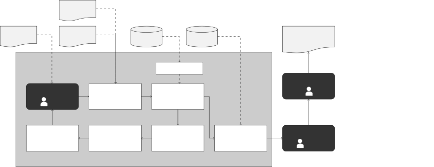
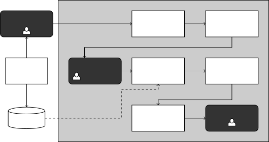

# Grammar-Guided Evolutionary Search for Discrete Prompt Optimisation

Muzhaffar Hazman ^(†)^(†)thanks: Corresponding Author. Email:
m.hazman1@universityofgalway.ie. Note: Work conducted as interns at
Huawei Technologies, Ireland Research Centre. Affiliation: Huawei
Technologies, Ireland Research Center, Ireland Affiliation: University
of Galway, Ireland    Minh-Khoi Pham¹¹footnotemark: 1
Affiliation: Huawei Technologies, Ireland Research Center, Ireland
Affiliation: Dublin City University, Ireland   
Shweta Soundararajan²²footnotemark: 2 Affiliation: Huawei Technologies,
Ireland Research Center, Ireland Affiliation: Technological University
Dublin, Ireland    Goncalo Mordido Affiliation: Huawei Technologies,
Ireland Research Center, Ireland    Leonardo Custode Affiliation: Huawei
Technologies, Ireland Research Center, Ireland    David Lynch
Affiliation: Huawei Technologies, Ireland Research Center, Ireland   
Giorgio Cruciata Affiliation: Huawei Technologies, Ireland Research
Center, Ireland    Yucheng Shi Affiliation: Huawei Technologies, Ireland
Research Center, Ireland    Hongmeng Song Affiliation: Huawei
Technologies, Ireland Research Center, Ireland    Wang Chao
Affiliation: Huawei Technologies, Ireland Research Center, Ireland   
Pan Yue Affiliation: Huawei Technologies, Ireland Research Center,
Ireland    Aleksandar Milenovic Affiliation: Huawei Technologies,
Ireland Research Center, Ireland    Alexandros Agapitos
Affiliation: Huawei Technologies, Ireland Research Center, Ireland

###### Abstract

Prompt engineering has proven to be a crucial step in leveraging
pretrained large language models (LLMs) in solving various real-world
tasks. Numerous solutions have been proposed that seek to automate
prompt engineering by using the model itself to edit prompts. However,
the majority of state-of-the-art approaches are evaluated on tasks that
require minimal prompt templates and on very large and highly capable
LLMs. In contrast, solving complex tasks that require detailed
information to be included in the prompt increases the amount of text
that needs to be optimised. Furthermore, smaller models have been shown
to be more sensitive to prompt design. To address these challenges, we
propose an evolutionary search approach to automated discrete prompt
optimisation consisting of two phases. In the first phase,
grammar-guided genetic programming is invoked to synthesise
prompt-creating programmes by searching the space of programmes
populated by function compositions of syntactic, dictionary-based and
LLM-based prompt-editing functions. In the second phase, local search is
applied to explore the neighbourhoods of best-performing programmes in
an attempt to further fine-tune their performance. Our approach
outperforms three state-of-the-art prompt optimisation approaches,
PromptWizard, OPRO, and RL-Prompt, on three relatively small
general-purpose LLMs in four domain-specific challenging tasks. We also
illustrate several examples where these benchmark methods suffer
relatively severe performance degradation, while our approach improves
performance in almost all task-model combinations, only incurring
minimal degradation when it does not.

^(†)^(†)paperid: 4057

## 1 Introduction

The advent of pretrained large language models (LLMs) as general-purpose
Natural Language Inferencing models that are performant in a wide range
of tasks has prompted both academic and industrial use of these models
to tackle challenging tasks. Deploying such models typically requires
prompt engineering that customises the behaviour of the model by
manually defining task parameters within prompt templates \[12\]. Manual
trial-and-error prompt engineering is feasible for many general natural
language tasks, mitigating the need for parameter finetuning. However,
complex or niche tasks often require longer prompts to which a model’s
performance can be highly sensitive. Optimising such prompt templates is
not trivial, as the search space is large and evaluating candidate
solutions may be expensive \[35, 37\].

In pursuit of better task performance of pretrained LLMs, the high
computational costs associated with finetuning have inspired a plethora
of black-box prompt engineering techniques that treat the internal
weights of any given LLMs as untrainable and unaccessible \[35\]. Recent
work has shown that the performance of LLMs across various tasks can be
further improved through prompt optimisation – editing and adjusting
prompt templates with the goal of improving task performance. Algorithms
for automatic prompt optimisation fall into two main categories; where
optimisation is performed over prompt embeddings, or by directly editing
the natural language description the seed prompt. These classes of
methods are known as soft prompt tuning and automatic discrete prompt
optimisation (DPO), respectively \[35\].



Figure 1: Our Grammar-Guided Genetic Programming for Discrete Prompt
Optimisation (G3P DPO) where each individual represents an edited
version of a prompt. The search iteratively produces and evaluates
individuals, returning the fittest as the task-optimised prompt.

Previous works in DPO are numerous and include approaches that apply
search strategies in broad (potentially infinite) search spaces \[8\],
constrained optimisation to parts of a prompt template \[25\], limited
text editing to syntactic operations \[45\], or applied edits at a
single preset chunking level \[32\]. In particular, most of the work in
this area evaluated DPO approaches on tasks that require a short prompt
template \[15\]. For instance, Deng et al. limited their search to only
5 tokens \[8\], and Yang et al. limited prompt templates to 500
characters \[43\]. Although numerous DPO methods have been evaluated on
challenging tasks \[34\], many of these tasks are posed in a way that
requires prompt templates of minimal length.

Furthermore, DPO methods that employ LLM-based editing typically use
very large models to edit and evaluate their prompts \[1, 11, 15, 43\].
This is likely due to their reliance on the large model’s ability to
identify weaknesses within a prompt and the edits needed to improve it.
PromptWizard, a particularly effective recent DPO method, was shown to
be reliable in many tasks when paired with GPT-4, GPT3.5, or Llama 70B,
but resulted in significant performance degradation when applied to
Llama3 8B \[1\].

Although DPO methods that employ LLM-based editing have demonstrated
effectiveness on large-scale models, their application to smaller LLMs
remains a significant gap; see Tab. 1. Concurrently, DPO techniques
without LLM-based editing seldom address tasks that require lengthy and
intricate prompt templates. Adapting smaller LLMs to such tasks is
attractive due to their reduced compute requirements and accelerated
inference, but these models exhibit a pronounced sensitivity to prompt
formulation \[49\]. Consequently, without suitable optimisation methods,
performance degradation is likely when opting for smaller models.
Bridging this gap necessitates DPO strategies that are designed and
evaluated in resource-constrained scenarios.

In this work, we tackle the optimisation of longer prompts for
technically challenging tasks using smaller general purpose LLMs. Our
method formulates the prompt optimisation problem as an evolutionary
programme synthesis problem that is solved by means of Grammar-guided
Genetic Programming \[41\] (G3P); see Fig. 1. The search space is
populated by compositions of prompt-editing functions consisting of
semantic, syntactic, list manipulation, and LLM-based edit operations;
see Tab. 2. Local search is applied to the best individual found with
G3P to further optimise the parameters of its edit operations; see Fig. 2. The neighbourhood is created as a set of point mutations for each of
the parameters of the best performing individual, and the resulting
neighbours are screened using a surrogate model of prompt performance. A
small number of individuals that maximise exploration or exploitation
are selected for real (and expensive LLM-based) fitness evaluation, and
the ultimate individual is selected based on validation score.
Experiments demonstrate that the proposed system improves the
performance of small general-purpose models in complex tasks from
various technical domains; while three notable benchmark approaches –
two that use LLM-based edits and one that uses token search – exhibited
a greater propensity for performance degradation when given the same
base prompts, tasks, and models.

## 2 Related Work

### 2.1 LLM Performance Sensitivity to Prompt Design

LLMs are highly sensitive to prompt design. Significant changes in
performance are induced from minor changes to the prompt, such as
semantically identical paraphrasing; adding ostensibly spurious changes
in text format (e.g., casing, separators, number of spaces) \[37\], as
well as the order of answer choices \[46\], and In-Context Learning
(ICL) demonstrations \[25\]. In particular, this brittleness is
especially exacerbated in smaller models as well as complex and
domain-specific tasks \[49\], rendering manual prompt engineering
unreliable and unscalable. This sensitivity has also led to methods that
have been found to reliably improve task performance, including
ICL\[4\], Chain-of-Thought (CoT) prompting, Few-Shot CoT, and Zero-Shot
CoT \[40\]. This suite of methods that operate on the LLM context have
motivated prompt engineering as a viable approach for improving LLM
performance without requiring costly finetuning.

Given the complexity of designing effective prompts that must consider
different model capabilities and task requirements, numerous automated
prompt optimisation approaches have been proposed. Our approach is an
instance of Automated Discrete Prompt Optimisation (DPO), where prompts
are treated as a set of discrete tokens; as opposed to Soft Prompt
Tuning \[35\] which performs optimisation within the LLM’s embedding
space. DPO approaches generally comprise a set of edit operations, an
optimisation algorithm, and a reward signal to guide the edits.

### 2.2 LLM-based Editing in DPO

Several recent works leveraged LLMs to rewrite prompts using
self-reflection or few-shot feedback loops. For example, ProTeGi \[33\]
instruments an LLM to generate a reflection expressed in natural
language based on task errors incurred by a base prompt, similar to
methods like REFINER \[31\] and PromptAgent \[39\]– and using this
summary to edit the prompt. OPRO \[43\] and PromptWizard \[1\] adopt a
similar strategy, but these methods also incorporated ICL demonstrations
during the rewriting phase. Building on this, PACE \[9\] frames prompt
editing as a policy learning problem, using an actor-critic
reinforcement learning setup to iteratively refine discrete prompts
based on LLM feedback.

However, many of these methods rely heavily on frequent LLM calls,
making them expensive, less interpretable, and difficult to scale in
practice. Although these have been shown to be reliably effective, they
often assume access to large proprietary models, limiting their
applicability in resource-constrained settings\[1, 15\]. Crucially, the
majority of existing DPO approaches, particularly those that rely on
LLM-based edits, rely on very large models. Table 1 summarises the LLMs
used in several prior DPO works, illustrating their reliance on large
and often proprietary LLMs.

### 2.3 Search-based DPO

| Model    | Size   | LLM-Edit                 | LLM-Evo       | STES       |
| -------- | ------ | ------------------------ | ------------- | ---------- |
| GPT-4    | 1.8T\* | \[1, 9, 33, 39, 43\]     | \[7\]         | \[36\]     |
| PaLM2    | 340B   | \[39, 43\]               | \[11\]        | \[19\]     |
| GPT-3.5  | 175B\* | \[1, 9, 31, 33, 39, 43\] | \[7, 11, 13\] | \[24, 36\] |
| GPT-3    | 175B\* | \[33\]                   | \[30\]        | \[32\]     |
| Llama2   | 70B    | \[1\]                    |               | \[36\]     |
| Mixtral  | 45B    |                          |               | \[36\]     |
| Llama2   | 13B    |                          | \[23\]        |            |
| Nemo     | 12B    |                          |               | \[44\]     |
| T5-XXL   | 11B    |                          | \[42\]        |            |
| Llama3.1 | 8B     |                          |               | \[44\]     |
| Llama2   | 7B     |                          | \[23\]        |            |
| BLOOMZ   | 7B     |                          | \[23\]        |            |
| Qwen2.5  | 7B     |                          |               | \[44\]     |
| Alpaca   | 7B     |                          | \[13\]        |            |
| GPT-2 XL | 1.5B   |                          | \[42\]        | \[8, 32\]  |

Table 1: LLMs and their sizes as utilised and evaluated in prior DPO
works, categorised into: LLM-based Editing (LLM-Edit), LLM-based
Evolutionary Analogue (LLM-Evo), and Syntatic/Token/Edit Search (STES). \* indicates approximated sizes.

A common approach to DPO is to search for a sequence of edit operations
that, when applied to a manually crafted prompt, creates an improved
prompt that boosts the LLM’s performance on a given task. This class of
edit-search DPO methods are practical and lightweight, since each edit
operation is performed at the token level, and typically involve minor
rewrites and rule-based edits. The underlying search strategies include
beam search, reinforcement learning (RL), and genetic search, each
offering distinct benefits and drawbacks. For instance, in Tempera
\[45\] the authors frame DPO as an RL problem, with the action space
consisting of edits to chunked phrases of the prompt, sequence ordering
of ICL demonstrations, and synonymising classification labels. GrIPS
\[32\] uses a similar set of operations but replaces the RL-based
optimiser with beam search, while SPRIG \[44\] extends this by
optimising system prompts using GrIPS’ editing operations. SAMMO \[36\]
employs enumerative and iterative search algorithms, combining
structural, syntactic, and LLM-based edits for a wider variety of
actions. The above methods do not chunk the prompt prior to editing or
use a single level of chunking to do so; to the best of our knowledge
existing methods do not dynamically assigns different chunking levels
for each operation.

Search has also been applied to propose individual tokens that make up
an optimised prompt. In RL-Prompt \[8\], the RL agent selects the next
token at each step, training a policy model to predict the next token
based on a task-specific reward. It uses masked language modelling for
text classification by selecting high-probability classification label
synonyms predicted by RL policy. PReWrite \[19\] shares this
formulation, but fine-tunes a dedicated LLM for prompt rewriting, while
DSP \[24\] instead trains a small policy model to generate directional
stimulus prompts guiding the LLM output.

### 2.4 Evolutionary Search in DPO

Evolutionary algorithms are powerful optimisation techniques inspired by
natural selection, using processes of mutation, crossover, and selection
to efficiently explore complex discrete search spaces \[2\]. Current
evolutionary DPO approaches invoke smaller models for LLM-based editing,
wherein evolutionary operators are emulated through prompting
strategies. Here, the baseline prompt is regarded as the genome
constituting an individual. Updated individuals (prompts) are generated
by performing LLM-based edits on individuals (mutation) selected from
the population at the previous generation, and by combining two
individual’s geneomes (via crossover) to create a new individual.
Variations of this formulation have been explored \[7, 11, 13, 15, 23,
42\]. However, we are aware of only one DPO approach that does not
replace evolutionary reproduction operators with LLM-based analogues.
PLUM \[30\] tested several metaheuristic algorithms, where instead of
applying LLM edits to produce new prompts, mutation and crossover are
applied to phrases in the prompt.

Two major challenges have hindered the widespread adoption of
evolutionary DPO. Firstly, population-based search using frontier LLMs
is computationally infeasible. Secondly, evolutionary operators, where a
smaller LLM performs mutation and crossover over the entire prompt, tend
to be destructive and often produce unviable prompts \[23\] or degraded
performance on certain tasks \[13\]. The prospect of leveraging smaller
LMs within an evolutionary search procedure is intriguing, since the
search becomes computationally feasible. Furthermore, the selection
mechanism automatically filters unviable prompts from the population,
given an adequate search budget. The keys to unlocking the full
potential of evolutionary search are more targeted / fine-grained edit
operations, structured search spaces, and surrogate-assisted fitness
evaluations. In this context, the grammar-guided search \[41\] offers a
promising path forward.

## 3 Approach

[TABLE]

Table 2: Edit operations that can be assigned by our grammar, divided
into List Manipulation and Semantically Aligned operations. \* A/S
indicates an index can either be
$`\langle\textrm{{atomic\textunderscore\-view}}\rangle`$ or
$`\langle\textrm{{slice\textunderscore\-view}}\rangle`$; A indicates the
index must be $`\langle\textrm{{atomic\textunderscore\-view}}\rangle`$.

### 3.1 Prompt Structure

To enable localised search of edit operations during optimisation, we
partition the prompts into modular sections, allowing the search process
to adaptively edit each functional part of the prompt without disrupting
the entire template. We formalise the structure of a prompt template,
$`P`$, as a composition of the following six sections, $`s\in S`$:

- •
  Persona: Instructions for the LLM to adopt a specific persona or role
  while generating responses.
- •
  Task: Instructions specifying the particular task for the LLM to
  perform.
- •
  Output Format: Instruction defining the required format of the output,
  often supplemented by output examples adhering to the specified
  structure.
- •
  In-Context Demonstrations: For each case, five example demonstrations
  with the most similar inputs are retrieved from the training set to
  enable learning by a few shots \[4\]. The grammar allows the search to
  determine which of these five are included and their order.
- •
  Context: A section reserved for additional retrieved information,
  typically when using retrieval-augmented generation (RAG). This
  includes a prefix describing the text followed by the information.
- •
  Chain-of-Thought (CoT): Instructions designed to invoke step-by-step
  reasoning in the model output, as proposed in \[18\].

Our grammar defines each of the Persona, Output Format, Context, and CoT
sections as optional. This flexibility incorporates the ablation of
these sections into our search space, enabling exploration of prompt
variants that omit or modify specific structural components.

### 3.2 Edit Operations

The grammar allows assignment of a range of edit operations,
$`\langle\textrm{edit\_op}\rangle`$, as listed in Tab. 2, which falls
into two categories:

1.  1.  List Manipulation, $`\langle\textrm{{list\_op}}\rangle`$: Operations
        that manipulate the text as a list of chunked strings such as
        insertion, deletion, and reordering.
2.  2.  Semantically Aligned Operations,
        $`\langle\textrm{{semantic\_op}}\rangle`$: Includes both LLM-based
        and text-processing operations designed to preserve or enhance
        semantic coherence. LLM-based edits, such as paraphrasing and
        summarising, are performed using the LLM. These edits are not
        applied to the In-Context Demonstrations.

Each edit operation is invoked with two arguments:
$`\langle\textrm{level}\rangle`$, indicating the chunking granularity,
and $`\langle\textrm{{index}}\rangle`$, specifying the chunk(s) to edit.
We define chunking as the non-desctructive segmentation of a string at a
given level that allows reconstruction without any alterations. E.g.
given the string ‘You are an expert. Answer this question:’, chunking at
the word level gives the list of chunks $`C`$: \[’You’, ’are’, ’an’,
’expert.’, ’Answer’, ’this’, ’question:’\] whereas chunking at the
sentence level gives a $`C`$ of \[’You are an expert.’, ’Answer this
question:’\]. After each edit, all chunks are combined into a cohesive
paragraph. In our approach, the grammar may assign the following
chunking levels:

- •
  Word: tokenised with NLTK.word_tokenize().
- •
  Sentence: split with NLTK.sentence_tokenize().
- •
  Phrase: parsed with a constituency-based CRF parser ³³ 3
  [https://github.com/yzhangcs/parser](https://github.com/yzhangcs/parser).

The $`\langle\textrm{{index}}\rangle`$ may be an
$`\langle\textrm{{atomic\textunderscore\-view}}\rangle`$ (a single
integer) or a $`\langle\textrm{{slice\textunderscore\-view}}\rangle`$
index (two integers that define the start and end of a contiguous span).
If a selected index $`i`$ exceeds the number of chunks in the input
text, the edit is applied to the $`(i\bmod|C|)`$-th chunk. E.g. an
atomic of (5) for the lists above returns the elements ’this’ and
’Answer the question:’, respectively.

### 3.3 Grammar-Guided Genetic Programming (G3P)

```math
\displaystyle\langle\textrm{persona\_sec}\rangle \displaystyle\models \displaystyle\langle\textrm{persona\_expr}\rangle\;\mid\;\langle\textrm{null\_string}\rangle
```

```math
\displaystyle\langle\textrm{persona\_expr}\rangle \displaystyle\models \displaystyle\langle\textrm{edit\_op}\rangle\langle\textrm{persona\_expr}\rangle\;\mid\;\langle\textrm{{PERSONA}}\rangle
```

```math
\displaystyle\langle\textrm{edit\_op}\rangle \displaystyle\models \displaystyle\langle\textrm{list\_op}\rangle\;\mid\;\langle\textrm{semantic\_op}\rangle
```

```math
\displaystyle\langle\textrm{PERSONA}\rangle \displaystyle\models
```

```math
\displaystyle\langle\textrm{null\_string}\rangle \displaystyle\models
```

Example 1 Grammar Model excerpt: the Persona section.

#### Grammar:

Grammar-Guided Genetic Programming (G3P) \[41\] is a form of Genetic
Programming (GP) \[20\] that uses a formal grammar, typically in
Backus–Naur Form, to guide the generation and variation operators
(crossover and mutation) of expression-tree structures. The grammar
constrains the search space and ensures syntactic correctness during
evolution \[29\].

In our G3P DPO approach, our grammar $`G`$ consists of production rules
that yield Python-executable code for applying
$`\langle\textrm{{edit\_op}}\rangle`$ transformations to sections,
$`P_{s}`$, of a human-authored base prompt, $`P_{0}`$. See Appendix C
for our complete grammar. In a given population, $`\mathcal{P}`$, each
individual $`I`$ is represented by its genotype (a sequence of integers)
that maps through $`G`$ to its phenotype – a set of edit sequences
$`E_{S,I}=\{\,e_{s,I}\mid s\in S\}`$, one for each prompt section where
$`S=\{\texttt{Persona},\texttt{Task},\texttt{Output},\texttt{ICL},\texttt{Context},\texttt{CoT}\}`$
per Sec. 3.1. Each $`e_{s,I}`$ is executed on its corresponding section
of the base prompt $`P_{s}`$. Each $`e_{s,I}`$ is applied independently
to its corresponding $`P_{s}`$, enabling modular edits while preserving
structural integrity, and the final prompt is given as:

```math
P_{I}=\texttt{concatenate}\left(\texttt{execute}(e_{s,I}(P_{s}))\right),\quad\forall s\in S. \tag{1}
```

where execute() represents Python’s built-in eval function and
concatenate() joining multiple strings into one.

We provide a simplified example of our grammar in Example 1. In this
example, $`\langle\textrm{PERSONA}\rangle`$ is the text of the Persona
section from $`P_{0}`$. The edited section
$`\langle\textrm{persona\textunderscore\-sec}\rangle`$ may be defined as
a null string or as $`\langle\textrm{persona\_expr}\rangle`$, which
recursively applies the edit operators
$`\langle\textrm{{edit\_op}}\rangle`$ to the original text from within
the original prompt. We present the edit operators available in our
grammar, $`\langle\textrm{{edit\_op}}\rangle`$, in Sec. 3.2. See our
complete grammar in Appendix C.

#### Grammar-Guided Genetic Programming:

To identify the optimum set of edit sequences $`E_{S,I}`$, we employ the
Context-Free Grammar-Guided Genetic Programming on Serialised Trees
algorithm as implemented in the Alogos framework⁶⁶ 6
[https://github.com/robert-haas/alogos](https://github.com/robert-haas/alogos).
Evolution proceeds through tournament selection, subtree crossover, and
subtree mutation operators over a population $`\mathcal{P}`$ initialised
with PTC2 \[26\]. For $`G`$ generations, every individual in
$`\mathcal{P}`$ is evaluated: their phenotype, $`E_{S,I}`$, is executed
to create their prompt template, $`P_{I}`$. The fitness of each
individual, $`f_{I}`$, is measured by prompting $`M_{T}`$ with $`P_{I}`$
on a random sample of the training data,
$`d_{\text{train}}\subset\mathcal{D}_{\text{train}}`$.

The individual with maximum $`f_{I}`$ in each generation is validated on
the validation set $`\mathcal{D}_{\text{val}}`$, giving that
individual’s validation fitness $`f_{I,\text{val}}`$. Each individual’s
fitness determines its likelihood of survival into the next generation
and selection for reproduction via subtree crossover and mutation.
Survivors and selected offspring form the updated population for the
next generation. The settings and operators used for our search are
presented in Appendix D.

The individual with maximum $`f_{I,\text{val}}`$ is deemed the elite
$`\mathcal{E}`$. At the start of every generation, where $`\mathcal{E}`$
is not in $`\mathcal{P}`$, it replaces the worst performing individual
$`I_{\text{worst}}=\arg\min_{I\in\mathcal{P}}f_{I}`$. After $`G`$
generations, the prevailing elite $`\mathcal{E}`$ produces the best
individual $`I^{*}`$ with its prompt representing the final optimised
prompt $`P^{*}`$. This prompt is then evaluated on a held-out testing
set $`\mathcal{D}_{\text{test}}`$.

### 3.4 Post-Hoc Local Search

Neighbourhood: Starting from the best-evolved individual in G3P DPO,
$`I^{*}`$ and its set of edit sequences, $`E_{S,I}`$, we define its
neighbours using a point mutation operator which randomly perturbs an
index parameter in $`E_{S,I}`$. For instance, applying this operator to
swap($`idx_{1}`$, $`idx_{2}`$) gives either swap($`idx_{3}`$,
$`idx_{2}`$) or swap($`idx_{1}`$, $`idx_{3}`$), where $`idx_{1}`$ and
$`idx_{2}`$ are the index values in $`e_{S}`$ and
$`idx_{3}\in\{1,\ldots,U\}`$. The upper bound $`U`$ is defined as
$`2\times`$ the maximum number of chunks found in an input to an edit
operation during the execution of $`E_{S,I}`$.

Using this operator, we enumerate the neighbourhood $`N_{I^{*}}`$ of
$`I^{*}`$ by targetedly applying it to every index within $`E_{S,I}`$.
We create 10 unique neighbours for each index, resulting in a
neighbourhood size of $`|N_{I^{*}}|=10\times n_{idx,I}`$, where
$`n_{idx,I}`$ is the number of indexes in $`E_{S,I}`$. The fitness of
each neighbour is predicted using our ensemble-based surrogate model
which returns the mean and variance of each neighbour’s predicted
fitness across its 10 submodels. To balance exploration and
exploitation, we select the 25 neighbours with the highest mean and the
25 with the highest variance of the predicted fitness, $`\hat{f}(P)`$
and $`\sigma^{2}(P)`$ respectively. The resulting 50 neighbours are then
scored by combining their performance on the validation set
$`D_{\text{val}}`$ and on a random sample
$`d_{\text{train}}\subset D_{\text{train}}`$ with
$`|d_{\text{train}}|=|D_{\text{val}}|`$. The neighbour with the highest
combined score is retained as our best individual, yielding the
optimized prompt. We illustrate this local search process in Fig. 2.



Figure 2: Our Post-Hoc Local Search, which generates and evaluates
variations of the best individual found during G3P DPO, each differing
from one another by the value of one index.

Surrogate Model: To manage the computational costs of local search over
large neighbourhoods, we train a surrogate ensemble to predict prompt
fitness from a Sentence-BERT embedding, using data collected during G3P
DPO.

We employ an ensemble of neural networks
$`F_{i}:X_{P}\in\mathbb{R}^{1\times D}\rightarrow f\in\mathbb{R}`$,
where $`X_{P}`$ is the embedding of prompt $`P`$, $`D`$ is the length of
$`X_{P}`$, $`f`$ is the fitness of $`P`$, and $`i\in\{1,\ldots,10\}`$.
Each $`F_{i}`$ comprises of linear layers of decreasing widths connected
with tanh activation and dropout. To train the ensemble, we first split
the training data in a 70:30 ratio into $`D_{\mathrm{surr,train}}`$ and
$`D_{\mathrm{surr,val}}`$, respectively. We then use bootstrap sampling,
with replacement, on $`D_{\mathrm{surr,train}}`$ to create training
subsets $`d_{\mathrm{surr,train}}^{i}`$. Each model $`F_{i}`$ is trained
on $`d_{\mathrm{surr,train}}^{i}`$ for $`T=200`$ epochs. Let
$`\mathcal{L}_{i}^{(t)}`$ denote the validation loss of model $`F_{i}`$
at epoch $`t`$. We track the average ensemble validation loss across all
submodels as
$`\bar{\mathcal{L}}^{(t)}=\tfrac{1}{10}\sum_{i=1}^{10}\mathcal{L}_{i}^{(t)}`$
and store the parameters of the models $`W_{t}`$ corresponding to the
epoch $`t^{*}`$ such that
$`t^{*}=\arg\min_{t\in\{1,\ldots,T\}}\bar{\mathcal{L}}^{(t)}`$.

The learning rate, batch size, neural network topology, and dropout rate
are defined for the sorrugated ensemble during initialisation by way of
hyperparameter testing. We sample 10 unique combinations of these
hyperparameters and test each using a 5-fold cross-validation of the
mean square error between the predicted and actual fitness values as
averaged across all submodels. We then used the best-performing
hyperparameter set to train the surrogate model.

At inference time, the ensemble with parameters $`W_{t}`$ takes in
$`X_{P}`$ of each neighbour in $`N_{I^{*}}`$ and predicts its fitness
$`F_{i}(X_{P})`$ for each model $`i\in{1,\ldots,10}`$. The surrogate
returns the mean predicted fitness
$`\hat{f}(P)=\tfrac{1}{10}\sum_{i=1}^{10}F_{i}(X_{P})`$, and the
variance,
$`\sigma^{2}(P)=\tfrac{1}{10}\sum_{i=1}^{10}\bigl(F_{i}(X_{P})-\hat{f}(P)\bigr)^{2}`$.
$`\hat{f}(P)`$ represents the ensemble’s estimate of the neighbour’s
fitness, while $`\sigma^{2}(P)`$ provides an estimate of the epistemic
uncertainty associated with the surrogate’s prediction.

## 4 Evaluation

[TABLE]

Table 3: Datasets used in our experiments. Performance for each task is
reported using the metric defined by each task’s respective authors.

### 4.1 Datasets, Models, and Prompts

Datasets: Four challenging and domain-specific NLP tasks are selected to
evaluate the proposed approach: PubMedQA, a biomedical
question-answering dataset collected from PubMed abstracts requiring
domain-specific reasoning \[16\]; ETHOS, a binary classification dataset
requiring detection of hate speech and offensive language in text
\[28\]; ConvFinQA, a conversational financial question-answering dataset
designed for multiturn numerical reasoning \[6\]; and TAT-QA, a
large-scale question-answering dataset requiring reasoning over tabular
and textual data \[47\]. These datasets provide a broad testbed covering
different types of reasoning, multiple domains, and diverse language
understanding tasks.

To ensure consistency with evaluation protocols adopted by the
benchmarks, we reuse the train-validation-test data split for TAT-QA and
the train-dev split for ConvFinQA. For the latter, the dev set is split
50:50 to form validation and test sets. We also reuse the author-defined
splits for PubMedQA with the sampling and randomisation seed provided by
the authors. Since ETHOS does not have predefined splits, random
sampling is used to form splits with a 50:20:30 train-val-test ratio.
The same splits are maintained when evaluating all approaches, models,
and methods. See Appendix A for additional details on the datasets. The
performance of a prompt is measured using the corresponding evaluation
metrics as defined by the authors of each dataset. The performance of a
prompt on a given task is measured using syntactic comparison to
ground-truth labels provided in the dataset. This eliminates the need to
use LLMs to score its own output.

|                    |      |                 |                      |               |              |                |                        |
| ------------------ | ---- | --------------- | -------------------- | ------------- | ------------ | -------------- | ---------------------- |
|                    |      |                 | Benchmark Approaches |               |              | Our Approaches |                        |
| Model              | Size | Baseline Prompt | PromptWizard         | OPRO          | RL-Prompt    | G3P DPO        | G3P DPO + Local Search |
| PubMedQA           |      |                 |                      |               |              |                |                        |
| Llama3.2           | 3B   | 43.8            | 56.8 (↑30%)          | 29.5 0(↓33%)  | 10.5 0(↓76%) | 70.0 0(↑60%)   | 66.5 0(↑52%)           |
| Llama3             | 8B   | 31.7            | 72.2 (↑128%)         | 34.5 00(↑9%)  | 40.0 0(↑26%) | 67.3 (↑112%)   | 69.7 (↑120%)           |
| Gemma2             | 9B   | 58.2            | 34.2 0(↓41%)         | 28.41 0(↓51%) | 26.5 0(↓55%) | 61.8 00(↑6%)   | 64.8 0(↑11%)           |
| Qwen2.5^(∗)        | 32B  | 70.4            | –                    | 56.06 0(↓20%) | –            | –              | –                      |
| ETHOS              |      |                 |                      |               |              |                |                        |
| Llama3.2           | 3B   | 70.3            | 78.0 0(↑11%)         | 59.7 0(↓15%)  | 25.0 0(↓64%) | 71.0 00(↑1%)   | 77.3 0(↑10%)           |
| Llama3             | 8B   | 39.1            | 58.7 0(↑50%)         | 27.6 0(↓29%)  | 04.7 0(↓88%) | 73.3 0(↑88%)   | 81.3 (↑108%)           |
| Gemma2             | 9B   | 83.0            | 68.00(↓18%)          | 00.0 0(↓100%) | 83.5 00(↑1%) | 83.3 00(↑0%)   | 83.7 00(↑1%)           |
| Qwen2.5^(∗)        | 32B  | 89.0            | –                    | 89.7 00(↑1%)  | –            | –              | –                      |
| TAT-QA             |      |                 |                      |               |              |                |                        |
| Llama3.2           | 3B   | 24.9            | 02.9 0(↓88%)         | 35.0 0(↑41%)  | 21.8 0(↓12%) | 42.7 0(↑72%)   | 44.2 0(↑78%)           |
| Llama3             | 8B   | 10.9            | 36.4 (↑234%)         | 29.5 (↑171%)  | 05.5 0(↓49%) | 32.3 (↑197%)   | 34.6 (↑218%)           |
| Gemma2             | 9B   | 40.5            | 38.7 00(↓4%)         | 38.9 0(↓4%)   | 34.5 0(↓15%) | 34.8 0(↓14%)   | 40.6 00(↑0%)           |
| Qwen2.5^(∗)        | 32B  | 37.0            | –                    | 63.2 0(↑71%)  | –            | –              | –                      |
| ConvFin-QA         |      |                 |                      |               |              |                |                        |
| Llama3.2           | 3B   | 34.5            | 18.2 0(↓47%)         | 17.8 0(↓48%)  | 03.6 0(↓90%) | 38.4 0(↑11%)   | 38.8 0(↑12%)           |
| Llama3             | 8B   | 19.6            | 01.4 0(↓93%)         | 05.5 0(↓72%)  | 08.5 0(↓57%) | 23.1 0(↑18%)   | 33.5 (0↑71%)           |
| Gemma2             | 9B   | 61.9            | 01.2 0(↓98%)         | 53.6 0(↓13%)  | 45.5 0(↓26%) | 49.8 0(↓20%)   | 54.5 0(↓12%)           |
| Qwen2.5^(∗)        | 32B  | 37.0            | –                    | 69.4 0(↑88%)  | –            | –              | –                      |
| Mean Relative Gain |      | –               | ↑5%                  | ↓12%^(∗∗)     | ↓42%         | ↑44%           | ↑56%                   |

Table 4: Performance of prompts optimised using benchmark and our
approaches. Relative gain over baseline prompt performance shown in
parantheses. Best and second-best performance measured for each
task-model combinantion is bolded and underlined, respectively.
\*Qwen2.5 32B was only used to evaluate the performance of OPRO with a
larger model. \*\*Excludes Qwen2.5 32B results for comparability with
other approaches.

Models: We evaluate three instruction-tuned LLMs of varying sizes for
both prompt editing and generation tasks: Llama3.2 3B, Llama3 8B, and
Gemma2 9B; see Appendix F for LLM hyperparameters. These intermediate
size LLMs strike a balance between general-purpose reasoning ability and
computational efficiency. Clear and concise task instructions are more
crucial for smaller LLMs due to their lack of domain-specific knowledge,
attenuated capabilities in reasoning tasks \[22, 50\], and to deduce
task requirements from provided demonstrations \[27\].

Prompts: For each task, we establish baseline performance by taking a
manually engineered baseline prompt template and providing five
in-context demonstrations as described in Sec 3.1; see baseline prompt
templates for each task in Appendix H. Optimisation of these prompts
proceeds in two steps. First, the baseline prompt is optimised using the
G3P DPO algorithm described in Section 3.3. Second, the partially
optimised prompt from G3P DPO seeds the Post-Hoc Local Search algorithm
described in Section 3.4. To assess the benchmark algorithms, the
baseline prompt is provided as input to PromptWizard, OPRO and
RL-Prompt. Finally, the performance of the baseline prompts and
optimised prompts realised by all methods are assessed on the holdout
test set of all four datasets.

The tasks we evaluate are challenging, especially for smaller LLMs.
Prior work applied a wide range of models. Consequently, comparable
baseline performance results for the models considered in this paper are
not available. Nonetheless, to provide some context, we report both the
literature baseline performance results in Appendix B, and the
performance of our models using baseline prompts. Overall, our results
are in line with existing performance trends by model size.

### 4.2 Benchmark Approaches

We benchmark our approach against three leading prompt optimisation
methods: PromptWizard \[1\], OPRO \[43\], and RL-Prompt \[8\].
PromptWizard was run with the default settings defined by its authors.

To manage the significantly higher costs of OPRO and RL-Prompt, we limit
the LLM-based evaluations on training data to match that of our
approach. We did so to both methods by setting the number of training
data per step to 10 rows, randomly sampled for each step. For RL-Prompt
we also reduced the number of candidate prompts per step to 10
Additionally, OPRO, by default, rejected prompts longer than 500
characters; we increased this limit to 5000. Finally, we updated the
RL-Prompt baseline by appending the searched tokens to the baseline
prompt – rather than replacing the entire prompt. In our preliminary
tests, the short prompts only yielded zero or near-zero performance
across all tasks. All other OPRO and RL-Prompt settings follow the
respective authors’ recommendations.

## 5 Results

### 5.1 Overview

Tab. 4 shows the performance of the baseline prompt, each benchmark, and
our two approaches. We found that the G3P DPO optimised prompts
outperformed the baseline prompts in 10 of 12 task-model combinations
and Local Search added a further performance improvement in 11 of 12
combinations. We found G3P + Local Search to be the best or second-best
for all combinations tested. Of the benchmark approaches, PromptWizard
performed best; improving over baseline prompt performance in 6 cases
and outperforming both our approaches in 3 cases. This shows that while
PromptWizard can improve prompt performance with smaller models, its
effectiveness was inconsistent across tasks and models.

Furthermore, when applying our approach to LLMs with different
capabilities (as observed by the difference in performance figures on
the baseline prompt), we observed a smaller inter-model spread i.e., the
difference between the performance of the best and worst models, than
that of the baseline prompts. Specifically, the baseline prompts had an
average inter-model spread of 35.6 across the four tasks. This was
reduced to 14.4 with G3P DPO and 10.5 with G3P + Local Search. This
reduction was mainly due to the performance gains for the weakest model.
In particular, Llama3 8B was the weakest performer on all tasks with the
baseline prompts, and experienced the largest relative improvement with
our approaches. In contrast, the benchmark approaches showed larger
performance degradations which led to greater average spreads of 27.5,
30.8, and 44.8 for PromptWizard, OPRO, and RL-Prompt, respectively. A
smaller spread between models could reduce the penalties associated with
selecting lower-performance models, allowing the use of these smaller
and more efficient models with less compromise in performance.

On average, the prompts optimised with G3P DPO used 35.4 edit
operations; comprising 32%, 28%, and 40% LLM-based and non-LLM-based
$`\langle\textrm{{semantic\_op}}\rangle`$, and
$`\langle\textrm{{list\_op}}\rangle`$ operations, respectively. Of
these, 36% were performed at the word level, and 43% and 21% at the
phrase and sentence levels, respectively. Among the 12 optimised
prompts, 7 had at least one section that was not edited. Furthermore,
while the grammar allows certain sections of the prompt to be removed,
this was not used in any of the prompts. Taken together, these suggest
that where the original text of a baseline prompt section is already
optimal, our approach does not apply any unnecessary or detrimental
edits.

### 5.2 Low-Performance Prompts

Figure 3: Training fitnesses measured during G3P DPO for the PubMedQA
task. See similar plots for all tasks in Appendix G.

Across the three benchmark approaches, we investigated several instances
in which the performance of the optimised prompt was found to be
severely degraded. In line with PromptWizard’s authors caution against
the use of models with fewer than 70 billion parameters with their
technique, our attempt to do so revealed several failure modes.

PromptWizard: The PromptWizard prompt for TAT-QA in Llama3.2 3B included
an instruction that read “What is the change in net sales for cheese
between 2018 and 2019?”. This change appears to have stemmed from an
attempt to induce prompt instruction using a particular sample of the
training data. This inclusion led to the LLM attempting to answer this
question regardless of the question for the given case at hand. For the
ConvFinQA task, we observed PromptWizard’s prompt template to include a
heavily edited ICL demonstration which did not comply with the stated
output format requirements; causing the LLM outputs during evaluation to
almost always be unparseable. Although PromptWizard was shown to improve
the performance of the ETHOS task in its original publication \[1\], we
found that when applied with a small model to optimise and a longer
prompt, it did not show the same efficacy.

OPRO: We investigated OPRO’s prompt for the ETHOS task on Gemma 2 9B –
even rerunning this three more times gave the same performance figure.
In this task, the outputs are restricted to two predefined
classification labels but in OPRO’s prompt these labels were converted
to unrelated invalid values: “Positive” and “Negative”. This caused the
LLM to output invalid predictions during the evaluation. Suspecting that
this and other performance issues with OPRO stemmed from the sizes of
our selected model, we apply OPRO to optimise the prompt for all tasks
in Qwen2.5 32B; the results are indicated with a \* in Tab. 4. With this
larger and more capable model, OPRO prompts showed a stark increase in
performance over respective baseline prompts in TAT-QA and ConvFinQA, a
small improvement for ETHOS, and a less severe degradation for PubMedQA
than was observed with smaller models.

The sizable variance in OPRO’s efficacy across different models requires
that its application be preceded by testing to ensure that the chosen
model is one that enables OPRO to improve a given prompt. As the
capability and sizes of available LLMs change with the release of new
open-source general-purpose models, the dependence of OPRO on certain
(and likely unstated) capabilities of the LLM necessitates extensive
testing to establish its compatibility with the model. This observation
is in line with recent experiments showing that relatively small models
cannot be self-optimised using OPRO \[27\].

RL-Prompt: Unlike the other two benchmark approaches, RL-Prompt does not
rely on the LLM to edit the prompts. Instead, it searches for tokens to
append to the baseline prompt. We suspect that the poor performance
observed here may be due to two issues. First, in most of its authors’
own evaluations, those tokens formed the entire prompt template; which
is a setting suitable only for tasks needing less detailed instruction.
During preliminary testing of this default approach, we found that the
resulting prompt only led to zero or near-zero performance. However,
since the number of LLM-based evaluations increases with the number of
searched tokens compared to the length of the baseline prompt templates,
increasing the search token count to that of the baseline prompts would
have proved to be unfeasible. Secondly, in pursuing comparable compute
costs, the reduced number of steps for which RL-Prompt was allowed to
run was possibly too few to effectively apply the approach. In its
original publications, the models tested were much smaller. Given the
added computational costs from our relatively larger models, we were
unable to use as many steps as the authors recommended or search for as
many tokens as in the baseline prompts.

G3P DPO: The prompts generated by our solution are not immune to these
failure modes, but the pressure of evolutionary selection and elitism
make it unlikely that they appear in the final prompt. In early
generations, we often observed candidates with zero training fitness;
tournament selection disfavors their including genomes in subsequent
populations. This can be observed via the distribution of training
fitnesses of the individuals across the generations of our search; see
training fitness curves for our G3P DPO in Fig. 3 and Appendix G.
Furthermore, only the highest scoring prompt from each generation is
ever eligible for final selection. Effectively, prompts that cause the
LLM to struggle with output formatting and classification labels (which
typically show single-digit performance values) may only be selected as
the final prompt where all generated prompts also contain similar or
worse issues. Finally, our implementation of elitism guarantees that the
genes of the best performing individual found at any point in the
search, the elite, always remain in the population. This allows for
further exploration of the search space around that individual while
ensuring that if no better individual is found, then this elite will be
returned as the final optimised prompt.

### 5.3 Limitations & Future Works

While our method demonstrates strong empirical performance in a variety
of combinations of tasks and models, it comes with a few inherent
limitations and opens several avenues for future exploration. First,
unlike some other DPO methods using LLM-based editing, our solution
currently does not include edit operations that introduce new
information into the prompt, such as data-driven instruction induction
\[1\], self-reflection \[43\], and phrase injection \[44\].

Furthermore, our evaluation focusses on selected structured NLP tasks
and relatively small open-source language models. A promising future
direction is to extend our framework to support prompt optimisation for
visuo-lingual tasks, where inputs span both text and other modalities
like images or videos. Additionally, incorporating embedding-based or
semantic-aware edit operations may allow for more nuanced modifications
beyond structural changes.

## 6 Conclusion

In this work, we addressed the problem of optimising prompts for smaller
general-purpose LLMs on domain-specific tasks with detailed templates,
demonstrating that existing DPO methods frequently fail in this setting.
In response, we proposed a grammar-guided evolutionary search DPO
solution a grammar model that defines sequences of edit operations on
sections of a manually crafted prompt. We show that this approach
improved the performance of three relatively small LLMs of varying sizes
on four datasets; with only two model-task combinations where it was not
able to. We also introduced a local search that further improves over
the optimised prompts in all cases but one. We believe this approach
will enable practitioners to tailor compact LLMs to specialised domains
more reliably, and motivate future works to tackle DPO in this
challenging scenario.

## References

- \[1\] E. Agarwal, J. Singh, V. Dani, R. Magazine, T. Ganu, and
  A. Nambi. Promptwizard: Task-aware prompt optimization framework.
  _arXiv preprint arXiv:2405.18369_, 2024.
- \[2\] T. Bäck, D. B. Fogel, and Z. Michalewicz. Handbook of
  evolutionary computation. _Release_, 97(1):B1, 1997.
- \[3\] K. Bikov. Financial data analysis with fine-tuned large language
  models, 2025. Preprint. Accessed April 24, 2025.
- \[4\] T. B. Brown, B. Mann, N. Ryder, M. Subbiah, J. Kaplan,
  P. Dhariwal, A. Neelakantan, P. Shyam, G. Sastry, A. Askell,
  S. Agarwal, A. Herbert-Voss, G. Krueger, T. Henighan, R. Child,
  A. Ramesh, D. M. Ziegler, J. Wu, C. Winter, C. Hesse, M. Chen,
  E. Sigler, M. Litwin, S. Gray, B. Chess, J. Clark, C. Berner,
  S. McCandlish, A. Radford, I. Sutskever, and D. Amodei. Language
  models are few-shot learners, 2020.
- \[5\] K. Chen, X. Li, T. Yang, H. Wang, W. Dong, and Y. Gao.
  Mdteamgpt: A self-evolving llm-based multi-agent framework for
  multi-disciplinary team medical consultation, 2025.
- \[6\] Z. Chen, S. Li, C. Smiley, Z. Ma, S. Shah, and W. Y. Wang.
  Convfinqa: Exploring the chain of numerical reasoning in
  conversational finance question answering. _arXiv preprint
  arXiv:2210.03849_, 2022.
- \[7\] W. Cui, J. Zhang, Z. Li, H. Sun, D. Lopez, K. Das, B. A. Malin,
  and S. Kumar. Phaseevo: Towards unified long-context prompt
  optimization for large language models. In _First Workshop on
  Long-Context Foundation Models@ ICML 2024_, 2024.
- \[8\] M. Deng, J. Wang, C.-P. Hsieh, Y. Wang, H. Guo, T. Shu, M. Song,
  E. Xing, and Z. Hu. RLPrompt: Optimizing discrete text prompts with
  reinforcement learning. In Y. Goldberg, Z. Kozareva, and Y. Zhang,
  editors, _Proceedings of the 2022 Conference on Empirical Methods in
  Natural Language Processing_, pages 3369–3391, Abu Dhabi, United Arab
  Emirates, Dec. 2022. Association for Computational Linguistics.
  [10.18653/v1/2022.emnlp-main.222](https://doi.org/10.18653/v1/2022.emnlp-main.222).
- \[9\] Y. Dong, K. Luo, X. Jiang, Z. Jin, and G. Li. Pace: Improving
  prompt with actor-critic editing for large language model. _arXiv
  preprint arXiv:2308.10088_, 2023.
- \[10\] Y. Fei, Y. Hou, Z. Chen, and A. Bosselut. Mitigating label
  biases for in-context learning, 2023.
- \[11\] C. Fernando, D. Banarse, H. Michalewski, S. Osindero, and
  T. Rocktäschel. Promptbreeder: Self-referential self-improvement via
  prompt evolution, 2023.
- \[12\] L. Giray. Prompt engineering with chatgpt: a guide for academic
  writers. _Annals of biomedical engineering_, 51(12):2629–2633, 2023.
- \[13\] Q. Guo, R. Wang, J. Guo, B. Li, K. Song, X. Tan, G. Liu,
  J. Bian, and Y. Yang. Connecting large language models with
  evolutionary algorithms yields powerful prompt optimizers, 2024.
- \[14\] Z. Guo, P. Wang, Y. Wang, and S. Yu. Improving small language
  models on pubmedqa via generative data augmentation, 2023.
- \[15\] C.-J. Hsieh, S. Si, F. X. Yu, and I. S. Dhillon. Automatic
  engineering of long prompts. _arXiv preprint arXiv:2311.10117_, 2023.
- \[16\] Q. Jin, B. Dhingra, Z. Liu, W. W. Cohen, and X. Lu. Pubmedqa: A
  dataset for biomedical research question answering. _arXiv preprint
  arXiv:1909.06146_, 2019.
- \[17\] M. R. Kabir, R. M. Sultan, I. H. Asif, J. Ibn Ahad, F. Rahman,
  M. R. Amin, N. Mohammed, and S. Rahman. Beyond labels: Aligning large
  language models with human-like reasoning. _arXiv preprint
  arXiv:2408.11879_, 2024.
- \[18\] T. Kojima, S. S. Gu, M. Reid, Y. Matsuo, and Y. Iwasawa. Large
  language models are zero-shot reasoners, 2023.
- \[19\] W. Kong, S. Hombaiah, M. Zhang, Q. Mei, and M. Bendersky.
  PRewrite: Prompt rewriting with reinforcement learning. In L.-W. Ku,
  A. Martins, and V. Srikumar, editors, _Proceedings of the 62nd Annual
  Meeting of the Association for Computational Linguistics (Volume 2:
  Short Papers)_, pages 594–601, Bangkok, Thailand, Aug. 2024.
  Association for Computational Linguistics.
- \[20\] J. R. Koza. _Genetic programming - on the programming of
  computers by means of natural selection_. Complex adaptive systems.
  MIT Press, 1993.
- \[21\] Y. Li, R. Kumar, W. Zhang, and T. Nguyen. Toward efficient
  prompt optimization for large language models. In _Proceedings of the
  31st ACM Conference on Information and Knowledge Management (CIKM
  ’23)_, pages 123–132. ACM, 2023a.
  [10.1145/3677052.3698685](https://doi.org/10.1145/3677052.3698685).
- \[22\] Y. Li, X. Yue, Z. Xu, F. Jiang, L. Niu, B. Y. Lin,
  B. Ramasubramanian, and R. Poovendran. Small models struggle to learn
  from strong reasoners, 2025.
- \[23\] Y. B. Li and K. Wu. Spell: Semantic prompt evolution based on a
  llm, 2023.
- \[24\] Z. Li, B. Peng, P. He, M. Galley, J. Gao, and X. Yan. Guiding
  large language models via directional stimulus prompting. _Advances in
  Neural Information Processing Systems_, 36:62630–62656, 2023b.
- \[25\] Y. Lu, M. Bartolo, A. Moore, S. Riedel, and P. Stenetorp.
  Fantastically ordered prompts and where to find them: Overcoming
  few-shot prompt order sensitivity. In S. Muresan, P. Nakov, and
  A. Villavicencio, editors, _Proceedings of the 60th Annual Meeting of
  the Association for Computational Linguistics (Volume 1: Long
  Papers)_, pages 8086–8098, Dublin, Ireland, May 2022. Association for
  Computational Linguistics.
  [10.18653/v1/2022.acl-long.556](https://doi.org/10.18653/v1/2022.acl-long.556).
- \[26\] S. Luke. Two fast tree-creation algorithms for genetic
  programming. _IEEE Transactions on Evolutionary Computation_,
  4(3):274–283, 2000.
- \[27\] S. Min, X. Lyu, A. Holtzman, M. Artetxe, M. Lewis,
  H. Hajishirzi, and L. Zettlemoyer. Rethinking the role of
  demonstrations: What makes in-context learning work? In Y. Goldberg,
  Z. Kozareva, and Y. Zhang, editors, _Proceedings of the 2022
  Conference on Empirical Methods in Natural Language Processing_, pages
  11048–11064, Abu Dhabi, United Arab Emirates, Dec. 2022. Association
  for Computational Linguistics.
  [10.18653/v1/2022.emnlp-main.759](https://doi.org/10.18653/v1/2022.emnlp-main.759).
- \[28\] I. Mollas, Z. Chrysopoulou, S. Karlos, and G. Tsoumakas. Ethos:
  a multi-label hate speech detection dataset. _Complex & Intelligent
  Systems_, 8(6):4663–4678, 2022.
- \[29\] M. Nicolau and A. Agapitos. Understanding grammatical
  evolution: Grammar design. In C. Ryan, M. O’Neill, and J. J. Collins,
  editors, _Handbook of Grammatical Evolution_, pages 23–53.
  Springer, 2018.
- \[30\] R. Pan, S. Xing, S. Diao, W. Sun, X. Liu, K. Shum, J. Zhang,
  R. Pi, and T. Zhang. Plum: Prompt learning using metaheuristics. In
  L.-W. Ku, A. Martins, and V. Srikumar, editors, _Findings of the
  Association for Computational Linguistics ACL 2024_, pages 2177–2197,
  Bangkok, Thailand and virtual meeting, Aug. 2024. Association for
  Computational Linguistics.
- \[31\] D. Paul, M. Ismayilzada, M. Peyrard, B. Borges, A. Bosselut,
  R. West, and B. Faltings. Refiner: Reasoning feedback on intermediate
  representations. _arXiv preprint arXiv:2304.01904_, 2023.
- \[32\] A. Prasad, P. Hase, X. Zhou, and M. Bansal. Grips:
  Gradient-free, edit-based instruction search for prompting large
  language models. _arXiv preprint arXiv:2203.07281_, 2022.
- \[33\] R. Pryzant, D. Iter, J. Li, Y. Lee, C. Zhu, and M. Zeng.
  Automatic prompt optimization with “gradient descent” and beam search.
  In H. Bouamor, J. Pino, and K. Bali, editors, _Proceedings of the 2023
  Conference on Empirical Methods in Natural Language Processing_, pages
  7957–7968, Singapore, Dec. 2023. Association for Computational
  Linguistics.
  [10.18653/v1/2023.emnlp-main.494](https://doi.org/10.18653/v1/2023.emnlp-main.494).
- \[34\] K. Ramnath, K. Zhou, S. Guan, S. S. Mishra, X. Qi, Z. Shen,
  S. Wang, S. Woo, S. Jeoung, Y. Wang, H. Wang, H. Ding, Y. Lu, Z. Xu,
  Y. Zhou, B. Srinivasan, Q. Yan, Y. Chen, H. Ding, P. Xu, and L. L.
  Cheong. A systematic survey of automatic prompt optimization
  techniques, 2025.
- \[35\] P. Sahoo, A. K. Singh, S. Saha, V. Jain, S. Mondal, and
  A. Chadha. A systematic survey of prompt engineering in large language
  models: Techniques and applications, 2024.
- \[36\] T. Schnabel and J. Neville. Symbolic prompt program search: A
  structure-aware approach to efficient compile-time prompt
  optimization, 2024.
- \[37\] M. Sclar, Y. Choi, Y. Tsvetkov, and A. Suhr. Quantifying
  language models’ sensitivity to spurious features in prompt design or:
  How i learned to start worrying about prompt formatting, 2024.
- \[38\] K. Singhal, T. Tu, J. Gottweis, R. Sayres, E. Wulczyn, M. Amin,
  L. Hou, K. Clark, S. R. Pfohl, H. Cole-Lewis, D. Neal, Q. M. Rashid,
  M. Schaekermann, A. Wang, D. Dash, J. H. Chen, N. H. Shah, S. Lachgar,
  P. A. Mansfield, S. Prakash, B. Green, E. Dominowska, B. Agüera y
  Arcas, N. Tomašević, and V. Natarajan. Toward expert-level medical
  question answering with large language models. _Nature Medicine_,
  31:943–950, 2025.
  [10.1038/s41591-024-03423-7](https://doi.org/10.1038/s41591-024-03423-7).
- \[39\] X. Wang, C. Li, Z. Wang, F. Bai, H. Luo, J. Zhang, N. Jojic,
  E. P. Xing, and Z. Hu. PromptAgent: Strategic Planning with Language
  Models Enables Expert-level Prompt Optimization. _arXiv preprint
  arXiv:2310.16427_, 2023.
- \[40\] J. Wei, X. Wang, D. Schuurmans, M. Bosma, B. Ichter, F. Xia,
  E. Chi, Q. Le, and D. Zhou. Chain-of-thought prompting elicits
  reasoning in large language models, 2023.
- \[41\] P. A. Whigham et al. Grammatically-based genetic programming.
  In _Proceedings of the workshop on genetic programming: from theory to
  real-world applications_, volume 16, pages 33–41. Citeseer, 1995.
- \[42\] H. Xu, Y. Chen, Y. Du, N. Shao, W. Yanggang, H. Li, and
  Z. Yang. GPS: Genetic prompt search for efficient few-shot learning.
  In Y. Goldberg, Z. Kozareva, and Y. Zhang, editors, _Proceedings of
  the 2022 Conference on Empirical Methods in Natural Language
  Processing_, pages 8162–8171, Abu Dhabi, United Arab Emirates,
  Dec. 2022. Association for Computational Linguistics.
  [10.18653/v1/2022.emnlp-main.559](https://doi.org/10.18653/v1/2022.emnlp-main.559).
- \[43\] C. Yang, X. Wang, Y. Lu, H. Liu, Q. V. Le, D. Zhou, and
  X. Chen. Large language models as optimizers. In _The Twelfth
  International Conference on Learning Representations_, 2024.
- \[44\] L. Zhang, T. Ergen, L. Logeswaran, M. Lee, and D. Jurgens.
  Sprig: Improving large language model performance by system prompt
  optimization. _arXiv preprint arXiv:2410.14826_, 2024.
- \[45\] T. Zhang, X. Wang, D. Zhou, D. Schuurmans, and J. E. Gonzalez.
  Tempera: Test-time prompting via reinforcement learning. _arXiv
  preprint arXiv:2211.11890_, 2022.
- \[46\] C. Zheng, H. Zhou, F. Meng, J. Zhou, and M. Huang. Large
  language models are not robust multiple choice selectors, 2024.
- \[47\] F. Zhu, W. Lei, Y. Huang, C. Wang, S. Zhang, J. Lv, F. Feng,
  and T.-S. Chua. Tat-qa: A question answering benchmark on a hybrid of
  tabular and textual content in finance. _arXiv preprint
  arXiv:2105.07624_, 2021.
- \[48\] F. Zhu, Z. Liu, F. Feng, C. Wang, M. Li, and T. S. Chua.
  Tat-llm: A specialized language model for discrete reasoning over
  financial tabular and textual data. In _Proceedings of the 5th ACM
  International Conference on AI in Finance_, ICAIF ’24, page 310–318,
  New York, NY, USA, 2024. Association for Computing Machinery.
  ISBN 9798400710810.
  [10.1145/3677052.3698685](https://doi.org/10.1145/3677052.3698685).
- \[49\] J. Zhuo, S. Zhang, X. Fang, H. Duan, D. Lin, and K. Chen.
  Prosa: Assessing and understanding the prompt sensitivity of llms. In
  _Findings of the Association for Computational Linguistics: EMNLP
  2024_, pages 1950–1976, 2024.
- \[50\] B. Zoph, C. Raffel, D. Schuurmans, D. Yogatama, D. Zhou,
  D. Metzler, E. H. Chi, J. Wei, J. Dean, L. B. Fedus, M. P. Bosma,
  O. Vinyals, P. Liang, S. Borgeaud, T. B. Hashimoto, and Y. Tay.
  Emergent abilities of large language models. _TMLR_, 2022.

## Appendices

## Appendix A Dataset Details

| Dataset                                 | PubMedQA\[16\]                    | ETHOS\[28\]           | TAT-QA\[3\] | ConvFinQA\[6\]        |
| --------------------------------------- | --------------------------------- | --------------------- | ----------- | --------------------- |
| Training Set Size                       | 336                               | 548                   | 13,215      | 3,037                 |
| Validation Set Size                     | 164                               | 150                   | 1,668       | 210                   |
| Testing Set Size                        | 500                               | 300                   | 1,663       | 211                   |
| Splits Provided by Dataset Authors      | Yes (via authors’ splitting code) | No                    | Yes         | Yes (train-dev split) |
| Task Selected (if more than one exists) | PQA-Labeled                       | Binary Classification | N/A         | Conversation          |
| Other available metrics                 | F1                                | Precision, Recall, F1 | Exact Match | Program Accuracy      |

Table 5: Task Dataset Details

## Appendix B Survey of Task Performance across Various Models

[TABLE]

Table 6: Performance reported by previous works on each task using
models of various sizes. \* indicates that the model size is
approximated due to it not being publicly disclosed.

## Appendix C Our Grammar

```math
\displaystyle\langle\textrm{PROMPT}\rangle \displaystyle\models \displaystyle\langle\textrm{sec\_persona}\rangle,\langle\textrm{sec\_task}\rangle,\langle\textrm{sec\_task\_cons}\rangle,\langle\textrm{sec\_icl}\rangle,
```

```math
\displaystyle{\langle\textrm{sec\_icl\_examples}\rangle,\langle\textrm{sec\_knowledge}\rangle,\langle\textrm{sec\_format}\rangle,\langle\textrm{sec\_input}\rangle,\langle\textrm{sec\_context}\rangle,\langle\textrm{sec\_cot}\rangle}
```

```math
\displaystyle\langle\textrm{X\_persona\_prompt}\rangle \displaystyle\models
```

```math
\displaystyle\langle\textrm{X\_task\_prompt}\rangle \displaystyle\models
```

```math
\displaystyle\langle\textrm{X\_icl\_prompt}\rangle \displaystyle\models
```

```math
\displaystyle\langle\textrm{X\_format\_prompt}\rangle \displaystyle\models
```

```math
\displaystyle\langle\textrm{X\_context\_prompt}\rangle \displaystyle\models
```

```math
\displaystyle\langle\textrm{X\_cot\_prompt}\rangle \displaystyle\models
```

```math
\displaystyle\langle\textrm{X\_icl\_examples}\rangle \displaystyle\models
```

Persona Section

```math
\displaystyle\langle\textrm{sec\_persona}\rangle \displaystyle\models \displaystyle\langle\textrm{persona\_expr}\rangle
```

```math
\displaystyle{\;\mid\;\langle\textrm{null\_string}\rangle}
```

```math
\displaystyle\langle\textrm{persona\_expr}\rangle \displaystyle\models \displaystyle\langle\textrm{text\_op}\rangle\langle\textrm{persona\_expr}\rangle)
```

```math
\displaystyle{\;\mid\;\langle\textrm{X\_persona\_prompt}\rangle}
```

In-Context Learning Section

```math
\displaystyle\langle\textrm{sec\_icl}\rangle \displaystyle\models \displaystyle\langle\textrm{icl\_expr}\rangle\texttt{+}\langle\textrm{icl\_examples}\rangle
```

```math
\displaystyle{\;\mid\;\langle\textrm{null\_string}\rangle}
```

```math
\displaystyle\langle\textrm{icl\_expr}\rangle \displaystyle\models \displaystyle\langle\textrm{text\_op}\rangle\langle\textrm{icl\_expr}\rangle)
```

```math
\displaystyle{\;\mid\;\langle\textrm{X\_icl\_prompt}\rangle}
```

```math
\displaystyle\langle\textrm{icl\_examples}\rangle \displaystyle\models \displaystyle\langle\textrm{edit\_op}\rangle\langle\textrm{icl\_examples}\rangle)
```

```math
\displaystyle{\;\mid\;\langle\textrm{X\_icl\_examples}\rangle}
```

Task Section

```math
\displaystyle\langle\textrm{task\_persona}\rangle \displaystyle\models \displaystyle\langle\textrm{task\_expr}\rangle
```

```math
\displaystyle\langle\textrm{task\_expr}\rangle \displaystyle\models \displaystyle\langle\textrm{text\_op}\rangle\langle\textrm{task\_expr}\rangle
```

```math
\displaystyle{\;\mid\;\langle\textrm{X\_task\_prompt}\rangle}
```

Format Section

```math
\displaystyle\langle\textrm{sec\_format}\rangle \displaystyle\models \displaystyle\langle\textrm{format\_expr}\rangle\texttt{+}\langle\textrm{format\_examples}\rangle
```

```math
\displaystyle{\;\mid\;\langle\textrm{format\_expr}\rangle}
```

```math
\displaystyle{\;\mid\;\langle\textrm{null\_string}\rangle}
```

```math
\displaystyle\langle\textrm{format\_expr}\rangle \displaystyle\models \displaystyle\langle\textrm{text\_op}\rangle\langle\textrm{format\_expr}\rangle
```

```math
\displaystyle{\;\mid\;\langle\textrm{X\_format\_prompt}\rangle}
```

Context Section

```math
\displaystyle\langle\textrm{sec\_context}\rangle \displaystyle\models \displaystyle\langle\textrm{context\_expr}\rangle\texttt{+}\langle\textrm{context\_examples}\rangle
```

```math
\displaystyle{\;\mid\;\langle\textrm{context\_expr}\rangle}
```

```math
\displaystyle{\;\mid\;\langle\textrm{null\_string}\rangle}
```

```math
\displaystyle\langle\textrm{context\_expr}\rangle \displaystyle\models \displaystyle\langle\textrm{text\_op}\rangle\langle\textrm{context\_expr}\rangle
```

```math
\displaystyle{\;\mid\;\langle\textrm{X\_context\_prompt}\rangle}
```

CoT Section

```math
\displaystyle\langle\textrm{sec\_cot}\rangle \displaystyle\models \displaystyle\langle\textrm{cot\_expr}\rangle
```

```math
\displaystyle{\;\mid\;\langle\textrm{null\_string}\rangle}
```

```math
\displaystyle\langle\textrm{cot\_expr}\rangle \displaystyle\models \displaystyle\langle\textrm{text\_op>}\rangle\langle\textrm{cot\_expr>}\rangle)
```

```math
\displaystyle{\;\mid\;\langle\textrm{X\_cot\_prompt}\rangle}
```

Edit Operators

```math
\displaystyle\langle\textrm{text\_op}\rangle \displaystyle\models \displaystyle\langle\textrm{edit\_op}\rangle\;\mid\;\langle\textrm{dict\_transformation\_op}\rangle\;\mid\;\langle\textrm{llm\_transformation\_op}\rangle
```

```math
\displaystyle\langle\textrm{edit\_op}\rangle \displaystyle\models \displaystyle swap\_elements(index1=\langle\textrm{view\_index\_expr}\rangle,index2=\langle\textrm{view\_index\_expr}\rangle,level=\langle\textrm{chunk\_level}\rangle,texts=
```

```math
\displaystyle\;\mid\;remove\_element(index=\langle\textrm{view\_index\_expr}\rangle,level=\langle\textrm{chunk\_level}\rangle,texts=
```

```math
\displaystyle\;\mid\;readd\_element(index=\langle\textrm{atomic\_view\_index\_expr}\rangle,level=\langle\textrm{chunk\_level}\rangle,texts=
```

```math
\displaystyle\;\mid\;duplicate\_element(index1=\langle\textrm{view\_index\_expr}\rangle,index2=\langle\textrm{atomic\_view\_index\_expr}\rangle,level=\langle\textrm{chunk\_level}\rangle,texts=
```

```math
\displaystyle\langle\textrm{dict\_transformation\_op}\rangle \displaystyle\models \displaystyle remove\_stopwords(index=\langle\textrm{view\_index\_expr}\rangle,texts=
```

```math
\displaystyle\;\mid\;synonimise(index=\langle\textrm{view\_index\_expr}\rangle,texts=
```

```math
\displaystyle\langle\textrm{llm\_transformation\_op}\rangle \displaystyle\models \displaystyle paraphrase(index=\langle\textrm{view\_index\_expr}\rangle,texts=
```

```math
\displaystyle\;\mid\;summarise(percent=\langle\textrm{tenths}\rangle,index=\langle\textrm{view\_index\_expr}\rangle,texts=
```

```math
\displaystyle\langle\textrm{chunk\_level}\rangle \displaystyle\models \displaystyle sentence\;\mid\;phrase\;\mid\;word
```

```math
\displaystyle\langle\textrm{view\_index\_expr}\rangle \displaystyle\models \displaystyle\langle\textrm{atomic\_view\_index\_expr}\rangle\;\mid\;\langle\textrm{slice\_view\_index\_expr}\rangle
```

```math
\displaystyle\langle\textrm{atomic\_view\_index\_expr}\rangle \displaystyle\models \displaystyle[\langle\textrm{zero\_to\_nine,}\rangle]
```

```math
\displaystyle\langle\textrm{slice\_view\_index\_expr}\rangle \displaystyle\models \displaystyle[\langle\textrm{zero\_to\_nine}\rangle,\langle\textrm{zero\_to\_nine}\rangle]
```

```math
\displaystyle\langle\textrm{null\_string}\rangle \displaystyle\models
```

```math
\displaystyle\langle\textrm{non\_zero\_digit}\rangle \displaystyle\models \displaystyle 1\;\mid\;2\;\mid\;3\;\mid\;4\;\mid\;5\;\mid\;6\;\mid\;7\;\mid\;8\;\mid\;9
```

```math
\displaystyle\langle\textrm{tenths}\rangle \displaystyle\models \displaystyle 0.\langle\textrm{non\_zero\_digit}\rangle
```

```math
\displaystyle\langle\textrm{zero\_to\_nine}\rangle \displaystyle\models \displaystyle\langle\textrm{non\_zero\_digit}\rangle\;\mid\;0
```

## Appendix D Grammar-guided GP Settings and Hyperparameters

| Parameter                                               | Value                                                        |
| ------------------------------------------------------- | ------------------------------------------------------------ |
| Evaluate N individuals on Validation Set per Generation | 1                                                            |
| Genetic Programming System (GP)                         | Context-Free Grammar Genetic Programming on Serialized Trees |
| GP max Nodes                                            | 1024                                                         |
| Maximum ICL Available                                   | 5                                                            |
| Offspring Population Size                               | 50                                                           |
| Parent Selection Operator                               | Tournament                                                   |
| Parent Tournament Selection Size                        | 2                                                            |
| Population Initialisation Method                        | Probabilistic Tree Creation 2 \[26\]                         |
| Population Size                                         | 50                                                           |
| Resample Training Data every                            | Generation                                                   |
| Rows of Training Data                                   | 20                                                           |
| Search Implementation                                   | Alogos⁷⁷ 7 https://github.com/robert-haas/alogos             |
| Survivor Selection Operator                             | Tournament                                                   |
| Survivor Tournament Selection Size                      | 4                                                            |
| Number of Generations                                   | 20                                                           |

Table 7: Grammar-guided GP Settings and Hyperparameters

## Appendix E Surrogate Model Settings and Hyperparameters

|                                                |                                                   |
| ---------------------------------------------- | ------------------------------------------------- |
| Parameter                                      | Value                                             |
| Tunable Parameters                             |                                                   |
| Submodel Layer Sizes                           | $`[(128,1),(128,64,1),(128,64,32,1)]`$            |
| Dropout Rate                                   | \[0.0 , 0.1 , 0.2 , 0.5\]                         |
| Batch Size                                     | \[16 , 32\]                                       |
| Learning Rate                                  | $`[10^{-4},10^{-3}]`$                             |
| Non-Tunable Parameters                         |                                                   |
| Activation Function                            | tanh                                              |
| Input                                          | Embeddings of Prompt Template                     |
| Input Encoder                                  | sentence-transformers/all-MiniLM-L6-v2            |
| Epochs                                         | 200                                               |
| Submodel Count                                 | 10                                                |
| Train-Val Split                                | 70:30                                             |
| Hyperparameter Cross-Validation Folds          | 5                                                 |
| Combinations of Tunable Hyperparameters Tested | 10                                                |
| Model Selection Criterion                      | Minimum Validation Loss averaged across submodels |
| Loss                                           | Mean Squared Error                                |
| Optimiser                                      | Adam                                              |

Table 8: Surrogate Model Parameters

## Appendix F LLM Settings

| Parameter                     | Value                                              |
| ----------------------------- | -------------------------------------------------- |
| Max New Tokens                | 2048                                               |
| Sampling                      | False                                              |
| Temperature                   | 0.0                                                |
| Quantisation                  | None                                               |
| Source for Pretrained Weights | [https://huggingface.co/](https://huggingface.co/) |
| HuggingFace Model IDs:        |                                                    |
|   00 – Llama3.2 3B            | meta-llama/Llama-3.2-3B-Instruct                   |
|   00 – Llama3 8B              | meta-llama/Meta-Llama-3-8B-Instruct                |
|   00 – Gemma2 9B              | google/gemma-2-9b-it                               |
|   00 – Qwen 2.5 32B           | Qwen/Qwen2.5-32B-Instruct                          |

Table 9: LLM Parameters

## Appendix G Training-Set Fitness Curves

Figure 4: Mean and Standard Deviation of the Training Fitness at every
generation for our Grammar-guided Search.

## Appendix H Baseline Prompt Templates

### H.1 PubMedQA

This prompt was designed based on the prompt used in \[5\].

"""

You are a Lead Physician responsible for answering challenging medical
questions.

Carefully analyse the Research Paper Abstract given in \[Context\] and
identify keypoints relevant to the \[Question\]. Then, answer the
question in \[Question\] according to the \[Task Constraints\] and
\[Output Constraints\].

You provide clear, concise, evidence-based answers and focus on
precision while considering research nuances.

\## \[Task Constraints\]

Answer the question in the \[Instruction\] according to the \[Output
Constraints\], which is in JSON format: {’Thought’:’...’,
’Answer’:’...’}. In the ’Thought’ section, provide the complete thought
process, and in the ’Answer’ section, provide a conclusion that fully
meets the requirements of the \[Instruction\].\\nIn the thought process,
combine the key points from the \[Question\] and \[Context\] to analyse
the data, and provide detailed reasoning.

The \[Context\] is used to provide background information for the task.
If you need to extract information from it, you can use it. If it is
empty, ignore it.

Simplify the answer and ensure that the ’Answer’ is provided.

\## \[Output Constraints\]

{’Thought’: ’A thorough explanation or a step by step analysis of the
\[Context\] answer \[Question\] ’, ’Answer’: ’yes/no/maybe’}.

Think carefully step by step and apply the above information to the
\[Question\] and generate the \*\*Answer\*\* following the specificed
\[Task Constraints\]

"""

### H.2 ETHOS-Binary

This prompt was designed based on the prompt used in \[11\].

"""

You are an expert content moderator for a social media site.

Carefully analyse the following \[Input\] whether it constitutes Hate
Speech.

You should provide clear, concise, evidence-based answers and focus on
precision while considering social nuances. In the ’Thought’ section,
provide the complete thought process, and in the ’Answer’ section,
provide a conclusion that fully meets the requirements of the
\[Instruction\]. In the thought process, combine the key points from the
\<input data\>, \[Instruction\], \[Knowledge\] to analyse the data, and
provide detailed reasoning. The \[Knowledge\] and \<Hints\> are golden
experiences used to analyse the \<input data\>. You can refer to them to
analyse the data. If they are empty, ignore them. If the \[Input\] is
too long, simplify the answer and ensure that the ’Answer’ is provided.

\## \[Knowledge\]

Text contains hate speech if it includes any of the following: Words or
phrases that are derogatory, disrespectful, or dehumanizing toward a
particular group of people. Statements that generalize about a
particular group of people in a negative way. Statements that incite
hatred or violence against a particular group of people. Statements that
express a desire for the extermination or removal of a particular group
of people. Text contains hate speech if it contains language that is
hostile or discriminatory towards a particular group of people. language
that is racist, sexist, homophobic, or other forms of hate speech. Hate
speech is harmful because it can create a hostile environment for
marginalized groups and can lead to discrimination and violence.

\## \[Instruction\]

analyse the following comment and determine if it is ’Hateful’ or ’Not
Hateful’.

\## \[Output Constraints\]

Respond in strict JSON format with a key-value pairs: {’Thought’: ’A
thorough explanation or a step by step analysis of the \[Context\]
answer \[Question\] ’, ’Answer’: ’Hateful’ \| ’Not Hateful’}.

Think carefully step by step and apply the above information to the
\[Question\] and generate the \*\*Answer\*\* following the specificed
\[Task Constraints\].

"""

### H.3 TAT-QA

This prompt was designed based on the prompt used in \[48\].

"""

You are a data analysis with expertise in interpreting tabular data.

Please analyse the \[Table\] based on the \[Paragraphs\] , and answer
the question in the \[Instruction\] according to the \[Task
Constraints\] and \[Output Constraints\].

Below is an instruction that describes a question answering task in the
finance domain, paired with an input table and its relevant text that
provide further context.The given question is relevant to the table and
text.

\## \[Task Constraints\]

Given a table and a list of texts in the following, what is the answer
to the question? You may need to apply these steps: 1.Extract the
relevant numerical values from the provided table or texts as
’evidence’. 2. IGenerate an equation using the extracted numerical
values as ’equation’. 3. Calculate the answer based on the equation for
the final ’answer’.Answer the question in the \[Instruction\] according
to the \[Output Constraints\], which is in JSON format:
{’Answer’:’...’}. In the ’Answer’ section, provide a conclusion that
fully meets the requirements of the \[Instruction\].In the thought
process, combine the key points from the \<input data\>,
\[Instruction\], \[Knowledge\], and \<Hints\> to analyse the data, and
provide detailed reasoning.The \[Context\] is used to provide background
information for the task. If you need to extract information from it,
you can use it. If it is empty, ignore it.The \[Knowledge\] and
\<Hints\> are golden experiences used to analyse the \<input data\>. You
can refer to them to analyse the data. If they are empty, ignore them.If
the \[Input\] is too long, simplify the answer and ensure that the
’Answer’ is provided.

\## \[Output Constraints\]

Finally, present the calculated answer in the format: {’Answer’: ’Your
Answer’}. Before answering, you must judge whether you can obtain
information directly related to \[Instruction\] from \[Experience
Knowledge\] and \[Context\]. You only copy the parts directly related to
\[Instruction\]. Please think carefully step by step and apply the above
information to the \[Instruction\] and generate the \*\*answer\*\*
following the specificed \[Task Constraints\]

"""

### H.4 ConvFinQa

This prompt was designed based on the prompt used in \[6\].

"""

You are a financial analyst with expertise in interpreting tabular data
and conversations.

Please analyse the \[Table\] based on the \[Text\] , and answer propose
a program that would help answer the question in the \[Instruction\]
according to the \[Task Constraints\] and \[Output Constraints\].

Below is an instruction that describes a question answering task in the
finance domain, paired with an input table and its relevant text that
provide further context. The given question is relevant to the table and
text.

\## \[Task Constraints\]

Given a table and texts above and below it in the following, how could
you answer the question? You need to craft a short numerical program
that computes the answer. For this program, you can use the following
functions: add(n1,n2), subtract(n1,n2), multiply(n1,n2), divide(n1,n2),
exp(n1,n2), greater(n1,n2), table_max, table_min, table_sum and
table_average. table_average() Returns the average of all values in the
table. table_sum() Returns the sum of all values in the table.
table_min() Returns the minimum value in the table. table_max() Returns
the maximum value in the table.

1.Extract the relevant numerical values from the provided table or
texts. 2. Generate an equation using the extracted numerical values as
’Formula’. 3. Calculate the answer based on the equation for the final
’Answer’. Answer the question in the \[Instruction\] according to the
\[Output Constraints\], which is in JSON format:
{’Formula’:’...’,’Answer’:’...’}. In the ’Formula’ section, provide a
numerical answer with decimal point or with %; that fully meets the
requirements of the \[Instruction\]. In the thought process, combine the
key points from the \<input data\>, \[Instruction\], \[Knowledge\], and
\<Hints\> to analyse the data, and provide detailed reasoning. The
\[Context\] is used to provide background information for the task. If
you need to extract information from it, you can use it. If it is empty,
ignore it. The \[Knowledge\] and \<Hints\> are golden experiences used
to analyse the \<input data\>. You can refer to them to analyse the
data. If they are empty, ignore them. If the \[Input\] is too long,
simplify the answer and ensure that the ’Formula’ is provided.

\## \[Output Constraints\]

Finally, present the calculated answer in the format: {’Formula’: ’Your
Program’,’Answer’: ’Your final numerical answer’}. Before answering, you
must judge whether you can obtain information directly related to
\[Instruction\] from \[Experience Knowledge\] and \[Context\]. You only
copy the parts directly related to \[Instruction\].

Please think carefully step by step and apply the above information to
the \[Instruction\] and generate the ’Formula’ and ’Answer’following the
specificed \[Task Constraints\]

"""

## Appendix I Prompt Template for LLM-based Edits

### I.1 Paraphrase

"""Paraphrase the following text while maintaining as much of the
original meaning as possible. Give the paraphrased answer in JSON format
as follows: {{"answer": "your paraphased text"}}.

The original text:

‘‘‘

{input_text}

‘‘‘"""

### I.2 Summarise

"""Reduce the text length of this text by slightly rephrasing and give
the final answer in JSON format as follows: {{"answer": "your shortened
text"}}. The length of your output should be approximately {ratio}\\ of
the length of the original text.

The original_text:

‘‘‘

{input_text}

‘‘‘"""
