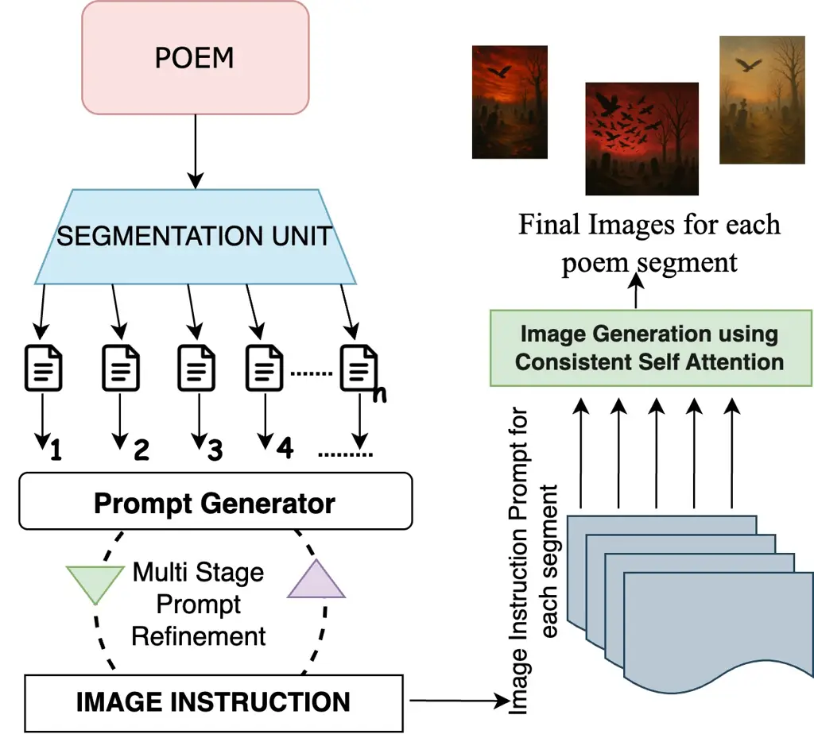
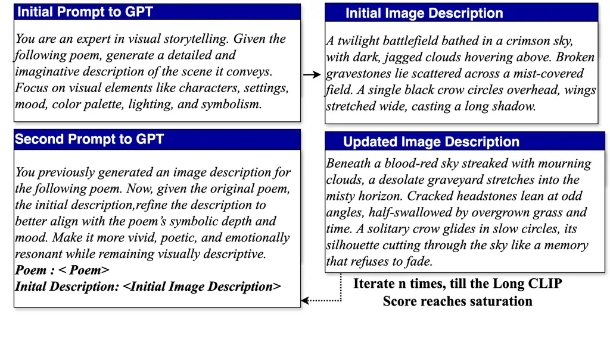
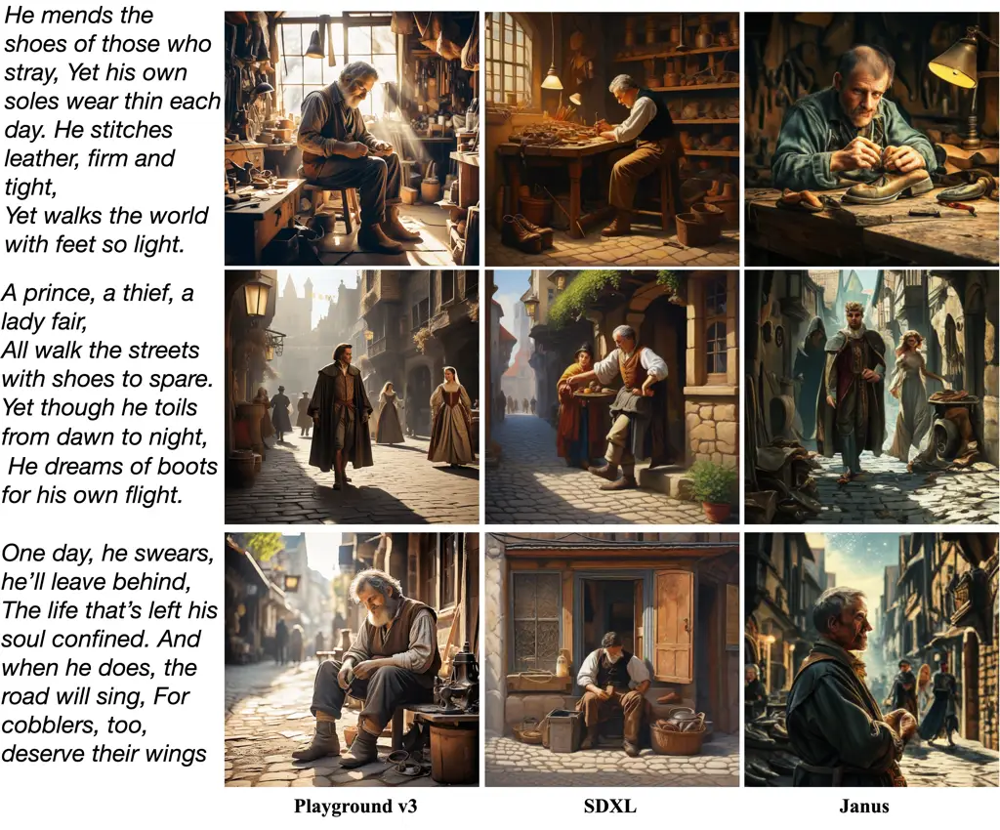
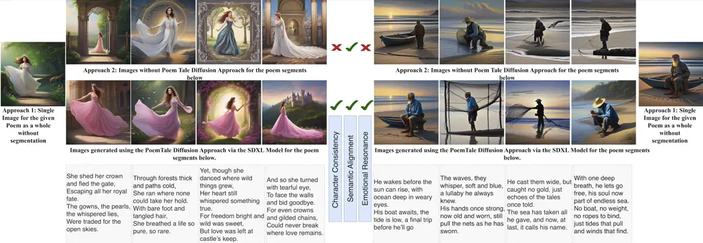
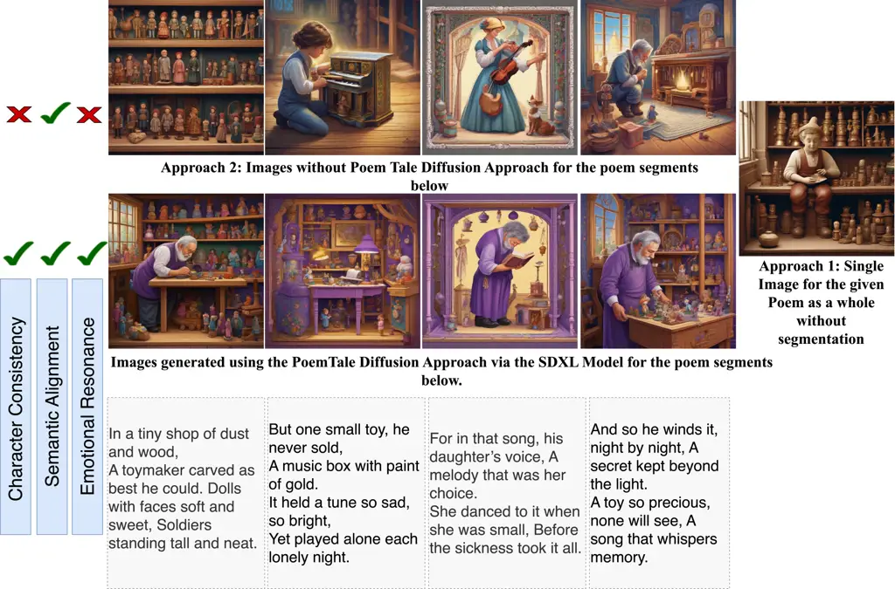
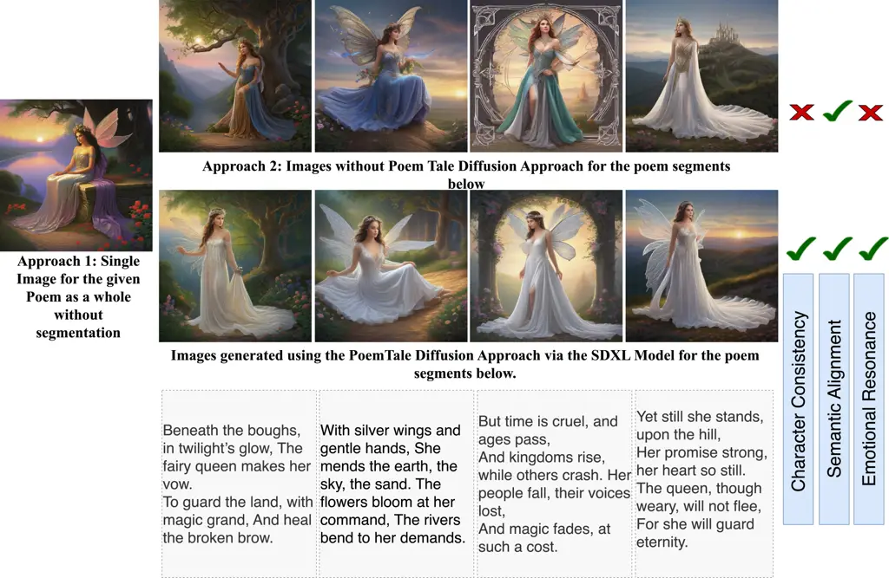

# PoemTale Diffusion: Minimising Information Loss in Poem to Image Generation with Multi-Stage Prompt Refinement

Sofia Jamil ^(†)^(†)thanks: Corresponding Author. Email:
sofia_2321cs16@iitp.ac.in Affiliation: Department of Computer Science &
Engineering, Indian Institute of Technology Patna, India    Bollampalli
Areen Reddy Affiliation: Department of Computer Science & Engineering,
Indian Institute of Technology Patna, India    Raghvendra Kumar
Affiliation: Department of Computer Science & Engineering, Indian
Institute of Technology Patna, India    Sriparna Saha
Affiliation: Department of Computer Science & Engineering, Indian
Institute of Technology Patna, India    Koustava Goswami
Affiliation: Adobe Research    K. J. Joseph Affiliation: Adobe Research

###### Abstract

Recent advancements in text-to-image diffusion models have achieved
remarkable success in generating realistic and diverse visual content. A
critical factor in this process is the model’s ability to accurately
interpret textual prompts. However, these models often struggle with
creative expressions, particularly those involving complex, abstract, or
highly descriptive language. In this work, we introduce a novel
training-free approach tailored to improve image generation for a unique
form of creative language: poetic verse, which frequently features
layered, abstract, and dual meanings. Our proposed PoemTale Diffusion
approach aims to minimise the information that is lost during poetic
text-to-image conversion by integrating a multi stage prompt refinement
loop into Language Models to enhance the interpretability of poetic
texts. To support this, we adapt existing state-of-the-art diffusion
models by modifying their self-attention mechanisms with a consistent
self-attention technique to generate multiple consistent images, which
are then collectively used to convey the poem’s meaning. Moreover, to
encourage research in the field of poetry, we introduce the P4I
(PoemForImage) dataset, consisting of 1111 poems sourced from multiple
online and offline resources. We engaged a panel of poetry experts for
qualitative assessments. The results from both human and quantitative
evaluations validate the efficacy of our method and contribute a novel
perspective to poem-to-image generation with enhanced information
capture in the generated images.

^(†)^(†)paperid: 123

## 1 Introduction

Poetry is a distinctive form of expression that evokes emotions and
feeds the imagination. This variety makes reading poetry particularly
captivating, as it invites readers to connect with the poet’s
inspiration while crafting their own personal perspectives. But what if
these imagined scenes could be brought to life? Visualizing poetry adds
a new dimension to the experience, allowing us to see and feel the poem
while enhancing our imagination. With the rise of text-to-image
generation models, particularly diffusion models, creative writing has
seen remarkable advancements due to their ability to produce
high-quality and diverse images. Several efforts have been made to
tackle the zero-shot text-to-image generation challenge by pre-training
large-scale generative models on massive image-text datasets, such as
DALL-E \[23\] and CogView \[7\]. However, poetry, with its intricate
layers of meaning and emotional depth, poses a unique challenge for
accurate visual representation. Diffusion models often struggle with
complex prompts that require a deeper level of comprehension. For
example, even the latest SDXL \[22\] model frequently fails to generate
an exact number of objects or correctly interpret negation in prompts
\[16\].

This raises an important question: How can existing visualization models
be adapted for poetry? One potential solution for poem-to-image
generation is to curate a comprehensive multimodal dataset comprising
poems and corresponding reference images and then train a text-to-image
diffusion model to enhance poem understanding. However, this approach
demands substantial time and resources to assemble a diverse and
high-quality dataset, along with the huge computational cost of training
or fine-tuning a diffusion model on such data. In contrast, we propose a
novel, training-free solution that enables diffusion models to generate
images that effectively capture the essence and meaning of a poem
without the need for extensive retraining.

The quality of generated images in text-to-image diffusion models is
inherently constrained by the text representation capabilities of their
encoders. Most existing text-to-image models \[22, 3, 28\] rely on CLIP
\[6\] to encode input prompts. However, CLIP’s limited text
representation capacity constrains the performance of text-to-image
generative models. Taking this aspect into consideration, we propose an
approach, PoemTale Diffusion, that aims to address this limitation by
focusing on three key areas for poetry-based image generation. First,
since CLIP encoders struggle with complex poetic language, transforming
poems into a more structured format improves image generation. To
achieve this, we leverage LLM capabilities along with automatic prompt
refinement techniques to convert poems into detailed image instructions,
which are then used as prompts for image generation. Secondly, a single
poem often contains significant variations in information, making it
difficult to generate a single representative image. To capture the
complex information within poems, we propose an entity-plus-emotion
segmentation algorithm, which divides poems into distinct segments based
on shifts in entities and emotional tones. Lastly, to generate visually
coherent images while preserving a consistent flow of information
throughout the poem’s depiction, we incorporate the consistent
self-attention technique \[38\] into existing text-to-image generation
models. To sum up, we make the following key contributions:

- •
  We introduce a novel task for poem visualization, aiming to generate
  images that capture the most detailed information from poems.
- •
  We present the PoemTale Diffusion Approach, which combines the poetic
  understanding of LLMs with automatic prompt refinement techniques and
  consistent self-attention to generate coherent and meaningful images.
- •
  We propose a novel poem segmentation algorithm, Entity Plus Emotion
  (EPE), which segments poems based on context shifts, capturing changes
  in entities and emotions to enhance poem clarity.
- •
  We introduce a Poem for Image (P4I) dataset, consisting of 1111 poems
  across various themes to assess the reliability of our approach and
  encourage future research in the field of poetry.
- •
  We conducted rigorous quantitative and human evaluations for each
  component of our pipeline, demonstrating that our proposed approach
  generates images with the maximum information retention.
- •
  All codes and datasets used in this study are publicly available at
  the GitHub ¹¹ 1 https://github.com/SofeeyaJ/PoemTale-Diffusion
  repository.

## 2 Background and Related Works

Image and Poetry: In the field of natural language processing (NLP),
various generative tasks related to poetry have been extensively
explored. These include topic-based poem generation \[9, 32, 37\],
acrostic poem generation \[1\], and rhetorically controlled poetry
generation \[20\]. The emergence of large language models (LLMs) has
further led to significant research on different prompting techniques
for poem generation \[4, 21, 11, 12\]. Some studies have also focused on
generating poems from images using deep coupled visual-poetic embedding
models combined with RNN-based adversarial training \[17\]. In some
works, poetry was generated from images using recurrent neural networks
trained on existing poems \[5\]. In contrast, Li et al. (2021) explored
the generation of painting-like images for Chinese poems. Similarly,
another study, Yuan et al. (2023) focused on creating poetic Chinese
landscape paintings with calligraphy.

Image Generation Via Diffusion Models: The recent boom in diffusion
models Sohl-Dickstein et al. (2015) has fundamentally transformed the
field of text-to-image generation. These models, such as IMAGEN Saharia
et al. (2022), DALL-E 3 Ramesh et al. (2022), and Stable Diffusion
Rombach et al. (2022), have quickly become popular because of their
exceptional capacity to generate images of high quality and variety. In
a recent study by Yu et al. (2024), a text-driven point cloud generation
pipeline was developed to create compelling and coherent sequences of 3D
scenes. Similarly, Liu et al. (2024b) introduced a method to generate
coherent image sequences based on a given storyline. Moreover, some
works have aimed to generate images while retaining specific identities.
However, they require an initial reference image to maintain consistency
across generated images. Several approaches have been developed for this
purpose, such as DreamBooth Gal et al. (2023), Custom Diffusion Ruiz
et al. (2023), IPAdapter Kumari et al. (2023), and PhotoMaker Ye et al.
(2023).

However, existing literature lacks approaches for generating images that
effectively convey a poem’s meaning, regardless of its genre, type, or
style. Our work bridges this gap by introducing the PoemTale Diffusion
approach, which produces a sequence of descriptive images.

## 3 P4I Corpus

To assess the scalability, robustness, and reliability of our framework,
we required a dataset that covers a wide range of thematic content. To
achieve this, we curated a diverse selection of poem types that are not
commonly found in existing literature. We refer to this dataset as P4I
(PoemsForImages). We employed three undergraduate Computer Science and
Engineering students and one postgraduate humanities student from a
reputable university. These individuals were carefully selected based on
their technical proficiency in collecting and organizing the required
poems from various sources. The students were compensated for their
efforts ²² 2 The annotators received compensation in the form of gift
vouchers and honorarium amounts in accordance with
[https://www.minimum-wage.org/](https://www.minimum-wage.org/), and the
entire process was completed in 270 hours.

### 3.1 Data Collection

1.  1.  Online Sources: To construct the PoemforImage(P4I) dataset, we
        gathered poems from multiple sources, including high-quality online
        platforms such as Poetry Foundation ³³ 3
        [https://poemanalysis.com/](https://poemanalysis.com/) and Poem
        Analysis⁴⁴ 4
        [https://www.poetryfoundation.org/](https://www.poetryfoundation.org/).
        The poems span a variety of themes, such as narrative, free verse,
        odes, laments, open verse, sonnets, open couplets, and children’s
        poetry. In response to the digital age’s influence on poetry, we
        also included modern forms like internet-based poetry and slam
        poetry.
2.  2.  Offline Sources: We manually curated poems from books, journals, and
        articles available in offline formats, sourcing them from three
        renowned libraries in the state.

### 3.2 Data Annotation

We annotated the P4I dataset with structured metadata to improve poem
organization and facilitate image generation. We enlisted three PhD
students from the Department of English Literature to conduct the
annotation, following guidelines curated by a professor in Literary
Arts. All annotators were duly compensated for their contributions and
will be acknowledged in the research. To ensure consistency and
reliability, inter-annotator agreement was measured using Cohen’s Kappa
score Viera et al. (2005), achieving a value of 0.78, which confirms the
consistency of the annotation process. Table 1 presents the various
statistics of our P4I dataset.

### 3.3 Annotation Guidelines

- •
  Remove duplicate records, extraneous characters, unnecessary white
  spaces, corrupt values, and HTML tags.
- •
  Standardize text formatting and resolve any inconsistencies in poem
  structure.
- •
  Label the Poem Title, Poet, and Poem Theme for each entry in the
  dataset.
- •
  Identify and label the protagonist or central character of the poem.
- •
  Identify the predominant mood or emotion of the poem. If the poem
  exhibits an emotional shift, segment the poem into smaller verses or
  stanzas corresponding to these shifts. Label each segment with its
  predominant emotion.

| Statistics                         | Count |
| ---------------------------------- | ----- |
| Total Number of Poems              | 1111  |
| Maximum Length of Poems (In words) | 460   |
| Minimum Length of Poems (In words) | 16    |
| Average Poem Length (in words)     | 180   |
| Total Themes of poems              | 6     |
| Distinct number of Poets           | 798   |

Table 1: Statistics of Different Poems Present in P4I Dataset

## 4 Tasks Setups

Poetry evokes vivid thoughts in the minds of its readers. The process of
visualizing and interpreting it is inherently subjective, as each
individual perceives it differently. No single representation can fully
capture every detail, which presents an interesting challenge when
converting these meanings into images. To address this challenge, we
explored different approaches for generating images from poems and
proposed a solution that preserves their essence while minimizing
information loss during the transformation process.

### 4.1 Approach 1: Image Generation via Direct Poems

We formulate this task as a simple text-to-image generation problem,
where we utilize SDXL Podell et al. (2024) to transform poetry into
engaging visuals that capture the poem’s meaning and theme. We take the
entire poem as input and provide it to diffusion models to generate an
image corresponding to the input poem.

### 4.2 Approach 2: Image Generation per Poem Stanzas

As per the annotation process highlighted in Section 3, poems were
segmented whenever there was a change in emotion. Therefore, we took
those segments and fed them into the diffusion model to generate a
corresponding image. This approach was designed to maximize information
capture and ensure that the visuals remained closely aligned with the
poem.

### 4.3 Analysis of Approaches

For the analysis of the above approaches, we collaborated with a team of
four professional experts from the Poetry Society of the Nation,
comprising one renowned poet, two university professors, and a doctoral
researcher in visual and literary arts. We randomly selected 15% of the
samples from the P4I dataset, totaling 170 poems. To ensure a
comprehensive evaluation, the assessment was conducted based on two key
factors: (i) semantic alignment, which measures how well the images
correspond to the poem’s meaning, (ii) emotional resonance, which
examines the extent to which the visuals capture the intended emotions
of the poem. Each expert provided individual ratings for these factors
per poem, and the final scores were combined to determine overall
performance. To ensure an unbiased evaluation, the judges were not
informed of the source of the generated images during the rating
process. Table 3 presents the average expert scores for this task. The
results indicate that Approach 1 caused significant information loss, as
a single image failed to capture the poem’s meaning, highlighting the
limitations of current image generation models in interpreting and
visualizing poetic language. Similarly, in Approach 2, where multiple
images were generated for different stanzas, the generated images lacked
semantic alignment, leading to fragmented information capture.

## 5 Room for Improvement: PoemTale Diffusion Approach

In light of the experimental results and analysis, it is evident that
both approaches failed to generate descriptive and meaningful visuals
when processed by text-to-image models. These models produce images that
lack depth, coherence, and alignment with the poem’s meaning, resulting
in significant information loss. To address these limitations in a
resource-efficient manner, we propose the PoemTale Diffusion Approach to
enhance information capture, focusing on the key areas below for
improvement.

1. Restructuring poems into a format more understandable to text
   encoders by clarifying abstract language, expanding implicit details,
   and simplifying complex metaphors can improve the model’s ability to
   accurately interpret poetic meaning.

2. To maintain narrative flow, the main character or central theme of
   the poem should remain visually consistent throughout all generated
   images.

3. Some poems contain long, interconnected verses that shift in tone,
   theme, or setting. Instead of processing an entire poem as a single
   prompt, we propose segmenting it into smaller, distinct parts.

To effectively implement the above strategies, we introduce PoemTale
Diffusion, a novel approach that generates a sequence of images,
$`\{I_{S_{1}},I_{S_{2}},\dots,I_{S_{n}}\}`$, where each image
$`I_{S_{i}}`$ visually represents the meaning of its respective segment
$`S_{i}`$. The collective sequence
$`\{I_{S_{1}},I_{S_{2}},\dots,I_{S_{n}}\}`$ of images captures the
narrative structure and collective meaning of the entire poem,
preserving both semantic depth and emotional resonance. This method
enhances poetry-to-image alignment while minimizing poetic information
loss. Our approach is divided into three distinct modules: (i)
Segmentation Module, (ii) Prompt Generator incorporating Multi Stage
Prompt Refinement (MSPR) loop (iii) Text to Image Models. Figure 1
depicts the working flow of our proposed approach.



Figure 1: Workflow of our proposed PoemTale Diffusion approach

### 5.1 Segmentation Module

To effectively break down complex poetic verses into smaller,
independent units, we introduce an _Entity Plus Emotion (EPE)_ approach
to detect segment boundaries in a poem. Our approach incrementally
processes each line of the poem, assigning named entity recognition
(NER) tags and emotions to each line. When there is a change in NER tags
or emotions between consecutive lines, the algorithm detects a shift in
context and segments the poem accordingly. This method focuses
exclusively on identifying where one segment of the poem ends, and
another begins, based on changes in the emotion and entities. We
employed the NLTK library to identify entities in the poem and employed
a fine-tuned version of DistilRoBERTa-base Hartmann (2022) for the
classification of emotions.

### 5.2 Multi Stage Prompt Refinement Loop (MSPR)

To clarify abstract language, reveal hidden details, and simplify
complex metaphors in poems, we utilized a multi-stage prompt refinement
loop leveraging GPT-4o-mini for generating image descriptions. In the
multi-stage refinement loop, the process begins with Stage 1 Jamil
et al. (2025), where GPT is prompted as a visual storytelling expert to
generate a vivid and imaginative scene based solely on a given poem. The
description is evaluated using the Long CLIP Zhang et al. (2024) score.
In Stage 2, refinement is introduced: As demonstrated in Figure 2, GPT
receives the original poem along with the initial description and is
prompted to deepen the emotional and poetic resonance of the scene. This
stage encourages symbolic interpretation and more detailed visualization
to align the output closely with the poem’s main intent. This iterative
process continues, with each cycle aiming to improve description
alignment with the poem’s meaning. The loop terminates when the Long
CLIP score shows saturation, indicating that there is no significant
improvement across three consecutive iterations, showing convergence. To
supplement automated evaluation, we also integrated feedback from human
experts. However, due to the time and resource demands of manual
assessment, this method was applied to a smaller subset of poems. Across
these samples, we consistently observed convergence after 4–5
iterations, which we identify as the optimal point for generating image
descriptions from poetic input. It is to be noted that this multi-stage
refinement is applied to all the segments of the poems to generate
accurate image descriptions for each segment. These image descriptions
for each segment are utilized in the next step to form a visual story
for each poem. This MSPR requires absolutely no training time and is
ideal for real-time scenarios.



Figure 2: Working of Multi Stage Prompt Refinement Approach

|                                      |               | PROMPT GENERATOR UNIT |           | EMOTION | CHARACTER CONSISTENCY |
| ------------------------------------ | ------------- | --------------------- | --------- | ------- | --------------------- |
|                                      |               | BLIP                  | Long-CLIP | CLIP    | CLIP                  |
| PoemTale Diffusion Approach          | JANUS         | 0.4009                | 0.3928    | 0.4028  | 0.2184                |
|                                      | SDXL          | 0.4218                | 0.4605    | 0.3926  | 0.2859                |
|                                      | PLAYGROUND V3 | 0.4333                | 0.5897    | 0.4249  | 0.3070                |
| Only With Poem Segments (Approach 2) | JANUS         | 0.2066                | 0.1808    | 0.2355  | 0.1193                |
|                                      | SDXL          | 0.3306                | 0.2464    | 0.2328  | 0.1864                |
|                                      | PLAYGROUND V3 | 0.3969                | 0.2567    | 0.2383  | 0.1948                |
| Single Image for Poems (Approach 1)  | JANUS         | 0.1845                | 0.1688    | 0.2096  | /                     |
|                                      | SDXL          | 0.2846                | 0.2131    | 0.1692  | /                     |
|                                      | PLAYGROUND V3 | 0.3224                | 0.2193    | 0.2145  | /                     |

Table 2: The Table presents the performance of different text-to-image
generation models evaluated under various approaches. The
best-performing approach values are highlighted in bold, while within
each of the other approaches, the best-performing model is italicized.
‘/’ denotes results are not applicable for that metric.

### 5.3 Poem to Image Generation using Consistent Self-Attention

After we have detailed image instructions for all segments of the poem,
our final step involves generating images for multiple segments (if
present) of a poem using a diffusion model. To maintain coherence across
multiple images, the main character or central theme of the poem should
remain visually consistent throughout all generated images. As
demonstrated in previous research Astlin Pereira and Hussain (2024),
self-attention plays a crucial role in modeling the overall structure of
generated visual images. Therefore, we incorporate Consistent
Self-Attention Zhou et al. (2024), which can be seamlessly integrated
into any diffusion model by replacing the original self-attention layer
in a zero-shot manner. This approach is training-free and
model-independent, making it applicable to any text-to-image generation
model equipped with a self-attention layer. The process begins with the
generation of an initial image for the first segment of the poem.
Subsequently, sampled reference tokens from the initial image are
utilized during the token similarity matrix calculation and token
merging. Since these sampled tokens share the same $`Q-K-V`$
(Query-Key-Value) weights, no additional training is required. As shown
in Figure 4, the application of Consistent Self-Attention successfully
preserves identity and attire consistency, ensuring coherence across all
generated images.

Consistent Self-Attention is integrated into the U-Net architecture of
existing diffusion models, utilizing the original self-attention weights
to remain training-free. Given a batch of image features
$`I\in\mathbb{R}^{B\times N\times C}`$, where $`B`$ is the batch size,
$`N`$ is the number of tokens in each image, and $`C`$ is the channel
count, the self-attention function is defined as:

```math
O_{i}=\text{Attention}(Q_{i},K_{i},V_{i}) \tag{1}
```

where $`Q_{i},K_{i},V_{i}`$ represent the query, key, and value
matrices, respectively. Standard self-attention operates independently
within each image feature $`I_{i}`$.

To enforce subject consistency across images, Consistent Self-Attention
samples tokens from other images within the batch:

```math
S_{i}=\text{RandSample}(I_{1},I_{2},I_{(i-1)},I_{(i+1)},...) \tag{2}
```

where RandSample denotes the random sampling function. These sampled
tokens $`S_{i}`$ are then paired with the original image feature
$`I_{i}`$ to form a new token set $`P_{i}`$. Linear projections generate
the updated key $`K_{P_{i}}`$ and value $`V_{P_{i}}`$ matrices for
Consistent Self-Attention, while the original query $`Q_{i}`$ remains
unchanged. The final attention operation is computed as:

```math
O_{i}=\text{Attention}(Q_{i},K_{P_{i}},V_{P_{i}}) \tag{3}
```

By facilitating cross-image interactions, Consistent Self-Attention
ensures that character identity, facial features, and attire remain
consistent across multiple images. This technique ultimately improves
poetic information preservation by aligning generated images more
closely with the poem’s intended meaning.

## 6 Experiments

### 6.1 Baselines

We implemented our PoemTale Diffusion approach using three
State-of-the-art (SOTA) text-to-image generation models: Playground V3
Liu et al. (2024a), Stable Diffusion XL Podell et al. (2024), and Janus
Wu et al. (2024). These models were chosen for their training-free and
pluggable nature, allowing us to establish baselines and compare results
across different architectures. For efficient sampling, we employed DDIM
(Denoising Diffusion Implicit Models) to accelerate the inference
process, INT8 quantization to optimize memory usage, and EMA
(Exponential Moving Average) for checkpoint selection.

### 6.2 Evaluation Metric

Since our PoemTale Diffusion approach comprises three distinct modules,
it is essential to evaluate them individually to assess the errors
introduced at each stage and their overall impact on image quality. To
achieve this, we utilized the CLIP score and BLIP score to evaluate each
component of PoemTale Diffusion. To evaluate the alignment between the
generated image and its corresponding prompt, we utilized the BLIP Li
et al. (2022) Score, where captions were generated for images, and their
similarity to the original image instruction prompt was computed.
Additionally, Long-CLIP Zhang et al. (2024) was employed to measure the
cosine similarity between the poem and the generated image. Emotion
plays a crucial role in conveying a poem’s intended meaning. To assess
how well the generated image captures the poem’s emotional nature, we
compared the emotion depicted in the image with the gold reference
emotion expressed in the poem, using CLIP scores Cherti et al. (2023)
for measurement. This detailed assessment of each component allows us to
analyze the extent of information loss at each step and its overall
impact on the final generated image, ensuring a thorough evaluation of
our approach.



Figure 3: Qualitative Comparison of Different Image Generation Models
Integrated with PoemTale Diffusion approach. We recommend that the
reader zoom in for better readability.



Figure 4: Results of various approaches in poem to image generation
corresponding to various segments of the poem (shown in the grey boxes).
We recommend that the reader zoom in for better readability.

## 7 Results Analysis and Discussion

### 7.1 Quantitative Evaluation

The results detailed in Table 2 provide important insights, into
different approaches within the context of our task. We conducted a
quantitative evaluation based on two key factors: (i) Approach-Based
Evaluation: As shown in Table 2, the PoemTale Diffusion Approach
consistently outperforms all other methods for poem-to-image generation.
This highlights the importance of integrating poem segmentation and
consistent self-attention, which together result in high-quality,
thematically aligned, and more informative images. We observe an
increasing trend in CLIP scores across the following aspects: emotion
depiction (0.21$`\uparrow`$), prompt alignment with images
(1.68$`\uparrow`$), character consistency across images
(0.57$`\uparrow`$), and resemblance to the reference character in the
poem (0.82$`\uparrow`$).

(ii) Baseline Based Evaluation: We implemented our proposed approach
across different baseline models and conducted both qualitative and
quantitative evaluations. Figure 3 presents a qualitative comparison of
the generated images. Playground V3, when integrated with the PoemTale
Diffusion approach, produces the most detailed and most visually
appealing images. It successfully maintains both facial features and
attire, ensuring character consistency. Other models show improved
character coherence but occasionally fail to preserve finer details like
clothing and hairstyle. Yet across all models, the use of PoemTale
Diffusion produces significantly more thematically aligned and visually
coherent images compared to approaches that do not utilize it.



Figure 5: Results of various approaches in poem to image generation
corresponding to various segments of the poem (shown in the grey boxes).
We recommend that the reader zoom in for better readability.



Figure 6: Results of various approaches in poem to image generation
corresponding to various segments of the poem (shown in the grey boxes).
We recommend that the reader zoom in for better readability.

|                                     |                     |                       |
| ----------------------------------- | ------------------- | --------------------- |
|                                     |                     | Average Expert Scores |
| PoemTale Diffusion Approach         | Semantic Alignment  | 3.9                   |
|                                     | Emotional Resonance | 4.1                   |
| Approach 1: Single Image for Poems  | Semantic Alignment  | 1.8                   |
|                                     | Emotional Resonance | 1.7                   |
| Approach 2: Only With Poem Segments | Semantic Alignment  | 2.2                   |
|                                     | Emotional Resonance | 2.1                   |

Table 3: Human evaluation scores from various experts for different
approaches, on a randomly selected set of 150 poems.

### 7.2 Human Evaluation

Recognizing that existing metrics may not fully capture the quality of
the generated images, especially in terms of consistency, relevance, and
aesthetic appeal, and with no standardized metric available, we
incorporated human evaluations. To conduct this evaluation, we
collaborated with the same set of area experts from the Poetry Society
of the Nation, including two renowned poet, one university professors,
and a doctoral researcher in visual and literary arts. We selected 15%
of the samples from the P4I dataset. The experts reviewed the images
produced by our PoemTale Diffusion approach using the playground model
(as it is the best performing baseline). For each selected poem, experts
were asked to rate the images on a scale from 1 to 5, considering the
criteria of image-poem semantic alignment, Consistency, and Emotional
Resonance, with higher scores reflecting better quality. The final
rating for each image across all categories was determined by averaging
the scores provided by the three experts. To eliminate potential bias,
the experts were not informed of the names of the models used to
generate the images or the approaches taken for image generation. The
human evaluation results, as shown in Table 3, indicate that our
PoemTale Diffusion approach achieves superior performance in overall
scores, particularly in terms of consistency and information retention.

Additionally, we present a detailed analysis of the images produced by
different approaches in Figure 4, based on the same key aspects used for
human evaluation. (I) character consistency: The PoemTale Diffusion
approach has an impressive ability to maintain character consistency
across all image segments. Figure 6 shows that the generated images
consistently depict the main character with the same facial features and
attire throughout, whereas other approaches fail to preserve this
consistency across subsequent images. This improvement can be attributed
to the Consistent Self-Attention mechanism, which effectively recognize
and maintain the character’s identity across all generated images. (ii)
semantic alignment: Figure 4 illustrates that our PoemTale Diffusion
approach achieves the highest level of poem-to-image alignment. This
improvement is due to the Prompt Generator Unit, which restructures the
poem into a more understandable format by generating detailed image
instructions. Furthermore, the MSPR technique ensures that the final
image instructions accurately convey the poem’s meaning, resulting in
highly aligned visual representations. (iii) emotional resonance: Since
poems often convey shifting emotions, we segmented them based on
emotional transitions and key entities. As seen in Figure 5, a single
image struggles to capture the full emotional depth of a poem. However,
by generating images for individual segments based on emotional shifts,
our approach ensures that each image reflects the intended mood of its
corresponding poem segment.

## 8 Conclusion and Future Works

This work explores the capabilities of diffusion models in poem-to-image
generation by evaluating various traditional approaches based on
semantic relevance and emotional resonance. To address the limitations
of existing methods, we introduce the PoemTale Diffusion approach, which
requires no training and is designed to generate images that capture the
maximum amount of information and meaning from poems. We have
implemented our proposed method on several SOTA diffusion models and
thoroughly evaluated each component of the pipeline to assess how
results propagate through to the final stage. To assess the scalability
and effectiveness of our approach, we present the PoemForImage (P4I)
dataset, which consists of 1111 poems covering a diverse range of themes
and styles. Our approach is the first to focus on image generation for
diverse poetry, producing both single and multiple images. Looking
ahead, we aim to develop a language-agnostic visual model capable of
generating images for poetry across multiple languages.

## 9 Acknowledgement

Sriparna Saha would like to acknowledge the funding from ADOBE Research
for conducting this research.

## References

- Agarwal and Kann (2020) R. Agarwal and K. Kann. Acrostic poem
  generation. In B. Webber, T. Cohn, Y. He, and Y. Liu, editors,
  _Proceedings of the 2020 Conference on Empirical Methods in Natural
  Language Processing (EMNLP)_, pages 1230–1240, Online, Nov. 2020.
  Association for Computational Linguistics.
  [10.18653/v1/2020.emnlp-main.94](https://doi.org/10.18653/v1/2020.emnlp-main.94).
  URL
  [https://aclanthology.org/2020.emnlp-main.94](https://aclanthology.org/2020.emnlp-main.94).
- Astlin Pereira and Hussain (2024) G. Astlin Pereira and M. Hussain. A
  review of transformer-based models for computer vision tasks:
  Capturing global context and spatial relationships. _arXiv e-prints_,
  pages arXiv–2408, 2024.
- Betker et al. (2023) J. Betker, G. Goh, L. Jing, T. Brooks, J. Wang,
  L. Li, L. Ouyang, J. Zhuang, J. Lee, Y. Guo, et al. Improving image
  generation with better captions. _Computer Science. https://cdn.
  openai. com/papers/dall-e-3. pdf_, 2(3):8, 2023.
- Chakrabarty et al. (2022) T. Chakrabarty, V. Padmakumar, and H. He.
  Help me write a poem - instruction tuning as a vehicle for
  collaborative poetry writing. In Y. Goldberg, Z. Kozareva, and
  Y. Zhang, editors, _Proceedings of the 2022 Conference on Empirical
  Methods in Natural Language Processing_, pages 6848–6863, Abu Dhabi,
  United Arab Emirates, Dec. 2022. Association for Computational
  Linguistics.
  [10.18653/v1/2022.emnlp-main.460](https://doi.org/10.18653/v1/2022.emnlp-main.460).
  URL
  [https://aclanthology.org/2022.emnlp-main.460](https://aclanthology.org/2022.emnlp-main.460).
- (5) W.-F. Cheng, C.-C. Wu, R. Song, J. Fu, X. Xie, and J.-Y. Jie.
  Image inspired poetry generation in xiaoice.” eprint arxiv (august 9,
  2018).
- Cherti et al. (2023) M. Cherti, R. Beaumont, R. Wightman, M. Wortsman,
  G. Ilharco, C. Gordon, C. Schuhmann, L. Schmidt, and J. Jitsev.
  Reproducible scaling laws for contrastive language-image learning. In
  _Proceedings of the IEEE/CVF Conference on Computer Vision and Pattern
  Recognition_, pages 2818–2829, 2023.
- Ding et al. (2021) M. Ding, Z. Yang, W. Hong, W. Zheng, C. Zhou,
  D. Yin, J. Lin, X. Zou, Z. Shao, H. Yang, et al. Cogview: Mastering
  text-to-image generation via transformers. _Advances in neural
  information processing systems_, 34:19822–19835, 2021.
- Gal et al. (2023) R. Gal, Y. Alaluf, Y. Atzmon, O. Patashnik, A. H.
  Bermano, G. Chechik, and D. Cohen-or. An image is worth one word:
  Personalizing text-to-image generation using textual inversion. In
  _The Eleventh International Conference on Learning
  Representations_, 2023. URL
  [https://openreview.net/forum?id=NAQvF08TcyG](https://openreview.net/forum?id=NAQvF08TcyG).
- Ghazvininejad et al. (2016) M. Ghazvininejad, X. Shi, Y. Choi, and
  K. Knight. Generating topical poetry. In _Proceedings of the 2016
  conference on empirical methods in natural language processing_, pages
  1183–1191, 2016.
- Hartmann (2022) J. Hartmann. Emotion english distilroberta-base.
  [https://huggingface.co/j-hartmann/emotion-english-distilroberta-base/](https://huggingface.co/j-hartmann/emotion-english-distilroberta-base/), 2022.
- Huynh and Bao (2024) T. M. Huynh and Q. L. Bao. Vietnamese poem
  generation & the prospect of cross-language poem-to-poem translation.
  _arXiv preprint arXiv:2401.01078_, 2024.
- Jamil et al. (2025) S. Jamil, B. A. Reddy, R. Kumar, S. Saha, J. K. J,
  and K. Goswami. Poetry in pixels: Prompt tuning for poem image
  generation via diffusion models. In O. Rambow, L. Wanner,
  M. Apidianaki, H. Al-Khalifa, B. D. Eugenio, and S. Schockaert,
  editors, _Proceedings of the 31st International Conference on
  Computational Linguistics_, pages 9224–9237, Abu Dhabi, UAE,
  Jan. 2025. Association for Computational Linguistics. URL
  [https://aclanthology.org/2025.coling-main.620/](https://aclanthology.org/2025.coling-main.620/).
- Kumari et al. (2023) N. Kumari, B. Zhang, R. Zhang, E. Shechtman, and
  J.-Y. Zhu. Multi-concept customization of text-to-image diffusion. In
  _Proceedings of the IEEE/CVF Conference on Computer Vision and Pattern
  Recognition_, pages 1931–1941, 2023.
- Li et al. (2021) D. Li, S. Wang, J. Zou, C. Tian, E. Nieuwburg,
  F. Sun, and E. Kanoulas. Paint4poem: A dataset for artistic
  visualization of classical chinese poems. _arXiv preprint
  arXiv:2109.11682_, 2021.
- Li et al. (2022) J. Li, D. Li, C. Xiong, and S. Hoi. Blip:
  Bootstrapping language-image pre-training for unified vision-language
  understanding and generation, 2022. URL
  [https://arxiv.org/abs/2201.12086](https://arxiv.org/abs/2201.12086).
- Lian et al. (2024) L. Lian, B. Li, A. Yala, and T. Darrell.
  LLM-grounded diffusion: Enhancing prompt understanding of
  text-to-image diffusion models with large language models.
  _Transactions on Machine Learning Research_, 2024. ISSN 2835-8856. URL
  [https://openreview.net/forum?id=hFALpTb4fR](https://openreview.net/forum?id=hFALpTb4fR).
  Featured Certification.
- Liu et al. (2018) B. Liu, J. Fu, M. P. Kato, and M. Yoshikawa. Beyond
  narrative description: Generating poetry from images by
  multi-adversarial training. In _Proceedings of the 26th ACM
  international conference on Multimedia_, pages 783–791, 2018.
- Liu et al. (2024a) B. Liu, E. Akhgari, A. Visheratin, A. Kamko, L. Xu,
  S. Shrirao, C. Lambert, J. Souza, S. Doshi, and D. Li. Playground v3:
  Improving text-to-image alignment with deep-fusion large language
  models, 2024a. URL
  [https://arxiv.org/abs/2409.10695](https://arxiv.org/abs/2409.10695).
- Liu et al. (2024b) C. Liu, H. Wu, Y. Zhong, X. Zhang, Y. Wang, and
  W. Xie. Intelligent grimm-open-ended visual storytelling via latent
  diffusion models. In _Proceedings of the IEEE/CVF Conference on
  Computer Vision and Pattern Recognition_, pages 6190–6200, 2024b.
- Liu et al. (2019) Z. Liu, Z. Fu, J. Cao, G. De Melo, Y.-C. Tam,
  C. Niu, and J. Zhou. Rhetorically controlled encoder-decoder for
  modern chinese poetry generation. In _Proceedings of the 57th annual
  meeting of the Association for Computational Linguistics_, pages
  1992–2001, 2019.
- Lo et al. (2022) K.-L. Lo, R. Ariss, and P. Kurz. Gpoet-2: A gpt-2
  based poem generator. _ArXiv_, abs/2205.08847, 2022. URL
  [https://api.semanticscholar.org/CorpusID:248863108](https://api.semanticscholar.org/CorpusID:248863108).
- Podell et al. (2024) D. Podell, Z. English, K. Lacey, A. Blattmann,
  T. Dockhorn, J. Müller, J. Penna, and R. Rombach. SDXL: Improving
  latent diffusion models for high-resolution image synthesis. In _The
  Twelfth International Conference on Learning Representations_, 2024.
  URL
  [https://openreview.net/forum?id=di52zR8xgf](https://openreview.net/forum?id=di52zR8xgf).
- Ramesh et al. (2021) A. Ramesh, M. Pavlov, G. Goh, S. Gray, C. Voss,
  A. Radford, M. Chen, and I. Sutskever. Zero-shot text-to-image
  generation. In _International conference on machine learning_, pages
  8821–8831. Pmlr, 2021.
- Ramesh et al. (2022) A. Ramesh, P. Dhariwal, A. Nichol, C. Chu, and
  M. Chen. Hierarchical text-conditional image generation with clip
  latents. arxiv 2022. _arXiv preprint arXiv:2204.06125_, 2022.
- Rombach et al. (2022) R. Rombach, A. Blattmann, D. Lorenz, P. Esser,
  and B. Ommer. High-resolution image synthesis with latent diffusion
  models. In _Proceedings of the IEEE/CVF conference on computer vision
  and pattern recognition_, pages 10684–10695, 2022.
- Ruiz et al. (2023) N. Ruiz, Y. Li, V. Jampani, Y. Pritch,
  M. Rubinstein, and K. Aberman. Dreambooth: Fine tuning text-to-image
  diffusion models for subject-driven generation. In _Proceedings of the
  IEEE/CVF Conference on Computer Vision and Pattern Recognition_, pages
  22500–22510, 2023.
- Saharia et al. (2022) C. Saharia, W. Chan, S. Saxena, L. Li, J. Whang,
  E. L. Denton, K. Ghasemipour, R. Gontijo Lopes, B. Karagol Ayan,
  T. Salimans, et al. Photorealistic text-to-image diffusion models with
  deep language understanding. _Advances in neural information
  processing systems_, 35:36479–36494, 2022.
- Sauer et al. (2023) A. Sauer, D. Lorenz, A. Blattmann, and R. Rombach.
  Adversarial diffusion distillation. In _European Conference on
  Computer Vision_, 2023. URL
  [https://api.semanticscholar.org/CorpusID:265466173](https://api.semanticscholar.org/CorpusID:265466173).
- Sohl-Dickstein et al. (2015) J. Sohl-Dickstein, E. Weiss,
  N. Maheswaranathan, and S. Ganguli. Deep unsupervised learning using
  nonequilibrium thermodynamics. In _International conference on machine
  learning_, pages 2256–2265. PMLR, 2015.
- Viera et al. (2005) A. J. Viera, J. M. Garrett, et al. Understanding
  interobserver agreement: the kappa statistic. _Fam med_,
  37(5):360–363, 2005.
- Wu et al. (2024) C. Wu, X. Chen, Z. Wu, Y. Ma, X. Liu, Z. Pan, W. Liu,
  Z. Xie, X. Yu, C. Ruan, and P. Luo. Janus: Decoupling visual encoding
  for unified multimodal understanding and generation, 2024. URL
  [https://arxiv.org/abs/2410.13848](https://arxiv.org/abs/2410.13848).
- Yan et al. (2013) R. Yan, H. Jiang, M. Lapata, S.-D. Lin, X. Lv, and
  X. Li. I, poet: automatic chinese poetry composition through a
  generative summarization framework under constrained optimization. In
  _IJCAI 2013, Proceedings of the 23rd International Joint Conference on
  Artificial Intelligence_, pages 2197–2203. AAAI Press, 2013.
- Ye et al. (2023) H. Ye, J. Zhang, S. Liu, X. Han, and W. Yang.
  Ip-adapter: Text compatible image prompt adapter for text-to-image
  diffusion models. _arXiv preprint arXiv:2308.06721_, 2023.
- Yu et al. (2024) H.-X. Yu, H. Duan, J. Hur, K. Sargent, M. Rubinstein,
  W. T. Freeman, F. Cole, D. Sun, N. Snavely, J. Wu, et al.
  Wonderjourney: Going from anywhere to everywhere. In _Proceedings of
  the IEEE/CVF Conference on Computer Vision and Pattern Recognition_,
  pages 6658–6667, 2024.
- Yuan et al. (2023) S. Yuan, A. Dai, Z. Yan, R. Liu, M. Chen, B. Chen,
  Z. Qiu, and X. He. Learning to generate poetic chinese landscape
  painting with calligraphy, 2023. URL
  [https://arxiv.org/abs/2305.04719](https://arxiv.org/abs/2305.04719).
- Zhang et al. (2024) B. Zhang, P. Zhang, X. Dong, Y. Zang, and J. Wang.
  Long-clip: Unlocking the long-text capability of clip. _arXiv preprint
  arXiv:2403.15378_, 2024.
- Zhang and Lapata (2014) X. Zhang and M. Lapata. Chinese poetry
  generation with recurrent neural networks. In _Proceedings of the 2014
  conference on empirical methods in natural language processing
  (EMNLP)_, pages 670–680, 2014.
- Zhou et al. (2024) Y. Zhou, D. Zhou, M.-M. Cheng, J. Feng, and Q. Hou.
  Storydiffusion: Consistent self-attention for long-range image and
  video generation. In _The Thirty-eighth Annual Conference on Neural
  Information Processing Systems_, 2024. URL
  [https://openreview.net/forum?id=VFqzxhINFU](https://openreview.net/forum?id=VFqzxhINFU).
