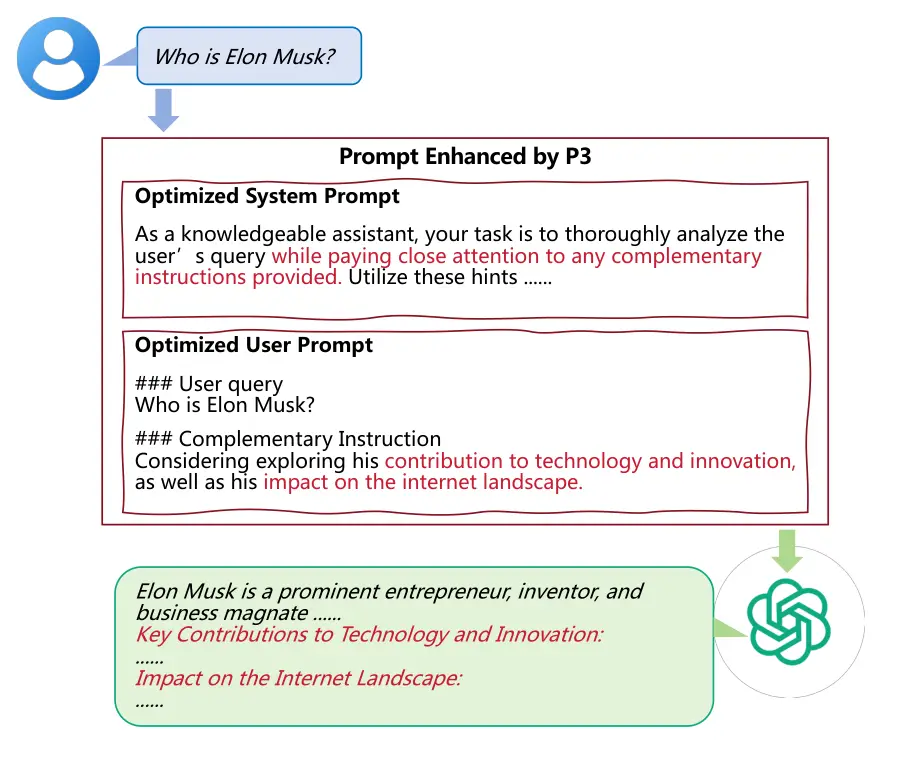
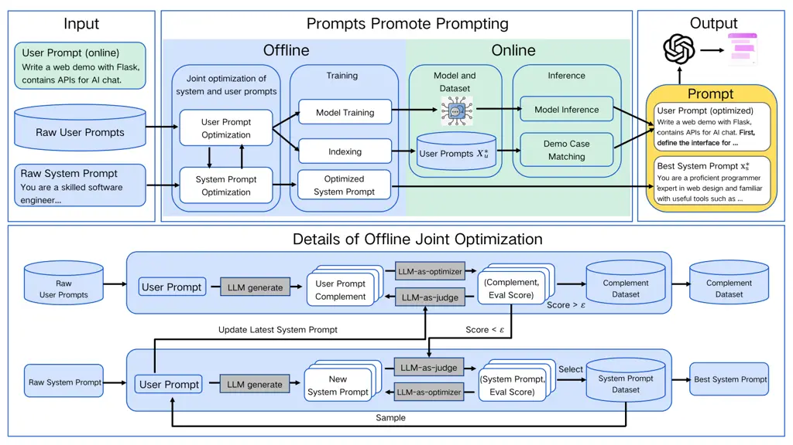
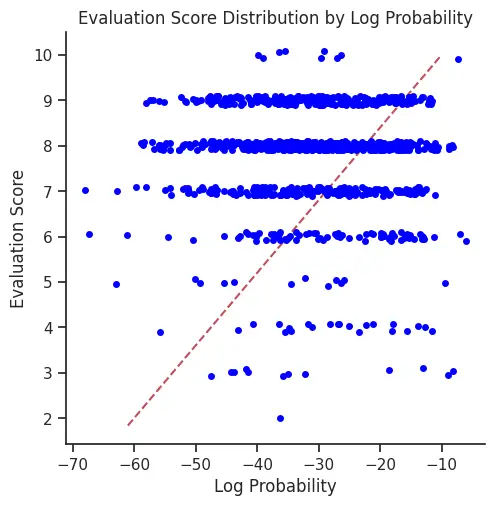
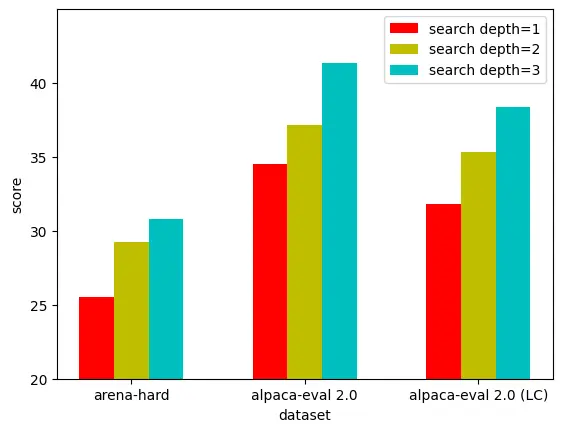

# P3: Prompts Promote Prompting

Xinyu Zhang Affiliation: Renmin University of China
Email: <zhangxinyu1995@ruc.edu.cn>    Yuanquan Hu Affiliation: Huawei
Poisson Lab Email: <dou@ruc.edu.cn>    Fangchao Liu Affiliation: Huawei
Poisson Lab    Zhicheng Dou Affiliation: Renmin University of China

###### Abstract

Current large language model (LLM) applications often employ
multi-component prompts, comprising both system and user prompts, to
guide model behaviors. While recent advancements have demonstrated the
efficacy of automatically optimizing either the system or user prompt to
boost performance, such unilateral approaches often yield suboptimal
outcomes due to the interdependent nature of these components. In this
work, we introduce P3, a novel self-improvement framework that
concurrently optimizes both system and user prompts through an iterative
process. The offline optimized prompts are further leveraged to promote
online prompting by performing query-dependent prompt optimization.
Extensive experiments on general tasks (e.g., Arena-hard and
Alpaca-eval) and reasoning tasks (e.g., GSM8K and GPQA) demonstrate that
P3 achieves superior performance in the realm of automatic prompt
optimization. Our results highlight the effectiveness of a holistic
optimization strategy in enhancing LLM performance across diverse
domains.

^(†)^(†)footnotetext: These authors contributed equally to this
work.^(\*)^(\*)footnotetext: Corresponding author.

## 1 Introduction

Large language models (LLMs) have achieved remarkable success across a
wide range of tasks, becoming a cornerstone of modern AI applications.
However, finetuning these models is often costly and data-dependent,
driving interest in ‘external’ tuning methods, e.g., prompt engineering
and retrieval-augmented generation, which optimize outputs without
retraining.

Among these methods, prompt engineering stands out as a cost-effective
and versatile approach, enabling significant performance gains with
minimal adjustments. Yet, crafting effective prompts remains
challenging, often requiring expertise and iterative manual tuning.
Recent advances in automated prompt optimization (APO) (Khattab et al.,
2023; Guo et al., ; Fernando et al., ; Pryzant et al., 2023; Zhou
et al., ) address this by leveraging LLMs to refine prompts based on
objective metrics or subjective feedbacks (LLM-as-judge). While these
methods show solid results on several benchmarks, they lack real-time
applicability, because their reliance on multiple model calls for each
prompt refinement can introduce huge computational overhead.



Figure 1: An illustration of P3’s optimization results.

To enable real-time prompt optimization, a new class of techniques for
online prompt optimization has emerged, such as BPO (Cheng et al., 2023)
and PAS (Zheng et al., 2024). These methods can be divided into two
stages. In the first stage, they optimize each user prompt and collect
(prompt, optimized prompt) pairs as datasets. Specifically, BPO
optimizes user prompts by rephrasing, and PAS adds a complementary
instruction as an expansion to the original prompt. In the second stage,
the collected dataset is used to finetune a smaller language model,
which is capable of dynamically adjusting or extending the original
prompt at test time. While promising, these approaches encounter three
key limitations:

Affinity Issue: System prompts significantly influence the style and
quality of LLM outputs. Existing methods primarily focus on optimizing
user prompts, overlooking the potential of system prompts. To fully
unlock the capabilities of prompt optimization, system prompts must
adapt to the structural changes introduced by optimized user prompts,
ensuring alignment and synergy between the two components.

Diversity Issue: There are numerous possible ways to rewrite or extend a
prompt, making it difficult to ensure that any single adjustment is
optimal. Current methods rely on a fixed rephrasing or extension
strategy, which can introduce bias and lack exploration for global
optimal solutions.

Inference Cost and Efficiency Issue: Existing online prompt optimization
methods require finetuning smaller LLMs (e.g., 7B instruct models). This
still necessitates substantial resources. And since these models operate
serially alongside the primary LLM, they introduce additional inference
latency and cost, further hindering real-time applications.

In response to these challenges, we propose Prompts Promote
Prompting (P3), which is a two-stage prompt optimization framework
leveraging offline prompts to promote online prompting. Given that
system prompts are more suited for offline optimization, while user
prompts need to be dynamically adjusted based on specific queries, our
method leverages both offline joint optimization for system prompts and
real-time user prompt complement for more flexible and efficient
application, as shown in Figure 1.

For the affinity issue, we jointly optimize system prompts and user
prompt complements in the offline stage. This involves iteratively
refining the system prompt to ensure it effectively guides the model’s
behavior and adapts to the paradigm of user prompt complementation,
ensuring both system and user prompts work synergistically. For the
diversity issue, we synthesize diverse user prompt complements in the
offline optimization phase. This strategy ensures that user prompt
complements cover diverse linguistic and contextual expressions,
improving the flexibility and generalization of prompt optimization.
Finally, for inference efficiency, we provide an alternative usage of
the collected offline dataset in the online stage. Apart from finetuning
a small LLM to perform online optimization, we provide an alternative
usage of the dataset: retrieving samples from the dataset as
demonstrations for in-context learning. This allows for prompt
adjustments in real time while minimizing computational costs and
inference time.

To validate the effectiveness of our method, we conducted comprehensive
experiments across various general and reasoning tasks, including
Arean-Hard Li et al. (2024), Alpaca-Eval 2.0 Li et al. (2023),
Alpaca-Eval (LC) Dubois et al. (2024), GSM8k Cobbe et al. (2021) and
GPQA Rein et al. (2024). The evaluation is performed on multiple LLMs,
including GPT-4o OpenAI (2024b), GPT-4 OpenAI (2024a), GPT-4-turbo,
GPT-3.5-turbo, Qwen-2 Qwen (2024), and LLaMA-3 Meta (2024). The results
demonstrate that P3 consistently outperforms existing prompt
optimization methods across all evaluated models. Additionally, the
in-context learning version of P3 (P3-ICL) achieves a good balance
between inference efficiency and performance gains. These findings
highlight the robustness and versatility of P3 in enhancing LLM
performance in real-time applications.

## 2 Methodology



Figure 2: The overall framework of our methods. The complete process
includes the offline joint optimization for user prompt and system
prompt, which iteratively optimizes the system prompt and then generates
the complementary user prompts. The generated user prompts are fed to
train a smaller model for online prompt optimization or serve as a
dataset for in-context learning. At test time, a user query is enhanced
by a complement generated by the online optimization model or few-shot
demonstrations retrieved from the offline dataset, guiding LLMs to
better respond to the user query. The details of the offline joint
optimization process are shown in the lower part of the figure.

In this section, we introduce the background and overall framework of
P3. We first give the task formulation for automatic prompt optimization
in Section 2.1. Then we describe the algorithm details of P3 in
section 2.2.

### 2.1 Task Definition

In this work, we address black-box prompt optimization (Zheng et al.,
2024; Cheng et al., 2023), formulated as:

```math
x_{\text{opt}}=\mathcal{F}(x), \tag{1}
```

where $`x`$ denotes an input prompt and $`x_{\text{opt}}`$ its optimized
counterpart, enhancing LLM output quality. Our objective is to develop a
black-box function $`\mathcal{F}`$ mapping $`x`$ to $`x_{\text{opt}}`$.
Drawing inspiration from generative optimization approaches (Yuksekgonul
et al., 2024; Yang et al., 2024b; Cheng et al., 2024), we implement
$`\mathcal{F}`$ using an LLM-driven system.

In current LLM applications, prompts are logically divided into two
parts: the system prompt $`x_{s}`$, which defines the role, capability,
or other global constraints for LLMs to follow, and the user prompt
$`x_{u}`$, which gives the concrete requirements for the current
conversation. However, previous methods mostly focus on either system
prompt or user prompt optimization, while keeping the other part fixed.
It may lead to sub-optimal optimization results because those two parts
are intertwined in LLMs’ decision process. Therefore, a holistic prompt
optimization framework needs to consider the optimization of both system
prompts and user prompts. To alleviate this affinity issue, we propose
to jointly optimize the system and user prompts.

### 2.2 Prompts Promote Prompting (P3)

Figure 2 illustrates the complete process of P3. We employ different
optimization strategies for system and user prompts, considering their
different characteristics. System prompts, which define knowledge
boundaries and establish behavioral guidelines for a given scenario, are
optimized offline using a representative dataset for that scenario. This
offline optimization allows for a fixed system prompt during online
deployment, ensuring consistent behavior. User prompts, however, are
inherently dynamic and context-dependent, necessitating adaptive online
optimization. P3 amortizes the learning of the online user prompt
optimizer during the offline stage, where user prompts are jointly
optimized alongside system prompts. These optimized user prompts are
then compiled into a dataset, which serves as a foundation for efficient
and dynamic online adaptation.

#### 2.2.1 User Prompt Optimization

For user prompt optimization, we follow Zheng et al. (2024) to generate
a piece of complementary instruction that provides feasible direction
and a short thought process for answering the user prompt.

In the offline stage, we iteratively optimize the complementary
instruction for each user prompt. As shown in Figure 2, for each user
prompt, $`k`$ candidate instructions are generated by LLMs as the
initial population. We concatenate these candidates with the user prompt
and system prompt, and prompt LLMs to generate answers. The answers are
evaluated using LLM-as-judge. The candidates and their scores serve as
few-shot demonstrations for LLM-as-optimizer (Yang et al., 2024b) to
generate refined instructions. This iterative process could continue for
multiple rounds, with each round’s optimized instructions selected as
demonstrations for the next. This optimization procedure ensures both
width (few-shot generation) and depth (multi-round iteration), enhancing
exploration in the solution space, and thus addressing the
aforementioned diversity issue.

The highest-scoring complementary instruction is selected as the final
label for the user prompt. If the final score is above a threshold
$`\epsilon`$, we collect the (user prompt, complementary instruction)
pair, appending it to the dataset $`X^{*}_{u}`$ used for finetuning the
online optimization model. Otherwise, it is appended to a hard sample
buffer $`X_{u}`$ for periodic system prompt optimization.

#### 2.2.2 System Prompt Optimization

For system prompt optimization, we leverage the hard samples identified
during user prompt optimization. These samples, which are of lower
quality and unsuitable for online model fine-tuning, are repurposed to
enhance the resilience of system prompts and improve the overall data
efficiency of our framework.

The optimization process for system prompts follows an LLM-as-optimizer
approach, similar to that used for user prompts. We first initialize a
buffer of system prompt $`X_{s}`$ based on the raw system prompt
$`x_{s}`$ by prompting an LLM to refine it. Each time we sample a batch
from the hard sample buffer and $`k`$ system prompts from $`X_{s}`$, and
evaluate each system prompt over the batch. Then the system prompts and
their scores (average score over the batch) serve as few-shot
demonstrations to generate refined system prompts. Finally, the refined
system prompts with the high scores are appended to $`X_{s}`$. And the
best one is updated as the current system prompt for subsequent user
prompt optimization, ensuring continuous improvement in system prompt
effectiveness. The pseudocodes of the offline optimization procedure are
provided in Appendix 7.5. And we provide meta prompts in Appendix 7.7.

#### 2.2.3 Online Optimization

After obtaining the optimized system prompt $`x_{s}^{*}`$ and the user
prompt complement dataset $`X_{u}^{*}`$ (the optimization results of the
final round in Sec 2.2.2), the online prediction process can be
represented as:

```math
y=LLM(x_{s}^{*},f(x_{u}|X^{*}_{u})) \tag{2}
```

where $`f`$ is the online optimization function based on $`X^{*}_{u}`$.
A common implementation of $`f`$, as adopted in BPO (Cheng et al., 2023)
and PAS (Zheng et al., 2024), involves fine-tuning a smaller language
model on $`X_{u}^{*}`$.

Here we propose an alternative implementation of $`f`$, in-context
learning with the collected dataset (P3-ICL). For each input user query,
we retrieve relevant user prompts along with their associated
complementary instructions from $`X^{*}_{u}`$ to perform few-shot
in-context learning. The prompt template is shown in Appendix 7.3. This
approach mitigates the extra computational budget brought by the online
optimization model while still achieving competitive performance gains.
By leveraging retrieved demonstrations directly, we preserve inference
efficiency without sacrificing the benefits of prompt optimization.

## 3 Experiments

| Dataset              | Main Model             | Raw   | BPO   | PAS   | P3    | P3-ICL |
| -------------------- | ---------------------- | ----- | ----- | ----- | ----- | ------ |
| Arena-hard           | GPT-4-turbo-2024-04-09 | 76.60 | 76.60 | 76.90 | 78.00 | 76.27  |
|                      | GPT-4-1106-preview     | 74.80 | 74.60 | 78.80 | 77.21 | 77.18  |
|                      | GPT-3.5-turbo-1106     | 18.90 | 15.90 | 22.10 | 25.56 | 36.81  |
|                      | Qwen2-72b-Instruct     | 48.10 | 44.40 | 52.20 | 52.82 | 61.88  |
|                      | LLaMA-3-70b-Instruct   | 41.10 | 45.20 | 50.30 | 51.64 | 51.96  |
|                      | Average                | 51.90 | 51.34 | 56.06 | 57.05 | 60.82  |
| Alpaca-Eval 2.0      | GPT-4-turbo-2024-04-09 | 46.12 | 54.65 | 65.31 | 70.50 | 67.70  |
|                      | GPT-4-1106-preview     | 50.00 | 55.19 | 65.92 | 69.94 | 66.40  |
|                      | GPT-3.5-turbo-1106     | 9.20  | 10.25 | 15.82 | 34.53 | 45.77  |
|                      | Qwen2-72b-Instruct     | 31.70 | 31.25 | 45.53 | 61.37 | 64.84  |
|                      | LLaMA-3-70b-Instruct   | 33.18 | 38.92 | 45.01 | 49.44 | 50.75  |
|                      | Average                | 34.04 | 38.05 | 47.52 | 57.16 | 59.09  |
| Alpaca-Eval 2.0 (LC) | GPT-4-turbo-2024-04-09 | 55.02 | 55.28 | 56.54 | 58.31 | 56.46  |
|                      | GPT-4-1106-preview     | 50.00 | 52.91 | 53.63 | 56.95 | 56.27  |
|                      | GPT-3.5-turbo-1106     | 19.30 | 20.29 | 23.31 | 35.35 | 42.20  |
|                      | Qwen2-72b-Instruct     | 39.24 | 39.02 | 44.31 | 55.72 | 50.35  |
|                      | LLaMA-3-70b-Instruct   | 34.42 | 39.24 | 40.52 | 42.15 | 42.10  |
|                      | Average                | 39.60 | 41.35 | 43.66 | 49.70 | 49.48  |

Table 1: Main results on different prompt optimization methods for
general QA.

In this section, we conduct thorough experiments to analyze the
performance of our proposed methods. We report results with the user
prompt optimization iteration number set to 1. Additional experiments
demonstrating performance improvements with increased iteration numbers
are provided in the Appendix 7.1. Other hyperparemeter settings are
listed in Appendix 7.6. Details of online model training are shown in
Appendix 7.8.

### 3.1 Evaluation on General QA Task

We first evaluate our method on general question-answering scenarios.
This domain serves as a critical testbed for prompt optimization
frameworks due to its practical relevance to industrial LLM
applications.

#### 3.1.1 Baselines and Settings

Benchmark: In this part, we adopt three popular general QA benchmarks as
in PAS:

\(1\) Arena-hard (Li et al., 2024): A multi-domain benchmark testing
model robustness through noise resilience, high-dimensional feature
handling, and adversarial robustness. It evaluates both accuracy and
generalization capabilities, including perturbation resistance and
performance on unseen data.

\(2\) Alpaca-Eval 2.0 (Li et al., 2023): A comprehensive benchmark
extending its predecessor with diverse and challenging tasks to assess
advanced LLMs across linguistic complexity, reasoning depth, and task
variety.

\(3\) Alpaca-Eval 2.0 (LC) (Dubois et al., 2024): the length-controlled
version of Alpaca-Eval 2.0. By introducing a regression-based debiasing
strategy, it ensures that the evaluation of models is not skewed by the
length of the responses. This version demonstrates stronger correlation
with human evaluations, enabling fairer model comparisons.

Baseline Methods. To verify the advantages of P3 over other prompt
optimization methods, we select two preceding online prompt optimization
methods, PAS and BPO. These are two strong online prompt optimization
baselines for improving human preference of LLMs’ outputs in general
scenarios. For reference, we also report the original results for LLMs
without prompt optimization.

Settings. For these tasks, we use the dataset provided by PAS for
offline optimization, ensuring a fair comparison. We select
GPT4o-mini (OpenAI, 2024c) as the proposal and optimizer model, and
GPT-3.5-turbo-1106 as the base model for generating responses in the
online stage. At the online optimization stage, we finetune a
Qwen2-7B-instruct (Yang et al., 2024a) model as the online optimization
model. For P3-ICL, we use a light-weight embedding model (SBERT, 2021)
to retrieve data from the offline dataset. For benchmark evaluation, we
choose the same base models following Zheng et al. (2024) for fair
comparisons: GPT-4-turbo-2024-04-09, GPT-4-1106-preview,
GPT-3.5-turbo-1106, Qwen2-72b-Instruct, and LLaMA-3-70b-Instruct (Dubey
et al., 2024).

#### 3.1.2 Results

As shown in Table 1, our methods demonstrate significant improvements
across all evaluation dimensions. The base P3 framework dominates BPO
and PAS in all but one model-dataset combination. Particularly notable
are its gains on smaller models, e.g., +18.71% over PAS for
GPT-3.5-turbo on Alpaca-Eval 2.0. This validates the effectiveness of
joint system-user prompt optimization. P3-ICL provides a competitive
alternative and eliminates the need for dedicated model training.
Remarkably, P3-ICL even surpasses P3 on weaker models like GPT-3.5-turbo
and Qwen2, suggesting its particular value for resource-constrained
deployments. Notably, P3 maintains its performance advantage even when
using GPT-4o-mini as the optimizer, a smaller and weaker model than the
GPT-4o employed by PAS. This consistent outperformance across diverse
LLMs underscores the effectiveness of P3’s joint optimization mechanism,
despite being trained offline with only a single model.

### 3.2 Evaluation on Reasoning Task

We also conduct experiments on two complex reasoning tasks to examine
P3’s efficacy to help improve LLMs’ reasoning ability.

#### 3.2.1 Baselines and Settings

Benchmark: In this domain, we choose two challenging benchmarks:

\(1\) GSM8k (Cobbe et al., 2021): A dataset of linguistically diverse,
high-quality math word problems at grade-school level. In this task, We
optimize GPT-3.5-turbo using GPT-4o, achieving performance gains
consistent with established methodologies (Yuksekgonul et al., 2024;
Khattab et al., 2024).

\(2\) GPQA (Rein et al., 2024): A challenging benchmark containing
multiple-choice questions in PhD-level science subjects. In this task,
We deploy GPT-4o for self-optimization. During evaluation, iterative
test-time updates (3 cycles) are aggregated via majority voting to
determine final predictions.

Baselines and Settings: For both tasks, we compare the results of P3 and
P3-ICL with popular APO methods, including 1) Zero-shot Chain-of-Thought
(CoT), 2) vanilla in-context learning (ICL), 3) TextGrad (Yuksekgonul
et al., 2024), 4) DSPy’s BootstrappedFewShotRandomSearch (BFSR)
optimizer (Khattab et al., 2024), 5) PAS. In the offline optimization
stage, unlike in Sec 3.1, we perform separate optimization for the two
benchmarks, as they each provide training and evaluation datasets. For
all the ICL methods, we apply 4-shot demonstrations.

|               |       |      |
| ------------- | ----- | ---- |
| Methods       | GSM8k | GPQA |
| zero-shot CoT | 72.9  | 51.0 |
| few-shot CoT  | 81.4  | 49.5 |
| TextGrad      | 81.1  | 55.0 |
| DSPy          | 81.1  | 50.5 |
| PAS           | 81.3  | 53.5 |
| P3-ICL        | 82.1  | 52.0 |
| P3            | 84.8  | 57.1 |

Table 2: Results on reasoning tasks.

#### 3.2.2 Results

The evaluation results are listed in Table 2. P3 achieves marginal
improvements against other methods. In GSM8k, P3 improves the
performance of gpt-3.5-turbo-0125 from 72.9% (vanilla CoT) to 84.8%,
outperforming other methods by at least 3.4%. In GPQA, P3 also achieves
promising results, which outperforms other baselines by at least 2.1%.
Besides, P3-ICL shows consistent improvements in both tasks against
vanilla CoT and DSPy, indicating that introducing explicit reasoning
instruction in demonstrations can benefit LLMs’ reasoning performance.

| Main Model             | Methods       | AH    | AE 2.0 | AE 2.0 | Avg.  | $`\triangle`$ |
| ---------------------- | ------------- | ----- | ------ | ------ | ----- | ------------- |
|                        |               |       |        | (LC)   |       |               |
| GPT-4-turbo-2024-04-09 | P3            | 78.00 | 70.50  | 58.31  | 68.94 | +9.69         |
|                        | P3 w/o system | 78.43 | 66.02  | 57.96  | 67.47 | +8.22         |
|                        | PAS + system  | 69.80 | 68.39  | 57.54  | 65.24 | +5.99         |
| GPT-4-1106-preview     | P3            | 77.21 | 69.94  | 56.95  | 68.03 | +9.76         |
|                        | P3 w/o system | 77.87 | 65.86  | 56.92  | 66.88 | +8.61         |
|                        | PAS + system  | 72.25 | 65.03  | 53.07  | 63.45 | +5.18         |
| GPT-3.5-turbo-1106     | P3            | 25.56 | 34.53  | 35.35  | 31.81 | +16.01        |
|                        | P3 w/o system | 23.32 | 16.65  | 24.67  | 21.55 | +5.75         |
|                        | PAS + system  | 23.40 | 35.19  | 35.16  | 31.25 | +15.45        |
| Qwen2-72b-Instruct     | P3            | 52.82 | 61.37  | 55.72  | 56.64 | +16.96        |
|                        | P3 w/o system | 53.83 | 47.70  | 44.94  | 48.82 | +9.14         |
|                        | PAS + system  | 48.23 | 55.96  | 49.40  | 51.20 | +11.52        |
| LLaMA-3-70b-Instruct   | P3            | 51.64 | 49.44  | 42.15  | 47.74 | +11.51        |
|                        | P3 w/o system | 50.85 | 47.14  | 40.76  | 46.25 | +10.02        |
|                        | PAS + system  | 47.26 | 46.52  | 39.86  | 44.55 | +8.32         |

Table 3: Ablation study on system prompt optimization in P3.

### 3.3 Ablation Study

In this section, we conduct an ablation study to evaluate the impact of
our design choices on LLM performance. Additionally, we analyze how
these design choices address the three key challenges outlined earlier.

#### 3.3.1 Improved Affinity via System Prompt Optimization

By jointly optimizing system and user prompts, P3 achieves enhanced
affinity between the two components compared to previous methods. We
analyze the effect of system prompt optimization in this experiment. As
shown in Table 3, P3 consistently outperforms its variant without system
prompt optimization across all benchmarks and LLMs, demonstrating the
stability and effectiveness of this approach. Notably, the improvements
are more pronounced in prompt-sensitive LLMs, such as GPT-3.5-turbo and
Qwen2. To further investigate the generalizability of this affinity, we
integrate P3’s system prompt into PAS. While PAS with P3’s system prompt
achieves remarkable gains in Alpaca-Eval and Alpaca-Eval (LC), its
performance degrades badly in Arena Hard, underscoring the necessity of
joint optimization for robust performance.

The benefits of joint system prompt optimization are twofold. First, it
leverages task-specific information to steer LLMs toward task-aligned
behaviors. Second, it enhances the model’s ability to adhere to the
details provided in complementary instructions, ensuring more precise
and context-aware responses. We provide a comprehensive case study in
Appendix 7.4. And all the optimized system prompts are listed in
Appendix 7.2.

#### 3.3.2 Enhanced Diversity in User Prompt Complementary



Figure 3: Plots for complements’ evaluation score by the generation log
probability.

The potential complements for each user prompt typically result in
multiple diverse outcomes. Previous methods, such as PAS and BPO, focus
exclusively on a singular complement or revision for each user prompt,
thus limiting exploration in the massive solution space. That is because
greedy decoding does not necessarily lead to the best complements. As
shown in Fig. 3, there’s no positive correlation between log probability
and eval score. Thus, high log probability during generation doesn’t
guarantee a high score, demonstrating the importance of diversity
sampling in the complementary instruction optimization process.

P3 mitigates this limitation through diverse sampling and generation. As
illustrated in Table 4, the results of P3 without system prompt
demonstrate superior performance compared with PAS. This evinces that
P3’s diverse sampling and generation strategy effectively enhances
overall performance.

| Dataset     | Method        | Score |
| ----------- | ------------- | ----- |
| Arena Hard  | PAS           | 22.10 |
|             | P3 w/o system | 23.32 |
| Alpaca-Eval | PAS           | 15.82 |
| 2.0         | P3 w/o system | 16.65 |
| Alpaca-Eval | PAS           | 23.32 |
| 2.0 (LC)    | P3 w/o system | 24.67 |
| GSM8k       | PAS           | 81.30 |
|             | P3 w/o system | 83.10 |

Table 4: Ablation study for diverse generation. All results are
generated by GPT-3.5-turbo-1106.

#### 3.3.3 Inference Efficiency via In-Context Learning

| Methods          | PAS       | P3        | P3-ICL   |
| ---------------- | --------- | --------- | -------- |
| Param. (Billion) | 7.62      | 7.62      | 0.02     |
| Mem. (MiB)       | $`18000`$ | $`18000`$ | $`5000`$ |
| Extra Lat. (s)   | 0.53      | 0.53      | 0.07     |
| FTL (s)          | 2.01      | 2.03      | 1.46     |
| Overall Lat. (s) | 13.86     | 13.89     | 13.40    |

Table 5: The computational complexity comparison between PAS, P3, and
P3-ICL. 1) Param represents the model parameters used in the online
optimization stage. 2) Mem represents the memory occupancy in the online
optimization period. 3) Extra Lat. represents the average extra latency
brought by prompt optimization. 4) FTL represets the average first-token
latency and 5) Overall Lat. represents the average overall latency.

The offline constructed data can not only be used for training a small
language model to conduct online optimization, but also for online
in-context learning, considering the efficiency of the inference stage.
Table 6 shows the ablation results for P3-ICL, which shows its superior
performance against vanilla ICL. Considering the results from Table 1,
we can further conclude that P3-ICL can still outperform PAS and BPO
across all benchmarks, and gain stable improvements against vanilla ICL.
We can conclude that the offline constructed data is also compatible
with in-context learning and effective in guiding LLMs to produce better
responses.

|                        |         |       |        |        |       |               |
| ---------------------- | ------- | ----- | ------ | ------ | ----- | ------------- |
| Main Model             | Methods | AH    | AE 2.0 | AE 2.0 | Avg.  | $`\triangle`$ |
| (LC)                   |         |       |        |        |       |               |
| GPT-4-turbo-2024-04-09 | P3-ICL  | 76.27 | 67.70  | 56.46  | 64.92 | +5.67         |
|                        | ICL     | 74.02 | 64.97  | 56.94  | 63.80 | +4.55         |
| GPT-4-1106-preview     | P3-ICL  | 77.18 | 66.40  | 56.27  | 64.53 | +6.26         |
|                        | ICL     | 76.89 | 66.02  | 58.12  | 64.83 | +6.56         |
| GPT-3.5-turbo-1106     | P3-ICL  | 36.81 | 45.77  | 42.20  | 41.59 | +25.79        |
|                        | ICL     | 31.65 | 28.23  | 35.80  | 31.89 | +16.09        |
| Qwen2-72b-Instruct     | P3-ICL  | 61.88 | 64.84  | 50.35  | 59.02 | +19.34        |
|                        | ICL     | 60.57 | 57.58  | 49.88  | 56.01 | +16.33        |
| LLaMA-3-70b-Instruct   | P3-ICL  | 51.96 | 50.75  | 42.10  | 48.27 | +12.04        |
|                        | ICL     | 49.80 | 45.60  | 41.08  | 45.49 | +9.26         |

Table 6: Ablation study for P3-ICL. We show the superior performance of
P3-ICL against vanilla ICL.

The core advantage of P3-ICL is more efficient and economic inference.
As shown in Table 5, P3-ICL reduces the memory occupancy from 18000 MiB
to 5000 MiB compared with using the online model for query complement,
and shortens the extra latency from 530 ms to 70 ms and offers a 25%
lower first-token latency(on a single 3090 RTS GPU). Crucially, we
observed that the longer input prompts generated by P3-ICL did not lead
to a significant increase in overall latency. The reason is that P3-ICL
only increases the number of tokens processed during the prefill phase,
where the efficiency of parallel processing on modern hardware can
mitigate its impact on total inference time. Thus, the overall latency
is usually dominated by the time spent generating tokens in the decode
phase, where P3 and PAS will bring larger latency with their generated
complements.

From the above observations, we can conclude that the inference
efficiency of P3 can be substantially improved through in-context
learning while still achieving comparable performance with previous
methods.

## 4 Related Work

### 4.1 Prompt Optimization

Prompt optimization is crucial for enhancing the performance of
pretrained language models (Devlin et al., 2019; Raffel et al., 2020;
Radford et al., ), as it allows for more accurate and contextually
relevant outputs through revision the input prompt. Traditional methods
of prompt optimization, such as soft prompt tuning (Li and Liang, 2021;
Lester et al., 2021), have shown significant improvements in model
performance by adjusting the prompts during the training phase.
Recently, hard prompt optimizations have gained traction, where directly
modifying the discrete prompts can leverage the efficacy of pretrained
models Brown et al. (2020); Sanh et al. (2021); Chung et al. (2024).

### 4.2 Automatic Prompt Optimization

Automatic prompt optimization (Shin et al., 2020) aims to develop
algorithms that can autonomously improve prompts without human efforts.
For instance, Deng et al. (2022) utilizes reinforcement learning to
dynamically adjust prompts. Guo et al. () employs evolutionary
algorithms to iteratively generate and refine prompts. Yuksekgonul
et al. (2024) and Cheng et al. (2024) perform end-to-end optimization
for agentic system with feedback proposed by LLMs, analogy to AutoDiff
in deep learning system. These automated techniques enhance the
scalability and adaptability of prompt optimization across diverse
domains.

### 4.3 Query-Dependent Automatic Prompt Optimization

Query-dependent prompt optimization tailors prompt optimization to the
specific queries. This approach recognizes that a one-size-fits-all
prompt may not be effective for diverse queries and seeks to adapt
prompts based on the input queries. Cheng et al. (2023) proposed a
method where the prompt is dynamically adjusted according to the query
characteristics, leading to more precise and contextually relevant
responses. Additionally, Zheng et al. (2024) highlighted the risk of
losing the original meaning during online prompt modifications and
developed a framework that generates context-aware prompt complements,
thereby improving the overall performance. These query-dependent
approaches highlight the importance of contextual adaptability in prompt
optimization, ensuring precise and targeted optimization for a wide
range of user inputs. Our work falls within this category.

## 5 Conclusion

In this work, we introduce Prompts Promote Prompting (P3), a novel
framwork addressing three fundamental challenges in online prompt
optimization: affinity alignment, response diversity, and inference
efficiency. Our solution establishes a dual-phase optimization paradigm
that combines offline prompt optimization with online adaptation of user
prompts. By optimizing system prompts offline and dynamically adjusting
user prompts online, P3 ensures the synergistic function of the two core
components in prompt engineering. P3-ICL, the in-context learning
variant of P3, achieves better efficiency in online stage. Experimental
results show that P3 and P3-ICL significantly outperform existing
automatic prompt optimization methods such as BPO and PAS across various
LLMs and domains. This approach provides a more flexible and efficient
solution for prompt optimization, providing a promising way for enhanced
LLM applications in real-time scenarios.

## 6 Limitations

We identify that there may be some possible limitations in this
research. Firstly, due to the limit of resources, we only choose
Qwen2-7B-Instruct as the base model for online optimization. We believe
using models of similar (e.g., Llama-3-8B Meta (2024)) or even smaller
size (e.g., Qwen2.5-3B Qwen (2025)) will reach comparable performance.
We will conduct further experiments to validate this point. Secondly,
our experiments focus on standard instruction-tuned LLMs, aligning with
other APO methods. We will investigate the potential of leveraging P3 to
enhance emerged reasoning models (e.g., OpenAI O1 (Jaech et al., 2024),
DeepSeek-R1 (Guo et al., 2025)) in future research.

## References

- Brown et al. (2020) Tom Brown, Benjamin Mann, Nick Ryder, Melanie
  Subbiah, Jared D Kaplan, Prafulla Dhariwal, Arvind Neelakantan, Pranav
  Shyam, Girish Sastry, Amanda Askell, et al. 2020. Language models are
  few-shot learners. _Advances in neural information processing
  systems_, 33:1877–1901.
- Cheng et al. (2024) Ching-An Cheng, Allen Nie, and Adith
  Swaminathan. 2024. [Trace is the next autodiff: Generative
  optimization with rich feedback, execution traces, and
  LLMs](https://openreview.net/forum?id=rYs2Dmn9tD). In _The
  Thirty-eighth Annual Conference on Neural Information Processing
  Systems_.
- Cheng et al. (2023) Jiale Cheng, Xiao Liu, Kehan Zheng, Pei Ke,
  Hongning Wang, Yuxiao Dong, Jie Tang, and Minlie Huang. 2023.
  Black-box prompt optimization: Aligning large language models without
  model training. _arXiv preprint arXiv:2311.04155_.
- Chung et al. (2024) Hyung Won Chung, Le Hou, Shayne Longpre, Barret
  Zoph, Yi Tay, William Fedus, Yunxuan Li, Xuezhi Wang, Mostafa
  Dehghani, Siddhartha Brahma, et al. 2024. Scaling
  instruction-finetuned language models. _Journal of Machine Learning
  Research_, 25(70):1–53.
- Cobbe et al. (2021) Karl Cobbe, Vineet Kosaraju, Mohammad Bavarian,
  Mark Chen, Heewoo Jun, Lukasz Kaiser, Matthias Plappert, Jerry Tworek,
  Jacob Hilton, Reiichiro Nakano, Christopher Hesse, and John
  Schulman. 2021. Training verifiers to solve math word problems. _arXiv
  preprint arXiv:2110.14168_.
- Deng et al. (2022) Mingkai Deng, Jianyu Wang, Cheng-Ping Hsieh, Yihan
  Wang, Han Guo, Tianmin Shu, Meng Song, Eric P Xing, and Zhiting
  Hu. 2022. Rlprompt: Optimizing discrete text prompts with
  reinforcement learning. _arXiv preprint arXiv:2205.12548_.
- Devlin et al. (2019) Jacob Devlin, Ming-Wei Chang, Kenton Lee, and
  Kristina Toutanova. 2019. Bert: Pre-training of deep bidirectional
  transformers for language understanding. In _Proceedings of the 2019
  Conference of the North American Chapter of the Association for
  Computational Linguistics: Human Language Technologies, Volume 1 (Long
  and Short Papers)_, pages 4171–4186.
- Dubey et al. (2024) Abhimanyu Dubey, Abhinav Jauhri, Abhinav Pandey,
  Abhishek Kadian, Ahmad Al-Dahle, Aiesha Letman, Akhil Mathur, Alan
  Schelten, Amy Yang, Angela Fan, et al. 2024. [The llama 3 herd of
  models](https://arxiv.org/abs/2407.21783). _Preprint_,
  arXiv:2407.21783.
- Dubois et al. (2024) Yann Dubois, Balázs Galambosi, Percy Liang, and
  Tatsunori B Hashimoto. 2024. Length-controlled alpacaeval: A simple
  way to debias automatic evaluators. _arXiv preprint arXiv:2404.04475_.
- (10) Chrisantha Fernando, Dylan Sunil Banarse, Henryk Michalewski,
  Simon Osindero, and Tim Rocktäschel. Promptbreeder: Self-referential
  self-improvement via prompt evolution. In _Forty-first International
  Conference on Machine Learning_.
- Guo et al. (2025) Daya Guo, Dejian Yang, Haowei Zhang, Junxiao Song,
  Ruoyu Zhang, Runxin Xu, Qihao Zhu, Shirong Ma, Peiyi Wang, Xiao Bi,
  et al. 2025. Deepseek-r1: Incentivizing reasoning capability in llms
  via reinforcement learning. _arXiv preprint arXiv:2501.12948_.
- (12) Qingyan Guo, Rui Wang, Junliang Guo, Bei Li, Kaitao Song, Xu Tan,
  Guoqing Liu, Jiang Bian, and Yujiu Yang. Connecting large language
  models with evolutionary algorithms yields powerful prompt optimizers.
  In _The Twelfth International Conference on Learning Representations_.
- Hayou et al. (2024) Soufiane Hayou, Nikhil Ghosh, and Bin Yu. 2024.
  Lora+: Efficient low rank adaptation of large models. _arXiv
  2402.12354_.
- Jaech et al. (2024) Aaron Jaech, Adam Kalai, Adam Lerer, Adam
  Richardson, Ahmed El-Kishky, Aiden Low, Alec Helyar, Aleksander Madry,
  Alex Beutel, Alex Carney, et al. 2024. Openai o1 system card. _arXiv
  preprint arXiv:2412.16720_.
- Khattab et al. (2024) Omar Khattab, Arnav Singhvi, Paridhi Maheshwari,
  Zhiyuan Zhang, Keshav Santhanam, Sri Vardhamanan, Saiful Haq, Ashutosh
  Sharma, Thomas T. Joshi, Hanna Moazam, Heather Miller, Matei Zaharia,
  and Christopher Potts. 2024. Dspy: Compiling declarative language
  model calls into self-improving pipelines.
- Khattab et al. (2023) Omar Khattab, Arnav Singhvi, Paridhi Maheshwari,
  Zhiyuan Zhang, Keshav Santhanam, Sri Vardhamanan, Saiful Haq, Ashutosh
  Sharma, Thomas T Joshi, Hanna Moazam, et al. 2023. Dspy: Compiling
  declarative language model calls into self-improving pipelines. _arXiv
  preprint arXiv:2310.03714_.
- Lester et al. (2021) Brian Lester, Rami Al-Rfou, and Noah
  Constant. 2021. The power of scale for parameter-efficient prompt
  tuning. In _Proceedings of the 2021 Conference on Empirical Methods in
  Natural Language Processing_, pages 3045–3059.
- Li et al. (2024) Tianle Li, Wei-Lin Chiang, Evan Frick, Lisa Dunlap,
  Tianhao Wu, Banghua Zhu, Joseph E Gonzalez, and Ion Stoica. 2024. From
  crowdsourced data to high-quality benchmarks: Arena-hard and
  benchbuilder pipeline. _arXiv preprint arXiv:2406.11939_.
- Li and Liang (2021) Xiang Lisa Li and Percy Liang. 2021.
  Prefix-tuning: Optimizing continuous prompts for generation. _arXiv
  preprint arXiv:2101.00190_.
- Li et al. (2023) Xuechen Li, Tianyi Zhang, Yann Dubois, Rohan Taori,
  Ishaan Gulrajani, Carlos Guestrin, Percy Liang, and Tatsunori B.
  Hashimoto. 2023. Alpacaeval: An automatic evaluator of
  instruction-following models.
  [https://github.com/tatsu-lab/alpaca_eval](https://github.com/tatsu-lab/alpaca_eval).
- Meta (2024) Meta. 2024. [The llama 3 herd of
  models](https://arxiv.org/abs/2407.21783). _Preprint_,
  arXiv:2407.21783.
- OpenAI (2024a) OpenAI. 2024a. [Gpt-4 technical
  report](https://arxiv.org/abs/2303.08774). _Preprint_,
  arXiv:2303.08774.
- OpenAI (2024b) OpenAI. 2024b. gpt-4o.
  [https://openai.com/index/gpt-4o-system-card/](https://openai.com/index/gpt-4o-system-card/).
- OpenAI (2024c) OpenAI. 2024c. Gpt4o.
  [https://platform.openai.com/docs/models/gpt-4o](https://platform.openai.com/docs/models/gpt-4o).
- Pryzant et al. (2023) Reid Pryzant, Dan Iter, Jerry Li, Yin Lee,
  Chenguang Zhu, and Michael Zeng. 2023. Automatic prompt optimization
  with “gradient descent” and beam search. In _Proceedings of the 2023
  Conference on Empirical Methods in Natural Language Processing_, pages
  7957–7968.
- Qwen (2024) Qwen. 2024. [Qwen2 technical
  report](https://arxiv.org/abs/2407.10671). _Preprint_,
  arXiv:2407.10671.
- Qwen (2025) Qwen. 2025. [Qwen2.5 technical
  report](https://arxiv.org/abs/2412.15115). _Preprint_,
  arXiv:2412.15115.
- (28) Alec Radford, Karthik Narasimhan, Tim Salimans, and Ilya
  Sutskever. Improving language understanding by generative
  pre-training.
- Raffel et al. (2020) Colin Raffel, Noam Shazeer, Adam Roberts,
  Katherine Lee, Sharan Narang, Michael Matena, Yanqi Zhou, Wei Li, and
  Peter J Liu. 2020. Exploring the limits of transfer learning with a
  unified text-to-text transformer. _Journal of machine learning
  research_, 21(140):1–67.
- Rajbhandari et al. (2020) Samyam Rajbhandari, Jeff Rasley, Olatunji
  Ruwase, and Yuxiong He. 2020. Zero: Memory optimizations toward
  training trillion parameter models. In _SC20: International Conference
  for High Performance Computing, Networking, Storage and Analysis_,
  pages 1–16. IEEE.
- Rein et al. (2024) David Rein, Betty Li Hou, Asa Cooper Stickland,
  Jackson Petty, Richard Yuanzhe Pang, Julien Dirani, Julian Michael,
  and Samuel R. Bowman. 2024. [GPQA: A graduate-level google-proof q&a
  benchmark](https://openreview.net/forum?id=Ti67584b98). In _First
  Conference on Language Modeling_.
- Sanh et al. (2021) Victor Sanh, Albert Webson, Colin Raffel, Stephen H
  Bach, Lintang Sutawika, Zaid Alyafeai, Antoine Chaffin, Arnaud
  Stiegler, Teven Le Scao, Arun Raja, et al. 2021. Multitask prompted
  training enables zero-shot task generalization. _arXiv preprint
  arXiv:2110.08207_.
- SBERT (2021) SBERT. 2021. all-minilm-l6-v2.
  [https://huggingface.co/sentence-transformers/all-MiniLM-L6-v2](https://huggingface.co/sentence-transformers/all-MiniLM-L6-v2).
- Shin et al. (2020) Taylor Shin, Yasaman Razeghi, Robert L Logan IV,
  Eric Wallace, and Sameer Singh. 2020. Autoprompt: Eliciting knowledge
  from language models with automatically generated prompts. _arXiv
  preprint arXiv:2010.15980_.
- Yang et al. (2024a) An Yang, Baosong Yang, Binyuan Hui, Bo Zheng,
  Bowen Yu, Chang Zhou, Chengpeng Li, Chengyuan Li, Dayiheng Liu, Fei
  Huang, Guanting Dong, Haoran Wei, Huan Lin, Jialong Tang, et al.
  2024a. [Qwen2 technical report](https://arxiv.org/abs/2407.10671).
  _Preprint_, arXiv:2407.10671.
- Yang et al. (2024b) Chengrun Yang, Xuezhi Wang, Yifeng Lu, Hanxiao
  Liu, Quoc V Le, Denny Zhou, and Xinyun Chen. 2024b. [Large language
  models as optimizers](https://openreview.net/forum?id=Bb4VGOWELI). In
  _The Twelfth International Conference on Learning Representations_.
- Yuksekgonul et al. (2024) Mert Yuksekgonul, Federico Bianchi, Joseph
  Boen, Sheng Liu, Zhi Huang, Carlos Guestrin, and James Zou. 2024.
  [Textgrad: Automatic "differentiation" via
  text](https://arxiv.org/abs/2406.07496).
- Zheng et al. (2024) Miao Zheng, Hao Liang, Fan Yang, Haoze Sun,
  Tianpeng Li, Lingchu Xiong, Yan Zhang, Yozhen Wu, Kun Li, Yanjun
  Sheng, et al. 2024. PAS: Data-efficient plug-and-play prompt
  augmentation system. _arXiv preprint arXiv:2407.06027_.
- (39) Yongchao Zhou, Andrei Ioan Muresanu, Ziwen Han, Keiran Paster,
  Silviu Pitis, Harris Chan, and Jimmy Ba. Large language models are
  human-level prompt engineers. In _The Eleventh International
  Conference on Learning Representations_.

## 7 Appendix

### 7.1 Ablation study on the search depths



Figure 4: Effect of different search depths

In this ablation, we examine whether increasing the search depths will
improve P3’s end-to-end performance. We choose GPT-3.5-turbo-1106 as the
base model, and increase the search depth (number of iterations) from 1
to 3. The evaluation is based on the Arena-hard and Alpaca-eval
benchmarks. As illustrated in Fig. 4, evaluation scores increase with
search depth across all three benchmarks, justifying that P3 can
generate more robust complementary instructions when searching more
adequately on the solution space, thus improving overall performance.

### 7.2 Optimized System prompts

Here we list the optimized system prompts in the offline optimization
stage for all datasets. Notice that in GSM8k, we manfully include a
piece of instruction to control the output format for evaluation.

#### 7.2.1 Optimized system prompt for general QA

Initial prompt: You are a helpful assistant. Given a user query, please
consider the hints in the complementary instruction and provide a
comprehensive, step-by-step solution.

Optimized prompt: As an intelligent assistant, your mission is to
meticulously analyze user queries alongside their complementary
instructions. Deliver a comprehensive, step-by-step response that not
only meets the user’s specific needs but also deepens their
understanding of the topic. Ensure clarity, creativity, and relevance in
your answers, effectively utilizing insights from the provided hints to
create engaging and informative content across a wide range of subjects.

#### 7.2.2 Optimized system prompt for GSM8k

(The text in blue is added manually for output format control.)

Initial prompt: You are an expert in solving math problems. Given a user
query, please consider the hints in the complementary instruction and
provide a comprehensive, step-by-step solution. Always conclude the last
line of your response should be of the following format: "Answer:
\$VALUE" where VALUE is a numerical value.

Optimized prompt: You are a mathematics expert tasked with solving a
variety of math problems. Upon receiving a user query, carefully analyze
the provided hints in the complementary instruction to guide your
solution process. Offer a detailed, step-by-step explanation of your
approach, ensuring clarity and coherence throughout. Always conclude the
last line of your response should be of the following format: "Answer:
\$VALUE" where VALUE is a numerical value.

#### 7.2.3 Optimized system prompt for GPQA

Initial prompt: You are an expert in solving STEM problems. Given a user
query, please consider the hints in the complementary instruction and
provide a comprehensive, step-by-step solution.

Optimized prompt: As an expert in STEM problem-solving, your task is to
provide a comprehensive and structured solution to the user’s query.
Begin by carefully analyzing the complementary hints provided in the
user’s instructions. Your response should be a detailed, step-by-step
explanation that not only addresses the specific problem but also
integrates relevant concepts and methodologies. Strive for clarity and
depth in your explanations, while also encouraging creative approaches
or alternative solutions where applicable. Ensure that your response is
tailored to the user’s needs, making it both informative and engaging.

### 7.3 Prompt Template for ICL and P3-ICL


### 7.4 Case Study

To better showcase the effectiveness of P3, this section provides a case
study on how the affinity between the system prompt and user prompt
affects the LLMs’ performance.

In Fig. 5, we show the affinity of the jointly optimized system prompt
for guiding LLMs to better adhere to the details of the complementary
instruction. The query is a question from GSM8k dataset. For PAS, we
employ a predefined system prompt with zero-shot CoT prompting and
structured output control. For P3, we utilize the jointly optimized
system prompt. PAS and P3 both output correct complementary
instructions: calculate the net profit by subtracting the total cost
from the total revenue. However, analysis of the LLM’s response
generated with PAS reveals a deviation from its complementary
instruction. The LLM initially calculates the total number of candles
that can be made, rather than the total revenue as specified in the
instruction. As a result, it got the final answer wrong. Conversely, the
LLM’s answer generated with P3 precisely follows P3’s complementary
instruction, which leads to a correct answer.


Figure 5: Comparison between PAS prompts and P3 prompts.

### 7.5 Algorithm Pseudocode

0:  Query dataset $`X`$, current system prompt $`x_{s}`$, search depth
D, system prompt optimization interval T, good query buffer $`X_{\mu}`$,
hard query buffer $`X^{\prime}_{\mu}`$

 for $`x`$ in $`X`$ do

  Generate $`k`$ candidate complements $`\{e_{j}\}_{j=1:k}`$

  Generate answers for those candidate complements with $`x`$ and
$`x_{s}`$

  Evaluate answers using LLM-as-judge, obtain scores
$`\{s_{j}\}_{j=1:k}`$

  for d = 1 to D do

   Use $`\{(e_{j},s_{j})\}_{j=1:k}`$ as examplers to few-shot generate
new candidates $`\{e_{k+j}\}_{j=1:c}`$

   Generate answers for new candidate complements with $`x`$ and
$`x_{s}`$

   Evaluate new answers using LLM-as-judge, obtain scores
$`\{s_{k+j}\}_{j=1:c}`$

   Select the top $`k`$ candidates in $`\{e_{j}\}_{j=1:k+c}`$

  end for

  Choose the best of those candidates as $`e^{*}`$, with its
corresponding score $`s^{*}`$

  if $`s^{*}`$ \> threshold $`\epsilon`$ then

   Append ($`x`$, $`e^{*}`$) to $`X^{\prime}_{\mu}`$

  else

   Append ($`x`$, $`e^{*}`$) to $`X_{\mu}`$

  end if

  if index(x) % T == 0 then

   Optimize system prompt with Algorithm 2

  end if

 end for

Algorithm 1 P3 Offline Optimization

0:  current system prompt $`x_{s}`$, hard query buffer $`X_{\mu}`$,
system prompt buffer $`X_{s}`$

1:  Sample a batch $`B`$ from $`X_{\mu}`$

2:  if $`X_{s}`$ is empty then

3:   Refine $`x_{s}`$ to generate k candidate system prompts

4:   Evaluate those candidates on $`B`$

5:   Update $`x_{s}`$ to the best candidate

6:   Add those candidates to $`X_{s}`$

7:  else

8:   Sample $`\{x_{s}^{j}\}_{j=1:k}`$ from $`X_{s}`$ with replacement

9:   Evaluate those samples on $`B`$, obtain scores
$`\{s_{j}\}_{j=1:k}`$

10:   Use $`\{(x_{s}^{j},s_{j})\}_{j=1:k}`$ as examplers to few-shot
generate $`c`$ new system prompts $`\{x_{s}^{k+j}\}_{j=1:c}`$

11:   Evaluate new system prompts on $`B`$, obtain scores
$`\{s_{k+j}\}_{j=1:c}`$

12:   Update $`x_{s}`$ to the best of $`\{x_{s}^{j}\}_{j=1:k+c}`$

13:   Select top $`C`$ new system prompts and append to $`X_{s}`$

14:  end if

Algorithm 2 P3 System Prompt Optimization

### 7.6 Hyperparameters for Offline Optimization

We set $`\epsilon=6`$, $`k=5`$, $`c=5`$ and $`C=3`$ for all the
experiments. We set $`T=400`$ for PAS and GSM8k datasets, and $`T=80`$
for the GPQA dataset. Here $`\epsilon`$ is an empirical number which we
adjust based on the difficulty of the dataset.

### 7.7 Meta Prompts for Offline Optimization


### 7.8 Details of Training Online Query Optimization Model

As for training the online query optimization model, we finetune a
Qwen2-7b-instruct model on the offline collected (user prompt,
complement) pairs.

For the PAS dataset, we employ full-parameter finetuning with DeepSpeed
Zero Rajbhandari et al. (2020). The optimizer is AdamW, and the learning
rate is set to 1e-5. We collect 7605 samples out of 7729 in the original
dataset, the rest is filtered as hard samples for system prompt
optimization.

For the GSM8k dataset, we also employ full-parameter finetuning with
DeepSpeed Zero Rajbhandari et al. (2020). The optimizer is AdamW, and
the learning rate is set to 1e-5. We collect 7361 samples out of 7473 in
the original training dataset (train.json), the rest is filtered as hard
samples for system prompt optimization.

For the GPQA dataset, since the volume of this dataset is much smaller,
we employ LoRA plus Hayou et al. (2024) as the SFT method, with rank r =
8, learning rate lr = 3e-4 and LoRA+ ratio $`\lambda=16`$. The optimizer
is also AdamW. We create a training dataset by fetching unduplicated
samples from gpqa_main.csv and gpqa_extended.csv, then removing the
duplicated samples in gpqa_diamond.csv. We collect 299 samples out of
348 in this training set. And the rest is filtered as hard samples for
system prompt optimization.

For both training and inference, we set a system prompt for the online
optimization model as follows:


