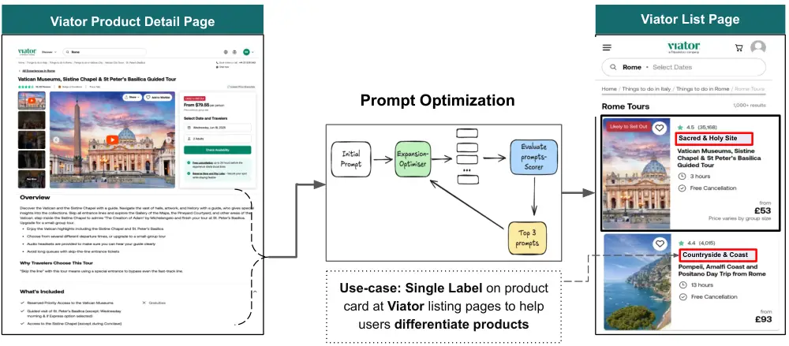
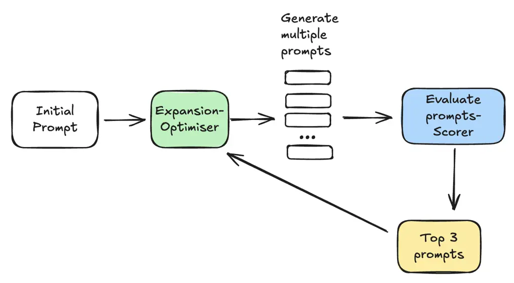
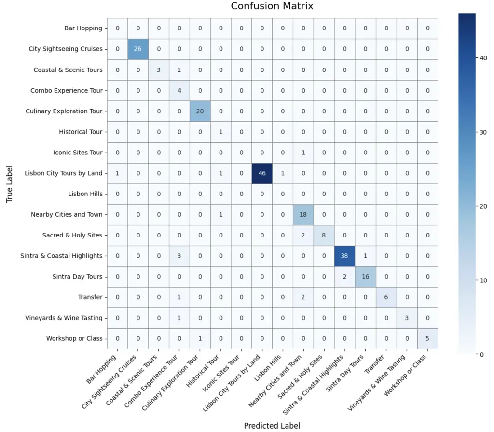

# Prompt Smart, Pay Less: Cost-Aware APO for Real-World Applications

DOI: [XXXXXXX.XXXXXXX](https://doi.org/XXXXXXX.XXXXXXX)Conference: Make
sure to enter the correct conference title from your rights confirmation
email; June 03–05, 2018; Woodstock,
NYISBN: 978-1-4503-XXXX-X/2018/06CCS: Do Not Use This Code Generate the
Correct Terms for Your PaperCCS: Do Not Use This Code Generate the
Correct Terms for Your PaperCCS: Do Not Use This Code Generate the
Correct Terms for Your PaperCCS: Do Not Use This Code Generate the
Correct Terms for Your Paper

Jayesh Choudhari Note: Both authors contributed equally to this
research. Affiliation: Viator, TripAdvisor, London, UK , Piyush Kumar
Singh Affiliation: Viator, TripAdvisor, London, UK , Douglas McIlwraith
Affiliation: Viator, TripAdvisor, London, UK and Snehal Nair
Affiliation: Viator, TripAdvisor, London, UK

Received  5 June 2009

###### Abstract.

Prompt design is a critical factor in the effectiveness of Large
Language Models (LLMs), yet remains largely heuristic, manual, and
difficult to scale. This paper presents the first comprehensive
evaluation of Automatic Prompt Optimization (APO) methods for
real-world, high-stakes multiclass classification in a commercial
setting, addressing a critical gap in the existing literature where most
of the APO frameworks have been validated only on benchmark
classification tasks of limited complexity.

We introduce APE-OPRO, a novel hybrid framework that combines the
complementary strengths of APE and OPRO, achieving notably better
cost-efficiency, around $`18\%`$ improvement over OPRO, without
sacrificing performance. We benchmark APE-OPRO alongside both
gradient-free (APE, OPRO) and gradient-based (ProTeGi) methods on a
dataset of  2,500 labeled products.

Our results highlight key trade-offs: ProTeGi offers the strongest
absolute performance at lower API cost but higher computational time as
noted in (Pryzant et al., 2023), while APE-OPRO strikes a compelling
balance between performance, API efficiency, and scalability. We further
conduct ablation studies on depth and breadth hyperparameters, and
reveal notable sensitivity to label formatting, indicating implicit
sensitivity in LLM behavior. These findings provide actionable insights
for implementing APO in commercial applications and establish a
foundation for future research in multi-label, vision, and multimodal
prompt optimization scenarios.

###### Keywords: 

LLM, Prompt Optimization, APE, OPRO, ProTeGi, CoT, APE-OPRO

Figure 1. Comparison of evaluated methods based on Mean Test Weighted F1
and Mean Cost per destination. Results are averaged over five runs per
destination, spanning 2,500 products across 10 destinations and each run
involves an optimization process with 10 iterations and 10 prompts per
iteration using GPT-4.1 (optimizer) and GPT-4o-mini (scorer). See
Section 3 for details on cost computation.

## 1. Introduction

Large Language Models (LLMs) have revolutionized natural language
processing across tasks such as summarization, question answering, and
classification. However, when used in a prompt-based setting, their
real-world performance is highly sensitive to the phrasing and structure
of input prompts. Designing effective prompts is often a manual,
heuristic-driven process that lacks reproducibility and scalability.
Zero-shot prompting, while attractive for its simplicity, frequently
falls short of production-grade performance without prompt optimization.
To address the challenge of effective prompt design, recent studies have
introduced automatic prompt optimization (APO) techniques that
iteratively refine prompts using model feedback or search strategies.
Although these approaches have shown promising results, they have
primarily been evaluated on tasks such as binary classification or
short-form output, often using benchmark datasets with limited
complexity. To the best of our knowledge, this work represents the first
comprehensive evaluation of APO methods in a complex, real-world
single-label multiclass classification setting.

Building on this foundation, our study presents a systematic
investigation of prompt optimization strategies for a commercially
impactful classification task at Viator (a global platform that
aggregates and sells curated travel experiences). We evaluate a range of
APO methods and propose a novel hybrid approach APE-OPRO, that
integrates the strengths of APE’s exploration with OPRO’s
metaprompt-based approach, and have performed a detailed
cost-performance analysis on a curated dataset of 2,500 manually labeled
products in the top 10 globally diverse destinations. The techniques
explored in this work fall into two main approaches:

- •
  Gradient-Free Methods have gained significant attention in recent
  literature, with several promising approaches such as Dual-Phase
  Accelerated Prompt Optimization (Yang et al., 2024), GPO (Tang et al.,
  2025), and PE2 (Ye et al., 2023). In this work, we focus on two widely
  adopted gradient-free methods—APE (Zhou et al., 2022) and OPRO (Yang
  et al., 2023). These serve as strong baselines and exemplify
  contrasting strategies for prompt optimization in the absence of
  gradient information.
- •
  Gradient-Based Methods have also attracted substantial interest, with
  approaches such as ProTeGi (Pryzant et al., 2023),
  TextGrad (Yuksekgonul et al., 2024), and GREATER (Das et al., 2024)
  advancing differentiable prompt optimization. In this study, we
  specifically focus on ProTeGi (Pryzant et al., 2023), which offers a
  robust and scalable gradient-based framework that aligns well with our
  experimental design and evaluation objectives.

In addition to gradient-based and gradient-free strategies, there exists
a third category of optimization methods inspired by evolutionary
algorithms. Evolutionary methods explore the prompt search space using
biologically inspired mechanisms such as mutation, selection, and
recombination. Notable examples include EvoPrompt (Tong et al., 2025),
PromptBreeder (Fernando et al., 2023) and SPRIG (Zhang et al., 2024). As
noted in the OPRO paper (Yang et al., 2023), EvoPrompt’s optimization
trajectory tends to be less stable compared to OPRO, primarily due to
its reliance on limited prompt history and the absence of task exemplars
during refinement. Consequently, we do not include these methods in our
experimental evaluation.

Beyond these methods, there also exist alternative optimization
strategies that do not fit neatly into the gradient-based,
gradient-free, or evolutionary frameworks. For example,
PromptAgent (Wang et al., 2023) employs Monte Carlo Tree Search to
explore and select optimal prompt sequences. CRISPO (He et al., 2025)
and SCULPT (Kumar et al., 2024) rely on iterative refinement guided by
model generated critiques and suggestions. PREFER (Zhang et al., 2023)
adopts an ensemble based feedback-reflect-refine loop to enhance prompt
quality. While promising, these strategies are considered complementary
and are not included in our current evaluation.



Figure 2. Workflow for single-label classification of Viator products.
Product text from Viator’s product description pages is passed to a
prompt optimization method, which generates a single,
destination-specific label to improve product differentiation on listing
pages.

### 1.1. Contributions

Our work makes the following key contributions:

- •
  Pushing Beyond Binary: Real-World Evaluation of APO in Multiclass
  Classification: We introduce a challenging real-world task of
  single-label, multiclass classification using our proprietary dataset
  of 2,500 high-revenue products across ten globally diverse
  destinations. This departs from the binary classification focus
  prevalent in most prior work, directly addressing the need for such
  evaluation highlighted as one of the limitations in (Pryzant et al.,
  2023).
- •
  APE-OPRO: A hybrid APO framework: We propose APE-OPRO, a novel hybrid
  approach that combines APE (Zhou et al., 2022) and OPRO (Yang et al.,
  2023). APE-OPRO matches OPRO’s performance while significantly
  reducing API costs by $`\sim\!18\%`$ as shown in figure 1.
- •
  Cost-Performance Trade-offs in Prompt Optimization: We perform a
  comprehensive cost-sensitive analysis of diverse APO approaches
  including gradient-based (ProTeGi) and gradient-free (APE, OPRO) and
  highlight their trade-offs between weighted F1 performance and API
  cost. Notably, ProTeGi delivers strong cost efficiency despite
  requiring longer execution time compared to other algorithms.
- •
  Revealing Implicit LLM sensitivity: We uncover a previously unreported
  sensitivity in APE where prompt performance is sensitive to label
  formatting, emphasizing how the stochastic behavior of large language
  models can impact automated prompt optimization.

Although this study focuses on single label classification, we outline a
generalizable framework for cost-aware APO evaluation and identify
promising research frontiers in multi-label, multimodal, and
multilingual prompt optimization.

## 2. Problem Formulation

To improve product discoverability on Viator, we initially adopted a
multi-label taxonomy in which individual products could be assigned
multiple, overlapping categories (e.g., a tour labeled both ‘Historical’
and ‘Cultural’). While this approach improved overall visibility, it
also caused popular products to appear in many categories, which reduced
the diversity of products shown to users and limited exposure for less
prominent yet relevant offerings. To address this issue, we transitioned
to a single label, multiclass taxonomy, where each product is assigned
one mutually exclusive label from a predefined set. This structure
reduces cognitive load and facilitates easier comparison across distinct
categories. In contrast to traditional hierarchical systems, our flat,
destination-specific taxonomy is better aligned with how users naturally
explore travel experiences and contributes to improved product
discoverability, as illustrated in Figure 2.

We frame this task as a single-label classification problem specific to
each destination $`d`$ , where, for a given product description
$`x\in\mathcal{D}`$, the objective is to assign the most appropriate
label from a defined, mutually exclusive set
$`\mathcal{C}_{d}=\{c_{1}^{d},c_{2}^{d},\ldots,c_{N_{d}}^{d}\}`$ .

Rather than relying on conventional supervised training approaches due
to limited ground truth, we frame the problem as a prompt optimization
task using Large Language Models. Our goal is to find an optimal natural
language prompt $`p^{*}\in\mathcal{P}`$ such that the LLM, when
conditioned on $`p^{*}`$ and input $`x`$, produces the correct label.
Formally, we seek:

```math
p^{*}=\arg\max_{p\in\mathcal{P}}\mathbb{E}_{\mathcal{D}^{\prime}\sim\mathcal{D}}\left[f(p,\mathcal{D}^{\prime})\right], \tag{1}
```

where $`f(p,\mathcal{D}^{\prime})`$ is an evaluation metric (e.g.,
weighted f1) calculated over a sample $`\mathcal{D}^{\prime}`$ of the
training data, assessing the LLM performance using prompt $`p`$.

To solve this optimization problem, we investigate several APO
techniques, categorizing them as gradient-free (APE (Zhou et al., 2022),
OPRO (Yang et al., 2023)) and gradient-based (ProTeGi (Pryzant et al.,
2023)). We also introduce a novel hybrid method, APE-OPRO, combining
APE’s initialization with OPRO’s metaprompt guided prompt generation. We
unify these methods within a general prompt optimization framework as
described in Figure 3.

This framework operates iteratively, starting with an initial prompt.
Each iteration involves an expansion phase, where an optimizer model
generates multiple candidate prompts (defining the width). These
candidates are then evaluated using a computationally less expensive
scorer model. The top ($`k=3`$) performing prompts, are selected and fed
back into the optimizer for the next iteration. This cycle continues for
a fixed number of iterations, defined as the depth. The framework is
flexible enough to encapsulate the explored APO strategies. This modular
design, which separates prompt generation from evaluation, facilitates
experimentation across different techniques.

Each destination uses a custom template for the prompt where the
candidate label set $`\mathcal{C}_{d}`$ is inserted into a fixed
template A.5.1 to preserve semantic relevance and improve performance.



Figure 3. Prompt Optimization Framework

## 3. Cost Computation

We compute the cost of APO for each destination as follows:

- •
  $`N`$ be the total number of iterations,
- •
  $`M`$ be the number of prompts generated per iteration,
- •
  $`C_{\text{in}}^{\text{op}}(i)`$ and $`C_{\text{out}}^{\text{op}}(i)`$
  be the input and output token costs for the optimizer model (expansion
  phase) in iteration $`i`$ (prompt generation),
- •
  $`C_{\text{in}}^{\text{sc}}(i,j)`$ and
  $`C_{\text{out}}^{\text{sc}}(i,j)`$ be the input and output token
  costs for scoring (scoring phase) the $`j`$-th prompt in iteration
  $`i`$.

Then, the total cost¹¹ 1 Reported costs do not account for potential
savings from prompt caching or batch API calls in offline scenarios for
one run is:

```math
\text{Total Cost}=\sum_{i=1}^{N}\left[C_{\text{in}}^{\text{op}}(i)+C_{\text{out}}^{\text{op}}(i)+\sum_{j=1}^{M}\left(C_{\text{in}}^{\text{sc}}(i,j)+C_{\text{out}}^{\text{sc}}(i,j)\right)\right] \tag{2}
```

For each method (APE, OPRO, APE-OPRO, and ProTeGi), the total cost is
computed as the cumulative sum of input and output tokens across all
optimization iterations, as defined in Equation 2. As shown in Figure 3,
each iteration includes two stages: prompt expansion (handled by
optimizer model) and prompt evaluation (handled by scorer model). Unless
otherwise stated, we use GPT-4.1 for optimization and GPT-4o-mini for
scoring²² 2 https://openai.com/api/pricing/.

## 4. Experiment Setup

### 4.1. Dataset

Our dataset comprises proprietary Viator travel experiences from ten
diverse global destinations, selected to capture a wide range of user
interests and destination types. These include major European cities
(Rome, Paris, Lisbon, Amsterdam, Edinburgh, Athens), Asia (Tokyo), North
American entertainment centers (Las Vegas), and island or remote
destinations (Maui, Reykjavik), offering geographic and cultural
diversity.

| Destination | Train | Test | \#Labels | Avg. \#Tokens |
| ----------- | ----- | ---- | -------- | ------------- |
| Rome        | 52    | 390  | 14       | 190           |
| Lisbon      | 75    | 213  | 23       | 180           |
| Amsterdam   | 50    | 109  | 16       | 185           |
| Paris       | 73    | 229  | 19       | 189           |
| Las Vegas   | 59    | 186  | 17       | 179           |
| Athens      | 58    | 185  | 19       | 198           |
| Tokyo       | 65    | 190  | 18       | 183           |
| Edinburgh   | 51    | 125  | 15       | 179           |
| Reykjavik   | 63    | 114  | 17       | 183           |
| Maui        | 48    | 166  | 12       | 173           |

Table 1. Overview of the dataset split by destination, including
train/test size, number of unique labels, and average token count per
product description

Figure 4. Distribution of labels in Top 10 Destinations

#### 4.1.1. Data Collection and Preprocessing

For each destination, we extracted product information from Viator’s
product description as illustrated in Figure 2. Each entry in the
experience contains an average of 185 tokens of descriptive text.

#### 4.1.2. Labeling Process

To initiate the taxonomy refinement, we manually labeled a subset of top
ranked products that cover 80% of the revenue within each destination,
focusing on popular and representative experiences. This
revenue-weighted sampling approach ensures that our taxonomy captures
economically significant experience categories while maintaining
destination-specific relevance. Two domain experts independently labeled
each experience, achieving an interannotator agreement of 87. 3%
(Cohen’s $`\kappa`$ = 0.81), with disagreements resolved by discussion.

We developed a flat labeling taxonomy (a non-hierarchical set of 66
mutually exclusive categories) to classify travel experience products
across 10 major destinations. The number of labels varies by destination
(from 12 for Maui to 23 for Lisbon), reflecting the diversity of
available experiences. Some labels are destination-specific (e.g.,
‘‘Volcano Tours’’ for Reykjavik), while others are universal (e.g.,
‘‘City Highlights’’).³³ 3 Due to proprietary constraints, the dataset is
not publicly released but can be simulated using category-rich
classification tasks.

#### 4.1.3. Dataset Characteristics

As illustrated in Figure 4, the distribution of labels follows a long
tail pattern, where a few labels represent a large proportion of
products, typically representing highly popular and destination-specific
activities, while many other labels correspond to niche or very common
offerings. For example, in Rome, “Sacred & Holy Site” accounts for
26.47% and “Countryside & Coast” represents 8.82% of all experiences,
while in Las Vegas, “Adventure” represents 19%, “City Highlight”
represents 3.24%.

The “Other Experiences” label is included as an additional candidate
label across all destinations during the training stage to handle
products associated with rare or previously unseen categories. When the
label is assigned, the product is flagged for manual review by
Destination Managers, who periodically assess whether a new dedicated
label should be introduced based on product volume.

#### 4.1.4. Destination Selection Criteria for Evaluation

To provide a representative evaluation of prompt optimization methods,
we focus on three key destinations: Rome, Amsterdam, and Lisbon. These
were chosen to capture a range of product diversity and complexity in
the labeling. Rome represents a destination with well defined tourist
attractions and relatively clear categorization. In contrast, Amsterdam
offers moderate complexity due to its diverse range of experience types,
while Lisbon presents the most challenging case with the highest number
of distinct labels (23).

### 4.2. Train-Test Split

To ensure consistency across methods, we adopt a standardized train-test
split strategy. We perform stratified sampling by randomly sampling up
to four examples per label within each destination to construct the
training set. The remaining examples are reserved for evaluation in the
test set. Using four examples per label ensures sufficient
representation during training while also minimizing the risk of labels
appearing only in the training set and not in the test set, leading to a
fairer evaluation. All methods are trained exclusively on the training
set and the test set is strictly held out and used only for final
evaluation. The number of training and test instances after the split is
summarized in Table 1.

### 4.3. Prompt Optimization Configuration

All methods are executed under a uniform configuration of
hyperparameters unless otherwise stated. For APE, OPRO, and APE-OPRO, we
fix the optimization depth (number of iterations) to 10, and the breadth
(number of prompts generated per iteration) to 10.

For ProTeGi, we similarly set the search-depth to 10, aligning it with
the other methods for comparability. The max-expansion-factor, which
controls the number of prompt candidates passed to the selection stage
in each iteration, is also set to 10. This parameter plays a role
analogous to the breadth in the other methods. All remaining
hyperparameters for ProTeGi are set as described in Section 3 (Setup) of
the original paper, except for the subset $`\mathcal{D}_{mini}`$, which
we set to half of the training data, i.e., $`\mathcal{D}_{train/2}`$.

Prompt selection at each iteration is based on macro F1 score, which
encourages generalizable prompts by evaluating performance uniformly
across all classes. We do not incorporate any early stopping criteria in
our experiments. Instead, each algorithm is allowed to run for a fixed
maximum number of iterations, ensuring a consistent evaluation framework
across all methods.

### 4.4. Evaluation Metric

For final performance evaluation, we report the weighted F1 score due to
the high class imbalance present in our multiclass classification task.
While macro F1 offers equal weighting across classes, it is highly
sensitive to errors in rare labels, where a single misclassification can
cause the F1 score for that class to drop to zero. This can
disproportionately skew the overall result.

In contrast, weighted F1 accounts for class frequency, providing a more
robust and representative measure of model performance in practical
scenarios—particularly where dominant classes are of primary interest. A
detailed definition of this metric is provided in Appendix A.2.

### 4.5. Algorithms

#### 4.5.1. CoT(Wei et al., 2022)

This serves as the baseline Chain-of-Thought (CoT) prompt, in which the
phrase - Think step by step before answering is appended to the base
instruction. We include this standard CoT formulation to establish a
performance baseline, enabling a comparison of the cost-performance
trade-offs associated with more advanced prompting strategies.

#### 4.5.2. APE(Zhou et al., 2022)

Among various prompt optimization strategies, the APE framework is
notable for its conceptual simplicity and minimal explicit feedback. We
adapt APE following the framework in figure 3 for our use case as
described in Algorithm 1.

1: Input: Initial prompt $`p_{0}`$, training data
$`\mathcal{D}_{train}`$, \#iterations $`T`$, \#prompts $`g=10`$

2: Initialize $`S_{0}=\{p_{0}\}`$, $`i=0`$

3: while $`i<T`$ do

4:   $`i\leftarrow i+1`$; $`S_{i}=\emptyset`$

5:   for each prompt $`p\in S_{i-1}`$ do

6:    Generate $`g/|S_{i-1}|`$ semantically similar prompts using
optimizer $`\triangleright`$ Section A.5.2

7:    Add generated prompts to $`S_{i}`$   

8:   Compute macro F1 for each prompt in $`S_{i}`$ (using scorer) on
$`\mathcal{D}_{train}`$

9:   Select top $`3`$ performing prompts $`\rightarrow S_{i}`$

10: Output: Best prompt (based on macro F1) $`p_{T}`$ over all
iterations

Algorithm 1 APE-style Prompt Optimization Framework

#### 4.5.3. OPRO(Yang et al., 2023)

We adapt the original OPRO framework to better suit our task of
iterative prompt refinement for label definition in prompt based
classification. Specifically, we make two key modifications: (1) we
exclude exemplars from the metaprompt, as our generated prompts are
significantly longer ($`\sim\!1300`$) tokens on average) and more
descriptive than standard OPRO setups; and (2) we restrict the
metaprompt to the top 3 performing prompts with their scores, rather
than the original set of 20, to maintain clarity and reduce prompt
length. The meta-prompt template is provided in Section A.5.3.

#### 4.5.4. APE-OPRO

In this method, we integrate the methodologies of APE and OPRO, to
improve the prompt optimization for our specific use case. Since OPRO
does not incorporate any prompt and scores in its initial iteration, we
use APE’s initialization strategy by generating semantically similar
variants of the initial system prompt A.5.1. This step mirrors the
Iterative Monte Carlo Search approach in APE (Zhou et al., 2022). We
then evaluate these candidate prompts on a training dataset and select
the top 3 prompts based on macro F1. These high-performing prompts,
along with their evaluation scores, are embedded into a
metaprompt A.5.3, which is used to guide the subsequent round of prompt
generation. This iterative process is repeated for 10 iterations
(including APE’s initial iteration) to progressively refine and improve
prompt quality.

#### 4.5.5. ProTeGi(Pryzant et al., 2023)

ProTeGi (Prompt Tuning via Gradient-Inspired Optimization) treats prompt
engineering as an iterative process guided by performance feedback,
mimicking gradient descent through natural language updates. As shown in
figure 3, we adapt ProTeGi to suit our specific task as described in
Algorithm 2.

1: Input: Initial system prompt $`p_{0}`$, training dataset
$`\mathcal{D}_{train}`$, \#iterations (search-depth) $`T`$, \#prompts
(breadth) $`B=10`$

2: Initialize $`S_{0}=\{p_{0}\}`$, $`i=0`$

3: while $`i<T`$ do

4:   $`i\leftarrow i+1`$; $`S_{i}\leftarrow\emptyset`$;
$`\text{max\_exp\_factor}\leftarrow B/|S_{i-1}|`$

5:   for each prompt $`p_{j}^{i-1}\in S_{i-1}`$ do

6:    Evaluate $`p_{j}^{i-1}`$ on $`\mathcal{D}_{train}`$, and identify
failure cases

7:    Generate feedback (using optimizer) $`\triangleright`$
Section A.5.4

8:    Use LLM (optimizer) to generate prompts incorporating feedback
$`\rightarrow S_{ij}`$ $`\triangleright`$ Section A.5.5

9:    Use MC-based sampling to generate 2 semantically similar prompts
$`\rightarrow S_{ij}^{mc}`$ $`\triangleright`$ Section A.5.6

10:    $`S_{ij}\leftarrow S_{ij}\cup S_{ij}^{mc}`$;

11:    if $`|S_{ij}|>\text{max\_exp\_factor}`$ then

12:
     $`S_{ij}\leftarrow random.sample(S_{ij},\text{max\_exp\_factor})`$

   

13:    $`S_{i}\leftarrow S_{i}\cup S_{ij}`$   

14:   Compute macro F1 for each prompt in $`S_{i}`$ (using scorer) as
per Successive Halving (Audibert and Bubeck, 2010) with
$`\mathcal{D}_{mini}=\mathcal{D}_{train}/2`$

15:   $`S_{i}\leftarrow`$ top 3 prompts based on macro F1

16: Output: Best prompt $`p_{T}`$ over all iterations based on macro F1

Algorithm 2 ProTeGi Prompt Optimization Framework

Exemplar selection is a unique challenge, and we intentionally refrained
from incorporating examples in the prompt templates of the methods
evaluated. Consequently, we exclude in-context learning (ICL) methods
from our comparison to ensure fairness and plan to explore them in
future work.

## 5. Results

All methods begin with the same initial system prompt template A.5.1,
which does not include label definitions. We observe that the final
prompts for all methods except APE contain label definitions, which
naturally emerge through the iterative optimization process. The final
prompts selected for the Lisbon destination are available in
Section A.6. For each method, the prompt with the highest macro F1
across 10 iterations is selected for test set evaluation.

### 5.1. Cost vs. Performance Trade-off

The cost–performance trade-off across five prompting methods, including
CoT, evaluated over the top ten destinations is summarized in Figure 1.
The following key insights emerge from the analysis:

1.  (1)
    Cost is not linearly correlated with performance—higher cost does
    not always guarantee better results.
2.  (2)
    ProTeGi achieves the highest overall performance while remaining
    more cost-effective than both OPRO and APE-OPRO, although it incurs
    higher execution time as noted in (Pryzant et al., 2023).
3.  (3)
    APE-OPRO matches OPRO’s performance with significantly lower cost,
    demonstrating the value of combining prompt initialization and
    iterative refinement.

A comprehensive performance comparison of all methods across 10
destinations is provided in Appendix A.1.

### 5.2. APE-OPRO vs OPRO

This section analyzes why APE-OPRO offers better cost-efficiency while
maintaining similar performance compared to OPRO. As shown in Figure 5,
OPRO consistently incurs higher costs across all destinations, with
Amsterdam showing the most significant difference, nearly twice the cost
of APE-OPRO. On average, OPRO incurs  18% higher costs under our
standard run configuration.

Figure 5. Total cost comparison between APE-OPRO and OPRO across 10
destinations. Each bar reflects the aggregated cost over 10 optimization
iterations with 10 candidate prompts per iteration

This disparity in cost stems from their initialization strategies.
APE-OPRO begins with APE generated prompts, which are semantically
similar variants of the initial system prompt A.5.1. These prompts are
scored using macro F1, and the top 3 are fed into the metaprompt to
produce structured prompts with label definitions, continuing this cycle
until a fixed number of iterations. In contrast, OPRO starts with the
metaprompt directly, without prior prompts or scores. As a result, it
creates long and detailed prompts from the beginning, which then lead to
even longer prompts in later steps.

We illustrate this distinction in Figure 6 using Amsterdam as a
representative case, where the divergence is particularly pronounced and
serves as a clear example to contextualize the observed behavior.
APE-OPRO starts with a lower token count in the first iteration, due to
its APE initialization, and increases gradually. OPRO, by contrast,
exhibits a steep early rise in token count, plateauing around iteration 6. For illustration, we include the best prompts from both methods at
iterations 1 and 4 in Appendix A.4. Iteration 1 highlights
initialization differences, while iteration 4 shows the significant
difference in token counts between two methods.

Figure 6. Distribution of token count for the best prompt saved in each
optimization iteration for APE-OPRO and OPRO in Amsterdam

This difference in approach is analogous to gradient descent, where OPRO
attempts a large optimization jump in the first iteration, and
potentially diverges from a cost-efficient solution. In contrast,
APE-OPRO follows a more gradual, stepwise refinement process starting
from a simple prompt and improving it iteratively, leading to more
efficient prompt evolution at reduced cost, while achieving similar
performance.

### 5.3. Variance Analysis

Given the inherent stochasticity of LLMs, quantifying the variance in
model performance is crucial for assessing generalizability. Figure 7
presents the average test weighted F1 scores computed over five
independent runs for each method across three distinct destination
datasets. Each bar in the figure is annotated with the corresponding
standard deviation, and error bars are included to visualize
variability.

Our analysis reveals that model performance exhibits noticeable
variation across destinations, underscoring the influence of
dataset-specific characteristics on the efficacy of each method. Methods
such as APE , OPRO , and APE-OPRO consistently exhibit lower variance
across all destinations, suggesting more stable behavior under repeated
evaluations. The average standard deviation in performance across the
three destinations is approximately $`0.04`$ for ProTeGi , followed by
$`0.03`$ for OPRO , $`0.026`$ for APE-OPRO , and $`0.02`$ for APE . We
hypothesize that one contributing factor to the slightly higher variance
observed in ProTeGi may be the limited size of the sampled training
dataset used in our implementation, where
$`\mathcal{D}_{mini}=\mathcal{D}_{train}/2`$, as opposed to the larger
dataset size $`\mathcal{D}_{mini}=64`$ recommended by the original
authors (Pryzant et al., 2023).

Figure 7. Evaluation of method generalizability across diverse
destination datasets, showing the average weighted F1 score and standard
deviation over five independent test trials per method

### 5.4. Convergence Analysis

Convergence analysis evaluates model stability and generalization as
reasoning depth increases, helping determine whether further depth
yields meaningful gains or if performance has plateaued. We evaluate
this by tracking the mean and variance of weighted F1 scores on both
training and test sets across increasing depths, averaging results over
five independent runs per method and across three destinations. Figure 8
shows these trends for ProTeGi, while convergence plots for other
methods appear in Section A.10. Several notable patterns emerge:

1.  (1)
    ProTeGi consistently shows strong convergence and generalization
    across all three destinations, with a narrow train-test gap and
    performance largely stabilizing by iteration 5–6.
2.  (2)
    For Amsterdam, CoT performs well even at shallow depths, leaving
    limited room for further gains. Most models plateau early.
3.  (3)
    For Rome, all methods demonstrate continued performance improvement
    up to depth 10, suggesting potential for further gains with
    increasing depth.
4.  (4)
    For Lisbon, both ProTeGi and APE-OPRO show rapid gains from the
    start and converge by depth 5–6, while OPRO achieves most of its
    improvement in the first iteration and plateaus by depth 1.
5.  (5)
    Interestingly, all 4 methods often show lower weighted F1 scores on
    the training set than on the test set. This counter-intuitive
    pattern stems from our sampling strategy, limiting training to at
    most four examples per label, thus making training metrics highly
    sensitive to individual errors. In contrast, the larger test set
    yields more stable and representative performance scores.

These findings collectively highlight the efficiency and generalization
strength of ProTegi, while also illustrating destination-specific
dynamics in convergence behavior.

Figure 8. Convergence analysis for ProTegi on 3 key destinations

### 5.5. Ablating on Depth

For all methods except CoT, with no principled stopping criterion, the
number of optimization iterations (or depth) is a key hyperparameter. As
such, the optimal depth might vary across methods and datasets. We
evaluated each method at multiple depths to assess its impact on
performance and cost, with ProTeGi’s search-depth serving as its
analogous control.

Figure 9 reports the test set weighted F1 scores for three destinations
across different iteration counts. Due to low variance observed in
performance metrics 5.3, we present results from a single run per
configuration.

As expected, increasing iteration count significantly raises costs.
Moving from 5 to 10 and 15 iterations typically resulted in a 2x and 3x
cost increase, respectively. ProTeGi showed a slightly steeper rise,
averaging 2.3–2.6x and 3.3–3.6x (see Appendix, Figure 18). While scorer
output tokens increase linearly with depth, ProTeGi’s optimizer
input/output and scorer input tokens grow super-linearly, likely due to
more detailed feedback generating longer prompts. However, this
increased specificity did not consistently yield better performance. For
ProTeGi, test weighted F1 scores sometimes plateaued or declined with
increased iteration depth (from 5 to 10 and 10 to 15), consistent with
trends in the original (Pryzant et al., 2023) paper. Similar diminishing
returns were observed in other methods, suggesting that smaller depths
may suffice for effective prompt optimization.

Figure 9. Change in Performance for depth or maximum number of
iterations for each method across destinations

### 5.6. Ablating on Breadth

Another key hyperparameter across all evaluated methods is the
breadth—the number of prompts generated and evaluated per iteration.
This controls the size of the candidate pool assessed during each round
to select the top ($`k=3`$) prompts for the next iteration. In ProTeGi ,
this is implemented during the selection phase (successive halving),
where a fixed number of prompts are forwarded if the post-expansion pool
exceeds the specified breadth.

Figure 10 shows the impact of varying breadth (5, 10, 15) on test
weighted F1 scores across three destinations.

Figure 10. Change in Performance for breadth or maximum number of
prompts in each iteration for each method across destinations

As expected, increasing breadth resulted in a roughly 2x and 3x cost
increases for most methods when moving from 5 to 10 and 15 prompts,
respectively, ProTeGi showed a more subdued cost increase (refer
Appendix, Figure 20). This is because breadth in ProTeGi mainly impacts
the scorer model during selection, with prompt generation in the
expansion phase governed by separate, fixed parameters (e.g., number of
feedbacks per error group, gradients per feedback, and prompts per
gradient) that were not varied in this study.

Similar to depth, increasing breadth yields marginal or negative gains
in test weighted F1 scores, indicating diminishing returns. This
suggests that smaller breadth values may suffice for effective prompt
optimization across all methods.

### 5.7. Sensitivity to Label List Formatting in Prompt Templates

To evaluate the impact of label formatting on prompt optimization
performance while keeping label order fixed, we investigated how
different styles of presenting label lists such as hyphenation (-
Label), numeric prefixes (1. Label), and alphabetical prefixes (a.
Label) affect model behavior within the initial system prompt A.5.1. The
corresponding prompt templates for these formatting styles are provided
in Appendix A.3. This experiment was conducted across all four methods
and we explicitly stated in the prompt: Treat all labels as equally
likely and independent of their position in the list. Despite this
explicit guidance, we observed that APE was notably sensitive to changes
in label formatting, particularly when labels were numerically or
alphabetically indexed. In contrast, the other methods remained largely
unaffected (see Appendix Section A.3). To quantify this effect, we ran
five independent trials of APE on the three key destinations, reporting
the test weighted F1 scores and their variance in Figure 11.

A likely reason for this sensitivity is that APE generates final prompts
without including label definitions, relying only on the label names. In
contrast, other methods generate detailed label definitions, which may
help reduce the impact of formatting effects.

Figure 11. Effect of Label Formatting Styles such as hyphens (-),
numbers ($`1.,2.,3.,\cdots`$), alphabets ($`a.,b.,c.,\cdots`$) on APE’s
Performance

## 6. Conclusion and Future work

In this work, we addressed a critical gap by providing the first
comprehensive evaluation of APO methods for real-world, commercially
relevant multiclass classification task. We systematically benchmarked
prominent gradient-free (APE, OPRO) and gradient-based (ProTeGi)
approaches on our proprietary dataset and introduced APE-OPRO, a novel
hybrid framework. Our empirical analysis revealed key performance-cost
trade-offs relevant to practical implementation. While ProTeGi
demonstrated superior API cost-efficiency and performance, it required
longer execution times. APE-OPRO offered a compelling balance by
matching OPRO’s performance, outperforming APE, and significantly
reducing cost compared to OPRO. These findings provide valuable insights
for practitioners, allowing them to choose between optimizing for API
cost (using ProTeGi) or balancing speed and performance (using
APE-OPRO), based on their specific computational and time limitations.
This versatility underscores APO’s effectiveness for complex commercial
applications.

Moving forward, our study highlights several promising avenues for
future research in APO. Key directions include developing methods for
more structured and fine-grained control over prompt updates (Tang
et al., 2025), as current techniques offer limited granularity.
Expanding the scope of APO is also critical, particularly to address
multi label tasks and to extend optimization techniques to vision and
multimodal domains, which remain largely underexplored. Furthermore,
investigating the impact of incorporating persona-based prompting (for
example, using destination-specific personas) within the optimization
process presents another interesting direction. Finally, exploring the
use of different models as scorers and optimizers may offer new insights
into performance–cost trade-offs.

###### Acknowledgements.

We gratefully acknowledge the valuable suggestions and consistent
feedback provided by [Karthik
Nagesh](https://www.linkedin.com/in/karthikn5/).

## References

- Audibert and Bubeck (2010) Jean-Yves Audibert and Sébastien
  Bubeck. 2010. Best arm identification in multi-armed bandits. In
  _COLT-23th Conference on learning theory-2010_. 13–p.
- Das et al. (2024) Sarkar Snigdha Sarathi Das, Ryo Kamoi, Bo Pang,
  Yusen Zhang, Caiming Xiong, and Rui Zhang. 2024. GReaTer: Gradients
  over Reasoning Makes Smaller Language Models Strong Prompt Optimizers.
  _arXiv preprint arXiv:2412.09722_ (2024).
- Fernando et al. (2023) Chrisantha Fernando, Dylan Banarse, Henryk
  Michalewski, Simon Osindero, and Tim Rocktäschel. 2023. Promptbreeder:
  Self-referential self-improvement via prompt evolution. _arXiv
  preprint arXiv:2309.16797_ (2023).
- He et al. (2025) Han He, Qianchu Liu, Lei Xu, Chaitanya Shivade, Yi
  Zhang, Sundararajan Srinivasan, and Katrin Kirchhoff. 2025. CriSPO:
  Multi-aspect critique-suggestion-guided automatic prompt optimization
  for text generation. In _Proceedings of the AAAI Conference on
  Artificial Intelligence_, Vol. 39. 24014–24022.
- Kumar et al. (2024) Shanu Kumar, Akhila Yesantarao Venkata, Shubhanshu
  Khandelwal, Bishal Santra, Parag Agrawal, and Manish Gupta. 2024.
  SCULPT: Systematic Tuning of Long Prompts. _arXiv preprint
  arXiv:2410.20788_ (2024).
- Pryzant et al. (2023) Reid Pryzant, Dan Iter, Jerry Li, Yin Tat Lee,
  Chenguang Zhu, and Michael Zeng. 2023. Automatic prompt optimization
  with" gradient descent" and beam search. _arXiv preprint
  arXiv:2305.03495_ (2023).
- Tang et al. (2025) Xinyu Tang, Xiaolei Wang, Wayne Xin Zhao, Siyuan
  Lu, Yaliang Li, and Ji-Rong Wen. 2025. Unleashing the potential of
  large language models as prompt optimizers: Analogical analysis with
  gradient-based model optimizers. In _Proceedings of the AAAI
  Conference on Artificial Intelligence_, Vol. 39. 25264–25272.
- Tong et al. (2025) Zeliang Tong, Zhuojun Ding, and Wei Wei. 2025.
  EvoPrompt: Evolving Prompts for Enhanced Zero-Shot Named Entity
  Recognition with Large Language Models. In _Proceedings of the 31st
  International Conference on Computational Linguistics_. 5136–5153.
- Wang et al. (2023) Xinyuan Wang, Chenxi Li, Zhen Wang, Fan Bai,
  Haotian Luo, Jiayou Zhang, Nebojsa Jojic, Eric P Xing, and Zhiting
  Hu. 2023. Promptagent: Strategic planning with language models enables
  expert-level prompt optimization. _arXiv preprint arXiv:2310.16427_
  (2023).
- Wei et al. (2022) Jason Wei, Xuezhi Wang, Dale Schuurmans, Maarten
  Bosma, Fei Xia, Ed Chi, Quoc V Le, Denny Zhou, et al. 2022.
  Chain-of-thought prompting elicits reasoning in large language models.
  _Advances in neural information processing systems_ 35 (2022),
  24824–24837.
- Yang et al. (2023) Chengrun Yang, Xuezhi Wang, Yifeng Lu, Hanxiao Liu,
  Quoc V Le, Denny Zhou, and Xinyun Chen. 2023. Large language models as
  optimizers. _arXiv preprint arXiv:2309.03409_ (2023).
- Yang et al. (2024) Muchen Yang, Moxin Li, Yongle Li, Zijun Chen,
  Chongming Gao, Junqi Zhang, Yangyang Li, and Fuli Feng. 2024.
  Dual-Phase Accelerated Prompt Optimization. _arXiv preprint
  arXiv:2406.13443_ (2024).
- Ye et al. (2023) Qinyuan Ye, Maxamed Axmed, Reid Pryzant, and Fereshte
  Khani. 2023. Prompt engineering a prompt engineer. _arXiv preprint
  arXiv:2311.05661_ (2023).
- Yuksekgonul et al. (2024) Mert Yuksekgonul, Federico Bianchi, Joseph
  Boen, Sheng Liu, Zhi Huang, Carlos Guestrin, and James Zou. 2024.
  Textgrad: Automatic" differentiation" via text. _arXiv preprint
  arXiv:2406.07496_ (2024).
- Zhang et al. (2023) Chenrui Zhang, Lin Liu, Jinpeng Wang, Chuyuan
  Wang, Xiao Sun, Hongyu Wang, and Mingchen Cai. 2023. Prefer: Prompt
  ensemble learning via feedback-reflect-refine. _arXiv preprint
  arXiv:2308.12033_ (2023).
- Zhang et al. (2024) Lechen Zhang, Tolga Ergen, Lajanugen Logeswaran,
  Moontae Lee, and David Jurgens. 2024. SPRIG: Improving Large Language
  Model Performance by System Prompt Optimization. _arXiv preprint
  arXiv:2410.14826_ (2024).
- Zhou et al. (2022) Yongchao Zhou, Andrei Ioan Muresanu, Ziwen Han,
  Keiran Paster, Silviu Pitis, Harris Chan, and Jimmy Ba. 2022. Large
  language models are human-level prompt engineers. In _The Eleventh
  International Conference on Learning Representations_.

## Appendix A Appendix

### A.1. Train Test Performance on 10 destinations

The Figures 12 and 13 present the model’s performance on both test and
train datasets, measured by the average weighted F1 score across 10
destinations. Results are averaged over five runs per destination, with
standard deviation included to indicate variability in performance. Note
that Figure 1 is a summarized version of this plot showing the
performance averaged over all the destinations for each method. We
observe that ProTeGi has either best or at par test performance for
almost all the 10 destinations.

Figure 12. Test weighted F1 (averaged over 5 runs) on Top 10
destinations

Figure 13. Train weighted F1 (averaged over 5 runs) on Top 10
destinations

### A.2. Metrics

This task is a standard multiclass classification problem, where macro
F1 and weighted F1 are common evaluation metrics. As shown in Figure 4,
the label distribution is highly imbalanced, with several classes
appearing fewer than three times across major destinations. This skews
the evaluation: macro F1, by weighting all classes equally, drops
significantly compared to weighted F1, which accounts for frequency.

| Label                       | F1 Score |
| --------------------------- | -------- |
| City Sightseeing Cruises    | 1.0000   |
| Culinary Exploration Tour   | 0.9756   |
| Lisbon City Tours by Land   | 0.9684   |
| Sintra & Coastal Highlights | 0.9268   |
| Sintra Day Tours            | 0.9143   |
| Workshop or Class           | 0.9091   |
| Sacred & Holy Sites         | 0.8889   |
| Coastal & Scenic Tours      | 0.8571   |
| Nearby Cities and Town      | 0.8571   |
| Vineyards & Wine Tasting    | 0.8571   |
| Transfer                    | 0.8000   |
| Combo Experience Tour       | 0.5714   |
| Historical Tour             | 0.5000   |
| Bar Hopping                 | 0.0000   |
| Iconic Sites Tour           | 0.0000   |
| Lisbon Hills                | 0.0000   |

Table 2. Per-class F1 scores for Lisbon



Figure 14. Confusion Matrix for Lisbon

As shown in Figure 14, in the Lisbon dataset, rare classes like Bar
Hopping, Iconic Sites Tour, and Lisbon Hills each incur just a single
error (false positive or false negative), yet receive an F1 score of
zero due to macro F1’s sensitivity. While such edge cases are heavily
penalized under macro F1, they have limited impact on real-world
utility, where frequent classes dominate and labels serve primarily as
metadata or filters on Viator listing pages. Given this, we adopt
weighted F1 as the primary evaluation metric, as it better reflects
overall labeling performance in imbalanced classification tasks where
broad coverage across frequent categories is prioritized.

### A.3. Sensitivity to Label List Formatting in Prompt Templates

We report the sensitivity of APE, OPRO and APE-OPRO to variations in
label list formatting in the graph below. As the results demonstrate,
all three methods exhibit robustness to such formatting changes, with no
significant impact on performance observed.

Figure 15. Effect of Label list formatting in prompt templates on OPRO,
APE-OPRO, and ProTeGi

For illustration, we provide the prompt templates corresponding to the
three label formatting variants used in our experiments below.

#### A.3.1. Initial system prompt formatting with Hyphen


#### A.3.2. Initial system prompt formatting with numeric


#### A.3.3. Initial system prompt formatting with alphabets


### A.4. APE OPRO vs OPRO

#### A.4.1. Best prompt of iteration 1 in Amsterdam for APE-OPRO


#### A.4.2. Best prompt of iteration 1 in Amsterdam for OPRO


#### A.4.3. Best prompt of iteration 4 in Amsterdam for APE-OPRO


#### A.4.4. Best prompt of iteration 4 in Amsterdam for OPRO


### A.5. Prompt Templates

#### A.5.1. Initial System Prompt

This is the prompt that we intend to optimize using the prompt
optimization framework.


#### A.5.2. Generating Similar Prompts Template

This prompt is used to generate similar prompt based on some given
prompt in each iteration.


#### A.5.3. OPRO metaprompt template

This is the prompt utilized by OPRO and APE-OPRO during the expansion
phase.


#### A.5.4. ProTeGi Gradient generation prompt

This is the prompt utilized by ProTeGi during the expansion phase.


#### A.5.5. ProTeGi Prompt Generation using Gradients


#### A.5.6. ProTeGi Semantically Similar Prompt Generation


### A.6. Best Prompts


### A.7. Variance Analysis

Figure 16 presents the variance in the weighted F1 scores on the
training dataset. As anticipated, the standard deviation on the training
data is relatively low across most methods when compared to the test
data. This aligns with expectations, given that models typically fit
better on training data. Notably, APE-OPRO exhibits a slightly higher
standard deviation on the training set, averaging $`\pm 0.03`$, in
contrast to $`\pm 0.0266`$ observed on the test set.

Figure 17 shows the standard deviation of the macro F1 score on both the
test and training datasets. As briefly discussed in Section 4.4, macro
F1 is inherently sensitive to class imbalance, particularly due to the
label distribution in the test set. This sensitivity contributes to both
the lower overall macro F1 scores and the higher observed standard
deviation on the test data.

Figure 16. Variance in the train weighted F1 score for all methods,
across three different destinations for five independent trials.

Figure 17. Evaluation of method generalizability across diverse
destination datasets, showing the avg. weighted F1 score and standard
deviation over five independent test and train trials per method.

### A.8. Ablating on Depth

Figure 18 presents the test weighted F1 scores across three key
destinations for all four methods, along with the corresponding costs
incurred as depth increases. This plot is similar to the plot in section
5.5 with cost information included for each method for each destination.

Figure 18. Change in Performance for depth or maximum number of
iterations for each method across destinations along with the (API) cost
incurred for each run of the respective algorithm.

Figure 19 presents the training weighted F1 scores across three key
destinations for all four methods, along with the associated costs as
depth increases. Note that the cost values are identical to those
reported in Figure 9. Across all methods, diminishing returns in
training weighted F1 were observed with increasing depth, suggesting
that smaller depths may be sufficient for effective prompt optimization
which is consistent with the pattern seen in the test weighted F1
results.

Figure 19. Caption

### A.9. Ablating on Breadth

Figure 20 presents the test weighted F1 score and associated cost as
breadth increases. This plot is similar to the plot in section 5.6 with
cost information included for each method for each destination.

Figure 20. Change in Performance for breadth or maximum number of
prompts in each iteration for each method across destinations

Figure 21 displays the training weighted F1 score and corresponding cost
as breadth increases. The observed diminishing or negative returns in F1
performance suggest that lower breadth values are likely adequate for
effective prompt optimization.

Figure 21. Caption

### A.10. Convergence Analysis

The following graphs present the convergence analysis of APE, OPRO, and
APE-OPRO for 3 key destinations and these are similar to the plot in
section 5.4

Figure 22. Convergence analysis for APE-OPRO on 3 key destinations

Figure 23. Convergence analysis for OPRO on 3 key destinations

Figure 24. Convergence analysis for APE for 3 key destinations
