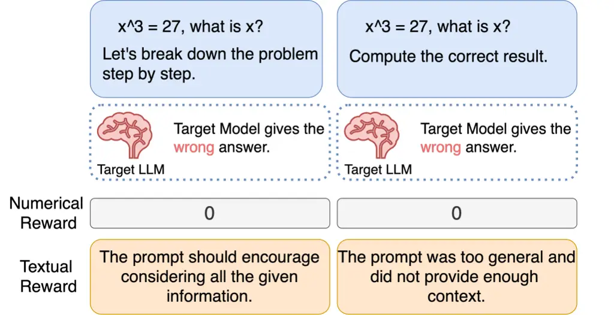
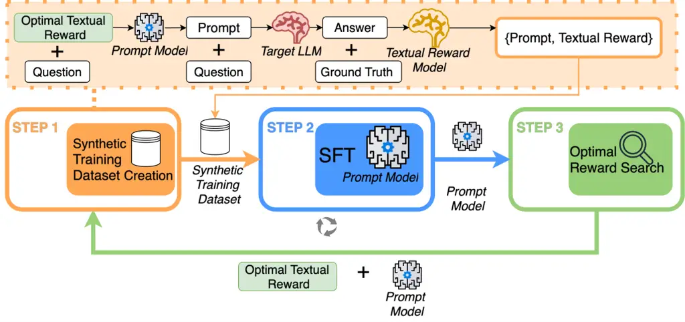
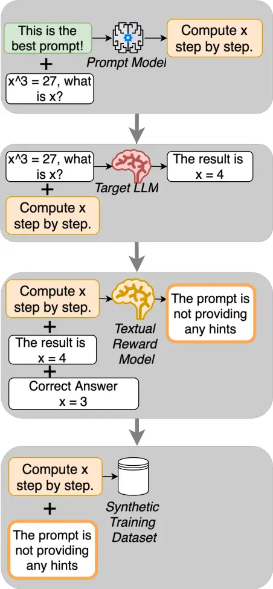
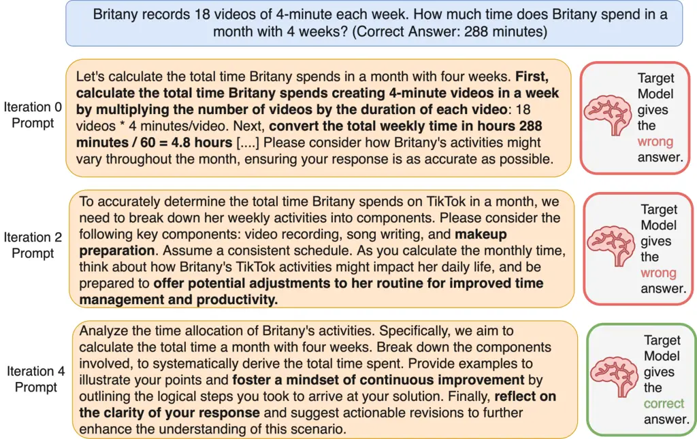
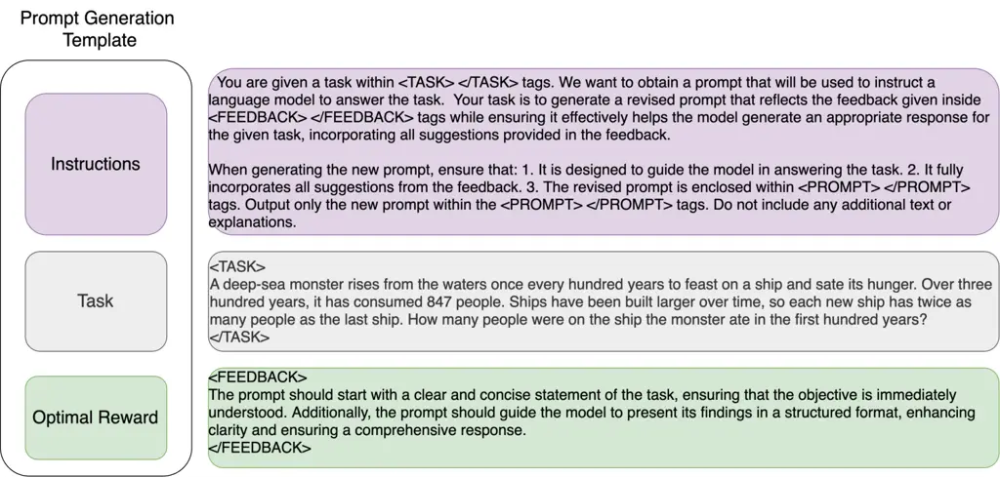
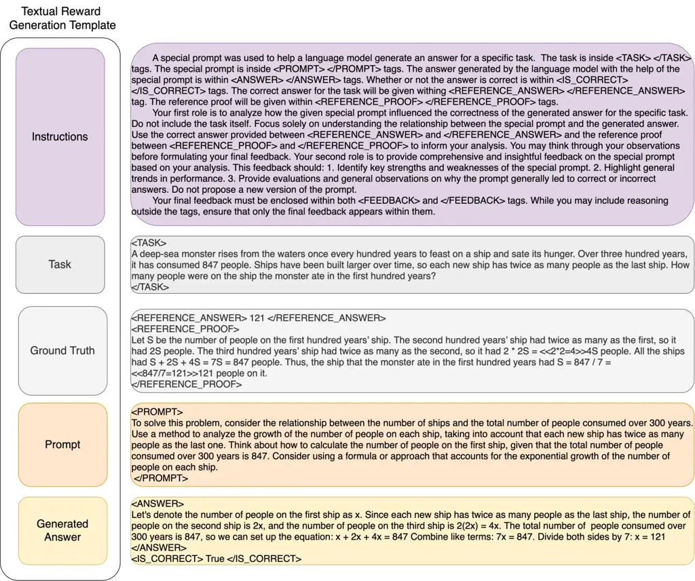
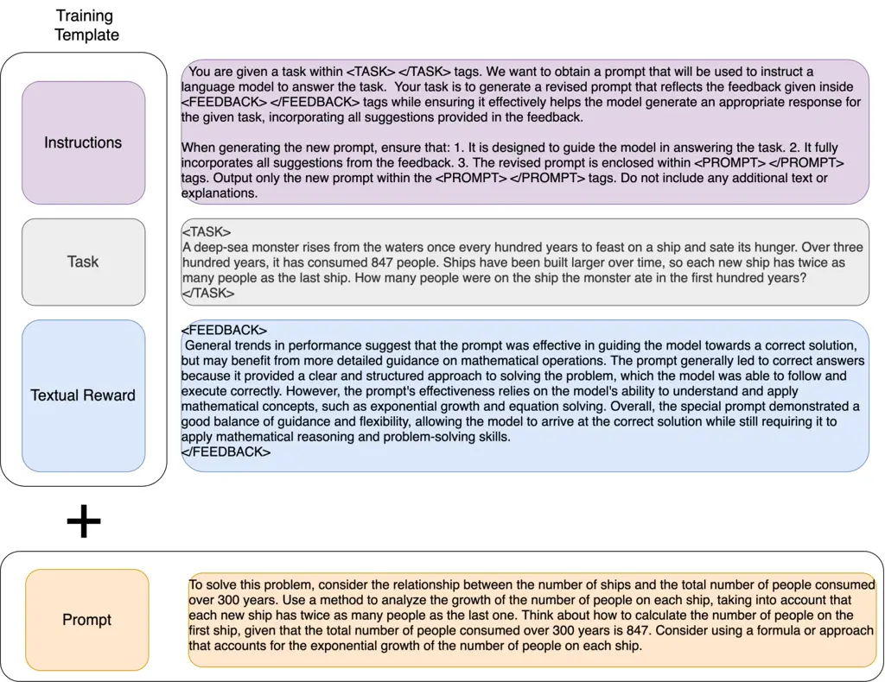

# TRPrompt: Bootstrapping Query-Aware Prompt Optimization from Textual Rewards

Andreea Nica Affiliation: EPFL Email: [andreea.nica@epfl.ch](mailto:)   
Ivan Zakazov ^(†)^(†)thanks: IZ and NMB co-supervised the project and
contributed equally. Affiliation: EPFL
Email: [ivan.zakazov@epfl.ch](mailto:)    Nicolas Mario
Baldwin¹¹footnotemark: 1 Affiliation: EPFL
Email: [nicolas.baldwin@epfl.ch](mailto:)    Saibo Geng
Affiliation: EFPL Email: [saibo.geng@epfl.ch](mailto:)    Robert West
Affiliation: EPFL, Microsoft Research
Email: [robert.west@epfl.ch](mailto:)

###### Abstract

Prompt optimization improves the reasoning abilities of large language
models (LLMs) without requiring parameter updates to the target model.
Following heuristic-based "Think step by step" approaches, the field has
evolved in two main directions: while one group of methods uses textual
feedback to elicit improved prompts from general-purpose LLMs in a
training-free way, a concurrent line of research relies on numerical
rewards to train a special prompt model, tailored for providing optimal
prompts to the target model. In this paper, we introduce the Textual
Reward Prompt framework (TRPrompt), which unifies these approaches by
directly incorporating textual feedback into training of the prompt
model. Our framework does not require prior dataset collection and is
being iteratively improved with the feedback on the generated prompts.
When coupled with the capacity of an LLM to internalize the notion of
what a "good" prompt is, the high-resolution signal provided by the
textual rewards allows us to train a prompt model yielding
state-of-the-art query-specific prompts for the problems from the
challenging math datasets GSMHard and MATH.

## 1 Introduction

The success of recent state-of-the-art large language models (LLMs)
should not only be associated with massive scaling of parameters but
also with aligning these models with human feedback \[13\].
Reinforcement Learning from Human Feedback (RLHF) proved to be an
extremely effective method to inject human knowledge into LLMs, enabling
them to achieve human-level performance on a variety of benchmarks
\[12\]. RLHF employs a reward model that generates numerical rewards
used to guide the optimisation of the language model. The numerical
rewards act as proxy for human preference and play a crucial role in
training. However, depending on the downstream task, numerical rewards
can be sparse, uninformative and very difficult to define. Textual
feedback, on the other hand, leverages the richness of language and can
offer a more informative and nuanced learning signal. One such task
where numerical rewards are hard to model is the query-dependent prompt
optimisation problem, where the goal is to generate a prompt tailored to
each input query, helping guide the language model toward high-quality
outputs.

Despite their remarkable power, LLMs seem to be challenged when it comes
to mathematical and logical reasoning tasks \[8\]. Prompt engineering
(concatenating the input query with an instruction) emerged as a
lightweight solution to enhance the reasoning abilities of LLMs \[17,
6\] since it eliminates the need for parameter tuning. Research efforts
have explored different methods of finding optimal prompts. One
direction focuses on using LLMs as black-box optimizers to iteratively
update the optimal prompt using textual feedback \[22, 11, 14, 19\].
This train-free methods solely rely on the interactions with an
off-the-shelf LLM. In contrast, other methods investigate training a
policy model through reinforcement learning that is able to generate the
optimal prompt \[16, 3, 10, 7\]. Although most of these methods focus on
finding an optimal task-level prompt \[3, 22\] that achieves optimal
average performance throughout the entire dataset, query-level prompt
optimization techniques \[7, 10, 16\] can yield better results, since
the prompt is specifically adapted to fit a particular query. Given the
binary aspect of the query-dependent problem (the prompt guided the LLM
to arrive at a correct/incorrect answer), designing a numerical reward
to successfully guide the prompt-space exploration for a given query is
extremely challenging due to the difficulty in encoding nuanced
preferences within sparse signals. Figure 1 shows a motivating example.



Figure 1: Motivating Example: Textual reward is more expressive than
numerical reward. When using both prompts, the target model reaches a
wrong answer. While the numerical reward is the same (0), the textual
reward distinctively captures each prompt fails to guide the target
language model in answering correctly.

A textual reward is an evaluation expressed in the natural language of a
prompt, serving as a qualitative measure of its effectiveness in
achieving a specific objective. Some successful applications of textual
rewards focus on improving the quality of the reward models \[18\], by
concatenating synthetic critiques with the inputs. The textual critiques
improve the performance and data efficiency of the reward model.
However, research on employing textual rewards for prompt optimization
problems remains critically scarce.

Solution: TRPrompt. To address the aforementioned limitations in the
existing literature, in this paper, we propose TRPrompt, a Textual
Reward Prompt optimization method that investigates the potential
benefits of using textual rewards instead of numerical ones during the
training of the prompt model. We believe that the richness of the
textual reward is able to encapsulate more information about the
performance of a given prompt compared to a numerical value. The textual
reward should offer stronger signals and more robust features for
fine-tuning the prompt model used to generate optimal prompts.

We develop a proof-of-concept framework that fine-tunes a relatively
small model (Llama-3-8B-Instruct \[1\]) to generate query-level optimal
prompts. Since there is little work in this space, we have developed the
entire methodology of applying textual rewards during training for
prompt optimization problems, adapted for the query-dependent objective,
where numerical rewards are harder to model. We train the prompt model
through supervised fine-tuning (SFT) using a synthetically generated
database of pairs of prompts and their corresponding textual rewards.
The pipeline is fully automated, with textual rewards being generated by
another language model that acts as a black-box reward model. In our
experiments, we use a model within the same family (Llama-3-8B-Instruct)
to generate textual rewards, facilitating the process of
self-improvement. Consequently, we establish an iterative process where
the fine-tuned prompt model efficiently generates improved, better
prompts, which are then used to further fine-tune the prompt model,
creating a cyclical feedback loop. In this way, at each iteration, the
prompt model receives signals through the textual rewards about the
actual performance of the prompts that are considered optimal,
facilitating improvement.

|                   | Train                        | Train-free                 |
| ----------------- | ---------------------------- | -------------------------- |
| Textual Rewards   | TRPrompt (ours)              | Textgrad \[19\], APO\[14\] |
| Numerical Rewards | Prompt-OIRL \[16\], QPO\[7\] | APE\[22\]                  |

Table 1: Overview of prompt optimization methods categorized by reward
type and training setup. TRPrompt is the only method that combines
textual rewards with a trainable approach.

Our framework can be applied to a wide range of tasks for evaluating the
mathematical reasoning skills of LLMs. TRPrompt can be initialized on
any off-the-shelf LLM and does not require prior dataset collection,
which makes it instantly adaptable to any dataset. We perform
experiments on multiple datasets and analyze the effectiveness of our
approach in producing optimal prompts for the desired objective. Our
contributions can be summarized as follows:

- •
  We advance the concept of textual rewards by being the first to
  incorporate them as a supervision signal directly used during training
  — moving beyond prior train-free approaches such as TextGrad\[19\].
- •
  We propose and develop a novel methodology TRPrompt that is able to
  exploit the benefits of textual rewards for the query-dependent prompt
  optimisation objective to improve prompting performance. Table 1
  compares prior methods with ours, showing how TRPrompt is the first to
  embed textual rewards directly into the training loop.
- •
  We validate the efficacy of our method in various data sets, providing
  a comprehensive analysis of its performance.
- •
  We achieve state-of-the-art performance in prompt optimization on the
  more challenging datasets, GSMHard and MATH, demonstrating the
  effectiveness of our method.



Figure 2: Overview of our query-dependent prompt optimization iterative
pipeline, containing 3 steps: (1) synthetic training dataset creation,
(2) fine-tuning of the prompt model and (3) optimal reward search.

## 2 The query-dependent prompting problem

The query-dependent prompting problem centers on guiding a target model
to correctly solve a given question. In this work, we focus specifically
on mathematical questions. To achieve this, we prepend the question with
a query-dependent prompt – an instruction specifically tailored to the
given question to improve the model’s reasoning. This prompt is
generated by a separate prompt model, which is trained to produce
effective query-dependent instructions. The prompt model conditions its
generations on textual rewards — natural language feedback that
indicates the quality of the desired prompt. To generate prompts that
reliably lead the target model to correct answers, we condition the
prompt model on the optimal textual reward, i.e., the best feedback that
a prompt can receive for a given question. This process is illustrated
in Figure 2, Step 1. A concrete example is shown in Figure 3. Thus,
training the prompt model involves two interconnected goals: (1)
fine-tuning the prompt model and (2) identifying the optimal textual
reward. This process constitutes what we term the query-dependent
prompting problem, which we now formalize.

Questions and answers. We consider the task of answering mathematical
questions $`q\in\mathcal{Q}=\mathcal{V}^{\infty}`$ where each question
is expressed in natural language using vocabulary $`\mathcal{V}`$. Each
question $`q`$ is expected to have a mathematically correct answer
$`y^{*}\in\mathcal{Y}_{gt}\subset\mathcal{Y}`$ which will be considered
the ground-truth.

Prompting. The performance of a target LLM in answering questions can be
enhanced by using appropriate prompting. A prompt
$`p\in\mathcal{P}=\in\mathcal{V}^{\infty}`$ is a combination of words in
the vocabulary $`\mathcal{V}`$, an instruction in natural language that
explains how to solve a task. In this work, prompts are appended at the
end of a question. A query-dependent prompt is a prompt generated
specifically to guide the target model to the correct result for a
specific question.

Target LLM. The mathematical questions are answered using a target LLM
$`M_{\text{target}}\colon\mathcal{Q}\to\mathcal{Y}`$ to obtain answers.
The generated answers can be mathematically described as
$`\hat{y}_{i}=M_{\text{target}}(q_{i},p_{i})`$ where $`q_{i}`$ is the
$`i`$-th question and $`p_{i}`$ is the query-dependent prompt
corresponding to question $`q_{i}`$ .



Figure 3: Step 1: Prompt generation and textual reward calculation

The quality of these generations can be evaluated using the following
metric
$`r(y^{*}_{i},\hat{y}_{i})=\mathbbm{1}\{\hat{y}_{i}=y^{*}_{i}\}`$, which
checks for equality between the generated answer and the ground-truth.

Textual reward. In order to assess the quality of a query-dependent
prompt, we will use a textual reward
$`t\in\mathcal{T}=\mathcal{V}^{\infty}`$. The textual reward represents
feedback expressed in natural language form that will synthesize the
performance of the query-dependent prompt in guiding the Target LLM to
the correct answer.

Optimal textual reward. We define $`t^{*}\in\mathcal{T}`$ as the optimal
textual reward, corresponding to the best achievable feedback that a
query-dependent prompt can obtain, in line with the objective scope.

Textual reward model. A textual reward model $`R_{\text{textual}}`$
where
$`R_{\text{textual}}\colon P\times\mathcal{Q}\times\mathcal{Y}_{\text{gen}}\times\mathcal{Y}_{\text{gt}}\to\mathcal{T}`$
is a language model that can produce textual reward $`t\in\mathcal{T}`$
for a query-dependent prompt $`p_{i}\in\mathcal{P}`$ based on the answer
generated by the Target LLM
$`\hat{y}_{i}\in\mathcal{Y}_{\text{gen}}\subset\mathcal{Y}`$ and the
ground-truth for the question
$`y^{*}_{i}\in\mathcal{Y}_{\text{gt}}\subset\mathcal{Y}`$. We have
$`t=R_{\text{textual}}(q_{i},p_{i},\hat{y}_{i},y^{*}_{i})`$.

Prompt model. A prompt model
$`\Pi_{\text{query}}:\mathcal{Q}\times\mathcal{T}\to P`$ is a language
model that is used to generate query-dependent prompts. For some query
$`q_{i}\in\mathcal{Q}`$ and a textual feedback $`t\in\mathcal{T}`$, we
have $`\Pi_{query}(q_{i},t)=p_{i}\in\mathcal{P}`$. The role of the
prompt model is to produce a query-dependent prompt, instruction that
will enhance the performance of the target model in the way specified by
the feedback $`t`$ for the specific question $`q_{i}`$.

Dual objective. To maximize the performance of the Target LLM on
reasoning tasks, the query-dependent prompting problem can be formulated
as a dual-objective optimization problem.

1.  1.  Prompt model objective. The first objective is to optimize the
        prompt model $`\Pi_{\text{query}}`$ to generate query-dependent
        prompts corresponding to the optimal textual reward $`t^{*}`$ for
        the given questions. These prompt should guide the Target LLM
        towards producing the correct answers. The goal is to maximize the
        target model’s performance by ensuring the prompts satisfies the
        highest-quality feedback signal.

    ```math
    \Pi^{*}_{\text{query}}=\arg\max_{\Pi_{\text{query}}}r(y^{*}_{i},\,M_{\text{target}}(q_{i},\Pi_{\text{query}}(q_{i},t^{*})))_{i\in[N],N=|\mathcal{Q}|} \tag{1}
    ```

2.  2.  Optimal textual reward objective. The second objective focuses on
        identifying the optimal textual reward $`t^{*}`$ for a given prompt
        model $`\Pi_{query}`$. This reward represents the most informative
        and effective natural language feedback that, when used to condition
        the prompt model, results in query-dependent prompts that maximizes
        the target model’s accuracy.

    ```math
    t^{*}=\arg\max_{t\in\mathcal{T}}r(y^{*}_{i},M_{\text{target}}(q_{i},\Pi_{\text{query}}(q_{i},t)))_{i\in[N],N=|\mathcal{Q}|} \tag{2}
    ```

## 3 Prompt optimization with textual reward

Existing query-dependent methods rely exclusively on numerical rewards
to guide training \[16, 7\]. In contrast, we argue that textual rewards
provide a richer and more expressive supervisory signal, capable of more
effectively steering the learning process. We introduce TRPrompt, a
framework for prompt optimization that leverages textual rewards as the
primary training signal. Our iterative, multi-loop design enables
continuous improvement, with textual feedback facilitating effective
knowledge transfer to the prompt model throughout the learning process.

Figure 2 displays our iterative approach on query-dependent optimization
problem. The pipeline contains three important steps: Step 1. synthetic
training dataset creation, Step 2. prompt model fine-tuning and Step 3.
optimal reward update.

Step 1. Query-dependent prompt generation & textual reward calculation.
The synthetic training dataset contains query-dependent prompts and
their textual rewards. To generate the question-specific prompt, an
optimal feedback signal $`t^{*}\in\mathcal{T}`$ is provided together
with the question $`q\in\mathcal{Q}`$ to the prompt model
$`\Pi_{\text{query}}`$:

```math
p_{i}=\Pi_{\text{query}}(q_{i},t^{*})\in\mathcal{P},\quad\forall q_{i}\in\mathcal{Q}
```

The query-specific generated prompt is then concatenated with the
question to produce the answer from the Target LLM.

```math
y_{i}=M_{\text{target}}(q_{i},\,p_{i}),\quad\forall q_{i}\in\mathcal{Q},\,p_{i}=\Pi_{\text{query}}(q_{i},t^{*})
```

Analysing the generated answer and the ground-truth, the textual reward
model
$`R_{\text{textual}}\colon P\times\mathcal{Q}\times\mathcal{Y_{\text{gen}}}\times\mathcal{Y_{\text{gt}}}\to\mathcal{T}`$
produces a detailed textual feedback regarding the performance of the
query-dependent prompt for the specific task.

```math
R_{\text{textual}}(p_{i},\,(q_{i},y_{i},y^{*}_{i}))=t_{i}
```

The textual rewards corresponding to a prompt for a specific task are
collected for fine-tuning
$`\mathcal{D_{\text{train}}}=\{(p_{i},q_{i},t_{i})\}`$. A concrete
example of the entire flow of STEP 1 can be seen in Figure 3

Step 2. Prompt model fine-tuning. For the query-specific task, we
fine-tune the prompt model $`\Pi_{\text{query}}`$ on the prompts
$`p\in\mathcal{P}`$ conditioned on the textual reward
$`t\in\mathcal{T}`$ and the question $`q\in\mathcal{Q}`$. Specifically,
we maximize the log-likelihood:

```math
\mathcal{L}_{SFT}=-\mathbb{E}_{(p_{i},q_{i},t_{i})\sim\mathcal{D_{\text{train}}}}\log\mathbb{P}(p_{i}|q_{i},t_{i}) \tag{3}
```

Step 3. Optimal textual reward update. Since the optimal reward is a
static value that has not been seen during training, finding the best
possible optimal reward that will leverage all the knowledge accumulated
throughout fine-tuning is an optimization problem on its own.
Specifically, we want to find a textual reward inline with the objective
from Equation 2. To search for the best optimal textual reward, we
employ a train-free optimization strategy, Textgrad. \[19\]. Using
Textgrad, we are able to explore the reward space. This step is
completed after each round of fine-tuning, to get the corresponding
optimal reward for each model. At the end of fine-tuning the prompt
model $`\Pi_{\text{query}}`$ we have:

```math
t^{*}=Textgrad(\Pi_{\text{query}})
```

The iterative procedure for the query-dependent objective, repeating
Steps 1, 2, and 3 over $`K`$ iterations, is detailed in Algorithm 1.

Require: Question dataset $`\mathcal{Q}`$, number of iterations $`K`$, a
language model as textual reward model $`R_{\text{textual}}`$, a Target
LLM $`M_{\text{target}}`$, SFT($`\cdot`$) denotes the supervised
fine-tuning process, Textgrad($`\cdot`$) denotes applying Textgrad for
optimal reward search, an initial optimal textual reward $`t^{*}_{0}`$,
the number of questions to analyze the textual reward $`N`$, a Prompt
Mode $`\Pi_{\text{query}}`$ that generates query-dependent prompts.

1: for $`k=1`$ to $`K`$ do

2:   $`\mathcal{D}_{\text{train}}\leftarrow\emptyset`$

3:   for $`q_{i}`$ in $`\mathcal{Q}`$ do

4:    Prompt Generation:
$`p_{i}\leftarrow\Pi^{k-1}_{\text{query}}(q_{i},t^{*}_{k-1})`$

5:    Question Answering: $`y_{i}=M_{\text{target}}(q_{i},\,p_{i})`$

6:    Textual Reward
$`t_{i}\leftarrow R_{\text{textual}}(p_{i},(q_{i},y_{i},y^{*}_{i})`$

7:
   $`\mathcal{D}_{\text{train}}\leftarrow\mathcal{D}_{\text{train}}\cup\{(p_{i},\,q_{i},\,t_{i})\}`$

8:   end for

9:   Fine-tuning:
$`\Pi^{k}_{\text{query}}\leftarrow SFT(\Pi^{k-1}_{\text{query}},\,\mathcal{D}_{\text{train}})`$

10:   Optimal Reward Update:
$`t^{*}_{k}=Textgrad(\Pi^{k}_{\text{query}},t^{*}_{k-1})`$

11: end for

12: return Prompt Model $`\Pi^{K}_{\text{query}}`$ and optimal reward
$`t^{*}_{K}`$ which can generate optimal prompts for a specific task.

Algorithm 1 Query-Dependent Prompt Optimization

## 4 Related work

Prompt optimization has followed two main paths: training-based methods
using numerical rewards \[16, 7\], and train-free approaches leveraging
natural language to refine prompt outputs without weight updates \[19,
14\]. TRPrompt bridges these paradigms by enabling gradient-based
training directly from textual rewards.

Prompt optimisation. Discrete prompts have one important feature:
interpretability. Research on zero-shot prompting has shown that LLMs
are good zero-shot reasoners simply by using the prompt ’Let’s think
step by step’ (CoT) \[6\]. Although most prompt-engineering research
efforts have focused on finding the optimal prompts at the task-level (a
prompt efficient for the entire dataset), this approach might yield
suboptimal results at the per-instance level. A generally effective
prompt, while performing well on average, may steer the LLM towards
incorrect results \[16\]. This is why increasing attention is now being
placed on query-dependent methods \[16, 21, 10, 7\]. Prompt-OIRL \[16\]
uses inverse RL to train a reward model which selects the best one of
the n-candidate prompts for a query. QPO \[7\] uses reinforcement
learning guided by a custom numerical reward to fine-tune a small
pre-trained language model to generate query-dependent optimal prompts
tailored to the input queries. All of the aforementioned methods
uniquely rely on numerical rewards to guide the training process.

Finetuning conditioned on reward. Conditioning generation on reward
signals during supervised learning has been explored in prior work \[20,
15\], showing success in domains such as code optimization\[15\].
However, these methods rely solely on numerical reward labels and do not
leverage the richer supervision offered by textual rewards.

Optimization with natural language feedback. Recent lines of work
investigate the use of natural language feedback to improve the LLM’s
overall performance. One line of research utilizes textual feedback for
self-improvement by refining the model outputs into better ones. These
applications deploy LLMs as black-box optimizers in a train-free method
where the textual feedback is used to obtain iterative improvement in
model’s output \[14, 19\]. Textgrad \[19\] takes inspiration from
gradient descent, providing a customizable framework that can apply a
"textual gradient" (textual feedback) to improve the generation of an
LLM on a variety of tasks, including prompt optimization. TPO \[9\]
translates a numerical reward signal generated by the reward model into
textual critiques and uses them as textual rewards to iteratively refine
the final output of the model. Textual rewards are used to help the
policy model come with suggestions guiding the generations for the next
iteration. Another line of research explores using critiques for
training reward models \[18\], thus converting the richer signals of the
synthetic critiques into a numerical representation. However, no method
to our knowledge uses textual rewards as direct signals during training.

|                    |                                  |                                    |                            |                     |                                  |
| ------------------ | -------------------------------- | ---------------------------------- | -------------------------- | ------------------- | -------------------------------- |
| Method             | (1) Avoids Static/Manual Prompts | (2) Independent of Initial Prompts | (3) Query Dependent Prompt | (4) Textual Rewards | (5) Textual Rewards For Training |
| CoT\[6\]           | ✗                                | ✗                                  | ✗                          | ✗                   | ✗                                |
| Prompt-OIRL \[16\] | ✗                                | ✗                                  | ✓                          | ✗                   | ✗                                |
| QPO \[7\]          | ✓                                | ✗                                  | ✓                          | ✗                   | ✗                                |
| Textgrad \[19\]    | ✓                                | ✗                                  | ✗                          | ✓                   | ✗                                |
| TPO \[9\]          | ✗                                | ✗                                  | ✗                          | ✓                   | ✗                                |
| TRPrompt (ours)    | ✓                                | ✓                                  | ✓                          | ✓                   | ✓                                |

Table 2: TRPrompt differentiates from existing research by (1) not
requiring a set of manually defined prompts, (2) being completely
independent from the starting prompts since our method constructs the
entire training dataset synthetically, avoiding the need for initial
prompts, (3) offering a query-dependent methodology for the prompt
optimisation problem, (4) relying on textual rewards that are used as
the main signal during training (5).

## 5 Experiments

In this section, we present empirical evidence illustrating the efficacy
of our method using textual rewards in guiding the training of the
optimal query-dependent prompt model. We start by outlining the general
experimental setup, followed by a in-depth analysis of results.

Tasks. We perform experiments on 3 math-reasoning datasets of various
complexities: GSM8K \[2\], GSMHard \[4\] which is a harder version of
GSM8K and MATH \[5\]. These arithmetic reasoning tasks are widely
studied in the zero-shot prompting domain.

Models. Our framework consists of three distinct models: 1. Target LLM
for which the optimal prompts are being searched. 2. Textual reward
model that generates the textual rewards. 3. Prompt model that will
generate the optimal prompts for the Target LLM, the model being
fine-tuned. We set all these models to be Meta-Llama-3-8B-Instruct
\[1\]. Our method is model-agnostic so different model instances can be
changed for different components. However, we choose to explore a
same-model approach since we want to investigate the ability of the
model for self-improvement. For Textgrad\[19\], we used GPT-4o-mini to
do the optimal textual reward updates. Technical details about the
experiments can be found in the Technical Appendix.

| Name                             | GSM8K (Acc.) | GSMHard (Acc.) | MATH (Acc.) |
| -------------------------------- | ------------ | -------------- | ----------- |
| CoT \[6\]                        | 85.59%       | 27.98%         | 39.35%      |
| Prompt-OIRL (6 prompts) \[16\]   | 84.53%       | 28.61%         | 21.31%      |
| QPO (1 starting prompt) \[7\]    | 84.76%       | 27.98%         | 28.37%      |
| QPO (500 starting prompts) \[7\] | 86.05%       | 30.80%         | 37.31%      |
| TRPrompt Query-Dependent (Ours)  | 84.53%       | 31.76%         | 41.37%      |

Table 3: Comparison between state-of-the-art methods and TRPrompt on
GSM8K, GSMHard, and MATH datasets.

Table 3 presents a comprehensive comparison between the query-dependent
optimized prompts generated by TRPrompt against several SOTA methods:
CoT "Let’s think step by step" prompt, query-dependent prompts produced
by QPO under two distinct initialization configurations (initial dataset
containing 1 expert prompt vs 500 expert prompts), Prompt-OIRL with
reward learned on 6 expert prompts and the task-level prompt obtained by
applying Textgrad.

From the results, we can conclude: (1). On challenging mathematical
benchmarks such as GSMHard and MATH, where the target model demonstrates
difficulty in generating correct answers, TRPrompt outperforms all other
state-of-the-art methods by +1% on GSMHard and by +2% on MATH. In the
case of GSM8K, where the model answers most questions correctly by
default, textual rewards appear to provide a weaker signal compared to
their effectiveness on more challenging datasets like GSMHard and MATH.
(2). While QPO and Prompt-OIRL exhibit a strong dependence on initial
expert-provided prompts, TRPrompt avoids this limitation entirely by
eliminating the need for handcrafted starting prompts, thereby avoiding
initialization bias. Prompt-OIRL selects one of the predefined prompts,
whereas QPO generates new prompts that are heavily influenced by the
structure and content of the initial prompt set. The accuracy improves
as the number of initial prompts is increased. TRPrompt explores the
prompt space more freely, resulting in higher-quality query-dependent
prompts.

Figure 4: Accuracy gain (in percentage points difference) compared to
the base model across iterations. Each iteration improves the ability of
the prompt model to generate prompts that guide the target model to the
correct answer.



Figure 5: Iterative improvement of query-dependent prompts on a GSMHard
question. Prompts generated by the prompt model become increasingly
structured and general across iterations, reducing reliance on partial
solutions and irrelevant details. By the final iteration, the improved
prompt guides the target model to the correct answer.

### 5.1 Analysis

Iteratively better prompts. The iterative nature of our pipeline is
essential for ensuring that the prompt model learns from its own
limitations. For each iteration, a new synthetic training dataset is
constructed using the prompts generated by the most recent version of
the prompt model, conditioned on the current optimal textual reward.
This setup guarantees that the textual reward is addressing the model’s
latest behavior, allowing it to receive precise critiques. As a result,
the prompt model progressively refines its generations by learning from
past errors, enabling targeted improvements. Figure 5 shows the
increasing improvement in prompt quality across iterations, with the
fine-tuned prompt model achieving better performance ( + 7.5%) than the
base model over the course of training, especially for the harder
datasets GSMHard and MATH. Each iteration exploits newly learned
patterns through the textual rewards, gradually improving the quality of
the generated prompts. Figure 5 exemplifies the progress of a prompt
across iterations for a GSMHard question. The prompt model transitions
from including explicit computations, to producing generic and
occasionally irrelevant suggestions, before converging on effective,
task-aligned instructions.

For the harder datasets (MATH and GSMHard), the target model struggles
to generate correct answers, allowing textual rewards to provide highly
targeted and constructive feedback. As a result, the prompt model shows
substantial improvement from one iteration to the next, effectively
learning from its errors. In contrast, on simpler datasets like GSM8K
—where the target model already performs well without any prompt — the
corrective power of textual rewards is diminished, leading to more
modest gains. We hypothesize that the limited performance gains on GSM8K
are partly due to an unbalanced training set dominated by positive
feedback. When most prompts already lead to correct answers, the textual
rewards overwhelmingly reinforce success, providing little contrast
between effective and ineffective prompts. The lack of negative
supervision undermines the quality of training, as the prompt model
receives insufficient signal to refine its behavior.

Ablation insights: why SFT + optimal reward search matter. We
investigate the impact of each step on the efficiency of our method. We
compute the accuracy after each intermediate step in the pipeline and
report the results for each dataset. Figure 7 illustrates the impact of
each step in the consistent increase in accuracy across iterations as
the prompt model is fine-tuned using Supervised Fine-Tuning (SFT) and
then applying Optimal Reward Search. The performance gains result from
the combined effect of both steps, jointly enabling effective
exploration of the prompt space. In contrast, Figure 7 presents an
ablation where the Optimal Reward Search step is removed from our
framework and only SFT is applied. In this setting, performance
gradually declines with each iteration across all datasets, suggesting
that without updating the optimal textual reward, the prompt model
begins to overfit to suboptimal feedback. These results highlight the
critical role of Optimal Reward Search in guiding the prompt model
towards meaningful exploration of the prompt space and sustaining
performance improvements over time.

Figure 6: Intermediate performance obtained by the prompt model after
each step in our pipeline. Both SFT and the Optimal Reward Search step
contribute to enhancing the prompt model ability to generate efficient
prompts.

Figure 7: Impact of eliminating the Optimal Reward Search step from our
pipeline: accuracy is consistently decreasing across iterations.

Evaluating cross-dataset transfer: accuracy of prompt models on unseen
tasks. We evaluate the generalization ability of TRPrompt and
query-dependent baselines by testing whether a prompt model trained on
one benchmark can generate effective prompts for unseen datasets. For
this experiment, the prompt model is trained on a single dataset and
evaluated on the remaining datasets. As shown in Table 4, all methods
show a drop in performance when applied out-of-distribution, confirming
that prompt optimization is sensitive to the training distribution.
However, TRPrompt achieves the highest accuracy on the MATH dataset when
the prompt model is trained on either GSM8K or GSMHard, consistently
outperforming Prompt-OIRL and QPO. Although TRPrompt does not exceed
baseline performance on GSM8K when trained on GSMHard, this observation
aligns with prior findings suggesting that performance gains are
typically less pronounced on simpler datasets. Collectively, these
results highlight the superior generalization capabilities of TRPrompt,
particularly in more challenging domains.

| Trained on ↓ | Method          | Tested on → | GSM8K    | GSMHard  | MATH     |
| ------------ | --------------- | ----------- | -------- | -------- | -------- |
|              |                 |             | Accuracy | Accuracy | Accuracy |
| GSM8K        | Prompt-OIRL     |             | \-       | 29.55%   | 22.14%   |
|              | QPO             |             | \-       | 28.61%   | 36.36%   |
|              | TRPrompt (Ours) |             | \-       | 27.67%   | 37.20%   |
| GSMHard      | Prompt-OIRL     |             | 84.15%   | \-       | 26.53%   |
|              | QPO             |             | 82.94%   | \-       | 26.35%   |
|              | TRPrompt (Ours) |             | 83.09%   | \-       | 39.41%   |

Table 4: Cross-dataset generalization: accuracy when models trained on
one dataset are evaluated on another datasets.

## 6 Limitations & future work

Reduced gains on easier datasets. TRPrompt shows relatively low
performance gains on GSM8K, both in-distribution and in
out-of-distribution settings. The dominance of correct answer and
positive textual rewards weakens the learning signal. Addressing this
issue may require rebalancing the training data or introducing more
nuanced textual feedback to better reflect subtle variations in prompt
quality.

High computational cost. The Optimal Reward Search step involving
Textgrad is computationally expensive and difficult to parallelize,
making it the main bottleneck in the pipeline. This limits scalability
and slows down training, especially on larger datasets. Future work
could focus on more efficient optimal reward search methods.

Further leveraging textual rewards. Our framework can be extended to
tasks where numerical rewards are difficult or unnatural to define, such
as creative writing or poetry. In these domains, quantitative metrics
often fail to capture quality, coherence, or style, whereas textual
feedback can provide richer, more interpretable signals. TRPrompt offers
a promising foundation for future research in this area.

## 7 Conclusion

We introduce TRPrompt, a novel query-dependent prompt optimization
framework that leverages the expressiveness of textual rewards to
directly guide the fine-tuning of a prompt model. Unlike prior work,
TRPrompt removes strong dependence on initial expert-provided prompts,
enabling prompt learning from scratch through an iterative process
guided by textual feedback. Experiments across arithmetic reasoning
tasks show that TRPrompt excels on challenging datasets like MATH and
GSMHard, where rich textual feedback offers meaningful guidance. These
results highlight TRPrompt’s potential for aligning LLMs in settings
where numerical rewards are limited or ill-defined, and position textual
supervision as a powerful tool for prompt optimization.

## Acknowledgments and Disclosure of Funding

## References

- \[1\] AI@Meta. Llama 3 model card. 2024.
- \[2\] Karl Cobbe, Vineet Kosaraju, Mohammad Bavarian, Mark Chen,
  Heewoo Jun, Lukasz Kaiser, Matthias Plappert, Jerry Tworek, Jacob
  Hilton, Reiichiro Nakano, et al. Training verifiers to solve math word
  problems. arXiv preprint arXiv:2110.14168, 2021.
- \[3\] Mingkai Deng, Jianyu Wang, Cheng-Ping Hsieh, Yihan Wang, Han
  Guo, Tianmin Shu, Meng Song, Eric P Xing, and Zhiting Hu. Rlprompt:
  Optimizing discrete text prompts with reinforcement learning. arXiv
  preprint arXiv:2205.12548, 2022.
- \[4\] Luyu Gao, Aman Madaan, Shuyan Zhou, Uri Alon, Pengfei Liu,
  Yiming Yang, Jamie Callan, and Graham Neubig. Pal: Program-aided
  language models. arXiv preprint arXiv:2211.10435, 2022.
- \[5\] Dan Hendrycks, Collin Burns, Saurav Kadavath, Akul Arora, Steven
  Basart, Eric Tang, Dawn Song, and Jacob Steinhardt. Measuring
  mathematical problem solving with the math dataset. NeurIPS, 2021.
- \[6\] Takeshi Kojima, Shixiang Shane Gu, Machel Reid, Yutaka Matsuo,
  and Yusuke Iwasawa. Large language models are zero-shot reasoners.
  Advances in neural information processing systems,
  35:22199–22213, 2022.
- \[7\] Yilun Kong, Hangyu Mao, Qi Zhao, Bin Zhang, Jingqing Ruan,
  Li Shen, Yongzhe Chang, Xueqian Wang, Rui Zhao, and Dacheng Tao. Qpo:
  Query-dependent prompt optimization via multi-loop offline
  reinforcement learning. arXiv preprint arXiv:2408.10504, 2024.
- \[8\] Qintong Li, Leyang Cui, Xueliang Zhao, Lingpeng Kong, and Wei
  Bi. Gsm-plus: A comprehensive benchmark for evaluating the robustness
  of llms as mathematical problem solvers. arXiv preprint
  arXiv:2402.19255, 2024.
- \[9\] Yafu Li, Xuyang Hu, Xiaoye Qu, Linjie Li, and Yu Cheng.
  Test-time preference optimization: On-the-fly alignment via iterative
  textual feedback. arXiv preprint arXiv:2501.12895, 2025.
- \[10\] Zekun Li, Baolin Peng, Pengcheng He, Michel Galley, Jianfeng
  Gao, and Xifeng Yan. Guiding large language models via directional
  stimulus prompting. Advances in Neural Information Processing Systems,
  36, 2024.
- \[11\] Shengcai Liu, Caishun Chen, Xinghua Qu, Ke Tang, and Yew-Soon
  Ong. Large language models as evolutionary optimizers. In 2024 IEEE
  Congress on Evolutionary Computation (CEC), pages 1–8. IEEE, 2024.
- \[12\] Josh OpenAI, Achiam, Steven Adler, Sandhini Agarwal, Lama
  Ahmad, Ilge Akkaya, Florencia Leoni Aleman, Diogo Almeida, Janko
  Altenschmidt, Sam Altman, Shyamal Anadkat, et al. Gpt-4 technical
  report. arXiv preprint arXiv:2303.08774, 2023.
- \[13\] Long Ouyang, Jeffrey Wu, Xu Jiang, Diogo Almeida, Carroll
  Wainwright, Pamela Mishkin, Chong Zhang, Sandhini Agarwal, Katarina
  Slama, Alex Ray, et al. Training language models to follow
  instructions with human feedback. Advances in neural information
  processing systems, 35:27730–27744, 2022.
- \[14\] Reid Pryzant, Dan Iter, Jerry Li, Yin Tat Lee, Chenguang Zhu,
  and Michael Zeng. Automatic prompt optimization with" gradient
  descent" and beam search. arXiv preprint arXiv:2305.03495, 2023.
- \[15\] Alexander Shypula, Aman Madaan, Yimeng Zeng, Uri Alon, Jacob
  Gardner, Milad Hashemi, Graham Neubig, Parthasarathy Ranganathan,
  Osbert Bastani, and Amir Yazdanbakhsh. Learning performance-improving
  code edits. arXiv preprint arXiv:2302.07867, 2023.
- \[16\] Hao Sun, Alihan Hüyük, and Mihaela van der Schaar.
  Query-dependent prompt evaluation and optimization with offline
  inverse rl. In The Twelfth International Conference on Learning
  Representations, 2023.
- \[17\] Jason Wei, Xuezhi Wang, Dale Schuurmans, Maarten Bosma, Fei
  Xia, Ed Chi, Quoc V Le, Denny Zhou, et al. Chain-of-thought prompting
  elicits reasoning in large language models. Advances in neural
  information processing systems, 35:24824–24837, 2022.
- \[18\] Zihuiwen Ye, Fraser Greenlee-Scott, Max Bartolo, Phil Blunsom,
  Jon Ander Campos, and Matthias Gallé. Improving reward models with
  synthetic critiques. arXiv preprint arXiv:2405.20850, 2024.
- \[19\] Mert Yuksekgonul, Federico Bianchi, Joseph Boen, Sheng Liu, Zhi
  Huang, Carlos Guestrin, and James Zou. Textgrad: Automatic"
  differentiation" via text. arXiv preprint arXiv:2406.07496, 2024.
- \[20\] Tianjun Zhang, Fangchen Liu, Justin Wong, Pieter Abbeel, and
  Joseph E. Gonzalez. The wisdom of hindsight makes language models
  better instruction followers. In Proceedings of the 40th International
  Conference on Machine Learning, ICML’23. JMLR.org, 2023.
- \[21\] Tianjun Zhang, Xuezhi Wang, Denny Zhou, Dale Schuurmans, and
  Joseph E Gonzalez. Tempera: Test-time prompting via reinforcement
  learning. arXiv preprint arXiv:2211.11890, 2022.
- \[22\] Yongchao Zhou, Andrei Ioan Muresanu, Ziwen Han, Keiran Paster,
  Silviu Pitis, Harris Chan, and Jimmy Ba. Large language models are
  human-level prompt engineers. arXiv preprint arXiv:2211.01910, 2022.

## Appendix A Technical Appendices and Supplementary Material

### A.1 Synthetic Dataset Creation

A central component of our pipeline is the construction of synthetic
training datasets. At each iteration, we use the current versions of the
Prompt Model and Reward Model to generate a new dataset, which is then
used to fine-tune the next version of the Prompt Model. This process
allows the model to iteratively improve by learning from its own outputs
and the corresponding feedback.

Synthetic dataset creation consists of two key steps: (1) Prompt
Generation, where the Prompt Model generates a query-specific prompt for
a given question, and (2) Textual Reward Generation, where the Reward
Model produces textual rewards for the generated prompt.

Given that both models rely on LLMs, clear and precise instruction is
critical to ensure the correct behavior of each model during this
process. To this end, meta-instructions were carefully designed to align
each model with its respective objective.

#### Prompt Generation

To generate prompts conditioned on the optimal textual reward, we
instruct the Prompt Model using a structured input format. The
meta-instructions specify both the task and the corresponding Optimal
Reward, which serves as the guiding feedback. As illustrated in Figure
8, the Prompt Model is prompted with a clear definition of its input and
output expectations and is explicitly instructed to generate a
query-dependent prompt that aligns with the provided textual reward.



Figure 8: Meta-Instruction template and example used to generate
query-dependent prompts conditioned on the Optimal Reward.

#### Textual Reward Generation

To generate a textual reward for a specific prompt, we provide the
Reward Model with the generated prompt, the Target Model’s output for
the associated question, and the corresponding ground-truth answer. The
Reward Model is guided by a meta-instruction designed to produce a
natural language critique that assesses the quality of the prompt based
on the accuracy and relevance of the generated answer. This critique is
the textual reward for the query-dependent prompt. An example of this
meta-instruction template, along with a concrete instantiation, is shown
in Figure 9.



Figure 9: Instruction template and example used to guide the Reward
Model in generating a textual reward. The input includes the task, the
query-dependent prompt, the ground-truth answer, and the Target Model’s
answer to the question using the query-dependent prompt.

#### Training Samples

Each synthetic training sample consists of a query-dependent prompt
paired with its corresponding textual reward. To incorporate this
supervision, we perform Supervised Fine-Tuning (SFT), training the
Prompt Model to generate the original prompt conditioned on the textual
reward. The model is optimized by minimizing the loss between the
generated prompt and the reference prompt that was originally used to
compute the textual reward. An example training pair, consisting of a
textual reward and its associated prompt, is shown in Figure 10.



Figure 10: Example of a training pair used in Supervised Fine-Tuning.
The Prompt Model is trained to reproduce the query-dependent prompt
based on the provided textual reward.

### A.2 Training Details

#### Datasets.

For each dataset, we compute test scores on the dedicated test sets,
which consist of 1,319 samples for GSM8K, 319 for GSMHard, and 3,369 for
MATH. The training sets include 7,473 questions for GSM8K, 1,000 for
GSMHard, and 5,136 for MATH. We apply a 90%–10% train-validation split
on each training set.

#### Synthetic Dataset.

At each iteration, a synthetic dataset of 800 lengths is created,
containing prompts and their corresponding textual rewards. In order to
create this dataset, we randomly sample 800 questions from the train set
on each iteration. All the final results we report in the paper are on
the dedicated test set for each dataset. We use the validation set in
order to choose the best checkpoint.

#### Generations.

When assessing a prompt’s performance, we configure the Target LLM’s
inference temperature to be 0.001 when generating a response to a
question concatenated with the query-dependent prompt we wish to
evaluate. We also set the temperature to be 0.001 for textual reward
generations. We set the default temperature to be 0.9 when generating
new query-dependent optimal prompts with the Prompt Model to encourage
diverse and creative generation of new prompts for training. We use a
batch size of 64 for generations.

#### Training Details.

We train the Prompt Model for 4 iterations.

#### SFT.

We train the Prompt Model on the synthetic dataset containing pairs of
prompts and their rewards via supervised fine-tuning (SFT). Due to
memory and cost restrictions, we choose to use Low-Rank Adaptation
(LoRA), a method designed to accelerate fine-tuning while keeping memory
consumption low. LoRA decomposes the weights-update-matrix into two
lower-dimension matrices that are easier to compute and store in memory.
Due to its benefits, LoRa is a suitable choice for optimally fine-tuning
the LLM while maintaining computational efficiency and preserving model
performance. For LoRA parameters, we utilize $`r=256`$ and
$`\alpha=256`$. The Prompt Model is trained at each iteration for $`2`$
epoch with a $`2\times 10^{-5}`$ learning rate. We use Adam optimizer,
with a linear learning rate decay.

#### Textgrad

For Textgrad, we use GPT-4o-mini to make the changes to the prompt.
Textgrad is run for 10 iterations and uses the validation set in order
to compare the quality of the Optimal Reward.

#### Hardware Requirements.

The training was performed on NVIDIA A100 GPUs with 80 GB of RAM. The
training is done using GPU memory. Training time is between 48h - 72h
depending on the dataset. The bottleneck of the training was the
Textgrad step, which is not parallelizable. Identifying the Optimal
Reward at each iteration accounted for around 70% of the total training
time, primarily due to the non-parallelized evaluation step in Textgrad,
which significantly slowed down the training process.
