# T2I-Copilot: A Training-Free Multi-Agent Text-to-Image System for Enhanced Prompt Interpretation and Interactive Generation

Chieh-Yun Chen    Min Shi    Gong Zhang    Humphrey Shi Affiliation: SHI
Labs @ Georgia Tech
Affiliation: [github.com/SHI-Labs/T2I-Copilot](https://github.com/SHI-Labs/T2I-Copilot)

###### Abstract

Text-to-Image (T2I) generative models have revolutionized content
creation but remain highly sensitive to prompt phrasing, often requiring
users to repeatedly refine prompts multiple times without clear
feedback. While techniques such as automatic prompt engineering,
controlled text embeddings, denoising, and multi-turn generation
mitigate these issues, they offer limited controllability, or often
necessitate additional training, restricting the generalization
abilities. Thus, we introduce T2I-Copilot, a training-free multi-agent
system that leverages collaboration between (Multimodal) Large Language
Models to automate prompt phrasing, model selection, and iterative
refinement. This approach significantly simplifies prompt engineering
while enhancing generation quality and text-image alignment compared to
direct generation. Specifically, T2I-Copilot consists of three agents:
(1) Input Interpreter, which parses the input prompt, resolves
ambiguities, and generates a standardized report; (2) Generation Engine,
which selects the appropriate model from different types of T2I models
and organizes visual and textual prompts to initiate generation; and (3)
Quality Evaluator, which assesses aesthetic quality and text-image
alignment, providing scores and feedback for potential regeneration.
T2I-Copilot can operate fully autonomously while also supporting
human-in-the-loop intervention for fine-grained control. On GenAI-Bench,
using open-source generation models, T2I-Copilot achieves a VQA score
comparable to commercial models RecraftV3 and Imagen 3, surpasses
FLUX1.1-pro by 6.17% at only 16.59% of its cost, and outperforms
FLUX.1-dev and SD 3.5 Large by 9.11% and 6.36%. Code will be released
at:
[github.com/SHI-Labs/T2I-Copilot](https://github.com/SHI-Labs/T2I-Copilot).

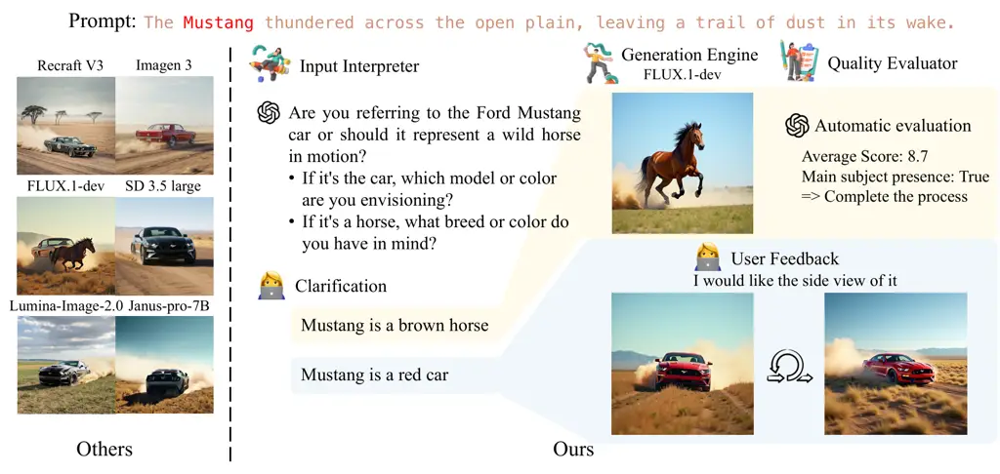

Figure 1: T2I-Copilot: An interactive agentic Text-to-Image generation
system. Current generative models struggle to interpret complex or
ambiguous user prompts, often failing to produce images that perfectly
align with user intent. We propose a multi-agent system that refines
input prompts, resolves ambiguities, and iteratively evaluates results,
providing feedback to guide regeneration when needed. Users can
supplement information interactively, or large language models can do so
autonomously. Our approach enhances both aesthetics and text-image
alignment without requiring additional training or intricate prompt
engineering.

## 1 Introduction

Although Text-to-Image (T2I) generative models \[3, 27, 12, 19, 22, 24,
34, 6, 42\] have made significant strides in generating realistic images
across various styles, they remain highly sensitive to prompt phrasing.
If a prompt is ambiguous or casually written, the model may fail to
generate images that fully align with the user’s intent. Inexperienced
users may repeatedly refine prompts without achieving the desired
results. This challenge arises because, unlike Large Language Models
(LLMs), which communicate directly with users in natural language to
explicitly address their needs, T2I models rely on text prompts enforced
through a text encoder during generation. These models do not offer
reasoning or analysis like LLMs and do not provide direct feedback on
their internal understanding or knowledge gaps when generation fails.
This lack of interpretability complicates error analysis and refinement.
For instance, as shown in Fig. 1, when given the prompt “The Mustang
thundered across the open plain, leaving a trail of dust in its wake,”
most T2I models \[3, 27, 1, 34, 6\] predominantly generate an image of a
car, whereas FLUX.1-dev \[12\] generates both a horse and a car. This
ambiguity arises because models either fail to recognize that Mustang
can refer to both a car and a horse or lacks sufficient contextual cues
to align with user intent. As a result, users must spend considerable
computational resources and time refining prompts, sampling multiple
times, or even fine-tuning models to achieve better results.

Existing approaches have attempted to address these limitations through
various strategies, including enhanced prompt engineering \[8, 18\],
control mechanisms within text embeddings \[5, 10\] or the denoising
process \[4, 26, 43\], leveraging LLMs for regional coordination \[16,
7, 35\], and multi-turn self-enhancement with tools \[38, 36, 21\].
However, two more key challenges persist: Firstly, trade-offs between
architectural modifications and generalization. Improvements in
attribute binding \[4, 26\] or de-bias \[5\] enhance specific use cases
but often reduce flexibility in handling diverse prompts. Secondly,
limited user controllability. For instance, PASTA \[21\] introduces a
multi-turn generation approach where users select their preferred image.
However, it lacks fine-grained control, preventing users from specifying
details like object attributes or style adjustments. It also does not
address cases where none of the generated images match user intent,
limiting interaction to selection rather than refinement. Similarly,
GenArtist \[36\] selects a model from its predefined eighteen tools
based solely on the prompt, without analyzing user intent beforehand.
While it uses LLMs to predict bounding boxes for prompt-specified
objects, this interpretation applies only to specific tools like
LMD \[16\] and does not generalize across the system. Moreover, it lacks
human-in-the-loop interaction, restricting user control over generation.
Currently, there is no unified system that integrates comprehensive
functionalities: i) enhance input interpretation before generation, ii)
generate images using multiple tools without fine-tuning or
architectural modifications, and iii) iterative self-improvement via
multi-turn interactions.

To address above-mentioned three key challenges in T2I generation, we
propose T2I-Copilot, a training-free multi-agent system that enhances
controllability and interpretability by proactively analyzing user
intent, selecting the optimal model, and iteratively refining results.
The system consists of three sequential agents: i) Input Interpreter
Agent: Analyzes user input by identifying key subjects, attributes
(_e.g_., color, position), and image settings (_e.g_., background,
style, lighting, camera parameters). It detects ambiguities which are
clarified by MLLM creatively fill or user clarification when necessary
and structures the analysis into a JSON-formatted report for precise
generation. ii) Generation Engine Agent: Selects and executes the most
suitable model based on user intent and model capabilities, enabling
fine-grained control via Referring Expression Segmentation or an
interactive user drawing canvas for targeted modifications. iii) Quality
Evaluator Agent: Assesses the generated image based on aesthetic and
text-image alignment criteria and provides improvement suggestions. If
necessary, it incorporates user feedback and initiates iterative
refinement. T2I-Copilot is a training-free framework, ensuring
compatibility and scalability with the latest T2I models while
integrating a human-in-the-loop approach for enhanced user control. Our
contributions are as follows:

- •
  Proposing a training-free multi-agent system for T2I generation, where
  three specialized agents collaborate to improve model interpretability
  and generation efficiency.
- •
  Bridging human intent and AI-driven creativity, enabling a more
  interpretable and interactive generative AI system.
- •
  Achieving strong performance comparable to proprietary models like
  Recraft V3 \[27\] and Imagen 3 \[3\], while surpassing
  FLUX1.1-pro \[12\] by 6.17% at only 16.59% ¹¹ 1 The cost comparison is
  detailed in Supplement D. of its cost and outperforming the
  open-source FLUX.1-dev \[12\] and SD 3.5 Large \[1\] by 9.11% and
  6.36%, respectively, with a VQAScore \[17\] on GenAI-Bench \[13\].

## 2 Related Works

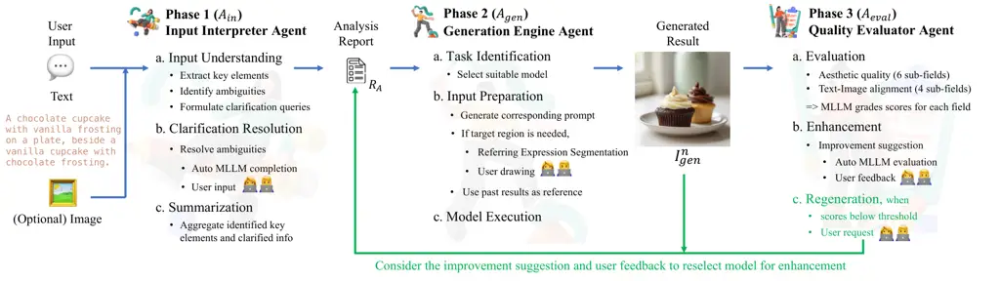

Figure 2: Pipeline of the proposed T2I-Copilot: A multi-agent system for
interactive text-to-image generation. The system consists of three
sequential agents: (1) Input Interpreter processes user inputs,
identifying ambiguities and either prompting the user for clarification
or leveraging an MLLM for automatic refinement. (2) Generation Engine
selects and executes the most suitable model based on the analysis
report, user intent, and model capabilities. It enables fine-grained
control via Referring Expression Segmentation or an interactive drawing
canvas for targeted modifications. (3) Quality Evaluator assesses the
generated image against aesthetic and alignment criteria, allowing user
feedback to refine the output. If the image does not meet expectations,
the system triggers regeneration to ensure improved results.

### 2.1 MLLM Agent

Large Language Models (LLMs) have been increasingly leveraged as AI
agents for complex tasks, including reasoning and
decision-making \[41\], tool utilization \[31\], and multi-agent
collaboration \[30\]. With the integration of vision capabilities,
Multimodal Large Language Models (MLLMs) further extend these
functionalities, making them valuable in T2I generation. Specifically,
(M)LLMs have been employed in prompt engineering \[18, 21\],
self-correction and verification \[38, 36\], prompt decomposition into
object bounding boxes \[16, 7, 35, 36\], and model selection \[37, 36,
25\]. Despite these advancements, existing approaches lack a unified
framework that seamlessly integrates prompt interpretation, model
selection, and iterative self-enhancement in T2I generation. To address
this, we propose a proactive MLLM-driven multi-agent system that
seamlessly unifies these processes, improving both controllability and
effectiveness in image generation.

### 2.2 Multi-turn Generation

To better align T2I generation with user intent, several works have
explored multi-turn approaches \[38, 36, 21\]. SLD \[38\] employs an LLM
to provide object coordinate modifications, allowing control over
positioning and attributes. GenArtist \[36\] leverages an MLLM for image
verification and self-correction; however, in our reproduction of the
publicly released code, we found that its self-corrections frequently
diverge from the intended prompt, as shown in Fig. 5. In addition, it
lacks support for user feedback. PASTA \[21\] applies reinforcement
learning to optimize image generation based on user preferences.
However, its selection-based approach offers limited fine-grained
control over specific object attributes and scene details. While these
methods have advanced multi-turn T2I generation, only PASTA supports
user interaction, though limited to selection. A more comprehensive
regeneration strategy is needed—one that extends beyond object
positioning, enables automated self-enhancement, and allows fine-grained
user control. Our approach fills this gap with an MLLM-driven evaluation
agent, which autonomously generates improvement suggestions for
iterative self-enhancement while also supporting human-in-the-loop
intervention for fine-grained control.

## 3 T2I-Copilot: Mutli-Agent T2I System

T2I-Copilot is a training-free multi-agent system designed to enhance
Text-to-Image generation by better interpreting input to enhance
generated image quality effectively. As illustrated in Fig. 2,
T2I-Copilot comprises three sequentially collaborating agents: Input
Interpreter ($`A_{in}`$) analyzes and refines user input by clarifying
ambiguities and structuring the request into an Analysis Report
($`R_{A}`$). Generation Engine ($`A_{gen}`$) selects and executes the
most appropriate model based on the task intention and model
capabilities. Quality Evaluator ($`A_{eval}`$) assesses generated image
quality and text-image alignment, iterating with refinement suggestions
if necessary. This system design ensures interpretability, adaptability,
and controllability, making it robust against ambiguous inputs and
enhancing the overall alignment between user intent and generated
images. For clarity, we provide the pseudocode in the Supplement.

### 3.1 Input Interpreter Agent ($`A_{in}`$)

Users may struggle to craft precise prompts that align with model
capabilities or users might not know how models interpret their prompts,
leading to unintended outputs. To mitigate this, we introduce the Input
Interpreter Agent ($`A_{in}`$), designed to analyze user input—including
text prompts and optional reference images—and transform it into a
structured Analysis Report ($`R_{A}`$), which captures key details
essential for model selection and image generation, to facilitate
high-quality outputs that better aligns user intent. The agent performs
three key functions:

1.  1.  Input Understanding: Extracts key elements, identifies ambiguities
        and formulates clarification queries.
2.  2.  Clarification Resolution: Resolves ambiguities via a MLLM automatic
        completion or human interaction.
3.  3.  Summarization: Aggregates the identified key elements and clarified
        information into a structured Analysis Report ($`R_{A}`$) for
        subsequent processing.

To achieve this, $`A_{in}`$ identifies key subjects and attributes
within the prompt, analyzing aspects, including background, composition,
color harmony, lighting, focus sharpness, emotional impact, uniqueness,
creativity, and visual style. It then detects unclear elements, explains
potential ambiguities, and generates clarification queries. These are
addressed through MLLM reasoning or by requesting user clarification.
Take Fig. 3 as an example. The prompt “An astronaut with a flag patch
drifting in space” lacks specificity—which nation’s flag is intended?
Without clarification, models rely on their default biases (_e.g_.,
Imagen 3 \[3\] defaults to a US flag, whereas HunyuanDiT \[15\] defaults
to a Chinese flag). By incorporating our Input Interpreter, the model
acquires contextual details before generation, reducing unintended
outputs.

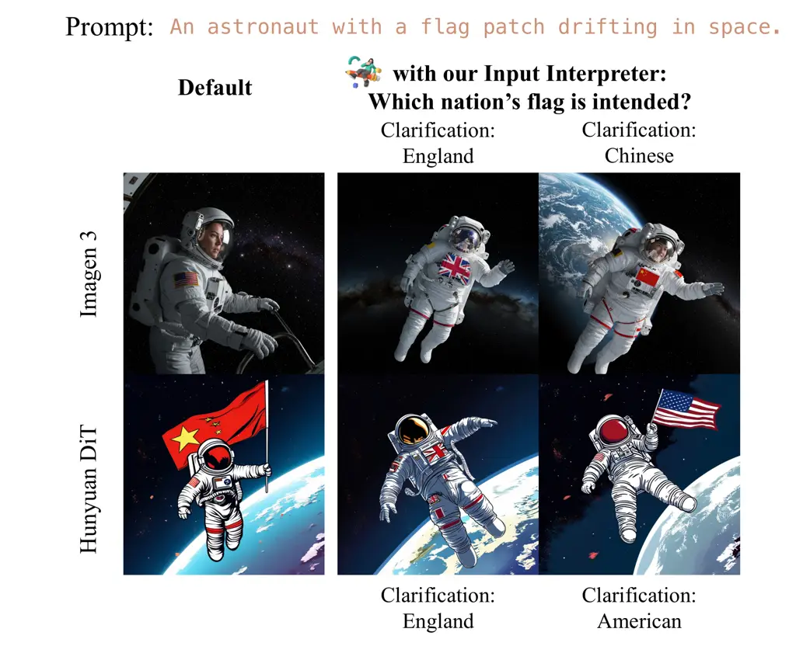

Figure 3: The effectiveness of Input Interpreter $`A_{in}`$. Without
clarification, ambiguous terms rely on model-specific knowledge. Our
Input Interpreter provides contextual details pre-generation, reducing
unintended outputs.

Beyond ambiguity resolution, the agent dynamically infers details based
on user responses and a creativity level parameter $`C_{level}`$, which
controls the extent of automatic enhancement:

- •
  LOW: $`A_{in}`$ strictly adheres to user input.
- •
  MEDIUM: $`A_{in}`$ makes reasonable assumptions while prioritizing
  user input.
- •
  HIGH: $`A_{in}`$ autonomously enriches the prompt while ensuring
  alignment with the user’s original intent when minimal user input is
  provided.

Once analysis is complete, the agent generates an Analysis Report
$`R_{A}`$, structured in JSON format, containing: i) Key extracted
elements, attributes, and spatial relationships, ii) Background
description, iii) Composition, color harmony, lighting, focus, and style
details, iv) User clarifications, and v) Detailed prompt. This report is
then passed to the next stage for model selection.

### 3.2 Generation Engine Agent ($`A_{gen}`$)

Rather than relying on a single state-of-the-art model for T2I
generation, we integrate two models to support a diverse range of
functionalities. These models support both prompt-guided T2I generation
and reference-guided T2I editing, allowing fine-grained control over
multiple aspects of image synthesis and modification. Although our
system utilizes only two models, their complementary capabilities ensure
broad coverage across various T2I tasks. For generation, the system
controls positioning, atmosphere, mood, lighting, and style, ensuring
that outputs align closely with user intent. For editing, it facilitates
object addition, replacement, and removal, offering precise image
modifications. The Generation Engine selects the most suitable model
based on $`R_{A}`$ generated by $`A_{in}`$ and the original user input.
If the request originates from a regeneration attempt initiated by the
Quality Evaluator, $`A_{gen}`$ additionally incorporates improvement
suggestions and user feedback as input. The workflow consists of three
stages: Task Identification, Input Preparation, and Model Execution.

In the Task Identification stage, $`A_{gen}`$ analyzes the input to
determine whether the request involves editing an existing image or
generating a new one from scratch. This decision is based on both user
intent and the capabilities of the available models. For instance,
editing models may struggle with certain tasks, such as object
rearrangement, style transfer, or fine-grained lighting adjustments. If
the Quality Evaluator determines that the selected editing model cannot
adequately fulfill the request, it suggests switching to the generation
model as an alternative. In such cases, $`A_{gen}`$ reformulates the
prompt to effectively approximate the desired modifications, leveraging
prompt-based control to achieve the intended outcome. This systematic
model selection ensures that each request is processed efficiently while
maintaining alignment with user intent.

Once the model is selected, $`A_{gen}`$ enters the Input Preparation
stage, refining the input to elicit the model’s full potential and
ensure alignment with user intent. This process includes generating an
optimized prompt that emphasizes critical contents, while adjusting the
prompt format to suit the selected model. For example, in editing tasks,
$`A_{gen}`$ provides modification-specific descriptions, explicitly
specifying object addition, replacement, or removal to ensure precise
control. When tasks require object-specific modifications, $`A_{gen}`$
would invoke Referring Expression Segmentation (RES) or prompts the user
to annotate target regions via an interactive drawing canvas. This
custom-designed tool allows users to mark areas directly on the
reference image, enabling a more intuitive and flexible editing
experience. Additionally, if a reference image is provided or if the
request involves regeneration, $`A_{gen}`$ would incorporate the
reference to maintain content consistency or guide modifications
accordingly.

Finally, in the Model Execution stage, $`A_{gen}`$ runs the selected
model with the prepared inputs to generate the final image
$`I_{gen}^{n}`$, where $`n`$ is the regeneration count.

A discussion on the effect of adding more models is in the Supplement.

### 3.3 Quality Evaluator Agent ($`A_{eval}`$)

Single-turn generation may not always achieve the desired result. To
address this, we introduce the Quality Evaluator Agent, which acts as an
automatic judge to determine whether the generated image meets user
intent. The evaluation is based on two primary criteria: aesthetic
quality and text-image alignment. In cases where the output does not
fully align with the intended goal, $`A_{eval}`$ identifies missing
elements and provides improvement suggestions. Given the generated
image, original input, and analysis report, $`A_{eval}`$ evaluates the
image across six sub-fields of aesthetic quality: composition, color
harmony, lighting and exposure, focus and sharpness, emotional impact,
and uniqueness and creativity. Simultaneously, it examines four
sub-fields of text-image alignment: presence of main subjects, accuracy
of spatial relationships, adherence to style requirements, and
background representation.

If the average score exceeds the predefined THRESHOLD, the generation is
complete with no further refinement needed. Conversely, if the score
falls below the THRESHOLD or the user requests modifications,
$`A_{eval}`$ redirects the process to $`A_{gen}`$, incorporating
improvement suggestions and user feedback for further refinement,
creating an iterative enhancement cycle.

Regeneration request. When regeneration is triggered, $`A_{gen}`$
re-evaluates model selection while incorporating MLLM-generated
improvement suggestions and optional user feedback. This iterative
process continues until the output sufficiently aligns with user intent,
enhancing the final image quality through progressive refinement. To
prevent infinite regeneration loops, we set a termination limit using
the hyperparameter MAX_regen_count. If the regeneration count reaches
this limit, the process stops, and the latest generated image is
returned as the final output.

## 4 Experiments

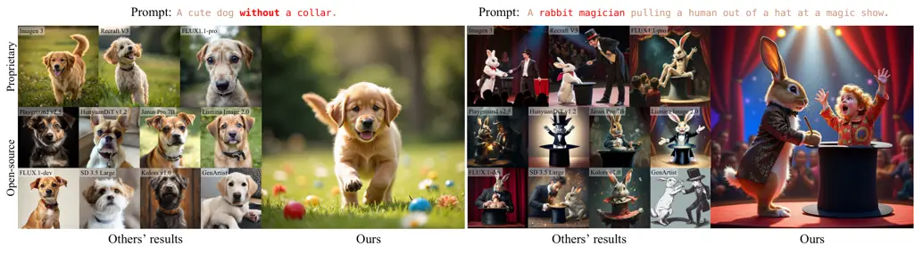

Figure 4: Qualitative comparison with 11 proprietary and open-source
models on two challenging T2I cases. (Left): Logical negation—only
Imagen 3 \[3\] and our method successfully exclude the collar on the
dog, while others fail. Our Input Interpreter Agent refines the prompt
by explicitly marking the collar as an excluded element, ensuring
accurate generation. (Right): Subject-object reversal—only our method
and FLUX.1-dev \[12\] correctly generate a rabbit magician instead of a
human magician. Our agent structures the prompt into a detailed analysis
report, assigning explicit roles and spatial relationships, enhancing
generation accuracy.

### 4.1 Experimental Setup

Implementation details. To ensure a fair comparison, all the reported
results from our T2I-Copilot are obtained in automatic mode, without
human-in-the-loop, unless otherwise specified. In T2I-Copilot, the
prompt-guided T2I generation model is FLUX.1-dev \[12\], the
reference-guided T2I editing model is PowerPaint \[44\], (M)LLM is
gpt-4o-mini-2024-07-18 \[23\], and the Referring Expression Segmentation
is Grounding-SAM2 \[28\]. We set the THRESHOLD as 8.0 and
MAX_regen_count as 3. Our multi-agent system is developed with the
framework of LangGraph \[33\].

Baselines. We compare our proposed method against five proprietary
models: Imagen 3 v002 \[3\], Recraft v3 \[27\], FLUX1.1-pro \[12\],
Midjourney v6 \[19\], and DALLE-3 \[22\]. Additionally, we evaluate it
against eight SOTA open-source models: Kolors v1.0 \[32\], Playground
v2.5 \[14\], HunyuanDiT v1.2 \[15\], Janus Pro 7B \[6\], Lumina Image
2.0 \[34\], Stable Diffusion 3.5 Large \[1\], and FLUX.1-dev \[12\]. All
baselines use official default settings. Furthermore, we include an
agentic T2I system, GenArtist \[36\], with the same controller as ours,
_i.e_., gpt-4o-mini-2024-07-18 \[23\].

Evaluation benchmarks. We evaluate model performance on two benchmarks:
the widely used DrawBench \[29\] and the more challenging
GenAI-Bench \[13\]. DrawBench consists of 200 samples, while GenAI-Bench
contains 1,600 samples, further divided into basic (722 samples) and
advanced (871 samples) tasks.²² 2 Seven cases were not categorized as
either basic or advanced tasks by the original authors. Upon review, we
classified them as basic tasks in our experiments, as each case refers
to a single object. Advanced tasks feature complex compositions,
including counting, differentiation, comparison, logical negation, and
logical universality.

Evaluation metrics. We evaluate model performance using the automated
metric VQAScore \[17\], following Imagen 3 \[3\], which identified it as
more human-aligned than CLIPScore \[9\], PickScore \[11\],
ImageReward \[40\], and HPSv2 \[39\]. Furthermore, we conduct a user
study to assess both text-image alignment and aesthetic quality.

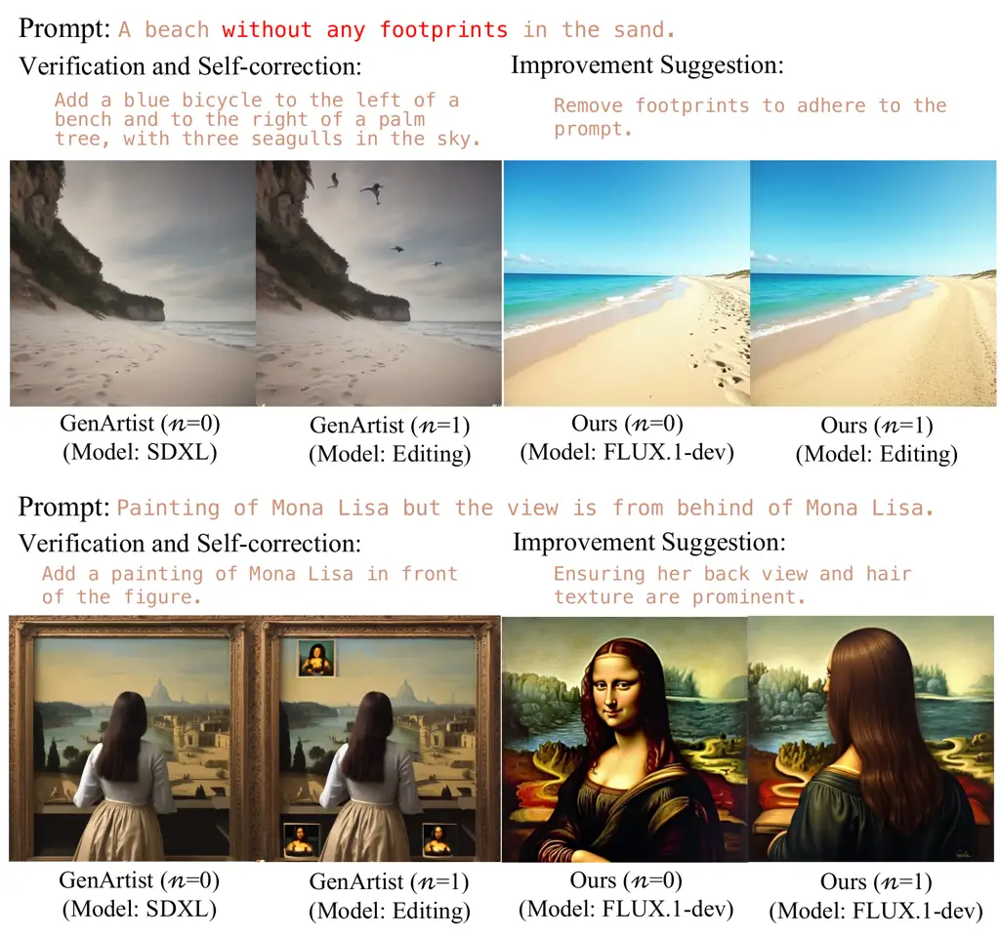

Figure 5: The effectiveness of $`A_{eval}`$: automatic evaluation and
regeneration. Compared to GenArtist \[36\], our model provides more
contextually relevant suggestions. Ours correctly removes footprints
while GenArtist suggests an unrelated fix. For Mona Lisa, ours preserves
style and adjusts correctly, while GenArtist loses style and misguides
the correction. Both use GPT-4o-mini for evaluation, with $`n`$ denoting
regeneration attempts.

### 4.2 Qualitative Results

We qualitatively compare our results with 11 models, as shown in Fig. 4.
More results are provided in Supplement. The two cases present
significant challenges for T2I models. The left case requires logical
negation to exclude specified objects from the generated image, while
the right case demands precise control over attributes, scene
composition, spatial relationships, and action dynamics.

In the left example, only Imagen 3 \[3\] and our method successfully
exclude the dog’s collar while other models generate it despite its
negation. Our Input Interpreter Agent ensures this by explicitly marking
the collar as excluded in the structured analysis. The refined prompt
focuses on a “cute fluffy golden retriever puppy playing outdoors,”
preventing the model from fixating on the negated object and improving
prompt adherence. In the right example, the challenge lies in the common
reversal of subject and object, making it difficult for models to
generate a rabbit magician. Only our method and FLUX.1-dev \[12\]
successfully generate the intended concept. Our Input Interpreter Agent
resolves this by structuring the prompt into a detailed analysis report,
explicitly defining roles and attributes. It specifies the rabbit as
“magician outfit, holding a wand, centrally positioned,” and the human
as “colorful magician’s assistant costume, emerging from a hat with a
surprised expression.” This structured approach improves generation
accuracy and aligns results with user intent.

Performance of Quality Evaluator. Fig. 5 demonstrates the effectiveness
of our evaluation and regeneration quality compared to GenArtist \[36\].
Our model generates suggestions that better align with the original
intent of the prompt. In the first example, when footprints appear
despite the prompt specifying a footprint-free beach, our model
correctly suggests their removal, whereas GenArtist provides an
unrelated correction. In the second example, GenArtist generates a back
view but loses the Mona Lisa’s style, while our model, though missing
the back view, preserves stylistic integrity and provides a more
reasonable regeneration suggestion. This improvement stems from our
system’s ability to grade images across 10 sub-fields, generating
structured improvement suggestions. These suggestions are processed by
$`A_{eval}`$, guiding $`A_{gen}`$ in selecting the optimal model and
preparing suitable input for enhancement.

### 4.3 Quantitative Results

|                           |             |         |          |         |         |         |          |         |         |         |           |         |         |               |                   |           |
| ------------------------- | ----------- | ------- | -------- | ------- | ------- | ------- | -------- | ------- | ------- | ------- | --------- | ------- | ------- | ------------- | ----------------- | --------- |
| Method                    | GenAI-Bench |         |          |         |         |         |          |         |         |         |           |         |         |               |                   | DrawBench |
|                           | Basic       |         |          |         |         |         | Advanced |         |         |         |           |         | Overall | User Study    |                   |           |
|                           | Attribute   | Scene   | Relation |         |         | Overall | Count    | Differ  | Compare | Logical |           | Overall |         | T2I Alignment | Aesthetic Quality |           |
|                           |             |         | Spatial  | Action  | Part    |         |          |         |         | Negate  | Universal |         |         |               |                   |           |
| Proprietary               |             |         |          |         |         |         |          |         |         |         |           |         |         |               |                   |           |
| Imagen 3 v002^(∗) \[3\]   | 0.909       | 0.923   | 0.909    | 0.903   | 0.918   | 0.912   | 0.841    | 0.841   | 0.795   | 0.673   | 0.788     | 0.776   | 0.839   | 95.9%         | 59.9%             | 0.866     |
| (Task completion rate)    | (92.4%)     | (93.1%) | (93.0%)  | (89.3%) | (88.7%) | (92.3%) | (91.5%)  | (88.9%) | (90.7%) | (88.8%) | (89.1%)   | (90.7%) | (91.4%) | -             | -                 | (97.0%)   |
| Recraft v3^(∗) \[27\]     | 0.914       | 0.913   | 0.913    | 0.901   | 0.913   | 0.913   | 0.806    | 0.797   | 0.772   | 0.589   | 0.761     | 0.725   | 0.811   | 89.2%         | 54.1%             | 0.836     |
| FLUX1.1-pro^(∗) \[12\]    | 0.890       | 0.899   | 0.884    | 0.871   | 0.894   | 0.884   | 0.766    | 0.788   | 0.751   | 0.490   | 0.710     | 0.666   | 0.766   | 95.5%         | 84.2%             | 0.786     |
| Midjourney v6^(†) \[19\]  | 0.880       | 0.870   | 0.870    | 0.870   | 0.910   | 0.870   | 0.780    | 0.780   | 0.790   | 0.500   | 0.760     | 0.690   | 0.772   | -             | -                 | -         |
| DALL-E 3^(†) \[22\]       | 0.910       | 0.900   | 0.920    | 0.890   | 0.910   | 0.900   | 0.820    | 0.780   | 0.820   | 0.480   | 0.800     | 0.700   | 0.791   | -             | -                 | -         |
| Open-source               |             |         |          |         |         |         |          |         |         |         |           |         |         |               |                   |           |
| Kolors v1.0 \[32\]        | 0.821       | 0.841   | 0.832    | 0.818   | 0.803   | 0.819   | 0.737    | 0.726   | 0.705   | 0.438   | 0.695     | 0.621   | 0.711   | 96.8%         | 66.2%             | 0.646     |
| Playground v2.5 \[14\]    | 0.818       | 0.850   | 0.803    | 0.818   | 0.821   | 0.815   | 0.732    | 0.696   | 0.721   | 0.499   | 0.695     | 0.640   | 0.720   | 85.8%         | 68.9%             | 0.743     |
| HunyuanDiT v1.2 \[15\]    | 0.817       | 0.855   | 0.825    | 0.827   | 0.798   | 0.818   | 0.732    | 0.723   | 0.743   | 0.475   | 0.692     | 0.640   | 0.721   | 94.6%         | 80.2%             | 0.712     |
| Janus Pro-7B \[6\]        | 0.865       | 0.886   | 0.867    | 0.856   | 0.870   | 0.859   | 0.731    | 0.759   | 0.734   | 0.480   | 0.693     | 0.653   | 0.747   | 98.2%         | 94.1%             | 0.786     |
| Lumina-Image-2.0 \[34\]   | 0.879       | 0.896   | 0.876    | 0.872   | 0.885   | 0.874   | 0.760    | 0.767   | 0.729   | 0.451   | 0.723     | 0.649   | 0.752   | 99.1%         | 92.8%             | 0.790     |
| SD 3.5 large \[1\]        | 0.891       | 0.895   | 0.889    | 0.880   | 0.895   | 0.890   | 0.760    | 0.763   | 0.743   | 0.471   | 0.707     | 0.659   | 0.764   | 92.8%         | 79.3%             | 0.781     |
| FLUX.1-dev \[12\]         | 0.873       | 0.875   | 0.862    | 0.853   | 0.875   | 0.864   | 0.747    | 0.756   | 0.733   | 0.456   | 0.711     | 0.646   | 0.745   | 94.6%         | 86.0%             | 0.769     |
| GenArtist \[36\]          | 0.702       | 0.736   | 0.659    | 0.677   | 0.688   | 0.693   | 0.553    | 0.473   | 0.518   | 0.437   | 0.546     | 0.504   | 0.588   | 97.3%         | 89.2%             | 0.607     |
| T2I-Copilot (LLM)         | 0.893       | 0.909   | 0.893    | 0.885   | 0.899   | 0.892   | 0.813    | 0.807   | 0.759   | 0.659   | 0.766     | 0.747   | 0.813   | -             | -                 | 0.829     |
| T2I-Copilot (Human)       | 0.901       | 0.917   | 0.905    | 0.895   | 0.902   | 0.904   | 0.835    | 0.820   | 0.788   | 0.716   | 0.798     | 0.784   | 0.839   | -             | -                 | 0.865     |
| Max Relative Range        |             |         |          |         |         |         |          |         |         |         |           |         |         |               |                   |           |
| Proprietary + Open-source | 11.1%       | 9.3%    | 13.4%    | 9.8%    | 13.7%   | 11.2%   | 14.3%    | 19.0%   | 15.3%   | 45.8%   | 14.8%     | 22.9%   | 16.6%   | -             | -                 | 28.4%     |
| Open-source               | 9.0%        | 7.8%    | 10.8%    | 8.1%    | 12.0%   | 9.2%    | 11.3%    | 15.5%   | 7.7%    | 45.4%   | 10.8%     | 19.6%   | 13.9%   | -             | -                 | 24.8%     |

^(∗)Imagen 3 v002 \[3\] results were generated at 23 Feb., 2025. Recraft
v3 \[27\] and FLUX1.1-pro \[12\] results are generated at 1 Mar., 2025.
^(†)Midjourney v6 \[19\] and DALL-E 3 \[22\] results are from Table 10
in VQAScore \[17\].

Table 1: Quantitative comparison of T2I-Copilot against 13 methods on
DrawBench \[29\] and GenAI-Bench \[13\], evaluated using
VQAScore \[17\]. User study evaluates T2I alignment and aesthetic
quality based on win rates. The table also reports Maximum Relative
Range, identifying logical negation as the most challenging category.
Bold text denotes the best proprietary and open-source models.

Tab. 1 presents a comparative analysis of T2I-Copilot against 13
baselines in terms of VQAScore on DrawBench \[29\] and
GenAI-Bench \[13\], with performance reported separately for different
task categories.

T2I-Copilot outperforms all open-source models across tasks and achieves
competitive results against proprietary models. In advanced tasks on
GenAI-Bench \[13\], despite being built on FLUX.1-dev \[12\], it
surpasses its foundation by 15.65%. This improvement stems from our
Input Interpreter and Quality Evaluator agents, which enhance
FLUX.1-dev \[12\] for better user intent alignment. Against proprietary
models, T2I-Copilot outperforms RecraftV3 \[27\], FLUX1.1-pro \[12\],
Midjourney v6 \[19\], and DALLE-3 \[22\] by 3.05%, 12.09%, 8.22%, and
6.68%, respectively. These results highlight its robustness in handling
complex text-image alignment challenges.

Additionally, we computed the Maximum Relative Range (MRR) to measure
performance variation across categories, defined as
$`\frac{\max(X)-\min(X)}{\text{mean}(X)}\times 100\%`$, where $`X`$
represents the performance scores. A lower MRR indicates more consistent
performance within a category. Excluding our method with humans and one
outlier, Table 1 shows the highest MRR in logical negation, a
challenging task requiring models to exclude specified objects,
demanding strong reasoning (e.g., left sample in Fig. 4, top sample in
Fig. 5). Our system tackles logical negation with the Input Interpreter
agent, leveraging LLM reasoning to enhance comprehension and
text-to-image alignment. Among open-source models, it outperforms all
competitors by at least 31.95%. The second-best, Playground v2.5 \[14\],
improves prompt adherence through fine-tuning, while the third-best,
Janus-pro-7B \[6\], enhances comprehension via a training-phase module.
Without relying on finetuning, our approach uses explicit prompt
reasoning during inference, ensuring adaptability. Compared to
proprietary models, our method outperforms RecraftV3 \[27\],
FLUX1.1-pro \[12\], Midjourney v6 \[19\], and DALL-E 3 \[22\] by at
least 11.8%, achieving competitive performance with Imagen 3 \[3\].
These results highlight the effectiveness of our approach in tackling
complex text-image alignment, particularly those requiring logical
reasoning and precise prompt comprehension.

Human-in-the-loop. In Tab. 1, we further incorporate human feedback into
the Quality Evaluator Agent to compare enhancement directions identified
by humans and LLMs. Human input improves text-image alignment in the
VQAScore by an additional 3.17% across the GenAI-Bench dataset. This
demonstrates that integrating human interaction into the system enhances
control and better aligns outputs with human intent.

User Study. In Tab. 1, we present a user study on text-image alignment
and aesthetic quality. We randomly sampled 33 image sets, each method
contributing three samples, totaling 2,442 votes. Each comparison
included an image from our method and one from a baseline. For each set,
volunteers answered two questions: (1) selecting the image that best
aligned with the text prompt and (2) choosing the one they found more
visually appealing beyond text alignment. Our method achieved an average
win rate of 94.5% for text-image alignment and 77.7% for aesthetic
quality, suggesting that participants placed greater emphasis on factors
like composition and style when evaluating visual appeal. While
alignment played a role in perception, aesthetic preferences appeared
more subjective. We plan further studies to better understand these
factors and refine aesthetic quality beyond text-image alignment.

Ablation study. In Tab. 2, we conduct the ablation study to evaluate the
impact of the proposed Input Interpreter and Quality Evaluator on
GenAI-Bench \[13\]. The results show that $`A_{in}`$ and $`A_{eval}`$
contribute 7.69% and 0.92% improvements, respectively, in text-to-image
alignment. This demonstrates that effectively interpreting the input
plays a crucial role in enhancing image generation quality.

|                                             |       |          |       |
| ------------------------------------------- | ----- | -------- | ----- |
| Method                                      | Basic | Advanced | All   |
| $`A_{gen}`$ + $`A_{eval}`$ (w/o $`A_{in}`$) | 0.864 | 0.646    | 0.755 |
| $`A_{in}`$ + $`A_{gen}`$ (w/o $`A_{eval}`$) | 0.888 | 0.736    | 0.805 |
| $`A_{in}`$ + $`A_{gen}`$ + $`A_{eval}`$     | 0.892 | 0.747    | 0.813 |

Table 2: Ablation study on GenAI-Bench \[13\].

## 5 Conclusion

In this work, we introduced T2I-Copilot, a training-free multi-agent
system designed to enhance interpretability, controllability, and
efficiency in Text-to-Image generation. By integrating three specialized
agents—Input Interpreter, Generation Engine, and Quality Evaluator—our
approach addresses key challenges in prompt interpretation, model
selection, and iterative refinement. Without relying on fine-tuning or
architectural modifications, T2I-Copilot operates autonomously while
incorporating human-in-the-loop interaction, ensuring adaptability
across diverse prompts and user needs. Our evaluation on GenAI-Bench
demonstrates that T2I-Copilot achieves a VQAScore comparable to Recraft
V3 and Imagen 3, surpasses FLUX1.1-pro by 6.17% at only 12.48% of its
cost, and outperforms FLUX.1-dev and SD 3.5 Large by 9.11% and 6.36%,
respectively.

## 6 Acknowledgments

This research was supported in part by National Science Foundation under
Award \#2427478 - CAREER Program, and by National Science Foundation and
the Institute of Education Sciences, U.S. Department of Education under
Award \#2229873 - National AI Institute for Exceptional Education. This
project was also partially supported by cyberinfrastructure resources
and services provided by College of Computing at the Georgia Institute
of Technology, Atlanta, Georgia, USA. We sincerely thank Fengzhe Zhou
for valuable suggestions and Teng-Fang Hsiao for insights on the editing
model. We also appreciate Ali Hassani, Kai Wang and Aditya Kane for
their kind support on server logistics.

## References

- \[1\] Stability AI. Stable diffusion 3.5, 2024.
- \[2\] Shuai Bai, Keqin Chen, Xuejing Liu, Jialin Wang, Wenbin Ge, Sibo
  Song, Kai Dang, Peng Wang, Shijie Wang, Jun Tang, Humen Zhong, Yuanzhi
  Zhu, Mingkun Yang, Zhaohai Li, Jianqiang Wan, Pengfei Wang, Wei Ding,
  Zheren Fu, Yiheng Xu, Jiabo Ye, Xi Zhang, Tianbao Xie, Zesen Cheng,
  Hang Zhang, Zhibo Yang, Haiyang Xu, and Junyang Lin. Qwen2.5-vl
  technical report. _arXiv preprint arXiv:2502.13923_, 2025.
- \[3\] Jason Baldridge, Jakob Bauer, Mukul Bhutani, Nicole Brichtova,
  Andrew Bunner, and Kelvin Chan et al. Imagen 3. _arXiv preprint
  arXiv:2408.07009_, 2024.
- \[4\] Hila Chefer, Yuval Alaluf, Yael Vinker, Lior Wolf, and Daniel
  Cohen-Or. Attend-and-excite: Attention-based semantic guidance for
  text-to-image diffusion models. In _ACM Special Interest Group on
  Computer Graphics and Interactive Techniques (SIGGRAPH)_, 2023.
- \[5\] Chieh-Yun Chen, Chiang Tseng, Li-Wu Tsao, and Hong-Han Shuai. A
  cat is A cat (not A dog!): Unraveling information mix-ups in
  text-to-image encoders through causal analysis and embedding
  optimization. In _Advances in Neural Information Processing Systems
  (NeurIPS)_, 2024a.
- \[6\] Xiaokang Chen, Zhiyu Wu, Xingchao Liu, Zizheng Pan, Wen Liu,
  Zhenda Xie, Xingkai Yu, and Chong Ruan. Janus-pro: Unified multimodal
  understanding and generation with data and model scaling. _arXiv
  preprint arXiv:2501.17811_, 2025.
- \[7\] Zhennan Chen, Yajie Li, Haofan Wang, Zhibo Chen, Zhengkai Jiang,
  Jun Li, Qian Wang, Jian Yang, and Ying Tai. Region-aware text-to-image
  generation via hard binding and soft refinement. _arXiv preprint
  arXiv:2411.06558_, 2024b.
- \[8\] Yaru Hao, Zewen Chi, Li Dong, and Furu Wei. Optimizing prompts
  for text-to-image generation. In _Advances in Neural Information
  Processing Systems (NeurIPS)_, 2023.
- \[9\] Jack Hessel, Ari Holtzman, Maxwell Forbes, Ronan Le Bras, and
  Yejin Choi. Clipscore: A reference-free evaluation metric for image
  captioning. In _Proceedings of the Conference on Empirical Methods in
  Natural Language Processing (EMNLP)_, pages 7514–7528, 2021.
- \[10\] Taihang Hu, Linxuan Li, Joost van de Weijer, Hongcheng Gao,
  Fahad Shahbaz Khan, Jian Yang, Ming-Ming Cheng, Kai Wang, and Yaxing
  Wang. Token merging for training-free semantic binding in
  text-to-image ynthesis. In _Advances in Neural Information Processing
  Systems (NeurIPS)_, 2024.
- \[11\] Yuval Kirstain, Adam Polyak, Uriel Singer, Shahbuland Matiana,
  Joe Penna, and Omer Levy. Pick-a-pic: An open dataset of user
  preferences for text-to-image generation. In _Advances in Neural
  Information Processing Systems (NeurIPS)_, 2023.
- \[12\] Black Forest Labs. FLUX, 2024.
- \[13\] Baiqi Li, Zhiqiu Lin, Deepak Pathak, Jiayao Emily Li, Xide Xia,
  Graham Neubig, Pengchuan Zhang, and Deva Ramanan. GenAI-bench: A
  holistic benchmark for compositional text-to-visual generation. In
  _Synthetic Data for Computer Vision Workshop @ CVPR_, 2024a.
- \[14\] Daiqing Li, Aleks Kamko, Ehsan Akhgari, Ali Sabet, Linmiao Xu,
  and Suhail Doshi. Playground v2.5: Three insights towards enhancing
  aesthetic quality in text-to-image generation. _arXiv preprint
  arXiv:2402.17245_, 2024b.
- \[15\] Zhimin Li, Jianwei Zhang, Qin Lin, Jiangfeng Xiong, Yanxin
  Long, Xinchi Deng, and Yingfang Zhang et al. Hunyuan-DiT: A powerful
  multi-resolution diffusion transformer with fine-grained chinese
  understanding. _arXiv preprint arXiv:2405.08748_, 2024c.
- \[16\] Long Lian, Boyi Li, Adam Yala, and Trevor Darrell. Llm-grounded
  diffusion: Enhancing prompt understanding of text-to-image diffusion
  models with large language models. _Transactions on Machine Learning
  Research (TMLR)_, 2024.
- \[17\] Zhiqiu Lin, Deepak Pathak, Baiqi Li, Jiayao Li, Xide Xia,
  Graham Neubig, Pengchuan Zhang, and Deva Ramanan. Evaluating
  text-to-visual generation with image-to-text generation. In
  _Proceedings of the European Conference on Computer Vision (ECCV)_,
  pages 366–384, 2024.
- \[18\] Oscar Mañas, Pietro Astolfi, Melissa Hall, Candace Ross, Jack
  Urbanek, Adina Williams, Aishwarya Agrawal, Adriana Romero-Soriano,
  and Michal Drozdzal. Improving text-to-image consistency via automatic
  prompt optimization. _Transactions on Machine Learning Research
  (TMLR)_, 2024.
- \[19\] Midjourney. Midjourney v6.1, 2024.
- \[20\] Mistral AI. Mistral Small 3.1 24B, 2025.
- \[21\] Ofir Nabati, Guy Tennenholtz, Chih-Wei Hsu, Moonkyung Ryu,
  Deepak Ramachandran, Yinlam Chow, Xiang Li, and Craig Boutilier.
  Personalized and sequential text-to-image generation. _arXiv preprint
  arXiv:2412.10419_, 2024.
- \[22\] OpenAI. DALL·E 3, 2024a.
- \[23\] OpenAI. GPT-4o, 2024b.
- \[24\] Dustin Podell, Zion English, Kyle Lacey, Andreas Blattmann, Tim
  Dockhorn, Jonas Müller, Joe Penna, and Robin Rombach. SDXL: Improving
  latent diffusion models for high-resolution image synthesis. In
  _Proceedings of the International Conference on Learning
  Representations (ICLR)_, 2024.
- \[25\] Jie Qin, Jie Wu, Weifeng Chen, Yuxi Ren, Huixia Li, Hefeng Wu,
  Xuefeng Xiao, Rui Wang, and Shilei Wen. DiffusionGPT: Llm-driven
  text-to-image generation system. _arXiv preprint
  arXiv:2401.10061_, 2024.
- \[26\] Royi Rassin, Eran Hirsch, Daniel Glickman, Shauli Ravfogel,
  Yoav Goldberg, and Gal Chechik. Linguistic binding in diffusion
  models: Enhancing attribute correspondence through attention map
  alignment. In _Advances in Neural Information Processing Systems
  (NeurIPS)_, 2023.
- \[27\] Recraft. Recraft v3, 2024.
- \[28\] Tianhe Ren, Shilong Liu, Ailing Zeng, Jing Lin, Kunchang Li, He
  Cao, Jiayu Chen, Xinyu Huang, Yukang Chen, Feng Yan, Zhaoyang Zeng,
  Hao Zhang, Feng Li, Jie Yang, Hongyang Li, Qing Jiang, and Lei Zhang.
  Grounded sam: Assembling open-world models for diverse visual tasks.
  _arXiv preprint arXiv:2401.14159_, 2024.
- \[29\] Chitwan Saharia, William Chan, Saurabh Saxena, Lala Li, Jay
  Whang, Emily L. Denton, Seyed Kamyar Seyed Ghasemipour,
  Raphael Gontijo Lopes, Burcu Karagol Ayan, Tim Salimans, Jonathan Ho,
  David J. Fleet, and Mohammad Norouzi. Photorealistic text-to-image
  diffusion models with deep language understanding. In _Advances in
  Neural Information Processing Systems (NeurIPS)_, 2022.
- \[30\] Samuel Schmidgall, Yusheng Su, Ze Wang, Ximeng Sun, Jialian Wu,
  Xiaodong Yu, Jiang Liu, Zicheng Liu, and Emad Barsoum. Agent
  laboratory: Using LLM agents as research assistants. _arXiv preprint
  arXiv:2501.04227_, 2025.
- \[31\] Yongliang Shen, Kaitao Song, Xu Tan, Dongsheng Li, Weiming Lu,
  and Yueting Zhuang. Hugginggpt: Solving AI tasks with chatgpt and its
  friends in huggingface. In _Advances in Neural Information Processing
  Systems (NeurIPS)_, 2023.
- \[32\] Kolors Team. Kolors: Effective training of diffusion model for
  photorealistic text-to-image synthesis. 2024.
- \[33\] LangChain team. LangGraph, 2024.
- \[34\] Lumina Team. Lumina-image 2.0 : A unified and efficient image
  generative model, 2025.
- \[35\] Omost Team. Omost github page
  (https://github.com/lllyasviel/omost), 2024.
- \[36\] Zhenyu Wang, Aoxue Li, Zhenguo Li, and Xihui Liu. Genartist:
  Multimodal LLM as an agent for unified image generation and editing.
  In _Advances in Neural Information Processing Systems
  (NeurIPS)_, 2024.
- \[37\] Chenfei Wu, Shengming Yin, Weizhen Qi, Xiaodong Wang, Zecheng
  Tang, and Nan Duan. Visual chatgpt: Talking, drawing and editing with
  visual foundation models. _arXiv preprint arXiv:2303.04671_, 2023a.
- \[38\] Tsung-Han Wu, Long Lian, Joseph E. Gonzalez, Boyi Li, and
  Trevor Darrell. Self-Correcting LLM-Controlled Diffusion Models . In
  _Proceedings of the IEEE/CVF Conference on Computer Vision and Pattern
  Recognition (CVPR)_, 2024.
- \[39\] Xiaoshi Wu, Yiming Hao, Keqiang Sun, Yixiong Chen, Feng Zhu,
  Rui Zhao, and Hongsheng Li. Human preference score v2: A solid
  benchmark for evaluating human preferences of text-to-image synthesis.
  _arXiv preprint arXiv:2306.09341_, 2023b.
- \[40\] Jiazheng Xu, Xiao Liu, Yuchen Wu, Yuxuan Tong, Qinkai Li, Ming
  Ding, Jie Tang, and Yuxiao Dong. Imagereward: Learning and evaluating
  human preferences for text-to-image generation. In _Advances in Neural
  Information Processing Systems (NeurIPS)_, 2023.
- \[41\] Shunyu Yao, Jeffrey Zhao, Dian Yu, Nan Du, Izhak Shafran,
  Karthik R. Narasimhan, and Yuan Cao. React: Synergizing reasoning and
  acting in language models. In _Proceedings of the International
  Conference on Learning Representations (ICLR)_, 2023.
- \[42\] Gong Zhang, Kihyuk Sohn, Meera Hahn, Humphrey Shi, and Irfan
  Essa. Finestyle: Fine-grained controllable style personalization for
  text-to-image models. In _Advances in Neural Information Processing
  Systems (NeurIPS)_, 2024.
- \[43\] Zikai Zhou, Shitong Shao, Lichen Bai, Zhiqiang Xu, Bo Han, and
  Zeke Xie. Golden noise for diffusion models: A learning framework.
  _arXiv preprint arXiv:2411.09502_, 2024.
- \[44\] Junhao Zhuang, Yanhong Zeng, Wenran Liu, Chun Yuan, and Kai
  Chen. A task is worth one word: Learning with task prompts for
  high-quality versatile image inpainting. In _Proceedings of the
  European Conference on Computer Vision (ECCV)_, 2024.

Supplementary Material

This supplement includes pseudocode (Supp. A), the effect of including
more models (Supp. B), an ablation study of MLLMs (Supp. C), cost
comparison (Supp. D) and more qualitative results (Supp. E), covering
ambiguous terms, single-turn results, and multi-turn results in both
automatic mode and human-in-the-loop settings.

## Appendix A Pseudocode for T2I-Copilot

1: Input: User input prompt $`P`$, Optional reference image $`I_{ref}`$,
Creativity level $`C_{level}`$, Human-in-the-loop flag $`H_{l}`$,
Improvement suggestions $`S_{imp}`$

2: $`R_{A}\leftarrow A_{in}(P,I_{ref},C_{level},H_{l})`$
$`\triangleright`$ Generate Analysis Report

3: $`I_{gen}^{n}\leftarrow A_{gen}(R_{A},P,I_{ref})`$ $`\triangleright`$
Generate Initial Image

4: $`score,S_{imp}\leftarrow A_{eval}(I_{gen}^{n},P,R_{A})`$
$`\triangleright`$ Evaluate Image Quality

5: $`n\leftarrow 0`$

6: $`U_{f}\leftarrow None`$ $`\triangleright`$ Initialize user feedback
variable

7: while $`score\textless\texttt{THRESHOLD}`$ and
$`n\textless\texttt{MAX\_regen\_count}`$ do

8:    if $`H_{l}`$ then

9:     $`U_{f}\leftarrow`$ Get user feedback on $`I_{gen}^{n}`$

10:    end if

11:    $`I_{gen}^{n}\leftarrow A_{gen}(R_{A},P,I_{ref},S_{imp},U_{f})`$
$`\triangleright`$ Regenerate Image

12:    $`score,S_{imp}\leftarrow A_{eval}(I_{gen}^{n},P,R_{A})`$
$`\triangleright`$ Re-evaluate Image Quality

13:    $`n\leftarrow n+1`$

14: end while

15: return $`I_{gen}^{n}`$ $`\triangleright`$ Final Output Image

Algorithm 1 : T2I-Copilot Multi-Agent System

Our system includes modular error handlers and fallbacks. Failures fall
into two categories, both handled automatically. First, for region
extraction errors, RES segments unwanted objects or MLLM generates masks
from bounding boxes; if both fail, MLLM infers boxes from prompt-image
context, and RES is retried with full prompts. Only after all options
fail is an error raised in $`A_{\text{gen}}`$, triggering fallback to
the previous image or notifying the user (0.1% of cases). Second, for
format extraction errors, malformed outputs trigger an automatic MLLM
retry, which typically succeeds (0.3% for GPT-4o-mini, 1% for
Qwen2.5-VL-3B). These mechanisms localize errors and prevent cascading
failures.

## Appendix B The effect of including more models

Our experiments show that the effect varies depending on specific
conditions. We initially incorporated five models for selection,
including a position-aware T2I model, RAG-Diffusion \[7\], a
reference-based IP-Adapter, and a reference-based style transfer model.
However, we found that the last two models were rarely selected.
Moreover, using RAG-Diffusion led to a 3.43% decrease in performance on
VQAScore \[17\] on GenAI-Bench \[13\], and the performance of the
position-aware model was inconsistent. This inconsistency stemmed from
the dependency on LLMs for position separation and RAG-Diffusion’s
effectiveness in following the designed positional relationships.
Instead, we found that simple reprompting in a prompt-guided T2I model
could achieve similar positional control without the added complexity.

Similarly, integrating IP-Adapter did not significantly improve
adherence to reference images for reference-based generation, leading to
a slight performance drop of 0.39%. Instead, we could directly use a
reference-based editing model to incorporate this functionality more
effectively.

Furthermore, including more models requires careful system prompt design
for model selection. Without proper prompt tuning, many tools remain
unused. For instance, GenArtist \[36\] includes 10 models for T2I
generation and 8 for editing. The default super-resolution tool is
excluded from the selection process because it is directly applied to
every generated sample rather than being chosen dynamically. As a
result, among the remaining models, only 3 generation models and 2
editing models were selected when generating 1,800 images in
DrawBench \[29\] and GenAI-Bench \[13\], leaving 6 generation tools and
6 editing tools unused. This highlights the need to evaluate whether
adding more models meaningfully contributes to performance improvements.

|                              |                        |          |         |                    |           |        |            |                  |                               |                              |      |
| ---------------------------- | ---------------------- | -------- | ------- | ------------------ | --------- | ------ | ---------- | ---------------- | ----------------------------- | ---------------------------- | ---- |
| Method (MLLM backbone)       | Performance (VQAScore) |          |         | Inference time (s) |           |        |            | Multi-turn Turns | Cost/image ( $`10^{-3}`$ USD) |                              |      |
|                              | Basic                  | Advanced | Overall | MLLM Latency       | Generator | Editor | End-to-End |                  | LLM                           | T2I                          | All  |
| FLUX1.1-pro                  | 0.884                  | 0.666    | 0.766   | -                  | -         | -      | 3.38       | 1.0              | -                             | $`\text{40.0}^{\text{API}}`$ | 40.0 |
| GenArtist (GPT-4o-mini)      | 0.693                  | 0.504    | 0.588   | 5.75               | 5.7       | 3.7    | 56.96      | 3.3              | $`\text{3.1}^{\text{API}}`$   | 1.6                          | 4.7  |
| Ours (GPT-4o-mini)           | 0.892                  | 0.747    | 0.813   | 23.7               | 17.4      | 5.9    | 45.72      | 1.5              | $`\text{5.0}^{\text{API}}`$   | 1.6                          | 6.6  |
| Ours (Mistral Small 3.1-24B) | 0.893                  | 0.761    | 0.821   | 44.0               | 17.6      | 5.7    | 64.74      | 1.5              | 7.3                           | 1.5                          | 8.9  |
| Ours (Qwen2.5-VL-7B)         | 0.893                  | 0.743    | 0.811   | 26.9               | 17.9      | 6.2    | 57.24      | 1.6              | 2.2                           | 1.7                          | 4.0  |
| Ours (Qwen2.5-VL-3B)         | 0.873                  | 0.695    | 0.777   | 12.8               | 18.1      | 6.3    | 36.02      | 1.5              | 1.1                           | 1.6                          | 2.6  |

Table A: MLLM ablation with average performance and cost on GenAI-Bench
\[16\]. Cost refers to GPU expenses unless otherwise noted.

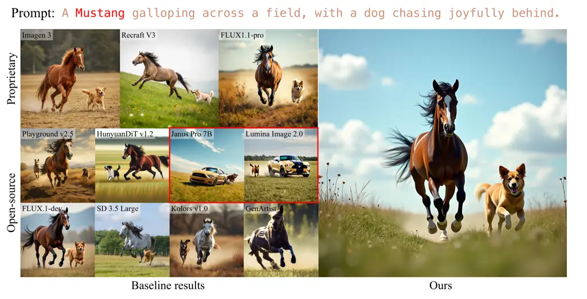

Figure 6: Ambiguities sample. The prompt “A Mustang galloping across a
field, with a dog chasing joyfully behind” is ambiguous; “Mustang” could
mean a car or a horse. While Janus Pro 7B \[6\] and Lumina Image
2.0 \[34\] depict a Ford Mustang, others show a horse. Our Input
Interpreter Agent resolves this by recognizing that “galloping” applies
to horses, ensuring correct subject interpretation.

## Appendix C Ablation study of MLLM backbones

We evaluate open-sourced Mistral Small 3.1 24B \[20\], Qwen2.5-VL 7B and
3B \[2\] on L40S GPUs, with the 24B model using two GPUs and the others
using one. Table A shows that performance is similar across model sizes:
compared to GPT-4o-mini, 7B model scores $`-`$0.2% VQAScore at $`-`$40%
cost.

## Appendix D Cost comparison

In Table A, beyond the direct spending per image: \$0.005 for our method
(using GPT-4o-mini) vs. \$0.04 for FLUX1.1-pro \[12\], we also account
for self-hosted hardware costs. Specifically, using an L40S GPU priced
at \$11,250 and depreciated over five years with 144 hours of weekly
usage results in a rate of \$0.30 per GPU-hour. Generating an average of
1,600 images, our method’s $`A_{gen}`$ takes 19.72s/image, translating
to \$0.0016/image. This amounts to only 16.59% of FLUX1.1-pro’s cost,
while achieving a +6% improvement in VQAScore \[17\]. Compared to
GenArtist \[36\], our method incurs 1.41x higher cost but delivers a
+38% gain in VQAScore \[17\].

## Appendix E More qualitative results

### E.1 Ambiguous term

Ambiguous terms in text-to-image prompts can lead to unintended or
inconsistent image generation. When a term has multiple possible
interpretations, different models may generate vastly different images,
reflecting the ambiguity inherent in natural language. Take Fig. 6 as an
example.

### E.2 More results in single-turn: Figs. 7, 8, 9, 10, 11, 12.

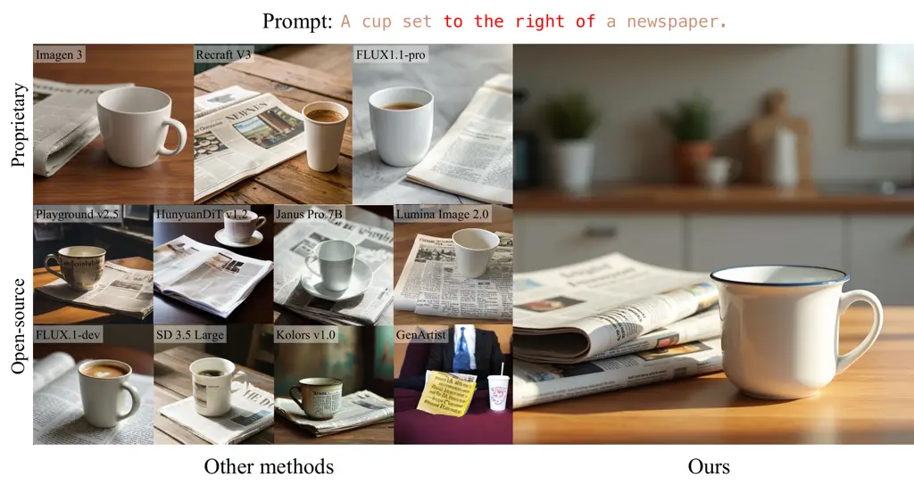

Figure 7: Qualitative result in single-turn: Demonstrate generation
performance on positional relationship of two objects.

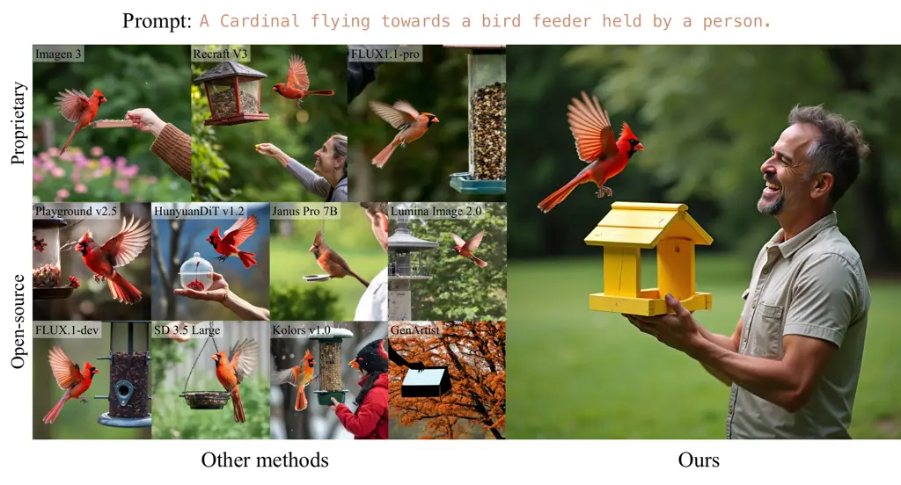

Figure 8: Qualitative result in single-turn: Demonstrate generation
performance on action relationship of a bird and a human with given
object (bird feeder).

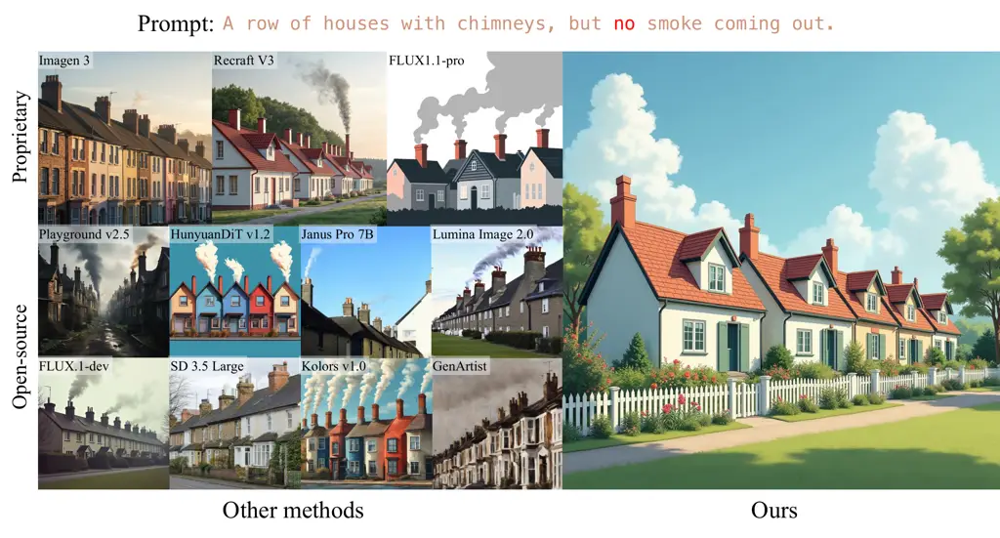

Figure 9: Qualitative result in single-turn: Demonstrate generation
performance on logical negation of excluding smoke in the image.

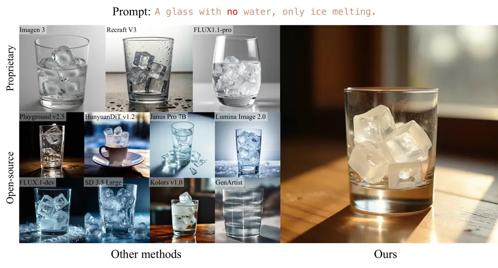

Figure 10: Qualitative result in single-turn: Demonstrate generation
performance on logical negation of excluding water in the image.

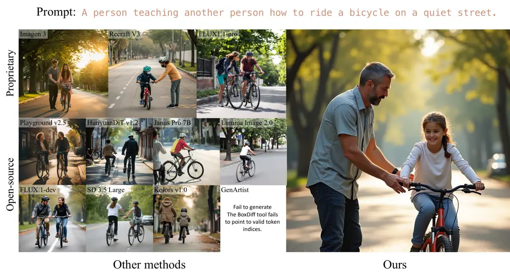

Figure 11: Qualitative result in single-turn: Demonstrate generation
performance on action relationship of two persons in the image.

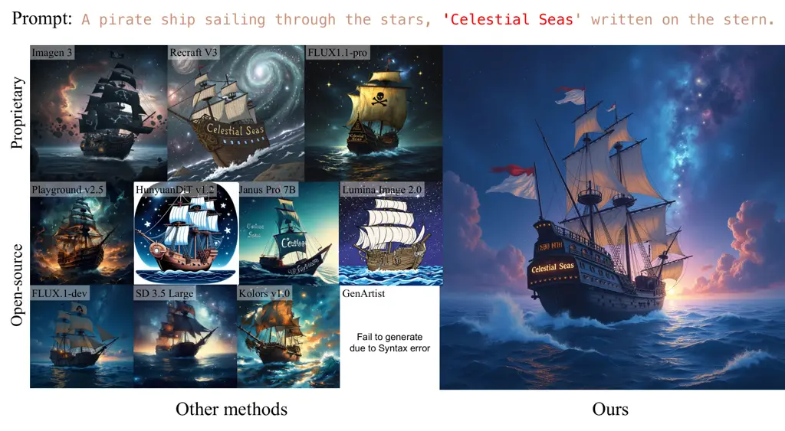

Figure 12: Qualitative result in single-turn: Demonstrate generation
performance on including specific text in the specific region.

### E.3 More results in multi-turn

#### E.3.1 Automatic: Figs. 13 and  14.

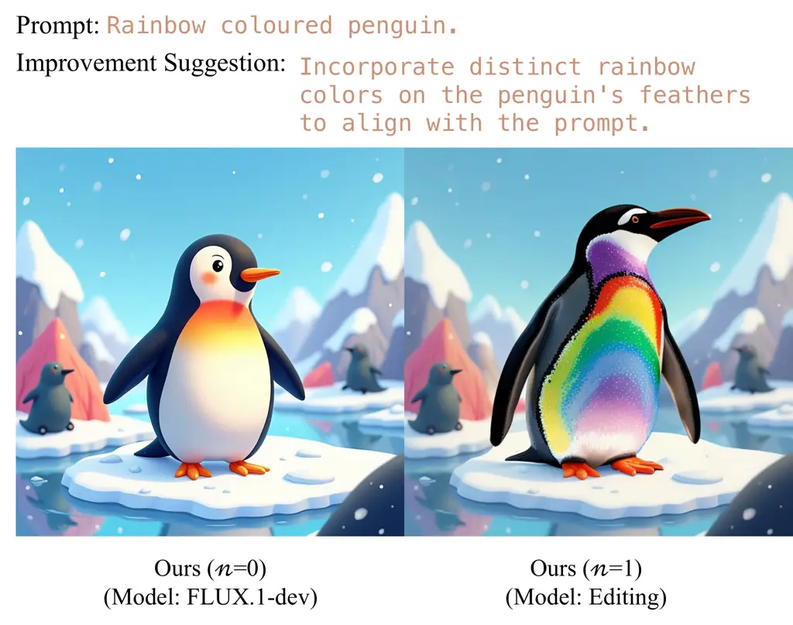

Figure 13: Qualitative result in multi-turn: Demonstrate enhancement
performance on providing improvement suggestion and successfully
modifying a specific region of the image automatically.

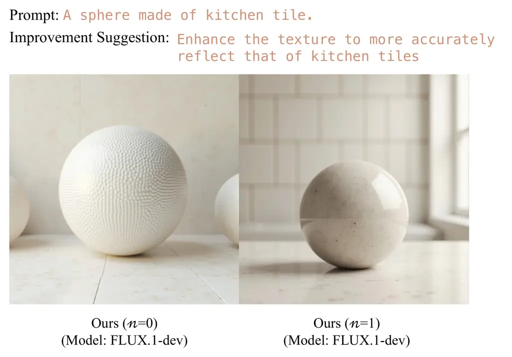

Figure 14: Qualitative result in multi-turn: Demonstrate enhancement
performance on providing improvement suggestion and successfully
modifying the texture of the image automatically.

#### E.3.2 Human-in-the-loop: Figs. 15 and  16.

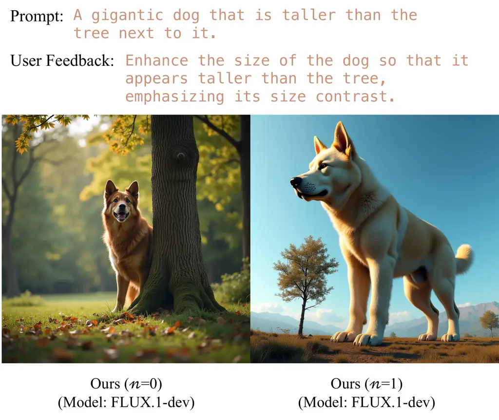

Figure 15: Qualitative result in multi-turn: Demonstrate enhancement
performance on including user feedback and successfully modifying the
size contrast of dog and tree.

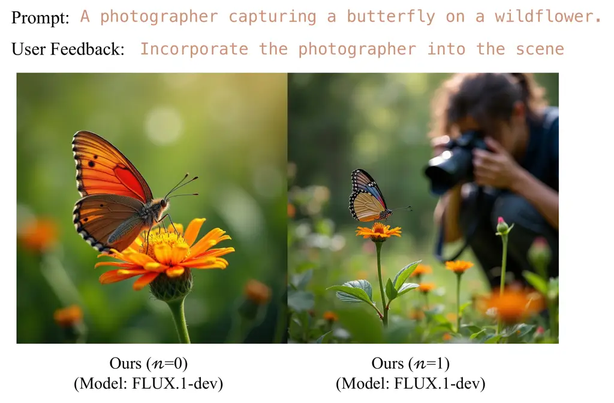

Figure 16: Qualitative result in multi-turn: Demonstrate enhancement
performance on including user feedback and successfully including the
photographer into the scene.

## Appendix F User study website screenshot: Fig. 17.

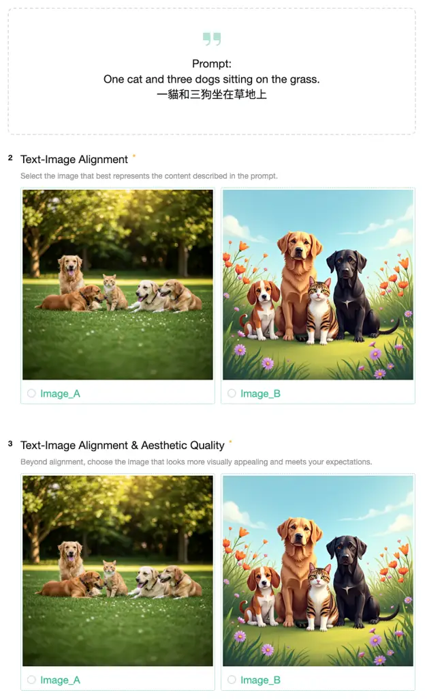

Figure 17: The screenshot of user study website.
