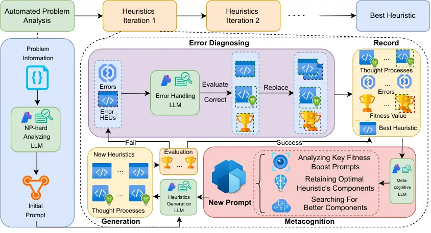
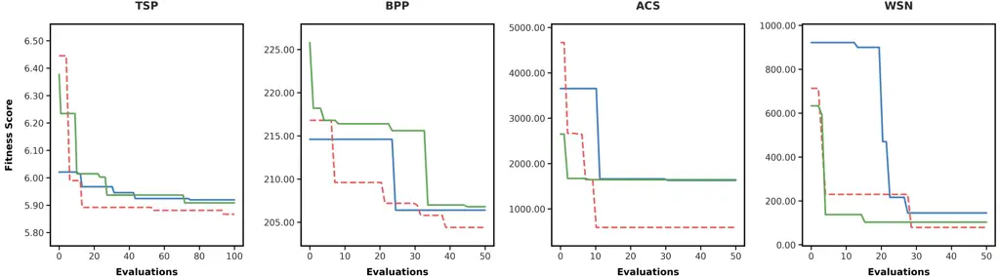
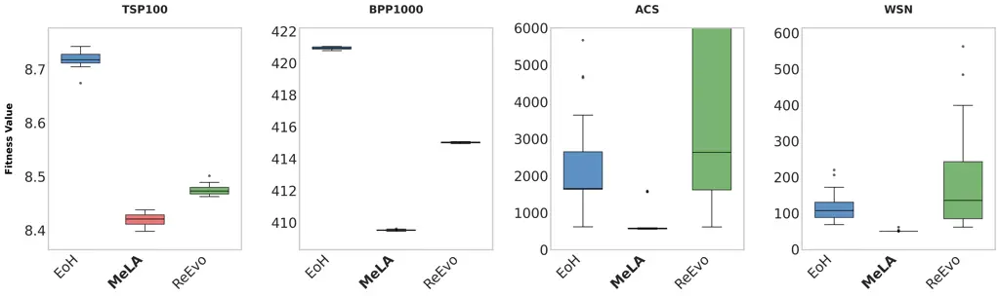
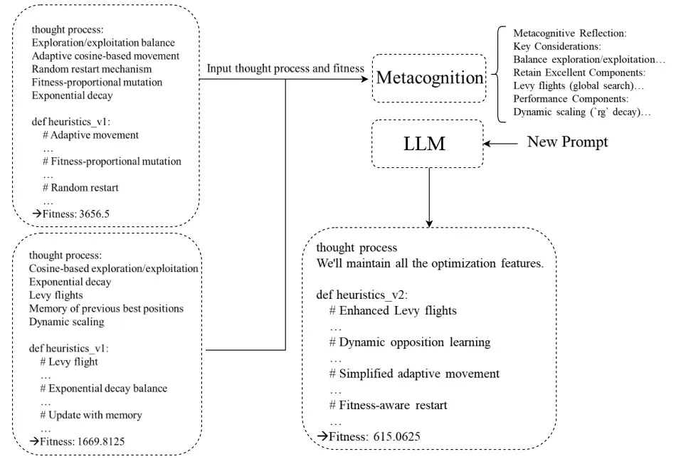

# MeLA: A Metacognitive LLM-Driven Architecture for Automatic Heuristic Design

Zishang Qiu Affiliation: School of Computer Science, University of
Nottingham Ningbo China, Ningbo, China
Email: [xinan.chen@nottingham.edu.com](mailto:)    Xinan Chen
^(†)^(†)thanks: Corresponding author. Affiliation: School of Computer
Science, University of Nottingham Ningbo China, Ningbo, China    Long
Chen Affiliation: College of Teacher Education, Zhejiang Normal
University, Jinhua, China    Ruibin Bai Affiliation: School of Computer
Science, University of Nottingham Ningbo China, Ningbo, China

###### Abstract

This paper introduces MeLA, a Metacognitive LLM-Driven Architecture that
presents a new paradigm for Automatic Heuristic Design (AHD).
Traditional evolutionary methods operate directly on heuristic code; in
contrast, MeLA evolves the instructional prompts used to guide a Large
Language Model (LLM) in generating these heuristics. This process of
”prompt evolution” is driven by a novel metacognitive framework where
the system analyzes performance feedback to systematically refine its
generative strategy. MeLA’s architecture integrates a problem analyzer
to construct an initial strategic prompt, an error diagnosis system to
repair faulty code, and a metacognitive search engine that iteratively
optimizes the prompt based on heuristic effectiveness. In comprehensive
experiments across both benchmark and real-world problems, MeLA
consistently generates more effective and robust heuristics,
significantly outperforming state-of-the-art methods. Ultimately, this
research demonstrates the profound potential of using cognitive science
as a blueprint for AI architecture, revealing that by enabling an LLM to
metacognitively regulate its problem-solving process, we unlock a more
robust and interpretable path to AHD.

Code/Dataset/Result — https://github.com/Qzs1335/MeLA

## Introduction

The quest for high-performance heuristics is a central and enduring
challenge in computational intelligence. These specialized algorithms
are the engines driving progress in complex optimization, from logistics
to drug discovery. Historically, powerful metaheuristics like SCSO
(Seyyedabbasi and Kiani 2023), WO (Han et al. 2024), and SOA (Givi and
Hubalovska 2023) were the products of a manual, artisanal process
requiring deep human expertise. While these algorithms can perform
exceptionally well on the specific problems they were designed for,
their performance often degrades when applied to different types of
problems or even to variations of the original problem. This limitation
is a direct consequence of the No Free Lunch (NFL) theorem (Wolpert and
Macready 1997), which posits that no single heuristic can be universally
optimal across all possible problems. Consequently, the reliance on
human-driven design for specific problem instances has become a critical
bottleneck, hindering the scale and speed of scientific and industrial
innovation.

To break this impasse, the field of Automatic Heuristic Design (AHD)
emerged, aiming to automate the creation of heuristics. While
foundational AHD paradigms like Hyper-Heuristics (HHs) (Pillay and Qu 2018) and Genetic Programming (GP) (Burke et al. 2007) were a conceptual
leap forward, their creative potential is fundamentally capped. By
design, they are tethered to human guidance, operating within search
spaces defined by expert-supplied components or primitives (Mei et al.
2022). This inherent limitation prevents them from achieving true design
autonomy, leaving the grand challenge of fully automated discovery
unsolved.

The advent of Large Language Models (LLMs) introduced a paradigm shift.
Recognizing their potential, the latest research frontier fuses LLMs
with the directed pressure of evolutionary computation (Zhang et al.
2024). Pioneering systems like FunSearch (Romera-Paredes et al. 2024),
EoH (Liu et al. 2024), and ReEvo (Ye et al. 2024) have demonstrated
remarkable success by evolving heuristics, discovering solutions that
rival human-engineered ones. However, this paper argues that their focus
on evolving heuristics is a source of profound limitations. The
paradigm’s core flaw is its reliance on population-level dynamics, which
treats the LLM as a static generator rather than an adaptive learner. By
failing to internalize the principles of what constitutes a superior
heuristic, this process inherently limits both the peak performance and
the generalizability of the discovered strategies.

Figure 1: Nature Evolving Driven & Metacognitive Driven Heuristic
Generation Architecture

This work posits that the true point of leverage is not the final
heuristic, but the generative reasoning process that creates it. To this
end, we introduce Prompt Evolution, a new AHD paradigm that
fundamentally differs from the natural selection model used by prior
work. As illustrated in Figure 1, instead of evolving a population of
heuristic codes, our architecture evolves the problem-solving strategy
itself, which is encoded in the LLM’s guiding prompt. This evolution is
driven by a metacognitive search engine inspired by cognitive science
(Martinez 2006). This engine assesses the entire causal chain—from the
strategic ”thinking process” embodied in a prompt to the empirical
performance of the heuristic it produces—and uses this analysis to
systematically refine the prompt for the next generation of thinking.

This focus on the reasoning process inherently improves the quality and
generality of the heuristics generated. However, we recognize that
achieving robust performance in practice requires addressing challenges
that extend beyond high-level strategy. This is particularly true for
complex, ill-defined real-world problems, such as Adaptive Curriculum
Sequencing (ACS) (Prates et al. 2019) or Wireless Sensor Network (WSN)
deployment (Chen et al. 2024). The ambiguity and situational
dependencies of these problems frequently cause prior architectures to
fail by generating syntactically or logically flawed code. To overcome
these practical hurdles, MeLA is engineered with two novel support
mechanisms: an Automated Problem Analyzer that formulates a rich problem
description directly from source code, obviating the need for manual
input, and an Error Diagnosis System that autonomously detects and
rectifies programming flaws in the generated heuristics. These
components grant MeLA a degree of autonomy and reliability essential for
real-world application.

In summary, this paper introduces MeLA, a metacognitive LLM-driven
architecture that advances the state of the art in AHD. The primary
contributions are:

1.  1.  A New AHD Paradigm: We propose and validate Prompt Evolution, which
        focuses on refining the LLM’s reasoning process rather than
        heuristics, leading to more stable and generalizable performance.
2.  2.  A Metacognitive Search Engine: We introduce a novel search
        mechanism, inspired by metacognition, that enables the architecture
        to self-reflect and strategically improve its prompt-based
        problem-solving approach.
3.  3.  Robustness for Real-World Application: We equip the architecture
        with automated problem analysis and error diagnosis capabilities,
        significantly enhancing its autonomy and making it the first
        LLM-based AHD framework demonstrated to be effective on complex,
        ill-defined real-world problems.

## Literature Review

### Heuristic Design with Large Language Models

The integration of LLMs with evolutionary computation now defines the
frontier of Automatic Heuristic Design (Huang et al. 2025). This
approach has yielded a new generation of architectures capable of
generating remarkably high-quality heuristics. A seminal example is
FunSearch (Romera-Paredes et al. 2024), which pairs a pre-trained LLM
with a systematic evaluator to discover genuinely novel constructions
for long-standing mathematical challenges, including the cap set and
online bin packing problems. Building on this direction, the Evolution
of Heuristics (EoH) (Liu et al. 2024) architecture established a
paradigm for generalizable and efficient design through the dual
evolution of thoughts and code, supported by multi-strategy prompt
engineering. The success of this approach has already inspired further
development in multi-objective contexts, such as MEoH (Yao et al. 2025).
Concurrently, Reflective Evolution (ReEvo) (Ye et al. 2024) introduced
an innovative self-refining mechanism that substantially reduces the
dependence on predefined heuristic component libraries, a traditional
requirement of AHD.

While powerful, these state-of-the-art architectures share a common
paradigm rooted in natural selection: they apply evolutionary pressure
directly to the generated heuristics. In this model, the LLM functions
as a sophisticated evolutionary operator that produces candidate
solutions, which are then evaluated and selected based on their
performance. This focus on the final product, rather than the generative
process that created it, represents a fundamental limitation that leaves
significant potential for more intelligent and adaptive search untapped.

### Prompt Evolution for LLM-Driven Optimization

Given the limitations of evolving heuristics, the logical next step is
to evolve the generative process itself. A promising paradigm for this
task is Prompt Evolution (Sahoo et al. 2024). Research in this area has
demonstrated that iteratively refining an LLM’s instructional prompt can
dramatically improve the quality and specificity of its output. For
instance, Li et al. (2023) designed a black-box evolutionary algorithm
called SPELL that uses an LLM to iteratively improve its prompts (Li and
Wu 2023). Similarly, the Promptbreeder mechanism was proposed to evolve
and adapt prompts for specific domains by treating them as mutable tasks
(Fernando et al. 2023). Other works have confirmed the efficacy of using
evolutionary algorithms to generate prompts through dynamic interaction
with the model (Martins et al. 2023).

These methods confirm that the reasoning pathway of an LLM is a viable
and potent target for optimization. However, the application of prompt
evolution to the structured, high-stakes domain of AHD remains a
critical and unexplored research gap. In its current form, prompt
evolution is often an unguided search, lacking a higher-level
intelligence to direct its path efficiently and strategically. This
raises a crucial question: how can a system learn to evolve its prompts
in a principled manner?

Figure 2: Flowchart of MeLA.

### Metacognition as a Framework for Self-Regulation

A robust answer to this question is found in the cognitive science of
metacognition. A fundamental distinction exists between cognition and
metacognition: the cognitive system executes tasks (e.g., information
retrieval), whereas the metacognitive system regulates these activities
through higher-order processes of planning, monitoring, and evaluation
(Lai 2011). Empirical studies demonstrate that individuals with
well-developed metacognitive competence hold significant advantages:
they can detect deficits in their own understanding and dynamically
adjust their cognitive strategies based on performance outcomes (Akturk
and Sahin 2011). This capacity for self-regulation, often termed
learning to learn, is crucial for adaptability in complex environments
(Dunlosky and Metcalfe 2008; Cox 2005).

This concept has recently found traction in AI research, with studies
exploring how to instill metacognitive capabilities in AI agents (Lin
and Wei-Kocsis 2025; Wang and Zhao 2023) and LLMs specifically (Li
et al. 2025). For heuristic design, metacognition offers the perfect
blueprint for an architecture that does not just generate solutions, but
actively analyzes its own problem-solving process to become a better
problem-solver over time. However, despite its clear relevance, the
strategic framework of metacognition has not yet been leveraged to guide
the generative process within AHD.

### Summary and Identified Research Gap

The foregoing review reveals a compelling opportunity at the
intersection of three distinct fields. Current AHD architectures are
powerful yet constrained by a paradigm that evolves heuristics. Prompt
evolution offers a mechanism for process refinement but lacks strategic
guidance. Finally, metacognition provides the theoretical blueprint for
intelligent, autonomous self-regulation. This paper bridges these
domains by introducing MeLA, an architecture that operationalizes
metacognitive principles to drive prompt evolution, thereby forging a
new and more powerful path for Automatic Heuristic Design.

## Methodology

### Main Idea & System Role

MeLA introduces a paradigm shift in AHD by focusing on the metacognitive
process of prompt evolution. It also incorporates automatic problem
analysis and error correction mechanisms to enhance the architecture’s
versatility and robustness across a range of challenges, from classical
benchmarks to complex real-world problems.

Previous architectures have concentrated on the generated heuristics
themselves, employing crossover and mutation based on performance. This
reliance on a natural selection-based evolutionary model can lead to
instability, with inconsistent performance and significant variance
among the generated heuristics. Furthermore, these approaches often lack
the necessary mechanisms to effectively address the nuances of
real-world problems and the errors that can arise in the generated
heuristics.

In contrast, MeLA emphasizes the ”why such heuristics are generated”.
This means MeLA focuses on the thought processes that LLMs generate when
creating heuristics. The quality of this thought process directly
correlates with the heuristic’s performance; a sound line of reasoning
leads to superior results, while flawed logic results in poor
performance. By integrating metacognition, MeLA analyzes these
LLM-generated thought processes to identify and retain the most
effective reasoning patterns that contribute to improved heuristic
performance. This allows the system to identify optimal heuristics and
formulate new, more effective prompts to guide the LLM in subsequent
heuristic generation, constituting a form of prompt evolution. The
robustness of MeLA is further enhanced by its automated problem analysis
and error diagnosis capabilities.

To operationalize this approach, MeLA introduces three distinct system
roles:

- •
  NP-hard Problem Analysis Expert: This role is responsible for
  analyzing the code-based representations of NP-hard problems. It
  identifies key parameter characteristics and examines the fundamental
  challenges inherent in these problems, providing a solid foundation
  for heuristic design.
- •
  Elite Code Debugger: This system component addresses errors within the
  generated heuristics. It analyzes execution failures, identifies the
  root causes of errors in the code, and applies targeted corrections
  while preserving the original problem-solving intent of the heuristic.
- •
  Metacognitive Reflector: This role facilitates introspection on the
  thought processes and errors that occur during heuristic generation.
  Interpreted by the LLM as ”another version of oneself”, this component
  is crucial for self-regulation and strategic improvement.

The detailed implementation of these system roles is further elaborated
in the Appendix. A flowchart of the MeLA architecture is provided in
Figure 2.

1: Input: Problem $`P`$, Number of Initializations $`N`$, Generation
Limit $`L`$

2: Output: Optimal Heuristic $`Best(H)`$

3: procedure OptimizeHeuristic($`P,L`$)

4:   for $`i\leftarrow 1`$ to $`N`$ do

5:    $`H,Th\leftarrow\text{InitializeHeuristics}(\text{Analyze}(P))`$

6:   end for

7:   for $`j\leftarrow N+1`$ to $`L`$ do

8:    $`f(H),E\leftarrow\text{Evaluate}(H)`$

9:    if $`E\neq\emptyset`$ then

10:      $`H,Th\leftarrow\text{CorrectErrors}(H,E,Th)`$

11:      $`f(H)\leftarrow\text{Evaluate}(H)`$

12:    end if

13:    $`Meta\leftarrow\text{AnalyzePerformance}(Th,f(H),`$

14:                   $`E,Best(H))`$

15:    $`H,Th\leftarrow\text{GenerateNext}(Meta)`$

16:   end for

17:   return $`Best(H)`$

18: end procedure

Algorithm 1 Iterative Heuristic Optimization

### Iteration Steps

The iterative optimization process of MeLA is detailed in Algorithm 1.
At each iteration, MeLA maintains a population of heuristics, denoted as
$`H=\{h_{1},\dots,h_{N}\}`$. Each heuristic $`h_{i}`$ in this population
is evaluated against a set of problem instances to determine its fitness
value, $`f(h_{i})`$.

The optimization loop begins with an initial problem Analyze, which
informs the InitializeHeuristics step, where the first population of
heuristics $`H`$ and their corresponding thought processes $`Th`$ are
generated. Subsequently, the core iterative cycle commences. First, all
heuristics in the current population are subjected to Evaluation, which
yields their fitness scores $`f(H)`$ and records any execution errors
$`E`$. If $`E`$ are detected, the CorrectErrors procedure is invoked to
repair the faulty heuristics and update the population $`H`$, thought
processes $`Th`$ and fitness $`f(H)`$. Following this, the
AnalyzePerformance stage initiates a metacognitive review $`Meta`$. It
assesses the recorded thought processes $`Th`$, the fitness landscape of
the population $`f(H)`$, the errors $`E`$ and the characteristics of the
best-performing heuristic $`Best(H)`$ to generate a new set of refined
prompts. These prompts are then used by the GenerateNext function to
produce the next generation of heuristics $`H`$ and thoughts $`Th`$.
This cycle of evaluation, correction, analysis, and generation repeats,
driving the continuous refinement of the underlying problem-solving
strategies.

### Prompt Evolution

Prompt evolution in MeLA is a structured, reflective process driven by
the metacognition phase. During this phase, MeLA leverages a
comprehensive record of the iterative history—including the thought
processes, execution errors, and resulting fitness values of all
generated heuristics. The metacognitive analysis then evolves the
guiding prompt by focusing on three key objectives:

- •
  Reinforcement: Identifying and reinforcing the reasoning patterns
  within the thought processes that correlated with fitness
  improvements.
- •
  Preservation: Isolating and preserving high-performing components from
  the best heuristic, such as specific search strategies.
- •
  Innovation: Hypothesizing novel components or modifications that could
  lead to further performance gains.

A concrete example illustrating this prompt evolution process is
detailed in the Appendix.

### Challenges in Real-World Problems

While architectures like EoH and ReEvo have demonstrated commendable
performance on classical benchmark problems, they face significant
challenges when applied to real-world optimization scenarios. These
problems are often high-dimensional and richly parameterized, requiring
meticulously detailed descriptions to guide the LLM toward generating
feasible heuristics. Crafting such descriptions is non-trivial; it
demands deep user expertise both in the problem domain and in the
nuances of interacting with LLMs. This dependency on manual,
expert-driven problem formulation limits their applicability and
scalability for diverse real-world challenges. For a detailed guide on
the modifications required to enable the execution of EoH and ReEvo on
these complex problems, please refer to the Appendix.

Compounding this issue, even with well-crafted problem descriptions,
both EoH and ReEvo exhibit a high probability of generating
non-executable heuristics. This stems from the inherent difficulty an
LLM faces in translating complex, multi-parameter problem specifications
into syntactically and logically correct code, leading to errors such as
undefined parameters or out-of-bounds array access. While this has a
lesser impact on an architecture like EoH, which does not strictly
depend on a population of valid individuals, it poses a critical failure
point for ReEvo. The crossover mechanism in ReEvo requires executable
parent heuristics; if none can be successfully generated, the
evolutionary process halts entirely.

MeLA is specifically engineered to overcome these limitations. It
utilizes an LLM’s analytical capabilities to approach problem
understanding from an expert perspective, thereby enhancing the accuracy
and versatility of heuristic generation. Crucially, it integrates a
robust error diagnosis and correction mechanism to dramatically increase
the rate of producing executable code.

### Predefined Prompts

MeLA’s operation is guided by four distinct, predefined prompts designed
to steer the LLM through the heuristic design process.

- •
  Problem Analysis Prompt: The LLM first analyzes the problem’s complete
  Python code to produce an expert description of its key
  characteristics and inherent computational difficulty. This analysis
  grounds the entire process.
- •
  Generation Prompts: These prompts create the heuristics. The Initial
  Generation prompt uses the problem analysis to produce a diverse
  population of $`N`$ heuristics. Subsequently, the Metacognitive
  Generation prompt uses insights from the metacognition step to evolve
  this population, generating $`N`$ refined heuristics for the next
  iteration.
- •
  Error Prompt: If a heuristic fails during evaluation, the LLM receives
  the faulty code and its corresponding error message. It then attempts
  to generate a corrected version up to $`M`$ times. The best-performing
  valid candidate replaces the original; if all attempts fail, the
  heuristic’s failure is logged.
- •
  Metacognition Prompt: This core prompt drives prompt evolution by
  instructing the LLM to analyze the iteration’s complete history (all
  thought processes, errors, and fitness values). It performs a
  self-reflective analysis to: 1) identify reasoning patterns that led
  to improved fitness, 2) preserve high-performing components (e.g., a
  search strategy like Lévy Flight) from the best heuristic, and 3)
  hypothesize new strategies for further enhancement. The output of this
  prompt directly informs the Metacognitive Generation prompt.

Full prompt details are provided in the Appendix.

|           |                   |                           |                   |                             |                   |                              |                   |                            |
| --------- | ----------------- | ------------------------- | ----------------- | --------------------------- | ----------------- | ---------------------------- | ----------------- | -------------------------- |
| Method    | TSP50             |                           | BPP500            |                             | ACS               |                              | WSN               |                            |
|           | SR ($`\uparrow`$) | Obj. ($`\downarrow`$)     | SR ($`\uparrow`$) | Obj. ($`\downarrow`$)       | SR ($`\uparrow`$) | Obj. ($`\downarrow`$)        | SR ($`\uparrow`$) | Obj. ($`\downarrow`$)      |
| GA        | –                 | $`16.75\pm 0.72`$         | –                 | $`219.60\pm 0.45`$          | –                 | $`3927.10\pm 976.76`$        | –                 | $`1923.17\pm 0.34`$        |
| PSO       | –                 | $`11.46\pm 0.34`$         | –                 | $`219.30\pm 0.46`$          | –                 | $`4067.25\pm 1095.79`$       | –                 | $`2674.44\pm 326.81`$      |
| SCSO      | –                 | $`7.87\pm 0.24`$          | –                 | $`221.71\pm 0.39`$          | –                 | $`3875.83\pm 1939.60`$       | –                 | $`661.00\pm 199.52`$       |
| SOA       | –                 | $`20.48\pm 0.39`$         | –                 | $`220.22\pm 0.28`$          | –                 | $`6349.44\pm 1504.71`$       | –                 | $`943.69\pm 80.90`$        |
| WO        | –                 | $`20.97\pm 0.29`$         | –                 | $`221.69\pm 0.37`$          | –                 | $`6975.08\pm 7256.24`$       | –                 | $`1251.25\pm 670.21`$      |
| EoH^(∗)   | 70.97%            | $`5.90\pm 0.02`$          | 88.54%            | $`209.08\pm 4.77`$          | 75.49%            | $`1252.88\pm 794.44`$        | 53.36%            | $`177.84\pm 96.32`$        |
| ReEvo^(∗) | 89.46%            | $`5.89\pm 0.03`$          | 96.73%            | $`208.76\pm 2.06`$          | 40.71%            | $`1848.78\pm 406.90`$        | 56.52%            | $`117.61\pm 18.30`$        |
| MeLA      | 98.41%            | $`\mathbf{5.85\pm 0.01}`$ | 93.28%            | $`\mathbf{205.48\pm 0.84}`$ | 94.07%            | $`\mathbf{589.60\pm 22.79}`$ | 99.21%            | $`\mathbf{53.89\pm 2.77}`$ |

Table 1: Comparative Performance Analysis Across Different Problems

Figure 3: Fitness Values of Different Architectures on Different
Problems. (
 MeLA,
 
EoH,
 
ReEvo )

## Experiments

### Experimental Setup

To rigorously evaluate the performance and versatility of MeLA, we
designed an experimental suite comprising three distinct categories of
optimization challenges: a classical benchmark, a black-box benchmark,
and two complex real-world problems. This selection allows for a
comprehensive assessment of the architecture’s capabilities across
various scenarios. The chosen problems are:

- •
  Traveling Salesperson Problem (TSP): A canonical NP-hard problem
  requiring the determination of the most efficient route that visits a
  set of cities exactly once before returning to the origin. In the
  experiment, the initial population size is 30, the evolutionary
  population size is 10, and a total of 100 solutions are generated.
- •
  Bin Packing Problem (BPP): A classic black-box combinatorial
  optimization problem that involves packing items of varying sizes into
  the minimum number of fixed-capacity containers (Ross et al. 2002). It
  serves as a benchmark for resource allocation challenges. In the
  experiment, the initial population size is 30, the evolutionary
  population size is 10, and a total of 50 solutions are generated.
- •
  Adaptive Curriculum Sequencing (ACS): A complex, real-world
  combinatorial optimization problem from the domain of e-learning. ACS
  involves generating personalized learning paths by balancing learner
  characteristics (e.g., knowledge level, attention span) with
  pedagogical constraints (e.g., concept dependencies, difficulty
  levels). As an NP-Hard problem, it requires optimizing multiple, often
  conflicting, objectives. In the experiment, the initial population
  size is 20, the evolutionary population size is 10, and a total of 50
  solutions are generated.
- •
  Wireless Sensor Network (WSN) Deployment: A real-world optimization
  problem from the communications domain, abbreviated herein as WSN. The
  goal is to optimize the placement and power management of sensor nodes
  to maximize network coverage and connectivity while minimizing total
  energy consumption, addressing NP-hard challenges like the Minimum
  Power k-Coverage problem. In the experiment, the initial population
  size is 20, the evolutionary population size is 10, and a total of 50
  solutions are generated.

In TSP and BPP problems, we optimize the heuristic information based on
Ant Colony Optimization (ACO). The core mechanism of ACO involves
guiding random solution sampling through heuristic measures. This
mechanism is naturally suitable for validating the value of AHD, which
automatically designs these heuristic rules to guide the search process,
replacing manually designed heuristic functions(Ye et al. 2024). In ACS
and WSN problems, we optimize the heuristic algorithm. By evaluating the
generated results of heuristic information and heuristic algorithms, we
assess the excellent performance of MeLA.

To ensure experimental fairness, EoH, ReEvo, and MeLA all use the same
experimental parameters.

The selection of ACS and WSN was specifically intended to test MeLA’s
cross-domain execution capabilities, and all four problems are
formulated as minimization tasks. We selected DeepSeek-V3-0324 as the
core generative engine due to its strong metacognitive reasoning
capabilities. As our preliminary tests confirmed that performance is
primarily driven by the MeLA architecture itself, not the specific LLM,
this work focuses on validating the framework with a single capable
model.

For our comparative analysis, we benchmarked MeLA against five
traditional metaheuristics (Genetic Algorithm (GA) (Holland 1992),
Particle Swarm Optimization (PSO) (Kennedy and Eberhart 1995), Sand Cat
Swarm Optimization (SCSO) (Seyyedabbasi and Kiani 2023), Skill
Optimization Algorithm (SOA) (Givi and Hubalovska 2023), and Walrus
Optimization (WO) (Han et al. 2024)) and two state-of-the-art LLM-driven
architectures (Evolution of Heuristics (EoH) (Liu et al. 2024) and
Reflective Evolution (ReEvo) (Ye et al. 2024)).

It should be emphasized that for excellent algorithms such as GA, in the
TSP and BPP problems, we evaluate the ACO’s performance with heuristic
information designed by these algorithms, while in the ACS and BPP
problems, we evaluate the algorithms themselves.

The details of these comprehensive definitions and constraints for all
problems are documented in the Appendix.

Figure 4: Performance of Optimal Heuristic Generated by Different
Architectures.

### Results and Analysis

The experimental results across the four problem domains are summarized
in Figure 3 and Table 1. Figure 3 illustrates a representative
convergence plot from one of our independent runs. Due to the stochastic
nature of LLM-based generation, an optimal heuristic may occasionally be
found during initialization; presenting a run that demonstrates clear
iterative improvement provides a more insightful view of an
architecture’s dynamic behavior. As shown, MeLA consistently achieves
superior fitness values across all four problems, with particularly
significant advantages over EoH and ReEvo on the BPP and ACS problems.

A quantitative summary of our findings over three independent runs,
including heuristic success rates (SR) and final fitness values, is
presented in Table 1. The data confirms MeLA’s superior performance on
the TSP, ACS, and WSN problems in terms of both success rate and average
final fitness. The advantage is most pronounced in real-world scenarios.
For the ACS problem, MeLA’s success rate is 18.58% and 53.36% higher
than EoH and ReEvo, respectively, while achieving a final fitness that
is 52.94% and 68.11% better. Similarly, on the WSN problem, MeLA
achieves a 69.70% and 54.18% higher success rate and improves the final
fitness by 71.30% and 48.27%. For the BPP problem, while ReEvo records a
marginally higher success rate (by 3.45%), MeLA still secures the best
average fitness, indicating its overall effectiveness. Finally, when
compared against traditional metaheuristics on the ACS and WSN problems,
all modern AHD architectures demonstrate a clear advantage, affirming
the power of this paradigm for complex, multi-parameter optimization.

Beyond aggregate performance, we analyzed the generality and stability
of the single best heuristic generated by each architecture, with
results detailed in Figure 4. For the TSP and BPP, we tested
generalization by evaluating the heuristics on 64 different larger-scale
instances over 10 independent runs. For the complex ACS and WSN
problems, we tested performance stability by re-executing the optimal
heuristics 30 times with different random seeds. In all scenarios, the
heuristic generated by MeLA demonstrated the most stable and superior
performance. This was particularly evident for the ACS and WSN problems,
where the heuristic not only exhibited minimal deviation but
consistently converged to its optimal fitness value in nearly every run,
confirming its exceptional quality and reliability.

The specific parameters used for all problems and the code for the
optimal heuristics generated by each architecture are available in the
Appendix.

### Ablation Analysis

To validate the individual contributions of MeLA’s core components, we
conducted a series of ablation studies. We systematically analyzed the
impact of: Prompt Evolution, the Automated Problem Analysis mechanism,
the Error Diagnosis mechanism, and the Metacognitive Search component.

- •
  Prompt Evolution: The superiority of Prompt Evolution over traditional
  natural selection is demonstrated by MeLA’s overall performance in
  Table 1 and Figure 4. On classic benchmarks, it yields heuristics with
  superior fitness, an advantage particularly pronounced on the BPP. On
  real-world problems, it produces solutions that are not only
  higher-performing but also significantly more stable. This confirms
  that evolving the underlying reasoning process is a more effective and
  robust strategy than evolving the heuristic code directly.
- •
  Automated Problem Analysis (PA) Mechanism: To isolate the effect of
  the PA mechanism, we compared initialization performance with and
  without this component. As shown in Table 2, the PA mechanism provides
  a moderate fitness improvement across problems and, critically, yields
  a significant increase in the initial heuristic success rate on the
  black-box BPP challenge.
- •
  Error Diagnosis Mechanism: The efficacy of the Error Diagnosis
  mechanism is clearly evidenced by the heuristic success rates
  presented in Table 1. MeLA’s ability to achieve near-perfect execution
  rates, especially on complex real-world problems where baselines like
  EoH and ReEvo falter, is a direct result of this component’s ability
  to autonomously repair faulty code.
- •
  Metacognitive Search Component: The impact of the Metacognitive Search
  component is demonstrated by comparing the average fitness values
  before and after its application (Table 2). For the ACS problem, each
  successive metacognitive stage delivers a clear and consistent
  improvement in fitness. On the BPP, the first metacognitive stage
  provides a substantial fitness gain, with subsequent stages showing
  diminishing returns as the heuristics approach a strong optimum.
  Furthermore, this component helps maintain or improve heuristic
  success rates throughout the evolutionary process, as seen in the
  final 100% success rate for ACS after the third stage.

|         |                       |                  |                       |                  |
| ------- | --------------------- | ---------------- | --------------------- | ---------------- |
| PA/Meta | BPP                   |                  | ACS                   |                  |
|         | Avg. ($`\downarrow`$) | SR($`\uparrow`$) | Avg. ($`\downarrow`$) | SR($`\uparrow`$) |
| Have PA | $`221.50`$            | 70.00%           | $`4434.14`$           | 100.00%          |
| No PA   | $`221.80`$            | 56.67%           | $`4447.32`$           | 93.33%           |
| Initial | $`219.61`$            | 86.67%           | $`5335.47`$           | 95.00%           |
| Meta-1  | $`207.16`$            | 90.00%           | $`4311.72`$           | 90.00%           |
| Meta-2  | $`207.20`$            | 90.00%           | $`3642.88`$           | 90.00%           |
| Meta-3  | –                     | –                | $`3530.78`$           | 100%             |

Table 2: Ablation results.

## Conclusion

This paper introduces MeLA, a novel architecture that marks a
significant advance in Automatic Heuristic Design. By pioneering prompt
evolution, MeLA shifts the focus from evolving heuristic code—the
standard in natural selection-based methods—to evolving the underlying
reasoning process that generates the heursitic. Central to our approach
is a metacognitive framework that enables the system to iteratively
refine its generative strategy. This allows MeLA to discover
high-performing thought patterns to get superior solution quality and
execution success rates across a diverse range of optimization
challenges.

This shift from direct code manipulation to cognitive framework
optimization allows MeLA to overcome the limitations of prior
approaches. Furthermore, by making the thought process the target of
optimization, MeLA yields a unique and powerful form of
interpretability. Unlike evolving cryptic heuristics, MeLA produces an
optimized prompt, which is human-readable. This prompt serves as a
reusable, high-level strategy that can be understood, manually refined,
and easily adapted by human experts, bridging the gap between automated
discovery and human-centric problem-solving. Our results validate prompt
evolution as a powerful and robust paradigm, offering a more stable and
adaptable method for generating high-quality heuristics, particularly
for complex real-world problems.

For future work, a key direction will be to investigate the performance
of MeLA with different underlying LLMs. Such experiments will not only
explore the trade-offs between various models but also further validate
the model-agnostic nature of the MeLA framework, enhancing its
generalizability.

## Acknowledgments

This work is supported by the Ningbo Municipal Bureau of Science and
Technology (Grant No. 2025Z197).

## References

- Akturk and Sahin (2011) Akturk, A. O.; and Sahin, I. 2011. Literature
  review on metacognition and its measurement. _Procedia-Social and
  Behavioral Sciences_, 15: 3731–3736.
- Burke et al. (2007) Burke, E. K.; Hyde, M. R.; Kendall, G.; and
  Woodward, J. 2007. Automatic heuristic generation with genetic
  programming: evolving a jack-of-all-trades or a master of one. In
  _Proceedings of the 9th annual conference on Genetic and evolutionary
  computation_, 1559–1565.
- Chen et al. (2024) Chen, L.; Qiu, Z.; Wu, Y.; and Tang, Z. 2024.
  Optimizing k-coverage in energy-saving wireless sensor networks based
  on the Elite Global Growth Optimizer. _Expert Systems with
  Applications_, 256: 124878.
- Cox (2005) Cox, M. T. 2005. Metacognition in computation: A selected
  research review. _Artificial intelligence_, 169(2): 104–141.
- Dunlosky and Metcalfe (2008) Dunlosky, J.; and Metcalfe, J. 2008.
  _Metacognition_. Sage Publications.
- Fernando et al. (2023) Fernando, C.; Banarse, D.; Michalewski, H.;
  Osindero, S.; and Rocktäschel, T. 2023. Promptbreeder:
  Self-referential self-improvement via prompt evolution. _arXiv
  preprint arXiv:2309.16797_.
- Givi and Hubalovska (2023) Givi, H.; and Hubalovska, M. 2023. Skill
  Optimization Algorithm: A New Human-Based Metaheuristic Technique.
  _Computers, Materials & Continua_, 74(1).
- Han et al. (2024) Han, M.; Du, Z.; Yuen, K. F.; Zhu, H.; Li, Y.; and
  Yuan, Q. 2024. Walrus optimizer: A novel nature-inspired metaheuristic
  algorithm. _Expert Systems with Applications_, 239: 122413.
- Holland (1992) Holland, J. H. 1992. Genetic algorithms. _Scientific
  american_, 267(1): 66–73.
- Huang et al. (2025) Huang, Z.; Wu, W.; Wu, K.; Wang, J.; and Lee,
  W.-B. 2025. Calm: Co-evolution of algorithms and language model for
  automatic heuristic design. _arXiv preprint arXiv:2505.12285_.
- Kennedy and Eberhart (1995) Kennedy, J.; and Eberhart, R. 1995.
  Particle swarm optimization. In _Proceedings of ICNN’95-international
  conference on neural networks_, volume 4, 1942–1948. ieee.
- Lai (2011) Lai, E. R. 2011. Metacognition: A literature review.
- Li et al. (2025) Li, W.; Li, D.; Dong, K.; Zhang, C.; Zhang, H.; Liu,
  W.; Wang, Y.; Tang, R.; and Liu, Y. 2025. Adaptive tool use in large
  language models with meta-cognition trigger. _arXiv preprint
  arXiv:2502.12961_.
- Li and Wu (2023) Li, Y. B.; and Wu, K. 2023. Spell: Semantic prompt
  evolution based on a llm. _arXiv preprint arXiv:2310.01260_.
- Lin and Wei-Kocsis (2025) Lin, W.; and Wei-Kocsis, J. 2025. Think,
  Reflect, Create: Metacognitive Learning for Zero-Shot Robotic Planning
  with LLMs. _arXiv preprint arXiv:2505.14899_.
- Liu et al. (2024) Liu, F.; Tong, X.; Yuan, M.; Lin, X.; Luo, F.; Wang,
  Z.; Lu, Z.; and Zhang, Q. 2024. Evolution of heuristics: Towards
  efficient automatic algorithm design using large language model.
  _arXiv preprint arXiv:2401.02051_.
- Martinez (2006) Martinez, M. E. 2006. What is metacognition? _Phi
  delta kappan_, 87(9): 696–699.
- Martins et al. (2023) Martins, T.; Cunha, J. M.; Correia, J.; and
  Machado, P. 2023. Towards the evolution of prompts with metaprompter.
  In _International Conference on Computational Intelligence in Music,
  Sound, Art and Design (Part of EvoStar)_, 180–195. Springer.
- Mei et al. (2022) Mei, Y.; Chen, Q.; Lensen, A.; Xue, B.; and
  Zhang, M. 2022. Explainable artificial intelligence by genetic
  programming: A survey. _IEEE Transactions on Evolutionary
  Computation_, 27(3): 621–641.
- Pillay and Qu (2018) Pillay, N.; and Qu, R. 2018. _Hyper-heuristics:
  theory and applications_. Springer.
- Prates et al. (2019) Prates, M.; Avelar, P. H.; Lemos, H.; Lamb,
  L. C.; and Vardi, M. Y. 2019. Learning to solve np-complete problems:
  A graph neural network for decision tsp. In _Proceedings of the AAAI
  conference on artificial intelligence_, volume 33, 4731–4738.
- Romera-Paredes et al. (2024) Romera-Paredes, B.; Barekatain, M.;
  Novikov, A.; Balog, M.; Kumar, M. P.; Dupont, E.; Ruiz, F. J.;
  Ellenberg, J. S.; Wang, P.; Fawzi, O.; et al. 2024. Mathematical
  discoveries from program search with large language models. _Nature_,
  625(7995): 468–475.
- Ross et al. (2002) Ross, P.; Schulenburg, S.; Marín-Bläzquez, J. G.;
  and Hart, E. 2002. Hyper-heuristics: learning to combine simple
  heuristics in bin-packing problems. In _Proceedings of the 4th annual
  conference on genetic and evolutionary computation_, 942–948.
- Sahoo et al. (2024) Sahoo, P.; Singh, A. K.; Saha, S.; Jain, V.;
  Mondal, S.; and Chadha, A. 2024. A systematic survey of prompt
  engineering in large language models: Techniques and applications.
  _arXiv preprint arXiv:2402.07927_.
- Seyyedabbasi and Kiani (2023) Seyyedabbasi, A.; and Kiani, F. 2023.
  Sand Cat swarm optimization: A nature-inspired algorithm to solve
  global optimization problems. _Engineering with computers_, 39(4):
  2627–2651.
- Wang and Zhao (2023) Wang, Y.; and Zhao, Y. 2023. Metacognitive
  prompting improves understanding in large language models. _arXiv
  preprint arXiv:2308.05342_.
- Wolpert and Macready (1997) Wolpert, D. H.; and Macready, W. G. 1997.
  No free lunch theorems for optimization. _IEEE transactions on
  evolutionary computation_, 1(1): 67–82.
- Yao et al. (2025) Yao, S.; Liu, F.; Lin, X.; Lu, Z.; Wang, Z.; and
  Zhang, Q. 2025. Multi-objective evolution of heuristic using large
  language model. In _Proceedings of the AAAI Conference on Artificial
  Intelligence_, volume 39, 27144–27152.
- Ye et al. (2024) Ye, H.; Wang, J.; Cao, Z.; Berto, F.; Hua, C.; Kim,
  H.; Park, J.; and Song, G. 2024. Reevo: Large language models as
  hyper-heuristics with reflective evolution. _arXiv preprint
  arXiv:2402.01145_.
- Zhang et al. (2024) Zhang, R.; Liu, F.; Lin, X.; Wang, Z.; Lu, Z.; and
  Zhang, Q. 2024. Understanding the importance of evolutionary search in
  automated heuristic design with large language models. In
  _International Conference on Parallel Problem Solving from Nature_,
  185–202. Springer.

## Appendix

### A.1 Errors

Here are the errors that may occur during the heuristic operation of LLM
generation.

Figure A1: Incomplete problem descriptions will result in no runnable
heuristics for both EoH and ReEvo.

### A.2 Prompt Evolution

The process of prompt evolution based on metacognition is shown in the
figure below. As illustrated in the figure, this flowchart demonstrates
a systematic metacognition-driven prompt evolution framework integrating
thought processes, fitness evaluation, and large language model (LLM)
interaction. The left panel displays initial heuristic configurations
(v1) with corresponding fitness scores (3656.5 and 1669.8125), featuring
optimization components such as exploration/exploitation balance and
adaptive cosine-based movement. The central metacognition module
performs critical analysis, evaluating key aspects including the
retention of Levy flights for global search and dynamic scaling
mechanisms. This reflective process informs the LLM’s prompt generation,
yielding an optimized thought process (heuristics_v2) on the right,
which achieves significantly improved performance (fitness: 615.0625)
through enhanced Levy flight implementation and fitness-aware restart
mechanisms. The diagram visually captures the iterative refinement cycle
where metacognitive analysis guides LLM-mediated prompt optimization,
demonstrating measurable fitness improvement across generations. An
example can be seen in Figure A2.

Figure A2: An example of Prompt Evolution.

### A.3 The Problem Descriptions of EoH and ReEvo

The problem description for EoH and ReEvo needs to be designed as
follows for proper operation. Incomplete problem descriptions will
result in no runnable heuristics for both EoH and ReEvo. For EoH, with a
complete problem description, it achieves a runnable heuristic
generation rate of 75.49%, while ReEvo only reaches 40.41%. However,
ReEvo can now run normally under these conditions. Refer to Figure A3
for details.

Figure A3: Incomplete problem descriptions will result in no runnable
heuristics for both EoH and ReEvo.

### A.4 System Role & Full Prompt

For details on the specific system roles and various prompt expressions,
please refer to Figure A4 and Figure A5.

Figure A4: System Role

Figure A5: Full Prompt

### A.5 Problems

All experiments were performed on a 48-core computer with an Intel Xeon
Gold 6248R 3.00GHz CPU, running Windows 10 Pro and equipped with 255GB
of RAM.

The relevant parameters for the four questions are shown in Table 1.
When experimenting with different problem sizes for TSP and BPP, we
ensure the use of the same dataset, with its generation criteria based
on ReEvo (Ye et al. 2024). This paper will not provide further
explanation for these two experiments. If needed, please directly refer
to the sections in ReEvo concerning TSP50, TSP100, BPP500, and BPP1000.
The operating parameters for these two issues are shown in Table A1 and
Table A2.

This paper will now focus on explaining the ACS and WSN problems.

$`\bullet`$ ACS: In the ACS problem, we consider real-world scenarios
and utilize the Open University Learning Analytics Dataset (OULAD) for
modeling and optimizing ACS solutions. It includes data from 10,000
learners, information on 7 selected courses, learner profiles, and their
interactions with the virtual learning environment. To reflect realistic
teaching conditions, we set the number of learners enrolled in a single
course to 30, with a total of 20 concepts to be mastered in the course.
The learning materials consist of 120 items, each covering at least one
concept, but none covering all 20 concepts. Due to the high complexity
of the problem, in evolutionary computation, we generally use multiple
iterations of Search Agents in a single experiment to find feasible
solutions. Therefore, in this problem, a heuristic evaluation method is
generated by having 20 agents search for the optimal solution over 50
iterations to assess the performance of the heuristic. The relevant
operating parameters are shown in Table A3.

The constraints in the ACS experimental setup are carefully designed to
model realistic learning constraints and priorities. The penalty factor
$`\varepsilon_{1}`$ (set to 1) applies when learners exceed the required
number of concepts, while $`\varepsilon_{2}`$ ($`10^{4}`$) imposes a
significantly higher penalty for failing to cover essential concepts,
emphasizing comprehensive learning coverage. The attention span
constraint is enforced through $`\varepsilon_{3}`$ (1000), penalizing
excessive cognitive load. Weight coefficients $`\omega_{1}`$ (0.25),
$`\omega_{2}`$ (1), and $`\omega_{3}`$ (0.25) balance these penalties,
with $`\omega_{2}`$ giving strongest emphasis to concept coverage
completeness. Priority-based material limits are implemented through
$`\psi_{1}`$ (3) for high-priority content, $`\psi_{2}`$ (6) for
medium-priority, and $`\psi_{3}`$ (1) for challenging materials,
ensuring appropriate distribution of learning resources. These
parameters collectively optimize the Adaptive Course Sequencing problem
using OULAD data. Its constraint parameter table is detailed in Table
A5.

$`\bullet`$ WSN: Wireless Sensor Networks deployment problem involving
200 fixed-position Sensing Nodes (SNs) and 50 Convergence Nodes (CNs)
whose positions and transmission powers need to be optimized. The system
aims to achieve three primary objectives: ensuring all SNs are connected
to at least one CN, maintaining connectivity among all CNs, and
minimizing total power consumption while meeting technical requirements.
The network operates with CNs having a 20-unit communication range and a
capacity constraint of serving no more than 15 SNs each, using a path
loss model that includes a 55 dB base loss, 2.5 path loss exponent,
additional quadrant-based loss factors ($`\beta_{x}`$, $`\beta_{y}`$),
and a minimum required signal strength of -85 dBm. The optimization
employs a population-based metaheuristic approach with 50 search agents
running for 100 iterations, where each solution represents CN
configurations through three parameters (x position, y position, and
power level) bounded within \[0,50\] for coordinates and \[0,30\] dBm
for power. The fitness function combines multiple components including
coverage penalties (10$`\times`$ per uncovered SN), connectivity
penalties (1000 for disconnected CN networks), power uniformity
penalties (100$`\times`$ for excessive standard deviation beyond 1 dB),
and the true fitness metric of total power consumption converted from
dBm to milliwatts. A feasible solution must satisfy all constraints by
covering all 200 SNs, maintaining full CN connectivity, keeping power
uniformity within limits, and achieving a fitness score below the 1000
penalty threshold, with the framework providing convergence tracking and
visualization capabilities to monitor optimization progress throughout
this complex multi-constraint problem. For details of the parameters and
constraints, please refer to Table A4 and Table A6.

The parameters of each meta-heuristic algorithm are shown in Table A7.

|                     |                          |
| ------------------- | ------------------------ |
| Parameter Category  | TSP                      |
| LLM architecture    | DeepSeek-V3-0324         |
| LLM Temperature     | 1                        |
| Population Size     | 30 (initial), 10 (other) |
| Independent Runs    | 3                        |
| Solutions Generated | 100                      |

|                     |                          |
| ------------------- | ------------------------ |
| Parameter Category  | BPP                      |
| LLM architecture    | DeepSeek-V3-0324         |
| LLM Temperature     | 1                        |
| Population Size     | 30 (initial), 10 (other) |
| Independent Runs    | 3                        |
| Solutions Generated | 50                       |

| Parameter Category  | ACS                      |
| ------------------- | ------------------------ |
| LLM architecture    | DeepSeek-V3-0324         |
| LLM Temperature     | 1                        |
| Population Size     | 20 (initial), 10 (other) |
| Independent Runs    | 3                        |
| Solutions Generated | 50                       |
| Problem Parameter   |                          |
|    Materials        | 120                      |
|    Concepts         | 20                       |
|    Students         | 30                       |
| Iterative Parameter |                          |
|    Search Agents    | 20                       |
|    Max Iterations   | 50                       |

|                        |                          |
| ---------------------- | ------------------------ |
| Parameter Category     | WSNs                     |
| LLM architecture       | DeepSeek-V3-0324         |
| LLM Temperature        | 1                        |
| Population Size        | 20 (initial), 10 (other) |
| Independent Runs       | 3                        |
| Solutions Generated    | 50                       |
| Problem Parameter      |                          |
|    Number of CN        | 50                       |
|    Number of SN        | 200                      |
|    Capacity            | 15                       |
|    Connection Distance | 20                       |
|    SN Connect Param.   | -85                      |
|    Beta ($`\beta`$)    | 55                       |
|    Gamma ($`\gamma`$)  | 2.5                      |
| Iterative Parameter    |                          |
|    Search Agents       | 50                       |
|    Max Iterations      | 100                      |

Table A1: Parameter settings for the TSP problem

Table A2: Parameter settings for the BPP problem

Table A3: Parameter settings for the ACS problem

Table A4: Parameter settings for the WSNs problem

| Parameter           | Parameter Description                                                     | Value      |
| ------------------- | ------------------------------------------------------------------------- | ---------- |
| $`\varepsilon_{1}`$ | Penalty factor for exceeding the number of concepts required for learning | 1          |
| $`\varepsilon_{2}`$ | Penalty factor for not covering the number of learning concepts           | $`10^{4}`$ |
| $`\varepsilon_{3}`$ | Penalty factor for exceeding the attention span                           | 1000       |
| $`\omega_{1}`$      | Coefficient $`\varepsilon_{1}`$                                           | 0.25       |
| $`\omega_{2}`$      | Coefficient $`\varepsilon_{2}`$                                           | 1          |
| $`\omega_{3}`$      | Coefficient $`\varepsilon_{3}`$                                           | 0.25       |
| $`\psi_{1}`$        | High priority material quantity limit                                     | 3          |
| $`\psi_{2}`$        | Medium priority material quantity limit                                   | 6          |
| $`\psi_{3}`$        | Challenging material quantity limit                                       | 1          |

| Parameter    | Value | Description                          |
| ------------ | ----- | ------------------------------------ |
| coverage     | 10    | Penalty per uncovered sensor node    |
| connectivity | 1000  | Penalty for disconnected network     |
| power_std    | 100   | Penalty for power standard deviation |

Table A5: ACS Constraints

Table A6: WSN Constraints

| Metaheuristic | Parameter               |
| ------------- | ----------------------- |
| GA            | $`pc=0.7,pm=0.1`$       |
| PSO           | $`w=0.8,c1=2.0,c2=2.0`$ |
| SCSO          | $`rG\in[2,0]`$          |
| SOA           | –                       |
| WO            | $`r=0.4`$               |

Table A7: Algorithm Parameters

### A.6 Optimal Heuristics for different problems

MeLA generated the optimal heuristics for the four issues as Listing 1 -
Listing 4.

1 def heuristics_v2(distance_matrix):

2 \#EVOLVE-START

3 eps = 1e-8

4 neigh_mean = np.mean(np.sort(distance_matrix, axis=1)\[:,1:5\],
axis=1)

5 norm_term = (neigh_mean\[:,None\] +
neigh_mean)/np.maximum(distance_matrix, eps)\*\*2

6 return np.reciprocal(distance_matrix + eps) \* norm_term

7 \#EVOLVE-END

8 return 1 / distance_matrix

Listing 1: TSP

1 def heuristics_v2(node_attr, node_constraint):

2 \#EVOLVE-START

3 n = node_attr.shape\[0\]

4 attr_sum = node_attr\[:, None\] + node_attr\[None, :\]

5 constraint_diff = np.maximum(1e-6, abs(node_constraint - attr_sum))

6 weights = 1 / (1 + constraint_diff \* node_attr.mean())

7 \#EVOLVE-END

8 return weights

Listing 2: BPP

1 def heuristics_v2(Positions, Best_pos, Best_score, rg):

2 SearchAgents_no = Positions.shape\[0\]

3 dim = Positions.shape\[1\]

4

5 lb_array = np.zeros((SearchAgents_no, dim))

6 ub_array = np.ones((SearchAgents_no, dim))

7

8 rand_adjust = lb_array + (ub_array - lb_array) \*
np.random.rand(\*Positions.shape)

9 Positions = np.where((Positions \< lb_array) \| (Positions \>
ub_array), rand_adjust, Positions)

10

11 \#EVOLVE-START

12 beta = 1.5

13 sigma =
(np.math.gamma(1+beta)\*np.sin(np.pi\*beta/2)/(np.math.gamma((1+beta)/2)\*beta\*(2\*\*((beta-1)/2))))\*\*(1/beta)

14 levy_step = 0.01 \* np.random.randn(SearchAgents_no,1) \* sigma /
(np.abs(np.random.randn(SearchAgents_no,1))\*\*beta)

15

16 learn_prob = 0.5 + 0.4\*(Best_score -
np.min(np.linalg.norm(Positions-Best_pos,axis=1)))/Best_score

17 mask = np.random.rand(SearchAgents_no,dim) \<
learn_prob.reshape(-1,1)

18 Positions = np.where(mask,

19 Best_pos + levy_step\*(Positions - Best_pos.mean(axis=0)),

20 Positions\*(1 + 0.5\*(np.random.rand(\*Positions.shape)-0.5)))

21 \#EVOLVE-END

22 return Positions

Listing 3: ACS

1 def heuristics_v2(Positions, Best_pos, Best_score, rg):

2 SearchAgents_no = Positions.shape\[0\]

3 dim = Positions.shape\[1\]

4

5 lb_array = np.zeros((SearchAgents_no, dim))

6 ub_array = np.ones((SearchAgents_no, dim))

7

8 rand_adjust = lb_array + (ub_array - lb_array) \*
np.random.rand(\*Positions.shape)

9 Positions = np.where((Positions \< lb_array) \| (Positions \>
ub_array), rand_adjust, Positions)

10

11 \#EVOLVE-START

12 \# Levy flight component

13 beta = 1.5

14 sigma =
(np.math.gamma(1+beta)\*np.sin(np.pi\*beta/2)/(np.math.gamma((1+beta)/2)\*beta\*2\*\*((beta-1)/2)))\*\*(1/beta)

15 u = np.random.randn(\*Positions.shape) \* sigma

16 v = np.random.randn(\*Positions.shape)

17 step = u/abs(v)\*\*(1/beta)

18

19 \# Adaptive weights

20 w = 0.9 - 0.5\*(Best_score/1000) \# Scale based on fitness

21

22 \# Hybrid update

23 r = np.random.rand(SearchAgents_no, 1)

24 mask = r \< 0.5

25 Positions = np.where(mask,

26 Best_pos + w\*step\*Positions,

27 w\*Positions + (Best_pos -
Positions)\*np.random.rand(\*Positions.shape))

28 \#EVOLVE-END

29 return Positions

Listing 4: WSN
