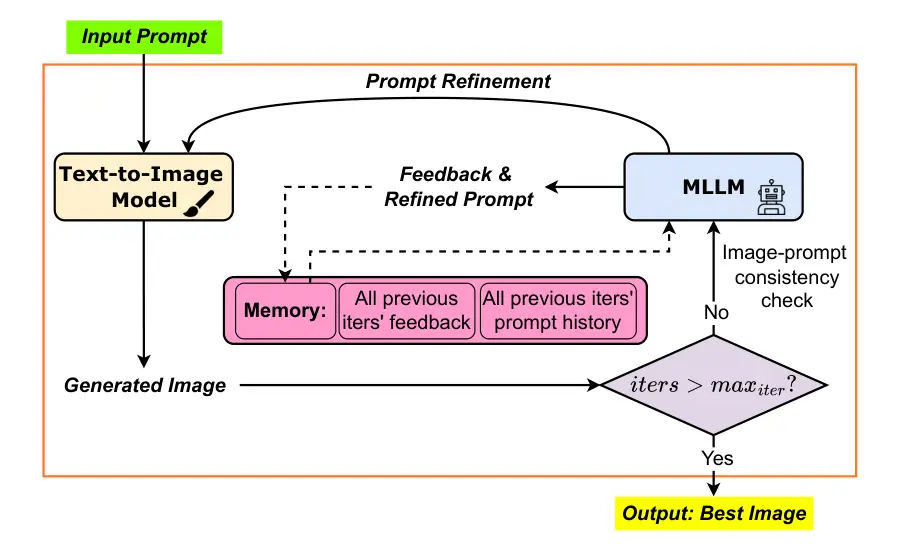
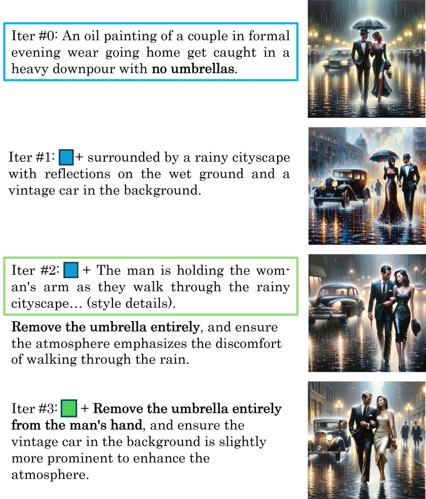
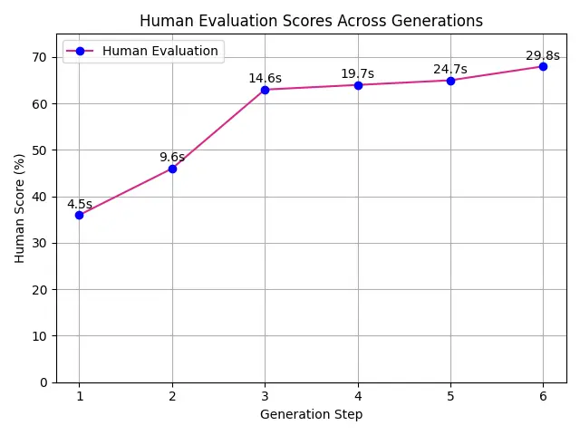
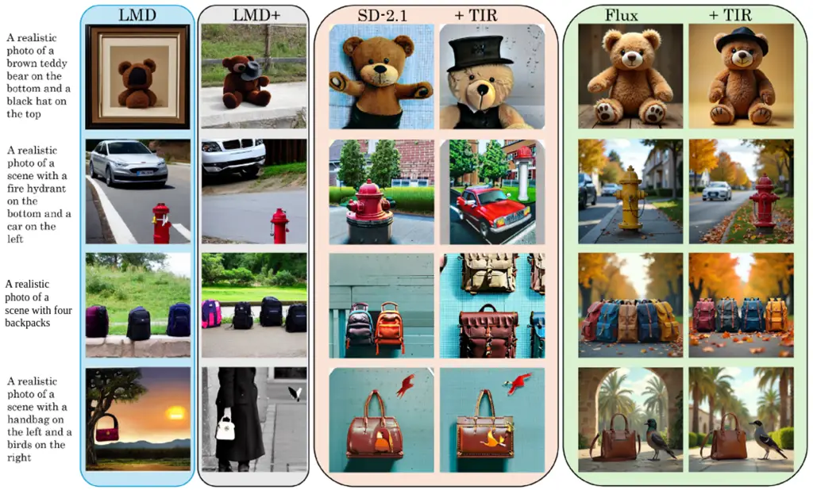
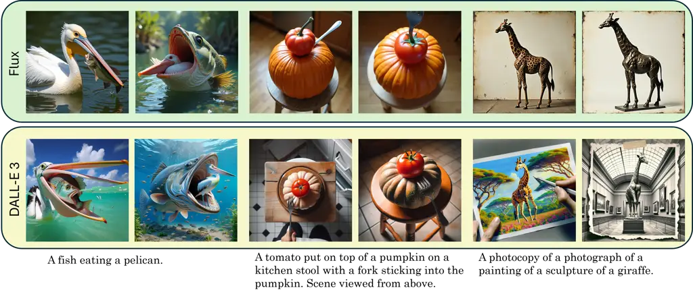
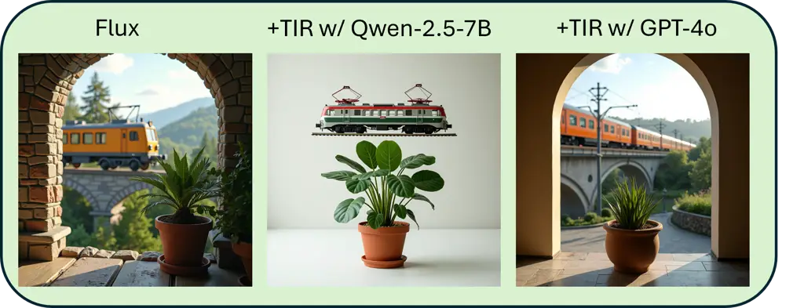
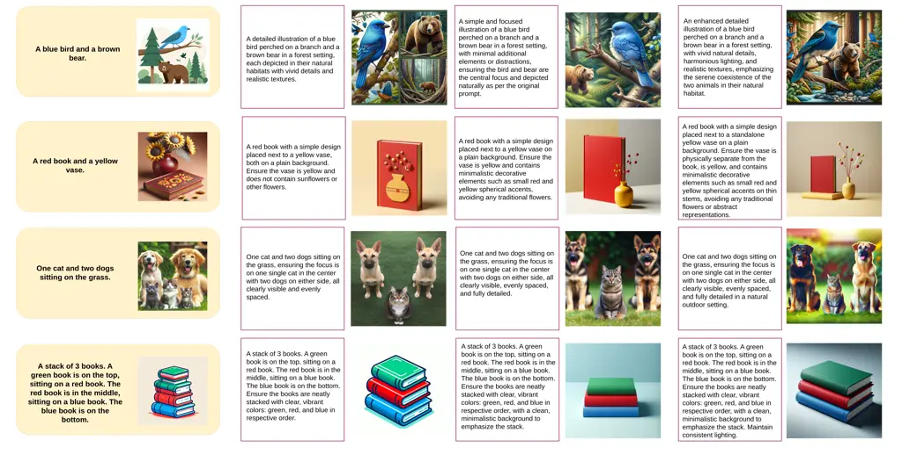
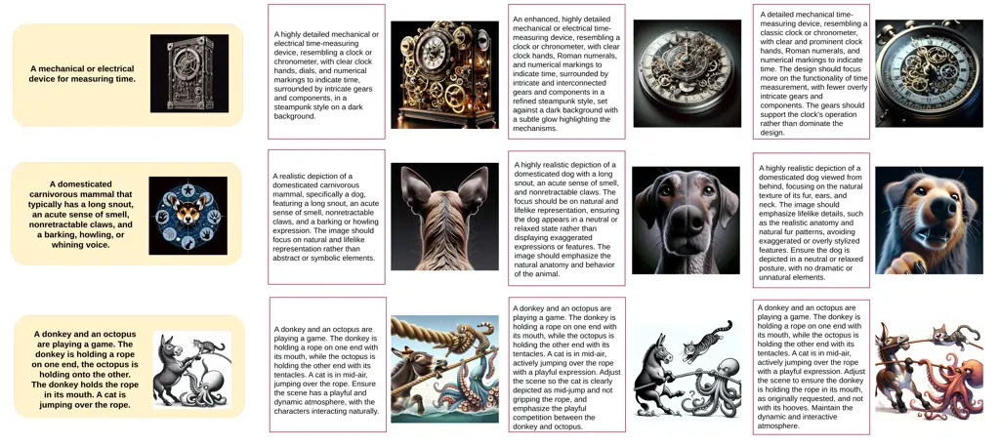

# Test-time Prompt Refinement for Text-to-Image Models

Mohammad Abdul Hafeez Khan¹¹ 1 \* Equal contribution. Corresponding
author: mkhan@my.fit.edu Affiliation: Florida Institute of Technology,
USA    Yash Jain¹¹ 1 \* Equal contribution. Corresponding author:
mkhan@my.fit.edu Affiliation: Microsoft Research, USA    Siddhartha
Bhattacharyya Affiliation: Florida Institute of Technology, USA   
Vibhav Vineet Affiliation: Microsoft Research, USA

###### Abstract

Text-to-image (T2I) generation models have made significant strides but
still struggle with prompt sensitivity: even minor changes in prompt
wording can yield inconsistent or inaccurate outputs. To address this
challenge, we introduce a closed-loop, test-time prompt refinement
framework that requires no additional training of the underlying T2I
model, termed TIR. In our approach, each generation step is followed by
a refinement step, where a pretrained multimodal large language model
(MLLM) analyzes the output image and the user’s prompt. The MLLM detects
misalignments (e.g., missing objects, incorrect attributes) and produces
a refined and physically grounded prompt for the next round of image
generation. By iteratively refining the prompt and verifying alignment
between the prompt and the image, TIR corrects errors, mirroring the
iterative refinement process of human artists. We demonstrate that this
closed-loop strategy improves alignment and visual coherence across
multiple benchmark datasets, all while maintaining plug-and-play
integration with black-box T2I models. Code is available at
[https://github.com/hafeezkhan909/Test-time-Image-Refinement](https://github.com/hafeezkhan909/Test-time-Image-Refinement).

![[Uncaptioned
image]](arxiv-2507-22076v2--6ad0f2a375bc.figures/figure-1.webp)

Figure 1: Effectiveness of the proposed Test-time Image Refinement (TIR)
approach in enhancing image generation quality. TIR iteratively refines
input prompts based on the generated images to more accurately reflect
the given text instructions. For each prompt, the left image shows the
original DALL-E 3 output, while the right image presents the refined
result produced by our approach (TIR), demonstrating improved content
control and better adherence to the specified prompt. Best viewed in
color.

## 1 Introduction

Text-to-image (T2I) models have enabled users to create high-quality
images from textual descriptions \[40, 37, 38, 39, 22\]. However, these
models often fail when prompts require compositional reasoning or
commonsense understanding. For instance, we observe that given the
prompt “a horse riding an astronaut”, a T2I model often generates an
astronaut riding a horse instead, as shown in Fig. 1, thereby reversing
the intended subject-object relationship. This occurs because the model
defaults to more statistically frequent or visually plausible
configurations learned during training, rather than faithfully
interpreting the prompt’s semantic structure. Such errors reflect a
broader inability to interpret uncommon spatial relations, especially
when they conflict with learned priors or require understanding of
syntactic cues, causal direction, or atypical physical dynamics.

This reveals a core limitation of current T2I systems: they operate in
an open-loop fashion and lack the ability to assess prompt plausibility
or self-correct errors after generation. Even advanced models like
DALL-E 3 \[5\], Stable Diffusion \[40\], and Flux \[22\] often produce
images that are photorealistic yet semantically incorrect. This is
especially evident in prompts involving spatial relationships, counting,
negation, or temporal logic, where adherence to the prompt breaks down
despite generating high-quality images.

These challenges indicate that T2I models struggle with the implicit
semantics of prompts unless such constraints are made explicit, which
better aligns with training-time prompt-image supervision based on
direct token-to-visual feature associations \[36, 37, 40\]. Existing
solutions such as fine-tuning \[23, 10\], post-hoc editing \[26, 46, 2,
15\], and prompt engineering offer partial solutions but come with
trade-offs. Training-based methods improve alignment but require costly,
model-specific adaptation; post-hoc corrections often distort scene
structure by editing images after generation; and prompt engineering
shifts the burden onto users to craft highly-specific, exhaustive
prompts.

A fundamental challenge remains: Can we enable T2I models to
self-correct misinterpretations iteratively, without additional
training?

As MLLMs like Qwen \[44, 49\] and GPT-4o \[16\] continue to advance in
multimodal reasoning, their understanding of text and images makes them
well-suited to provide semantic feedback on the alignment between
prompts and generated images. Leveraging this capability, we introduce
Test-time Image Refinement (TIR), a closed-loop framework, illustrated
in Fig. 2. Instead of treating T2I generation as a one-shot process, TIR
uses an MLLM in each iteration to assess misalignments between the
user’s intent and the generated image, focusing on semantic reasoning
failures such as spatial errors, attribute mismatches, incorrect object
counts, etc. It then produces a refined prompt that explicitly corrects
these issues while preserving contextual history from prior refinements.
This history-aware feedback loop enables the T2I model to progressively
converge toward the intended scene, without relying on handcrafted
prompts, scene layouts, or bounding-box supervision.

TIR requires no additional training or architectural modifications.
Instead, it treats test-time compute as a resource and integrates
seamlessly with off-the-shelf T2I models such as Stable
Diffusion \[40\], DALL-E 3 \[5\], and Flux \[22\], making it a flexible,
plug-and-play solution for improving prompt adherence. Our key
contributions are as follows:

- •
  MLLM-driven Test-time Refinement: We introduce an iterative refinement
  framework to improve prompt-image alignment without modifying the T2I
  model.
- •
  Training-Free, Plug-and-Play Adaptability: Our method requires no
  fine-tuning and is compatible with black-box APIs, making it
  applicable to any pretrained T2I model.
- •
  Empirical Validation: We validate our method across multiple datasets
  and T2I models, showing that TIR improves semantic fidelity, enables
  reasoning capabilities at test time and, in the future, it may help
  construct reasoning benchmarks for generative models.

Overall, our work bridges the gap between the generative strength of T2I
models and the need for adaptive, self-correcting systems. By leveraging
MLLM-guided refinement at test time, we enable models to iteratively
improve semantic alignment, mimicking the way human artists refine their
work through feedback.



Figure 2: Test-time prompt refinement for Text-to-Image Models (TIR).
Starting from a user-provided input prompt, we generate an image using a
text-to-image model. A Multi-modal Large Language Model (MLLM) evaluates
the consistency between the output image and the prompt, and refines the
prompt based on feedback. We retain all previous prompts and feedback in
memory to ground the image generation in the input instructions and
iteratively improve the output. We repeat this cycle for a fixed number
of iterations, progressively refining the prompt and generating an image
that best aligns with the original user intent.

## 2 Literature Review

### 2.1 Text-to-Image (T2I) Models

Text-to-image generation has evolved from GAN-based models \[39, 52, 55,
43\] to transformer-based architectures \[8, 9, 38\] and diffusion-based
models \[37, 33, 40, 41\], significantly improving generation quality
and text fidelity. However, T2I models still struggle with compositional
reasoning and prompt adherence, failing to capture fine-grained spatial
relationships, attribute details, and multi-object interactions \[3,
31\].

To improve controllability, researchers have explored structured
conditioning signals such as keypoints, bounding boxes, scene graphs,
and other domain-specific representations \[6, 25, 32, 18, 50, 19, 51,
17, 53\]. While effective, these methods rely on external annotations
that may not always be available. Training-free alternatives leverage
pretrained LLMs for layout generation and spatial reasoning \[12, 26,
35\]. However, these approaches assume that once a layout is specified,
the T2I model will faithfully follow it, overlooking potential
deviations during generation. Furthermore, their latent pasting approach
struggles with occlusions, and disrupts the diffusion denoising process,
as the pasted noise does not align with the model’s learned score
function. This misalignment introduces inconsistencies in image quality,
making it difficult to maintain high fidelity throughout the entire
generation.

### 2.2 LLM-Driven Vision-Language Approaches

##### Vision-Language Grounding

LLMs have shown strong reasoning capabilities in vision-language tasks
such as image captioning and VQA \[24, 1\]. Early approaches relied on
CLIP-based embeddings \[36\], but recent methods \[45, 20\] explore
LLM-guided prompt generation for text-conditioned image synthesis.
However, they still operate in a single-pass manner, where the LLM
provides an initial prompt but does not iteratively refine it based on
the generated image.

##### LLM-Guided T2I Refinement

Recent works have incorporated LLMs into T2I pipelines to improve
semantic fidelity and compositional accuracy \[13, 27, 54\]. Some
methods use LLMs for spatial reasoning \[35, 12\], but these rely on
static layouts that do not dynamically adjust based on the generated
image. Others explore iterative feedback loops where an LLM evaluates
and refines outputs post-generation \[46, 21, 34\], but these approaches
often struggle with maintaining visual coherence across multiple edits.

For instance, Li et al. \[26\] propose a layout-first approach where an
LLM generates a structured scene layout before synthesis. However, their
method does not reassess alignment after generation, leading to
potential misalignments that persist throughout the denoising process.
Wu et al. \[46\] introduce an iterative feedback mechanism where an LLM
refines images after they are fully generated, but their latent-space
corrections disrupt the coherence of the denoising process, resulting in
artifacts and inconsistencies.

Unlike prior LLM-guided generation methods, which rely on scene layouts,
masks, or supervised conditioning during training, our framework
operates at test time and requires no intermediate representations.

## 3 Problem Statement

Given an input text prompt $`\mathbf{c}`$, the goal of a text-to-image
(T2I) model is to generate an image $`\mathbf{x}`$ that faithfully
reflects the semantic intent of $`\mathbf{c}`$. In practice, however,
the generated image often fails to capture important aspects of the
prompt, particularly when $`\mathbf{c}`$ is under-specified, ambiguous,
or reliant on implicit world knowledge. Rewriting such prompts to make
spatial relationships, object attributes, or stylistic constraints
explicit can substantially improve generation quality \[29\]. This
implies that while T2I models are capable of mapping clear textual
descriptions to visual outputs, they often struggle with compositional
reasoning, object interactions, and fine-grained semantic alignment.
These failures highlight a fundamental challenge: the generation process
is sensitive to how explicitly the prompt encodes the intended scene,
and current models lack mechanisms to infer or correct missing semantics
during inference.

## 4 Test-time Image Refinement (TIR)

To address the limitations of static prompting, we propose TIR, a
test-time refinement framework that leverages Multi-modal Large Language
Models (MLLMs) to iteratively assess and improve prompt-image alignment.
Rather than conditioning on a fixed input, TIR dynamically refines the
prompt based on structured feedback from the MLLM, enabling progressive
alignment across multiple iterations.

The core of TIR is a closed-loop refinement process that alternates
between Consistency Analysis and Prompt Refinement. At each step, the
MLLM evaluates the semantic consistency between the generated image and
the intended prompt, identifying reasoning failures such as incorrect
object counts, spatial misplacements, or missing attributes. Using this
feedback, the MLLM rewrites the prompt to make implicit semantics
explicit, resolve ambiguities, and preserve previously correct elements.
The refinement is mainly conditioned on the original prompt, the current
image, and the history of prior refinements, enabling context-aware
corrections that accumulate over iterations. The complete pipeline is
presented in Algorithm 1.



Figure 3: Illustrative example of TIR. Each row represents a different
iteration of our approach. The first row shows the initial input prompt
alongside its generated image. In subsequent rows, the left column
presents progressively refined prompts, while the right column shows the
corresponding images generated from these refined prompts. Notice how
the condition of the umbrella evolves with each refinement. For
instance, in the third image, the man holds a small umbrella artifact,
which is explicitly addressed in the final image. The colored boxes
denote the prompt in the previous iteration. Best viewed in color.

### 4.1 Iterative Prompt-Image Alignment via MLLMs

We begin with a T2I model, parameterized by $`\theta`$, which generates
an image $`\mathbf{x}`$ given a text prompt $`\mathbf{c}`$, expressed
as:

```math
\mathbf{x}=\mathcal{G}_{\theta}(\mathbf{c}), \tag{1}
```

where $`\mathcal{G}_{\theta}`$ represents the generative model
responsible for producing the image. The first generation step is
performed using the original user-provided prompt $`\mathbf{c}_{0}`$,
producing an initial image $`\mathbf{x}_{0}`$:

```math
\mathbf{x}_{0}=\mathcal{G}_{\theta}(\mathbf{c}_{0}). \tag{2}
```

This initial output serves as the starting point for an iterative
refinement process. We define a function $`\mathcal{F}_{\text{MLLM}}`$,
which at iteration $`i`$, takes as input the sequence of prior prompts
$`\{\mathbf{c}_{i-1},\dots,\mathbf{c}_{0}\}`$, the corresponding
feedback history $`\{\mathbf{f}_{i-1},\dots,\mathbf{f}_{1}\}`$, and the
last generated image $`\mathbf{x}_{i-1}`$. The refinement process is
formulated as:

```math
\mathbf{c}_{i},\mathbf{f}_{i}=\mathcal{F}_{\text{MLLM}}(\mathbf{x}_{i-1},\{\mathbf{c}_{i-1},\dots,\mathbf{c}_{0}\},\{\mathbf{f}_{i-1},\dots,\mathbf{f}_{1}\}). \tag{3}
```

Here, $`\mathcal{F}_{\text{MLLM}}`$ first performs prompt-image
consistency analysis by evaluating the semantic and structural
correctness of $`\mathbf{x}_{i-1}`$ with respect to the last prompt
$`\mathbf{c}_{i-1}`$, prior refinements, and the accumulated feedback.
It identifies issues such as missing objects, incorrect spatial
arrangements, attribute mismatches, etc. Based on this feedback
$`\mathbf{f}_{i}`$, it generates a refined prompt $`\mathbf{c}_{i}`$
that corrects errors, improves specificity and enhances compositional
alignment while preserving fidelity to the original user intent.

The T2I model then regenerates a new image using the updated prompt:

```math
\mathbf{x}_{i}=\mathcal{G}_{\theta}(\mathbf{c}_{i}). \tag{4}
```

By iteratively refining the prompt using both the refinement history and
the last generated image, the MLLM progressively enforces semantic
constraints, making the prompt more explicit and reducing ambiguity. The
refinement history serves two purposes: it ensures continuity by
retaining valid information from previous iterations, and it helps avoid
oscillatory or conflicting corrections. Meanwhile, the last generated
image provides direct visual feedback, enabling the MLLM to reason about
persistent generation errors and dynamically adjust the prompt based on
how the T2I model has interpreted earlier refinements. This history- and
context-aware mechanism supports convergence toward semantically
accurate and visually grounded generations. Fig. 2 provides a visual
representation of TIR.

Since T2I models are highly sensitive to the conditioning prompt,
progressively refining the prompt helps reduce semantic ambiguity,
mitigate mode collapse, and improve adherence to object attributes,
spatial arrangements, and fine-grained details. Consequently, the
generated image iteratively improves in visual fidelity and alignment
with the user’s intent, while integrating refinements accumulated over
previous iterations, as shown in Fig. 3.

The full iterative refinement process is described in Algorithm 1.

1: $`\mathbf{c}_{0}`$, T2I model $`\mathcal{G}_{\theta}`$, MLLM
refinement function $`\mathcal{F}_{\text{MLLM}}`$, max iterations $`K`$

2: Generate initial image:
$`\mathbf{x}_{0}=\mathcal{G}_{\theta}(\mathbf{c}_{0})`$

3: Initialize prompt history: $`\mathcal{C}\leftarrow[\mathbf{c}_{0}]`$

4: Initialize feedback history: $`\mathcal{F}\leftarrow[\ ]`$

5: for $`i=1`$ to $`K`$ do

6:
   $`\mathbf{c}_{i},\mathbf{f}_{i}=\mathcal{F}_{\text{MLLM}}(\mathbf{x}_{i-1},\mathcal{C},\mathcal{F})`$

7:    Append $`\mathbf{c}_{i}`$ to $`\mathcal{C}`$, $`\mathbf{f}_{i}`$
to $`\mathcal{F}`$

8:    Generate image:
$`\mathbf{x}_{i}=\mathcal{G}_{\theta}(\mathbf{c}_{i})`$

9: end for

10: return $`\mathbf{x}_{K}`$ $`\triangleright`$ Final generated image

Algorithm 1 Test-time Image Refinement (TIR)

## 5 Experimental Setup

### 5.1 Datasets and Evaluation Metrics

To evaluate Test-time Image Refinement (TIR), we use three benchmark
datasets, assessing compositional accuracy, prompt comprehension, and
complex prompts generalization. Each dataset uses predefined evaluation
metrics.

##### GENEVAL \[14\] (Compositional Accuracy)

GENEVAL consists of 553 prompts designed to assess fine-grained
compositional correctness in text-to-image models. These include object
presence, numerical accuracy, spatial relations, and attribute
alignment. We evaluate performance using the following: (i) Object
presence and counting, using Mask2Former \[7\] with a confidence
threshold of 0.9 to minimize false positives; (ii) Spatial correctness,
determined by comparing centroid positions of detected objects; (iii)
Attribute correctness, assessed via zero-shot classification with CLIP
ViT-L/14 \[36\]. Final scores are aggregated across tasks and prompts.

##### LLM-Grounded Benchmark (Prompt Comprehension)

Following \[26\], we generate 320 structured prompts covering four key
aspects: 1) Negation (to evaluate whether absent objects remain absent), 2) Numerical reasoning (to evaluate correct object counts), 3) Attribute
binding (to evaluate correct object-attribute assignments), 4) Spatial
reasoning (to evaluate correct object positioning). Our evaluation tests
whether TIR improves model adherence to these constraints. We use
OWL-ViT \[30\] for object detection, bounding box analysis for spatial
evaluation, and compute accuracy for each reasoning task.

##### DrawBench \[42\] (Generalization to Open-Ended Prompts)

DrawBench includes prompts with rare attributes, ambiguous phrasing, and
complex styles to test generalization to open-ended generation.
Evaluation is based on perceptual quality and prompt adherence. We
report scores using ImageReward \[48\], a learned metric based on human
preferences, and conduct human evaluation to assess prompt-image
consistency.

### 5.2 Implementation Details

We evaluated our method on three types of T2I models (a) Diffusion
Models - Stable-Diffusion-1.5 and 2.1 \[40\], (b) Rectified-Flow
Transformer - Flux.1-dev \[22\], and (c) closed-source APIs - DALL-E
3 \[5\]. Throughout the paper, we kept the denoising steps 100 for
diffusion models and 50 for rectified-flow models. We maintained default
hyper-parameters for guidance and other model-specific settings. All the
models were queried with the same generator seed for reproducibility.
For MLLMs, we used GPT-4o as the consistency checker and prompt refiner
until otherwise mentioned. The MLLM instruction prompt is shown in
Fig. 5.

After initial generation, the cycle of generation $`\rightarrow`$
assessment $`\rightarrow`$ refinement $`\rightarrow`$ regeneration is
repeated for a fixed number of $`K=3`$ iterations. Empirical analysis
showed three iterations provide the best balance between refinement
effectiveness and computational cost (see Fig. 4). We evaluated 200
DrawBench prompts with two human annotators (Cohen’s $`K=0.78`$),
scoring each image as 1 for perfect alignment with the prompt, and 0
otherwise. Increasing refinements beyond $`K=3`$ resulted in only
marginal improvements while increasing inference time.



Figure 4: Human evaluation on DrawBench for $`K=1`$ to $`6`$ shows
$`K=3`$ balances quality and cost. Best viewed in zoom.

You are an Image Improvement Assistant. Your job is to help make the
image more aligned with the ORIGINAL prompt.

### Given Inputs:

1.  Original User Prompt: • {original_prompt} 2. History of Prompt
    Refinements and Feedback: • {history_text} 3. Current Image Analysis: •
    Look at the image and identify what aspects DIFFER from what the
    ORIGINAL prompt requested. • Analyze what essential elements from the
    ORIGINAL prompt are missing or incorrectly represented.

### Your Task:

1.  Create a NEW PROMPT that will help generate an image that better
    matches the ORIGINAL prompt. 2. Focus on fixing what’s missing or
    incorrectly represented in the current image 3. Incorporate suitable
    elements from prompt history into the NEW PROMPT. 4. The goal is to get
    progressively closer to fulfilling the ORIGINAL prompt.

### Output:

REFINED PROMPT: "\<A detailed and enhanced version of the last prompt
that improves alignment\>"

Figure 5: Refinement prompt provided to the MLLM.

## 6 Results



Figure 6: Qualitative comparison of TIR against the LMD and LMD+
baselines on prompts from the LLM‐Grounded Diffusion Benchmark. Each
column corresponds to one method’s outputs for the same input prompt.
Although LMD and LMD+ are tuned for this benchmark, TIR consistently
produces more accurate images aligned with the given prompts. In the
final row, where the baseline already meets the prompt requirements, TIR
preserves correctness without introducing any regression.



Figure 7: Qualitative results of TIR on open-ended prompts from
DrawBench. Images on the left are from base model while the right image
is after TIR refinement. Even stronger T2I models struggle to
disentangle semantic components in complex prompts, TIR extracts
capabilities of these models by refining prompts into simpler sections
while retaining the original instruction, giving desired outputs.

|                           |          |          |           |         |               |
| ------------------------- | -------- | -------- | --------- | ------- | ------------- |
| Method                    | Negation | Numeracy | Attribute | Spatial | Average       |
| MultiDiffusion \[4\]      | 29.0     | 28.0     | 26.0      | 39.0    | 30.5          |
| Backward Guidance \[6\]   | 22.0     | 37.0     | 26.0      | 67.0    | 38.0          |
| BoxDiff \[47\]            | 22.0     | 30.0     | 37.0      | 71.0    | 40.0          |
| LayoutGPT + GLIGEN \[11\] | 36.0     | 65.0     | 26.0      | 78.0    | 51.3          |
| LMD \[26\]                | 100.0    | 40.0     | 50.5      | 38.7    | 57.3          |
| LMD+ \[26\]               | 100.0    | 50.9     | 63.5      | 42.0    | 64.1          |
| SD-1.5 \[40\]             | 35.0     | 40.0     | 42.0      | 38.0    | 38.75         |
| w/ TIR                    | 80.0     | 51.7     | 30.0      | 54.5    | 54.0 (+15.25) |
| SD-2.1 \[40\]             | 45.0     | 50.6     | 18.0      | 44.5    | 39.5          |
| w/ TIR                    | 85.0     | 56.0     | 18.0      | 43.0    | 50.5 (+11.0)  |
| Flux \[22\]               | 10.0     | 52.2     | 83.0      | 81.5    | 56.7          |
| w/ TIR                    | 55.0     | 64.7     | 81.8      | 77.0    | 69.6 (+12.9)  |
| DALL-E 3 \[5\]            | 31.6     | 44.5     | 73.0      | 81.0    | 57.5          |
| w/ TIR                    | 73.7     | 49.2     | 71.0      | 83.0    | 69.2 (+11.7)  |

Table 1: Comparison of training-free image tuning methods on
LLM-Grounded Diffusion Benchmark. We observe consistent improvements
with TIR applied on various T2I models. Further, the gains are more
substantial in spatial and numeracy tasks, compared to color attribution
which is consistent to our observation on GENEVAL benchmark. Note that,
LMD+ \[26\] and GLIGEN \[11\] use a specialized bbox (layout) tuned
diffusion model.

| Model          | Position | Counting | Single Obj. | Two Object | Color Attr | Colors | Overall Score |
| -------------- | -------- | -------- | ----------- | ---------- | ---------- | ------ | ------------- |
| Flux \[22\]    | 19.00    | 68.75    | 100.00      | 75.76      | 48.00      | 77.66  | 64.86         |
| w/ TIR         | 49.00    | 71.25    | 98.75       | 80.81      | 47.00      | 80.85  | 71.27 (+6.41) |
| DALL-E 3 \[5\] | 34.00    | 48.75    | 96.25       | 77.78      | 31.00      | 74.47  | 60.37         |
| w/ TIR         | 45.00    | 60.00    | 96.25       | 82.83      | 38.00      | 86.17  | 68.04 (+7.67) |

Table 2: Performance on GENEVAL benchmark. Here we present accuracies
across six fine-grained categories, along with overall scores. Across
all categories, integrating TIR leads to the largest improvement in
spatial positioning and counting tasks, while single‐object prompts
remain highly accurate even without TIR. In more complex cases requiring
multiple objects and color understanding, TIR delivers consistent gains
for stronger T2I models. Overall, all T2I models experience a
substantial increase in their overall scores.

##### Qualitative results.

Fig. 6 presents a visual comparison against baselines on LLM-grounded
diffusion benchmark prompts. In general, base models struggle to capture
the compositional nature of the prompt. Baselines \[26, 35\] fail to
maintain image quality due to their reliance on intermediate noisy
latent pasting, a limitation inherent to diffusion-based methods. TIR
enhances T2I model capabilities by breaking down complex compositional
attributes into structured semantic components, allowing the model to
better capture fine-grained details and spatial relationships. As a
result, TIR generates images with higher fidelity, improved clarity, and
stronger alignment with the given prompt.

In Fig. 7, we showcase the capabilities of TIR on more powerful models.
As the prompt becomes more structured and semantically meaningful, a
model with a robust language backbone is able to more effectively
leverage the decomposed semantic components, thereby synthesizing images
that not only exhibit enhanced visual quality but also preserve
intricate compositional details. This synergy between the refined
semantic understanding and image generation leads to outputs that are
both visually compelling and semantically coherent, further highlighting
the efficacy and scalability of our approach. More qualitative images
are provided in the supplementary material, showing full trajectories of
prompt refinement and generation.

##### Comparison of training-free image tuning methods on LLM-Grounded Diffusion Benchmark.

In Table 1, we demonstrate that our method improves control on image
generation across different models. We verify that TIR works on
different types of image generation models, irrespective of their (a)
backbone architecture - U-Net  \[40\] or DiT \[5\]; (b) generative
modeling - diffusion \[40\] or rectified-flow based \[22\]; and (c)
access type - open-sourced \[40, 22\] or close-sourced \[5\]. Further,
we have observed the largest gains of TIR in the Negation and Numeracy
tasks. We attribute this distinction to the ability of the base image
generation model and their ability to understand detailed prompts. As
models evolve, their ability to process semantically equivalent yet more
detailed prompts improves, as reflected in the higher average scores
achieved with TIR by Flux and DALL-E 3 compared to previous-generation
Stable Diffusion models. Finally, we observe that TIR outperforms
training-free baselines \[4, 6, 47, 26\]. Although LMD+ achieves high
accuracy, it is not a direct comparison, as it uses GLIGEN \[25\], which
is a fine-tuned diffusion model to take grounded bounding boxes as
input.

Figure 8: Evaluation on Drawbench dataset. We compare normalized
ImageReward \[48\] score on DALL-E 3 model and observe consistent
improvement over multiple tries. The error bars show the std dev. over
five runs. Further, we also performed human evaluation for prompt-image
correctness on Drawbench due to the open-ended nature of its prompt and
display substantial gains.

##### Comparison on GENEVAL benchmark.

We evaluate fine-grained compositional control achieved by TIR in
Table 2. We observe consistent improvements with TIR in both Flux.1-dev
\[22\] and DALL-E 3 \[5\] models across all categories. These results
corroborate our finding that the performance of TIR is enhanced by
stronger base diffusion models. In addition, we show an increase in
quantitative performance in all composition categories, showcasing the
strength of TIR in image generation.

| Model                        | Position | Counting | Single Obj. | Two Object | Color Attr | Colors | Overall Score |
| ---------------------------- | -------- | -------- | ----------- | ---------- | ---------- | ------ | ------------- |
| Flux \[22\]                  | 19.00    | 68.75    | 100.00      | 75.76      | 48.00      | 77.66  | 64.86         |
| w/ TIR( Qwen-$`2.5`$-$`7`$B) | 29.00    | 67.50    | 98.75       | 86.87      | 44.00      | 81.91  | 68.01 (+3.15) |

Table 3: Comparison against different MLLMs. We evaluated GENEVAL
benchmark with Qwen-$`2.5`$-$`7`$B as prompt-image checker. Coupled with
Flux results on GPT-4o from Tab. 2, we show steady gains with another
MLLM. Interestingly, we observe similar trends between the two MLLMs,
indicating certain biases in the base T2I model.

##### Evaluation on Drawbench.

Evaluating image quality in a compositional setting is a challenging
task. Following \[28\], we evaluated _ImageReward_ metrics on DrawBench
against DALL-E 3 model with GPT-4o as prompt refiner. _ImageReward_
possess more nuanced evaluative aspects, capturing _Aesthetic Score_ and
_CLIPScore_ and closely align with human preferences, making it suitable
for image quality evaluation metric \[28\]. Fig. 8 shows the increase in
image quality with TIR. To show consistent gains, we sample five images
for each prompt and report the mean and standard deviation in the score.
We also performed human-evaluation to verify prompt-image correctness on
Drawbench. Human annotators gave a score of $`1`$ if the image is
perfectly aligned to the prompt and $`0`$ otherwise. Fig. 8 highlights
TIR results in prompt-image correctness. We report a $`25`$% higher
alignment towards the prompt compared to the vanilla model and a
$`4.5`$% gain in _ImageReward_ score.



Figure 9: Qualitative comparison with different MLLMs. Input prompt - a
photo of a train above a potted plant. While Qwen-$`2.5`$-$`7`$B
produces a semantically correct output, GPT-4o optimizes the prompt to
produce a more natural image.

##### Comparison against different MLLMs.

We evaluate the effectiveness of TIR refinement across different MLLMs.
Specifically, we use the Qwen-$`2.5`$-$`7`$B MLLM \[44, 49\] and test it
on the GENEVAL benchmark \[14\] with Flux.1-dev \[22\] as the image
generator. Table 3 demonstrates consistent improvements with TIR when
using Qwen-$`2.5`$-$`7`$B as the refinement MLLM. It highlights the
versatility of TIR and its wider applicability with different MLLMs. In
Fig. 9, we show visually how different MLLMs result in stark outcomes.
While Qwen-$`2.5`$-$`7`$B provided a semantically correct prompt for the
input - a photo of a train above a potted plant, GPT-4o refined the
prompt to produce a more natural image. Interestingly, comparing with
Flux + GPT-4o performance reported in Table 2 aligns with our intuition
that stronger MLLMs refine complex prompts more easily, resulting in
better control in generated images. Further, _Color Attr._ does not
experience improvement with either MLLMs which suggests that the base
T2I model (Flux) has a limitation in identifying correct color
attributions. Perhaps, TIR could be a way of identifying bias in
text-to-image models. We leave this exploration for future works.

## 7 Limitations

Although TIR is model agnostic and applies to all T2I models, it does
have certain limitations. Firstly, TIR relies on the strong language
backbone of a T2I model. T2I Models with limited semantic understanding
or poor comprehension of complex prompts may show minimal improvement.
In contrast, a stronger language backbone observes substantial
prompt-image alignment as observed with DALL-E 3. We believe that with
the evolution of T2I models the applicability of TIR would only
increase. Secondly, it is possible that there is a misalignment between
the vocabulary of the T2I model and the prompt refiner MLLM. A
semantically preserving refined prompt might not bring any change in the
output of the T2I model if its vocabulary distribution differs from that
of the MLLM (see Fig. 10 (a), (b)). However, we believe that with
sufficient refinement steps such a gap could be overcome. Moreover, the
MLLM itself may sometimes introduce flawed refinements when it
incorrectly identifies an issue in a generated image. These errors can
persist over iterations, leading to attribute regressions or unintended
style dominance, as illustrated in Fig. 10 (c). Perhaps, a better
refinement strategy can overcome this, and we implore the community to
explore this direction.

Figure 10: Failure cases using DALL-E 3 as the T2I model and
Qwen-$`2.5`$-$`7`$B as the MLLM. (a): Demonstrates a semantic
misalignment between the intended object interaction and the generated
outputs. Across iterations, the T2I model fails to depict the red
elephant physically sitting on the blue mouse. (b): Reveals a
vocabulary–distribution mismatch, where the crimson banana and black
apple remain consistent in form but the T2I model struggles to enforce
the intended left-right layout, resulting instead in a split view
composition in the final image. (c): Shows an attribute regression,
where a matte black pineapple shifts to teal in later iterations and the
unintended teal tone also appears in surrounding elements, indicating
overfitting to dominant visual styles.

## 8 Conclusion

We addressed the sensitivity of foundational T2I generation models to
minor prompt variations, which often results in misaligned and
inconsistent image outputs. Since manual prompt modifications are costly
and impractical at scale, we introduced a test-time prompt refinement
framework that iteratively improves prompts using an MLLM. Our approach
enhances alignment and visual coherence without altering the underlying
T2I model, leading to both quantitative and qualitative improvements
across multiple benchmarks.

## References

- \[1\] J. Alayrac, J. Donahue, P. Luc, A. Miech, I. Barr, Y. Hasson, K.
  Lenc, A. Mensch, K. Millican, M. Reynolds, et al. (2022) Flamingo: a
  visual language model for few-shot learning. Advances in neural
  information processing systems 35, pp. 23716–23736. Cited by: §2.2.
- \[2\] O. Avrahami, O. Fried, and D. Lischinski (2023) Blended latent
  diffusion. ACM Transactions on Graphics (Proc. SIGGRAPH) 42 (4). Cited
  by: §1.
- \[3\] Y. Balaji, S. Nah, X. Huang, A. Vahdat, J. Song, Q. Zhang, K.
  Kreis, M. Aittala, T. Aila, S. Laine, et al. (2022) Ediff-i:
  text-to-image diffusion models with an ensemble of expert denoisers.
  arXiv preprint arXiv:2211.01324. Cited by: §2.1.
- \[4\] O. Bar-Tal, L. Yariv, Y. Lipman, and T. Dekel (2023)
  Multidiffusion: fusing diffusion paths for controlled image
  generation. Cited by: §6, Table 1.
- \[5\] J. Betker, G. Goh, L. Jing, T. Brooks, J. Wang, L. Li, L.
  Ouyang, J. Zhuang, J. Lee, Y. Guo, et al. (2023) Improving image
  generation with better captions. Computer Science. https://cdn.
  openai. com/papers/dall-e-3. pdf 2 (3), pp. 8. Cited by: §1, §1, §5.2,
  §6, §6, Table 1, Table 2.
- \[6\] M. Chen, I. Laina, and A. Vedaldi (2024) Training-free layout
  control with cross-attention guidance. In Proceedings of the IEEE/CVF
  winter conference on applications of computer vision, pp. 5343–5353.
  Cited by: §2.1, §6, Table 1.
- \[7\] B. Cheng, I. Misra, A. G. Schwing, A. Kirillov, and R.
  Girdhar (2022) Masked-attention mask transformer for universal image
  segmentation. In Proceedings of the IEEE/CVF conference on computer
  vision and pattern recognition, pp. 1290–1299. Cited by: §5.1.
- \[8\] M. Ding, Z. Yang, W. Hong, W. Zheng, C. Zhou, D. Yin, J. Lin, X.
  Zou, Z. Shao, H. Yang, et al. (2021) Cogview: mastering text-to-image
  generation via transformers. Advances in neural information processing
  systems 34, pp. 19822–19835. Cited by: §2.1.
- \[9\] P. Esser, R. Rombach, and B. Ommer (2021) Taming transformers
  for high-resolution image synthesis. In Proceedings of the IEEE/CVF
  conference on computer vision and pattern recognition,
  pp. 12873–12883. Cited by: §2.1.
- \[10\] Y. Fan, O. Watkins, Y. Du, H. Liu, M. Ryu, C. Boutilier, P.
  Abbeel, M. Ghavamzadeh, K. Lee, and K. Lee (2023) DPOK: reinforcement
  learning for fine-tuning text-to-image diffusion models. In Advances
  in Neural Information Processing Systems (NeurIPS), Cited by: §1.
- \[11\] W. Feng, W. Zhu, T. Fu, V. Jampani, A. Akula, X. He, S.
  Basu, X. E. Wang, and W. Y. Wang (2023) Layoutgpt: compositional
  visual planning and generation with large language models. Advances in
  Neural Information Processing Systems 36, pp. 18225–18250. Cited by:
  Table 1, Table 1, Table 1.
- \[12\] W. Feng, W. Zhu, T. Fu, V. Jampani, A. Akula, X. He, S.
  Basu, X. E. Wang, and W. Y. Wang (2024) Layoutgpt: compositional
  visual planning and generation with large language models. Advances in
  Neural Information Processing Systems 36. Cited by: §2.1, §2.2.
- \[13\] H. Gani, S. F. Bhat, M. Naseer, S. Khan, and P. Wonka (2023)
  Llm blueprint: enabling text-to-image generation with complex and
  detailed prompts. arXiv preprint arXiv:2310.10640. Cited by: §2.2.
- \[14\] D. Ghosh, H. Hajishirzi, and L. Schmidt (2023) Geneval: an
  object-focused framework for evaluating text-to-image alignment.
  Advances in Neural Information Processing Systems 36, pp. 52132–52152.
  Cited by: §5.1, §6.
- \[15\] A. Hertz, R. Mokady, J. Tenenbaum, K. Aberman, Y. Pritch,
  and D. Cohen-Or (2022) Prompt-to-prompt image editing with cross
  attention control. arXiv preprint arXiv:2208.01626. Cited by: §1.
- \[16\] A. Hurst, A. Lerer, A. P. Goucher, A. Perelman, A. Ramesh, A.
  Clark, A. Ostrow, A. Welihinda, A. Hayes, A. Radford, et al. (2024)
  Gpt-4o system card. arXiv preprint arXiv:2410.21276. Cited by: §1.
- \[17\] M. Khan, S. Boddepalli, S. Bhattacharyya, and D. Mitra (2024)
  Few-shot classification and anatomical localization of tissues in
  spect imaging. In 2024 IEEE Nuclear Science Symposium (NSS), Medical
  Imaging Conference (MIC) and Room Temperature Semiconductor Detector
  Conference (RTSD), pp. 1–1. Cited by: §2.1.
- \[18\] M. A. H. Khan, P. Ganeriwala, S. Bhattacharyya, N. Neogi,
  and R. Muthalagu (2024) Alina: advanced line identification and
  notation algorithm. In 2024 IEEE/CVF Conference on Computer Vision and
  Pattern Recognition Workshops (CVPRW), pp. 7293–7302. Cited by: §2.1.
- \[19\] M. A. H. Khan, H. Sabnis, J. A. A. Jothi, J. Kanishkha,
  and A. D. Prasad (2022) Classification of microstructure images of
  metals using transfer learning. In International Conference on
  Modelling and Development of Intelligent Systems, pp. 136–147. Cited
  by: §2.1.
- \[20\] J. Y. Koh, D. Fried, and R. R. Salakhutdinov (2024) Generating
  images with multimodal language models. Advances in Neural Information
  Processing Systems 36. Cited by: §2.2.
- \[21\] S. Kwon, T. Lee, and T. Kim (2024) Zero-shot text-guided
  infinite image synthesis with llm guidance. arXiv preprint
  arXiv:2407.12642. Cited by: §2.2.
- \[22\] B. F. Labs (2024) FLUX. Note:
  [https://github.com/black-forest-labs/flux](https://github.com/black-forest-labs/flux)
  Cited by: §1, §1, §1, §5.2, §6, §6, §6, Table 1, Table 2, Table 3.
- \[23\] K. Lee, H. Liu, M. Ryu, O. Watkins, Y. Du, C. Boutilier, P.
  Abbeel, M. Ghavamzadeh, and S. S. Gu (2023) Aligning text-to-image
  models using human feedback. arXiv preprint arXiv:2302.12192. Cited
  by: §1.
- \[24\] J. Li, D. Li, S. Savarese, and S. Hoi (2023) Blip-2:
  bootstrapping language-image pre-training with frozen image encoders
  and large language models. In International conference on machine
  learning, pp. 19730–19742. Cited by: §2.2.
- \[25\] Y. Li, H. Liu, Q. Wu, F. Mu, J. Yang, J. Gao, C. Li, and Y. J.
  Lee (2023) Gligen: open-set grounded text-to-image generation. In
  Proceedings of the IEEE/CVF Conference on Computer Vision and Pattern
  Recognition, pp. 22511–22521. Cited by: §2.1, §6.
- \[26\] L. Lian, B. Li, A. Yala, and T. Darrell (2023) Llm-grounded
  diffusion: enhancing prompt understanding of text-to-image diffusion
  models with large language models. arXiv preprint arXiv:2305.13655.
  Cited by: §1, §2.1, §2.2, §5.1, §6, §6, Table 1, Table 1, Table 1,
  Table 1.
- \[27\] H. Lin, A. Zala, J. Cho, and M. Bansal (2023) Videodirectorgpt:
  consistent multi-scene video generation via llm-guided planning. arXiv
  preprint arXiv:2309.15091. Cited by: §2.2.
- \[28\] N. Ma, S. Tong, H. Jia, H. Hu, Y. Su, M. Zhang, X. Yang, Y.
  Li, T. Jaakkola, X. Jia, et al. (2025) Inference-time scaling for
  diffusion models beyond scaling denoising steps. arXiv preprint
  arXiv:2501.09732. Cited by: §6.
- \[29\] F. Meng, W. Shao, L. Luo, Y. Wang, Y. Chen, Q. Lu, Y. Yang, T.
  Yang, K. Zhang, Y. Qiao, et al. (2024) Phybench: a physical
  commonsense benchmark for evaluating text-to-image models. arXiv
  preprint arXiv:2406.11802. Cited by: §3.
- \[30\] M. Minderer, A. Gritsenko, A. Stone, M. Neumann, D.
  Weissenborn, A. Dosovitskiy, A. Mahendran, A. Arnab, M. Dehghani, Z.
  Shen, et al. (2022) Simple open-vocabulary object detection. In
  European conference on computer vision, pp. 728–755. Cited by: §5.1.
- \[31\] A. Nichol, P. Dhariwal, A. Ramesh, P. Shyam, P. Mishkin, B.
  McGrew, I. Sutskever, and M. Chen (2021) Glide: towards photorealistic
  image generation and editing with text-guided diffusion models. arXiv
  preprint arXiv:2112.10741. Cited by: §2.1.
- \[32\] O. Patashnik, D. Garibi, I. Azuri, H. Averbuch-Elor, and D.
  Cohen-Or (2023) Localizing object-level shape variations with
  text-to-image diffusion models. In Proceedings of the IEEE/CVF
  International Conference on Computer Vision, pp. 23051–23061. Cited
  by: §2.1.
- \[33\] D. Podell, Z. English, K. Lacey, A. Blattmann, T. Dockhorn, J.
  Müller, J. Penna, and R. Rombach (2023) Sdxl: improving latent
  diffusion models for high-resolution image synthesis. arXiv preprint
  arXiv:2307.01952. Cited by: §2.1.
- \[34\] J. Qin, J. Wu, W. Chen, Y. Ren, H. Li, H. Wu, X. Xiao, R. Wang,
  and S. Wen (2024) Diffusiongpt: llm-driven text-to-image generation
  system. arXiv preprint arXiv:2401.10061. Cited by: §2.2.
- \[35\] L. Qu, S. Wu, H. Fei, L. Nie, and T. Chua (2023) Layoutllm-t2i:
  eliciting layout guidance from llm for text-to-image generation. In
  Proceedings of the 31st ACM International Conference on Multimedia,
  pp. 643–654. Cited by: §2.1, §2.2, §6.
- \[36\] A. Radford, J. W. Kim, C. Hallacy, A. Ramesh, G. Goh, S.
  Agarwal, G. Sastry, A. Askell, P. Mishkin, J. Clark, et al. (2021)
  Learning transferable visual models from natural language supervision.
  In International conference on machine learning, pp. 8748–8763. Cited
  by: §1, §2.2, §5.1.
- \[37\] A. Ramesh, P. Dhariwal, A. Nichol, C. Chu, and M. Chen (2022)
  Hierarchical text-conditional image generation with clip latents.
  arXiv preprint arXiv:2204.06125 1 (2), pp. 3. Cited by: §1, §1, §2.1.
- \[38\] A. Ramesh, M. Pavlov, G. Goh, S. Gray, C. Voss, A. Radford, M.
  Chen, and I. Sutskever (2021) Zero-shot text-to-image generation. In
  International conference on machine learning, pp. 8821–8831. Cited by:
  §1, §2.1.
- \[39\] S. Reed, Z. Akata, X. Yan, L. Logeswaran, B. Schiele, and H.
  Lee (2016) Generative adversarial text to image synthesis. In
  International conference on machine learning, pp. 1060–1069. Cited by:
  §1, §2.1.
- \[40\] R. Rombach, A. Blattmann, D. Lorenz, P. Esser, and B.
  Ommer (2022) High-resolution image synthesis with latent diffusion
  models. In Proceedings of the IEEE/CVF conference on computer vision
  and pattern recognition, pp. 10684–10695. Cited by: §1, §1, §1, §1,
  §2.1, §5.2, §6, Table 1, Table 1.
- \[41\] C. Saharia, W. Chan, S. Saxena, L. Li, J. Whang, E. L.
  Denton, K. Ghasemipour, R. Gontijo Lopes, B. Karagol Ayan, T.
  Salimans, et al. (2022) Photorealistic text-to-image diffusion models
  with deep language understanding. Advances in neural information
  processing systems 35, pp. 36479–36494. Cited by: §2.1.
- \[42\] Schuture (2023) Benchmarking awesome diffusion models. Note:
  [https://github.com/Schuture/Benchmarking-Awesome-Diffusion-Models](https://github.com/Schuture/Benchmarking-Awesome-Diffusion-Models)Accessed:
  March 5, 2025 Cited by: §5.1.
- \[43\] M. Tao, H. Tang, F. Wu, X. Jing, B. Bao, and C. Xu (2022)
  Df-gan: a simple and effective baseline for text-to-image synthesis.
  In Proceedings of the IEEE/CVF conference on computer vision and
  pattern recognition, pp. 16515–16525. Cited by: §2.1.
- \[44\] Q. Team (2024) Qwen2.5: a party of foundation models. External
  Links: [Link](https://qwenlm.github.io/blog/qwen2.5/) Cited by: §1,
  §6.
- \[45\] C. Wu, S. Yin, W. Qi, X. Wang, Z. Tang, and N. Duan (2023)
  Visual chatgpt: talking, drawing and editing with visual foundation
  models. arXiv preprint arXiv:2303.04671. Cited by: §2.2.
- \[46\] T. Wu, L. Lian, J. E. Gonzalez, B. Li, and T. Darrell (2024)
  Self-correcting llm-controlled diffusion models. In Proceedings of the
  IEEE/CVF Conference on Computer Vision and Pattern Recognition,
  pp. 6327–6336. Cited by: §1, §2.2, §2.2.
- \[47\] J. Xie, Y. Li, Y. Huang, H. Liu, W. Zhang, Y. Zheng, and M. Z.
  Shou (2023) Boxdiff: text-to-image synthesis with training-free
  box-constrained diffusion. In Proceedings of the IEEE/CVF
  International Conference on Computer Vision, pp. 7452–7461. Cited by:
  §6, Table 1.
- \[48\] J. Xu, X. Liu, Y. Wu, Y. Tong, Q. Li, M. Ding, J. Tang, and Y.
  Dong (2023) Imagereward: learning and evaluating human preferences for
  text-to-image generation. Advances in Neural Information Processing
  Systems 36, pp. 15903–15935. Cited by: §5.1, Figure 8, Figure 8.
- \[49\] A. Yang, B. Yang, B. Hui, B. Zheng, B. Yu, C. Zhou, C. Li, C.
  Li, D. Liu, F. Huang, G. Dong, H. Wei, H. Lin, J. Tang, J. Wang, J.
  Yang, J. Tu, J. Zhang, J. Ma, J. Xu, J. Zhou, J. Bai, J. He, J.
  Lin, K. Dang, K. Lu, K. Chen, K. Yang, M. Li, M. Xue, N. Ni, P.
  Zhang, P. Wang, R. Peng, R. Men, R. Gao, R. Lin, S. Wang, S. Bai, S.
  Tan, T. Zhu, T. Li, T. Liu, W. Ge, X. Deng, X. Zhou, X. Ren, X.
  Zhang, X. Wei, X. Ren, Y. Fan, Y. Yao, Y. Zhang, Y. Wan, Y. Chu, Y.
  Liu, Z. Cui, Z. Zhang, and Z. Fan (2024) Qwen2 technical report. arXiv
  preprint arXiv:2407.10671. Cited by: §1, §6.
- \[50\] B. Yang, S. Gu, B. Zhang, T. Zhang, X. Chen, X. Sun, D. Chen,
  and F. Wen (2023) Paint by example: exemplar-based image editing with
  diffusion models. In Proceedings of the IEEE/CVF Conference on
  Computer Vision and Pattern Recognition, pp. 18381–18391. Cited by:
  §2.1.
- \[51\] Z. Yang, J. Wang, Z. Gan, L. Li, K. Lin, C. Wu, N. Duan, Z.
  Liu, C. Liu, M. Zeng, et al. (2023) Reco: region-controlled
  text-to-image generation. In Proceedings of the IEEE/CVF Conference on
  Computer Vision and Pattern Recognition, pp. 14246–14255. Cited by:
  §2.1.
- \[52\] H. Zhang, T. Xu, H. Li, S. Zhang, X. Wang, X. Huang, and D. N.
  Metaxas (2017) Stackgan: text to photo-realistic image synthesis with
  stacked generative adversarial networks. In Proceedings of the IEEE
  international conference on computer vision, pp. 5907–5915. Cited by:
  §2.1.
- \[53\] L. Zhang, A. Rao, and M. Agrawala (2023) Adding conditional
  control to text-to-image diffusion models. In Proceedings of the
  IEEE/CVF International Conference on Computer Vision, pp. 3836–3847.
  Cited by: §2.1.
- \[54\] T. Zhang, Y. Zhang, V. Vineet, N. Joshi, and X. Wang (2023)
  Controllable text-to-image generation with gpt-4. arXiv preprint
  arXiv:2305.18583. Cited by: §2.2.
- \[55\] M. Zhu, P. Pan, W. Chen, and Y. Yang (2019) Dm-gan: dynamic
  memory generative adversarial networks for text-to-image synthesis. In
  Proceedings of the IEEE/CVF conference on computer vision and pattern
  recognition, pp. 5802–5810. Cited by: §2.1.

Supplementary Material

## 9 Dataset and Evaluation Details

### 9.1 Benchmark Datasets

We use three benchmark datasets to assess compositional fidelity, prompt
comprehension, and generalization:

#### 9.1.1 GENEVAL: Compositional Accuracy

GENEVAL \[14\] consists of 553 prompts testing object presence, count,
color accuracy, spatial positioning, and attribute binding. It provides
structured evaluation for fine-grained correctness in T2I models.

#### 9.1.2 LLM-Grounded Diffusion Benchmark: Prompt Comprehension

Lian et al. \[26\] designed a benchmark to assess how well T2I models
interpret prompts. Based on their given templates, we created 320
structured prompts, using 20 most common COCO objects, covering:

- •
  Negation (A realistic photo of a scene without \[object name\])
- •
  Numerical reasoning (A realistic photo of a scene with \[number\]
  \[object name\])
- •
  Attribute binding (A realistic photo of a scene with \[modifier 1\]
  \[object name 1\] and \[modifier 2\] \[object name 2\])
- •
  Spatial reasoning (A realistic photo of a scene with \[object name 1\]
  on the \[location\] and \[modifier 2\] \[object name2\] on the
  \[opposite location\], where the location is chosen from left, right,
  top, and bottom.)

#### 9.1.3 DrawBench: Generalization to Open-Ended Prompts

DrawBench \[42\] evaluates generative adaptability across ambiguous
descriptions, numerical constraints, spatial relations, and rare words.
It helps measures perceptual plausibility rather than strict
correctness.

## 10 Qualitative Results

Figs. 11 and 12 showcase qualitative results of our Test-time Iterative
Refinement (TIR) method on Drawbench prompts, using GPT-4o as the MLLM
for prompt refinement and DALL-E 3 as the text-to-image (T2I) generator.
Each row illustrates the initial prompt and image on the left, followed
by three iterations of refinement. For each iteration, the left column
presents the progressively refined prompts, while the right column shows
the corresponding images generated from these refined prompts. We
observe progressive improvements in visual-semantic alignment,
demonstrating TIR’s ability to iteratively correct misalignments and
converge toward more faithful generations with respect to original user
intent.





Figure 11: Qualitative results on Drawbench using DALL-E 3 as the T2I
model and GPT-4o as the MLLM. Each row shows the prompt refinement
trajectory, beginning with the initial prompt and generation on the
left, followed by three rounds of GPT-4o-guided refinements. The results
demonstrate how TIR progressively enhances alignment between user intent
and visual output.

Figure 12: Qualitative results on Drawbench using DALL-E 3 as the T2I
model and GPT-4o as the MLLM. Each row shows the prompt refinement
trajectory, beginning with the initial prompt and generation on the
left, followed by three rounds of GPT-4o-guided refinements. The results
demonstrate how TIR progressively enhances alignment between user intent
and visual output.
