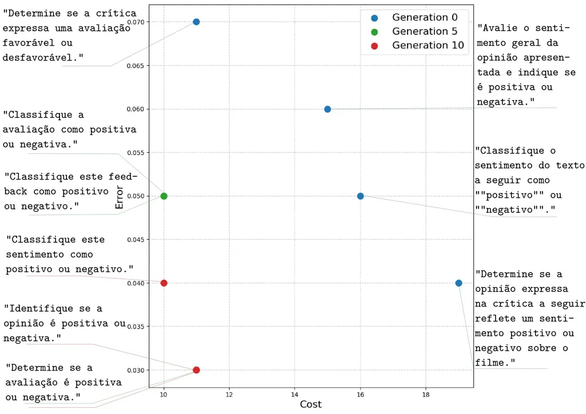
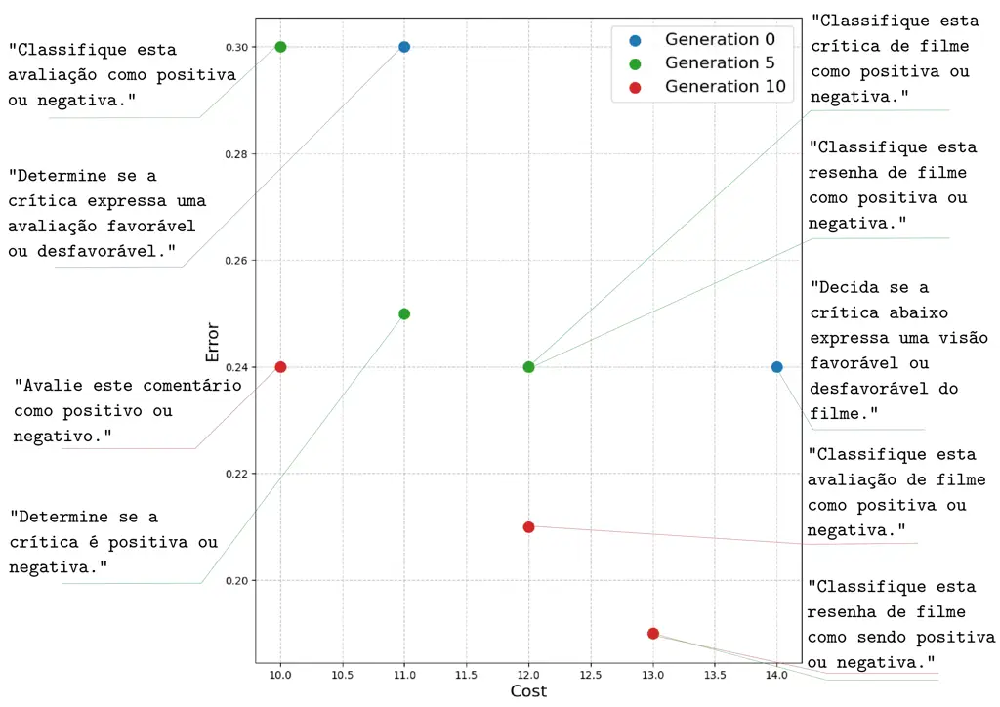

# MOPrompt: Multi-objective Semantic Evolution for Prompt Optimization

Sara Câmara Affiliation: Postgraduate Program in Computer Science,
Federal University of Ouro Preto, Brazil.
Email: [gladston@ufop.edu.br](mailto:)    Eduardo Luz
Affiliation: Computing Department, Universidade Federal de Ouro Preto,
Ouro Preto, 35402-136, Minas Gerais, Brazil.    Valéria Carvalho
Affiliation: Computing Department, Universidade Federal de Ouro Preto,
Ouro Preto, 35402-136, Minas Gerais, Brazil.    Ivan Meneghini
Affiliation: Federal Institute of Minas Gerais, Ibirité-MG, Brazil.   
Gladston Moreira Affiliation: Computing Department, Universidade Federal
de Ouro Preto, Ouro Preto, 35402-136, Minas Gerais, Brazil.

###### Abstract

Prompt engineering is crucial for unlocking the potential of Large
Language Models (LLMs). Still, since manual prompt design is often
complex, non-intuitive, and time-consuming, automatic prompt
optimization has emerged as a research area. However, a significant
challenge in prompt optimization is managing the inherent trade-off
between task performance, such as accuracy, and context size. Most
existing automated methods focus on a single objective, typically
performance, thereby failing to explore the critical spectrum of
efficiency and effectiveness. This paper introduces the MOPrompt, a
novel Multi-objective Evolutionary Optimization (EMO) framework designed
to optimize prompts for both accuracy and context size (measured in
tokens) simultaneously. Our framework maps the Pareto front of prompt
solutions, presenting practitioners with a set of trade-offs between
context size and performance – a crucial tool for deploying Large
Language Models (LLMs) in real-world applications. We evaluate MOPrompt
on a sentiment analysis task in Portuguese, using Gemma-2B and
Sabiazinho-3 as evaluation models. Our findings show that MOPrompt
substantially outperforms the baseline framework. For the Sabiazinho
model, MOPrompt identifies a prompt that achieves the same peak accuracy
(0.97) as the best baseline solution, but with a 31% reduction in token
length.

   

|     |
| --- |
|     |

*K*eywords Multi-objective optimization $`\cdot`$ Prompt Evalution
$`\cdot`$ Decision space diversity $`\cdot`$ Region of Interest.

## 1 Introduction

The emergence of powerful LLMs like GPT-4 \[1\] and Gemini \[2\] has
revolutionized the field of Natural Language Processing (NLP). The
effective use of these models is highly dependent on prompt engineering,
the process of designing effective instructions to guide the model’s
output \[3\]. However, manually crafting optimal prompts is a
significant bottleneck; it is often described as a “dark art” that
requires extensive trial and error.

Automating prompt optimization is a promising avenue to address this
challenge \[4\]. In \[5\], the authors presented a framework called
EvoPrompt, which combines evolutionary algorithms (EAs) with large
language models (LLMs) to optimize prompts, with significant performance
improvements over human-designed prompts and existing automated prompt
generation methods. Yet, in \[6\], the authors proposed an iterative
prompt evolution method to optimize the model’s performance on toxic
content classification in social media. The current automatic methods
concentrate exclusively on maximizing task-specific performance metrics
\[5\], overlooking the context size, which is measured in tokens—the
fundamental units of text processed by the model. While larger context
windows can improve performance, they also require more computational
resources and may lead to slower processing times.

To tackle this issue, this work introduces MOPrompt, an automatic prompt
optimization framework that addresses a multi-objective problem by
optimizing prompts to achieve maximum accuracy and minimum context size
(token length), simultaneously. As in \[5, 6\], we utilize LLMs to act
as evolutionary operators to generate new prompts, executing semantic
crossover and mutation operations to develop a diverse and contextually
rich population of candidate prompts.

We pose the following research questions:

- •
  RQ1: Can a multi-objective evolutionary approach find prompts that are
  both more accurate and more token-efficient than those found by a
  single-objective optimization?
- •
  RQ2: What is the impact of different prompting strategies,
  specifically zero-shot versus few-shot, on the multi-objective
  optimization process?

We conduct a set of experiments on a Portuguese sentiment classification
task. We compare our approach against a baseline framework, EvoPrompt
\[5\], across two distinct open-source evaluation models (Gemma-2B and
Sabiazinho-3) and two prompting strategies (zero-shot and few-shot). The
results demonstrate rapid convergence of MOPrompt. Using a few-shot
strategy with the Sabiazinho model, the MOPrompt framework identified a
prompt that achieves the same peak accuracy (0.97) as the best baseline
solution, while reducing the token length by 31%.

Our main contributions are:

- •
  A novel EMO framework, MOPrompt, for automatic prompt optimization
  that effectively balances task accuracy and token length (context
  size).
- •
  An empirical study on a non-English language (Portuguese) that
  validates our approach and provides actionable insights into the
  accuracy-cost trade-off in practical prompt engineering.

## 2 Related Work

Our work is situated at the intersection of automatic prompt
engineering, evolutionary algorithms, and the emerging paradigm of using
LLMs as optimizers.

#### Automatic Prompt Engineering

The field has rapidly moved from manual prompt design to automated
methods \[7, 8\]. Early approaches focused on discrete textual prompts,
often using gradient-free optimization or search algorithms to find the
best instruction from a predefined set \[4\]. These methods, while
effective, typically optimize for a single performance metric. In
contrast, our work explicitly models the trade-off between performance
and cost, a crucial aspect for real-world applications that is often
overlooked in academic research.

#### Evolutionary Algorithms for Prompt Optimization

Evolutionary Algorithms (EAs) has proven to be a powerful tool for
prompt optimization due to its gradient-free nature and ability to
explore complex search spaces. \[5\] introduced EvoPrompt to optimize
discrete prompts, which connects LLMs with evolutionary algorithms.
Specifically, EvoPrompt utilizes LLMs to generate new candidate prompts
based on evolutionary operators (semantic operators), inspired by the
genetic algorithm and differential evolution. In \[9\], the authors
proposed an evolutionary multi-objective (EMO) approach tailored
explicitly for prompt optimization called EMO-Prompts, using sentiment
analysis capabilities as a maximization problem of the score of an
emotion pair. Our work differs in a key aspect: we focus on the
fundamental trade-off between accuracy and context size. Similarly, we
use an LLM itself as the core engine for performing evolutionary
operations, a significant departure from using traditional,
heuristic-based genetic operators.

#### LLMs as Optimizers and Operators

A recent trend involves using LLMs not just as the target of
optimization but as active components within the optimization task.
Works, such as Automatic Prompt Engineer (APE) \[4\] and Promptbreeder
\[10\], have demonstrated that LLMs can generate and refine prompts for
various tasks iteratively. Also in \[11\], the authors propose SPELL, a
semantic prompt evolution method considering a LLM as a prompt
generator. However, it operates in a self-referential, single-objective
manner. Our proposed framework integrates the idea of an LLM-driven
evolution into a formal EMO context, utilizing the LLM to execute guided
crossover and mutation operations, thereby explicitly navigating the
accuracy-context size trade-off.

## 3 Background

To understand our method, we first introduce the foundational concepts
of LLMs, evolutionary algorithms, and multi-objective optimization.

### 3.1 Large Language Models and Prompting

LLMs are deep neural networks trained on vast amounts of text data,
enabling them to understand and generate human-like text \[3\]. Their
behavior is steered through prompts, which are natural language
instructions. Two common prompting strategies are:

- •
  Zero-shot prompting: The LLM is given a direct instruction to perform
  a task without any examples.
- •
  Few-shot prompting: The prompt includes a few examples
  (demonstrations) of the task to guide the model’s output more
  effectively.

### 3.2 Evolutionary Algorithms

EAs is a family of population-based metaheuristic optimization
algorithms inspired by biological evolution \[12\]. They maintain a
population of candidate solutions (individuals) that evolve over
generations. Each generation involves evaluating the fitness of
individuals, selecting the best ones for reproduction, and applying
genetic operators like crossover (combining two parents to create
offspring) and mutation (introducing small, low-frequency random
changes) to create a new generation.

### 3.3 Multiobjective Optimization

Many real-world problems involve the simultaneous optimization of
multiple, often conflicting, objectives \[13\]. A Multi-objective
Optimization Problem (MOP) can be mathematically stated as follows:

```math
\min_{x\in\mathcal{X}}\mathbf{F}(x)=(f_{1}(x),f_{2}(x),...,f_{m}(x)) \tag{1}
```

where $`x`$ is the vector of decision variables (or a solution)
belonging to the feasible solution set $`\mathcal{X}`$, and
$`\mathbf{F}(x)`$ is the vector of $`m`$ objective functions to be
minimized.

Unlike in single-objective optimization, there is typically no single
solution that is best for all objectives. The goal, instead, is to find
a set of solutions representing the best possible trade-offs. The Pareto
dominance principle formalizes this concept. A solution $`x_{a}`$
dominates a solution $`x_{b}`$ (denoted as $`x_{a}\prec x_{b}`$) if and
only if $`f_{i}(x_{a})\leq f_{i}(x_{b})`$ for every objective
$`i\in\{1,...,m\}`$ and there is at least one objective
$`j\in\{1,...,m\}`$ for which $`f_{j}(x_{a})<f_{j}(x_{b})`$. A solution
$`x^{*}\in\mathcal{X}`$ is called Pareto-optimal if no other solution
$`x\in\mathcal{X}`$ dominates it.

- •
  The set of all Pareto-optimal solutions is called the Pareto set
  ($`\mathcal{X}_{E}`$).
- •
  The image of the Pareto set in the objective space,
  $`f(\mathcal{X}_{E})`$, is called the Pareto front
  ($`\mathcal{Y}_{N}`$).

The Pareto front represents the optimal trade-offs among the conflicting
objectives. Algorithms such as Nondominated Sorting Genetic Algorithm II
(NSGA-II) \[12\] are designed to find a well-distributed and convergent
approximation of this front.

## 4 The MOPrompt Framework

We now detail our MOPrompt framework, starting with the multi-objective
formulation problem, the core LLM-based genetic operators, our
single-objective baseline, and concluding with the complete
multi-objective approach.

### 4.1 Problem Formulation

We formally define the multi-objective prompt optimization problem. Let
$`p`$ be a prompt from the space of all possible text-based prompts
$`\mathcal{P}`$. We aim to find a set of Pareto-optimal prompts
$`P^{*}\subset\mathcal{P}`$ that solves the following bi-objective
optimization problem:

```math
\min_{p\in\mathcal{P}}F(p)=(f_{\text{cost}}(p),f_{\text{error}}(p)) \tag{2}
```

where the two objective functions to be minimized are:

- •
  Cost: $`f_{\text{cost}}(p)=f_{\text{tokens}}(p)`$, the number of
  tokens in prompt $`p`$. This function measures the computational
  efficiency of the prompt.
- •
  Error: $`f_{\text{error}}(p)=1-f_{\text{acc}}(p,D,M,S)`$, the
  classification error rate, where $`f_{\text{acc}}`$ is the accuracy on
  a dataset $`D`$ using an evaluator model $`M`$ and a prompting
  strategy $`S`$.

This formulation aligns with standard minimization problems in EMO
frameworks, such as NSGA-II.

### 4.2 LLM-based Genetic Operators

Our framework employs a generator LLM, $`M_{G}`$ (GPT-4o mini \[1\]), to
execute genetic operations. Diverging from traditional heuristic-based
operators that manipulate text superficially, we leverage the semantic
understanding of a LLM. We’ve defined a unified genetic function,
$`GA_{LLM}`$, which performs a crossover between two parent prompts
($`pr_{a},pr_{b}`$) and subsequently mutates the result to produce a
single offspring. This entire sequence is executed via a structured
requisition to $`M_{G}`$’s public Application Programming Interface
(API), utilizing the template presented in Table 1. This approach
facilitates the creation of new prompts that are not only syntactically
valid but also semantically coherent and contextually relevant to the
optimization task.

| Template for Generator LLM (Crossover + Mutation)                                                                                                                                                                                                                 |
| ----------------------------------------------------------------------------------------------------------------------------------------------------------------------------------------------------------------------------------------------------------------- |
| system:                                                                                                                                                                                                                                                           |
| Você é um otimizador de prompts para classificação de sentimentos (positivo ou negativo). Seu papel é melhorar instruções para modelos de linguagem, gerando prompts curtos, diretos e eficazes. Gere apenas o prompt, sem explicações ou comentários adicionais: |
| user_crossover:                                                                                                                                                                                                                                                   |
| Prompt A: "{prompt_a}"                                                                                                                                                                                                                                            |
| Prompt B: "{prompt_b}"                                                                                                                                                                                                                                            |
| Realize uma combinação dos dois prompts, como em uma operação de crossover, mantendo clareza, coerência e o propósito original.                                                                                                                                   |
| user_mutation:                                                                                                                                                                                                                                                    |
| Assim como uma mutação que introduz variedade, gere uma variação deste prompt mantendo seu objetivo de classificar sentimentos com precisão: "{prompt}" A variação pode incluir reformulação, troca de termos ou reorganização sintática.                         |

Table 1: LLM template for genetic operations. The generator LLM
($`M_{G}`$) is instructed to act as a prompt optimizer and perform
crossover and mutation.

### 4.3 Multi-objective Approach: MOPrompt

Our proposed method, MOPrompt, extends this framework to a
multi-objective context. The algorithm MOPrompt aims to solve the
bi-objective problem formulated in the previous section, which involves
minimizing both token count and classification error.

The key difference lies in the selection phase. Instead of roulette
wheel selection, MOPrompt employs the NSGA-II algorithm. At each
generation, the combined population of parents and offspring is sorted
into non-dominated fronts. The next generation is then populated with
individuals from the best fronts. To maintain diversity along the Pareto
front, a crowding distance metric is used as a tie-breaker, favoring
solutions in less-crowded regions of the objective space. This process
allows MOPrompt to explore the trade-off between the prompt’s accuracy
and context size, returning a prompt’s Pareto-optimal set for the user
to choose from.

## 5 Experimental Setup

### 5.1 Baseline Framework: EvoPrompt

To establish a strong baseline, we implement a version of the Evo-Prompt
framework \[5\]. Here, the Evo-Prompt version performs the same genetic
operations in Table 1. This algorithm focuses solely on maximizing
accuracy ($`f_{\text{acc}}`$). It employs a standard EA structure where
selection is performed using the roulette wheel method. The probability
of a prompt being selected for reproduction is proportional to its
accuracy score. While this method is effective at finding high-accuracy
prompts, it inherently overlooks prompt length, often resulting in
verbose and costly solutions.

### 5.2 Task and Dataset

We evaluate our methods on a binary sentiment analysis task. The dataset
used is “maritaca-ai/imdb_pt”, a Portuguese translation of the classic
Internet Movie Database (IMDb) movie review dataset \[14\]. For
computational efficiency, we conduct our experiments on a fixed,
randomly sampled subset of 100 reviews, balanced with 50 positive and 50
negative examples. This same subset is used across all experimental runs
to ensure fair comparison.

### 5.3 Models

Our framework utilizes two types of models:

- •
  Generator LLM ($`M_{G}`$): We use GPT-4o mini \[1\] as the engine for
  our evolutionary algorithm. It is responsible for generating the
  initial population of prompts and for executing the crossover and
  mutation operations as described in Table 1.
- •
  Evaluator LLMs ($`M`$): To assess the fitness (accuracy) of the
  generated prompts, we use two distinct, open-source models:
  - –
    Gemma-2B: A lightweight model from Google based on Gemini technology
    \[2\].
  - –
    Sabiazinho-3: An efficient model from Maritaca AI, specifically
    trained for Brazilian Portuguese \[15\].

### 5.4 Evaluation

We investigate four primary experimental scenarios, covering both the
baseline framework, Evo-Prompt, and our proposed framework, MOPrompt,
each one applied to the ‘Gemma-2B’ and ‘Sabiazinho-3’ evaluator models.
Within each scenario, we explore both ‘zero-shot’ and ‘few-shot’
prompting strategies. In our experiments, we set the population size to
10 individuals, and each evolutionary run lasted for 10 generations.

### 5.5 Metrics

The performance of the prompts is measured using two primary metrics:

- •
  Accuracy: The proportion of correctly classified sentiment labels in
  our 100-review test set.
- •
  Token Count: In LLMs, the whole input, including the prompt, is
  processed as a sequence of tokens, which are the fundamental units of
  text. The maximum number of tokens that a model can process at once is
  known as its context size or context window \[16\]. The cost of using
  commercial LLMs and the computational load of open-source models are
  directly proportional to the total number of tokens processed \[17\].
  Therefore, minimizing the prompt’s token count is a critical objective
  for creating efficient, cost-effective, and scalable applications. To
  ensure a model-agnostic and consistent measure of prompt cost, we
  calculate the number of tokens for each prompt using the
  ‘TreebankWordTokenizer‘ from the NLTK library. This provides a
  standardized measure of prompt verbosity.

## 6 Results and Discussion

The evolutionary dynamics of the MOPrompt framework are illustrated in
Figure 1(a) and Figure 1(b), which maps the progression of the Pareto
front across three key generations (0, 5, and 10) for both the
Sabiazinho and Gemma models using a few-shot strategy. The
visualizations confirm that the optimization process demonstrates a
clear pattern of rapid convergence towards more optimal solutions.

For the Sabiazinho model, Figure 1(a), the initial prompts are scattered
across a wide range of context sizes and have relatively high error
rates. The evolutionary process quickly drives the population towards a
more optimal state over the generations. A similar trend is observed
with the Gemma model Figure 1(b), although its final Pareto front
reveals a more pronounced trade-off. The initial prompts in Generation 0
also start with high error rates. As the generations progress, MOPrompt
successfully pushes the front toward lower error and cost.



(a) Sabiazinho model



(b) Gemma model

Figure 1: Pareto Front evolution for 0, 5, and 10 generations, running
the MOPrompt framework using a "few-shot" strategy.

We now present our findings, structured around the research questions
posed in the introduction. More details of the code and results are
available on the repository of
[Github](https://anonymous.4open.science/r/mo-prompt-project-4C6B/)
project.

### 6.1 RQ1: Multiobjective vs. Single-Objective Performance

Table 2 provides a quantitative summary of our results. The data clearly
answers our first research question: the multi-objective approach,
MOPrompt, consistently finds prompts that are superior to those
discovered by the single-objective evoPrompt.

| Model      | Strategy  | Framework | Highlight          | Accuracy | Tokens |
| ---------- | --------- | --------- | ------------------ | -------- | ------ |
| Gemma      | Few shot  | MOPrompt  | Max Acc (Front)    | 0.8100   | 13     |
|            |           | MOPrompt  | Min Tokens (Front) | 0.7600   | 10     |
|            |           | Baseline  | Best Accuracy      | 0.8200   | 20     |
|            | Zero shot | MOPrompt  | Max Acc (Front)    | 0.8500   | 12     |
|            |           | MOPrompt  | Min Tokens (Front) | 0.7900   | 10     |
|            |           | Baseline  | Best Accuracy      | 0.8700   | 19     |
| Sabiazinho | Few shot  | MOPrompt  | Max Acc (Front)    | 0.9700   | 11     |
|            |           | MOPrompt  | Min Tokens (Front) | 0.9600   | 10     |
|            |           | Baseline  | Best Accuracy      | 0.9700   | 16     |
|            | Zero shot | MOPrompt  | Max Acc (Front)    | 0.9600   | 11     |
|            |           | MOPrompt  | Min Tokens (Front) | 0.9500   | 10     |
|            |           | Baseline  | Best Accuracy      | 0.9600   | 18     |

Table 2: Performance summary comparing the MOPromot and the baseline
(Evo-Prompt) framework for all scenarios.

For the Gemma and Sabiazinho models, there is a minimal variation in
accuracy between the MOPrompt and EVO-Prompt baseline and a significant
difference in the reduction of the context size of prompts. For example,
for the Gemma model in the zero-shot configuration, the best baseline
prompt achieves an accuracy of 0.87 with 19 tokens. At the same time,
MOPrompt finds a solution with a comparable accuracy of 0.85, but using
only 12 tokens — a cost reduction of 37%. Another interesting
observation is the difference in accuracy between the tested models. The
average accuracy for both models and strategies (MOPrompt and
EVO-prompt, Few-shot and Zero-shot) using the Gemma model was 83.75,
while the same measurement was 96.5 for the Sabiazinho model. We believe
this difference stems from the language used. All tokens were written in
Brazilian Portuguese, and the Sabiazinho model is specifically designed
for this language, unlike the Gemma model.

To understand why MOPrompt is more effective, we qualitatively analyzed
the generated prompts, as shown in Table 3. The MOPrompt framework
proposed favors concise and direct instructions, while the Baseline
framework (Evo-Prompt), lacking the pressure to reduce token count,
often generates more verbose and less efficient prompts. For example,
the best zero-shot prompt for Gemma from Evo-Prompt is: “Classifique a
opinião como positiva ou negativa, identificando se o autor demonstra
aprovação ou desaprovação.” (19 tokens). The MOPrompt that achieves a
similar performance is much more direct: “Determine se a opinião
apresentada é positiva ou negativa.” (12 tokens), effectively removes
redundant clauses (the "identificando…" part) without harming
performance.

| Model      | Strategy  | Framework | Prompt Highlight                                                              |
| ---------- | --------- | --------- | ----------------------------------------------------------------------------- |
| Gemma      | Few shot  | MOPrompt  | "Classifique esta resenha de filme como sendo positiva ou negativa."          |
|            |           | MOPrompt  | "Avalie este comentário como positivo ou negativo."                           |
|            |           | Baseline  | "Classifique esta resenha de filme como ’positiva’ (favorável)                |
|            |           |           | ou ’negativa’ (desfavorável)."                                                |
|            | Zero shot | MOPrompt  | "Determine se a opinião apresentada é positiva ou negativa."                  |
|            |           | MOPrompt  | "Classifique este sentimento como positivo ou negativo."                      |
|            |           | Baseline  | "Classifique a opinião como positiva ou negativa,                             |
|            |           |           | identificando se o autor demonstra aprovação ou desaprovação."                |
| Sabiazinho | Few shot  | MOPrompt  | "Determine se a avaliação é positiva ou negativa."                            |
|            |           | MOPrompt  | "Classifique este sentimento como positivo ou negativo."                      |
|            |           | Baseline  | "Identifique se o sentimento expressado a seguir é ’positivo’ ou ’negativo’." |
|            | Zero shot | MOPrompt  | "Determine se este comentário é positivo ou negativo."                        |
|            |           | MOPrompt  | "Classifique a crítica como positiva ou negativa."                            |
|            |           | Baseline  | "Determine se a análise a seguir reflete uma opinião positiva ou              |
|            |           |           | negativa sobre o filme."                                                      |

Table 3: Qualitative analysis of the prompt solutions presented in Table
2, obtained by Frameworks.

Collectively, the evidence from both models shows that the MOPrompt
methodology is promising. It actively refines and simplifies prompts
over generations, validating the framework’s ability to find optimal
solutions that strike a balance between performance and cost.

### 6.2 RQ2: Impact of Prompting Strategy

Our second research question concerns the role of few-shot examples. Our
results confirm that providing examples typically improves performance.
However, the magnitude of this benefit varies significantly between
models.

For the Sabiazinho model, the gap between the zero-shot and few-shot
front’s is modest. This indicates that Sabiazinho is an inherently
strong zero-shot reasoner for this task, and the examples serve as a
fine-tuning mechanism to reach peak performance. For the Gemma model,
the difference is much more pronounced, suggesting a greater dependency
on in-context examples to optimize the accuracy-cost trade-off. This
highlights a crucial interaction between the optimization algorithm and
the model’s capabilities: the value of a prompting strategy is
model-dependent.

### 6.3 Limitations

Despite the promising results, we acknowledge some limitations. First,
while the LLM-based genetic operator is powerful, we observed that it
can sometimes converge to similar prompt structures, leading to sparse
Pareto fronts in some experimental runs. Future work could focus on
techniques to keep greater diversity in the generated prompts. Second,
our study focused on a single task (sentiment analysis) and utilized a
specific set of models. Validating the generalizability of these
findings across a broader range of tasks and LLMs is an essential next
step.

## 7 Conclusion

In this paper, we addressed the critical challenge of balancing
performance and cost in prompt engineering for LLMs. We introduced
MOPrompt, a novel EMO framework that simultaneously optimizes prompts
for accuracy and token efficiency. Our approach utilizes a large
language model as a semantic operator to perform genetic crossover and
mutation, employing Pareto dominance to evolve prompts.

Our experiments, conducted on a sentiment analysis task in Portuguese,
demonstrate the clear superiority of our multi-objective approach over a
strong single-objective baseline. By exploring the Pareto front of
solutions, MOPrompt discovered prompts that offer significant cost
reductions – up to 31% – without compromising peak accuracy. Our
analysis revealed that MOPrompt achieves this by generating more concise
and direct instructions, effectively discovering the optimal “language”
for each target model.

This work suggests empirical evidence for the effectiveness of EMO in
prompt engineering and highlights its crucial role in optimizing the
accuracy-context size trade-off. For future work, we plan to apply
MOPrompt to a broader array of tasks and models, investigate methods to
enhance prompt diversity, and explore its integration with more complex
prompting techniques such as Chain-of-Thought (CoT).

## Acknowledgments

The authors would like to thank the Fundação de Amparo a Pesquisa do
Estado de Minas Gerais (FAPEMIG, grant APQ-01647-22), Conselho Nacional
de Desenvolvimento Científico e Tecnológico (CNPq, grants 307151/2022-0,
152613/2024-2) and Instituto Federal de Educação e Tecnologia de Minas
Gerais (IFMG, grant 030/2024) for supporting the development of this
study.

## References

- \[1\] J. Achiam, S. Adler, S. Agarwal, L. Ahmad, I. Akkaya, F. L.
  Aleman, D. Almeida, J. Altenschmidt, S. Altman, S. Anadkat, et al.,
  Gpt-4 technical report, preprint arXiv:2303.08774.
- \[2\] G. Team, T. Mesnard, C. Hardin, R. Dadashi, S. Bhupatiraju,
  S. Pathak, L. Sifre, M. Rivière, M. S. Kale, J. Love, et al., Gemma:
  Open models based on gemini research and technology, preprint
  arXiv:2403.08295.
- \[3\] P. Sahoo, A. K. Singh, S. Saha, V. Jain, S. Mondal, A. Chadha, A
  systematic survey of prompt engineering in large language models:
  Techniques and applications, preprint arXiv:2402.07927.
- \[4\] Y. Zhou, A. I. Muresanu, Z. Han, K. Paster, S. Pitis, H. Chan,
  J. Ba, Large language models are human-level prompt engineers, in: The
  Eleventh International Conference on Learning Representations, 2022.
- \[5\] Q. Guo, R. Wang, J. Guo, B. Li, K. Song, X. Tan, G. Liu,
  J. Bian, Y. Yang, Connecting large language models with evolutionary
  algorithms yields powerful prompt optimizers, in: International
  Conference on Learning Representations (ICLR), 2024.
- \[6\] A. Oliveira, P. H. Silva, V. Santos, G. Moreira, V. L. Freitas,
  E. J. Luz, Toxic text classification in portuguese: Is llama 3.1 8b
  all you need?, in: Symposium in Information and Human Language
  Technology, 2024, pp. 57–66.
- \[7\] P. Korzynski, G. Mazurek, P. Krzypkowska, A. Kurasinski,
  Artificial intelligence prompt engineering as a new digital
  competence: Analysis of generative ai technologies such as chatgpt,
  Entrepreneurial Business and Economics Review 11 (3) (2023) 25–37.
- \[8\] G. Marvin, N. Hellen, D. Jjingo, J. Nakatumba-Nabende, Prompt
  engineering in large language models, in: International conference on
  data intelligence and cognitive informatics, 2023, pp. 387–402.
- \[9\] J. Baumann, O. Kramer, Evolutionary multi-objective optimization
  of large language model prompts for balancing sentiments, in:
  International Conference on the Applications of Evolutionary
  Computation (Part of EvoStar), 2024, pp. 212–224.
- \[10\] C. Fernando, D. Banarse, H. Michalewski, S. Osindero,
  T. Rocktäschel, Promptbreeder: self-referential self-improvement via
  prompt evolution, in: Proceedings of the 41st International Conference
  on Machine Learning, 2024.
- \[11\] Y. B. Li, K. Wu, Spell: Semantic prompt evolution based on a
  llm, preprint arXiv:2310.01260.
- \[12\] K. Deb, A. Pratap, S. Agarwal, T. Meyarivan, A fast and elitist
  multiobjective genetic algorithm: Nsga-ii, IEEE transactions on
  evolutionary computation 6 (2) (2002) 182–197.
- \[13\] G. Moreira, L. Paquete, Guiding under uniformity measure in the
  decision space, in: 2019 IEEE Congress on Evolutionary Computation
  (CEC), 2019, pp. 1536–1542.
- \[14\] A. L. Maas, R. E. Daly, P. T. Pham, D. Huang, A. Y. Ng,
  C. Potts, [Learning word vectors for sentiment
  analysis](http://www.aclweb.org/anthology/P11-1015), in: Proceedings
  of the 49th Annual Meeting of the Association for Computational
  Linguistics: Human Language Technologies, 2011, pp. 142–150.  
  URL
  [http://www.aclweb.org/anthology/P11-1015](http://www.aclweb.org/anthology/P11-1015)
- \[15\] R. Pires, H. Abonizio, T. S. Almeida, R. Nogueira, [Sabiá:
  Portuguese large language models](http://arxiv.org/abs/2304.07880)
  (2023).
  [arXiv:2304.07880\[cs\]](http://arxiv.org/abs/2304.07880%20%5Bcs%5D),
  [doi:10.1007/978-3-031-45392-2_15](http://dx.doi.org/10.1007/978-3-031-45392-2_15).  
  URL [http://arxiv.org/abs/2304.07880](http://arxiv.org/abs/2304.07880)
- \[16\] S. Pawar, S. M. T. I. Tonmoy, S. M. M. Zaman, V. Jain,
  A. Chadha, A. Das, The what, why, and how of context length extension
  techniques in large language models – a detailed survey, preprint
  arXiv:2401.07872.
- \[17\] N. Martin, A. B. Faisal, H. Eltigani, R. Haroon, S. Lamelas,
  F. Dogar, Llmproxy: Reducing cost to access large language models,
  preprint arXiv:2410.11857.
