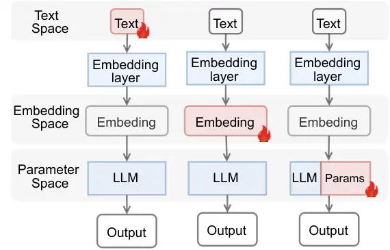
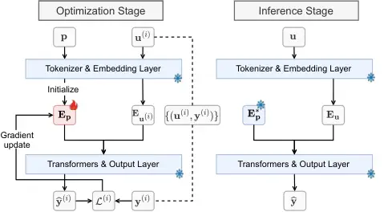

# EmbedGrad: Gradient-Based Prompt Optimization in Embedding Space for Large Language Models

Xiaoming Hou    Jiquan Zhang    Zibin Lin    DaCheng Tao    Shengli
Zhang ^(†)^(†)thanks: Corresponding author

###### Abstract

Effectively adapting powerful pretrained foundation models to diverse
tasks remains a key challenge in AI deployment. Current approaches
primarily follow two paradigms: discrete optimization of text prompts
through prompt engineering, or continuous adaptation via additional
trainable parameters. Both exhibit limitations—discrete methods lack
refinement precision while parameter-based techniques increase
complexity and reduce interpretability. To address these constraints, we
propose EmbedGrad, a novel framework that optimizes text prompt
embeddings through gradient-based refinement. Our approach uniquely
decouples training from deployment: during optimization, labeled
examples guide precise embedding adjustments while preserving semantic
meaning; during inference, only optimized embeddings integrate with user
queries. This enables fine-grained calibration impossible in text space,
such as enhancing the reasoning capability of prompts like “please
reason step by step”. Comprehensive evaluations across mathematical
reasoning, sentiment analysis, and causal judgment tasks demonstrate
EmbedGrad’s effectiveness: optimizing this reasoning prompt for
Qwen2.5-Math-1.5B increased accuracy from 14.74% to 58.96% on
mathematical problems. Consistent improvements were observed across
model scales (0.5B-14B) and all tasks, with particularly significant
gains for smaller models on complex problems like causal judgment. By
bridging prompt engineering and parameter efficiency without
architectural changes, our work establishes embedding refinement as a
powerful new paradigm for task adaptation.

¹College of Electronics and Information Engineering, Shenzhen University

²College of Computer Science and Software Engineering, Shenzhen
University

³Nanyang Technological University

## 1 Introduction

The impressive capabilities of pretrained foundation models have
transformed artificial intelligence, but adapting these powerful systems
effectively for real-world tasks remains challenging. Achieving strong
performance on applications like mathematical reasoning, sentiment
analysis, or causal judgment often requires careful adjustments, which
typically need either labor-intensive prompt design or computationally
expensive fine-tuning. This challenge is especially important for
resource-limited environments where efficiency is critical.

Current adaptation approaches are divided into two main types, each with
limitations. Natural language optimization methods work directly with
text prompts, using techniques like AutoPrompt (Shin et al. 2020) and
TextGrad (Yuksekgonul et al. 2025) to search for better wordings. While
these methods produce understandable prompts, they struggle with
language complexity and can only make coarse adjustments, often missing
subtle meaning details. On the other hand, parameter-based methods such
as LoRA (Hu et al. 2022) and Prefix-Tuning (Li and Liang 2021) add
task-specific components to the model, enabling precise control but
increasing complexity, reducing transparency, and requiring more
computation during use. Both approaches face a core tension: text
optimization lacks precision, while parameter tuning sacrifices clarity
and efficiency.



Figure 1: Optimization Spaces: Text, Embedding (ours), and Parameter
Domains.

To solve this, we introduce EmbedGrad—a novel approach that bridges
these methods by optimizing prompts in the continuous embedding space.
As shown in Figure 1 (middle), our method operates in the middle ground
between text and parameter optimization, combining the understandability
of natural language with the precision of continuous adjustments.
EmbedGrad achieves this through three key innovations: (1) treating
prompt embeddings as adjustable parameters that can be refined using
gradients, (2) separating improvement from deployment to avoid extra
inputs during actual use, and (3) working efficiently by only modifying
prompt representations, not the model itself.

By working in the embedding space—where words become numerical
representations—EmbedGrad enables precise meaning adjustments impossible
through text changes. For example, refining the representation of
“please reason step by step” increased math-solving accuracy by 44%
while keeping the prompt’s original meaning. This approach allows
fine-grained improvements along meaning pathways, such as strengthening
the emotional focus of a sentiment prompt or enhancing causal reasoning
capabilities without changing its words. Crucially, optimized prompts
stay recognizable, with over 95% similarity to the original wording.

Comprehensive tests across mathematical reasoning, sentiment analysis,
and causal judgement tasks show EmbedGrad’s effectiveness, with improved
results across model sizes (0.5B to 14B parameters) and sustained
efficiency with just 5-10 refinement cycles. These gains come from
EmbedGrad’s dual ability to make models more confident in reasoning
while better activating key functions, confirmed through both confidence
measurements and specialized analysis. The approach establishes a
practical new way to adapt AI systems—delivering strong performance
while keeping solutions understandable and efficient.

The remainder of this paper is structured as follows: Section 2
positions our work within existing literature; Section 3 formalizes the
EmbedGrad framework; Section 4 presents experimental validation;
Section5 discusses mechanistic insights; and Section 6 concludes with
future directions.

## 2 Related Work

### 2.1 Natural Language Space Optimization

Prompt engineering in natural language space has evolved from manual
refinement to automated techniques like AutoPrompt (Shin et al. 2020),
which generates discrete text templates through token-level
optimization. While effective for tasks like sentiment analysis, it
faces combinatorial complexity limitations. Self-refinement approaches
such as Self-Refine (Madaan et al. 2023) employ LLM feedback loops to
iteratively improve outputs, showing promise in mathematical reasoning
but requiring multiple inference passes. TextGrad (Yuksekgonul et al. 2025) extends this paradigm by backpropagating natural language
feedback. These methods share three core constraints: coarse-grained
adjustments limited to token substitutions, unpredictable semantic drift
from minor wording changes, and inference-phase redundancy where
examples consume context window capacity. Crucially, they cannot
leverage gradient-based optimization in continuous spaces.

### 2.2 Parameter-Space Adaptation Methods

Parameter-efficient tuning augments models with learnable modules.
Prompt Tuning (Lester, Al-Rfou, and Constant 2021) optimizes continuous
“soft prompts” initialized randomly, achieving efficiency but
sacrificing interpretability. Prefix-Tuning (Li and Liang 2021) inserts
trainable vectors into transformer layers, while P-Tuning (Liu et al. 2022) and its variant (Liu et al. 2023) generalizes prompt embeddings
across layers and tasks—applying continuous prompts to each transformer
layer rather than just the input. This enables stronger performance on
NLU benchmarks but requires storing task-specific vectors. Adapter-based
methods (Houlsby et al. 2019; Rücklé et al. 2021; Pfeiffer et al. 2021)
inserts bottleneck modules after Transformer blocks’ self-attention and
FFN layers, while LoRA-like methods (Hu et al. 2022; Dettmers et al.
2023; Zhang et al. 2023) implement low-rank adaptation by decomposing
weight updates. These approaches introduce architectural modifications
and share critical limitations: optimization decouples from
human-designed prompt semantics, and task-specific components increase
deployment complexity.

### 2.3 EmbedGrad’s Distinct Positioning

EmbedGrad fundamentally differs by bridging natural language and
parameter spaces through embedding optimization of existing text
prompts. Unlike Prompt Tuning that initializes random vectors, we
preserve the semantic core of human-written prompts while enabling
gradient-based refinement. Compared to Prefix-Tuning or P-Tuning v2 that
insert layers of task parameters, EmbedGrad modifies only the prompt’s
embedding—requiring no architectural changes. Crucially, our approach
uniquely decouples training (using examples) from inference
(concatenating only optimized embeddings with queries), eliminating
context window competition. This combines the interpretability of text
prompts with the precision of continuous optimization, while maintaining
parameter efficiency absent in adapter methods.

## 3 Methodology



Figure 2: The framework of EmbedGrad.

### 3.1 Preliminaries: Architecture of LLMs

LLMs are typically autoregressive, generating outputs sequentially based
on prior tokens. Their architecture consists of four core components:

1.  1.  Tokenizer: Converts raw text into a sequence of tokens:

    ```math
    \mathbf{x}=[x_{1},x_{2},\cdots,x_{n}]\in\mathbb{N}^{n}. \tag{1}
    ```

2.  2.  Embedding Layer: Maps tokens to continuous vector via an embedding
        matrix $`\mathbf{E}\in\mathbb{R}^{V\times d}`$, yielding

    ```math
    \mathbf{e}_{\mathbf{x}}=\mathbf{E}_{\mathbf{x}}\in\mathbb{R}^{n\times d}, \tag{2}
    ```

    where $`V`$ is the vocabulary size and $`d`$ is the embedding
    dimension.

3.  3.  Transformer Layers: Process embeddings autoregressively with masked
        attention. The hidden states $`\mathbf{h}^{(L)}`$ are computed
        layer-wise:

    ```math
    \mathbf{h}^{(i)}=\begin{cases}\mathbf{e}_{\mathbf{x}},&i=0\\
    \text{Transformer}_{\theta_{i}}(\mathbf{h}^{(i-1)}),&i=1,2,\cdots,L\\
    \end{cases} \tag{3}
    ```

    Each position $`t`$ in $`\mathbf{h}^{(L)}`$ outputs a contextualized
    representation $`\mathbf{h}_{t}^{(L)}`$ for token $`x_{t}`$.

4.  4.  Output Layer: Predicts the next token at each step using:

    ```math
    \hat{\mathbf{y}}_{t}=\text{softmax}(W_{o}\mathbf{h}_{t}^{(L)}+\mathbf{b}_{o}), \tag{4}
    ```

    where $`W_{o}\in\mathbb{R}^{d\times V}`$ and
    $`\mathbf{b}_{o}\in\mathbb{R}^{V}`$. The final output
    $`\hat{\mathbf{y}}`$ is generated token-by-token autoregressively.

### 3.2 The EmbedGrad Framework

EmbedGrad optimizes the continuous embedding of an existing natural
language prompt while freezing all LLM parameters $`\theta`$, $`W_{o}`$,
and $`\mathbf{b}_{o}`$. This framework comprises three stages:
initialization, optimization, and inference, as depicted in Figure 2.

- •
  Initialization A natural language prompt $`P`$ (e.g., “Classify
  sentiment as positive/negative”) is tokenized into
  $`\mathbf{p}=[p_{1},p_{2},\cdots,p_{k}]`$. Its initial embedding
  $`\mathbf{E}_{\mathbf{p}}^{(0)}\in\mathbb{R}^{k\times d}`$ is directly
  extracted from the LLM’s frozen embedding layer, preserving the
  original semantic structure.
- •
  Optimization Given labeled data
  $`\mathcal{D}=\{(\mathbf{u}^{(i)},\mathbf{y}^{(i)})\}`$, the
  concatenated prompt-and-input embedding becomes the input sequence:

  ```math
  \mathbf{h}^{(0)}=\left[\mathbf{E}_{\mathbf{p}},\mathbf{E}_{\mathbf{u}^{(i)}}\right]\in\mathbb{R}^{(k+n)\times d}, \tag{5}
  ```

  where $`\mathbf{E}_{\mathbf{u}^{(i)}}`$ is the user input embedding.
  The LLM processes this through its autoregressive Transformer,
  computing hidden states $`\mathbf{h}_{t}^{(L)}`$ for each position
  $`t`$ in the concatenated sequence. The task loss $`\mathcal{L}_{CE}`$
  is calculated over the output tokens $`\hat{\mathbf{y}}_{t}`$ and
  their targets $`\mathbf{y}_{t}`$, with updates propagated only to
  $`\mathbf{E}_{\mathbf{p}}`$:

  ```math
  \displaystyle\mathcal{L}(\hat{\mathbf{y}}^{(i)},\mathbf{y}^{(i)}) \displaystyle=\sum_{t}\mathcal{L}_{CE}(\hat{\mathbf{y}}_{t}^{(i)},\mathbf{y}_{t}^{(i)}), \tag{6}
  ```

  ```math
  \displaystyle\mathbf{E}_{\mathbf{p}}^{*} \displaystyle=\mathop{\arg\min}\limits_{\mathbf{E}_{\mathbf{p}}}\sum_{i=1}^{|\mathcal{D}|}\mathcal{L}(\hat{\mathbf{y}}^{(i)},\mathbf{y}^{(i)}). \tag{7}
  ```

  This aligns the prompt embedding with the autoregressive generation
  process without altering the model architecture.

- •
  Inference The optimized embedding $`\mathbf{E}_{\mathbf{p}}^{*}`$ is
  concatenated with user input $`\mathbf{u}`$:

  ```math
  \text{Input}=[\mathbf{E}_{\mathbf{p}}^{*},\mathbf{E}_{\mathbf{u}}]\in\mathbb{R}^{(k+m)\times d}, \tag{8}
  ```

  where $`m`$ is the length of $`\mathbf{u}`$. The LLM then
  autoregressively generates output $`\hat{\mathbf{y}}`$ by sequentially
  attending to both the prompt and prior tokens:

  ```math
  \hat{\mathbf{y}}=\text{softmax}(W_{o}\cdot\text{Transformer}_{\theta}(\text{Input})+\mathbf{b}_{o}) \tag{9}
  ```

  ensuring the prompt’s semantic influence persists throughout the
  generation while avoiding redundant context usage.

## 4 Experiments

| Dataset  | Initial Prompt                                                                                                                                                                                                                      |
| -------- | ----------------------------------------------------------------------------------------------------------------------------------------------------------------------------------------------------------------------------------- |
| Math500  | please reason step by step, and put your final answer with \boxed{}.                                                                                                                                                                |
| IMDB     | Please determine whether the following statement is positive or negative. Let’s think step by step.                                                                                                                                 |
| MEDD     | Determine the main emotion or mood expressed in the following text, choosing only from: \[sad, angry, concerned, surprised, happy, calm, disgusted, doubtful\]. Requirement: Let’s think step by step and choose the strongest one. |
| Bigbench | How would a typical person answer each of the following questions about causation? Please think step by step, and then answer "Yes" or "No".                                                                                        |

Table 1: Initial prompts to be optimized with EmbedGrad for each dataset

|                        |            |                       |            |           |                         |
| ---------------------- | ---------- | --------------------- | ---------- | --------- | ----------------------- |
| Task                   | Dataset    | Base Model            | Before (%) | After (%) | $`\mathbf{\Delta}`$ (%) |
| Mathematical Reasoning | Math500    | Qwen2.5-Math-1.5B     | 14.74      | 58.96     | +44.22 $`\uparrow`$     |
|                        |            | Qwen2.5-Math-7B       | 56.18      | 65.34     | +9.16 $`\uparrow`$      |
|                        | Math500-L1 | Qwen2.5-Math-1.5B     | 9.09       | 86.36     | +77.27 $`\uparrow`$     |
|                        |            | Qwen2.5-Math-7B       | 72.73      | 95.45     | +22.72 $`\uparrow`$     |
|                        | Math500-L2 | Qwen2.5-Math-1.5B     | 15.56      | 82.22     | +66.66 $`\uparrow`$     |
|                        |            | Qwen2.5-Math-7B       | 64.44      | 82.22     | +17.78 $`\uparrow`$     |
|                        | Math500-L3 | Qwen2.5-Math-1.5B     | 22.64      | 79.25     | +56.61 $`\uparrow`$     |
|                        |            | Qwen2.5-Math-7B       | 62.26      | 77.36     | +15.10 $`\uparrow`$     |
|                        | Math500-L4 | Qwen2.5-Math-1.5B     | 14.06      | 57.81     | +43.75 $`\uparrow`$     |
|                        |            | Qwen2.5-Math-7B       | 57.81      | 64.06     | +6.25 $`\uparrow`$      |
|                        | Math500-L5 | Qwen2.5-Math-1.5B     | 10.45      | 34.33     | +23.88 $`\uparrow`$     |
|                        |            | Qwen2.5-Math-7B       | 40.30      | 43.28     | +2.98 $`\uparrow`$      |
| Sentiment Analysis     | IMDB       | Qwen2.5-0.5B-Instruct | 20.24      | 34.52     | +14.28 $`\uparrow`$     |
|                        |            | Qwen2.5-3B-Instruct   | 59.52      | 71.43     | +11.91 $`\uparrow`$     |
|                        |            | Qwen2.5-7B-Instruct   | 69.05      | 78.57     | +9.52 $`\uparrow`$      |
|                        |            | Llama-3.1-8B-Instruct | 57.14      | 64.29     | +7.15 $`\uparrow`$      |
|                        |            | Qwen2.5-14B-Instruct  | 70.24      | 77.38     | +7.14 $`\uparrow`$      |
|                        | MEDD       | Qwen2.5-0.5B-Instruct | 16.03      | 90.57     | +74.54 $`\uparrow`$     |
|                        |            | Qwen2.5-3B-Instruct   | 66.37      | 93.41     | +27.04 $`\uparrow`$     |
|                        |            | Qwen2.5-7B-Instruct   | 87.36      | 92.10     | +4.74 $`\uparrow`$      |
|                        |            | Llama-3.1-8B-Instruct | 83.57      | 92.10     | +8.53 $`\uparrow`$      |
|                        |            | Qwen2.5-14B-Instruct  | 84.67      | 92.90     | +8.23 $`\uparrow`$      |
| Causal Judgement       | Bigbench   | Qwen2.5-0.5B-Instruct | 50.53      | 61.05     | +10.58$`\uparrow`$      |
|                        |            | Qwen2.5-3B-Instruct   | 54.74      | 63.16     | +9.42$`\uparrow`$       |
|                        |            | Qwen2.5-7B-Instruct   | 62.11      | 65.26     | +3.15$`\uparrow`$       |
|                        |            | Qwen2.5-14B-Instruct  | 69.47      | 71.58     | + 2.11$`\uparrow`$      |

Table 2: Experimental results across tasks and models, with $`\Delta`$
showing absolute improvements.

### 4.1 Experimental Setup

We conduct comprehensive evaluations to assess EmbedGrad’s effectiveness
across mathematical reasoning, sentiment analysis, and causal judgement
tasks. For mathematical reasoning, we employ the Math500
benchmark (Lightman et al. 2023) containing 500 problems categorized
into five difficulty levels (L1 to L5, with L1 representing elementary
problems and L5 advanced challenges), which rigorously tests multi-step
problem-solving capabilities. The sentiment analysis evaluation
encompasses both binary classification using the English IMDB (Maas
et al. 2011) movie review dataset and fine-grained 8-class emotion
recognition with the Chinese MEDD dataset (Johnson 2024). For causal
judgement, we use the BigBench benchmark (bench authors 2023) which
requires models to answer questions about causation. All experiments
utilize greedy decoding, where at each generation step the
highest-probability token is selected as the next output.

Our model selection spans diverse architectures and scales:
Qwen2.5-Math-1.5B/7B for mathematical reasoning, Qwen2.5 instruct series
(0.5B, 3B, 7B, and 14B parameters) and Llama-8B for sentiment analysis
and causal judgement. Critical optimization parameters include learning
rates of 0.01 for 1.5B-scale models and 0.001 for larger models
($`\geq`$7B), training durations of 5-10 epochs with early stopping to
prevent overfitting. The specific prompts optimized for each dataset are
detailed in Table 1. These prompts were selected to represent common
task formulations in their respective domains. During optimization, only
the embedding representations of these text prompts were adjusted while
preserving their semantic core.

### 4.2 Experimental Results

Comprehensive evaluation across diverse tasks demonstrates EmbedGrad’s
consistent effectiveness, as summarized in Table 2. The method delivers
substantial accuracy improvements while eliminating inference-stage
redundancy, with transformative results on complex tasks and smaller
models.

For mathematical reasoning, optimizing the prompt embedding elevated
Qwen2.5-Math-1.5B accuracy from 14.74% to 58.96% (+44.22%) on Math500,
with dramatic gains on elementary problems (L1: +77.27%). In sentiment
analysis, optimizing task-specific prompts boosted Qwen-0.5B performance
by 74.54% on the challenging MEDD dataset. For causal judgement task on
BigBench shows significant gains across model scales: Qwen-0.5B improved
by 10.58%, while larger models maintained consistent but more modest
improvements. This reinforces our key observation that smaller models
benefit most substantially from prompt optimization.

Our analysis reveals consistent patterns: improvements inversely
correlate with model scale (Qwen-0.5B gains averaged 5.8× higher than
Qwen-14B) and directly correlate with task complexity (MEDD improvements
3.2× higher than IMDB). Crucially, these benefits remain consistent
across architectures and task types. Beyond accuracy gains, EmbedGrad
delivers efficiency advantages: optimization converges in 5-10
epochs—faster than fine-tuning—while reducing inference overhead by
eliminating in-context examples. The most pronounced improvements occur
where models struggle most: smaller architectures on complex tasks,
demonstrating targeted enhancement without compromising semantic
integrity.

## 5 Discussion

### 5.1 Semantic Anchoring in Continuous Optimization Space

Our analysis of the optimized embedding vectors employs a rigorous token
similarity assessment method to quantify semantic preservation. For each
optimized token embedding $`\mathbf{v}_{opt}`$ in the prompt, we compute
its similarity to the entire vocabulary through an inner product
operation followed by softmax normalization:

```math
p_{j}=\frac{\exp(\mathbf{v}_{o}pt)\cdot\mathbf{e}_{j}}{\sum_{k=1}^{V}\exp(\mathbf{v}_{o}pt)\cdot\mathbf{e}_{j}}, \tag{10}
```

where $`\mathbf{e}_{j}`$ represents embedding of all vocabulary tokens.
The token $`w_{\hat{j}}`$ with $`\hat{j}=\mathop{\arg\max}_{j}p_{j}`$ is
identified as the nearest semantic match. This quantitative approach
revealed exceptionally high fidelity to the original prompt, with
$`p_{\text{original}}>0.95`$ and $`\hat{j}`$ corresponding precisely to
the initial token in all cases. The probability distributions
consistently exhibited sharp peaks at original tokens, demonstrating
that optimization occurs within constrained semantic neighborhoods
rather than reconstruct the original semantic foundation.

This localized optimization behavior provides crucial advantages over
discrete prompt engineering approaches. The continuous embedding space
enables sub-token adjustments impossible in discrete text spaces,
allowing for precise “semantic interpolation” between related
concepts—such as blending attributes of “analyze” with nuances of
“evaluate”—that gradually shift the prompt’s effectiveness without
altering its core meaning. This granular control represents a
fundamental advance over discrete methods like AutoPrompt (Shin et al.
2020), which often produce semantically divergent prompts when
navigating the combinatorial explosion of token substitutions.

The semantic anchoring effect ensures optimization occurs within a trust
region around the original embedding, preventing catastrophic semantic
drift while permitting nuanced refinement. This characteristic is
particularly valuable for sensitive applications where prompt integrity
is essential, such as medical diagnosis or legal analysis, where minor
semantic shifts could significantly alter output interpretations. By
operating in the continuous embedding space, EmbedGrad achieves what
discrete optimization cannot: nuanced adjustments to prompt semantics
while preserving the crucial link between human intention and model
behavior, effectively bridging the precision of parameter tuning with
the interpretability of natural language prompting. The constrained
optimization pathway also explains EmbedGrad’s consistent performance
improvements across diverse tasks without unpredictable semantic jumps
that could degrade reliability in production environments.

### 5.2 Confidence Enhancement through Entropy Reduction

Our investigation into EmbedGrad’s effectiveness reveals significant
changes in model behavior during generation, particularly through the
lens of trajectory entropy—a well-established measure of decision
confidence in autoregressive models (Zhang et al. 2025). We quantify
this key metric using a rigorous computational approach: for each
generated sequence of length $`T`$, the trajectory entropy is formally
defined as:

```math
H_{\text{trajectory}}=-\frac{1}{T}\sum_{t=1}^{T}\sum_{\omega\in\mathcal{V}}p_{t}(\omega)\log_{2}p_{t}(\omega), \tag{11}
```

where $`p_{t}(\omega)`$ represents the probability distribution over the
vocabulary $`\mathcal{V}`$ at generation step $`t`$. Prior to
optimization, both Qwen2.5-Math-1.5B and 7B models exhibited problematic
generation patterns during mathematical reasoning tasks. Most notably,
they frequently entered repetitive output loops, persistently recycling
their final phrase until reaching token limits—a failure mode
characterized by abnormally low entropy values averaging 0.05. This
behavior was especially pronounced in the smaller 1.5B model, occurring
in over two-thirds of failed solutions. When models avoided this trap,
baseline entropy measured 0.237 for the 1.5B model and 0.124 for the 7B
variant, indicating higher uncertainty in the smaller model’s reasoning
process.

After applying EmbedGrad, we observed transformative improvements:
repetitive failures nearly disappeared while trajectory entropy
stabilized around 0.120 for both models. This dual effect—eliminating
pathological low-entropy states while reducing normal-state
entropy—signals a fundamental shift toward more confident and stable
generation. For the 1.5B model, this represented a substantial reduction
in uncertainty (from 0.237 to 0.120), directly corresponding to its
dramatic 44.22% accuracy improvement on Math500. The 7B model’s smaller
entropy decrease (from 0.124 to 0.120) aligns with its more modest 9.16%
accuracy gain, demonstrating how improvement magnitude correlates with
initial uncertainty levels.

These entropy patterns illuminate EmbedGrad’s core mechanism: by
refining prompt embeddings, the method provides better initial guidance
that streamlines the model’s reasoning pathway. This reduces
computational hesitaton during generation, where each step requires less
probabilistic reevaluation. The convergence of both models’ entropy near
0.120 suggests this value represents an optimal confidence zone for
reliable mathematical reasoning: sufficiently certain to avoid
indecision errors but not so overconfident as to trigger degenerative
loops. Critically, the greater entropy reduction in smaller models
explains why they benefit more dramatically, as EmbedGrad effectively
compensates for their inherent architectural limitations. This positions
prompt embedding optimization not merely as an input adjustment, but as
a calibration technique that enhances the fundamental
confidence-uncertainty balance governing model reasoning.

### 5.3 Enhanced Functional Activation via Representation Engineering

Our analysis extends beyond entropy metrics to reveal how
EmbedGrad-optimized embeddings fundamentally reshape model cognition
through Representation Engineering. Using Linear Artificial Tomography
(LAT) (Zou et al. 2023), we quantitatively measure how optimized
embeddings activate target functionalities like sentiment
classification. This top-down approach characterizes high-level model
behaviors by comparing internal representations under two conditions:
original text prompts versus optimized embeddings.

Figure 3: Activation intensity enhancement of model’s sentiment
classification functionality on the optimized input vector across
model’s layers.

The LAT methodology identifies a “sentiment direction” in representation
space by contrasting emotional and robotic responses to stimuli.
Projecting layer-wise activations onto this direction reveals functional
activation intensity. As depicted in Figure 3, for sentiment
classification, optimized embeddings consistently show stronger
activation than original prompts across all layers ($`\Delta>0`$), with
the most dramatic improvement at the first layer. This first-layer
amplification establishes a more effective foundation for downstream
processing, while subsequent layers maintain moderately elevated
activation.

These findings provide mechanistic evidence for EmbedGrad’s
effectiveness: optimized embeddings activate task-relevant
representations more efficiently, particularly at critical input
processing stages. The layered enhancement pattern explains performance
gains observed in sentiment analysis, where optimized prompts improved
accuracy by up to 74.54% for smaller models. By enhancing functional
activation while preserving semantic intent, EmbedGrad demonstrates how
continuous embedding refinement unlocks latent model capabilities
inaccessible through discrete text modifications.

### 5.4 Hyperparameters Sensitivity and Model-Scale Optimization

Our experimental findings reveal that EmbedGrad’s effectiveness exhibits
significant sensitivity to optimization hyperparameters, particularly
learning rate and iteration count, with improper settings leading to
overfitting and suboptimal performance. This sensitivity displays a
clear correlation with model scale, as evidenced by our MATH500
experiments: the optimal learning rate for the 1.5B model was
approximately 0.01, while the larger 7B model required a more
conservative 0.001 rate. Similarly, iteration counts between 5-10 epochs
consistently produced the best results across models, with smaller
models tolerating slightly higher iteration counts before overfitting
manifested.

This model-scale dependency directly connects to our earlier findings
about semantic anchoring and entropy reduction mechanisms. Smaller
models like the 1.5B variant possess higher baseline uncertainty
(evidenced by their 0.237 trajectory entropy), creating a broader
optimization landscape that permits more aggressive learning rates
without immediate overfitting risks. Their shallower architecture also
allows prompt embedding updates to propagate more directly through fewer
layers, enabling faster convergence. Conversely, larger models like the
7B version operate with lower baseline entropy (0.124) and more complex
internal representations, making their optimization landscape more
intricate and prone to overshooting optimal regions with overly
ambitious learning rates.

The limited 5-10 epoch sweet spot emerges from the fundamental nature of
embedding space optimization. Unlike conventional fine-tuning that
adjusts millions of parameters, EmbedGrad optimizes only the prompt
embedding vector—a highly compressed target where changes rapidly
saturate semantic meaning. Extended iterations risk over-specializing
the prompt to the training examples, compromising generalization. This
effect mirrors our semantic anchoring observations: optimization occurs
within a confined neighborhood of the original embedding, meaning
excessive adjustments can breach the trust region boundary, causing
semantic drift rather than refinement.

### 5.5 Limitations and Practical Considerations

While EmbedGrad demonstrates significant advantages in prompt
optimization, we acknowledge several practical limitations that merit
consideration. The most notable constraint is its dependence on model
accessibility—since the method operates through gradient updates in the
embedding space, it requires access to the model’s internal architecture
and embedding layer, limiting its applicability to open-source models
rather than closed API-based systems. This technical requirement
excludes deployment scenarios involving proprietary models like GPT-4 or
Claude, where only input-output interactions are permitted.
Additionally, the optimization’s effectiveness remains inherently
constrained by the quality of the initial prompt, as the semantic
anchoring mechanism confines adjustments within the neighborhood of the
starting embedding; fundamentally flawed prompts may require human
revision before optimization can yield substantial benefits. The method
also exhibits sensitivity to hyperparameter selection, particularly
learning rate and iteration count, necessitating careful
calibration—typically 3-5 validation runs—to avoid suboptimal
performance.

Despite these limitations, EmbedGrad maintains substantial value within
its operational domain. For the vast ecosystem of open-source models
(LLaMA (Touvron et al. 2023), Qwen (Team 2024), Mistral (Jiang et al.
2023), etc.), it provides a uniquely efficient optimization pathway. The
semantic preservation characteristic is actually advantageous in
safety-critical applications like healthcare and finance, where prompt
integrity is paramount, and its limitations become strengths by
preventing uncontrolled semantic drift. Future work will focus on
developing transfer learning techniques to extend optimized embeddings
across model families and creating distillation methods that allow
closed-model deployment. These practical constraints do not diminish
EmbedGrad’s core innovation—its ability to bridge discrete prompt
engineering and continuous parameter optimization—but rather define the
boundary conditions where its transformative potential is maximized:
enabling resource-efficient, interpretable, and robust prompt
enhancement for the open-source AI ecosystem.

## 6 Conclusion and future work

EmbedGrad pioneers a gradient-based approach to prompt optimization by
refining prompt embeddings within continuous semantic space,
fundamentally advancing beyond traditional discrete text modifications.
Our method achieves precise prompt calibration while maintaining human
interpretability and computational efficiency through semantic
anchoring—preserving core meaning while enabling nuanced adjustments.
Comprehensive evaluations across mathematical reasoning and sentiment
analysis demonstrate significant performance enhancements, particularly
benefiting smaller models by compensating for architectural limitations.
Although currently optimized for open-source implementations and
dependent on initial prompt quality, EmbedGrad establishes a new
paradigm for parameter-efficient adaptation that bridges human intention
with machine reasoning. Future work will extend this framework to
cross-model transfer learning and distillation techniques, further
enhancing accessibility while preserving the crucial balance between
precision and interpretability in AI systems.

## References

- bench authors (2023) bench authors, B. 2023. Beyond the Imitation
  Game: Quantifying and extrapolating the capabilities of language
  models. _Transactions on Machine Learning Research_.
- Dettmers et al. (2023) Dettmers, T.; Pagnoni, A.; Holtzman, A.; and
  Zettlemoyer, L. 2023. Qlora: Efficient Finetuning of Quantized Llms.
  _Advances in neural information processing systems_, 36: 10088–10115.
- Houlsby et al. (2019) Houlsby, N.; Giurgiu, A.; Jastrzebski, S.;
  Morrone, B.; De Laroussilhe, Q.; Gesmundo, A.; Attariyan, M.; and
  Gelly, S. 2019. Parameter-Efficient Transfer Learning for NLP. In
  _International Conference on Machine Learning_, 2790–2799. PMLR.
- Hu et al. (2022) Hu, E. J.; Shen, Y.; Wallis, P.; Allen-Zhu, Z.; Li,
  Y.; Wang, S.; Wang, L.; and Chen, W. 2022. Lora: Low-rank Adaptation
  of Large Language Models. _ICLR_, 1(2): 3.
- Jiang et al. (2023) Jiang, A. Q.; Sablayrolles, A.; Mensch, A.;
  Bamford, C.; Chaplot, D. S.; de las Casas, D.; Bressand, F.; Lengyel,
  G.; Lample, G.; Saulnier, L.; Lavaud, L. R.; Lachaux, M.-A.; Stock,
  P.; Scao, T. L.; Lavril, T.; Wang, T.; Lacroix, T.; and Sayed,
  W. E. 2023. Mistral 7B. arXiv:2310.06825.
- Johnson (2024) Johnson. 2024. Chinese Multi Emotion Dialogue Dataset.
  https://huggingface.co/datasets/Johnson8187/Chinese˙Multi-Emotion˙Dialogue˙Dataset.
- Lester, Al-Rfou, and Constant (2021) Lester, B.; Al-Rfou, R.; and
  Constant, N. 2021. The Power of Scale for Parameter-Efficient Prompt
  Tuning. arXiv:2104.08691.
- Li and Liang (2021) Li, X. L.; and Liang, P. 2021. Prefix-Tuning:
  Optimizing Continuous Prompts for Generation. arXiv:2101.00190.
- Lightman et al. (2023) Lightman, H.; Kosaraju, V.; Burda, Y.; Edwards,
  H.; Baker, B.; Lee, T.; Leike, J.; Schulman, J.; Sutskever, I.; and
  Cobbe, K. 2023. Let’s Verify Step by Step. _arXiv preprint
  arXiv:2305.20050_.
- Liu et al. (2022) Liu, X.; Ji, K.; Fu, Y.; Tam, W.; Du, Z.; Yang, Z.;
  and Tang, J. 2022. P-Tuning: Prompt Tuning Can Be Comparable to
  Fine-Tuning across Scales and Tasks. In Muresan, S.; Nakov, P.; and
  Villavicencio, A., eds., _Proceedings of the 60th Annual Meeting of
  the Association for Computational Linguistics (Volume 2: Short
  Papers)_, 61–68. Dublin, Ireland: Association for Computational
  Linguistics.
- Liu et al. (2023) Liu, X.; Zheng, Y.; Du, Z.; Ding, M.; Qian, Y.;
  Yang, Z.; and Tang, J. 2023. GPT Understands, Too. arXiv:2103.10385.
- Maas et al. (2011) Maas, A. L.; Daly, R. E.; Pham, P. T.; Huang, D.;
  Ng, A. Y.; and Potts, C. 2011. Learning Word Vectors for Sentiment
  Analysis. In _Proceedings of the 49th Annual Meeting of the
  Association for Computational Linguistics: Human Language
  Technologies_, 142–150. Portland, Oregon, USA: Association for
  Computational Linguistics.
- Madaan et al. (2023) Madaan, A.; Tandon, N.; Gupta, P.; Hallinan, S.;
  Gao, L.; Wiegreffe, S.; Alon, U.; Dziri, N.; Prabhumoye, S.; Yang, Y.;
  et al. 2023. Self-refine: Iterative refinement with self-feedback.
  _Advances in Neural Information Processing Systems_, 36: 46534–46594.
- Pfeiffer et al. (2021) Pfeiffer, J.; Kamath, A.; Rücklé, A.; Cho, K.;
  and Gurevych, I. 2021. AdapterFusion: Non-Destructive Task Composition
  for Transfer Learning. arXiv:2005.00247.
- Rücklé et al. (2021) Rücklé, A.; Geigle, G.; Glockner, M.; Beck, T.;
  Pfeiffer, J.; Reimers, N.; and Gurevych, I. 2021. AdapterDrop: On the
  Efficiency of Adapters in Transformers. arXiv:2010.11918.
- Shin et al. (2020) Shin, T.; Razeghi, Y.; Logan IV, R. L.; Wallace,
  E.; and Singh, S. 2020. Autoprompt: Eliciting knowledge from language
  models with automatically generated prompts. _arXiv preprint
  arXiv:2010.15980_.
- Team (2024) Team, Q. 2024. Qwen2.5: A Party of Foundation Models.
- Touvron et al. (2023) Touvron, H.; Lavril, T.; Izacard, G.; Martinet,
  X.; Lachaux, M.-A.; Lacroix, T.; Rozière, B.; Goyal, N.; Hambro, E.;
  Azhar, F.; Rodriguez, A.; Joulin, A.; Grave, E.; and Lample, G. 2023.
  LLaMA: Open and Efficient Foundation Language Models.
  arXiv:2302.13971.
- Yuksekgonul et al. (2025) Yuksekgonul, M.; Bianchi, F.; Boen, J.; Liu,
  S.; Lu, P.; Huang, Z.; Guestrin, C.; and Zou, J. 2025. Optimizing
  generative AI by backpropagating language model feedback. _Nature_,
  639(8055): 609–616.
- Zhang et al. (2023) Zhang, Q.; Chen, M.; Bukharin, A.; Karampatziakis,
  N.; He, P.; Cheng, Y.; Chen, W.; and Zhao, T. 2023. AdaLoRA: Adaptive
  Budget Allocation for Parameter-Efficient Fine-Tuning.
  arXiv:2303.10512.
- Zhang et al. (2025) Zhang, Y.; Zhang, Z.; Guan, H.; Cheng, Y.; Duan,
  Y.; Wang, C.; Wang, Y.; Zheng, S.; and He, J. 2025. No Free Lunch:
  Rethinking Internal Feedback for LLM Reasoning. _arXiv preprint
  arXiv:2506.17219_.
- Zou et al. (2023) Zou, A.; Phan, L.; Chen, S.; Campbell, J.; Guo, P.;
  Ren, R.; Pan, A.; Yin, X.; Mazeika, M.; Dombrowski, A.-K.;
  et al. 2023. Representation engineering: A top-down approach to ai
  transparency. _arXiv preprint arXiv:2310.01405_.
