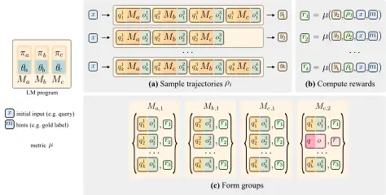

\author@bx@sep

=0pt

# Composing Policy Gradients and Prompt Optimization for Language Model Programs

Conference: ACM Conference on AI and Agentic Systems; May 26–29, 2026;
San Jose, CA, USAACM Conference on AI and Agentic Systems (ACM CAIS
’26), May 26–29, 2026, San Jose, CA,
USADOI: [10.1145/3786335.3813164](https://doi.org/10.1145/3786335.3813164)ISBN: 979-8-4007-2415-2/26/05CCS: Computing
methodologies Natural language processingCCS: Computing
methodologies Reinforcement learningCCS: Computing
methodologies Multi-agent systems

Noah Ziems Note: All three authors contributed equally to this research.
Correspondence to [nziems2@nd.edu](mailto:nziems2@nd.edu),
[soylu@stanford.edu](mailto:soylu@stanford.edu), and
[lakshyaaagrawal@berkeley.edu](mailto:lakshyaaagrawal@berkeley.edu).
Affiliation: University of Notre Dame, Notre Dame, USA email:
<nziems2@nd.edu> , Dilara Soylu Affiliation: Stanford University,
Stanford, USA email: <soylu@stanford.edu> , Lakshya A Agrawal
Affiliation: UC Berkeley, Berkeley, USA email:
<lakshyaaagrawal@berkeley.edu> , Isaac Miller Affiliation: Anyscale, San
Francisco, USA email: <isaac@cmpnd.ai> , Liheng Lai Affiliation: UC
Berkeley, Berkeley, USA email: <liheng@berkeley.edu> , Chen Qian
Affiliation: CMU, Pittsburgh, USA email: <chenqian@cmu.edu> , Kaiqiang
Song Affiliation: Zoom, Inc., San Jose, USA email:
<kaiqiang.song@zoom.us> , Meng Jiang Affiliation: University of Notre
Dame, Notre Dame, USA email: <mjiang2@nd.edu> , Dan Klein
Affiliation: UC Berkeley, Berkeley, USA email: <klein@cs.berkeley.edu> ,
Matei Zaharia Affiliation: UC Berkeley, Berkeley, USA email:
<matei@berkeley.edu> , Karel D’Oosterlinck Affiliation: Contextual AI,
Mountain View, USA email: <karel@contextual.ai> , Christopher Potts
Affiliation: Stanford University, Stanford, USA email:
<cgpotts@stanford.edu> and Omar Khattab Affiliation: MIT, Cambridge, USA
email: <okhattab@mit.edu>

© cc

###### Abstract.

Group Relative Policy Optimization (GRPO) has proven to be an effective
tool for post-training language models (LMs). However, AI systems are
increasingly expressed as modular programs that mix together multiple LM
calls with distinct prompt templates and other tools, and it is not
clear how practitioners can best leverage online RL algorithms like GRPO
to improve these systems. We begin to address this challenge by
investigating whether it is possible to effectively instantiate GRPO for
arbitrary multi-prompt programs and whether it can work robustly as an
off-the-shelf optimizer for LM programs using the same abstractions and
constraints typically involved for prompt optimization. Our main variant
of multi-module GRPO constructs groups from module-level invocations,
and we also consider trajectory-level grouping as another natural
instantiation. We find for the first time that GRPO (and its
multi-module counterpart) empirically composes well with automatic
prompt optimization, and together they improve accuracy by 11% on
average across classification, many-hop search, and privacy-preserving
delegation tasks against the post-trained LM—with 5% gains against
prompt optimization on its own. We open-source multi-module GRPO in the
DSPy library at [dspy.ai](https://dspy.ai).

[https://github.com/stanfordnlp/dspy](https://github.com/stanfordnlp/dspy)

###### Keywords: 

Compound AI Systems, Language Program Optimization, Prompt Optimization,
In-context Learning, Online Reinforcement Learning, BetterTogether

^(†)^(†)cc-license: by

## 1. Introduction

Many modern AI systems and agents are increasingly implemented as
modular designs, in which modules are responsible for well-specified
subtasks that contribute to a broader objective. A canonical example is
“multi-hop” deep research, where the system responds to a question by
iteratively using a query generation LM module to produce a search
query, passing that query to a retriever, and finally feeding all
iteratively retrieved passages into a response generation LM module to
produce the final output (Yang et al., 2018; Jiang et al., 2020; Nakano
et al., 2021; Qi et al., 2021). Akin to conventional software, the
explicit modularization of such systems makes their behavior
controllable, testable, parallelizable, and allows for leveraging the
priors of the LM differently for each module. This modularization also
allows for a separation of concerns: developers can iterate on their
programs, and can bolt learning algorithms, typically automatic prompt
optimization methods, on top to tune their quality (Khattab et al.,
2024). Such optimizers can run the program, observe module-level inputs
and outputs, score the final output with a program-level metric, and
update the prompts or other parameters.


Figure 1. Simplified example of a multi-hop retrieval LM program
invocation. Each module is responsible for a single subtask, and only
its structured outputs (e.g., followup_query) are passed to downstream
modules. Bold text indicates the specific spans extracted as the
module’s output. Although each module internally generates tokens to
produce these outputs, the raw generation traces (prompts, reasoning
steps, and intermediate tokens) remain local to the module and are not
shared across the pipeline. An example of a full trace can be found in
Appendix C. A horizontal pipeline diagram showing a multi-hop retrieval
LM program: a query-generation module produces a search query, a
retriever returns passages, and a response-generation module produces
the final answer. Each module is drawn as a box with its own local
prompt and reasoning trace; only the structured outputs (e.g., a
follow-up query string) are shown crossing between modules, while
reasoning tokens stay inside each box. Bold text marks the specific
output span passed downstream.

Group Relative Policy Optimization (GRPO; Shao et al. 2024) has recently
emerged as a powerful method for fine-tuning language models (LMs) in
the final stages of training. By leveraging relative rewards within
groups of “reasoning” rollouts that share the same prompt, GRPO offers a
simple alternative to Proximal Policy Optimization (PPO; Schulman et al.
2017), with strong empirical results and far lower engineering overhead.
However, GRPO was originally designed for single-stage settings where
each rollout consists of a single auto-regressive LM call. It remains
unclear how to best instantiate post-training RL algorithms such as GRPO
for compound systems that involve multiple LM calls whose contexts,
control flow, and intermediate states differ across rollouts. As in
standard GRPO, rewards are typically only observed at the level of
full-trajectory rollouts. However, as each module has its own isolated
context, applying GRPO to the multi-module setting introduces challenges
that do not arise in single-call systems or in simple LLM agents, like
ReAct, where a single chat history captures the full trajectory. For
example, rollouts from the same LM program input can differ in both
length and structure due to control-flow variation, early termination,
or parsing failures. An example of an LM program invocation can be seen
in Figure 1.

To investigate whether GRPO can effectively be instantiated for such LM
programs with a simple and extensible framework, we develop the mmGRPO
framework. The main variant we test with mmGRPO constructs module-level
groups, relaxing the conventional GRPO implementation assumption of
single-prompt groups by aligning structurally comparable module calls
across different trajectories. We also test a trajectory-level variant
of mmGRPO as another natural instantiation of GRPO for multi-module
programs. Both mmGRPO variants can be used across a wide range of LM
programs and are implemented to extend the existing abstractions for
multi-module prompt optimization approaches, allowing them to be used
interchangeably for improving program performance. We open-source mmGRPO
as an off-the-shelf optimizer for arbitrary compound AI systems.

Because ours is the first implementation of GRPO that applies to
sophisticated pipelines of LMs, we are able to conduct a controlled
comparison of three approaches to optimizing modular AI systems: prompt
optimization (PO), online reinforcement learning via mmGRPO, and their
combination using the BetterTogether framework (Soylu et al., 2024),
which is our main contribution in this work. Our evaluation setup comes
from a subset of LangProBe, a Language Programs Benchmark (Tan et al.,
2025), and spans three diverse LM program tasks: classification
(Banking77; Casanueva et al. 2020), multi-hop claim verification (HoVer;
Jiang et al. 2020), and privacy-conscious delegation (PAPILLON; Siyan et
al. 2025). Each involves different reasoning styles and control flow
structures. Experiments are run using two open-source LMs,
llama3.1-8b-instruct (Grattafiori et al., 2024) and qwen3-8b (Yang et
al., 2025).

Across these settings, mmGRPO improves performance by 7% on average
against the model’s unadapted reasoning performance. While mmGRPO does
not always surpass the prompt optimized programs via MIPROv2 (Opsahl-Ong
et al., 2024), it complements them effectively: staging MIPROv2 and
mmGRPO—à la BetterTogether—consistently yields higher performance than
either method alone, improving by 5% and 3% compared to MIPROv2 and
mmGRPO, respectively; and by 11% compared to the model’s unadapted
reasoning performance. These findings suggest that policy gradient RL
and PO offer complementary benefits for LM program training, and we
advocate for future work exploring their integration in offline and
online settings.

## 2. Preliminaries

GRPO is an online policy gradient method for LM fine-tuning that
operates over _groups_ of trajectories, conventionally sharing the same
input prompt. The GRPO objective encourages the current policy
$`p_{\theta_{\text{old}}}`$, parameterized by LM weights
$`\theta_{\text{old}}`$, to upweight relatively high-reward completions
within a group, while applying PPO-style clipping and KL divergence
regularization to ensure stable updates. This results in an updated
policy $`p_{\theta}`$.

GRPO also makes use of a reference policy $`p_{\theta_{\text{ref}}}`$ in
the KL divergence penalty, seeking to prevent the updated policy from
drifting too far from its original distribution. Here, we express the
original GRPO objective in Equation 1 in terms of prompt–output–reward
triples $`(q,o_{i},r_{i})`$, which will let us describe how LM-program
traces can be converted into multi-module GRPO training data.

```math
\displaystyle\mathcal{J}_{\text{GRPO}}\! \displaystyle\left(\theta\right)=\mathbb{E}_{\{(q,\,o_{i},\,r_{i})\}_{i=1}^{G}}
```

```math
\displaystyle\;\frac{1}{G}\sum_{i=1}^{G}\frac{1}{|o_{i}|}\sum_{t=1}^{|o_{i}|}\Bigg\{\min\!\Big(\omega_{i,t}\hat{A}_{i},\;\operatorname{clip}\!\left(\omega_{i,t},\,1{-}\epsilon,\,1{+}\epsilon\right)\hat{A}_{i}\Big)
```

```math
\displaystyle\phantom{\;\frac{1}{G}\sum_{i=1}^{G}\frac{1}{|o_{i}|}\sum_{t=1}^{|o_{i}|}\Bigg\{}-\beta\,\mathbb{D}_{\mathrm{KL}}\!\Big[p_{\theta}\;\|\;p_{\theta_{\text{ref}}}\Big]\Bigg\}, \tag{1}
```

where $`\theta`$ indicates the parameters for an LM shared by all
groups, $`\hat{A}_{i}`$ is derived from the observed reward $`r_{i}`$
(below), and

```math
\omega_{i,t}=\frac{p_{\theta}(o_{i,t}\mid q,\,o_{i,<t})}{p_{\theta_{\text{old}}}(o_{i,t}\mid q,\,o_{i,<t})}
```

Each GRPO group is defined as a set of triples
$`\mathcal{G}=\{(q,o_{i},r_{i})\}_{i=1}^{G}`$, constructed by first
sampling a fixed prompt from a distribution of questions $`q\sim P(Q)`$,
and then generating a batch of $`G`$ completions
$`\{o_{i}\}_{i=1}^{G}\sim p_{\theta_{\text{old}}}(O\mid q)`$ from the
current policy. Finally, a scalar reward $`r_{i}`$ for each $`o_{i}`$ is
computed with a reward function. The term $`\omega_{i,t}`$ denotes the
importance sampling ratio between the new and old policies for the
$`t`$th token in a given output. The scalar reward $`r_{i}`$ is then
normalized within the group to compute an advantage $`\hat{A}_{i}`$ in
the outcome supervision formulation of GRPO,

```math
\displaystyle\hat{A}_{i} \displaystyle=\frac{r_{i}-\text{mean}(\mathcal{R})}{\text{std}(\mathcal{R})},\quad\mathcal{R}=\{r_{i}\}_{i=1}^{G}, \tag{2}
```

which is applied uniformly across all tokens $`t`$ in the corresponding
completion $`o_{i}`$, as shown in Equation 2.

#### LM program formulation

An LM program $`\Phi`$ is composed of LM modules and other tools
orchestrated by its control flow. Let
$`\mathcal{M}=\{M_{1},\ldots,M_{|\mathcal{M}|}\}`$ denote the set of LM
modules used therein, each of which communicates via natural language.

Given a structured input $`x`$ (for example, a record with fields such
as question or document_titles), executing $`\Phi(x)`$ orchestrates
module invocations, transforming inputs and routing outputs between
modules. In other words, $`\Phi(x)`$ defines a distribution from which
we can sample $`y,\rho`$ pairs, where $`y`$ is the final output and
$`\rho`$ is the trajectory of module calls:

```math
\displaystyle(y,\rho)\sim\Phi(x),\quad\rho=[\zeta_{1},\zeta_{2},\dots,\zeta_{|\rho|}] \tag{3}
```

Here, the trajectory $`\rho`$ records the sequence of module calls, and
each trace $`\zeta_{t}=\langle M_{t},q_{t},o_{t}\rangle`$ captures the
module identity as well as the module-level inputs and outputs at module
invocation $`t`$ within the program trajectory. The trajectory $`\rho`$
logs only the LM-level calls in their execution order and omits any
other control logic. This trace is the same execution record exposed by
DSPy programs for prompt optimization, and we reuse it in this work as
the basic data structure to conduct online RL weight updates over
unchanged LM programs.

Each module $`M\in\mathcal{M}`$ is parameterized by a prompt template
$`\pi_{M}`$ and LM weights $`\theta_{M}`$, and may be invoked multiple
times. For example, in a multi-hop setting, a module used to generate
new queries could be invoked once for each hop, leading to multiple
invocations of that module within a single trajectory $`\rho`$. During
execution at module invocation $`t`$, the prompt template
$`\pi_{M_{t}}`$ transforms the input $`q_{t}`$ into a materialized
prompt, where we use the same symbols for the structured input $`q_{t}`$
and its materialized prompt to simplify the notation:

```math
\displaystyle q_{t}\leftarrow\pi_{M_{t}}(q_{t}) \tag{4}
```

This prompt is then passed to an LM parameterized by $`\theta_{M_{t}}`$,
which samples an output $`o_{t}`$, returned to the control flow of
$`\Phi`$ for subsequent steps:

```math
\displaystyle o_{t}\sim p_{\theta_{M_{t}}}(\cdot\mid q_{t}) \tag{5}
```

This modularity offers several benefits over ReAct-style agents, where
every step is appended to a single growing prompt. Such approaches often
inflate contexts and leak unnecessary information across steps. Further,
they are more difficult to test as the smaller subtasks the agent must
execute, such as query generation, cannot be easily evaluated
independent of the other subtasks. In contrast, control flow within LM
programs specifies exactly which inputs each module sees. This allows
repeated module invocations without carrying along unnecessary context,
and further allows for each module to be tested in isolation. This
explicit modularity makes execution more interpretable and is a core
reason why recent and concurrent multi-step GRPO implementations, which
assume a single expanding prompt, are not directly applicable to
multi-module LM programs (Jin et al., 2025; Zeng et al., 2025; Wang et
al., 2025).

#### LM program optimization

Let $`\mathcal{D}=\{(x,m)\}`$ be a dataset of inputs $`x`$ and optional
metadata $`m`$ (e.g., final answer, documents to retrieve, or PII to
redact). The goal is to learn the parameters of the given LM program
$`\Phi`$, namely, the prompt templates $`\pi_{M}`$ and LM weights
$`\theta_{M}`$ for each module $`M\in\mathcal{M}`$, such that we
maximize the expected reward:

```math
\displaystyle\mathbb{E}_{(x,m)\sim\mathcal{D};\ (y,\rho)\sim\Phi_{\Pi,\Theta}(x)}\left[\mu\left(y,\rho,x,m\right)\right] \tag{6}
```

Here, the reward function $`\mu(y,\rho,x,m)`$ scores the execution,
typically based on the final output $`y`$’s correctness. Any metadata
$`m`$ (e.g., gold answers) is not visible to the program during
execution but may be used by $`\mu`$ for evaluation. Prompt optimization
methods operate on this objective by updating the prompt templates
$`\Pi=\{\pi_{M}\}`$, while mmGRPO updates the LM weights
$`\Theta=\{\theta_{M}\}`$ using rewards from the same program
executions. The BetterTogether framework composes these two choices by
first optimizing prompts and then optimizing weights, or alternating
both.

## 3. Applying GRPO to multi-module LM programs



Figure 2. Illustration of mmGRPO’s group building strategy for the
module-level variant. We assume an LM program with modules $`M_{a}`$,
$`M_{b}`$, and $`M_{c}`$, an input $`x`$ (with optional hints $`m`$),
and a final reward metric $`\mu`$. Module-level mmGRPO constructs GRPO
groups in three steps: (a) Sample $`k`$ trajectories by running the LM
program. For each input, the program logic selects the next module to
call and prepares its input $`q_{1}`$. After the module returns an
output $`o_{1}`$, the program logic prepares the next module input, and
so on. Because control flow is governed by the program logic, the
sequence and number of module calls can differ across trajectories, even
for the same $`x`$. Each run ultimately produces a final output $`y`$.
(b) A reward function scores the final output (and optionally the
trajectory), producing a scalar reward $`r`$. (c) Module-level mmGRPO
then forms GRPO groups by collecting all call data for a given module
and relative invocation index (e.g., “second call to $`M_{c}`$”) into a
separate group. When a trajectory does not contain a particular module
invocation, a padding strategy (e.g., repeating one of the other
datapoints in the group with its associated rewards) is applied so that
group sizes remain consistent across trajectories.A three-panel diagram
illustrating module-level mmGRPO's group-building strategy for a program
with modules M_a, M_b, and M_c. Panel (a) shows k sampled trajectories
of program execution; each trajectory is a sequence of module calls that
may differ in length and module ordering. Panel (b) shows a reward
function evaluating each trajectory's final output and assigning a
scalar reward. Panel (c) shows module-level GRPO groups formed by
aligning calls across trajectories by (module, invocation index);
missing positions are filled by a padding strategy so each group has the
same size.

We design our multi-module GRPO framework mmGRPO to be interchangeable
with prompt optimizers operating over the same LM program and to rely on
the same structure of execution traces that LM programming frameworks
like DSPy (Khattab et al., 2024) already collect. As a result, learning
algorithms can be swapped without modifying the program itself or
entangling the program design process with knowledge of the details of
the learning algorithm.

Given a dataset $`\mathcal{D}`$ and a reward function $`\mu`$, our goal
is to optimize an LM program $`\Phi`$ consisting of modules
$`\mathcal{M}`$ by updating the weights $`\theta_{M_{i}}`$ of each
module. In standard GRPO, each group contains completions from a single
auto-regressive LM call—i.e., one prompt and its full output. However,
LM programs typically comprise multiple modules with each one invoking
its own LM using a custom prompt. This raises the practical question of
how to convert LM-program rollouts into GRPO training groups. We explore
two variants of mmGRPO, with choices that allow our implementation to
remain largely modular with respect to existing GRPO implementations.
The main variant we test is module-level mmGRPO, where groups are formed
at the module invocation level, but we also test a trajectory-level
variant.

1: Student program $`\Phi`$ with module set $`\mathcal{M}`$; training
set $`\mathcal{D}`$; metric $`\mu`$; steps $`N_{\text{steps}}`$; group
size $`G`$; batch size $`B`$; number of example rollouts $`K`$; training
hyper-parameters $`\Psi_{\text{train}}`$

2: function
mmGRPO($`\Phi,\mathcal{D},\mu,N_{\text{steps}},G,B,K,\Psi_{\text{train}}`$)

3:   for $`\text{step}=1`$ to $`N_{\text{steps}}`$ do

4:    $`\mathcal{B}\leftarrow\textsc{SampleBatch}(\mathcal{D},B)`$

5:    for each $`(x,m)\in\mathcal{B}`$ do

6:       $`\mathcal{R}\leftarrow\textsc{SampleRollouts}(\Phi,K,x)`$

7:
      $`\texttt{groups},\Theta\leftarrow\textsc{FormGroups}(\Phi,\mathcal{R},G,\mu,x,m)`$

8:       for each
$`(\mathcal{G},\theta_{M})\in\textsc{Zip}(\texttt{groups},\Theta)`$ do

9:        Update $`\theta_{M}`$ via $`\mathcal{J}(\mathcal{G})`$ with
hyper-parameters $`\Psi_{\text{train}}`$            

10:   return $`\Phi`$ with unchanged prompt templates
$`\{\pi_{M_{i}}\}_{i=1}^{|\mathcal{M}|}`$

11:       and updated LM weights
$`\{\theta^{*}_{M_{i}}\}_{i=1}^{|\mathcal{M}|}`$

12: function SampleRollouts($`\Phi,K,x`$)

13:   $`\mathcal{R}\leftarrow\emptyset`$

14:   for $`k=1`$ to $`K`$ do

15:    $`(y,\rho)\sim\Phi(x)`$

16:    $`\mathcal{R}\leftarrow\mathcal{R}\cup\{(y,\rho)\}`$   

17:   return $`\mathcal{R}`$

18: Module-level variant:
$`\mathcal{J}=\mathcal{J}^{\text{module}}_{\text{mmGRPO}}`$
(Equation 7);  FormGroups is set to FormModuleLevelGroups (Algorithm 2).

19: Trajectory-level variant:
$`\mathcal{J}=\mathcal{J}^{\text{trajectory}}_{\text{mmGRPO}}`$
(Equation 9);  FormGroups groups full trajectories.

Algorithm 1 mmGRPO: GRPO for multi-module LM programs

The main algorithm for mmGRPO is shown in Algorithm 1, covering both
variants we test. Similar to GRPO, mmGRPO iterates through
$`N_{\text{steps}}`$ training steps (line 3). At each step it samples a
batch of training examples (line 4). Then, for each example, it samples
rollouts via SampleRollouts (line 6). It then calls FormGroups to
convert these rollouts into a list of GRPO groups paired with the LM
weights they update (line 7). Finally, it applies a GRPO-style update to
each group (line 9) before moving on to the next example. The two
variants of mmGRPO differ only in their choice of FormGroups and the
objective $`\mathcal{J}`$ as specified at the bottom of the algorithm,
but the surrounding control flow is shared otherwise.

We now explain how the module-level and trajectory-level variants each
instantiate FormGroups and the objective $`\mathcal{J}`$.

#### Forming module-level groups

In the module-level variant, mmGRPO forms groups using the
FormModuleLevelGroups algorithm shown in Algorithm 2. We describe it at
a high level in this section, with a more detailed treatment saved for
Appendix A.

FormModuleLevelGroups aligns module calls across trajectories based on
both the module identifier and the relative order in which it appears in
the trajectory. This alignment yields module-level GRPO groups, each of
the form $`\{(q_{i},o_{i},r_{i})\}^{G}_{i=1}`$, where $`q_{i}`$ and
$`o_{i}`$ are extracted from a group of aligned traces all generated by
a specific module $`M`$, and $`r_{i}`$ is set to the corresponding
program-level output reward for the trajectory that generated each
trace.

In practice, not all trajectories generated by $`\Phi`$ given the same
program-level input $`x`$ follow the same structure; the program logic
may diverge (e.g., by invoking different modules or terminating early),
or errors such as module-level parsing failures may halt execution. To
create groups from trajectories with different structures,
FormModuleLevelGroups optionally pads smaller groups to a fixed size
before applying the loss. This is exemplified in Figure 2, where a
module-level group with fewer entries than the target size is filled in
via the padding strategy. Refer to Appendix A for more details on
FormModuleLevelGroups and the padding modes.

Once the groups are formed, the module-level mmGRPO loss in Equation 7
is applied independently to each module-level group, with two key
differences from the original GRPO objective (Equation 1).

```math
\displaystyle\mathcal{J}^{\text{module}}_{\text{mmGRPO}}\! \displaystyle\left(\hbox{\pagecolor{HighlightColorTheta}$\theta_{M}$}\right)=\mathbb{E}_{\{(\hbox{\pagecolor{HighlightColorQ}$\scriptstyle q_{i}$},\,o_{i},\,r_{i})\}_{i=1}^{G}}
```

```math
\displaystyle\;\frac{1}{G}\sum_{i=1}^{G}\frac{1}{|o_{i}|}\sum_{t=1}^{|o_{i}|}\Bigg\{\min\!\Big(\omega_{i,t}\hat{A}_{i},\;\operatorname{clip}\!\left(\omega_{i,t},\,1{-}\epsilon,\,1{+}\epsilon\right)\hat{A}_{i}\Big)
```

```math
\displaystyle\phantom{\;\frac{1}{G}\sum_{i=1}^{G}\frac{1}{|o_{i}|}\sum_{t=1}^{|o_{i}|}\Bigg\{}-\beta\,\mathbb{D}_{\mathrm{KL}}\!\Big[\hbox{\pagecolor{HighlightColorTheta}$\scriptstyle p_{\theta_{M}}$}\;\|\;\hbox{\pagecolor{HighlightColorTheta}$\scriptstyle p_{\theta_{M_{\text{ref}}}}$}\Big]\Bigg\}, \tag{7}
```

where $`\scriptstyle\theta_{M}`$ are the LM weights for module $`M`$,
$`\hat{A}_{i}`$ is computed from $`r_{i}`$ via Equation 2, and

```math
\omega_{i,t}=\frac{\hbox{\pagecolor{HighlightColorTheta}$p_{\theta_{M}}$}(o_{i,t}\mid\hbox{\pagecolor{HighlightColorQ}$q_{i}$},\,o_{i,<t})}{\hbox{\pagecolor{HighlightColorTheta}$p_{\theta_{M_{\text{old}}}}$}(o_{i,t}\mid\hbox{\pagecolor{HighlightColorQ}$q_{i}$},\,o_{i,<t})} \tag{8}
```

First, each group contributes gradients through the LM weights used by
the corresponding module: in the general case, modules may have separate
weights or adapters. In our experiments, all trainable modules share one
LM adapter, so all module-level groups update the same underlying
weights. Second, unlike GRPO where completions share a single prompt,
datapoints in a module-level group may have different prompts $`q_{i}`$,
reflecting variation in upstream context. We use the module-level mmGRPO
variant presented here for our main experiments in Section 5.

#### Forming trajectory-level groups

A natural alternative to module-level grouping is to keep each full
program rollout as the unit of GRPO training. For a trajectory
$`\rho_{i}`$, let $`o_{i,j}`$ denote the output of the $`j`$-th LM
invocation in the trajectory, $`q_{i,j}`$ its local prompt, and
$`o_{i,j,t}`$ the $`t`$-th generated token of that module output. Let
$`L_{i}=\sum_{j=1}^{|\rho_{i}|}|o_{i,j}|`$ denote the total number of
generated LM tokens in trajectory $`\rho_{i}`$. For the trajectory-level
variant we evaluate, all trainable module calls share one LM adapter, so
we write a single set of weights $`\theta`$. With separate module
weights, the corresponding module parameters would be used for the
tokens produced by each module.

Omitting clipping and KL terms for presentation, the trajectory-level
objective can be written as

```math
\displaystyle\mathcal{J}^{\text{trajectory}}_{\text{mmGRPO}}(\theta)=\mathbb{E}_{\{\rho_{i}\}_{i=1}^{G}}\frac{1}{G}\sum_{i=1}^{G}\frac{1}{L_{i}}\sum_{j=1}^{|\rho_{i}|}\sum_{t=1}^{|o_{i,j}|}\left\{\omega_{i,j,t}\hat{A}_{i}\right\}, \tag{9}
```

where

```math
\displaystyle\omega_{i,j,t}=\frac{p_{\theta}(o_{i,j,t}\mid q_{i,j},\,o_{i,j,<t})}{p_{\theta_{\mathrm{old}}}(o_{i,j,t}\mid q_{i,j},\,o_{i,j,<t})}. \tag{10}
```

#### Module-level vs. trajectory-level grouping

The two variants differ in how the same rollout data is grouped and
normalized. Module-level mmGRPO splits trajectories into local
prompt–output–reward triples and forms groups from aligned module
invocations. In contrast, trajectory-level mmGRPO keeps each full
execution as the grouped unit, before applying the program-level reward
to all generated LM tokens in that execution. Thus, module-level
grouping normalizes each module invocation by its own output length,
while trajectory-level grouping normalizes by the total generated length
of the full rollout. When trajectories differ in structure, module-level
grouping also requires alignment and padding choices, whereas
trajectory-level grouping operates directly over the full rollouts.

We use the module-level formulation in our main experiments for two
practical reasons. First, it maps relatively easily onto existing
prompt–completion GRPO trainers: each training example remains a local
module prompt, module output, and program-level reward. Second, because
module-level normalization scales each invocation by its own output
length, we might expect it to be more suitable when different parts of a
program generate outputs of very different sizes. Trajectory-level
grouping is also natural and bakes in fewer assumptions specific to LM
programs. We test it as another instantiation in Section 5.

#### Sampling with programs other than the student program

All of our experiments use an on-policy setting, where we use the
student program $`\Phi`$ to sample rollouts. One modification that would
be simple to implement in the mmGRPO framework is sampling from teacher
programs that share the same structural interface as the student program
(i.e., operating over the same module-level input and output fields),
but may differ in their prompt templates (e.g., alternative instructions
or few-shot examples) or LM weights (e.g., larger models). In
particular, SampleRollouts can be modified to accept these teacher
programs; and then, rather than sampling all rollouts from the student
alone, mmGRPO could sample from a configurable mixture of teacher
programs. These variations could enable partially off-policy training,
providing greater flexibility in guiding learning with higher-performing
policies. We leave this exploration to future work.

## 4. Composing online RL with prompt optimization via BetterTogether

BetterTogether (Soylu et al., 2024) demonstrates that combining prompt
optimization (PO) with weight optimization yields stronger results than
using either technique alone, specifically in the context of offline RL
via rejection fine-tuning on outcome-filtered trajectories. Rather than
applying weight optimization directly to an unmodified program, the
authors first optimize the program’s prompt templates and then apply
weight optimization on the resulting prompt-optimized program.

This ordering is natural for LM programs because prompt optimization and
weight optimization act on different elements of the same program.
Prompt optimization changes the instructions, demonstrations, and module
interfaces that shape the program’s rollouts at a high level of
abstraction. mmGRPO then updates the LM weights under the rollout
distribution induced by those prompts, using the same program-level
metric.

We extend the BetterTogether approach to the online RL setting for the
first time using mmGRPO. In particular, we experiment with combining the
module-level variant of mmGRPO with a strong prompt optimizer, MIPROv2
(Opsahl-Ong et al., 2024). While Soylu et al. (2024) also experiment
with alternative compositions, such as running prompt optimization after
weight tuning, in this work we focus on the former: applying an mmGRPO
variant to a program on top of automatic prompt optimization.

## 5. Experiments

### 5.1. LMs and datasets

For both LM programs and datasets, we start with implementations from
the Language Programs Benchmark (LangProBe), which was created to allow
easy evaluation of optimization approaches for multi-module LM programs
(Tan et al., 2025). The DSPy implementation of these LM programs for
each task is shown in Appendix B.

LMs. We run our experiments on llama3.1-8b-instruct (Grattafiori et al., 2024) and qwen3-8b (Yang et al., 2025). Although mmGRPO allows for
different LM copies to learn separate weight updates for the different
modules of a program, we focus on the multi-task setting where a single
set of weights is shared for all modules in an LM program.

Classification. Banking77 is an intent classification benchmark
involving $`13{,}083`$ labeled customer service queries from the banking
domain (Casanueva et al., 2020). The task is to assign each user query
to one of 77 intent classes, an example of which is shared below.

Example datapoint for Banking77 text: I have been waiting over a week.
Is the card still coming? label: card_arrival

We implement a simple program for this task using a single
Chain-of-Thought (CoT) module (Wei et al., 2022), which first produces a
reasoning trace before predicting the intent label. For evaluation we
compute the exact match between the ground-truth label and the generated
label. We intentionally include this single-module program as a sanity
check. With only one module, both mmGRPO variants reduce to standard
GRPO, allowing us to verify that the algorithm recovers GRPO performance
in the simplest case before evaluating it on more complex multi-module
systems.

For training and evaluation, we randomly sample $`250`$ training
examples and $`500`$ for evaluation.

Privacy-conscious delegation. The Private User Prompt Annotations (PUPA)
benchmark by Siyan et al. (2025) focuses on privacy-preserving question
answering, where the goal is to respond to user queries without exposing
private information to external APIs.

Example datapoint for PAPILLON user_query: Send a friendly e-mail
opening to Sara telling her thank you for calling me back so quickly,
taking the time to discuss with me FRC’s IPAEP, and for your immediate
willingness to make reasonable accommodations to help break down the
barriers caused by my disabilities so that I can have equal access to
your program. Your kindness and compassion is appreciated.
target_response: Dear Sara, I hope this email finds you well. I just
wanted to take a moment to express my sincere gratitude for your prompt
response to my call and the time you took to discuss FRC’s IPAEP with
me. I truly appreciate your immediate willingness to make reasonable
accommodations to ensure that I have equal access to your program and to
help break down the barriers caused by my disabilities... pii_str:
sara\|\|ipaep\|\|frc

We use PAPILLON, also from Siyan et al. (2025), a two-module pipeline
that generates a redacted version of a private user query, sends the
redacted query to an untrusted but more performant external model, then
uses the response of that external model to generate the final response.
PAPILLON tests mmGRPO on a multi-module system whose modules play
structurally distinct roles, redaction and response synthesis, each
invoked once per trajectory.

We use openai/gpt-4.1-mini-2025-04-14 (OpenAI, 2025) as the external LM.
As described in Siyan et al. (2025), the evaluation metric is a
composite score which takes into account the content of the response and
the amount of private information that was leaked, both of which are
scored by a large LM acting as a judge. We evaluate this setup using
$`111`$ training examples and $`221`$ for evaluation.

Multi-hop claim verification. HoVer (Jiang et al., 2020) is a claim
verification benchmark where the task is to extract facts from multiple
relevant Wikipedia articles and decide whether a given claim is
supported.

Example datapoint for HoVer claim: This director is known for his work
on Miss Potter. The Academy of Motion Picture Arts and Sciences presents
the award in which he was nominated for his work in "Babe". titles:
\[’Miss Potter’, ’Chris Noonan’, ’Academy Award for Best Director’\]

The claims in HoVer are multi-hop in that they require multi-hop
reasoning by connecting information found in different articles. The
original dataset has $`18{,}171`$ train and $`4{,}000`$ development and
test examples derived from the examples in the HotPotQA dataset (Yang et
al., 2018). Our program for HoVer consists of 2 modules, a query
generation module and a fact summarization module, called iteratively
over 4 hops, along with a ColBERTv2 (Santhanam et al., 2022) retriever
indexed on the short snippets from the Wikipedia (2017) dump provided
with the HotPotQA dataset, shared with HoVer. This program tests mmGRPO
along a different axis than PAPILLON or Banking77, as multiple modules
are invoked repeatedly across many hops within a single trajectory.

We refer to the particular 4-hop variant Hover program we use as
HoVer\_(4-HOP), in order to differentiate it from the one provided in Tan
et al. (2025). The program returns up to 100 passages at the end, and
the final metric evaluates whether the gold passages are found within
the returned passages using Recall@100. We build our splits from the
original train split, randomly sampling $`500`$ examples each for our
train and evaluation splits, while ensuring that we do not sample any
two examples derived from the same HotPotQA question.

### 5.2. Baseline and method details

We evaluate each of our LM and task pairs with vanilla Chain-of-Thought
(CoT) and a prompt optimizer, to serve as baselines. We demonstrate our
module-level mmGRPO optimizer in two configurations: mmGRPO, and
BetterTogether mmGRPO. While each method assumes access to the same
program-level evaluation metric, none uses intermediate module-level
supervision. Instead, training data is generated online by running the
program and scoring full program executions with the metric. We build on
the DSPy framework (Khattab et al., 2024) to run our baseline
experiments and develop our new mmGRPO optimizers, and draw inspiration
from the Verifiers library (Brown, 2025).

Inference. We use the vLLM (Kwon et al., 2023) engine for sampling with
max context length of $`32{,}768`$ tokens for inference. We set max
tokens to $`1{,}032`$ and re-try each query up to $`3`$ times in case of
module parsing errors. For qwen3-8b, we use
$`\mathrm{sampling\_temperature}=0.6`$, $`\mathrm{top\_p}=0.95`$ and
$`\mathrm{top\_k}=20`$ following the parameters used for its instruction
training as noted in the official technical report Yang et al. (2025).
For llama3.1-8b-instruct, we use $`\mathrm{sampling\_temperature}=0.6`$
and $`\mathrm{top\_p}=0.9`$ following the official model card’s
generation configuration in HuggingFace (Meta AI, 2024).

Vanilla CoT. We adopt the Chain-of-Thought (CoT) prompting method
introduced by Wei et al. (2022), where each module’s prompt instructs
the language model to first generate a reasoning field before producing
its final output (e.g., answer, search_query). This creates a strong
prompt baseline to compare our methods against. Unless stated otherwise,
both the prompt-optimization and mmGRPO methods described below begin
training from this base CoT prompt. We refer to this initial prompt
configuration as the “Vanilla CoT” program.

MIPROv2. We use the state-of-the-art prompt optimizer Multiprompt
Instruction PRoposal Optimizer Version 2 (MIPROv2; Opsahl-Ong et al. 2024) as our prompt-optimized baseline. MIPROv2 jointly optimizes module
prompts—free-form instructions and optional few-shot examples—by (i)
bootstrapping candidate exemplars, (ii) proposing instructions, and
(iii) selecting high-yield instruction–example combinations via Bayesian
optimization over program-level metrics. For our experiments, we use the
medium setting, which uses 12 trials; 12 few-shot and 6 instruction
candidates, and automatically uses 80% of the train set for validation.
We refer to the program optimized using MIPROv2 with these settings as
the prompt-optimized program and re-use it for the BetterTogether
strategy below.

mmGRPO. Except when specified otherwise, mmGRPO refers to the
module-level variant used in our main experiments. We train our models
using the GRPOTrainer in HuggingFace TRL (von Werra et al., 2020), each
with a maximum context length of $`8{,}192`$ tokens. Training is
performed with a temperature of $`0.6`$, a learning rate of
$`1\times 10^{-5}`$, gradient accumulation steps of $`20`$, with per
device train batch size of $`1`$. We use $`\beta=0.01`$ and gradient
norm clipping of $`0.1`$ for qwen3-8b; and $`\beta=0.04`$ and gradient
norm clipping of $`0.5`$ for llama3.1-8b-instruct.

We run mmGRPO for 750 steps, using 4 training examples per step. At each
step, we randomly draw 4 examples from the training dataset. For each
example, we generate 12 rollouts, which are then grouped into
module-level or trajectory-level GRPO groups depending on which mmGRPO
variant is used. We use a train context length of $`8{,}192`$ tokens,
which is used to filter any trajectory with a module-level prompt and
completion longer than this. We apply Low-Rank Adaptation (LoRA, Hu et
al. 2022) with rank $`\mathrm{r}=16`$, $`\mathrm{lora\_alpha}=64`$,
$`\mathrm{lora\_dropout}=0.05`$, targeting the projection modules
$`[\mathrm{q},\mathrm{k},\mathrm{v},\mathrm{o},\mathrm{up},\mathrm{down},\mathrm{gate}]`$.
We run all of our mmGRPO experiments below using these same settings.

mmGRPO with BetterTogether. We further evaluate a setting that combines
prompt optimization with the weight optimization of mmGRPO following the
BetterTogether framework (Soylu et al., 2024). For these experiments, we
only use the module-level mmGRPO variant. Specifically, instead of
optimizing the LM program’s weights directly, we first apply prompt
optimization to identify high quality prompts for each module. The
prompts are then kept fixed, and mmGRPO is used to optimize the
program’s weights. We refer to this configuration as BetterTogether(PO,
mmGRPO), which is the main compositional setting studied in our
experiments.

### 5.3. Main results

| Strategy                        | Banking77                   |                             | PAPILLON                    |                             | HoVer\_(4-HOP)              |                             | Avg Scores |       |      |
| ------------------------------- | --------------------------- | --------------------------- | --------------------------- | --------------------------- | --------------------------- | --------------------------- | ---------- | ----- | ---- |
|                                 | llama3.1                    | qwen3                       | llama3.1                    | qwen3                       | llama3.1                    | qwen3                       | llama3.1   | qwen3 | All  |
| Baseline Strategies:            |                             |                             |                             |                             |                             |                             |            |       |      |
|    Vanilla CoT                  | $`58.4_{\pm 1.4}`$          | $`64.6_{\pm 1.2}`$          | $`76.2_{\pm 1.3}`$          | $`78.3_{\pm 0.9}`$          | $`59.5_{\pm 2.2}`$          | $`60.6_{\pm 0.6}`$          | 64.7       | 67.8  | 66.3 |
|    MIPROv2 (PO)                 | $`59.4_{\pm 0.4}`$          | $`65.9_{\pm 1.1}`$          | $`83.9_{\pm 5.6}`$          | $`78.1_{\pm 4.3}`$          | $`63.4_{\pm 3.0}`$          | $`69.3_{\pm 0.8}`$          | 68.9       | 71.1  | 70.0 |
| Module-level mmGRPO Strategies: |                             |                             |                             |                             |                             |                             |            |       |      |
|    mmGRPO                       | $`\mathbf{63.7}_{\pm 3.2}`$ | $`64.9_{\pm 0.5}`$          | $`83.9_{\pm 0.5}`$          | $`\mathbf{83.3}_{\pm 1.8}`$ | $`60.2_{\pm 1.2}`$          | $`71.0_{\pm 1.0}`$          | 69.3       | 73.1  | 71.2 |
|    BetterTogether(PO, mmGRPO)   | $`\mathbf{63.7}_{\pm 2.6}`$ | $`\mathbf{69.1}_{\pm 1.8}`$ | $`\mathbf{86.5}_{\pm 5.0}`$ | $`81.1_{\pm 4.1}`$          | $`\mathbf{68.3}_{\pm 2.7}`$ | $`\mathbf{71.5}_{\pm 1.5}`$ | 72.8       | 73.9  | 73.4 |

Table 1. Performance of different learning algorithms across three LM
programs: a single-stage intent-classification program, Banking77,
two-stage privacy-conscious delegation program, PAPILLON, and a
four-stage retrieval based question answering program HoVer\_(4-HOP).
MIPROv2 represents a prompt optimization baseline where prompts for all
the stages in a program are jointly optimized, while Vanilla CoT refers
to vanilla chain-of-thought prompting. Both mmGRPO and MIPROv2 improve
over the untuned baseline, though neither consistently dominates the
other. The best overall performance is achieved by the BetterTogether
variant of mmGRPO, which first applies prompt optimization using MIPROv2
and then fine-tunes using mmGRPO. We report evaluation accuracy for each
cell, averaged over 3 seeds.

The main results, using the module-level mmGRPO variant, are shown in
Table 1. We share an ablation experiment using the trajectory-level
variant in Section 5.4.

mmGRPO and BetterTogether(PO, mmGRPO) consistently improve over their
respective baselines. We can see that the mmGRPO row is consistently
higher than the “Vanilla CoT” row, 7% on average. Similarly,
BetterTogether(PO, mmGRPO) shows consistent gains over the “MIPROv2
(PO)” row, 5% on average. These show that mmGRPO is effective at finding
better policies for the provided program across all LM–task pairs.

We believe these results are consistent with a key observation about
online RL methods, such as mmGRPO, where their effectiveness depends
heavily on the quality of the initial rollouts. When the base policy is
too weak, exploration bottlenecks can limit mmGRPO’s ability to discover
high-reward trajectories, causing poor gains for complex LM programs
such as those used for HoVer. Instead, prompt optimization improves the
reliability of early trajectories, providing a more favorable
initialization for weight updates and allowing mmGRPO to exploit
higher-quality rollouts. This also can help explain why BetterTogether
consistently surpasses either method alone.

PO is competitive with lower computational budgets. When averaged across
all tasks and models, MIPROv2 alone improved upon the Vanilla CoT
strategy by 6% compared to mmGRPO’s 7% improvement. However, MIPROv2
achieved these results significantly faster while using fewer GPU-hours.
On average, our vanilla mmGRPO experiments took 18.7 hours using 2 H100
GPUs whereas MIPROv2 took only 1.4 hours on average and only required 1
H100 GPU. These results indicate that PO approaches like MIPROv2 are
likely more feasible for settings with lower computation budgets.

BetterTogether(PO, mmGRPO) performs the best in most task pairs. The
BetterTogether(PO, mmGRPO) approach improves over the Vanilla CoT by
11%, MIPROv2 by 5%, and vanilla mmGRPO by 3%. This shows the value of
high-quality rollouts at the start of mmGRPO training, as performing PO
generates stronger rollouts, leading to a more robust training signal
early in the training runs.

### 5.4. Trajectory-level mmGRPO experiment

Fully exploring the implementation space of mmGRPO is beyond the scope
of this study. However, to verify that GRPO-style optimization of LM
programs is not tied to module-level grouping or other incidental
choices, we also experiment with a trajectory-level variant that we have
developed since running the main experiments of this paper. We run it on
HoVer using qwen3-8b. This variant groups full program executions rather
than aligned module invocations.

We find the trajectory-level mmGRPO performance is strong, and with the
usage of the CISPO (MiniMax, 2025) loss and additional tuning of group
and batch sizes, we are able to achieve a Recall@100 of $`75.3`$
compared to the module-level result in Table 1 of $`71.0`$. This
indicates a much larger possible design space of more powerful
policy-gradient RL algorithms for multi-module systems to be explored in
future work. We find this particularly exciting with the recent
introduction of a new generation of more reflective and more powerful
prompt optimizers such as GEPA (Agrawal et al., 2026) and Meta-Harness
(Lee et al., 2026) which could further improve the rich composition we
initially explore with our BetterTogether experiments.

### 5.5. Qualitative case studies

To better understand how mmGRPO changes program behavior, we manually
inspect HoVer examples where the module-level mmGRPO variant achieves
higher Recall@100 than both Vanilla CoT and MIPROv2. The examples below
are not intended as a complete causal explanation of the gains in
Table 1, but they illustrate two recurring behavioral differences we
observed across inputs and rollouts.

More retrieval-oriented query generation. In several improved cases,
mmGRPO changes the query generation module from producing sentence-like
questions to producing compact semantic retrieval queries. For example,
for a claim involving Jessica Stroup, Alex Wise, Kyle, and the Marvel
Cinematic Universe, the Vanilla CoT variant generates a full sentence
query: “Is there a four-part web series featuring Jessica Stroup and
Alex Wise as Kyle in the Marvel Cinematic Universe?” MIPROv2 instead
produces the shorter query “Alex Wise Iron Fist character”. Since the
program uses a ColBERTv2 retriever (Santhanam et al., 2022), this
shorter keyword-style query is better matched to the retrieval backend.
The mmGRPO variant produces an even more specific query, “Alex Wise
Jessica Stroup Kyle Iron Fist Marvel Cinematic Universe”, which
retrieves all $`3`$ relevant documents in this example, compared with
$`2`$ for MIPROv2 and $`0`$ for Vanilla CoT.

A second case shows improvements for a related failure mode. For the
claim “The host of the show that featured LA Urban Rangers provided the
voice of Backson in an animated feature film.”, Vanilla CoT refuses to
generate a new query, stating that no additional search is needed
because the claim is already supported by the current key facts. MIPROv2
generates a partial query, “Who was the host of the show that featured
LA Urban Rangers”, while mmGRPO produces the more targeted query “Huell
Howser California’s Gold LA Urban Rangers Backson Winnie the Pooh 2011”.
These qualitative examples suggest that mmGRPO can improve the module’s
ability to produce queries that are both concise and targeted to the
remaining missing evidence.

Passing verification state between modules. We also observe cases where
mmGRPO changes how the append notes module uses the key_facts field.
Rather than only restating facts from the claim, the module sometimes
records whether those facts have actually been supported by retrieved
passages.

For example, consider the claim “The player involved in the Helmet Catch
with David Tyree was the first overall pick in the 2004 NFL Draft and
had the Manning Field named after him.” The Vanilla CoT and MIPROv2
variants both include the statement “The Manning Field was named after
Eli Manning” in key_facts, even though the retrieved passages have not
yet established this fact. By contrast, the mmGRPO variant writes:
“There is no mention of a Manning Field being named after Eli Manning in
the provided search results.” This gives the downstream query-generation
module a more accurate picture of what remains to be fetched and
verified.

A similar pattern appears in another claim involving Guangxi University
of Technology and Xiachengzi Railway Station, where mmGRPO writes that
Muling is a city in China but that its exact location and area are not
specified in the retrieved results. Again, the module is not merely
accumulating candidate facts; it is also tracking gaps in the evidence
gathered so far.

Overall, these case studies suggest that mmGRPO can change both local
module behavior and cross-module information flow. The query generation
module becomes more retrieval-oriented, while the append notes module
sometimes passes forward a lightweight verification state that helps
later queries target missing evidence.

## 6. Related work

Prompt optimization. Much recent work adapts prompts to fit data and
tasks, i.e., optimizes the prompts used to invoke an LM rather than its
weights. Broadly, approaches include (i) _instruction generation_, in
which LMs synthesize candidate instruction templates (Yang et al., 2024;
Zhou et al., 2023; Pryzant et al., 2023; Fernando et al., 2024); (ii)
_gradient-based_ methods that optimize discrete text via differentiation
(e.g., soft/continuous prompts) and then project back to tokens (Shin et
al., 2020; Wen et al., 2023); and (iii) _RL-based_ editors that treat
prompt edits as actions and optimize them against trajectory-level
rewards (Deng et al., 2022; Zhang et al., 2023; Hao et al., 2023), among
many others.

Weight optimization. Proximal Policy Optimization (PPO) has been widely
used for post-training language models with reinforcement learning,
particularly when aligning language models with human preferences or
feedback (Schulman et al., 2017; Ouyang et al., 2022). In the context of
Reinforcement Learning from Human Feedback (RLHF), PPO uses an
actor-critic approach where a reward model is trained to approximate
human preferences and a policy model is optimized based on predicted
rewards from the reward model. However, PPO is computationally
intensive, as it requires training and running both the policy model and
the reward model during optimization.

Recently, Direct Preference Optimization (DPO) algorithms have emerged
as a simpler alternative that avoids explicit reward modeling and
instead learns from contrastive preference pairs (Rafailov et al.,
2023). Similarly, Group Relative Policy Optimization (GRPO) offers an
efficient alternative to PPO by avoiding the need for a value model and
instead relying on estimated advantages through relative rewards within
a group of rollouts (Shao et al., 2024).

Optimization of LM programs’ prompts and weights. Existing work has
explored optimizing LM programs with prompt optimizers, including those
that focus primarily on rejection sampling (Khattab et al., 2024) and
others that extend this to use Bayesian optimization for selecting the
instruction-demonstration candidates that are most promising (Opsahl-Ong
et al., 2024). Additional work (Soylu et al., 2024) has explored
combining weight optimizers with prompt optimizers for additional
benefit, but in the context of offline RL. However, adapting some
techniques to LM Programs requires making a number of decisions
(Section 2) and presents substantial implementation challenges. The
present work describes how we generalize online RL via GRPO to LM
programs composed of multiple modules.

## 7. Conclusion

We introduce mmGRPO, an implementation of GRPO for multi-module LM
programs that propagates rewards across disjoint modules. Towards
maintaining the separation of the programming and learning concerns in
LM programs, we design mmGRPO to bolt onto existing programs without
modification, making it interchangeable with prompt optimizers. Our
design preserves GRPO’s practicality while accommodating heterogeneous
prompts and partial trajectories, and our evaluations demonstrate that
mmGRPO is highly effective in navigating challenging credit assignment
problems without requiring intermediate supervision. We further show
that combining mmGRPO with state-of-the-art prompt optimization methods
via BetterTogether yields the strongest overall performance in the
majority of settings, revealing a complementary relationship between
weight and prompt optimization for online RL methods.

While our experiments demonstrate the promise of multi-module RL
formulations, this work has limitations. We use 8-billion parameter
language models, which may not reflect how mmGRPO performs with larger
models, and we also rely on LoRA for fine-tuning; while efficient, this
may limit training performance compared to full-parameter updates.
Further, we evaluate only two mmGRPO implementations despite many
possible alternative formulations. Finally, while Banking77 is a
well-understood classification task, we study it in a limited-feedback
setting where models only receive rewards derived from bootstrapped
rollouts, not supervised intent labels. While supervised training
enables encoder models to perform well on this task, we focus on
investigating whether current methods can achieve strong performance
from reward signals on the rollouts alone. Our results suggest that this
is not yet the case.

We acknowledge the use of light assistance from AI tools in the
preparation of portions of this paper. All outputs were reviewed,
verified, and edited by the authors.

###### Acknowledgements.

D.S. was partially supported by the Laude Institute, by IBM as a
founding member of the Stanford Institute for Human-Centered Artificial
Intelligence (HAI), by PwC as a member of HAI, and by the HAI
Hoffman–Yee Grant “Dendritic Computation for Knowledge Systems”. N.Z.
was partially supported by NSF IIS-2142827, IIS-2234058, and by the
Laude Institute. L.A. was partially supported by the Laude Institute and
the Amazon AI PhD Fellowship. D.S. thanks the members of the StanfordNLP
group for their support and feedback.

## References

- Agrawal et al. (2026) L. A. Agrawal, S. Tan, D. Soylu, N. Ziems, R.
  Khare, K. Opsahl-Ong, A. Singhvi, H. Shandilya, M. J. Ryan, M.
  Jiang, C. Potts, K. Sen, A. Dimakis, I. Stoica, D. Klein, M. Zaharia,
  and O. Khattab GEPA: reflective prompt evolution can outperform
  reinforcement learning. In The Fourteenth International Conference on
  Learning Representations, Rio de Janeiro, Brazil. External Links:
  [Link](https://openreview.net/forum?id=RQm2KQTM5r) Cited by: §5.4.
- Brown (2025) W. Brown Verifiers: environments for llm reinforcement
  learning. Note:
  [https://github.com/PrimeIntellect-ai/verifiers](https://github.com/PrimeIntellect-ai/verifiers)
  Cited by: §5.2.
- Casanueva et al. (2020) I. Casanueva, T. Temčinas, D. Gerz, M.
  Henderson, and I. Vulić Efficient intent detection with dual sentence
  encoders. In Proceedings of the 2nd Workshop on Natural Language
  Processing for Conversational AI, T. Wen, A. Celikyilmaz, Z. Yu, A.
  Papangelis, M. Eric, A. Kumar, I. Casanueva, and R. Shah (Eds.),
  Online, pp. 38–45. External Links:
  [Document](https://dx.doi.org/10.18653/v1/2020.nlp4convai-1.5),
  [Link](https://aclanthology.org/2020.nlp4convai-1.5/) Cited by: §1,
  §5.1.
- Deng et al. (2022) M. Deng, J. Wang, C. Hsieh, Y. Wang, H. Guo, T.
  Shu, M. Song, E. Xing, and Z. Hu RLPrompt: optimizing discrete text
  prompts with reinforcement learning. In Proceedings of the 2022
  Conference on Empirical Methods in Natural Language Processing, Y.
  Goldberg, Z. Kozareva, and Y. Zhang (Eds.), Abu Dhabi, United Arab
  Emirates, pp. 3369–3391. External Links:
  [Document](https://dx.doi.org/10.18653/v1/2022.emnlp-main.222),
  [Link](https://aclanthology.org/2022.emnlp-main.222/) Cited by: §6.
- Fernando et al. (2024) C. Fernando, D. S. Banarse, H. Michalewski, S.
  Osindero, and T. Rocktäschel Promptbreeder: self-referential
  self-improvement via prompt evolution. In Proceedings of the 41st
  International Conference on Machine Learning, R. Salakhutdinov, Z.
  Kolter, K. Heller, A. Weller, N. Oliver, J. Scarlett, and F.
  Berkenkamp (Eds.), Proceedings of Machine Learning Research, Vol. 235,
  Vienna, Austria, pp. 13481–13544. External Links:
  [Link](https://proceedings.mlr.press/v235/fernando24a.html) Cited by:
  §6.
- Grattafiori et al. (2024) A. Grattafiori, A. Dubey, A. Jauhri, A.
  Pandey, A. Kadian, A. Al-Dahle, A. Letman, A. Mathur, A. Schelten, A.
  Vaughan, et al. The llama 3 herd of models. CoRR abs/2407.21783.
  External Links: [Link](https://arxiv.org/abs/2407.21783) Cited by: §1,
  §5.1.
- Hao et al. (2023) Y. Hao, Z. Chi, L. Dong, and F. Wei Optimizing
  prompts for text-to-image generation. In Advances in Neural
  Information Processing Systems, A. Oh, T. Naumann, A. Globerson, K.
  Saenko, M. Hardt, and S. Levine (Eds.), Vol. 36, New Orleans, LA, USA,
  pp. 66923–66939. External Links:
  [Link](https://proceedings.neurips.cc/paper_files/paper/2023/file/d346d91999074dd8d6073d4c3b13733b-Paper-Conference.pdf)
  Cited by: §6.
- Hu et al. (2022) E. J. Hu, yelong shen, P. Wallis, Z. Allen-Zhu, Y.
  Li, S. Wang, L. Wang, and W. Chen LoRA: low-rank adaptation of large
  language models. In International Conference on Learning
  Representations, Virtual. External Links:
  [Link](https://openreview.net/forum?id=nZeVKeeFYf9) Cited by: §5.2.
- Jiang et al. (2020) Y. Jiang, S. Bordia, Z. Zhong, C. Dognin, M.
  Singh, and M. Bansal HoVer: a dataset for many-hop fact extraction and
  claim verification. In Findings of the Association for Computational
  Linguistics: EMNLP 2020, Online, pp. 3441–3460. External Links:
  [Document](https://dx.doi.org/10.18653/v1/2020.findings-emnlp.309),
  [Link](https://aclanthology.org/2020.findings-emnlp.309) Cited by: §1,
  §1, §5.1.
- Jin et al. (2025) B. Jin, H. Zeng, Z. Yue, J. Yoon, S. Arik, D.
  Wang, H. Zamani, and J. Han Search-r1: training llms to reason and
  leverage search engines with reinforcement learning. ArXiv preprint
  abs/2503.09516. External Links:
  [Link](https://arxiv.org/abs/2503.09516) Cited by: §2.
- Khattab et al. (2024) O. Khattab, A. Singhvi, P. Maheshwari, Z.
  Zhang, K. Santhanam, S. V. A, S. Haq, A. Sharma, T. T. Joshi, H.
  Moazam, H. Miller, M. Zaharia, and C. Potts DSPy: compiling
  declarative language model calls into state-of-the-art pipelines. In
  The Twelfth International Conference on Learning Representations,
  Vienna, Austria. External Links:
  [Link](https://openreview.net/forum?id=sY5N0zY5Od) Cited by: §1, §3,
  §5.2, §6.
- Kwon et al. (2023) W. Kwon, Z. Li, S. Zhuang, Y. Sheng, L.
  Zheng, C. H. Yu, J. Gonzalez, H. Zhang, and I. Stoica Efficient memory
  management for large language model serving with pagedattention. In
  Proceedings of the 29th Symposium on Operating Systems Principles,
  SOSP ’23, New York, NY, USA, pp. 611–626. External Links:
  [Document](https://dx.doi.org/10.1145/3600006.3613165), ISBN
  9798400702297, [Link](https://doi.org/10.1145/3600006.3613165) Cited
  by: §5.2.
- Lee et al. (2026) Y. Lee, R. Nair, Q. Zhang, K. Lee, O. Khattab,
  and C. Finn Meta-harness: end-to-end optimization of model harnesses.
  External Links: [Link](https://arxiv.org/abs/2603.28052), 2603.28052
  Cited by: §5.4.
- Meta AI (2024) Meta AI Llama 3.1-8b-instruct: generation
  configuration. Note: Accessed:
  2025-07-29[https://huggingface.co/meta-llama/Llama-3.1-8B-Instruct/blob/main/generation_config.json](https://huggingface.co/meta-llama/Llama-3.1-8B-Instruct/blob/main/generation_config.json)
  Cited by: §5.2.
- MiniMax (2025) MiniMax MiniMax-m1: scaling test-time compute
  efficiently with lightning attention. CoRR abs/2506.13585. External
  Links: [Document](https://dx.doi.org/10.48550/ARXIV.2506.13585),
  [Link](https://doi.org/10.48550/arXiv.2506.13585), 2506.13585 Cited
  by: §5.4.
- Nakano et al. (2021) R. Nakano, J. Hilton, S. Balaji, J. Wu, L.
  Ouyang, C. Kim, C. Hesse, S. Jain, V. Kosaraju, W. Saunders, X.
  Jiang, K. Cobbe, T. Eloundou, G. Krueger, K. Button, M. Knight, B.
  Chess, and J. Schulman WebGPT: browser-assisted question-answering
  with human feedback. CoRR abs/2112.09332. External Links:
  [Link](https://arxiv.org/abs/2112.09332), 2112.09332 Cited by: §1.
- OpenAI (2025) OpenAI GPT-4.1-mini. Note: Accessed:
  2025-07-17[https://openai.com/index/gpt-4-1/](https://openai.com/index/gpt-4-1/)
  Cited by: §5.1.
- Opsahl-Ong et al. (2024) K. Opsahl-Ong, M. J. Ryan, J. Purtell, D.
  Broman, C. Potts, M. Zaharia, and O. Khattab Optimizing instructions
  and demonstrations for multi-stage language model programs. In
  Proceedings of the 2024 Conference on Empirical Methods in Natural
  Language Processing, Y. Al-Onaizan, M. Bansal, and Y. Chen (Eds.),
  Miami, Florida, USA, pp. 9340–9366. External Links:
  [Document](https://dx.doi.org/10.18653/v1/2024.emnlp-main.525),
  [Link](https://aclanthology.org/2024.emnlp-main.525/) Cited by: §1,
  §4, §5.2, §6.
- Ouyang et al. (2022) L. Ouyang, J. Wu, X. Jiang, D. Almeida, C.
  Wainwright, P. Mishkin, C. Zhang, S. Agarwal, K. Slama, A. Ray, J.
  Schulman, J. Hilton, F. Kelton, L. Miller, M. Simens, A. Askell, P.
  Welinder, P. F. Christiano, J. Leike, and R. Lowe Training language
  models to follow instructions with human feedback. In Advances in
  Neural Information Processing Systems, S. Koyejo, S. Mohamed, A.
  Agarwal, D. Belgrave, K. Cho, and A. Oh (Eds.), Vol. 35, New Orleans,
  LA, USA, pp. 27730–27744. External Links:
  [Link](https://proceedings.neurips.cc/paper_files/paper/2022/file/b1efde53be364a73914f58805a001731-Paper-Conference.pdf)
  Cited by: §6.
- Pryzant et al. (2023) R. Pryzant, D. Iter, J. Li, Y. Lee, C. Zhu,
  and M. Zeng Automatic prompt optimization with “gradient descent” and
  beam search. In Proceedings of the 2023 Conference on Empirical
  Methods in Natural Language Processing, H. Bouamor, J. Pino, and K.
  Bali (Eds.), Singapore, pp. 7957–7968. External Links:
  [Document](https://dx.doi.org/10.18653/v1/2023.emnlp-main.494),
  [Link](https://aclanthology.org/2023.emnlp-main.494/) Cited by: §6.
- Qi et al. (2021) P. Qi, H. Lee, T. Sido, and C. Manning Answering
  open-domain questions of varying reasoning steps from text. In
  Proceedings of the 2021 Conference on Empirical Methods in Natural
  Language Processing, M. Moens, X. Huang, L. Specia, and S. W. Yih
  (Eds.), Online and Punta Cana, Dominican Republic, pp. 3599–3614.
  External Links:
  [Document](https://dx.doi.org/10.18653/v1/2021.emnlp-main.292),
  [Link](https://aclanthology.org/2021.emnlp-main.292/) Cited by: §1.
- Rafailov et al. (2023) R. Rafailov, A. Sharma, E. Mitchell, C. D.
  Manning, S. Ermon, and C. Finn Direct preference optimization: your
  language model is secretly a reward model. In Advances in Neural
  Information Processing Systems, A. Oh, T. Naumann, A. Globerson, K.
  Saenko, M. Hardt, and S. Levine (Eds.), Vol. 36, New Orleans, LA, USA,
  pp. 53728–53741. External Links:
  [Link](https://proceedings.neurips.cc/paper_files/paper/2023/file/a85b405ed65c6477a4fe8302b5e06ce7-Paper-Conference.pdf)
  Cited by: §6.
- Santhanam et al. (2022) K. Santhanam, O. Khattab, J. Saad-Falcon, C.
  Potts, and M. Zaharia ColBERTv2: effective and efficient retrieval via
  lightweight late interaction. In Proceedings of the 2022 Conference of
  the North American Chapter of the Association for Computational
  Linguistics: Human Language Technologies, M. Carpuat, M. de Marneffe,
  and I. V. Meza Ruiz (Eds.), Seattle, United States, pp. 3715–3734.
  External Links:
  [Document](https://dx.doi.org/10.18653/v1/2022.naacl-main.272),
  [Link](https://aclanthology.org/2022.naacl-main.272/) Cited by: §5.1,
  §5.5.
- Schulman et al. (2017) J. Schulman, F. Wolski, P. Dhariwal, A.
  Radford, and O. Klimov Proximal policy optimization algorithms. CoRR
  abs/1707.06347. External Links:
  [Link](http://arxiv.org/abs/1707.06347), 1707.06347 Cited by: §1, §6.
- Shao et al. (2024) Z. Shao, P. Wang, Q. Zhu, R. Xu, J. Song, X. Bi, H.
  Zhang, M. Zhang, Y. K. Li, Y. Wu, and D. Guo DeepSeekMath: pushing the
  limits of mathematical reasoning in open language models. CoRR
  abs/2402.03300. External Links:
  [Link](https://arxiv.org/abs/2402.03300) Cited by: §1, §6.
- Shin et al. (2020) T. Shin, Y. Razeghi, R. L. Logan IV, E. Wallace,
  and S. Singh AutoPrompt: Eliciting Knowledge from Language Models with
  Automatically Generated Prompts. In Proceedings of the 2020 Conference
  on Empirical Methods in Natural Language Processing (EMNLP), B.
  Webber, T. Cohn, Y. He, and Y. Liu (Eds.), Online, pp. 4222–4235.
  External Links:
  [Document](https://dx.doi.org/10.18653/v1/2020.emnlp-main.346),
  [Link](https://aclanthology.org/2020.emnlp-main.346/) Cited by: §6.
- Siyan et al. (2025) L. Siyan, V. C. Raghuram, O. Khattab, J.
  Hirschberg, and Z. Yu PAPILLON: privacy preservation from
  Internet-based and local language model ensembles. In Proceedings of
  the 2025 Conference of the Nations of the Americas Chapter of the
  Association for Computational Linguistics: Human Language Technologies
  (Volume 1: Long Papers), L. Chiruzzo, A. Ritter, and L. Wang (Eds.),
  Albuquerque, New Mexico, pp. 3371–3390. External Links:
  [Document](https://dx.doi.org/10.18653/v1/2025.naacl-long.173), ISBN
  979-8-89176-189-6,
  [Link](https://aclanthology.org/2025.naacl-long.173/) Cited by: §1,
  §5.1, §5.1, §5.1.
- Soylu et al. (2024) D. Soylu, C. Potts, and O. Khattab Fine-tuning and
  prompt optimization: two great steps that work better together. In
  Proceedings of the 2024 Conference on Empirical Methods in Natural
  Language Processing, Y. Al-Onaizan, M. Bansal, and Y. Chen (Eds.),
  Miami, Florida, USA, pp. 10696–10710. External Links:
  [Document](https://dx.doi.org/10.18653/v1/2024.emnlp-main.597),
  [Link](https://aclanthology.org/2024.emnlp-main.597/) Cited by: §1,
  §4, §4, §5.2, §6.
- Tan et al. (2025) S. Tan, L. A Agrawal, A. Singhvi, L. Lai, M. J.
  Ryan, D. Klein, O. Khattab, K. Sen, and M. Zaharia LangProBe: a
  language program benchmark. In Findings of the Association for
  Computational Linguistics: EMNLP 2025, C. Christodoulopoulos, T.
  Chakraborty, C. Rose, and V. Peng (Eds.), Suzhou, China,
  pp. 21489–21509. External Links:
  [Document](https://dx.doi.org/10.18653/v1/2025.findings-emnlp.1172),
  ISBN 979-8-89176-335-7,
  [Link](https://aclanthology.org/2025.findings-emnlp.1172/) Cited by:
  §1, §5.1, §5.1.
- von Werra et al. (2020) TRL: Transformers Reinforcement Learning
  External Links: [Link](https://github.com/huggingface/trl) Cited by:
  §5.2.
- Wang et al. (2025) Z. Wang, K. Wang, Q. Wang, P. Zhang, L. Li, Z.
  Yang, X. Jin, K. Yu, M. N. Nguyen, L. Liu, E. Gottlieb, Y. Lu, K.
  Cho, J. Wu, L. Fei-Fei, L. Wang, Y. Choi, and M. Li RAGEN:
  understanding self-evolution in llm agents via multi-turn
  reinforcement learning. ArXiv preprint abs/2504.20073. External Links:
  [Link](https://arxiv.org/abs/2504.20073) Cited by: §2.
- Wei et al. (2022) J. Wei, X. Wang, D. Schuurmans, M. Bosma, b.
  ichter, F. Xia, E. Chi, Q. V. Le, and D. Zhou Chain-of-thought
  prompting elicits reasoning in large language models. In Advances in
  Neural Information Processing Systems, S. Koyejo, S. Mohamed, A.
  Agarwal, D. Belgrave, K. Cho, and A. Oh (Eds.), Vol. 35, New Orleans,
  LA, USA, pp. 24824–24837. External Links:
  [Link](https://proceedings.neurips.cc/paper_files/paper/2022/file/9d5609613524ecf4f15af0f7b31abca4-Paper-Conference.pdf)
  Cited by: §5.1, §5.2.
- Wen et al. (2023) Y. Wen, N. Jain, J. Kirchenbauer, M. Goldblum, J.
  Geiping, and T. Goldstein Hard prompts made easy: gradient-based
  discrete optimization for prompt tuning and discovery. In Advances in
  Neural Information Processing Systems, A. Oh, T. Naumann, A.
  Globerson, K. Saenko, M. Hardt, and S. Levine (Eds.), Vol. 36, New
  Orleans, LA, USA, pp. 51008–51025. External Links:
  [Link](https://proceedings.neurips.cc/paper_files/paper/2023/file/a00548031e4647b13042c97c922fadf1-Paper-Conference.pdf)
  Cited by: §6.
- Xu et al. (2026) Y. E. Xu, Y. Savani, F. Fang, and J. Z. Kolter Not
  all rollouts are useful: down-sampling rollouts in llm reinforcement
  learning. CoRR abs/2504.13818. External Links:
  [Link](https://arxiv.org/abs/2504.13818) Cited by: Appendix A.
- Yang et al. (2025) A. Yang, A. Li, B. Yang, B. Zhang, B. Hui, B.
  Zheng, B. Yu, C. Gao, C. Huang, C. Lv, C. Zheng, D. Liu, F. Zhou, F.
  Huang, F. Hu, H. Ge, H. Wei, H. Lin, J. Tang, J. Yang, J. Tu, J.
  Zhang, J. Yang, J. Yang, J. Zhou, J. Zhou, J. Lin, K. Dang, K. Bao, K.
  Yang, L. Yu, L. Deng, M. Li, M. Xue, M. Li, P. Zhang, P. Wang, Q.
  Zhu, R. Men, R. Gao, S. Liu, S. Luo, T. Li, T. Tang, W. Yin, X.
  Ren, X. Wang, X. Zhang, X. Ren, Y. Fan, Y. Su, Y. Zhang, Y. Zhang, Y.
  Wan, Y. Liu, Z. Wang, Z. Cui, Z. Zhang, Z. Zhou, and Z. Qiu Qwen3
  technical report. CoRR abs/2505.09388. External Links:
  [Link](https://arxiv.org/abs/2505.09388) Cited by: §1, §5.1, §5.2.
- Yang et al. (2024) C. Yang, X. Wang, Y. Lu, H. Liu, Q. V. Le, D. Zhou,
  and X. Chen Large language models as optimizers. In The Twelfth
  International Conference on Learning Representations, Vienna, Austria.
  External Links: [Link](https://openreview.net/forum?id=Bb4VGOWELI)
  Cited by: §6.
- Yang et al. (2018) Z. Yang, P. Qi, S. Zhang, Y. Bengio, W. Cohen, R.
  Salakhutdinov, and C. D. Manning HotpotQA: a dataset for diverse,
  explainable multi-hop question answering. In Proceedings of the 2018
  Conference on Empirical Methods in Natural Language Processing, E.
  Riloff, D. Chiang, J. Hockenmaier, and J. Tsujii (Eds.), Brussels,
  Belgium, pp. 2369–2380. External Links:
  [Document](https://dx.doi.org/10.18653/v1/D18-1259),
  [Link](https://aclanthology.org/D18-1259/) Cited by: §1, §5.1.
- Zeng et al. (2025) S. Zeng, Q. Wei, W. Brown, O. Frunza, Y. Nevmyvaka,
  and M. Hong Reinforcing multi-turn reasoning in llm agents via
  turn-level credit assignment. ArXiv preprint abs/2505.11821. External
  Links: [Link](https://arxiv.org/abs/2505.11821) Cited by: §2.
- Zhang et al. (2023) T. Zhang, X. Wang, D. Zhou, D. Schuurmans,
  and J. E. Gonzalez TEMPERA: test-time prompt editing via reinforcement
  learning. In The Eleventh International Conference on Learning
  Representations, Kigali, Rwanda. External Links:
  [Link](https://openreview.net/forum?id=gSHyqBijPFO) Cited by: §6.
- Zhou et al. (2023) Y. Zhou, A. I. Muresanu, Z. Han, K. Paster, S.
  Pitis, H. Chan, and J. Ba Large language models are human-level prompt
  engineers. In The Eleventh International Conference on Learning
  Representations, Kigali, Rwanda. External Links:
  [Link](https://openreview.net/forum?id=92gvk82DE-) Cited by: §6.

## Appendix

## Appendix A Forming module-level groups

We now describe how mmGRPO constructs GRPO-style groups at the module
level for LM programs. Once the rollouts are sampled, mmGRPO constructs
module-level GRPO groups via the FormModuleLevelGroups function
described in Algorithm 2. Each GRPO group is defined as a list of
$`G\leq R`$ triples $`\{(q_{i},o_{i},r_{i})\}_{i=1}^{G}`$, where each
element consists of a module-level input prompt $`q`$, the corresponding
output $`o`$, and the final trajectory-level reward $`r`$. In practice,
one can use $`G<R`$, the number of rollouts, to leave room for post-hoc
adjustments to group size (discussed later in this section).

1: Student program $`\Phi`$ with module set $`\mathcal{M}`$; rollouts
$`\mathcal{R}=\{(y_{j},\rho_{j})\}_{j=1}^{R}`$; group size $`G`$; metric
$`\mu`$; input $`x`$; input metadata $`m`$

2: function FormModuleLevelGroups($`\Phi,\mathcal{R},G,\mu,x,m`$)

3:
  $`\mathtt{groups\_dict}\leftarrow\textsc{DefaultDict}(\text{list})`$

4:   for each $`(y,\rho)\in\mathcal{R}`$ do

5:    $`r\leftarrow\mu(y,\rho,x,m)`$

6:    $`\mathtt{counter}\leftarrow\textsc{DefaultDict}(\text{int})`$

7:    for each trace $`\zeta=(M,q,o)\in\rho`$ do

8:       Append $`(q,o,r)`$ to
$`\mathtt{groups\_dict}[(M,\mathtt{counter}[M])]`$

9:       $`\mathtt{counter}[M]\leftarrow\mathtt{counter}[M]+1`$      

10:
  $`\mathtt{groups\_dict}\leftarrow\textsc{PadGroups}(\mathtt{groups\_dict})`$

11:
  $`\mathtt{groups}\leftarrow[\textsc{SelectKDiverseElements}(\mathcal{G},G)\mid\mathcal{G}\in\textsc{Values}(\mathtt{groups\_dict})]`$

12:
  $`\Theta\leftarrow[\theta_{M}\mid(M,\_)\in\textsc{Keys}(\mathtt{groups\_dict})]`$

13:   return $`\mathtt{groups},\Theta`$

14: Assume DefaultDict, Keys, and Values are provided

15: Refer to the prose in Appendix A for descriptions of PadGroups and
SelectKDiverseElements

Algorithm 2 FormModuleLevelGroups: Create module-level GRPO groups for
mmGRPO

Given the program $`\Phi`$, the list of output–trajectory tuples
$`\mathcal{R}`$, the desired GRPO group size $`G`$, the metric $`\mu`$,
the input $`x`$, and the input metadata $`m`$, FormModuleLevelGroups
iterates over each output–trajectory pair in $`\mathcal{R}`$ (Line 4),
computing a corresponding score $`r=\mu(y,\rho,x,m)`$ (Line 5). If the
corresponding trajectory is incomplete, a fallback reward is assigned
(e.g., a formatting error penalty). Following this, it iterates over the
traces in each trajectory (Line 7). Each trace contributes a triple
$`(q,o,r)`$ consisting of the module-level input, output, and final
trajectory reward. This triple is added to the group corresponding to
$`(M,k)`$, where $`k`$ is the relative invocation index of $`M`$ in the
trajectory (tracked by $`\mathtt{counter}[M]`$ in Algorithm 2, Line 8);
$`\mathtt{counter}[M]`$ is incremented after each occurrence (Line 9).
To ensure uniform group sizes despite variability in module invocation
counts across trajectories, Lines 10 and 11 apply post-processing steps
that adjust each group to have exactly $`G`$ elements, as detailed later
in this section. Finally, Line 12 constructs a list of LM weight
references, one corresponding to each group, and both this list and the
final GRPO groups are returned (Line 13).

As a result, FormModuleLevelGroups creates GRPO groups defined by both
the module identity and the relative position within the trajectory with
respect to the other calls to the same module. Let
$`K_{M_{i},\rho_{j}}`$ denote the number of times module $`M_{i}`$ is
invoked in trajectory $`\rho_{j}`$ for
$`(y_{j},\rho_{j})\in\mathcal{R}`$; then the total number of GRPO groups
formed across all trajectories is
$`\sum_{i}\max_{j}K_{M_{i},\rho_{j}}`$, where $`M_{i}\in\mathcal{M}`$
for the given $`\mathcal{R}`$. Each resulting group is a list of
module-level $`(q,o,r)`$ triples, corresponding to structurally aligned
invocations of a given module at a specific position in the trajectory.
In contrast to standard GRPO, which produces a single group per set of
rollouts in single-stage settings, mmGRPO yields a list of groups, one
for each module and relative invocation position. To ensure uniform
group sizes and handle variation across trajectories, mmGRPO applies two
post-processing steps: PadGroups and SelectKDiverseElements, described
next.

#### Handling variably invoked trajectories with PadGroups

If every module $`M_{i}`$ in the student program is invoked the same
number of times $`K_{M_{i},*}`$ across all trajectories $`\rho_{j}`$
where $`(y_{j},\rho_{j})\in\mathcal{R}`$, then each constructed GRPO
group will contain exactly $`R`$ triples prior to the call to Line 10 in
Algorithm 2. For example, suppose the LM program consists of two
modules, $`M_{1}`$ and $`M_{2}`$, and $`R=3`$ trajectories are sampled.
If, in every trajectory, the program calls $`M_{1}`$ exactly twice and
$`M_{2}`$ exactly once, then mmGRPO will form three GRPO groups: two for
$`M_{1}`$ (corresponding to its first and second calls) and one for
$`M_{2}`$. Each of these groups will contain exactly three triples, one
from each trajectory, without requiring any padding or truncation. This
scenario arises when all executions yield structurally identical
trajectories and none encounter parsing or runtime errors.

However, in practice, these conditions may not hold: some modules may be
invoked fewer times due to variation in control flow, while others may
terminate early due to parsing failures or other runtime errors. In such
cases, certain (module, invocation-index) GRPO groups may contain fewer
than $`G`$ elements. To address this, mmGRPO applies post-processing
strategies to ensure that each group has a uniform size, with a call to
the PadGroups function, described here.

The behavior of PadGroups is controlled by a padding*mode
hyper-parameter (not explicitly noted in the function call to it
in Algorithm 1), which supports two values: truncate and fill. Under the
truncate strategy, it discards all GRPO groups for module $`M*{i}`$
whose invocation index exceeds $`\min*{j}K*{M*{i},\rho*{j}}`$, ensuring
that only groups with complete representation across all trajectories
are retained. Under the fill strategy, it pads each trajectory’s list of
$`M*{i}`$ invocations up to length $`\max*{j}K*{M*{i},\rho*{j}}`$ by
uniformly sampling (with replacement) from that trajectory’s existing
$`M*{i}`$ invocations. We use the fill setting for the experiments
reported in this paper.

#### Ensuring diversity in groups with SelectKDiverseElements

After standardizing group sizes across trajectories, mmGRPO further
adjusts each group to ensure it contains exactly $`G`$ elements, the
target GRPO group size. Rather than sampling elements uniformly at
random, it invokes the SelectKDiverseElements function, which selects
(or duplicates) elements to form a group of size $`G`$ while maximizing
diversity within the group. This function handles both down-sampling
(when the group has more than $`G`$ elements) and up-sampling (when it
has fewer), favoring selections that increase reward variance in the
sampled prompt-output pairs. Contemporaneously, Xu et al. (2026) propose
a similar variance-based selection strategy, demonstrating that
promoting diversity in GRPO groups improves held-out generalization.

## Appendix B Task details

The DSPy implementations for the LM programs for Banking77, PAPILLON,
and HoVer are presented below. Example datapoints for each task are
presented in Section 5.1. Code snippets assume respective DSPy imports
are available.

### B.1. Banking77

A DSPy program for Banking77 is shared in Python Snippet 1.

1 LABELS = \[ ... \] \# List of all output labels

2 Banking77 = dspy.ChainOfThought(f"text -\> label: Literal{LABELS}")

Python Snippet 1: DSPy program for Banking77.

### B.2. PAPILLON

A DSPy program for PAPILLON is shared in Python Snippet 2.

1 class CraftRedactedRequest(dspy.Signature):

2 """

3 Given a private user query, create a privacy-preserving request for a
powerful external LLM.

4 The LLM may assist without learning private information about the
user.

5 """

6

7 user_query = dspy.InputField()

8 llm_request = dspy.OutputField()

9

10

11 class RespondToQuery(dspy.Signature):

12 """

13 Respond to a user query.

14 For inspiration, we found a potentially related request to a powerful
external LLM and its response.

15 """

16

17 related_llm_request = dspy.InputField()

18 related_llm_response = dspy.InputField(desc="information from a
powerful LLM responding to a related request")

19 user_query = dspy.InputField(desc="the user’s request you need to
fulfill")

20 response = dspy.OutputField(desc="your final response to the user’s
request")

21

22

23 class PAPILLON(dspy.Module):

24 def \_\_init\_\_(self, untrusted_model):

25 self.craft_redacted_request =
dspy.ChainOfThought(CraftRedactedRequest)

26 self.respond_to_query = dspy.Predict(RespondToQuery)

27 self.untrusted_model = untrusted_model

28

29 def forward(self, user_query):

30 llm_request =
self.craft_redacted_request(user_query=user_query).llm_request

31 llm_response = self.untrusted_model(llm_request)\[0\]

32 response = self.respond_to_query(

33 related_llm_request=llm_request, related_llm_response=llm_response,
user_query=user_query

34 ).response

35

36 return dspy.Prediction(llm_request=llm_request,
llm_response=llm_response, response=response)

Python Snippet 2: DSPy program for Papillon.

### B.3. HoVer

A DSPy program for HoVer is shared in Python Snippet 3.

1 \# Assume that a function called deduplicate is defined

2

3 class GenerateThreeQueries(dspy.Signature):

4 """

5 Given a claim and some key facts, generate up to 3 followup queries to
find the next most essential clue towards verifying or refuting the
claim. If you think fewer queries are sufficient, generate None for the
search query outputs you don’t need. The goal ultimately is to find all
documents implicated by the claim.

6 """

7 claim = dspy.InputField()

8 key_facts = dspy.InputField()

9 search_query1 = dspy.OutputField()

10 search_query2 = dspy.OutputField()

11 search_query3 = dspy.OutputField()

12

13

14 class AppendNotes(dspy.Signature):

15 """

16 Given a claim, some key facts, and new search results, identify any
new learnings from the new search results, which will extend the key
facts known so far about whether the claim is true or false. The goal is
to ultimately collect all facts that would help us find all documents
implicated by the claim.

17 """

18 claim = dspy.InputField()

19 key_facts = dspy.InputField()

20 new_search_results = dspy.InputField()

21 new_key_facts = dspy.OutputField()

22

23

24 class Hover(dspy.Module):

25 def \_\_init\_\_(

26 self,

27 num_hops=4,

28 k_per_search_query=10,

29 k_per_search_query_last_hop=30,

30 num_total_passages=100,

31 ):

32 \# Value is fixed to simplify signature construction in presented
snippet

33 self.num_search_queries_per_hop = 3

34

35 self.num_hops = num_hops

36 self.k_per_search_query = k_per_search_query

37 self.k_per_search_query_last_hop = k_per_search_query_last_hop

38 self.num_total_passages = num_total_passages

39

40 self.rm = dspy.ColBERTv2()

41 self.generate_query = dspy.ChainOfThought(GenerateThreeQueries)

42 self.append_notes = dspy.ChainOfThought(AppendNotes)

43

44 def forward(self, claim: str) -\> list\[str\]:

45 key_facts = \[\]

46 committed_docs = \[\]

47

48 for hop_ind in range(self.num_hops):

49 is_last_hop = hop_ind == self.num_hops - 1

50 is_first_hop = hop_ind == 0

51 hop_k = self.k_per_search_query_last_hop if is_last_hop else
self.k_per_search_query

52 num_docs_to_keep = (self.num_total_passages - len(committed_docs)) if
is_last_hop else self.k_per_search_query

53

54 if is_first_hop:

55 search_queries = \[claim\]

56 else:

57 pred = self.generate_query(claim=claim, key_facts=key_facts)

58 search_queries = \[pred.search_query1, pred.search_query2,
pred.search_query3\]

59 search_queries = deduplicate(search_queries)

60

61 search_results = \[r for q in search_queries for r in search_raw(q,
k=hop_k, rm=self.rm)\]

62 search_results = sorted(search_results, key=lambda r: r\["score"\],
reverse=True)

63

64 unique_docs = \[\]

65 for result in search_results:

66 if result\["long_text"\] not in unique_docs:

67 unique_docs.append(result\["long_text"\])

68 unique_docs = unique_docs\[:num_docs_to_keep\]

69 committed_docs.extend(unique_docs)

70

71 if not is_last_hop:

72 pred = self.append_notes(claim=claim, key_facts=key_facts,
new_search_results=unique_docs)

73 key_facts.append(pred.new_key_facts)

74

75 return dspy.Prediction(key_facts=key_facts,
retrieved_docs=committed_docs)

Python Snippet 3: DSPy program for HoVer.

## Appendix C Example DSPy traces demonstrating disjoint module contexts

The following illustrates how DSPy executes a multi-module program where
each module receives its own locally constructed prompt and thus
operates over a disjoint context. Note that for brevity we show a full
trace from a simplified version of the HoVer program shown in
Appendix B.

Your input fields are:

1. ‘claim‘ (str):

2. ‘key_facts‘ (str):

3. ‘new_search_results‘ (str):

Your output fields are:

4. ‘reasoning‘ (str):

5. ‘new_key_facts‘ (str):

All interactions will follow this structure:

\[\[ \## claim \## \]\]

{claim}

\[\[ \## key_facts \## \]\]

{key_facts}

\[\[ \## new_search_results \## \]\]

{new_search_results}

\[\[ \## reasoning \## \]\]

{reasoning}

\[\[ \## new_key_facts \## \]\]

{new_key_facts}

\[\[ \## completed \## \]\]

Your objective:

Given a claim, some key facts, and new search results, identify any new
learnings required to verify or refute the claim.

Message 1: HoVer hop 1 (key-fact extraction module): system prompt.

\[\[ \## claim \## \]\]

Bruce Geller died in 1978. He developed the American television
detective show that Gail Fisher plays the role of Peggy Fair in.

\[\[ \## key_facts \## \]\]

N/A

\[\[ \## new_search_results \## \]\]

\[1\] "Gail Fisher ... played Peggy Fair on the detective series Mannix
..."

\[2\] "Mannix ... developed by executive producer Bruce Geller ..."

\[3\] "Bruce Bernard Geller (1930-1978) was an American producer ..."

\[4\] "List of Mannix episodes ... developed by Bruce Geller ..."

Respond with \[\[ \## reasoning \## \]\], \[\[ \## new_key_facts \##
\]\], and \[\[ \## completed \## \]\].

Message 2: HoVer hop 1 (key-fact extraction module): user prompt.

\[\[ \## reasoning \## \]\]

The search results confirm Bruce Geller’s death date and his role in
developing Mannix. They also confirm Gail Fisher’s role as Peggy Fair.
These facts clarify the relationships relevant to the claim.

\[\[ \## new_key_facts \## \]\]

1. Bruce Geller (1930-1978) developed the detective show Mannix.

2. Gail Fisher (1935-2000) played Peggy Fair on Mannix (1968-1975).

\[\[ \## completed \## \]\]

Message 3: HoVer hop 1 (key-fact extraction module): assistant output.

Your input fields are:

1. ‘claim‘ (str):

2. ‘key_facts‘ (str):

Your output fields are:

3. ‘reasoning‘ (str):

4. ‘followup_search_query‘ (str):

All interactions follow this structure:

\[\[ \## claim \## \]\]

{claim}

\[\[ \## key_facts \## \]\]

{key_facts}

\[\[ \## reasoning \## \]\]

{reasoning}

\[\[ \## followup_search_query \## \]\]

{followup_search_query}

\[\[ \## completed \## \]\]

Your objective:

Given a claim and extracted key facts, generate a followup search query
to find the next most essential clue for verification.

Message 4: HoVer hop 2 (follow-up search module): system prompt.

\[\[ \## claim \## \]\]

Bruce Geller died in 1978. He developed the American television
detective show that Gail Fisher plays the role of Peggy Fair in.

\[\[ \## key_facts \## \]\]

\<\<\<

1. Bruce Geller (1930-1978) developed Mannix.

2. Gail Fisher (1935-2000) played Peggy Fair on Mannix.

\>\>\>

Respond with \[\[ \## reasoning \## \]\], \[\[ \## followup_search_query
\## \]\], and \[\[ \## completed \## \]\].

Message 5: HoVer hop 2 (follow-up search module): user prompt.

\[\[ \## reasoning \## \]\]

The key facts give the dates and roles of Geller and Fisher. The next
step is to verify the exact nature of Geller’s contribution to
developing Mannix.

\[\[ \## followup_search_query \## \]\]

"Bruce Geller developed Mannix" "Mannix Gail Fisher Peggy Fair"

\[\[ \## completed \## \]\]

Message 6: HoVer hop 2 (follow-up search module): assistant output.

## Appendix D Asset information

The license information for the models and datasets we used is
documented below. All models and datasets are accessed via
[HuggingFace](https://huggingface.co/).

qwen3-8b is released under the Apache License 2.0, accessed via the
HuggingFace model identifier Qwen/Qwen3-8B.

llama3.1-8b-instruct is released under the Meta Llama 3 Community
License, accessed via the HuggingFace model identifier
meta-llama/Meta-Llama-3.1-8B-Instruct.

Banking77 is released under the CC BY 4.0 license.

HoVer is released under the CC BY 4.0 license.

PAPILLON is released under the MIT License.
