# J6: Jacobian-Driven Role Attribution for Multi-Objective Prompt Optimization in LLMs

Yao Wu Affiliation: School of Engineering Affiliation: Westlake
University Affiliation: Hangzhou, China
Email: [wuyao@westlake.edu.cn](mailto:)

###### Abstract

In large language model (LLM) adaptation, balancing multiple
optimization objectives—such as improving factuality (_heat_) and
increasing confidence (via low entropy)—poses a fundamental challenge,
especially when prompt parameters (e.g., hidden-layer insertions $`h`$
and embedding modifications $`w`$) interact in non-trivial ways.
Existing multi-objective optimization strategies often rely on scalar
gradient aggregation, ignoring the deeper geometric structure between
objectives and parameters. We propose J6, a structured Jacobian-based
method that decomposes the gradient interaction matrix into six
interpretable components:
$`[\|J_{11}\|^{2},\ \langle J_{11},J_{22}\rangle,\ \|J_{12}\|^{2},\ \|J_{21}\|^{2},\ \|J_{22}\|^{2},\ \langle J_{21},J_{12}\rangle]`$.
This decomposition enables both _hard decision-making_ (e.g., choosing
the dominant update direction via $`\arg\max`$) and _soft strategies_
(e.g., attention-style weighting via softmax over J6), forming a dynamic
update framework that adapts to local conflict and synergy. Moreover,
the interpretable structure of J6 provides insight into parameter
attribution, task interference, and geometry-aligned adaptation. Our
work introduces a principled and extensible mechanism for conflict-aware
prompt optimization, and opens a new avenue for incorporating structured
Jacobian reasoning into multi-objective neural tuning.

## 1 Introduction

Large Language Models (LLMs) are increasingly deployed in real-world
scenarios that demand not only high accuracy (e.g., factual
correctness), but also strong reliability (e.g., output certainty). This
dual requirement gives rise to a growing need for multi-objective prompt
optimization, where practitioners aim to improve both fidelity and
certainty simultaneously—two goals that are often at odds during model
inference Nema et al. (2025); Wang et al. (2024).

Existing prompt tuning approaches typically optimize a single scalar
loss or apply fixed-weight multi-task objectives. However, these
approaches treat all prompt parameters homogeneously and fail to model
the underlying structure between different parameter types and their
contributions to different objectives Dun et al. (2023). Specifically,
they overlook the fact that different perturbation types—such as
hidden-layer perturbations ($`h`$) and embedding perturbations
($`w`$)—may affect each objective differently, and often nonlinearly,
due to the multiplicative nature of the logit computation:
$`(H+h)(W+w)^{T}`$.

A natural yet flawed solution is to statically assign $`h`$ to optimize
fidelity (i.e., cross-entropy minimization) and $`w`$ to optimize
certainty (i.e., entropy minimization). However, such a rigid role
assignment is overly simplistic and brittle in practice. Both $`h`$ and
$`w`$ may influence both objectives in entangled and dynamic ways Wang
et al. (2024). A hidden-layer perturbation that improves answer accuracy
may simultaneously disrupt confidence, and vice versa. In such settings,
pre-assigning roles leads to suboptimal updates and gradient conflicts.

We argue for a fundamentally different perspective: instead of
statically binding $`h`$ and $`w`$ to fixed tasks, we enable dynamic and
competitive role attribution, where each parameter group autonomously
decides—at each optimization step—whether to respond to one objective,
both, or neither. This allows parameters to behave as adaptive agents
that sniff task relevance based on local gradient signals Quinton and
Rey (2025).

To implement this, we introduce J6, a Jacobian-based attribution
framework that reveals the fine-grained interaction structure between
objectives and parameter groups. At each step, we compute a local
$`2\times 2`$ Jacobian matrix $`J`$ over two objectives (heat and
confidence) and two parameter groups ($`h`$, $`w`$), and decompose $`J`$
into six interpretable components:

```math
\text{J6}=\left[\underbrace{\|J_{11}\|^{2}}_{\text{h}\rightarrow\text{Heat}},\quad\underbrace{\langle J_{11},J_{22}\rangle}_{\text{Alignment}},\quad\underbrace{\|J_{12}\|^{2}}_{\text{w}\rightarrow\text{Heat}},\quad\underbrace{\|J_{21}\|^{2}}_{\text{h}\rightarrow\text{Conf}},\quad\underbrace{\|J_{22}\|^{2}}_{\text{w}\rightarrow\text{Conf}},\quad\underbrace{\langle J_{21},J_{12}\rangle}_{\text{Alignment}}\right]
```

Each J6 entry quantifies either a role-specific contribution (e.g.,
$`h\rightarrow\texttt{heat}`$) or a structural interaction (e.g.,
cross-objective alignment) within the gradient space.

Building on this decomposition, we propose two update schemes:

- •
  Hard Strategy: Select the maximal entry in the J6 vector to determine
  which parameter to update and which objective to prioritize. This
  produces interpretable, discrete role assignments at each step.
- •
  Soft Strategy: Normalize J6 scores via softmax and use them as
  continuous weights to guide simultaneous updates across $`h`$ and
  $`w`$, allowing gradient blending without dimensional expansion.

Beyond J6, we further extend this idea to a richer gradient attribution
space $`\text{J}^{+}`$, comprising 15 high-order alignment terms that
account for cross-role synergy, intra-role consistency, and asymmetric
dominance. This extended view is not used directly in training, but
provides the theoretical foundation for our Soft Strategy. Notably, we
show that a properly weighted J6 vector is sufficient to emulate the
optimization behavior of $`\text{J}^{+}`$—offering high expressivity
without incurring extra computation.

Empirically, we evaluate J6 on three benchmarks—MathQA, GSM8K, and
TruthfulQA—under settings with severe objective conflicts. Our method
consistently outperforms strong baselines including Slot, PCGrad, and
Pareto-based methods Nema et al. (2025), while offering insightful
visualizations of how $`h`$ and $`w`$ adapt roles over time. These
findings demonstrate that Jacobian-driven role attribution is not only
effective, but also interpretable and extensible.

Contributions. This paper makes the following key contributions:

1.  1.  We introduce the problem of role attribution in multi-objective
        prompt tuning, and formalize it through Jacobian
        decomposition Quinton and Rey (2025).
2.  2.  We propose J6, a simple yet expressive mechanism that supports both
        hard (argmax) and soft (weighted) update strategies.
3.  3.  We extend the attribution space to a 15-term vector
        $`\text{J}^{+}`$, and show that soft-weighted J6 suffices to emulate
        it.
4.  4.  We demonstrate strong empirical results on three tasks, along with
        interpretable analysis of parameter-objective dynamics.

## 2 Related Work

### 2.1 Multi-Objective Optimization in Deep Learning

Balancing multiple, often conflicting, objectives has been a
long-standing challenge in multi-task and multi-objective learning. A
classic solution is PCGrad Yu et al. (2020), which reduces destructive
interference by projecting gradients onto the normal plane of each
other. ParetoMTL Lin et al. (2019) explores Pareto frontiers to generate
non-dominated trade-offs across objectives. Geometry-aware
approaches Sener and Koltun (2018) further introduce vector projections
and alignment constraints to decouple task interactions.

While effective at the global task level, these methods typically
operate on coarse-grained gradient representations and overlook the
heterogeneous roles that different parameter groups may play. In
contrast, our approach performs local, parameter-level decomposition via
a Jacobian-based scoring mechanism, enabling fine-grained control over
optimization responsibilities within the model.

### 2.2 Prompt Tuning and Delta-Based Adaptation

Prompt tuning has emerged as a lightweight alternative to full
fine-tuning, allowing efficient adaptation of LLMs with minimal
additional parameters Lester et al. (2021). Methods such as Prefix
Tuning Li and Liang (2021) and LoRA Hu et al. (2021) introduce trainable
vectors or low-rank matrices into intermediate activations or weight
spaces. Delta Tuning Ding et al. (2022) generalizes this idea by
enabling parameter insertions at arbitrary locations, making adaptation
more modular and extensible.

### SLOT Method

SLOT Hu et al. (2025) introduces instance-level adaptation at test time
by injecting a perturbation into the hidden state of the LLM. Given the
final hidden state $`H`$ and output projection matrix $`W`$, SLOT
modifies the logits as:

```math
\text{logits}^{\prime}=(H+\delta)W^{\top}
```

where $`\delta`$ is a test-time learned perturbation, optimized via
cross-entropy over the same prompt:

```math
\delta=\arg\min_{\delta}\text{CrossEntropy}((H+\delta)W^{\top},y)
```

This hidden-layer intervention tunes the model’s behavior without
retraining, improving sample-specific alignment.

This optimization encourages the model to better align its internal
representations with prompt intent, serving as an effective one-shot
alignment strategy under limited supervision. Despite their flexibility,
these methods typically collapse multi-objective behaviors (e.g.,
accuracy and confidence) into a single scalar loss, making them
vulnerable to hidden conflicts among competing goals. For example, a
perturbation that enhances token prediction (fidelity) might
inadvertently inflate entropy (uncertainty).

To overcome this limitation, we propose J6, a Jacobian-guided
attribution mechanism that explicitly separates gradient
responsibilities across multiple objectives. Unlike SLOT’s single-loss
formulation, J6 empowers parameters such as $`h`$ and $`w`$ to
dynamically specialize in response to distinct objectives, Heat
(accuracy) and Confidence (certainty), based on fine-grained Jacobian
signals. This allows for more interpretable, role-specific optimization
and mitigates gradient interference during multi-objective prompt
adaptation.

### EM-INF

EM-INF Agarwal et al. (2025) directly optimizes entropy at the logits
layer:

```math
\mathcal{L}_{\text{entropy}}=-\mathrm{Entropy}(\mathrm{softmax}(\text{logits}))
```

By targeting certainty as an independent goal, EM-INF enhances
confidence in complex reasoning tasks. Yet, this can degrade factual
accuracy if confidence diverges from correctness.

Our method draws from EM-INF’s focus on entropy but embeds it into a
two-objective system. We use the Jacobian structure to allocate
optimization pressure across parameters, allowing fidelity and certainty
to co-adapt rather than compete blindly.

### 2.3 Jacobian-Based Modeling and Optimization

Jacobian matrices have long been used to analyze neural network
sensitivity Sundararajan et al. (2017), generalization via neural
tangent kernels Jacot et al. (2018), and regularization Drucker and
Le Cun (1992). More recently, per-layer Jacobians have been applied to
investigate learning dynamics Fort et al. (2021) and to improve
representation alignment in multi-view learning Navon et al. (2023).

However, existing works primarily use Jacobians as static diagnostics or
post-hoc analytical tools. In contrast, our work treats the Jacobian as
a first-class optimization signal, dynamically decomposing its local
structure during training to guide parameter-objective assignment. This
shift transforms the Jacobian from a passive monitor into an active
control mechanism.

### 2.4 Factuality vs. Confidence in LLMs

Maintaining both factual accuracy and confident output generation is a
central concern for large language models Kadavath et al. (2022). Prior
efforts such as TruthfulQA Lin et al. (2022) and SelfCheckGPT Manakul
and Gales (2023) expose the trade-off between informativeness and
entropy. Entropy filtering Lee et al. (2022) and output calibration have
been proposed as inference-time remedies, but they do not intervene
during model optimization.

Our method addresses this gap by directly incorporating the dual
objectives of fidelity (via cross-entropy) and certainty (via entropy
minimization) into the training process. Using Jacobian-based
attribution, we enable the model to resolve their competition adaptively
during learning, rather than relying on fixed heuristics or post-hoc
adjustments.

## 3 Method

We propose the J6 Strategy, a Jacobian-guided optimization framework for
multi-objective prompt tuning. Our method aims to jointly optimize two
often competing goals in large language model (LLM) inference: fidelity
(i.e., task accuracy, denoted as Heat) and certainty (i.e., output
confidence, denoted as Confidence). Unlike traditional approaches that
bind each objective to specific parameters or scalarize multiple losses
into a single function, J6 introduces a structured and interpretable
mechanism for dynamically allocating optimization responsibility across
parameter groups.

We begin by formalizing the problem setup and highlighting the
limitations of static role assignments in multi-objective tuning. We
then introduce the Jacobian Interaction Matrix—a local $`2\times 2`$
matrix capturing how each objective gradient aligns with each parameter
direction—and decompose it into the J6 score vector. This vector encodes
role-specific effectiveness and cross-objective alignment.

Finally, we describe two optimization modes built a top J6: a hard
routing strategy that selects dominant roles via argmax, and a soft
weighting strategy that adaptively blends gradients based on normalized
Jacobian scores. Together, these components enable flexible,
conflict-aware updates without increasing model dimensionality.

### 3.1 Problem Formulation

We consider a prompt-tuning setting where the goal is to adapt a frozen
Large Language Model (LLM) to specific tasks while simultaneously
balancing two optimization objectives. To enable lightweight yet
expressive adaptation, we introduce two additive parameter groups:

- •
  $`h\in\mathbb{R}^{d_{h}}`$: perturbations applied to the hidden
  layers,
- •
  $`w\in\mathbb{R}^{d_{w}}`$: perturbations applied to the vocabulary
  embedding layer.

These parameters modulate the model’s output logits, which we
approximate as:

```math
\text{logits}=(H+h)(W+w)^{T},
```

where $`H`$ and $`W`$ represent the frozen base representations (i.e.,
the hidden states and vocabulary embeddings of the pretrained LLM), and
$`(h,w)`$ are the tunable low-rank adaptations. Specifically, $`W`$
corresponds to the pre-trained vocabulary embeddings, and the
perturbation $`w`$ is added to each embedding vector, adjusting how each
token interacts with the hidden state.

We define the objectives as:

```math
\displaystyle\text{ob}_{1}(h,w) \displaystyle=\mathrm{CrossEntropy}(\text{logits},\ y)\quad\text{(Heat)}~\text{\cite[cite]{\@@bibref{Authors Phrase1YearPhrase2}{hu2025slotsamplespecificlanguagemodel}{\@@citephrase{(}}{\@@citephrase{)}}}} \tag{1}
```

```math
\displaystyle\text{ob}_{2}(h,w) \displaystyle=-\mathrm{Entropy}(\mathrm{softmax}(\text{logits}))\quad\text{(Confidence)}~\text{\cite[cite]{\@@bibref{Authors Phrase1YearPhrase2}{agarwal2025unreasonableeffectivenessentropyminimization}{\@@citephrase{(}}{\@@citephrase{)}}}} \tag{2}
```

The Heat loss is derived from the cross-entropy between the model’s
logits and the true target, ensuring task alignment. The Confidence loss
minimizes the entropy of the softmax probabilities, encouraging
confident predictions. In the SLOT framework, this loss can be
interpreted as the model’s self-prediction of the next token, guiding
parameter optimization for task-specific tuning.

However, these objectives often conflict. In tasks requiring reasoning
or domain adaptation, improving accuracy may reduce confidence, and vice
versa. Our goal is to design a mechanism that dynamically balances these
objectives by routing gradient influence through the appropriate
parameter group, leveraging geometric attribution.

### 3.2 Motivation: Dynamic Role Attribution

Traditional prompt tuning methods statically assign specific roles to
hidden perturbations ($`h`$) and embedding perturbations ($`w`$)—where
$`h`$ is responsible for optimizing Heat (cross-entropy) and $`w`$
optimizes Confidence (entropy minimization). However, this rigid
assignment often fails to capture the dynamic interactions between these
two tasks in practice.

Given the multiplicative structure of the logits in large language
models (LLMs):

```math
\text{logits}=(H+h)(W+w)^{T},
```

updates to $`h`$ and $`w`$ are inherently entangled—each parameter can
influence both objectives in complex, unpredictable ways. For example,
adjusting $`h`$ for improved accuracy can inadvertently affect the
confidence, and modifying $`w`$ to enhance certainty can potentially
undermine the accuracy.

To address these limitations, we propose a dynamic role attribution
framework that eliminates the need for fixed roles. Instead of
predefining tasks for each parameter group, we allow $`h`$ and $`w`$ to
dynamically choose their optimization strategy at each step. They can
choose to support Heat, Confidence, both, or remain inactive, depending
on which task they can most effectively contribute to at that moment.

This dynamic decision-making process is guided by the local gradient
landscape. Specifically, we construct a Jacobian Interaction Matrix that
quantifies how each parameter influences each objective. From this
matrix, we derive the J6 score, a fine-grained signal that enables
either competitive or cooperative updates, achieved through discrete
strategy routing or soft weighting.

In this way, J6 overcomes the limitations of brittle, pre-defined
heuristics by providing interpretable, geometry-aware role decisions,
ultimately enabling conflict-aware prompt optimization under
multi-objective supervision Yu et al. (2020); Liu et al. (2021).

### 3.3 Jacobian Construction and J6 Score Vector

To capture how each group of prompt parameters affects each optimization
objective, we construct the local Jacobian matrix
$`J\in\mathbb{R}^{2\times 2}`$ at each step of training. It summarizes
the partial derivatives of two objectives with respect to two parameter
groups:

```math
J=\begin{bmatrix}J_{11}&J_{12}\\
J_{21}&J_{22}\end{bmatrix},\quad\text{where}\quad J_{ij}=\nabla_{\theta_{j}}\text{ob}_{i},\quad\theta_{1}=h,\ \theta_{2}=w.
```

We instantiate this Jacobian for our specific objective setting:
$`\text{ob}_{1}=\texttt{Heat}`$ (Cross-Entropy), and
$`\text{ob}_{2}=\texttt{Confidence}`$ (Negative Entropy). Thus, $`J`$
becomes:

```math
J=\begin{bmatrix}\frac{\partial\text{ob}_{1}}{\partial h}&\frac{\partial\text{ob}_{1}}{\partial w}\\
\frac{\partial\text{ob}_{2}}{\partial h}&\frac{\partial\text{ob}_{2}}{\partial w}\end{bmatrix}=\begin{bmatrix}\nabla_{h}\text{Heat}&\nabla_{w}\text{Heat}\\
\nabla_{h}\text{Conf}&\nabla_{w}\text{Conf}\end{bmatrix}=\begin{bmatrix}J_{11}&J_{12}\\
J_{21}&J_{22}\end{bmatrix}
```

We now define the J6 Score Vector to decompose the Jacobian into six
interpretable components:

```math
\text{J6}=\left[\underbrace{\|J_{11}\|^{2}}_{\text{$h\rightarrow$ Heat}},\quad\underbrace{\|J_{12}\|^{2}}_{\text{$w\rightarrow$ Heat}},\quad\underbrace{\|J_{21}\|^{2}}_{\text{$h\rightarrow$ Confidence}},\quad\underbrace{\|J_{22}\|^{2}}_{\text{$w\rightarrow$ Confidence}},\quad\underbrace{\langle J_{11},J_{22}\rangle}_{\text{Cross Alignment}},\quad\underbrace{\langle J_{21},J_{12}\rangle}_{\text{Cross Alignment}}\right]
```

Each component reflects a specific geometric or optimization property of
the parameter-objective landscape, as summarized in the table below:

| J6 Component                     | Gradient Role                      | Optimization Interpretation                                                    |
| -------------------------------- | ---------------------------------- | ------------------------------------------------------------------------------ |
| $`\|J_{11}\|^{2}`$               | $`h`$’s contribution to Heat       | $`h\rightarrow\text{Heat}`$                                                    |
| $`\|J_{22}\|^{2}`$               | $`w`$’s contribution to Confidence | $`w\rightarrow\text{Confidence}`$                                              |
| $`\|J_{12}\|^{2}`$               | $`w`$’s influence on Heat          | $`w\rightarrow\text{Heat}`$                                                    |
| $`\|J_{21}\|^{2}`$               | $`h`$’s influence on Confidence    | $`h\rightarrow\text{Confidence}`$                                              |
| $`\langle J_{11},J_{22}\rangle`$ | Cross-path interaction             | $`h\rightarrow\text{Heat}`$   and $`w\rightarrow\text{Confidence}`$   coupling |
| $`\langle J_{21},J_{12}\rangle`$ | Cross-path interaction             | $`h\rightarrow\text{Confidence}`$   and $`w\rightarrow\text{Heat}`$   coupling |

Table 1: Interpretation of each J6 score component. $`\|J_{ij}\|^{2}`$
quantifies parameter-objective influence; inner products reflect
alignment.

Each component quantifies a distinct aspect of the local interaction
geometry, including how each parameter group contributes to its primary
objective, how it interferes with the other, and whether the two groups
align or conflict in their gradient directions. These interpretations
are summarized in Table 1.

This decomposition enables interpretable and structured decision-making
in prompt optimization. Rather than applying static or uniform updates
to $`h`$ and $`w`$, J6 provides a geometry-aware signal that supports
two optimization strategies:

- •
  Hard Strategy: discretely selects one of six roles per parameter group
  at each step (e.g., "optimize for Heat", "remain frozen").
- •
  Soft Strategy: continuously reweights objective gradients using
  J6-aligned scores, enabling smooth interpolation and partial
  cooperation across objectives.

We formalize this in the following optimization algorithm, which can be
invoked at each training or adaptation step for a given prompt instance.

0:  Base representations $`H`$, $`W`$; tunable parameters $`h`$, $`w`$;
input prompt $`x`$ and target $`y`$.

1:  Compute logits: $`\text{logits}=(H+h)(W+w)^{T}`$

2:  Compute losses: $`\text{ob}_{1}`$ (Heat), $`\text{ob}_{2}`$
(Confidence)

3:  Compute gradients: $`\nabla_{h}\text{ob}_{1}`$,
$`\nabla_{h}\text{ob}_{2}`$, $`\nabla_{w}\text{ob}_{1}`$,
$`\nabla_{w}\text{ob}_{2}`$

4:  Construct Jacobian blocks: $`J_{11},J_{12},J_{21},J_{22}`$

5:  Compute J6 score vector:

```math
\text{J6}=\left[\|J_{11}\|^{2},\;\langle J_{11},J_{22}\rangle,\;\|J_{12}\|^{2},\;\|J_{21}\|^{2},\;\|J_{22}\|^{2},\;\langle J_{21},J_{12}\rangle\right]
```

6:  if Hard Routing then

7:   Assign update role to $`h`$ and $`w`$ based on max-scoring J6 slot

8:   Apply gradient update only along selected objective direction(s)

9:  else if Soft Weighting then

10:   Normalize J6 components to obtain gradient weights
$`\alpha_{1},\alpha_{2},\ldots`$

11:   Combine gradients:
$`\nabla_{h}=\alpha_{h}^{(1)}\nabla_{h}\text{ob}_{1}+\alpha_{h}^{(2)}\nabla_{h}\text{ob}_{2}`$

12:   Similarly compute weighted $`\nabla_{w}`$

13:  end if

14:  Update $`h`$, $`w`$ via optimizer step

Algorithm 1 J6 Slot Optimization and Inference for a Given Prompt

### 3.4 J⁺: Fine-Grained Attribution via Expanded Jacobian

The J6 vector provides a compact representation of the key roles of
$`h`$ and $`w`$ through six gradient metrics. While useful, it offers
only a coarse partition of the parameter-objective interactions and
misses out on capturing more complex behaviors, such as when $`h`$
supports both Heat and Confidence simultaneously, or when $`w`$ aids one
objective while conflicting with the other.

#### From J6 to J⁺.

Although J6 captures the key gradient interactions between perturbation
parameters $`h`$ and $`w`$, it serves as a low-dimensional approximation
of the full gradient interaction space encoded by J⁺. While J6 retains
essential components like primary gradient magnitudes, interference
terms, and alignment scores, it cannot fully represent the complexity of
$`h`$ and $`w`$’s interactions, particularly when they simultaneously
affect multiple objectives in non-linear ways.

To address these limitations, we propose J⁺, an extended Jacobian-based
scoring system that decomposes the full $`2\times 2`$ gradient Jacobian
matrix $`J`$ into 15 interpretable components. These components
enumerate all possible gradient magnitudes, alignments, and
cross-objective contributions, thus providing a more granular and
expressive optimization framework.

The J⁺ space consists of $`4\times 4-1=15`$ interpretable terms, where
the "4" represents the four directional roles for each parameter group:
$`h_{1}`$, $`h_{2}`$, $`h_{1}+h_{2}`$, and None for $`h`$; and similarly
for $`w`$. The subtraction of 1 removes the degenerate case (None–None),
which is uninformative in optimization.

These 15 interactions represent meaningful directional relationships
between $`h`$ and $`w`$, enabling both discrete and soft-weighted
optimization strategies based on the gradient geometry.

|                                                            |                                         |                                         |                                                |                           |
| ---------------------------------------------------------- | --------------------------------------- | --------------------------------------- | ---------------------------------------------- | ------------------------- |
|  | $`w_{1}`$ (Heat)                        | $`w_{2}`$ (Conf)                        | $`w_{1}+w_{2}`$                                | None                      |
| $`h_{1}`$ (Heat)                                           | $`\langle J_{11},J_{12}\rangle`$        | $`\langle J_{11},J_{22}\rangle`$        | $`\langle J_{11},J_{12}+J_{22}\rangle`$        | $`\|J_{11}\|^{2}`$        |
| $`h_{2}`$ (Conf)                                           | $`\langle J_{21},J_{12}\rangle`$        | $`\langle J_{21},J_{22}\rangle`$        | $`\langle J_{21},J_{12}+J_{22}\rangle`$        | $`\|J_{21}\|^{2}`$        |
| $`h_{1}+h_{2}`$                                            | $`\langle J_{11}+J_{21},J_{12}\rangle`$ | $`\langle J_{11}+J_{21},J_{22}\rangle`$ | $`\langle J_{11}+J_{21},J_{12}+J_{22}\rangle`$ | $`\|J_{11}+J_{21}\|^{2}`$ |
| None                                                       | $`\|J_{12}\|^{2}`$                      | $`\|J_{22}\|^{2}`$                      | $`\|J_{12}+J_{22}\|^{2}`$                      | x (invalid)               |

Table 2: J⁺ Gradient Interaction Matrix: Each cell represents a
geometric interaction between $`h`$ and $`w`$ directions toward specific
objectives.

Therefore, we can define the J⁺ vector as:

```math
\text{J}^{+}=\left[\begin{array}[]{lllll}\|J_{11}\|^{2},&\|J_{12}\|^{2},&\|J_{21}\|^{2},&\|J_{22}\|^{2},&\langle J_{11},J_{22}\rangle,\\
\langle J_{21},J_{12}\rangle,&\langle J_{11},J_{21}\rangle,&\langle J_{12},J_{22}\rangle,&\langle J_{11}+J_{21},\,J_{12}+J_{22}\rangle,&\langle J_{11},\,J_{12}+J_{22}\rangle,\\
\langle J_{21},\,J_{12}+J_{22}\rangle,&\langle J_{11}+J_{21},\,J_{12}\rangle,&\langle J_{11}+J_{21},\,J_{22}\rangle,&\|J_{11}+J_{21}\|^{2},&\|J_{12}+J_{22}\|^{2}\end{array}\right]
```

Compared to J6, the J⁺ vector introduces additional gradient
interactions and aggregated behaviors:

- •
  $`\langle J_{11},J_{21}\rangle`$ — Captures $`h`$’s internal
  consistency across Heat and Confidence.
- •
  $`\langle J_{12},J_{22}\rangle`$ — Captures $`w`$’s internal
  consistency across Heat and Confidence.
- •
  $`\langle J_{11}+J_{21},J_{12}+J_{22}\rangle`$ — Measures total
  coordination between $`h`$ and $`w`$ over both objectives.
- •
  $`\langle J_{11},J_{12}+J_{22}\rangle`$ — Measures how $`h`$ (on Heat)
  aligns with overall $`w`$.
- •
  $`\langle J_{11}+J_{21},J_{22}\rangle`$ — Measures how overall $`h`$
  aligns with $`w`$ (on Confidence).
- •
  $`\|J_{11}+J_{21}\|^{2}`$, $`\|J_{12}+J_{22}\|^{2}`$ — Aggregate total
  influence strengths of $`h`$ and $`w`$, respectively.

This decomposition provides finer-grained attribution signals, allowing
for nuanced role assignments and strategic adaptation in multi-objective
tuning. J⁺ serves as a superset of J6, forming the foundation for our
soft optimization controller.

That we can conclude:

```math
\text{J}^{+}=\left[\begin{array}[]{lllll}\underbrace{\|J_{11}\|^{2}}_{\text{h}\rightarrow\text{Heat}},&\underbrace{\|J_{12}\|^{2}}_{\text{w}\rightarrow\text{Heat}},&\underbrace{\|J_{21}\|^{2}}_{\text{h}\rightarrow\text{Conf}},&\underbrace{\|J_{22}\|^{2}}_{\text{w}\rightarrow\text{Conf}},&\underbrace{\langle J_{11},J_{22}\rangle}_{\text{Cross Align (h-Heat, w-Conf)}},\\
\underbrace{\langle J_{21},J_{12}\rangle}_{\text{Cross Align (h-Conf, w-Heat)}},&\underbrace{\langle J_{11},J_{21}\rangle}_{\text{h \textrightarrow Both}},&\underbrace{\langle J_{12},J_{22}\rangle}_{\text{w \textrightarrow Both}},&\underbrace{\langle J_{11}+J_{21},\;J_{12}+J_{22}\rangle}_{\text{Joint Align (h + w)}},&\underbrace{\langle J_{11},\;J_{12}+J_{22}\rangle}_{\text{h dominates Heat}},\\
\underbrace{\langle J_{21},\;J_{12}+J_{22}\rangle}_{\text{h dominates Conf}},&\underbrace{\langle J_{11}+J_{21},\;J_{12}\rangle}_{\text{w dominates Heat}},&\underbrace{\langle J_{11}+J_{21},\;J_{22}\rangle}_{\text{w dominates Conf}},&\underbrace{\|J_{11}+J_{21}\|^{2}}_{\text{h Total Strength}},&\underbrace{\|J_{12}+J_{22}\|^{2}}_{\text{w Total Strength}}\end{array}\right]
```

Given the full Jacobian alignment matrix $`J^{+}\in\mathbb{R}^{15}`$, we
define a decision mechanism that selects the dominant optimization
pathway by identifying the most aligned gradient channel. Specifically,
we compute:

```math
\texttt{j\_index}=\arg\max_{j}J^{+}_{j}
```

Based on this matrix, we compile a detailed attribution and decision
table to guide both hard and soft strategies under different
optimization intents:

| J Index | Optimization Action                  | J⁺ Component                                   | Optimization Suggestion                           |
| ------- | ------------------------------------ | ---------------------------------------------- | ------------------------------------------------- |
| 1       | $`h\rightarrow`$ Heat                | $`\|J_{11}\|^{2}`$                             | Optimize $`h_{1}`$ only                           |
| 2       | $`w\rightarrow`$ Heat                | $`\|J_{12}\|^{2}`$                             | Optimize $`w_{1}`$ only                           |
| 3       | $`h\rightarrow`$ Conf                | $`\|J_{21}\|^{2}`$                             | Optimize $`h_{2}`$ only                           |
| 4       | $`w\rightarrow`$ Conf                | $`\|J_{22}\|^{2}`$                             | Optimize $`w_{2}`$ only                           |
| 5       | Cross Align ($`h`$–Heat, $`w`$–Conf) | $`\langle J_{11},J_{22}\rangle`$               | Jointly optimize $`h_{1}`$, $`w_{2}`$             |
| 6       | Cross Align ($`h`$–Conf, $`w`$–Heat) | $`\langle J_{21},J_{12}\rangle`$               | Jointly optimize $`h_{2}`$, $`w_{1}`$             |
| 7       | $`h\rightarrow`$ Both                | $`\langle J_{11},J_{21}\rangle`$               | Optimize both $`h_{1}+h_{2}`$                     |
| 8       | $`w\rightarrow`$ Both                | $`\langle J_{12},J_{22}\rangle`$               | Optimize both $`w_{1}+w_{2}`$                     |
| 9       | Joint Align ($`h+w`$)                | $`\langle J_{11}+J_{21},J_{12}+J_{22}\rangle`$ | Jointly optimize $`h_{1}+h_{2}`$, $`w_{1}+w_{2}`$ |
| 10      | $`h`$ dominates Heat                 | $`\langle J_{11},J_{12}+J_{22}\rangle`$        | Prioritize $`h_{1}`$, auxiliary $`w`$             |
| 11      | $`h`$ dominates Conf                 | $`\langle J_{21},J_{12}+J_{22}\rangle`$        | Prioritize $`h_{2}`$, auxiliary $`w`$             |
| 12      | $`w`$ dominates Heat                 | $`\langle J_{11}+J_{21},J_{12}\rangle`$        | Prioritize $`w_{1}`$, auxiliary $`h`$             |
| 13      | $`w`$ dominates Conf                 | $`\langle J_{11}+J_{21},J_{22}\rangle`$        | Prioritize $`w_{2}`$, auxiliary $`h`$             |
| 14      | $`h`$ Total Strength                 | $`\|J_{11}+J_{21}\|^{2}`$                      | Joint optimization over $`h_{1}+h_{2}`$           |
| 15      | $`w`$ Total Strength                 | $`\|J_{12}+J_{22}\|^{2}`$                      | Joint optimization over $`w_{1}+w_{2}`$           |

Table 3: J⁺ Attribution and Action Table: Strategy Selection for Hard
and Soft Updates

The J⁺ vector expands upon J6 by offering a finer decomposition of
parameter-objective interactions, with 15 terms that cover all gradient
alignments and cross-objective contributions. J6, as an orthogonal
projection basis of J⁺, selectively retains the most interpretable
components—direct magnitudes, interference terms, and cross-objective
alignments—forming a compact yet expressive representation of the local
gradient-field dynamics.

This allows J6 to provide a concise control signal for optimization. By
applying a soft-weighted combination of J6 components, we can emulate
J⁺’s directional guidance without the full dimensional cost, enabling
both discrete and differentiable strategies for conflict-aware parameter
updates.

### 3.5 Soft (Weighted) Strategy

To enhance optimization flexibility and interpretability, we introduce a
soft (weighted) update strategy based on the geometry of the Jacobian
matrix. This strategy is grounded in the relationship between the J6
vector and the full J⁺ interaction matrix (Table 2).

#### From J⁺ to J6.

The J⁺ matrix represents all meaningful pairwise interactions between
perturbation directions $`h`$, $`w`$ and objectives (Heat, Confidence).
It spans a 4×4 interaction space including alignment, interference, and
composite behaviors. However, many of these components are
interdependent or redundant in optimization.

In contrast, the J6 vector is constructed as a low-dimensional
projection of J⁺—specifically chosen for its semantic interpretability
and optimization utility. It extracts six components: primary gradients
($`\|J_{11}\|^{2}`$, $`\|J_{22}\|^{2}`$), cross-objective interferences
($`\|J_{12}\|^{2}`$, $`\|J_{21}\|^{2}`$), and synergy terms
($`\langle J_{11},J_{22}\rangle`$, $`\langle J_{21},J_{12}\rangle`$).

This geometric foundation enables us to construct a differentiable soft
routing mechanism over the J6 vector, allowing parameter updates to
adaptively emphasize useful directions while remaining fully trainable.
Our soft strategy thus acts as a low-rank controller that approximates
the full behavior space of J⁺ through interpretable, learnable signal
composition.

#### Step 1: Temperature-scaled weighting.

We begin by applying a softmax with temperature $`\tau`$ to the raw J6
scores:

```math
\tilde{\alpha}_{i}=\frac{\exp(\text{J6}[i]/\tau)}{\sum_{j}\exp(\text{J6}[j]/\tau)},
```

where $`\tau`$ controls the sharpness of selection. A small $`\tau`$
leads to near-argmax behavior (hard attention), while a large $`\tau`$
yields more uniform weighting.

#### Step 2: Competitive contrast enhancement.

To further amplify high-scoring components while preserving smoothness,
we apply a competitive reward operator, squaring each weight and
re-normalizing:

```math
\alpha_{i}=\frac{\tilde{\alpha}_{i}^{\gamma}}{\sum_{j}\tilde{\alpha}_{j}^{\gamma}},\quad\text{where }\gamma>1.
```

This enhances contrast (akin to energy-based methods) without excluding
weaker signals. For example,
$`(0.5,0.3,0.1,0.1)\rightarrow(0.25,0.09,0.01,0.01)`$ after squaring.

#### Step 3: Weighted updates.

Finally, the parameters are updated via weighted gradients over multiple
objectives:

```math
\Delta h=-\eta_{h}\left(\alpha_{0}\nabla_{h}\text{ob}_{1}+\alpha_{3}\nabla_{h}\text{ob}_{2}\right),\qquad\Delta w=-\eta_{w}\left(\alpha_{2}\nabla_{w}\text{ob}_{1}+\alpha_{4}\nabla_{w}\text{ob}_{2}\right),
```

where $`\text{ob}_{1}`$, $`\text{ob}_{2}`$ represent Heat and Confidence
objectives respectively. Additional components $`\alpha_{1}`$ and
$`\alpha_{5}`$ can scale auxiliary updates, such as alignment penalties
or entropy regularization.

This soft strategy offers a continuous and interpretable optimization
mechanism. It balances objectives dynamically using geometric signals,
and encourages diverse directional exploration while maintaining
differentiability.

0:  J6 vector $`\text{J6}\in\mathbb{R}^{6}`$, temperature $`\tau`$,
exponent $`\gamma`$

1:  $`\tilde{\alpha}_{i}\leftarrow\exp(\text{J6}[i]/\tau)`$ for
$`i=0,\dots,5`$

2:  Normalize:
$`\tilde{\alpha}_{i}\leftarrow\tilde{\alpha}_{i}/\sum_{j}\tilde{\alpha}_{j}`$

3:  Apply reward operator:
$`\alpha_{i}\leftarrow\tilde{\alpha}_{i}^{\gamma}`$

4:  Renormalize: $`\alpha_{i}\leftarrow\alpha_{i}/\sum_{j}\alpha_{j}`$

5:  Compute update for $`h`$:
$`\Delta h\leftarrow-\eta_{h}(\alpha_{0}\nabla_{h}\text{ob}_{1}+\alpha_{3}\nabla_{h}\text{ob}_{2})`$

6:  Compute update for $`w`$:
$`\Delta w\leftarrow-\eta_{w}(\alpha_{2}\nabla_{w}\text{ob}_{1}+\alpha_{4}\nabla_{w}\text{ob}_{2})`$

7:  return $`\Delta h`$, $`\Delta w`$

Algorithm 2 J6 Weighted Update: Soft Strategy

## 4 Conclusion

In this paper, we introduced J6, a structured Jacobian-based approach
for multi-objective prompt optimization in large language models (LLMs).
We identified the fundamental challenge of balancing multiple, often
conflicting, objectives—specifically fidelity (accuracy) and certainty
(confidence)—in the context of prompt tuning. Traditional methods fall
short in modeling the complex interactions between parameters and
objectives, typically relying on scalar aggregation techniques that
ignore the underlying gradient geometry.

Our proposed solution, J6, decomposes the gradient interaction matrix
into six interpretable components, providing a clear framework for
dynamic role attribution. By using hard and soft strategies, J6 offers
both discrete role assignments and continuous gradient blending,
allowing the model to adaptively respond to local conflicts and
synergies. This enables a more flexible, interpretable, and effective
optimization process compared to existing methods.

We extended this approach to J+, a richer Jacobian space that
incorporates 15 alignment terms, offering even finer granularity.

Our work presents a novel direction for integrating Jacobian-based
reasoning into prompt optimization, offering both theoretical insight
and practical performance gains. The J6 framework not only provides a
more effective means of balancing accuracy and confidence but also opens
the door for further exploration of structured gradient reasoning in
neural network optimization.

Future work can explore extending J6 to even larger models,
incorporating more complex multi-objective settings, and further
refining the soft weighting strategies for finer control. Additionally,
exploring the application of J6 in other areas such as reinforcement
learning or multi-task learning could provide valuable insights into its
broader applicability.

## References

- Agarwal et al. \[2025\] Shivam Agarwal, Zimin Zhang, Lifan Yuan,
  Jiawei Han, and Hao Peng. The unreasonable effectiveness of entropy
  minimization in llm reasoning, 2025. URL
  [https://arxiv.org/abs/2505.15134](https://arxiv.org/abs/2505.15134).
- Ding et al. \[2022\] Ning Ding, Zhen Hu, Yulin Wang, et al. Delta
  tuning: A comprehensive study of parameter efficient methods for
  pre-trained language models. In _ICLR_, 2022.
- Drucker and Le Cun \[1992\] Harris Drucker and Yann Le Cun. Improving
  generalization performance using double backpropagation. _IEEE
  Transactions on Neural Networks_, 1992.
- Dun et al. \[2023\] Chen Dun, Mirian Hipolito Garcia, Guoqing Zheng,
  Ahmed Hassan Awadallah, Anastasios Kyrillidis, and Robert Sim.
  Sweeping heterogeneity with smart mops: Mixture of prompts for llm
  task adaptation. _arXiv preprint arXiv:2310.02842_, 2023. Available at
  [https://arxiv.org/abs/2310.02842](https://arxiv.org/abs/2310.02842).
- Fort et al. \[2021\] Stanislav Fort, Jie Ren, et al. Drawing
  conclusions from gradient-based explanations without gradient
  explosion. _arXiv preprint arXiv:2101.11607_, 2021.
- Hu et al. \[2021\] Edward J Hu, Yelong Shen, Philip Wallis, et al.
  Lora: Low-rank adaptation of large language models. _arXiv preprint
  arXiv:2106.09685_, 2021.
- Hu et al. \[2025\] Yang Hu, Xingyu Zhang, Xueji Fang, Zhiyang Chen,
  Xiao Wang, Huatian Zhang, and Guojun Qi. Slot: Sample-specific
  language model optimization at test-time, 2025. URL
  [https://arxiv.org/abs/2505.12392](https://arxiv.org/abs/2505.12392).
- Jacot et al. \[2018\] Arthur Jacot, Franck Gabriel, and Clément
  Hongler. Neural tangent kernel: Convergence and generalization in
  neural networks. _NeurIPS_, 2018.
- Kadavath et al. \[2022\] Saurav Kadavath et al. Language models
  (still) can’t solve arithmetic. _arXiv preprint
  arXiv:2201.11903_, 2022.
- Lee et al. \[2022\] Jinhyuk Lee et al. Factuality enhanced language
  models for open-domain qa. _arXiv preprint arXiv:2205.12011_, 2022.
- Lester et al. \[2021\] Brian Lester, Rami Al-Rfou, and Noah Constant.
  The power of scale for parameter-efficient prompt tuning. In
  _EMNLP_, 2021.
- Li and Liang \[2021\] Xiang Lisa Li and Percy Liang. Prefix-tuning:
  Optimizing continuous prompts for generation. In _ACL_, 2021.
- Lin et al. \[2022\] Stephanie Lin, Jacob Hilton, and Amanda Askell.
  Truthfulqa: Measuring how models mimic human falsehoods. _arXiv
  preprint arXiv:2109.07958_, 2022.
- Lin et al. \[2019\] Ziwei Lin, Fengxiang Yu, Cheng Liu, Yang Song,
  Baoxiang Li, Yu Qiao, and Wei Wang. Pareto multi-task learning. In
  _NeurIPS_, 2019.
- Liu et al. \[2021\] Bo Liu, Xingchao Liu, Xiaojie Jin, Peter Stone,
  and Qiang Liu. Conflict-averse gradient descent for multi-task
  learning. In _NeurIPS_, 2021.
- Manakul and Gales \[2023\] Phongtharin Manakul and Mark Gales.
  Selfcheckgpt: Zero-resource black-box hallucination detection for
  generative large language models. _arXiv preprint
  arXiv:2303.08896_, 2023.
- Navon et al. \[2023\] Yair Navon, Shai Shalev-Schwartz, and Gal
  Chechik. Multi-task learning as a sparse factorization problem. _arXiv
  preprint arXiv:2309.02734_, 2023.
- Nema et al. \[2025\] Aashutosh Nema, Samaksh Gulati, Evangelos
  Giakoumakis, and Bipana Thapaliya. Modp: Multi objective directional
  prompting. _arXiv preprint arXiv:2504.18722_, 2025. Available at
  [https://arxiv.org/abs/2504.18722](https://arxiv.org/abs/2504.18722).
- Quinton and Rey \[2025\] Pierre Quinton and Valérian Rey. Jacobian
  descent for multi-objective optimization. _arXiv preprint
  arXiv:2406.16232_, 2025. Available at
  [https://arxiv.org/abs/2406.16232](https://arxiv.org/abs/2406.16232).
- Sener and Koltun \[2018\] Ozan Sener and Vladlen Koltun. Multi-task
  learning as multi-objective optimization. In _Advances in Neural
  Information Processing Systems_, pages 527–538, 2018.
- Sundararajan et al. \[2017\] Mukund Sundararajan, Ankur Taly, and Qiqi
  Yan. Axiomatic attribution for deep networks. In _ICML_, 2017.
- Wang et al. \[2024\] Rui Wang, Fei Mi, Yi Chen, Boyang Xue, Hongru
  Wang, Qi Zhu, Kam-Fai Wong, and Ruifeng Xu. Role prompting guided
  domain adaptation with general capability preserve for large language
  models. _arXiv preprint arXiv:2403.02756_, 2024. Available at
  [https://arxiv.org/abs/2403.02756](https://arxiv.org/abs/2403.02756).
- Yu et al. \[2020\] Tianhe Yu, Saurabh Kumar, Abhishek Gupta, Sergey
  Levine, Karol Hausman, and Chelsea Finn. Gradient surgery for
  multi-task learning. In _Advances in Neural Information Processing
  Systems_, volume 33, pages 5824–5836, 2020.
