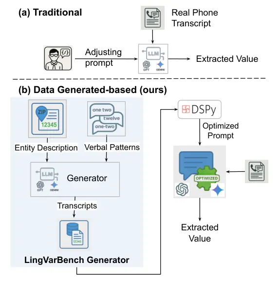

# LingVarBench: Benchmarking LLMs on Entity Recognitions and Linguistic Verbalization Patterns in Phone-Call Transcripts

Seyedali Mohammadi Thanks: These authors contributed equally.    Manas
Paldhe¹¹footnotemark: 1    Amit Chhabra    Youngseo Son    Vishal
Seshagiri Affiliation: Infinitus Systems, Inc., San Francisco, CA, USA
Affiliation: {ali.mohammadi, manas.paldhe, amit.chhabra, youngseo.son,
vishal.seshagiri}@infinitus.ai

###### Abstract

We study structured entity extraction from phone-call transcripts in
customer-support and healthcare settings, where annotation is costly and
data access is limited by privacy and consent. Existing methods degrade
under disfluencies, interruptions, and speaker overlap, yet large
real-call corpora are rarely shareable. We introduce LingVarBench, a
benchmark and semantic synthetic data generation pipeline that generates
linguistically varied training data via (1) LLM-sampled entity values,
(2) curated linguistic verbalization patterns covering diverse
disfluencies and entity-specific readout styles, and (3) a
value–transcript consistency filter. Using this dataset, DSPy’s SIMBA
automatically synthesizes and optimizes extraction prompts, reducing
manual prompt engineering and targeting robustness to verbal variation.
On real customer transcripts, prompts optimized solely on LingVarBench
outperform zero-shot baselines and match or closely approach human-tuned
prompts for structured entities such as ZIP code, date of birth, and
name (F1 $`\approx 94\text{--}95`$). For subjective questionnaire items,
optimized prompts substantially improve over zero-shot performance and
approach human-tuned prompts. LingVarBench offers a practical and
cost-efficient path to deployment in a direct-answer setting, with real
annotations later enabling additional refinement.

## 1 Introduction



Figure 1: Motivation for LingVarBench: (a) Traditional entity extraction
starts with little or no usable transcript data, leading to poor
performance and requiring manual prompt tuning as transcripts arrive.
(b) LingVarBench instead synthesizes diverse transcript verbalization
patterns and uses DSPy + SIMBA to optimize prompts and generate robust,
scalable evaluation data.

Figure 2: Overview of the LingVarBench Synthetic Data Generation
Framework: A three-step pipeline for generating linguistically varied
transcripts of structured fields. Canonical values (e.g., zip code) are
transformed into diverse spoken-style utterances with consistency checks
to ensure accurate recovery.

Voice-enabled AI is rapidly entering healthcare, powering clinical
documentation, patient interaction, and administrative automation (16;
2). A core building block of these systems is _structured information
extraction_ from patient–provider conversations: reliably recovering
name, date of birth (DOB), ZIP code, and other fields from spontaneous
speech (13). Unlike form-based EHR interfaces, voice AI must handle
highly variable verbalizations of the same fact (e.g., March third,
nineteen seventy-five, “three three seventy-five,” or “zero three zero
three one nine seven five” for a DOB).

As illustrated in Figure 1(a), current practice is largely _data-first
and human-in-the-loop_: teams wait for real phone transcripts to trickle
in, then repeatedly hand-tune prompts on restricted Protected Health
Information (PHI). Each new entity (ZIP, DOB, medications, etc.)
restarts this slow cycle, and robustness is limited to the narrow
linguistic patterns observed in the available calls. This workflow is
further constrained by HIPAA, which makes real transcripts scarce,
tightly access-controlled, and expensive to annotate (23). Existing NLP
benchmarks such as CoNLL-2003 and clinical named entity recognition
(NER) corpora (19) focus on written text and do not capture the
disfluencies and Linguistic Verbalization Patterns (LVPs)¹¹ 1 A
linguistic verbalization pattern is a recurring way in which a
structured value is realized in spoken language (e.g., different number
or date readings, fillers, hesitations, self-corrections). of
conversational healthcare speech.

We introduce LingVarBench²² 2 LingVarBench abbreviates Linguistic
Variation Benchmark; in this work, linguistic variation and linguistic
verbalization patterns both refer to the same concept: different ways
structured values are expressed in natural-language utterances., shown
in Figure 1(b) and detailed further in Figure 2, a semantic synthetic
data generation and evaluation framework for healthcare voice AI. Our
contributions are three-fold: (1) we synthesize HIPAA-compliant
patient–provider dialogues using large language models (LLMs) by
combining entity descriptions with curated LVPs,e.g., digit-by-digit vs.
grouped numbers, pauses, fillers, self-corrections; (2) we use DSPy +
SIMBA to automatically optimize extraction prompts on this synthetic
data, avoiding manual prompt engineering on PHI (full framework in
Figure 2); and (3) we provide a benchmark specification (entity schemas,
LVP inventory, and generation/validation protocol) to measure robustness
under controlled conversational variation.

On real-world production transcripts, prompts optimized exclusively on
LingVarBench outperform zero-shot prompting and match—or even
surpass—human-tuned prompts for structured entities such as ZIP, DOB,
and name (F1 $`\approx`$ 94–95), despite the human prompts being crafted
with access to real customer transcripts. For subjective questionnaire
items, the optimized prompts remain comparable to human-tuned
performance and substantially higher than zero-shot. These results show
that a fully automated, synthetic, linguistically controlled pipeline
can achieve near–human-level prompting without requiring access to PHI,
providing a practical path to HIPAA-compliant healthcare voice AI. This
approach is especially valuable at initial product launch, when
real-world datasets are not yet available.

## 2 Related Work

Much recent work has focused on clean text and high-quality
transcriptions for training their models 1; 12. These often fail to
generalize effectively in noisy real-world scenarios. Moreover, these
datasets frequently lack coverage of domain-specific or emerging
entities, limiting their long-term applicability. For example, 6
reported low F1 scores for entities such as email address (0.46) and
named products (0.65). 11 and 7 show that even modern neural-based NER
systems tend to memorize dataset-specific patterns rather than
generalize. These models often break down across datasets due to dataset
bias, annotation artifacts, and poor generalization to unseen entity
types or domains—highlighting the shallow generalization of even
well-curated datasets. Therefore, large datasets that accurately reflect
real-world scenarios are crucial for effectively fine-tuning models and
enhancing their performance 20; 3. To overcome these shortcomings,
synthetic data has been used to enhance model performance. Initially,
generative adversarial networks (GANs) 8 were popular for creating
synthetic data closely resembling real samples. More recently, language
models and other generative AI systems have been employed to create
datasets for various training tasks. 9 introduced the
Generate-Annotate-Learn (GAL) framework, which uses synthetic text data
to improve classification performance. Similar approaches have been
applied in other domains as well: for instance, synthetic speech has
been used to train automatic speech recognition (ASR) models 18, and
synthetic visual data has supported semantic segmentation in autonomous
driving 17. More recently, the emergence of LLMs has enabled the
generation of high-quality synthetic labels, further enhancing model
compression and distillation techniques. Fu et al. (2022) demonstrated
this by using pseudo-labels from a fine-tuned teacher model, enabling a
student model to achieve a 75 times speedup with only a 1% drop in
accuracy.

For model optimizations and fine-tuning, prompt-based learning has
emerged as a powerful paradigm for adapting large models to downstream
tasks 4; 21. However, prompt engineering for entity extraction remains a
trial-and-error process, especially when dealing with unpredictable user
input. Recent frameworks like DSPy 10 provide a principled way to
optimize prompts using differentiable feedback, but their effectiveness
is limited by the availability of diverse high-coverage datasets.

To train generalizable models with minimal human effort, we are
proposing a synthetic dataset generation pipeline tailored for entity
extraction from phone call transcriptions. We leverage LLMs to simulate
realistic transcripts with controlled LVPs and use DSPy to optimize
prompts that generalize across these variants. This enables rapid
iteration and robust evaluation without relying on expensive human
annotation. In this work, we instantiate the pipeline using three
commercially available LLMs: GPT 4, Gemini 2.0 Flash, and Gemini 2.5
Pro, allowing us to evaluate cross-model consistency and robustness.

## 3 Methodology

### 3.1 Problem Definition

Our problem formulation is grounded in the assumption that
instruction-tuned language models implicitly model how humans realize
structured values as spoken language, capturing diverse paraphrases,
disfluency and surface forms for the same underlying value 5; 15; 24. We
operationalize this “verbalization prior” by conditioning the LLM on a
value and a LVP, and then using it to sample candidate transcripts that
we later validate for value consistency. Formally, given a target entity
type $`e\in\mathcal{E}`$, a structured field description
$`d\in\mathcal{D}`$, and a LVP $`v\in\mathcal{V}`$, our goal is to
generate a transcript $`u\in\mathcal{U}`$ such that (i) the transcript
$`u`$ contains a valid instantiation of the entity $`e`$, consistent
with the field description $`d`$; (ii) $`u`$ reflects the specified
linguistic variation $`v`$; (iii) the distribution of $`u`$ approximates
the distribution of real-world phone call transcripts for the given
entity and variation type. We model a novel function $`G`$ as a
composition of three components. The overall generative function is

```math
G(d,v)=\mathcal{C}\big(T(V(d),v)\big),
```

where $`G:(\mathcal{D},\mathcal{V})\rightarrow(\mathcal{U},e)`$,
$`V:\mathcal{D}\rightarrow\mathbb{V}`$ is a Value Generator that samples
a plausible entity value from a field description,
$`T:\mathbb{V}\times\mathcal{V}\rightarrow\mathcal{U}`$ is a Transcript
Generator that produces a natural-language utterance embedding the value
with the desired variation, and
$`\mathcal{C}:\mathcal{U}\rightarrow(\mathcal{U},e)`$ is a Consistency
Checker that enforce value consistency and ensures the generated
transcript is semantically correct and contains a recoverable entity
$`e`$.

### 3.2 LingVarBench Overview

We developed three key modules—Value Generator, Transcript Generator,
and Consistency Checker, using LLMs. The data flow between these modules
is illustrated in Figure 2. The process begins with the Value Generator,
which takes a task description as input and produces plausible values
aligned with the specified description. These generated values, along
with predefined linguistic verbalization types, are then passed to the
Transcript Generator, which constructs transcripts embedding the
provided values. Finally, the Consistency Checker module verifies the
plausibility and consistency between the generated transcripts and the
corresponding values. Only those transcripts that pass this step are
retained for use. We next highlight the key challenge and how our design
enforces controllability and reliability.

Beyond simply prompting an LLM, the key technical challenge is ensuring
that generated transcripts are both (i) linguistically diverse and (ii)
semantically correct with respect to the intended structured value. In
LingVarBench, controllability comes from explicitly composing each
example from a field description and an LVP, while reliability comes
from enforcing two constraints: distributional coverage (uniform
coverage across value–variation pairs via recursive balancing) and
semantic consistency (filtering out generations where the transcript
does not unambiguously support the target value). Together, these
constraints turn LLM generation into a repeatable benchmark construction
procedure that supports fine-grained robustness evaluation and prompt
optimization.

#### 3.2.1 Inputs

We represent each field description using three components: the field
name (e.g., ZIP code), the data type (e.g., integer), and a natural
language description that specifies the format or constraints of the
field (e.g., “Zip code is a 5-digit number, with optional 4-digit add on
code"). To better reflect real-world spoken language, we also define a
set of LVPs that capture speech phenomena such as disfluencies, informal
syntax, entity format variability, and self-corrections—features that
are typically underrepresented in conventional benchmarks.

In our experiments, we evaluated model performance on the following
entities: ZIP code, DOB, name, pain rating, respiratory issues, and
hearing issues. Together, these entities span a range of types,
including integers, strings, dates, booleans, and multi-select enums.
Although our experiments instantiate LingVarBench on these six entities,
the framework is entity-agnostic: adding a new field requires only a
schema-level description (name, type, and constraints) plus optional
entity-specific LVP templates for common readout conventions. We view
broader entity coverage (e.g., additional intake fields and
open-vocabulary clinical concepts) as an important next step. We
selected this set because it reflects the core fields used in our
production intake flows: ZIP, DOB, and name are high-stakes
authentication fields, while pain rating and respiratory/hearing issues
are clinically relevant screening questions that stress both numerical
and yes/no/multi-select reasoning under noisy speech.

In this work, we focus on direct-answer turns, i.e., utterances that
explicitly contain (or directly state) the target value in response to
the system question. This isolates robustness to linguistic realization
(LVPs) while keeping supervision well-defined. We do not yet model
multi-turn resolution or dialogue acts such as refusals (“I’d rather not
say”), topic shifts, clarification questions (“Which date do you
mean?”), or pragmatic/implicit answers (“same as last time”), which are
common in real phone calls and require additional dialogue-state or
answerability modeling.

#### 3.2.2 Value Generation Module

The Value Generation component uses an LLM prompted with the field
description to produce sample values. The quantity of generated values
is configurable, allowing for increased diversity in the output. An
abstracted template prompt is shown in Figure 3 (in Appendix A).

#### 3.2.3 Transcript Generation Module

The transcript generation modules generate all possible pairs of a) the
values generated by the Value generation module and b) the LVPs. For
each pair, the module prompts the LLM to generate a phone call
transcription that will provide the specific value with the specific
LVP. To prevent over-representation of certain value–variation pairs,
the module employs a recursive generation strategy: underrepresented
pairs are identified and re-prompted until a balanced distribution is
achieved. This ensures uniform coverage across the dataset while
preserving linguistic diversity. The output of this module is a list of
transcripts for every generated value. An abstracted
transcript-generation prompt appears in Figure 4 (in Appendix A).

##### Linguistic Verbalization Patterns (LVPs)

To simulate the variability of real-world speech, we define a set of
LVPs applied during transcript generation. These patterns fall into two
categories: (a) general variations, which capture stylistic or pragmatic
features such as disfluencies, hesitations, or confirmation-seeking, and
(b) entity-specific variations, which reflect how different structured
fields (e.g., ZIP codes) are naturally expressed in spoken language. For
example, the general variation self-correction is defined such that the
model includes self-corrections in its response, e.g., ‘‘it’s one two...
no wait, four five’’. Our LVPs model variation within direct answers; We
isolate robustness to linguistic realization (LVPs) by mainly focusing
on direct-answer turns, providing a controlled environment to measure
information extraction accuracy specifically independently of multi-turn
dialogue state modeling (refusals, topic shifts, multi-turn grounding),
which allows for a more precise evaluation of the model’s sensitivity to
spoken-language variation.

Entity-specific variations introduce structural diversity. For
date-of-birth, for instance, we include types like spoken_date_8_digits,
which verbalizes the full date using individual spoken digits. An
example would be: "one two zero two one nine four seven". These curated
types enable precise control over linguistic diversity and support
fine-grained robustness evaluation for extraction models. A detailed
description of all LVPs that we used is available in Tables 6-11, in
Appendix D.

##### Design and extensibility of LVPs.

We intentionally define LVPs as a lightweight, modular inventory
(Appendix D) rather than learning a latent variation model, because our
goal is controllable stress-testing of extractors under specific
spoken-language phenomena. The inventory is structured to be extensible:
(i) _general_ LVPs capture broadly reusable dialogue surface phenomena
(e.g., hesitation, self-correction, confirmation-seeking), while (ii)
_entity-specific_ LVPs encode formatting conventions tied to an entity
schema (e.g., digit grouping for DOB/ZIP, name variants). To extend
LingVarBench to a new domain or language, one typically keeps the
general LVPs and adds/edits a small set of entity-specific templates
reflecting local conventions; the rest of the pipeline remains
unchanged. Newly added LVPs can be sanity-checked automatically by
generating samples and retaining only those where the intended value is
recoverable under the same consistency validation used in the pipeline.

#### 3.2.4 Transcript Consistency Checker Module

Recent work shows that LLMs can behave unpredictably under knowledge
conflicts, sometimes readily incorporating external evidence and
sometimes stubbornly adhering to their internal parametric memory 22; 14. Motivated by these findings, we incorporate a Transcript Consistency
Checker module within the pipeline. This module reuses the same LLM as a
verifier to determine whether a generated transcript correctly contains
the intended value. To mitigate the impact of false positives on the
data distribution, the system recursively invokes the Transcript
Generation Module until the target number of valid samples is achieved.
In our current setup, the checker filters out non-answer turns (e.g.,
refusals or off-topic responses), reflecting our direct-answer scope.
Although false negatives pose a risk by introducing labeling noise, this
can be mitigated through more stringent validation criteria (e.g.,
requiring exact value recovery or higher confidence).

### 3.3 Prompt Optimization with DSPy

For every entity, we used the LingVarBench Synthetic Data Generation
framework to generate about a thousand labels of ground truth data. This
was then split into training and test dataset. We used the training data
to optimize the prompts for entity extraction using DSPy 10 and SIMBA
optimization engine. The optimized prompt was then tested with the test
split of the dataset. We then used our proprietary real phone call
dataset from calls to patients to verify that the optimized prompt works
in the real world. The base instruction used for DSPy optimization is
shown in Figure 6 (Appendix A).

## 4 Experimental Setup and Results

### 4.1 Proprietary Dataset

We deploy voice AI agents to automate patient-facing phone calls in
healthcare settings. Every call is reviewed by a human-in-the-loop
before submitting to the customer. Our customers also audit the data for
correctness providing us with a second layer of validation. For each
question asked by the voice agent, the dataset includes the
corresponding patient utterance and the extracted entity response. The
two layer validation process leads to a high-quality ground-truth
dataset for entity extraction from real-world phone interactions. Due to
the sensitive nature of healthcare data, this dataset cannot be
open-sourced or publicly released. However, we used it internally to
validate the performance of our optimized prompts. Figure 7, in Appendix
A, presents fabricated examples to illustrate the structure and content
of the dataset.

##### Data availability and reproducibility.

Due to privacy, consent, and organizational constraints, we do not
release the proprietary real-call dataset used for external validation,
the generated synthetic benchmark dataset, or our internal codebase. We
therefore provide a detailed benchmark specification (entity schemas and
LVP inventory in Appendix D), generation/validation protocol, prompt
templates in Appendix A, and complete experimental settings to support
independent reimplementation and analysis.

### 4.2 Metrics

To evaluate the effectiveness of our approach, we conducted experiments
to measure (i) the entity extraction accuracy achieved using prompts
optimized with LingVarBench-generated data; (ii) the similarity between
real transcripts and LingVarBench-generated synthetic transcripts.

##### Entity extraction accuracy

We used LingVarBench to optimize entity extraction prompts for three
general entities, zip code, name, DOB, and three specific entities, pain
rating, respiratory issues, and hearing issues, for which human-labeled
data are available. We compared the accuracy of prompts optimized using
LingVarBench against two baselines: (a) a zero-shot human-written
prompt, and (b) a human-written prompt optimized through evaluation and
tuning on historical data. We compute F1 scores using binary correctness
at the sample level.

##### Similarity scores

|                  |         |        |       |         |       |        |       |             |       |               |       |                 |       |
| ---------------- | ------- | ------ | ----- | ------- | ----- | ------ | ----- | ----------- | ----- | ------------- | ----- | --------------- | ----- |
| Prompt Type      | Model   | ZIP(%) |       | Name(%) |       | DOB(%) |       | Pain Rt.(%) |       | Resp. Iss.(%) |       | Hearing Iss.(%) |       |
|                  |         | Acc    | F1    | Acc     | F1    | Acc    | F1    | Acc         | F1    | Acc           | F1    | Acc             | F1    |
| 0-shot           | GPT 4   | 88.62  | 93.93 | 78.19   | 87.77 | 74.52  | 85.42 | 80.18       | 81.41 | 96.18         | 95.04 | 87.43           | 87.88 |
|                  | Gem 2.5 | 89.37  | 94.34 | 79.15   | 88.38 | 77.04  | 87.01 | 82.28       | 85.10 | 96.84         | 95.77 | 82.94           | 83.70 |
|                  | Gem 2.0 | 88.50  | 93.85 | 47.87   | 64.75 | 72.50  | 84.04 | 80.97       | 82.51 | 96.18         | 94.92 | 84.18           | 84.84 |
| Human            | GPT 4   | 88.87  | 94.06 | 79.16   | 88.38 | 80.28  | 89.05 | 86.22       | 87.33 | 81.18         | 63.50 | 89.79           | 90.09 |
|                  | Gem 2.5 | 89.75  | 94.54 | 79.56   | 88.59 | 81.84  | 90.00 | 82.15       | 85.36 | 97.50         | 96.65 | 82.94           | 83.61 |
|                  | Gem 2.0 | 89.76  | 94.58 | 83.38   | 90.97 | 82.62  | 90.47 | 81.10       | 82.7  | 97.11         | 96.04 | 84.06           | 84.65 |
| Optimized (Ours) | GPT 4   | 89.79  | 94.66 | 90.18   | 94.84 | 78.59  | 94.84 | 80.05       | 81.53 | 96.71         | 95.67 | 88.44           | 88.74 |
|                  | Gem 2.5 | 95.07  | 94.61 | 85.20   | 94.15 | 80.80  | 89.38 | 82.94       | 85.93 | 96.58         | 95.56 | 88.78           | 89.15 |
|                  | Gem 2.0 | 89.14  | 89.30 | 90.18   | 94.84 | 80.66  | 89.30 | 85.43       | 86.8  | 96.84         | 95.86 | 88.10           | 88.45 |

Table 1: Accuracy and F1 on real-world production data using zero-shot,
human-written (tuned on real data for Gemini 2.0), and optimized
prompts. Our prompts are optimized using only synthetic data generated
by LingVarBench, yet outperform zero-shot and match or exceed
human-tuned prompts for ZIP and Name, and improve over 0-shot for DOB.

We used text embedding models in conjunction with cosine similarity to
assess the similarity between LingVarBench-generated transcripts and
real phone call transcripts.

```math
\text{Similarity}(T_{\text{real}},T_{\text{synthetic}})=\frac{\vec{E}_{\text{real}}\cdot\vec{E}_{\text{synthetic}}}{\|\vec{E}_{\text{real}}\|\,\|\vec{E}_{\text{synthetic}}\|}
```

where: $`T_{\text{real}}`$ is the real phone call transcript annotated
with ground truth entities, $`T_{\text{synthetic}}`$ is the
corresponding synthetic transcript generated by LingVarBench using the
same entity values and LVP, $`\vec{E}_{\text{x}}`$ is the embedding
vector of the input text.

|                        |       |      |      |      |      |       |       |
| ---------------------- | ----- | ---- | ---- | ---- | ---- | ----- | ----- |
| Model                  | Var.  | ZIP  | Name | DOB  | Pain | Resp. | Hear. |
| text-embedding-3-large | Match | 0.81 | 0.81 | 0.62 | 0.66 | 0.57  | 0.69  |
|                        | Super | 0.78 | 0.77 | 0.58 | 0.65 | 0.55  | 0.58  |
|                        | Sub   | 0.72 | 0.65 | 0.62 | 0.64 | 0.53  | 0.59  |
|                        | Null  | 0.67 | 0.55 | 0.55 | 0.42 | 0.43  | 0.39  |
| gemini-embedding-001   | Match | 0.91 | 0.92 | 0.83 | 0.75 | 0.65  | 0.78  |
|                        | Super | 0.90 | 0.91 | 0.82 | 0.72 | 0.62  | 0.70  |
|                        | Sub   | 0.87 | 0.83 | 0.83 | 0.71 | 0.62  | 0.71  |
|                        | Null  | 0.85 | 0.77 | 0.80 | 0.70 | 0.58  | 0.67  |

Table 2: Cosine similarity between real and synthetic transcripts. Let
$`V_{r}`$ = variation types in real transcripts, $`V_{s}`$ = variation
types in synthetic transcripts. Match refers to the similarity scores
when $`V_{s}=V_{r}`$; Super refers to the similarity scores when
$`V_{s}\supseteq V_{r}`$ ; Sub refers to the similarity scores when
$`V_{s}\subseteq V_{r}`$; and Null refers to the case when:
$`V_{s}\cap V_{r}=\emptyset`$. Full results with standard deviations are
in Table 5 in Appendix C.

### 4.3 Implementation Details

We implemented the pipeline in Python using DSPy 10. We instantiate the
pipeline using three commercially available LLMs: GPT 4 (via Azure
OpenAI), Gemini 2.0 Flash, and Gemini 2.5 Pro (via Google Vertex AI).
All models are used across the generation, validation, and extraction
stages. Prompt formats were standardized across models, and decoding
parameters (temperature = 0, top-p = 1.0) were kept consistent. This
setup allows us to evaluate the framework’s robustness across models. We
chose GPT-4 and Gemini 2.5 Pro because they are the state of the art
cloud-hosted models for which we have appropriate Business Associate
Agreements (BAAs). We tested with Gemini 2.0 flash because we leverage
faster LLMs in production to deliver low-latency experience to patients.
For semantic similarity evaluations, we used the text-embedding-3-large
(OpenAI) and gemini-embedding-001 (Google) models.

### 4.4 Results and Discussion

We evaluate LingVarBench on six entities for which our proprietary
dataset provides high-quality, human-validated ground truth. We group
these into _general entities_ (ZIP code, DOB, name) and _task-specific
entities_ (pain rating, respiratory issues, hearing issues). Together,
they span integers, strings, dates, booleans, and multi-select enums,
and cover both common patient-identifying information and clinically
relevant screening questions. We focus on this set because it is the
subset for which our production evaluation data provides consistent,
human-validated ground truth. Our framework is designed to be
entity-agnostic. Although we demonstrate its efficacy on a core set of
six critical healthcare and authentication fields, the architecture
allows for seamless extension to new domains and tasks via schema-level
descriptions for future work. Summary statistics of the synthetic
transcripts and DSPy training/validation/test splits are reported in
Appendix B (Tables 3 and 4).

Table 1reports the performance of zero-shot, human-written, and
LingVarBench-optimized prompts on real production calls. For general
entities, LingVarBench-optimized prompts trained _only_ on synthetic
data achieve approximately 90% accuracy for ZIP and name, matching or
exceeding human-tuned prompts. DOB accuracy is somewhat lower, largely
due to synthetic samples that use less common date formats (e.g.,
dd-mm-yyyy) in U.S. speech, highlighting the importance of domain-aware
formatting priors when generating synthetic transcripts.

Among task-specific entities, pain rating is more challenging because
patients often respond with ambiguous phrases such as “none”, “high”, or
“low”, which reduces accuracy despite strong performance on canonical
numerical answers. Respiratory issues are asked via a yes/no question
(“Do you have any respiratory issues?”), yielding generally high
accuracy and F1. Hearing issues are selected from a small, fixed set of
options; because the response space is highly constrained, variation is
limited and all prompt types perform similarly.

In real-world conversations, entities may not appear immediately or
directly in response to a question, introducing labeling noise because
human annotators do not mark the exact utterance span; as a result, 100%
accuracy is effectively unattainable. Moreover, the human-crafted prompt
was optimized specifically for Gemini 2.0 Flash, so it is expected to
outperform other models when re-used without further tuning.

Table 2presents cosine similarity between synthetic and real transcripts
with matched entity values. We observe that similarity increases as the
alignment of LVPs between real and synthetic transcripts improves, and
this trend holds across both embedding models. This supports that our
synthetic generation pipeline produces transcripts that closely resemble
real-world conversational data, even though both sides share the same
underlying entity values. Additional similarity results with standard
deviations are included in the Appendix. We hypothesize that
incorporating an even broader range of LVPs could further sharpen the
separation between variation-matched and variation-mismatched
conditions.

## 5 Conclusion

This work presents LingVarBench, a synthetic data generation pipeline
leveraging large language models to produce NER datasets tailored for
phone call transcripts, guided by human-defined entity specifications
and linguistic verbalization patterns. We demonstrate that entity
extraction models trained on LingVarBench-generated data for various
entities achieve performance comparable to that obtained via
human-crafted prompt tuning on large-scale real-world call datasets.

## 6 Limitations

The framework presently models only direct answers that explicitly
respond to the question; it does not yet capture indirect, ambiguous, or
off-topic utterances (e.g., refusals, topic shifts, or pragmatic
answers). Extending the framework to simulate such complex dialogue
phenomena remains an important direction for future work.

Our LVP inventory is curated for controllable variation but is not
exhaustive; expanding to new domains or languages may require new
templates. We also evaluate six structured entities with reliable ground
truth, and leave broader coverage (e.g., additional intake fields or
open-vocabulary concepts) to future work.

We note that the human-optimized prompt underperformed relative to the
zero-shot GPT-4 prompt when extracting respiratory-issue entities,
because the human prompt was optimized for the Gemini 2.0 Flash model.

## Ethical Considerations

This research centers on using large language models to generate
synthetic data for training NER systems tailored to phone-call
transcripts. We do not release any real customer transcripts, and we
also do not release the generated synthetic benchmark dataset due to
organizational data-sharing constraints. To support transparency, we
document the full benchmark specification (entity schemas and LVP
inventory) and the generation/validation protocol.

## Acknowledgments

We thank Dr. Manas Gaur (Prof. at University of Maryland, Baltimore
County) for providing valuable feedback on the manuscript. We also thank
Amanda Griffin for her assistance with preparing the figures. Finally,
we thank Infinitus System, Inc. for providing access to the real-world
production transcripts used for evaluation, as well as for the financial
support and computational resources that enabled this research.

## References

- Arokodare et al. (2025) O. Arokodare, H. Wimmer, and J. Du Clinical
  Text Summarization using NLP Pretrained Language Models: A Case Study
  of MIMIC-IV-Notes. Journal of Information Systems Applied Research and
  Analytics 18 (1), pp. 17–31. Cited by: §2.
- Augnito (2024) Augnito Voice ai in healthcare: statistics and trends
  for 2024. Note:
  [https://augnito.ai/resources/stats-on-voice-ai-in-healthcare/](https://augnito.ai/resources/stats-on-voice-ai-in-healthcare/)
  Cited by: §1.
- Bao et al. (2023) J. Bao, R. Wang, Y. Wang, A. Sun, Y. Li, F. Mi,
  and R. Xu A synthetic data generation framework for grounded
  dialogues. In Proceedings of the 61st Annual Meeting of the
  Association for Computational Linguistics (Volume 1: Long Papers), A.
  Rogers, J. Boyd-Graber, and N. Okazaki (Eds.), Toronto, Canada,
  pp. 10866–10882. External Links:
  [Link](https://aclanthology.org/2023.acl-long.608/),
  [Document](https://dx.doi.org/10.18653/v1/2023.acl-long.608) Cited by:
  §2.
- Brown et al. (2020a) T. B. Brown, B. Mann, N. Ryder, and et al.
  Language models are few-shot learners. In Advances in Neural
  Information Processing Systems (NeurIPS), Vol. 33, pp. 1877–1901.
  Cited by: §2.
- Brown et al. (2020b) T. B. Brown, B. Mann, N. Ryder, M. Subbiah, J.
  Kaplan, P. Dhariwal, A. Neelakantan, P. Shyam, G. Saxena, A. Bosma, et
  al. Language models are few-shot learners. In Advances in Neural
  Information Processing Systems, Vol. 33, pp. 1877–1901. Cited by:
  §3.1.
- Davidson et al. (2021) S. Davidson, J. Hosier, Y. Zhou, and V. Gurbani
  Improved named entity recognition for noisy call center transcripts.
  In Proceedings of the Seventh Workshop on Noisy User-generated Text
  (W-NUT 2021), W. Xu, A. Ritter, T. Baldwin, and A. Rahimi (Eds.),
  Online, pp. 361–370. External Links:
  [Link](https://aclanthology.org/2021.wnut-1.40/),
  [Document](https://dx.doi.org/10.18653/v1/2021.wnut-1.40) Cited by:
  §2.
- Eger et al. (2020) S. Eger, A. Youssef, and I. Gurevych Is it time to
  swish? comparing deep learning activation functions across nlp tasks.
  In Proceedings of EMNLP, pp. 4263–4273. Cited by: §2.
- Goodfellow et al. (2014) I. J. Goodfellow, J. Pouget-Abadie, M.
  Mirza, B. Xu, D. Warde-Farley, S. Ozair, A. Courville, and Y. Bengio
  Generative adversarial nets. In Advances in Neural Information
  Processing Systems, Z. Ghahramani, M. Welling, C. Cortes, N. Lawrence,
  and K.Q. Weinberger (Eds.), Vol. 27, pp. . External Links:
  [Link](https://proceedings.neurips.cc/paper_files/paper/2014/file/f033ed80deb0234979a61f95710dbe25-Paper.pdf)
  Cited by: §2.
- He et al. (2022) X. He, I. Nassar, J. Kiros, G. Haffari, and M.
  Norouzi Generate, annotate, and learn: NLP with synthetic text.
  Transactions of the Association for Computational Linguistics 10,
  pp. 826–842. External Links:
  [Link](https://aclanthology.org/2022.tacl-1.48/),
  [Document](https://dx.doi.org/10.1162/tacl%5Fa%5F00492) Cited by: §2.
- Khattab et al. (2024) O. Khattab, A. Singhvi, P. Maheshwari, Z.
  Zhang, K. Santhanam, S. Vardhamanan, S. Haq, A. Sharma, T. T.
  Joshi, H. Moazam, et al. DSPy: compiling declarative language model
  calls into self-improving pipelines. In The Twelfth International
  Conference on Learning Representations, Note: DSPy framework for
  programming language models with automated prompt optimization using
  techniques like SIMBA (Stochastic Introspective Mini-Batch Ascent).
  External Links: [Link](https://openreview.net/forum?id=s9t4SkQ8T3)
  Cited by: §2, §3.3, §4.3.
- Kim and Kang (2022) H. Kim and J. Kang How do your biomedical named
  entity recognition models generalize to novel entities?. IEEE Access
  10 (), pp. 31513–31523. External Links:
  [Document](https://dx.doi.org/10.1109/ACCESS.2022.3157854) Cited by:
  §2.
- Liu et al. (2025) L. Liu, Z. Wu, Y. Wu, Y. Wang, R. Yao, X. Li, J.
  Hu, L. Ruan, and Y. Zhou Using natural language processing to extract
  information from clinical text in electronic medical records for
  populating clinical registries: a systematic review. Journal of the
  American Medical Informatics Association. External Links:
  [Document](https://dx.doi.org/10.1093/jamia/ocaf176), ISSN 1527-974X
  Cited by: §2.
- LLP (2024) F. &. L. LLP HIPAA compliance for ai in digital health:
  what privacy officers need to know. Note: Overview of HIPAA
  requirements for AI systems handling PHI in digital health. External
  Links:
  [Link](https://www.foley.com/insights/publications/2025/05/hipaa-compliance-ai-digital-health-privacy-officers-need-know/)
  Cited by: §1.
- Mohammadi et al. (2025) S. Mohammadi, B. H. Vedula, H. Lamba, E.
  Raff, P. Kumaraguru, F. Ferraro, and M. Gaur Do llms adhere to label
  definitions? examining their receptivity to external label
  definitions. In Proceedings of the 2025 Conference on Empirical
  Methods in Natural Language Processing, pp. 32368–32381. Cited by:
  §3.2.4.
- Ouyang et al. (2022) L. Ouyang, J. Wu, X. Jiang, D. Almeida, C.
  Wainwright, P. Mishkin, C. Zhang, S. Agarwal, K. Slama, A. Ray, et al.
  Training language models to follow instructions with human feedback.
  Advances in neural information processing systems 35, pp. 27730–27744.
  Cited by: §3.1.
- Research (2024) G. V. Research AI voice agents in healthcare market \|
  industry report, 2030. Note:
  [https://www.grandviewresearch.com/industry-analysis/ai-voice-agents-healthcare-market-report](https://www.grandviewresearch.com/industry-analysis/ai-voice-agents-healthcare-market-report)Market
  size estimated at \$468M in 2024, projected CAGR of 37.79%
  through 2030. Cited by: §1.
- Ros et al. (2016) G. Ros, L. Sellart, J. Materzynska, D. Vazquez,
  and A. M. Lopez The synthia dataset: a large collection of synthetic
  images for semantic segmentation of urban scenes. In 2016 IEEE
  Conference on Computer Vision and Pattern Recognition (CVPR), Vol. ,
  pp. 3234–3243. External Links:
  [Document](https://dx.doi.org/10.1109/CVPR.2016.352) Cited by: §2.
- Rosenberg et al. (2019) A. Rosenberg, Y. Zhang, B. Ramabhadran, Y.
  Jia, P. Moreno, Y. Wu, and Z. Wu Speech recognition with augmented
  synthesized speech. In 2019 IEEE Automatic Speech Recognition and
  Understanding Workshop (ASRU), Vol. , pp. 996–1002. External Links:
  [Document](https://dx.doi.org/10.1109/ASRU46091.2019.9003990) Cited
  by: §2.
- Tjong Kim Sang and De Meulder (2003) E. F. Tjong Kim Sang and F. De
  Meulder Introduction to the CoNLL-2003 shared task:
  language-independent named entity recognition. In Proceedings of the
  Seventh Conference on Natural Language Learning at HLT-NAACL 2003,
  Edmonton, Canada, pp. 142–147. External Links:
  [Link](https://www.aclweb.org/anthology/W03-0419) Cited by: §1.
- Wang et al. (2024) Y. Wang, D. Feng, Y. Dai, Z. Chen, J. Huang, S.
  Ananiadou, Q. Xie, and H. Wang HARMONIC: harnessing llms for tabular
  data synthesis and privacy protection. Advances in Neural Information
  Processing Systems 37, pp. 100196–100212. Cited by: §2.
- Wei et al. (2022) J. Wei, X. Wang, D. Schuurmans, and et al. Chain of
  thought prompting elicits reasoning in large language models. In
  Advances in Neural Information Processing Systems (NeurIPS), Vol. 35,
  pp. 24824–24837. Cited by: §2.
- Xie et al. (2023) J. Xie, K. Zhang, J. Chen, R. Lou, and Y. Su
  Adaptive chameleon or stubborn sloth: revealing the behavior of large
  language models in knowledge conflicts. In The Twelfth International
  Conference on Learning Representations, Cited by: §3.2.4.
- Zhan et al. (2024) X. Zhan, N. Abdi, W. Seymour, and J. Such
  Healthcare voice ai assistants: factors influencing trust and
  intention to use. Proc. ACM Hum.-Comput. Interact. 8 (CSCW1). External
  Links: [Link](https://doi.org/10.1145/3637339),
  [Document](https://dx.doi.org/10.1145/3637339) Cited by: §1.
- Zhang et al. (2025) J. Zhang, J. Guo, J. Yuan, H. Lu, Y. Zhou, F.
  Wu, Q. Wang, and D. Lu LLM-driven completeness and consistency
  evaluation for cultural heritage data augmentation in cross-modal
  retrieval. In Proceedings of the 2025 Conference on Empirical Methods
  in Natural Language Processing, pp. 19418–19428. Cited by: §3.1.

## Appendix A Prompt Templates


Figure 3: Abstracted Prompt for Value Generation


Figure 4: Abstracted Prompt for Transcript Generation


Figure 5: Abstracted Prompt for Validation


Figure 6: Base Extraction Instructions used in DSPy optimization (ZIP
Code)

> Agent: Could you tell me your name please?  
> Patient: It is John.  
> → Entity extracted: Name  Entity value: John
>
> Agent: What is your zip code?  
> Patient: It is nine double one oh one.  
> → Entity extracted: ZIP Code  Entity value: 91101 Agent: Do you have
> any respiratory issues?  
> Patient: Yes, I have asthma.  
> Agent: What about any of these hearing issues? Deafness, hard of
> hearing, or do you use hearing aids?  
> Patient: Hearing aid.

Figure 7: Fabricated examples reflecting the structure of real
patient–agent interactions used in evaluation. Real transcripts cannot
be shown due to HIPAA constraints.

## Appendix B Dataset and Implementation Details

|              |         |            |                          |         |             |           |                   |
| ------------ | ------- | ---------- | ------------------------ | ------- | ----------- | --------- | ----------------- |
| Entity       | Model   | \# Samples | Split (Train/Valid/Test) | \# Tags | \# Tag Occ. | \# Values | Avg Len (±std)    |
| ZIP code     | GPT 4   | 5635       | 3944 / 845 / 846         | 33      | 12449       | 10        | 41.7 ± 10.0       |
|              | Gem 2.5 | 1332       | 932 / 199 / 201          | 33      | 2539        | 5         | 41.3 ± 20.0       |
|              | Gem 2.0 | 6467       | 4526 / 970 / 971         | 31      | 12101       | 12        | 41.1 ± 11.2       |
| Name         | GPT 4   | 2550       | 1785 / 382 / 383         | 46      | 5466        | 12        | 26.0 ± 8.5        |
|              | Gem 2.5 | 2164       | 1514 / 324 / 326         | 51      | 3468        | 5         | 29.7 ± 11.1       |
|              | Gem 2.0 | 6631       | 4641 / 994 / 996         | 46      | 12397       | 12        | 31.3 ± 13.0       |
| DOB          | GPT 4   | 1055       | 739 / 158 / 158          | 36      | 2314        | 7         | 54.63 ± 10.74     |
|              | Gem 2.5 | 821        | 574 / 123 / 124          | 34      | 1436        | 3         | 48.66 ± 19.31     |
|              | Gem 2.0 | 682        | 477 / 102 / 103          | 33      | 682         | 5         | 63.3 ± 34.0       |
| Pain Rt.     | GPT 4   | 296        | 207 / 44 / 45            | 19      | 490         | 11        | 39.7 ± 16.8       |
|              | Gem 2.5 | 885        | 619 / 132 / 134          | 19      | 1055        | 11        | 38.0 ± 16.6       |
|              | Gem 2.0 | 823        | 576 / 123 / 124          | 19      | 1082        | 11        | 39.4 ± 17.8       |
| Resp. Iss.   | GPT 4   | 2114       | 1479 / 317 / 318         | 21      | 4056        | 2         | 56.4 $`\pm`$ 20.6 |
|              | Gem 2.5 | 886        | 620 / 132 / 134          | 21      | 1111        | 2         | 40.9 $`\pm`$ 20.5 |
|              | Gem 2.0 | 704        | 492 / 105 / 107          | 22      | 886         | 2         | 61.9 $`\pm`$ 38.0 |
| Hearing Iss. | GPT 4   | 795        | 556 / 119 / 120          | 37      | 861         | 7         | 45.5 ± 19.2       |
|              | Gem 2.5 | 992        | 694 / 148 / 150          | 37      | 1733        | 7         | 57.7 ± 25.5       |
|              | Gem 2.0 | 4530       | 3171 / 679 / 680         | 37      | 5846        | 7         | 43.6 ± 19.5       |

Table 3: Dataset statistics by entity and model. Totals or averages are
reported per entity and across all entities for applicable columns The
total number of valid samples varies because, although we request five
samples per prompt per iteration, this is not strictly enforced. Hence,
the LLM may produce fewer than five samples. The proportion of invalid
samples was below 1%. Note that “# Tag Occ.” is the total count of
variation tags assigned across all transcripts. Since transcripts can
have multiple tags, this exceeds the number of samples.

|              |         |               |              |
| ------------ | ------- | ------------- | ------------ |
| Entity       | Model   | Valid Acc.(%) | Test Acc.(%) |
| ZIP code     | GPT 4   | 96.92         | 96.93        |
|              | Gem 2.5 | 80.90         | 78.11        |
|              | Gem 2.0 | 89.59         | 89.19        |
| Name         | GPT 4   | 96.34         | 97.34        |
|              | Gem 2.5 | 72.22         | 70.25        |
|              | Gem 2.0 | 79 .58        | 79.51        |
| DOB          | GPT 4   | 98.10         | 98.11        |
|              | Gem 2.5 | 100           | 97.58        |
|              | Gem 2.0 | 94.12         | 99.03        |
| Pain Rt.     | GPT 4   | 100           | 100          |
|              | Gem 2.5 | 100           | 100          |
|              | Gem 2.0 | 99.19         | 100          |
| Resp. Iss.   | GPT 4   | 100           | 100          |
|              | Gem 2.5 | 100           | 96.58        |
|              | Gem 2.0 | 97.29         | 100          |
| Hearing Iss. | GPT 4   | 68.91         | 79.17        |
|              | Gem 2.5 | 84.46         | 84.91        |
|              | Gem 2.0 | 78.64         | 80.44        |

Table 4: Validation and test accuracy on synthetic data during
DSPy-based prompt optimization. All results are based on
LingVarBench-generated transcripts for each entity type.

## Appendix C Additional Results

|                    |                 |                 |                 |                 |                 |                 |
| ------------------ | --------------- | --------------- | --------------- | --------------- | --------------- | --------------- |
| Variation Type     | ZIP code        | Name            | DOB             | Pain Rt.        | Resp. Iss.      | Hearing Iss.    |
| Match              | 0.81$`\pm`$0.13 | 0.81$`\pm`$0.15 | 0.62$`\pm`$0.14 | 0.66$`\pm`$0.10 | 0.57$`\pm`$0.02 | 0.69$`\pm`$0.2  |
| Superset variation | 0.78$`\pm`$0.13 | 0.77$`\pm`$0.15 | 0.58$`\pm`$0.17 | 0.65$`\pm`$0.10 | 0.55$`\pm`$0.02 | 0.58$`\pm`$0.18 |
| Subset variation   | 0.72$`\pm`$0.14 | 0.65$`\pm`$0.17 | 0.62$`\pm`$0.14 | 0.64$`\pm`$0.15 | 0.53$`\pm`$0.03 | 0.59$`\pm`$0.20 |
| Null overlap       | 0.67$`\pm`$0.14 | 0.55$`\pm`$0.17 | 0.55$`\pm`$0.17 | 0.42$`\pm`$0.15 | 0.43$`\pm`$0.03 | 0.39$`\pm`$0.21 |

(a) text-embedding-3-large (OpenAI)

|                    |                 |                 |                 |                 |                 |                 |
| ------------------ | --------------- | --------------- | --------------- | --------------- | --------------- | --------------- |
| Variation Type     | ZIP code        | Name            | DOB             | Pain Rt.        | Resp. Iss.      | Hearing Iss.    |
| Match              | 0.91$`\pm`$0.07 | 0.92$`\pm`$0.08 | 0.83$`\pm`$0.08 | 0.75$`\pm`$0.05 | 0.65$`\pm`$0.02 | 0.78$`\pm`$0.11 |
| Superset variation | 0.90$`\pm`$0.07 | 0.91$`\pm`$0.1  | 0.82$`\pm`$0.09 | 0.72$`\pm`$0.05 | 0.62$`\pm`$0.03 | 0.70$`\pm`$0.11 |
| Subset variation   | 0.87$`\pm`$0.07 | 0.83$`\pm`$0.08 | 0.83$`\pm`$0.09 | 0.71$`\pm`$0.05 | 0.62$`\pm`$0.02 | 0.71$`\pm`$0.11 |
| Null overlap       | 0.85$`\pm`$0.07 | 0.77$`\pm`$0.1  | 0.80$`\pm`$0.09 | 0.70$`\pm`$0.06 | 0.58$`\pm`$0.02 | 0.67$`\pm`$0.11 |

(b) gemini-embedding-001 (Google)

Table 5: Similarity scores across different embedding models. “Match”
indicates identical variation types in both generated and reference
transcripts. “Superset variation” refers to generated transcripts
containing all variation types from the reference plus additional ones.
“Subset variation” uses a non-empty subset of the reference’s variation
types. “Null overlap” indicates no shared variation types.

## Appendix D Linguistic Verbalization Patterns

##### Extending the LVP inventory (domains, languages, new phenomena).

Each LVP is specified as a short _instruction template_ plus an
_example_ ((Tables 6–11) ). Extending the inventory is straightforward:
(1) reuse general LVPs (disfluency, self-correction, confirmation cues)
across entities and domains; (2) add entity-specific LVPs by enumerating
plausible surface realizations implied by the entity schema (e.g.,
alternative date/number readouts, spelling, honorifics); and (3)
iteratively validate candidates using the same value–transcript
consistency check, discarding patterns that frequently produce
non-recoverable values. For new languages, the same structure applies:
general LVPs are translated/parameterized, and entity-specific LVPs are
adapted to locale-specific conventions (e.g., date order, numeral
grouping, name particles).

|                      |                                                                                             |
| -------------------- | ------------------------------------------------------------------------------------------- |
| Type                 | Instruction and Example                                                                     |
| filler_words         | Include filler words like “um”, “uh”, “you know”. Example: um, it’s one two three four five |
| hesitation           | Include hesitations and pauses. Example: it’s... one... two... three...                     |
| correction           | Include self-corrections. Example: one two three... no wait, four five                      |
| repetition           | Repeat parts for emphasis. Example: one two three, one two three, four five                 |
| pause                | Insert natural pauses. Example: one two, pause, three four five                             |
| formal               | Use formal, precise language. Example: the number is one two three four five                |
| casual               | Use relaxed language. Example: it’s one two three four five                                 |
| polite               | Use polite language. Example: please, it’s one two three four five                          |
| confident            | Sound confident. Example: definitely one two three four five                                |
| uncertain            | Sound unsure. Example: I think it’s one two three four five                                 |
| rushed               | Speak quickly. Example: onetwothreefourfive                                                 |
| careful              | Speak slowly and carefully. Example: carefully, one two three four five                     |
| confirmation         | Ask for confirmation. Example: one two three four five, is that right?                      |
| clarification        | Clarify the answer. Example: one two three four five, does that make sense?                 |
| direct and simple    | Be direct and simple. Example: one two three four five                                      |
| brief_confirmation   | Use brief confirmation. Example: yes, one two three four five                               |
| concise_confirmation | Use concise confirmation. Example: confirmed, one two three four five                       |

Table 6: linguistic verbalization patterns: General category.

|                     |                                                                   |
| ------------------- | ----------------------------------------------------------------- |
| Type                | Instruction and Example                                           |
| digit_by_digit      | Say each digit separately. Example: one two three four five       |
| grouped_two         | Group digits in twos. Example: twelve thirty-four five            |
| grouped_three       | Group digits in threes. Example: one twenty-three forty-five      |
| hundred             | Use “hundred”. Example: three hundred two five                    |
| mixed_grouping      | Use mixed digit groupings. Example: twelve three four five        |
| spoken_number_split | Split number words into digits. Example: thirty two five eight    |
| reversed            | Say digits in reverse. Example: five four three two one           |
| with_pause          | Add pauses. Example: one two... three four... five                |
| with_repetition     | Repeat groups. Example: one two, one two, three four five         |
| with_correction     | Self-correct. Example: one two three... no wait, four five        |
| with_hesitation     | Add hesitation. Example: one... two... three... four... five      |
| with_filler         | Use filler words. Example: um, one two three, you know, four five |
| formal              | Formal phrasing. Example: the digits are one two three four five  |
| casual              | Casual phrasing. Example: yeah, it’s one two three four five      |
| polite              | Polite phrasing. Example: please, it’s one two three four five    |
| confident           | Confident tone. Example: definitely one two three four five       |
| uncertain           | Uncertain tone. Example: I think it’s one two three four five     |
| spelled_out         | Spell digits with hyphens. Example: one-two-three-four-five       |

Table 7: linguistic verbalization patterns: ZIP code-specific category.

|                         |                                                                                   |
| ----------------------- | --------------------------------------------------------------------------------- |
| Type                    | Instruction and Example                                                           |
| date_as_4_digits        | 4-digit format. Example: 1267 → 01-02-1967                                        |
| spoken_date_4_digits    | Spoken version of 4-digit. Example: one two six seven → 01-02-1967                |
| date_as_5_digits        | 5-digit format. Example: 32584 → 03-25-1984                                       |
| spoken_date_5_digits    | Spoken version of 5-digit. Example: five one seven eight two → 05-17-1982         |
| date_as_6_digits        | 6-digit format MMDDYY. Example: 120285 → 12-02-1985                               |
| spoken_date_6_digits    | Spoken 6-digit format. Example: one two zero two eight five → 12-02-1985          |
| date_as_8_digits        | Full 8-digit date. Example: 12021947 → 12-02-1947                                 |
| spoken_date_8_digits    | Spoken 8-digit format. Example: one two zero two one nine four seven → 12-02-1947 |
| spoken_month_day_year   | Natural spoken format. Example: January second, nineteen ninety                   |
| mixed_spoken_and_digits | Mixed formats. Example: January zero two, nineteen ninety                         |
| filler_or_correction    | Includes filler or correction. Example: uh, zero one zero two one nine nine zero  |
| casual_or_polite_digits | Casual/polite phrasing. Example: please, one five, eighty five                    |

Table 8: linguistic verbalization patterns, Date of Birth (DOB)-specific
category.

|                       |                                                              |
| --------------------- | ------------------------------------------------------------ |
| Type                  | Instruction and Example                                      |
| name_with_last        | Full name. Example: John Smith → John                        |
| name_with_prefix      | Prefix + name. Example: My name is John Smith → John         |
| name_reverse_order    | Last name first. Example: Smith, John → John                 |
| name_with_title       | Name with title. Example: Mr. John Smith → John              |
| name_with_middle      | Name with middle. Example: John Michael Smith → John         |
| name_with_suffix      | Name with suffix. Example: John Smith Jr. → John             |
| name_with_initials    | Initials format. Example: J. M. Smith → John                 |
| name_with_correction  | Correction. Example: James—no, I mean John Smith → John      |
| name_partial_spelling | Partial spelling. Example: John, that’s J-O-H-N Smith → John |
| name_with_apostrophe  | Apostrophe in last name. Example: O’Connor, John → John      |
| name_hyphenated       | Hyphenated last name. Example: John Smith-Jones → John       |
| nickname              | Nickname. Example: Johnny → John                             |

Table 9: linguistic verbalization patterns: Name-specific category.

|                      |                                                                                                                                                     |
| -------------------- | --------------------------------------------------------------------------------------------------------------------------------------------------- |
| Type                 | Instruction and Example                                                                                                                             |
| pain_scale           | Uses pain scale numbers or descriptive pain levels. Example: seven, three out of ten, about a five                                                  |
| comparative_language | Uses comparative language when describing pain rating. Example: worse than last time, about eight, not as bad, maybe four                           |
| symptom_description  | Describes pain symptoms along with the rating. Example: it’s a seven, sharp and throbbing, about five, dull ache                                    |
| health_assessment    | Includes health context with pain rating. Example: considering my condition, I’d say seven, for someone my age, probably a six                      |
| confident            | Shows confidence when stating pain rating. Example: definitely seven, it’s absolutely an eight, for sure five                                       |
| hesitant             | Shows hesitation when stating pain rating. Example: um... maybe seven?, I guess... five?, well... probably six                                      |
| uncertain            | Expresses uncertainty about pain rating. Example: I’m not sure, maybe seven, I think it’s around five, probably six, I guess                        |
| formal               | Uses formal language when stating pain rating. Example: I would rate it at seven, the pain level is approximately five, my pain rating is eight     |
| casual               | Uses casual language when stating pain rating. Example: yeah, it’s like a seven, oh, maybe five, I’d say six                                        |
| polite               | Uses polite language when stating pain rating. Example: I would say seven, please, it’s five, thank you for asking, about six, if I may             |
| filler_words         | Includes filler words when stating pain rating. Example: um, it’s like, you know, seven, well, uh, about five, so, like, maybe six                  |
| hesitation           | Includes pauses and false starts when stating pain rating. Example: it’s... seven, I would say... five, um... eight                                 |
| correction           | Includes self-corrections when stating pain rating. Example: six... no wait, seven, I said five, but actually six, eight... or maybe seven          |
| repetition           | Repeats the pain rating for emphasis. Example: seven, seven, it’s five, five out of ten, eight, definitely eight                                    |
| pause                | Includes natural pauses when stating pain rating. Example: it’s... about seven, let me think... five, I’d say... six                                |
| thoughtful           | Speaks slowly and deliberately when stating pain rating. Example: let me think carefully... seven, well... I would say... five, hmm... probably six |
| confused             | Shows confusion about how to rate pain. Example: I’m not sure how to rate it... seven?, is five a lot? I’ll say five, what does seven mean exactly? |
| frustrated           | Shows frustration when stating pain rating. Example: ugh, it’s like a seven, I already said eight, for the last time, five                          |
| rushed               | Speaks quickly when stating pain rating. Example: seven quickly, just five, six let’s move on                                                       |

Table 10: linguistic verbalization patterns: Pain Rating-specific
category.

|                     |                                                                                       |
| ------------------- | ------------------------------------------------------------------------------------- |
| Type                | Instruction and Example                                                               |
| condition_specific  | Specify the exact condition (asthma, COPD, or both). Example: Yes, I have asthma      |
| severity_level      | Mention severity or frequency of the condition. Example: Yes, severe asthma           |
| treatment_mention   | Reference treatment while answering. Example: Yes, I use an inhaler for asthma        |
| doctor_reference    | Reference doctor or medical diagnosis. Example: My doctor diagnosed me with asthma    |
| medical_terminology | Use formal medical terminology. Example: I have chronic obstructive pulmonary disease |
| health_concern      | Express health concerns or impact. Example: Yes, asthma, it affects my breathing      |
| confident           | Answer with confidence. Example: Yes, definitely have asthma                          |
| hesitant            | Answer with hesitation. Example: Well... I think I have asthma                        |
| uncertain           | Express uncertainty about the condition. Example: I think it’s asthma                 |
| formal              | Use formal language. Example: Yes, I have been diagnosed with asthma                  |
| casual              | Use casual language. Example: Yeah, got asthma                                        |
| polite              | Use polite, respectful language. Example: Yes, I do have asthma, thank you for asking |
| filler_words        | Include filler words. Example: Um, yes, I have asthma                                 |
| hesitation          | Include hesitations and pauses. Example: Yes... I have... asthma                      |
| correction          | Include self-corrections. Example: Asthma... no wait, COPD                            |
| repetition          | Repeat parts for emphasis. Example: Yes, yes, I have asthma                           |
| pause               | Include natural pauses. Example: Yes, \[pause\] asthma                                |
| thoughtful          | Sound thoughtful or reflective. Example: Let me think... yes, asthma                  |
| confused            | Sound confused about the question. Example: Wait, asthma or COPD? I have asthma       |
| frustrated          | Express frustration. Example: Yes, I already said, asthma!                            |
| rushed              | Answer quickly or hurriedly. Example: Yeah-asthma                                     |

Table 11: linguistic verbalization patterns: Respiratory Issues-specific
category.
