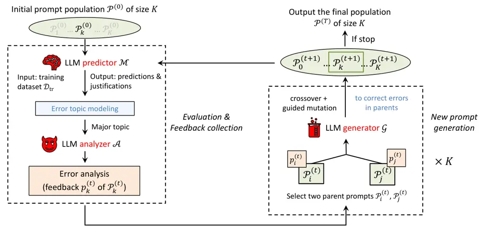

# GreenTEA: Gradient Descent with Topic-modeling and Evolutionary Auto-prompting

Zheng Dong    Luming Shang    Gabriela Olinto

Amazon Buyer Risk Prevention

###### Abstract

High-quality prompts are crucial for Large Language Models (LLMs) to
achieve exceptional performance. However, manually crafting effective
prompts is labor-intensive and demands significant domain expertise,
limiting its scalability. Existing automatic prompt optimization methods
either extensively explore new prompt candidates, incurring high
computational costs due to inefficient searches within a large solution
space, or overly exploit feedback on existing prompts, risking
suboptimal optimization because of the complex prompt landscape. To
address these challenges, we introduce GreenTEA, an agentic LLM workflow
for automatic prompt optimization that balances candidate exploration
and knowledge exploitation. It leverages a collaborative team of agents
to iteratively refine prompts based on feedback from error samples. An
analyzing agent identifies common error patterns resulting from the
current prompt via topic modeling, and a generation agent revises the
prompt to directly address these key deficiencies. This refinement
process is guided by a genetic algorithm framework, which simulates
natural selection by evolving candidate prompts through operations such
as crossover and mutation to progressively optimize model performance.
Extensive numerical experiments conducted on public benchmark datasets
suggest the superior performance of GreenTEA against human-engineered
prompts and existing state-of-the-arts for automatic prompt
optimization, covering logical and quantitative reasoning, commonsense,
and ethical decision-making.

## 1 Introduction

The performance of LLMs is highly dependent on the quality of the
prompts. Manual prompt engineering \[3, 19\], though widely adopted,
requires substantial human effort and domain expertise, posing
challenges when adapting to diverse tasks. To mitigate this dependency,
automatic prompt optimization has emerged as a promising direction
\[26\]. Early methods primarily adopt discrete search strategies \[16,
36\] by enumerating a wide range of prompt candidates, enabling
extensive exploration but often incurring high computational costs due
to inefficient search dynamics. An alternative line of research focuses
on feedback-driven refinement \[6, 24, 29, 34\] by learning from error
samples and improve existing prompts in an iterative way. While
effective in exploiting learned knowledge, these approaches are
susceptible to suboptimal convergence in the presence of complex and
non-convex landscapes in prompt solution space. These limitations
highlights the necessity of a well-designed optimization algorithm for
navigating the complex prompt space in a cost-efficient way.

In this paper, we introduce GreenTEA, an agentic workflow for automatic
prompt optimization that emphasizes both effectiveness and efficiency.
GreenTEA adopts a feedback-driven, iterative framework in which one LLM
agent analyzes the deficiencies of current prompts and another generates
improved candidates based on the identified deficiencies. To guide this
process, we introduce a topic-modeling mechanism that clusters error
samples by the current prompts. This facilitates the identification of
major error patterns and ensures that the collected samples sent to the
analyzing agent are semantically coherent. New prompts are generated via
a novel gradient-guided genetic algorithm (GA), which produces a
population of candidates through evolutionary operations on existing
prompts, guided by the feedback. This design draws on the success of
evolutionary algorithms in prompt optimization \[1, 14, 32\], striking a
balance between exploration and exploitation within the prompt space.
The main contributions of this paper include:

- •
  We present GreenTEA, an agentic workflow for automatic prompt
  optimization that emphasizes both effectiveness and efficiency.
- •
  We introduce an error topic modeling mechanism to improve the
  optimization efficiency by extracting the major error and collecting
  feedback based on semantically coherent samples.
- •
  We develop a gradient-guided evolutionary algorithm that enhances the
  robustness of prompt optimization by balancing exploration and
  exploitation in the prompt search space.
- •
  Comprehensive experiments show that GreenTEA consistently achieves
  expert-level prompts across different scenarios.

## 2 Related works

LLMs for automatic prompt optimization. Early work regards the prompt as
a learnable artifact and leverages LLMs to serve as black–box optimizer
\[35\] to solve the prompt optimization problem. Various approaches
adopt self-refinement via LLMs to critique answers and regenerate the
prompts iteratively \[25, 33\]. Recent work of DSPy \[17\] generalizes
this idea into a compiler that represents an unified reasoning and
optimization pipeline. These studies establish the premise that prompt
optimization can be automated by exploiting the existing knowledge, yet
they adopt generic random or greedy edits that may potentially lead to
local optima \[14\].

Evolutionary prompt search. Evolutionary algorithms (EAs) have emerged
as a powerful tool for automatic prompt optimization by iteratively
refining a _population_ of candidate solutions through biologically
inspired operators. Prior studies \[1, 21\] demonstrate the
effectiveness of LLM-based operators, while EVOPROMPT \[14\] presents a
generic framework that couples LLMs with EAs, enabling a broad family of
EA variants within a unified pipeline. Recent work of GAAPO \[28\]
compares different evolution strategies in a modularized framework via
comprehensive evaluations. In contrast to these approaches, our GreenTEA
integrates a gradient-guided exploration mechanism that directs
evolution explicitly towards the major failure modes.

Gradient-guided genetic algorithm. Genetic algorithm (GA) \[15\] is a
well-established class of evolutionary search methods and have been
widely adopted for prompt optimization \[31, 32\]. They balance
exploration with exploitation via fitness-based selection, achieved
through crossovers and mutations that traverse the vast prompt space.
Direction-guided variants further accelerate convergence by biasing
mutations with gradient rather than random perturbations, consistently
achieving enhanced performance across domains such as protein–ligand
docking \[13\], system-fairness testing \[12\], and molecular generation
\[38\]. While they remain largely unexplored for prompt evolution, our
GreenTEA closes that gap by embedding a topic-guided gradient into the
GA loop, yielding faster convergence and more interpretable evolutionary
trajectories.

## 3 Methodology: GreenTEA

Given a LLM $`\mathcal{M}`$, the goal of prompt optimization is to find
the best-performing prompt $`\mathcal{P}^{*}`$ on a training set
$`\mathcal{D}_{\rm{tr}}=\{(q_{1},a_{1}),\dots,(q_{N},a_{N})\}`$ under a
performance metric $`s`$, i.e.,
$`\mathcal{P}^{*}={\rm argmax}_{\mathcal{P}\in\Omega}\ s(\mathcal{P},\mathcal{D}_{{\rm tr}},\mathcal{M})`$.
Here $`(q_{i},a_{i})`$ represents the $`i`$-th question-answer pair.
This optimization problem is highly non-convex and intractable. In the
following, we introduce our GreenTEA framework that use LLM agents to
find the approximate solution in an iterative way.

### 3.1 Overview: Iterative prompt optimization

Figure 1: GreenTEA framework. The first stage (left) evaluates the
prompts on the predictor $`\mathcal{M}`$ and collect feedback on them
via the analyzer $`\mathcal{A}`$. The second stage (right) generates new
prompts via the generator $`\mathcal{G}`$. The two stages are performed
iteratively until termination criteria are met.

The framework contains a feedback-collection stage and a prompt
generation stage that performed in an iterative loop to progressively
enhance the prompt, as illustrated in Figure 1. The algorithm starts
with a initial population of prompts $`\mathcal{P}^{(0)}`$ of size
$`K`$. These prompts are simple and generic without being fine-crafted
for the task.

In the first stage of $`t`$-th iteration, each prompt
$`\mathcal{P}_{k}^{(t)}`$ in the existing population
$`\mathcal{P}^{(t)}`$ will be evaluated on $`\mathcal{D}_{\rm{tr}}`$
using the LLM predictor $`\mathcal{M}`$. We then apply the topic
modeling to all the cases that $`\mathcal{M}`$ have made the wrong
predictions on to group them into different topic clusters. Therefore,
cases in the same cluster are semantically closer with each other than
those in different clusters. We collect those in the cluster with the
largest size and input them to the second agent, named the LLM analyzer
$`\mathcal{A}`$. The analyzer summarizes the mistakes and outputs an
error analysis $`p_{k}^{(t)}`$ as the feedback of
$`\mathcal{P}_{k}^{(t)}`$ that pinpoints the key deficiencies of the
prompt.

After the feedback collection, the second stage contains the third
agent, named the LLM generator $`\mathcal{G}`$, that produce new prompts
to address the deficiencies of the existing prompt. We use a
gradient-guided GA to evolute the prompts. Instead of optimizing a
single prompt, the generator $`\mathcal{G}`$ takes two existing prompts
(the parents) as the input, combine them into one, and revise the prompt
based on the feedback of the parents to generate a new prompt (the
child). The generator $`\mathcal{G}`$ will perform the generation by
$`K`$ times to have the new population $`\mathcal{P}_{k}^{(t+1)}`$ of
size $`K`$, which will be evaluated and further refined in the next
iteration. This cycle continues until predefined termination criteria
are met. This evolutionary procedure enhances the exploratory ability of
the framework and avoids the optimization trajectory being trapped in
the local minima.

The output of GreenTEA is the prompt population $`\mathcal{P}^{(T)}`$
being optimized over $`T`$ iterations. See Appendix A for algorithm
details. In the following, we elaborate on the topic modeling for
collecting wrong predictions and the guided GA for prompt generation.

### 3.2 Topic modeling for feedback collection

We observe diverse reasons behind the wrong predictions by the predictor
$`\mathcal{M}`$. To make it easier for the analyzer $`\mathcal{A}`$ to
summarize the error and identify the prompt deficiency, we adopt the
topic modeling to guide the selection of wrong prediction samples.
Assuming we have the output of $`\mathcal{M}`$ on each question
$`q_{i}`$, denoted as
$`\widehat{a_{i}}\sim g_{\mathcal{M}}(\cdot|\mathcal{P}_{k}^{(t)},q_{i})`$.
Here $`g_{\mathcal{M}}`$ represents the text generation mechanism of
$`\mathcal{M}`$ that returns the most likely textual output given the
input of the prompt and the question. We collect wrong prediction
samples, denoted by
$`\mathcal{W}=\{(q_{i},a_{i},\widehat{a_{i}}):a_{i}\neq\widehat{a_{i}}\}`$,
and perform clustering on $`\mathcal{W}`$ based on the textual embedding
of each $`a_{i}`$. Both the choices of the text embedding model and the
clustering algorithm are flexible. For instance, we apply a pretrained
sentence BERT \[27\] to create the embedding and the K-nearest neighbors
for clustering. Samples in the largest cluster are retrieved as the
final input to the analyzer $`\mathcal{A}`$ for error analysis, each
including $`q_{i},a_{i}`$, and $`\widehat{a_{i}}`$. By doing so, the
picked samples are semantically close, allowing for the analyzer to
focus on the major type of error during its analysis.

The output of the analyzer $`\mathcal{A}`$ is an analysis of the error
that $`\mathcal{M}`$ has made by comparing the model prediction
$`\widehat{a_{i}}`$ with the true answer $`a_{i}`$. The error analysis
contains a guidance on how the existing prompt can be improved to
address its deficiencies and output the correct predictions. Note that
we make the improvement guidance not question-specific but as general as
possible to be able to applied to similar questions that have not been
encountered.

### 3.3 Prompt generation via guided GA

Given the current population $`\mathcal{P}^{(t)}`$, the guided GA
generates a new prompt via the following steps:

- •
  Parent selection. We use roulette wheel selection method \[20\] to
  select two parent prompts $`\mathcal{P}_{i}^{(t)}`$ and
  $`\mathcal{P}_{j}^{(t)}`$ based on their fitness scores. The fitness
  score $`f_{k}`$ for each prompt $`\mathcal{P}_{k}^{(t)}`$ is measured
  by the scoring function on the training data, e.g.,
  $`f_{k}=s(\mathcal{P}_{k}^{(t)},\mathcal{D}_{\rm tr},\mathcal{M})`$.
  The probability of selecting the $`k`$-th prompt as a parent is
  $`e_{k}=f_{k}/\sum_{k^{\prime}=1}^{K}f_{k^{\prime}}`$.
- •
  Child generation. The LLM generator $`\mathcal{G}`$ takes the selected
  parent prompts together with their feedback as the input, e.g.,
  $`\{\mathcal{P}_{i}^{(t)},\mathcal{P}_{j}^{(t)},p_{i}^{(t)},p_{j}^{(t)}\}`$,
  and generates a child prompt $`\mathcal{P}_{k}^{(t+1)}`$. The
  generator performs this prompt evolution by i) a crossover to combine
  the parent prompts into an child prompt that inherits their
  traits; ii) a mutation to introduce modification to the child prompt.
  We use corresponding instructions to guide the mutation to incorporate
  feedback into the child prompt.

We repeat the above steps by $`K`$ times to produce $`K`$ child prompts.
These child prompts will be evaluated on $`\mathcal{D}_{\rm tr}`$ to get
their fitness score. We then merge them with the current population and
retain the top $`K`$ prompts with the highest fitness scores to form the
updated population $`\mathcal{P}^{(t+1)}`$. This process ensures the
improvement of the population’s overall quality, concluding with the
best prompt in the updated population being designated as the optimal
prompt.

## 4 Experiments

We present the numerical results of prompt optimization that demonstrate
the superior performance of GreenTEA across different tasks.

### 4.1 Experiment setup

We conduct experiments on the following datasets, including:

- •
  GSM8K \[5\]: A dataset of 8.5K grade-school math word problems
  designed to evaluate quantitative reasoning and step-by-step problem
  solving. Each instance includes a problem description and a detailed,
  free-form answer explanation.
- •
  ETHOS \[23\]: An English hate speech detection dataset containing 997
  online comments labeled for attributes such as hate speech,
  discrimination, and offensive language. It evaluates a model’s
  capability in ethical and socially sensitive reasoning.
- •
  PIQA \[2\]: A physical commonsense reasoning benchmark with 16,000
  multiple-choice questions. Each question describes a real-world
  scenario, and the model must select the more plausible of two possible
  solutions.
- •
  BBH (Big-Bench Hard) \[30\]: A challenging subset of the BIG-Bench
  benchmark consisting of 23 diverse tasks requiring multi-step logical
  reasoning, such as date manipulation, causal judgment, and word
  sorting. Each task includes hundreds of examples with high variance in
  difficulty.

The choice of the agents in GreenTEA is flexible and can be either open-
or closed-source. While the predictor $`\mathcal{M}`$ is picked to
satisfy the deployment constraints of a given application (latency,
cost, privacy), we recommend using a more capable LLM for both the
analyzer $`\mathcal{A}`$ and the generator $`\mathcal{G}`$ \[17, 33\],
as larger models possess richer world knowledge and stronger reasoning
abilities to yield gains when optimizing the prompts. In the following
experiments, we use closed-source models from the Anthropic Claude
family, choosing the predictor to be Claude 3 Sonnet, and the analyzer
and the generator to be Claude 3.5 Sonnet. See more details of
experimental setup and prompt templates in Appendix B.

### 4.2 Comparison with baselines

| Method           | GSM8K                       | ETHOS                       | PIQA                        | BBH                         |
| ---------------- | --------------------------- | --------------------------- | --------------------------- | --------------------------- |
| CoT prompt       | $`82.43_{(1.19)}`$          | $`78.33_{(1.25)}`$          | $`83.97_{(0.72)}`$          | $`77.48_{(2.05)}`$          |
| OPRO \[33\]      | $`88.10_{(0.93)}`$          | $`83.33_{(2.05)}`$          | $`86.05_{(0.61)}`$          | $`79.58_{(1.26)}`$          |
| ProTeGi \[25\]   | $`84.63_{(1.02)}`$          | $`\textbf{85.67}_{(1.49)}`$ | $`85.72_{(0.84)}`$          | $`78.86_{(1.77)}`$          |
| EVOPROMPT \[14\] | $`86.27_{(0.58)}`$          | $`82.00_{(1.41)}`$          | $`86.43_{(0.36)}`$          | $`80.12_{(1.43)}`$          |
| GreenTEA         | $`\textbf{91.37}_{(0.45)}`$ | $`84.67_{(1.89)}`$          | $`\textbf{89.86}_{(0.28)}`$ | $`\textbf{82.23}_{(1.13)}`$ |

- •
  \*Numbers in parentheses are standard errors for three independent
  runs.

Table 1: Testing accuracy of GreenTEA and baselines

We compare our GreenTEA against three state-of-the-arts in automatic
prompt optimization that have methodological relations to GreenTEA: (i)
OPRO \[33\] leverages LLMs as optimizer to find instructions that
maximize the model performance; (ii) ProTeGi \[25\] exploits feedback on
the existing prompt and use textual gradient descent to optimize the
prompt; (iii) EVOPROMPT \[14\] adopts an evolutionary framework for
prompt optimization without using the prompt feedback. We also evaluate
the performance of chain-of-thoughts (CoT) prompts \[19\] and compare it
with GreenTEA.

Table 1 reports the accuracy of the predictor $`\mathcal{M}`$ equipped
with different prompts on the testing set on different tasks. The
prompts optimized by GreenTEA achieve a consistently better or
comparable performance against those from other prompt optimization
baselines. The GreenTEA also significantly improve the prompt
performance from the manually designed CoT prompts across the evaluated
scenarios.

### 4.3 Ablation study

We perform an ablation study to demonstrate the effectiveness of the
topic-modeling and gradient-guided GA in prompt optimization.
Specifically, we compared two variants of GreenTEA that have these key
components removed:

- •
  GreenTEA-TM-GGA: this variant uses a classic GA instead of the
  gradient-guided GA to generate child prompts. The LLM generator
  $`\mathcal{G}`$ performs random mutation by simply rephrasing the
  intermediate prompt from crossover of two parent prompts, without
  deliberately addressing specific errors. Note that we do not need to
  perform feedback collection, thus topic modeling is also excluded in
  this variant.
- •
  GreenTEA-TM: this variant uses the gradient-guided GA but replaces the
  topic modeling with random sampling, collecting incorrect samples by
  randomly selecting a subset of wrong predictions from the available
  pool.

(a) GSM8K

(b) ETHOS

Figure 2: Training accuracy evolution by GreenTEA and two ablated
variants on GSM8K and ETHOS datasets.

To better investigate the performance difference between variants, we
visualize the evolution of the average model accuracy over the whole
population on the training set of GSM8K and ETHOS datasets after each
iteration in Figure 2. We observe that the complete GreenTEA
consistently achieves higher accuracy and faster convergence compared to
both ablated variants, as it rapidly improves within the first few
iterations and continues to exhibit steady gains. The performance drop
in GreenTEA-TM highlights the benefits of topic modeling in improving
the optimize efficiency as it facilitates more targeted feedback
learning. The earlier plateau and lower final accuracies of
GreenTEA-TM-GGA further underscore the significance of gradient-guided
evolution in prompt optimization.

Figure 3: Prompt evolution on ETHOS dataset. Key messages in the
feedback and the corresponding adjustments in the prompts at each
iteration are highlighted in the same color.

### 4.4 Model interpretation

To illustrate how GreenTEA systematically enhances prompt quality,
Figure 3 presents the feedback and corresponding optimized prompts
collected across three iterations for the ETHOS dataset. At each
iteration, the LLM analyzer $`\mathcal{A}`$ identifies key deficiencies
in the prompt—such as lack of clarity on group targeting, missing
criteria for hate speech, or ambiguity in assessing intent and severity.
These critical insights from the LLM analyzer $`\mathcal{A}`$
(highlighted in color) are explicitly integrated into the prompt by the
LLM generator $`\mathcal{G}`$. Beginning with a basic prompt like
“Decide if the comment is hateful”, the GreenTEA with the backbone of
Claude model family progressively refines instructions into detailed,
multi-step guidelines. This structured refinement effectively guides the
LLM predictor $`\mathcal{M}`$ toward more accurate classifications.
These improvements of the prompts directly correlate with substantial
accuracy gains at iterations $`2`$, $`6`$, and $`11`$ in Figure 2(b),
demonstrating GreenTEA’s capability in optimizing more interpretable and
high-performing prompts.

## 5 Discussion

We propose GreenTEA, an agentic workflow for prompt optimization that
emphasizes both effectiveness and efficiency. It iteratively refines
prompts by incorporating feedback from previous performance and
imitating the natural evolutionary process to generate stronger
solutions. Numerical experiments show the superior performance of
GreenTEA against current state-of-the-arts. An ablation study further
demonstrates the benefits of topic modeling and guided genetic
algorithms in enhancing the efficiency and robustness of the
optimization process in complex prompt solution space. Extensions of
GreenTEA include adopting other clustering methods, e.g., spectral
clustering that has demonstrated strong empirical performance \[22\] to
identify informative error patterns; incorporating advanced scoring
metrics beyond aggregated accuracy to capture key features that reflect
prompt quality \[33\]; designing efficient workflows \[18\] to manage
the growing complexity of prompts over iterations; and leveraging its
non-parametric optimization capabilities for broader solution
optimization tasks, e.g., high-dimensional event modeling \[4, 10, 11,
9, 7, 8, 37\], that go beyond prompt refinement.

## References

- \[1\] Baumann, J. and Kramer, O. (2024). Evolutionary multi-objective
  optimization of large language model prompts for balancing sentiments.
  In International conference on the applications of evolutionary
  computation, pages 212–224. Springer.
- \[2\] Bisk, Y., Zellers, R., Gao, J., Choi, Y., et al. (2020). Piqa:
  Reasoning about physical commonsense in natural language. In
  Proceedings of the AAAI conference on artificial intelligence, volume
  34, pages 7432–7439.
- \[3\] Brown, T., Mann, B., Ryder, N., Subbiah, M., Kaplan, J. D.,
  Dhariwal, P., Neelakantan, A., Shyam, P., Sastry, G., Askell, A., et
  al. (2020). Language models are few-shot learners. Advances in neural
  information processing systems, 33:1877–1901.
- \[4\] Cheng, X., Dong, Z., and Xie, Y. (2025). Deep spatio-temporal
  point processes: Advances and new directions. arXiv preprint
  arXiv:2504.06364.
- \[5\] Cobbe, K., Kosaraju, V., Bavarian, M., Chen, M., Jun, H.,
  Kaiser, L., Plappert, M., Tworek, J., Hilton, J., Nakano, R., et al.
  (2021). Training verifiers to solve math word problems. arXiv preprint
  arXiv:2110.14168.
- \[6\] Dong, Y., Luo, K., Jiang, X., Jin, Z., and Li, G. (2024a). Pace:
  Improving prompt with actor-critic editing for large language model.
  In Findings of the Association for Computational Linguistics ACL 2024,
  pages 7304–7323.
- \[7\] Dong, Z., Cheng, X., and Xie, Y. (2023a). Spatio-temporal point
  processes with deep non-stationary kernels. In The Eleventh
  International Conference on Learning Representations.
- \[8\] Dong, Z., Fan, Z., and Zhu, S. (2025). Conditional generative
  modeling for high-dimensional marked temporal point processes. In
  Proceedings of the 31st ACM SIGKDD Conference on Knowledge Discovery
  and Data Mining V. 1, pages 248–259.
- \[9\] Dong, Z., Mateu, J., and Xie, Y. (2024b).
  Spatio-temporal-network point processes for modeling crime events with
  landmarks. arXiv preprint arXiv:2409.10882.
- \[10\] Dong, Z., Repasky, M., Cheng, X., and Xie, Y. (2023b). Deep
  graph kernel point processes. In Temporal Graph Learning Workshop@
  NeurIPS 2023.
- \[11\] Dong, Z., Zhu, S., Xie, Y., Mateu, J., and
  Rodríguez-Cortés, F. J. (2023c). Non-stationary spatio-temporal point
  process modeling for high-resolution covid-19 data. Journal of the
  Royal Statistical Society Series C: Applied Statistics, 72(2):368–386.
- \[12\] Fan, M., Wei, W., Jin, W., Yang, Z., and Liu, T. (2022).
  Explanation-guided fairness testing through genetic algorithm. In
  Proceedings of the 44th International Conference on Software
  Engineering, pages 871–882.
- \[13\] Guan, B., Zhang, C., and Ning, J. (2016). EDGA: a population
  evolution direction-guided genetic algorithm for protein–ligand
  docking. Journal of Computational Biology, 23(7):585–596.
- \[14\] Guo, Q., Wang, R., Guo, J., Li, B., Song, K., Tan, X., Liu, G.,
  Bian, J., and Yang, Y. (2024). Connecting large language models with
  evolutionary algorithms yields powerful prompt optimizers. In The
  Twelfth International Conference on Learning Representations.
- \[15\] Holland, J. H. (1992). Adaptation in natural and artificial
  systems: an introductory analysis with applications to biology,
  control, and artificial intelligence. MIT press.
- \[16\] Jiang, Z., Xu, F. F., Araki, J., and Neubig, G. (2020). How can
  we know what language models know? Transactions of the Association for
  Computational Linguistics, 8:423–438.
- \[17\] Khattab, O., Singhvi, A., Maheshwari, P., Zhang, Z., Santhanam,
  K., Vardhamanan, S., Haq, S., Sharma, A., Joshi, T. T., Moazam, H., et
  al. (2023). Dspy: Compiling declarative language model calls into
  self-improving pipelines. arXiv preprint arXiv:2310.03714.
- \[18\] Kim, S., Moon, S., Tabrizi, R., Lee, N., Mahoney, M. W.,
  Keutzer, K., and Gholami, A. (2024). An llm compiler for parallel
  function calling. In Forty-first International Conference on Machine
  Learning.
- \[19\] Kojima, T., Gu, S. S., Reid, M., Matsuo, Y., and Iwasawa, Y.
  (2022). Large language models are zero-shot reasoners. Advances in
  neural information processing systems, 35:22199–22213.
- \[20\] Lipowski, A. and Lipowska, D. (2012). Roulette-wheel selection
  via stochastic acceptance. Physica A: Statistical Mechanics and its
  Applications, 391(6):2193–2196.
- \[21\] Liu, F., Tong, X., Yuan, M., and Zhang, Q. (2023). Algorithm
  evolution using large language model. arXiv preprint arXiv:2311.15249.
- \[22\] Liu, X., Muthukrishnan, P., and Montreuil, B. (2025). Network
  design and capacity management in hyperconnected urban logistic
  networks. In Proceedings of 11th International Physical Internet
  Conference.
- \[23\] Mollas, I., Chrysopoulou, Z., Karlos, S., and Tsoumakas, G.
  (2022). Ethos: a multi-label hate speech detection dataset. Complex &
  Intelligent Systems, 8(6):4663–4678.
- \[24\] Prasad, A., Hase, P., Zhou, X., and Bansal, M. (2023). Grips:
  Gradient-free, edit-based instruction search for prompting large
  language models. In Proceedings of the 17th Conference of the European
  Chapter of the Association for Computational Linguistics, pages
  3845–3864.
- \[25\] Pryzant, R., Iter, D., Li, J., Lee, Y. T., Zhu, C., and
  Zeng, M. (2023). Automatic prompt optimization with" gradient descent"
  and beam search. arXiv preprint arXiv:2305.03495.
- \[26\] Ramnath, K., Zhou, K., Guan, S., Mishra, S. S., Qi, X., Shen,
  Z., Wang, S., Woo, S., Jeoung, S., Wang, Y., et al. (2025). A
  systematic survey of automatic prompt optimization techniques. arXiv
  preprint arXiv:2502.16923.
- \[27\] Reimers, N. and Gurevych, I. (2019). Sentence-bert: Sentence
  embeddings using siamese bert-networks. In Proceedings of the 2019
  Conference on Empirical Methods in Natural Language Processing and the
  9th International Joint Conference on Natural Language Processing
  (EMNLP-IJCNLP), pages 3982–3992.
- \[28\] Sécheresse, X., de Torcy, A. V., et al. (2025). Gaapo: Genetic
  algorithmic applied to prompt optimization. arXiv preprint
  arXiv:2504.07157.
- \[29\] Sun, H., Li, X., Xu, Y., Homma, Y., Cao, Q., Wu, M., Jiao, J.,
  and Charles, D. (2023). Autohint: Automatic prompt optimization with
  hint generation. arXiv preprint arXiv:2307.07415.
- \[30\] Suzgun, M., Scales, N., Schärli, N., Gehrmann, S., Tay, Y.,
  Chung, H. W., Chowdhery, A., Le, Q., Chi, E., Zhou, D., et al. (2023).
  Challenging big-bench tasks and whether chain-of-thought can solve
  them. In Findings of the Association for Computational Linguistics:
  ACL 2023, pages 13003–13051.
- \[31\] Tanaka, H., Mori, N., and Okada, M. (2023). Genetic algorithm
  for prompt engineering with novel genetic operators. In 2023 15th
  International Congress on Advanced Applied Informatics Winter, pages
  209–214. IEEE.
- \[32\] Xu, H., Chen, Y., Du, Y., Shao, N., Yanggang, W., Li, H., and
  Yang, Z. (2022). Gps: Genetic prompt search for efficient few-shot
  learning. In Proceedings of the 2022 Conference on Empirical Methods
  in Natural Language Processing, pages 8162–8171.
- \[33\] Yang, C., Wang, X., Lu, Y., Liu, H., Le, Q. V., Zhou, D., and
  Chen, X. (2024). Large language models as optimizers. In The Twelfth
  International Conference on Learning Representations.
- \[34\] Zhang, T., Wang, X., Zhou, D., Schuurmans, D., and
  Gonzalez, J. E. (2023). TEMPERA: Test-time prompt editing via
  reinforcement learning. In The Eleventh International Conference on
  Learning Representations.
- \[35\] Zheng, M., Su, X., You, S., Wang, F., Qian, C., Xu, C., and
  Albanie, S. (2023). Can gpt-4 perform neural architecture search?
  arXiv preprint arXiv:2304.10970.
- \[36\] Zhou, Y., Muresanu, A. I., Han, Z., Paster, K., Pitis, S.,
  Chan, H., and Ba, J. (2022). Large language models are human-level
  prompt engineers. In The Eleventh International Conference on Learning
  Representations.
- \[37\] Zhu, S., Wang, H., Dong, Z., Cheng, X., and Xie, Y. (2022).
  Neural spectral marked point processes. In International Conference on
  Learning Representations.
- \[38\] Zhuang, C., Mukherjee, D., Lu, Y., Fu, T., and Zhang, R.
  (2025). Gradient GA: Gradient genetic algorithm for drug molecular
  design. arXiv preprint arXiv:2502.09860.

## Appendix A Algorithm

we present the full algorithmic workflow of GreenTEA in Algorithm 1. The
method maintains a population of prompts that are iteratively refined
through a feedback-guided evolutionary process. In each iteration, error
patterns are extracted from model predictions via topic modeling,
analyzed by an LLM agent, and used to guide new prompt generation
through crossover and mutation.

 Input: Population size $`K`$, max number of iteration $`T`$, scoring
function $`s(\cdot)`$, training data $`\mathcal{D}_{\rm tr}`$, LLM
predictor $`\mathcal{M}`$, LLM analyzer $`\mathcal{A}`$, LLM generator
$`\mathcal{G}`$ 

 Initialization: Population
$`\mathcal{P}^{(0)}=\{\mathcal{P}_{0}^{(0)},\dots,\mathcal{P}_{k-1}^{(0)}\}`$,
$`t=0`$ 

 while $`t\leq T`$ do

  for each prompt $`\mathcal{P}_{k}^{(t)}`$ in $`\mathcal{P}^{(t)}`$
that has not been evaluated do

   1. Get score
$`f_{k}=s(\mathcal{P}_{k}^{(t)},\mathcal{D}_{\rm tr},\mathcal{M})`$ and
collect $`\{\widehat{a_{n}}\}_{n=1}^{N}`$;

   2. Get wrong samples $`\mathcal{W}_{k}^{(t)}`$ using topic modeling;

   3. Input $`\mathcal{W}_{k}^{(t)}`$ to $`\mathcal{A}`$ and obtain
feedback $`p_{k}^{(t)}`$ of $`\mathcal{P}_{k}^{(t)}`$;

  end for

  $`\mathcal{P}^{(t)}=`$ prompts in $`\mathcal{P}^{(t)}`$ with the
top-$`K`$ scores;

  $`\mathcal{P}^{(t+1)}=\mathcal{P}^{(t)}`$;

  for $`k\in\{0,\dots,K-1\}`$ do

   1. Select parent prompts
$`\mathcal{P}_{i}^{(t)},\mathcal{P}_{j}^{(t)}`$ from
$`\mathcal{P}^{(t)}`$ using roulette wheel selection;

   2. Generate a new prompt $`\mathcal{P}_{k}^{(t+1)}`$ by inputting
$`\mathcal{P}_{i}^{(t)},\mathcal{P}_{j}^{(t)},p_{i}^{(t)},p_{j}^{(t)}`$
to the generator $`\mathcal{G}`$;

   3.
$`\mathcal{P}^{(t+1)}=\{\mathcal{P}^{(t+1)},\mathcal{P}_{k}^{(t+1)}\}`$

  end for

  $`t\leftarrow t+1`$;

 end while

 return $`\mathcal{P}^{(T)}=`$ prompts in $`\mathcal{P}^{(T)}`$ with the
top-$`K`$ scores;

Algorithm 1 GreenTEA for automatic prompt optimization

## Appendix B Details of experimental setup

Dataset. The testing set contain 1,000 samples for GSM8K and PIQA data,
contain 100 samples for ETHOS data, and contain 25 samples for each BBH
task.

Figure 4: Prompt template for predictor $`\mathcal{M}`$

Experiment configuration. We set the temperature of the LLM predictor
$`\mathcal{M}`$ to be $`0.0`$ when evaluating the performance of
generated prompts, and set the default temperature to be $`1.0`$ for LLM
analyzer $`\mathcal{A}`$ and generator $`\mathcal{G}`$ to generate
diverse outputs. For the generic algorithm, we set the number of
iteration to be $`20`$ and the population size to be $`4`$, i.e.,
generate $`4`$ new prompts in each iteration and keep the best $`4`$
prompts as the updated population after each iteration. We evaluate the
testing accuracy of the prompts in the last population and report their
average as the final prompt accuracy by GreenTEA. The results of the
testing accuracy in Table 1 are averaged over three independent runs.

Figure 5: Prompt template for analyzer $`\mathcal{A}`$

Meta-prompt template. See the meta-prompt templates for different agents
in GreenTEA in Figure 4, 5, and 6.

Figure 6: Prompt template for generator $`\mathcal{G}`$
