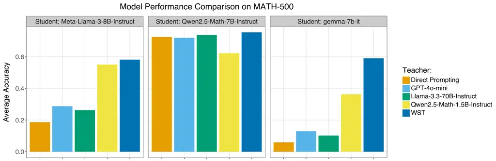
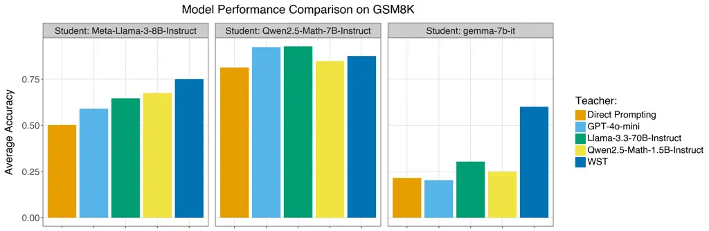
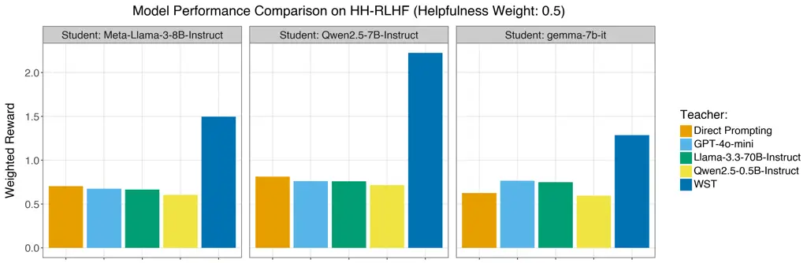
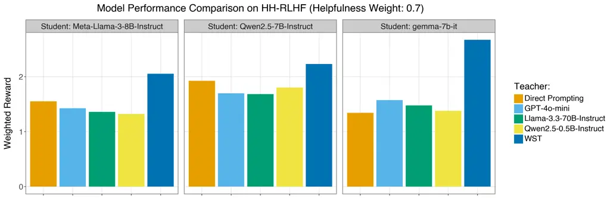
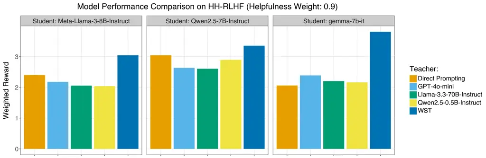
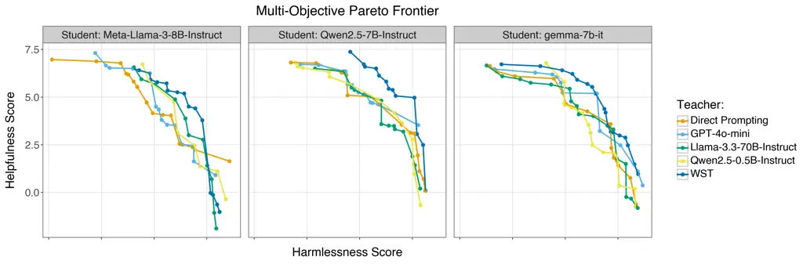

# WST: Weak-to-Strong Knowledge Transfer via Reinforcement Learning

Haosen Ge Affiliation: Wharton AI & Analytics Initiative
Affiliation: University of Pennsylvania Affiliation: Philadelphia, PA
19104 Email: [hge@wharton.upenn.edu](mailto:)    Shuo Li
Affiliation: Department of Computer and Information Science
Affiliation: University of Pennsylvania Affiliation: Philadelphia, PA
19104 Email: [lishuo1@seas.upenn.edu](mailto:)    Lianghuan Huang
Affiliation: Department of Physics and Astronomy Affiliation: University
of Pennsylvania Affiliation: Philadelphia, PA 19104
Email: [leoh@sas.upenn.edu](mailto:)

###### Abstract

Effective prompt engineering remains a challenging task for many
applications. We introduce Weak-to-Strong Transfer (WST), a automatic
prompt engineering framework where a small “Teacher” model generates
instructions that enhance the performance of a much larger “Student”
model. Unlike prior work, WST requires only a weak teacher, making it
efficient and broadly applicable in settings where large models are
closed-source or difficult to fine-tune. Using reinforcement learning,
the Teacher Model’s instructions are iteratively improved based on the
Student Model’s outcomes, yielding substantial gains across reasoning
(MATH-500, GSM8K) and alignment (HH-RLHF) benchmarks—98% on MATH-500 and
134% on HH-RLHF—and surpassing baselines such as GPT-4o-mini and
Llama-70B. These results demonstrate that small models can reliably
scaffold larger ones, unlocking latent capabilities while avoiding
misleading prompts that stronger teachers may introduce, establishing
WST as a scalable solution for efficient and safe LLM prompt refinement.

## 1 Introduction

Large Language Models (LLMs) have been increasingly applied to complex
tasks. Due to the high cost of fine-tuning and the prevalence of
closed-source models, prompt engineering remains critical for improving
performance and ensuring safety alignment (Sahoo et al., 2024).
Nonetheless, because LLMs are highly sensitive to the wording and
phrasing of prompts, it remains an open challenge to optimally structure
prompts.

We introduce an efficient automatic prompt refinement pipeline,
Weak-to-Strong Transfer (WST), which leverages the (surprising) ability
of small models to scaffold larger models through automatic prompt
generation. Across a series of experiments, we demonstrate that a model
as small as 0.5B parameters can significantly enhance the performance of
much larger models (e.g., 8B) on complex tasks such as mathematical
reasoning and safety alignment. Our approach produces higher-quality
instructions than several competitive baselines, including Llama 70B and
GPT-4o-mini.

We consider a setting where a local model, denoted as $`M_{1}`$,
provides instructions to a remote model, $`M_{2}`$, in response to a
given query $`q`$. For clarity throughout the paper, we refer to local
model $`M_{1}`$ as the "Teacher Model" and the remote model $`M_{2}`$ as
the "Student Model", reflecting their instructional relationship. The
Student Model incorporates the instructions from the teacher model and
generates the final response to $`q`$. In contrast to prior work on
automatic prompt engineering (e.g., Batorski et al. (2025); Pryzant
et al. (2023)), we require the Teacher Model to be significantly
_smaller_ than the Student Model.

This weak-to-strong design offers unique advantages: (i) substantial
efficiency gains, since improving a large model requires only modifying
the small model’s weights; and (ii) practical applicability, as many
real-world scenarios involve proprietary models where training a
comparably large Teacher Model is infeasible. Thus, our pipeline can be
readily adapted to diverse applications.

Importantly, the task of generating useful instructions is non-trivial
for the Teacher Model due to its limited capacity relative to the
Student Model. If the Teacher Model were stronger than the Student
Model, one could simply substitute the Teacher Model’s output for the
Student Model’s. However, because the Teacher Model typically performs
worse in isolation, its challenge is to provide helpful instructions
without introducing misleading information. This is fundamentally
different from the original task of responding to $`q`$ directly. Our
experiments show that many models, regardless of size, can produce
misleading instructions that degrade another model’s performance. In
contrast, our WST method not only mitigates this risk but also
consistently improves downstream performance.

The WST pipeline employs reinforcement learning to automatically improve
the Teacher Model’s instructions based on the Student Model’s
performance. Given a query $`q`$ (e.g., a math problem), the Teacher
Model generates instructions $`m_{1}`$. The pair $`(q,m_{1})`$ is then
passed to the Student Model, which outputs a final response $`m_{2}`$.
This response is evaluated using a predefined metric to obtain a reward
$`r`$, which is subsequently used to update the Teacher Model’s weights.

We evaluate WST on both reasoning and alignment tasks. For reasoning, we
use the MATH-500 and GSM8K benchmarks; for alignment, we use the HH-RLHF
dataset. Our results demonstrate that WST significantly outperforms
natural baselines.

#### Contributions.

Our work makes the following contributions:

- •
  We introduce Weak-to-Strong Transfer (WST), a novel post-training
  framework that empowers smaller models to autonomously compose prompts
  that enhance the performance of much larger models—without requiring
  access to their weights. Across benchmarks, WST yields consistent
  gains: a 98% improvement on MATH-500, 45% on GSM8K, and 134% on
  HH-RLHF.
- •
  We show that after applying WST, small models can effectively scaffold
  larger models: the larger models achieve higher accuracy and improved
  alignment when guided by prompts generated from the smaller models,
  even when the larger models substantially outperform them in
  isolation.
- •
  We find that without WST, stronger Teacher Models can produce
  misleading instructions that hinder the performance of Student Models,
  underscoring the necessity of WST in scaffolding better Student Model
  performance.

## 2 Method

#### Pipeline.

Let $`\mathcal{M}`$ denote the space of possible generations and
$`\mathcal{Q}`$ the space of queries. Given a query $`q\in\mathcal{Q}`$
(e.g., a math problem or user request), we first prompt the Teacher
Model to generate a set of instructions $`m_{1}\in\mathcal{M}`$ intended
to improve the Student Model’s performance on $`q`$. For example, in a
safety alignment task, the Teacher Model might consist of constraints
specifying what content should not be generated. The pair $`(q,m_{1})`$
is then passed to the Student Model, which produces the final output
$`m_{2}\in\mathcal{M}`$. We define a reward function
$`g:\mathcal{M}\mapsto\mathbbm{R}`$ and obtain a reward $`r=g(m_{2})`$.
Finally, we use GRPO (Guo et al., 2025) to update the Teacher Model
based on $`r`$.

#### Reward.

In our experiments, we allow the Student Model to generate multiple
outputs for each query in order to stabilize the reward estimate.
Specifically, given a query $`q_{i}`$ and instructions $`m_{1}^{i}`$, we
sample $`K`$ generations from the Student Model:
$`m_{2}^{i1},m_{2}^{i2},\ldots,m_{2}^{iK}`$. The reward is then defined
as

```math
\displaystyle r_{i}=\frac{1}{K}\sum_{k=1}^{K}g(m_{2}^{ik})-s_{i}, \tag{1}
```

where $`g(m_{2}^{ik})`$ is the reward assigned to the $`k`$-th
generation for query $`q_{i}`$, and $`s_{i}`$ is a baseline score that
we describe below. In practice, $`s_{i}`$ represents the baseline
performance of the Student Model. We establish the baseline by averaging
the rewards of 10 independent generations from the Student Model in
isolation.

Thus, $`r_{i}>0`$ if and only if the Student Model’s performance
improves after incorporating instructions $`m_{1}^{i}`$. Averaging
across multiple generations reduces variance in the reward signal and
provides a more reliable comparison against the baseline.

## 3 Experiments

We evaluate the performance of our approach on two tasks: reasoning and
alignment.

#### Reasoning.

We use MATH-500 and GSM8K to evaluate our method on reasoning-intensive
tasks. The evaluation metric is average accuracy:

```math
\displaystyle\text{Acc}(q_{i})=\frac{1}{K}\sum_{k=1}^{K}\mathbbm{1}[m_{2}^{ik}\text{ contains the correct solution}],
```

where $`q_{i}`$ denotes the $`i`$-th problem in the dataset and
$`m_{2}^{ik}`$ the $`k`$-th generation from the Student Model in
response to $`q_{i}`$. We set $`K=10`$ in all reasoning experiments.

#### Alignment.

For alignment, we use the HH-RLHF dataset. We adopt a multi-objective
setup following prior work (e.g., Yang et al. (2024); Zhong et al.
(2024)). Each generation is separately evaluated for helpfulness and
harmlessness using two LLM-based reward models, yielding a reward vector
$`\tilde{r}=[r^{(1)},r^{(2)}]`$. We convert this to a scalar reward
using a weighted sum:$`r=w\cdot\tilde{r}`$, with
$`w=[w^{(1)},w^{(2)}],\quad\sum_{j=1}^{2}w^{(j)}=1,\quad w^{(j)}\geq 0.`$
The weights $`w`$ capture user-specific preferences; for example, a user
may emphasize harmlessness over helpfulness by adjusting $`w`$. The
evaluation metric is then

```math
\displaystyle\text{WeightedReward}(q_{i})=\frac{1}{K}\sum_{k=1}^{K}w\cdot\tilde{r}_{ik},
```

where $`\tilde{r}_{ik}`$ is the reward vector for the $`k`$-th
generation of the Student Model on query $`q_{i}`$. Following Yang
et al. (2024), we use gpt2-large-harmless-reward-model and
gpt2-large-helpful-reward-model as the LLM judges. In our main
experiments, we set $`w=[0.5,0.5]`$ and $`K=1`$. Additional experiments
with varying weights are reported in the appendix.

#### Models.

We first select the Teacher Model and the Student Model models to
validate the weak-to-strong ability using WST. Specifically, For the
Teacher Model, we use Qwen2.5-Math-1.5B-Instruct (reasoning) and
Qwen2.5-0.5B-Instruct (alignment). For the Student Model, we use
Qwen2.5-Math-7B-Instruct on reasoning task and Qwen2.5-7B-Instruct on
alignment task. We additionally selected Gemma-7B-it and
Llama-3-8B-Instruct as the Student Model to identify the cross-faimily
transferability.

#### Baselines.

We compare our method against four natural baselines: (i) Direct
Prompting where the Student Model is prompted with chain-of-thought
reasoning and few-shot demonstrations; (ii) Original Models where the
Teacher Model is used directly (without training) to provide
instructions; (iii) GPT-4o-mini and (iv) Llama-3.3-70B-Instruct where
GPT-4o-mini and Llama-3.3-70B-Instruct are used without training to
scaffold the Teacher Model models.

#### Results



(a) MATH-500



(b) GSM8K



(c) HH-RLHF

Figure 1: Experiment Results

We present our experimental results in Figure 1. Overall, our method
outperforms all baselines on both reasoning and alignment tasks, with
the sole exception of Qwen2.5-Math-7B-Instruct on GSM8K. Several
findings are particularly noteworthy.

First, WST enables a weaker model to enhance the performance of a
strictly stronger model. On both reasoning and alignment tasks, the
Qwen2.5-7B models achieve higher performance than Direct Prompting once
augmented with WST-generated instructions. Since our pipeline begins
with strictly weaker models as the Teacher Model—Qwen2.5-1.5B and
Qwen2.5-0.5B—this result demonstrates that WST allows small models to
unlock latent capabilities within much larger models. Importantly, this
improvement does not occur when the base Qwen2.5-1.5B and Qwen2.5-0.5B
are used directly without training.

Second, the task of generating effective instructions is fundamentally
different from solving the task directly. Simply using a strong model to
provide instructions does not guarantee improved performance. In fact,
it can sometimes degrade performance: for example, GPT-4o’s instructions
lead to slightly worse results on both GSM8K and HH-RLHF.

## 4 Conclusions

We propose a novel post-training pipeline that enables small models to
efficiently enhance the performance of larger models on both reasoning
and alignment tasks through automatic prompt engineering. Our
experiments demonstrate that this approach not only surpasses strong
baselines but also outperforms widely used open-source and proprietary
models that are more than 100 times larger, highlighting the
effectiveness and scalability of our Weak-to-Strong Transfer framework.

## References

- Batorski et al. (2025) Batorski, P., A. Kosmala, and P. Swoboda
  (2025). Prl: Prompts from reinforcement learning. arXiv preprint
  arXiv:2505.14412.
- Guo et al. (2025) Guo, D., D. Yang, H. Zhang, J. Song, R. Zhang,
  R. Xu, Q. Zhu, S. Ma, P. Wang, X. Bi, et al. (2025). Deepseek-r1:
  Incentivizing reasoning capability in llms via reinforcement learning.
  arXiv preprint arXiv:2501.12948.
- Pryzant et al. (2023) Pryzant, R., D. Iter, J. Li, Y. T. Lee, C. Zhu,
  and M. Zeng (2023). Automatic prompt optimization with" gradient
  descent" and beam search. arXiv preprint arXiv:2305.03495.
- Sahoo et al. (2024) Sahoo, P., A. K. Singh, S. Saha, V. Jain,
  S. Mondal, and A. Chadha (2024). A systematic survey of prompt
  engineering in large language models: Techniques and applications.
  arXiv preprint arXiv:2402.07927.
- Yang et al. (2024) Yang, R., X. Pan, F. Luo, S. Qiu, H. Zhong, D. Yu,
  and J. Chen (2024). Rewards-in-context: Multi-objective alignment of
  foundation models with dynamic preference adjustment. arXiv preprint
  arXiv:2402.10207.
- Zhong et al. (2024) Zhong, Y., C. Ma, X. Zhang, Z. Yang, H. Chen,
  Q. Zhang, S. Qi, and Y. Yang (2024). Panacea: Pareto alignment via
  preference adaptation for llms. Advances in Neural Information
  Processing Systems 37, 75522–75558.

## Appendix A Additional Experiments and Results

### A.1 Alignment Experiments with Varying Weights

We further assess model performance under increased weights for the
helpfulness rewards, specifically at 0.7 and 0.9. The results are
reported in Figure 2. As shown, WST consistently outperforms the
baseline methods.



(a) HH-RLHF



(b) HH-RLHF

Figure 2: Experiment Results

### A.2 Pareto Curve

We evaluate the extent to which WST enhances the Student Model’s
performance across both dimensions simultaneously. In line with prior
studies, we visualize the results using the Pareto frontier in Figure 3.
The results demonstrate that WST facilitates concurrent improvements
along both dimensions.



Figure 3: Pareto Frontier
