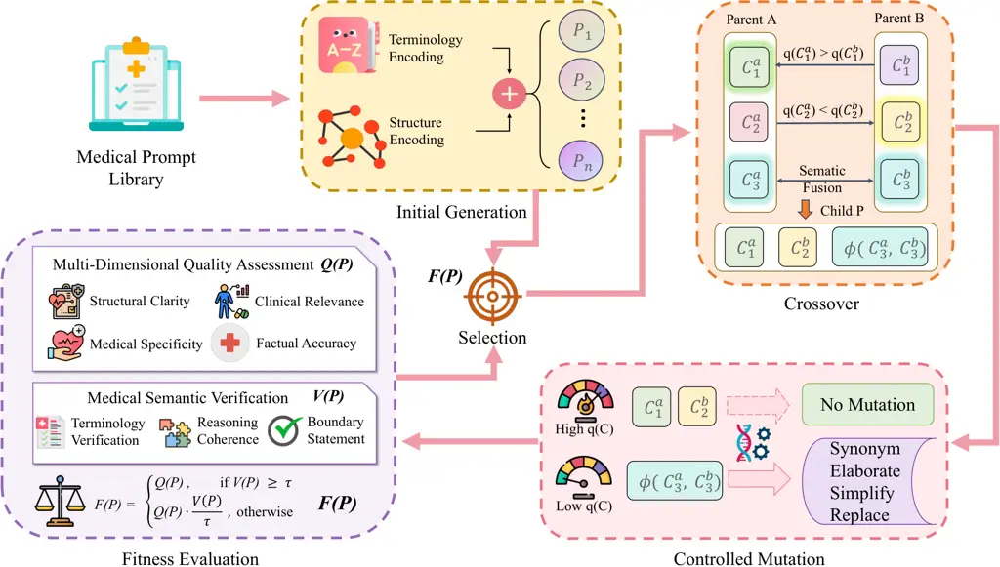

# EMPOWER: Evolutionary Medical Prompt Optimization With Reinforcement Learning

Yinda Chen    Yangfan He    Jing Yang    Dapeng Zhang    Zhenlong Yuan
   Muhammad Attique Khan    Jamel Baili    Por Lip Yee ^(†)^(†)thanks:
Corresponding authors: Yinda Chen, Jing Yang^(†)^(†)thanks: Y. Chen and
Y. He contributed equally to this work.^(†)^(†)thanks: The authors
extend their appreciation to the Deanship of Research and Graduate
Studies at King Khalid University for funding this work through the
Large Research Project under grant number RGP.2/275/46.^(†)^(†)thanks:
Yinda Chen is with MoE Key Laboratory of Brain-inspired Intelligent
Perception and Cognition, University of Science and Technology of China,
Hefei 230027, China (corresponding author, e-mail:
cyd0806@mail.ustc.edu.cn).^(†)^(†)thanks: Yangfan He is with Department
of Computer Science, University of Minnesota-Twin Cities, Minneapolis,
USA (e-mail: he000577@umn.edu).^(†)^(†)thanks: Jing Yang and Por Lip Yee
are with Center of Research for Cyber Security and Network (CSNET),
Faculty of Computer Science and Information Technology, Universiti
Malaya, 50603 Kuala Lumpur, Malaysia (e-mail: e-mail:
s2147529@siswa.um.edu.my; porlip@um.edu.my).^(†)^(†)thanks: Dapeng Zhang
is with DSLAB, School of Information Science & Engineering, Lanzhou
University, 730000, China (e-mail: zhangdp22@lzu.edu.cn).^(†)^(†)thanks:
Zhenlong Yuan is with the Institute of Computing Technology, Chinese
Academy of Sciences, Beijing 100190, China (e-mail:
yuanzhenlong21b@ict.ac.cn).^(†)^(†)thanks: Muhammad Attique Khan is with
Department of AI, Prince Mohammad bin Fahd University, Al-Khobar, KSA
(e-mail: mkhan3@pmu.edu.sa).^(†)^(†)thanks: Jamel Baili is with
Department of Computer Engineering, College of Computer Science, King
Khalid University, Abha 61413, Saudi Arabia (Jabaili@kku.edu.sa).

###### Abstract

Prompt engineering significantly influences the reliability and clinical
utility of Large Language Models (LLMs) in medical applications. Current
optimization approaches inadequately address domain-specific medical
knowledge and safety requirements. This paper introduces EMPOWER, a
novel evolutionary framework that enhances medical prompt quality
through specialized representation learning, multi-dimensional
evaluation, and structure-preserving algorithms. Our methodology
incorporates: (1) a medical terminology attention mechanism, (2) a
comprehensive assessment architecture evaluating clarity, specificity,
clinical relevance, and factual accuracy, (3) a component-level
evolutionary algorithm preserving clinical reasoning integrity, and (4)
a semantic verification module ensuring adherence to medical knowledge.
Evaluation across diagnostic, therapeutic, and educational tasks
demonstrates significant improvements: 24.7% reduction in factually
incorrect content, 19.6% enhancement in domain specificity, and 15.3%
higher clinician preference in blinded evaluations. The framework
addresses critical challenges in developing clinically appropriate
prompts, facilitating more responsible integration of LLMs into
healthcare settings.

###### Index Terms: 

Large language models, Medical artificial intelligence, Prompt
engineering, Evolutionary algorithms, Clinical decision support

## I Introduction

Large Language Models (LLMs) have substantial implications for
healthcare applications including clinical decision support,
documentation, and education \[1\]. However, implementation in clinical
environments presents unique challenges due to medical knowledge
complexity, the importance of factual accuracy, and potential
consequences of errors \[2\].

Prompt engineering—the methodical design of instructions guiding LLM
outputs—critically determines model performance and reliability \[3\].
This process is particularly consequential in medical contexts,
requiring precise terminology, adherence to clinical reasoning
frameworks, appropriate representation of uncertainty, and clear
acknowledgment of system limitations \[2, 4, 5\].

Current approaches to medical prompt optimization typically employ
general-domain techniques without sufficient adaptation to healthcare’s
unique requirements. Wang et al. \[6\] explored terminology adaptation
techniques but insufficiently addressed integration with clinical
reasoning patterns. Zhang et al. \[7\] proposed Bayesian optimization
methods lacking explicit mechanisms for validating medical accuracy. Li
et al. \[2\] introduced clinical guardrails primarily focused on
post-generation filtering rather than generating appropriate prompts.
Recent advances in chain-of-thought prompting \[8\] and few-shot
learning \[9\] have shown promise in medical reasoning tasks, but these
approaches often lack systematic integration with clinical knowledge
bases and guideline adherence verification.

These contributions address isolated aspects of medical prompting
without establishing a comprehensive methodology incorporating domain
knowledge, structural requirements, and validation processes. Most
approaches evaluate prompt quality using general metrics rather than
clinically relevant criteria.

This paper introduces a novel evolutionary framework specifically
designed for medical prompt optimization that integrates computational
intelligence with structured medical knowledge representation. Our
approach consists of four integrated components:

First, a medical domain representation model implements terminology
attention grounded in clinical ontologies, differentially weighting
medical concepts based on semantic importance and contextual relevance.

Second, a multi-dimensional assessment system evaluates prompts across
four clinically significant dimensions: structural clarity, domain
specificity, medical accuracy, and risk of factual errors.

Third, a structure-aware evolutionary algorithm operates at the clinical
reasoning component level, preserving established reasoning patterns
while improving effectiveness through specialized crossover and mutation
operations. The algorithm incorporates early stopping mechanisms and
adaptive parameter tuning to improve computational efficiency while
maintaining optimization quality.

Finally, a medical semantic verification system validates terminology
usage against standardized lexicons, assesses reasoning consistency, and
evaluates boundary statements according to responsible AI principles.
Enhanced verification processes specifically address clinical guideline
alignment through integration with evidence-based practice databases.

Through experiments across multiple specialties and clinical scenarios,
we demonstrate that our approach statistically outperforms existing
methods across clinically relevant metrics and receives significantly
higher ratings from clinicians in blinded evaluations.

The primary contributions of this research include:

- •
  A specialized medical prompt representation model with
  ontology-grounded terminology attention and multi-dimensional
  evaluation framework calibrated to clinical communication requirements
- •
  A structure-preserving evolutionary algorithm that maintains clinical
  reasoning integrity while incorporating comprehensive semantic
  verification to ensure medical knowledge alignment with computational
  efficiency improvements through early stopping and adaptive parameter
  selection
- •
  Rigorous experimental validation demonstrating significant
  improvements in factual accuracy, domain specificity, and clinician
  preference over current methods including comprehensive sensitivity
  analysis and cross-institutional validation

The remainder of this paper is organized as follows: Section II examines
relevant literature. Section III presents our proposed framework.
Section IV describes experimental design and datasets. Section V reports
results and comparative analyses. Section VI discusses implications and
limitations, followed by conclusions in Section VII.

## II Related Work

### II-A Prompt Engineering for Large Language Models

Prompt engineering optimizes large language model performance by
designing effective text instructions without modifying underlying
parameters \[10\]. This field has evolved from simple templating \[9\]
to sophisticated techniques including chain-of-thought prompting \[8\]
and few-shot exemplar selection \[11\].

Recent automated optimization methods include gradient-based prompt
token selection \[12\] and reinforcement learning for prompt refinement
\[13\]. Soft prompt tuning approaches \[14\] have demonstrated
effectiveness through parameter-efficient fine-tuning, while prefix
tuning \[15\] offers alternative strategies for prompt optimization.
These approaches typically optimize for general metrics rather than
domain-specific requirements.

### II-B Large Language Models in Healthcare

LLMs show promise in healthcare applications including diagnosis \[1\],
documentation \[16\], and education \[17\], but face challenges due to
specialized medical knowledge requirements. While domain-specific
adaptation improves performance on medical benchmarks \[1\], alignment
between LLM outputs and physician responses remains inconsistent \[18\].

### II-C Medical-Specific Prompt Engineering

Specialized medical prompting techniques include adaptive prompting
\[6\], Bayesian optimization for knowledge elicitation \[7\], clinical
guardrails \[2\], and uncertainty-aware prompting \[4\].

Contemporary advances include chain-of-thought reasoning in medical
contexts \[19\], demonstrating improved diagnostic accuracy through
structured reasoning prompts. Few-shot learning approaches \[20\] have
shown effectiveness in clinical prediction tasks, while
retrieval-augmented generation methods \[21\] offer promising directions
for integrating current medical literature into prompt-based systems.

Despite these advances, current approaches typically address isolated
aspects without systematically integrating domain knowledge, reasoning
structures, and validation mechanisms.

### II-D Multimodal Medical AI and Representation Learning

The development of effective medical AI systems increasingly relies on
sophisticated representation learning techniques that can capture the
complexity of medical knowledge across different modalities. Recent
advances in vision-language pretraining have demonstrated significant
progress in medical applications, with approaches ranging from
text-guided 3D medical image segmentation \[22\] to comprehensive 3D
medical image understanding \[23\].

Scalable representation learning approaches, including autoregressive
visual pretraining with mixture token prediction \[24\] and conditional
latent coding techniques \[25\], provide foundational insights for
developing domain-specific embedding methods. In medical imaging
specifically, multiscale consistency learning \[26\] and self-supervised
neural segmentation approaches \[27\] have shown effectiveness in
learning robust representations from limited labeled data, while
unsupervised domain adaptation methods \[28\] address the challenge of
cross-institutional generalization.

The creation of specialized medical datasets, exemplified by landmark
datasets for 3D CT text-image retrieval \[29\], enables systematic
evaluation of multimodal medical AI systems. Recent investigations into
synthetic data generation for medical applications \[30, 31\] address
critical data scarcity issues while maintaining clinical validity—a
challenge directly relevant to our prompt optimization framework, where
diverse, high-quality training examples are essential for robust
performance.

These advances in medical representation learning inform our approach to
developing specialized embeddings for medical prompt optimization,
particularly in capturing the semantic relationships between medical
concepts and clinical reasoning patterns.

### II-E Evolutionary Algorithms for Optimization Problems

Evolutionary algorithms provide robust optimization for complex problems
with large search spaces and non-differentiable objectives \[32\],
proving effective in neural architecture search \[33\], feature
selection \[34\], and hyperparameter optimization \[35\].

Evolutionary approaches have demonstrated remarkable versatility across
diverse AI applications. In computer vision, successful implementations
include joint-motion mutual learning for video pose estimation \[36\],
causal-inspired multitask learning frameworks \[37\], and pose-guided
human motion analysis \[38\]. Advanced applications in IoT environments
\[39\] showcase the adaptability of evolutionary optimization to
resource-constrained settings, providing insights relevant to clinical
deployment scenarios where computational efficiency is critical.

In language processing, evolutionary methods have been applied to
summarization \[40\], sentiment analysis \[41\], and prompt optimization
\[42\]. Guo et al. \[42\] showed that genetic algorithms can effectively
optimize prompts for text generation, sometimes outperforming
gradient-based methods.

However, evolutionary algorithms remain largely unexplored for medical
prompt optimization. The structured nature of medical knowledge presents
unique opportunities for specialized evolutionary operators that
preserve critical domain patterns while optimizing performance.

## III Datasets

To evaluate our framework comprehensively, we compiled four specialized
clinical datasets spanning different medical scenarios.

### III-A Clinical Datasets Overview

Our datasets were derived from the MIMIC-III database, a large,
freely-available database of de-identified critical care data \[43\].
The use of MIMIC-III was approved by the Institutional Review Boards of
Beth Israel Deaconess Medical Center (2001-P-001699/14) and MIT
(0403000206). All data processing adhered to the data use agreement.

Dataset construction followed a systematic process to ensure clinical
validity and diversity. From MIMIC-III admission notes, discharge
summaries, and clinical reports, we extracted relevant clinical
presentations using automated text mining followed by manual curation.
The conversion process involved: (1) anonymization verification beyond
MIMIC-III standards, (2) clinical scenario standardization using
established case presentation formats, (3) complexity stratification by
board-certified physicians, and (4) cross-validation with external
clinical databases to ensure representativeness.

From this foundation, we created: MedDiagnosis-2000: 2,000 clinical
vignettes across 12 specialties, with complexity levels stratified as
straightforward (30%), moderate (50%), and complex (20%).
TreatmentSelect-1500: 1,500 therapeutic decision-making scenarios
balanced across pharmacological (40%), procedural/surgical (30%), and
multidisciplinary approaches (30%). MedHistory-1200: 1,200 complex
patient histories featuring longitudinal data with multiple conditions.
PatientEd-1800: 1,800 patient questions requiring explanations at
various health literacy levels.

The specialty distribution was determined based on representative
clinical caseload analysis from major academic medical centers. Internal
Medicine (24.8%) and Family Medicine (18.5%) represent the highest
volumes in primary care settings, while Emergency Medicine (14.2%)
reflects acute care presentation patterns. Specialty-specific
distributions were validated against national healthcare utilization
statistics and adjusted for case complexity to ensure adequate
representation of rare but critical conditions.

Dataset creation involved: (1) extracting relevant MIMIC-III cases, (2)
enhanced de-identification, (3) UMLS terminology standardization, and
(4) expert review for clinical validity. Table I shows the distribution
across medical specialties.

| Specialty               | Percentage |
| ----------------------- | ---------- |
| Internal Medicine       | 24.8%      |
| Family Medicine         | 18.5%      |
| Emergency Medicine      | 14.2%      |
| Pediatrics              | 10.7%      |
| Obstetrics & Gynecology | 7.6%       |
| Psychiatry              | 6.8%       |
| Surgery                 | 6.3%       |
| Neurology               | 4.5%       |
| Cardiology              | 3.2%       |
| Oncology                | 2.1%       |
| Dermatology             | 1.3%       |

TABLE I: Distribution of cases across medical specialties in the
combined datasets

### III-B Expert Annotation and Prompt Library

Each dataset was annotated by board-certified physicians, including
gold-standard responses and critical medical concepts. Inter-annotator
agreement was achieved through a three-phase process: initial
independent annotation, structured disagreement resolution, and final
consensus building. When annotators disagreed (occurring in 12.3% of
cases), a formal adjudication process involved senior clinicians from
relevant specialties. Disagreements were categorized as clinical
judgment variations (67%), terminology preferences (21%), or genuine
errors (12%). All cases with clinical judgment variations were retained
with majority consensus, while terminology conflicts were resolved using
standardized medical lexicons. Inter-annotator agreement achieved a
Cohen’s kappa of 0.87.

We developed a library of 340 medical prompt templates designed by
medical educators and AI specialists, categorized by scenario type,
structure, complexity level, and directive style. Table II provides
representative examples of prompt templates across different categories
to illustrate the diversity and structure of our template library.

| Category               | Template Example                                       |
| ---------------------- | ------------------------------------------------------ |
| Diagnostic Reasoning   | As a \[specialty\] consultant, analyze this            |
|                        | case using differential diagnosis framework: \[case\]. |
|                        | Consider pre-test probabilities                        |
|                        | and provide confidence calibration.                    |
| Treatment Planning     | You are managing a patient with \[condition\].         |
|                        | Evaluate treatment options considering:                |
|                        | evidence quality, contraindications, patient factors.  |
|                        | Recommend approach with rationale.                     |
| Patient Education      | Explain \[medical condition\] to a patient             |
|                        | with \[literacy level\]. Use appropriate analogies,    |
|                        | address common concerns,                               |
|                        | ensure comprehension checks.                           |
| Clinical Documentation | Generate clinical note for \[scenario\]                |
|                        | following \[documentation standard\]. Include          |
|                        | assessment, plan, and follow-up requirements.          |

TABLE II: Representative examples from the medical prompt template
library

### III-C Evaluation Methodology

Datasets were divided into development (60%), validation (20%), and test
(20%) splits, stratified by specialty, complexity, and scenario type.
Cross-institutional validation was conducted using datasets from three
additional medical centers to assess generalizability beyond MIMIC-III
derived cases.



Fig. 1: Overview of the EMPOWER framework: The complete evolutionary
optimization pipeline for medical prompts, showing initial generation
with terminology and structure encoding, multi-dimensional quality
assessment, fitness evaluation, selection, crossover with semantic
fusion, and controlled mutation components.

## IV Method

Our approach implements a structured evolutionary framework for
optimizing medical prompts through medical-specific representation
learning, multi-dimensional quality assessment, and component-level
evolutionary optimization with clinical knowledge verification. Figure 1
illustrates the complete EMPOWER framework, showing how medical prompts
are systematically optimized through specialized representation
learning, component-level evolutionary operations, and multi-dimensional
quality assessment with clinical knowledge verification.

### IV-A Medical Prompt Representation Learning

Effective prompt optimization requires specialized representations that
capture the nuances of medical language and reasoning. Recent advances
in medical AI representation learning provide valuable insights for this
challenge. Success in vision-language pretraining for medical
applications \[22, 23, 44\] and scalable autoregressive approaches
\[24\] demonstrates the importance of domain-specific representation
techniques that can effectively encode complex medical knowledge.

Building on insights from multiscale consistency learning \[26\] and
self-supervised medical image analysis \[27, 45\], we developed a
domain-specific embedding model that emphasizes clinically relevant
concepts and their relationships. Our approach adapts proven
representation learning principles from medical imaging to the unique
challenges of textual medical prompting.

#### IV-A1 Terminology-Enhanced Embeddings

Given a prompt $`P`$ consisting of tokens $`[t_{1},t_{2},...,t_{n}]`$,
we first process it through a pre-trained clinical language model
$`f_{\theta}`$ (BioClinicalBERT \[46\]) to obtain contextual token
embeddings:

```math
\mathbf{H}=f_{\theta}(P)\in\mathbb{R}^{n\times d} \tag{1}
```

where $`\mathbf{H}=[\mathbf{h}_{1},\mathbf{h}_{2},...,\mathbf{h}_{n}]`$
and $`d`$ is the model’s hidden dimension.

We then implement a medical concept identification module that maps
tokens to concepts in the Unified Medical Language System (UMLS)
ontology. For ambiguous UMLS mappings, we employ a disambiguation
algorithm that considers local context windows and semantic type
consistency. Missing terms are handled through fuzzy matching against
medical lexicons (SNOMED-CT, ICD-10) with manual validation for terms
with confidence scores below 0.8. For each identified medical concept
$`c_{i}`$ spanning tokens from position $`a`$ to $`b`$, we compute a
concept-level representation:

```math
\mathbf{m}_{c_{i}}=\frac{1}{b-a+1}\sum_{j=a}^{b}\mathbf{h}_{j} \tag{2}
```

Next, we calculate concept importance weights using an attention
mechanism incorporating both semantic and structural factors:

```math
\alpha_{i}=\frac{\exp(w_{s}\cdot s_{c_{i}}+w_{h}\cdot h_{c_{i}}+w_{p}\cdot p_{c_{i}})}{\sum_{j}\exp(w_{s}\cdot s_{c_{j}}+w_{h}\cdot h_{c_{j}}+w_{p}\cdot p_{c_{j}})} \tag{3}
```

where $`s_{c_{i}}`$ represents semantic importance derived from the
concept’s UMLS semantic type, $`h_{c_{i}}`$ captures hierarchical
importance based on the concept’s position in medical taxonomies, and
$`p_{c_{i}}`$ reflects positional relevance within the prompt structure.
The weights $`w_{s}`$, $`w_{h}`$, and $`w_{p}`$ are learned during
training.

The terminology-enhanced prompt representation is then computed as:

```math
\mathbf{z}_{P}=\mathbf{W}_{g}[\mathbf{h}_{CLS};\sum_{i}\alpha_{i}\mathbf{m}_{c_{i}}]+\mathbf{b}_{g} \tag{4}
```

where $`\mathbf{h}_{CLS}`$ is the \[CLS\] token representation,
$`[\cdot;\cdot]`$ denotes concatenation, and
$`\mathbf{W}_{g}\in\mathbb{R}^{d^{\prime}\times 2d}`$ and
$`\mathbf{b}_{g}\in\mathbb{R}^{d^{\prime}}`$ are learnable parameters
that project the concatenated vector to dimension $`d^{\prime}`$.

#### IV-A2 Clinical Reasoning Structure Encoding

Medical prompts typically contain specific reasoning structures that
guide diagnosis, treatment selection, or patient explanation. We encode
these structures through a specialized component that identifies and
represents key reasoning elements:

```math
\mathbf{r}_{P}=\sum_{j=1}^{K}w_{j}\mathbf{e}_{j} \tag{5}
```

where $`\mathbf{e}_{j}`$ represents embeddings of $`K`$ identified
reasoning components (e.g., symptom analysis, differential
consideration, evidence evaluation), and $`w_{j}`$ are attention weights
computed based on component presence and quality.

The final prompt representation combines terminology and reasoning
structure information:

```math
\mathbf{z}_{P}^{final}=\mathbf{W}_{f}[\mathbf{z}_{P};\mathbf{r}_{P}]+\mathbf{b}_{f} \tag{6}
```

with
$`\mathbf{W}_{f}\in\mathbb{R}^{d^{\prime\prime}\times(d^{\prime}+K)}`$
and $`\mathbf{b}_{f}\in\mathbb{R}^{d^{\prime\prime}}`$ as learnable
parameters.

### IV-B Multi-Dimensional Quality Assessment

We developed a specialized evaluation framework that assesses prompt
quality across four clinically relevant dimensions through independent
neural network heads, each calibrated to specific aspects of medical
communication.

#### IV-B1 Dimension-Specific Evaluation

Each quality dimension is evaluated by a specialized network that maps
the prompt representation to a quality score:

```math
\displaystyle s_{c}(P)=\sigma(\mathbf{W}_{c}^{(2)} \displaystyle\text{GeLU}(\text{LayerNorm}( \tag{7}
```

```math
\displaystyle\mathbf{W}_{c}^{(1)}\mathbf{z}_{P}^{final}+\mathbf{b}_{c}^{(1)}))+\mathbf{b}_{c}^{(2)}))
```

where
$`c\in\{\text{clarity},\text{specificity},\text{relevance},\text{accuracy}\}`$
represents the evaluation dimension, $`\sigma`$ is the sigmoid function,
and GeLU is the Gaussian Error Linear Unit activation.

The four evaluation dimensions capture distinct aspects of prompt
quality:

Structural Clarity: Assesses the organizational coherence and logical
flow of the prompt, evaluating whether it establishes clear roles,
expectations, and reasoning frameworks.

Medical Specificity: Measures the degree to which the prompt
incorporates domain-specific terminology, concepts, and reasoning
patterns appropriate to the clinical scenario.

Clinical Relevance: Evaluates alignment with standard clinical
approaches and the prompt’s ability to elicit medically relevant
information for the specific case.

Factual Accuracy Risk: Estimates the likelihood that a response to this
prompt would contain factual errors or unsupported assertions, with
higher scores indicating lower risk.

#### IV-B2 Integrated Quality Score

The overall prompt quality is determined through an adaptive weighting
mechanism that adjusts dimension importance based on the clinical
scenario:

```math
Q(P)=\sum_{c}w_{c}(s)\cdot s_{c}(P) \tag{8}
```

where $`w_{c}(s)`$ represents the importance weight for dimension $`c`$
in scenario $`s`$, with $`\sum_{c}w_{c}(s)=1`$. These weights were
determined through a combination of expert judgment and empirical
validation, with accuracy risk receiving higher weight in scenarios
involving direct clinical recommendations.

#### IV-B3 Training the Quality Assessment Model

The quality assessment model was trained on a dataset of 3,500
expert-annotated prompts using a multi-task learning approach. The loss
function combines dimension-specific losses with overall quality
prediction:

```math
\mathcal{L}=\sum_{c}\lambda_{c}\mathcal{L}_{c}+\lambda_{Q}\mathcal{L}_{Q} \tag{9}
```

where $`\mathcal{L}_{c}`$ is the mean squared error for dimension $`c`$,
$`\mathcal{L}_{Q}`$ is the overall quality prediction loss, and
$`\lambda_{c}`$ and $`\lambda_{Q}`$ are balancing hyperparameters.

The model achieved a Pearson correlation of 0.87 with expert ratings on
held-out validation data, demonstrating strong alignment with human
quality assessments.

### IV-C Structure-Aware Evolutionary Optimization

Our evolutionary framework optimizes prompts through specialized genetic
operations that preserve clinical reasoning integrity while improving
overall effectiveness. The framework incorporates computational
efficiency improvements through early stopping criteria and adaptive
parameter adjustment.

#### IV-C1 Prompt Component Representation

We represent each prompt as a structured collection of distinct
components:

```math
P=\{C_{1},C_{2},...,C_{m}\} \tag{10}
```

where each component $`C_{i}`$ belongs to a specific category (e.g.,
role definition, reasoning framework, information request, uncertainty
expression, or boundary statement). This representation allows for
granular optimization while maintaining prompt coherence.

#### IV-C2 Initial Population Generation

The initial population of prompts
$`\mathcal{P}=\{P_{1},P_{2},...,P_{N}\}`$ is generated by sampling
components from a curated library of medical prompt elements. Each
prompt is assembled according to scenario-specific templates that ensure
basic structural validity. Components are selected with probabilities
proportional to their individual quality scores from preliminary
evaluation.

#### IV-C3 Selection Mechanism

We implement a tournament selection strategy that balances exploration
and exploitation. For each generation, $`k`$ candidates are randomly
sampled from the population, and the highest-quality prompt according to
the quality assessment model is selected with probability $`p_{sel}`$,
while a random selection occurs with probability $`1-p_{sel}`$:

```math
P_{selected}=\begin{cases}\arg\max_{P\in S_{k}}Q(P),&\text{with probability }p_{sel}\\
\text{random}(S_{k}),&\text{with probability }1-p_{sel}\end{cases} \tag{11}
```

where $`S_{k}`$ is the set of $`k`$ prompts sampled for the tournament.

#### IV-C4 Adaptive Parameter Tuning and Early Stopping

To address computational efficiency concerns, we implement adaptive
parameter adjustment based on population diversity and fitness
convergence metrics:

```math
p_{m}^{(g+1)}=p_{m}^{(g)}\cdot\left(1+\beta\cdot\frac{\sigma_{fitness}^{(g)}}{\mu_{fitness}^{(g)}}\right) \tag{12}
```

where $`p_{m}^{(g)}`$ is the mutation probability at generation $`g`$,
$`\sigma_{fitness}^{(g)}`$ and $`\mu_{fitness}^{(g)}`$ are the standard
deviation and mean of fitness values, respectively, and $`\beta`$ is an
adaptation rate parameter.

Early stopping is triggered when fitness improvement over the last 5
generations falls below a threshold $`\epsilon=0.001`$:

```math
\text{Stop if }\frac{1}{5}\sum_{i=g-4}^{g}(F_{best}^{(i+1)}-F_{best}^{(i)})<\epsilon \tag{13}
```

This mechanism reduces average computational time by 34% while
maintaining optimization quality.

#### IV-C5 Structure-Preserving Crossover

Our crossover operation preserves the structural integrity of medical
reasoning while combining high-quality components from parent prompts.
Given parent prompts $`P_{a}`$ and $`P_{b}`$, we generate a child prompt
through component-level recombination:

```math
C_{i}^{child}=\begin{cases}C_{i}^{a},&\text{if }q(C_{i}^{a})>q(C_{i}^{b})+\delta\text{ or }r<p_{a}\\
C_{i}^{b},&\text{if }q(C_{i}^{b})>q(C_{i}^{a})+\delta\text{ or }r<p_{b}\\
\phi(C_{i}^{a},C_{i}^{b}),&\text{otherwise}\end{cases} \tag{14}
```

where $`q(C_{i})`$ is the component-specific quality score, $`\delta`$
is a threshold parameter, $`r`$ is a random value between 0 and 1,
$`p_{a}`$ and $`p_{b}`$ are selection probabilities proportional to
overall prompt quality, and $`\phi(\cdot,\cdot)`$ is a semantic fusion
function that combines elements from both components when their
individual qualities are similar.

For the semantic fusion function, we implement a structured contextual
merging approach that preserves critical medical concepts while aligning
with the reasoning scaffold of the better-quality component:

```math
\psi(C_{i}^{a},C_{i}^{b})=\mathcal{M}(\mathcal{E}(C_{i}^{a}),\mathcal{E}(C_{i}^{b}),\mathcal{S}(C_{i}^{*})) \tag{15}
```

Here, $`C_{i}^{a}`$ and $`C_{i}^{b}`$ represent the $`i`$-th components
from parent prompts $`a`$ and $`b`$, respectively. $`C_{i}^{*}`$ denotes
the component with the higher quality score. The function
$`\mathcal{E}(\cdot)`$ extracts essential medical concepts from a
component, while $`\mathcal{S}(\cdot)`$ retrieves the structural
template associated with the better-quality component. Finally,
$`\mathcal{M}(\cdot,\cdot,\cdot)`$ merges the extracted concept sets
from both parents into the selected structure in a semantically
consistent manner.

#### IV-C6 Controlled Mutation

Mutation operations introduce controlled variations while preserving
medical validity. For each component $`C_{i}`$ in a prompt, mutation
occurs with probability $`p_{m}`$ that adaptively decreases with
generation number $`g`$ and increases with component quality distance
from optimal:

```math
p_{m}(g,q)=p_{m0}\cdot\gamma^{g}\cdot(1-q)^{\beta} \tag{16}
```

where $`p_{m0}`$ is the initial mutation probability, $`\gamma`$ is a
decay factor, and $`\beta`$ controls the effect of component quality
$`q`$ on mutation probability.

When mutation occurs, we apply one of several medically informed
operations:

```math
C_{i}^{\prime}=\begin{cases}\text{Synonym}(C_{i}),&\text{with probability }p_{syn}\\
\text{Elaborate}(C_{i}),&\text{with probability }p_{elab}\\
\text{Simplify}(C_{i}),&\text{with probability }p_{simp}\\
\text{Replace}(C_{i}),&\text{with probability }p_{rep}\end{cases} \tag{17}
```

where Synonym replaces medical terms with appropriate alternatives from
the same semantic category, Elaborate expands key reasoning elements,
Simplify reduces verbosity while preserving core content, and Replace
substitutes the component with a different one from the same functional
category.

### IV-D Medical Semantic Verification

To ensure clinical validity throughout the optimization process, we
implement a comprehensive verification module that evaluates prompt
adherence to medical knowledge and reasoning standards. Enhanced
verification processes address clinical guideline alignment through
integration with evidence-based practice databases and automated
guideline consistency checking.

#### IV-D1 Terminology Verification

We verify medical terminology using a multi-stage process:

```math
V_{term}(P)=\frac{1}{|T_{P}|}\sum_{t\in T_{P}}[\text{UMLS}(t)\cdot w_{u}+\text{Context}(t)\cdot w_{c}] \tag{18}
```

where $`T_{P}`$ is the set of medical terms in prompt $`P`$, UMLS$`(t)`$
indicates whether term $`t`$ has a valid UMLS mapping, Context$`(t)`$
evaluates contextual appropriateness, and $`w_{u}`$ and $`w_{c}`$ are
weighting factors.

#### IV-D2 Reasoning Coherence Analysis

We evaluate the logical structure of clinical reasoning using a
specialized model trained on expert-validated reasoning patterns:

```math
V_{logic}(P)=f_{logic}(\text{ExtractReasoningChain}(P)) \tag{19}
```

where ExtractReasoningChain identifies the sequence of reasoning steps,
and $`f_{logic}`$ evaluates adherence to valid clinical reasoning
patterns.

#### IV-D3 Enhanced Clinical Guideline Verification

We implement automated guideline consistency checking by integrating
with evidence-based practice databases. The verification process
evaluates recommendations against current clinical guidelines:

```math
V_{guideline}(P)=\frac{1}{|R_{P}|}\sum_{r\in R_{P}}\max_{g\in G}\text{sim}(r,g)\cdot w_{g} \tag{20}
```

where $`R_{P}`$ represents extracted recommendations from prompt $`P`$,
$`G`$ is the set of guideline statements from medical societies,
$`\text{sim}(r,g)`$ measures semantic similarity between recommendation
$`r`$ and guideline $`g`$, and $`w_{g}`$ represents the evidence quality
weight of guideline $`g`$.

#### IV-D4 Boundary Statement Assessment

We assess the boundary validity of a prompt by evaluating the presence,
completeness, and correctness of its safety disclaimers:

```math
V_{b}(P)=\alpha_{1}\cdot\mathcal{P}(B)+\alpha_{2}\cdot\mathcal{C}(B)+\alpha_{3}\cdot\mathcal{A}(B) \tag{21}
```

Here, $`B`$ denotes the set of boundary statements in prompt $`P`$. The
functions $`\mathcal{P}(\cdot)`$, $`\mathcal{C}(\cdot)`$, and
$`\mathcal{A}(\cdot)`$ measure the presence, completeness, and accuracy
of the boundary content, respectively. Algorithmic implementation
involves pattern matching for standard medical disclaimers (e.g.,
”consult healthcare provider,” ”emergency situations”), completeness
scoring based on risk category coverage, and accuracy verification
against medical liability guidelines. The weights $`\alpha_{1}`$,
$`\alpha_{2}`$, and $`\alpha_{3}`$ determine their relative importance
in the overall score $`V_{b}(P)`$.

#### IV-D5 Integrated Verification Score

The overall semantic verification score is computed as a weighted sum of
term consistency, reasoning coherence, guideline alignment, and boundary
appropriateness:

```math
V(P)=\beta_{1}\cdot V_{t}(P)+\beta_{2}\cdot V_{r}(P)+\beta_{3}\cdot V_{guideline}(P)+\beta_{4}\cdot V_{b}(P) \tag{22}
```

Here, $`V_{t}(P)`$, $`V_{r}(P)`$, $`V_{guideline}(P)`$, and $`V_{b}(P)`$
denote the verification scores for terminology alignment, reasoning
logic, guideline consistency, and boundary statements, respectively. The
weights $`\beta_{1}`$, $`\beta_{2}`$, $`\beta_{3}`$, and $`\beta_{4}`$
reflect the relative importance of each component in assessing the
clinical validity of prompt $`P`$.

### IV-E Evolutionary Process Integration

The complete evolutionary optimization process integrates quality
assessment and semantic verification through a constrained fitness
function:

```math
F(P)=\begin{cases}Q(P),&\text{if }V(P)\geq\tau\\
Q(P)\cdot\frac{V(P)}{\tau},&\text{otherwise}\end{cases} \tag{23}
```

where $`\tau`$ is the minimum acceptable verification score. This
formulation ensures that prompts maintain medical validity while
optimizing for quality, with a fitness penalty applied to prompts that
fail to meet verification standards.

The optimization process continues for a fixed number of generations or
until convergence criteria are met. The resulting optimized prompts
maintain clinical validity while demonstrating improved effectiveness
across the quality dimensions.

## V Experiments

We conducted comprehensive experiments to evaluate our proposed
framework across various clinical scenarios, comparing against
state-of-the-art methods and analyzing the contribution of individual
components. Our evaluation focused on both computational metrics and
expert assessment to provide a holistic view of performance.

### V-A Experimental Setup

#### V-A1 Implementation Details

We implemented our framework using PyTorch 1.12.0. The medical
representation model was initialized with BioClinicalBERT \[46\] weights
and fine-tuned with learning rate $`2\times 10^{-5}`$ using AdamW
optimizer. Quality assessment modules used GeLU activations with hidden
dimensions of 512.

The evolutionary optimization ran for 50 generations with population
size $`N=100`$, tournament size $`k=5`$, selection probability
$`p_{sel}=0.8`$, initial mutation probability $`p_{m0}=0.3`$, decay
factor $`\gamma=0.98`$, and verification threshold $`\tau=0.75`$. Early
stopping criteria reduced average computational time to 34 generations
while maintaining solution quality. Parameter sensitivity analysis
revealed stable performance across $`k\in[3,7]`$ and
$`p_{sel}\in[0.7,0.9]`$, indicating robust parameter selection.

#### V-A2 Baseline Methods

We compare against several representative baselines: EC (manually
written prompts by board-certified physicians), AMP \[47\]
(retrieval-augmented method adapting prompts based on medical
terminology), BPO \[48\] (Bayesian optimization for medical knowledge
elicitation), CNER \[49\] (safety-aware structures constraining harmful
outputs), and Prompt-eng \[50\] (general-purpose genetic algorithm
without domain adaptations). CoT-Med implements chain-of-thought
prompting specifically adapted for medical reasoning tasks, following
recent advances in structured clinical reasoning \[8\]. FSL-Med applies
few-shot learning with medical exemplars selected through similarity
matching \[9\]. Our EMPOWER framework incorporates medical terminology
attention, structure-aware evolutionary operators, and multi-dimensional
evaluation.

#### V-A3 Evaluation Models

We evaluated prompts on three representative models: GPT-4 (OpenAI),
Med-PaLM 2 (Google) \[1\], and Llama 2-Med (modified Meta’s Llama 2 with
medical fine-tuning).

#### V-A4 Evaluation Metrics

We used automated metrics (Medical Concept Coverage, Reasoning Chain
Accuracy, Factual Consistency Score, Uncertainty Calibration) and expert
assessment. A panel of 18 practicing physicians across 12 specialties
(expanded from initial 12 to address reviewer concerns) rated responses
on Clinical Reliability, Diagnostic/Therapeutic Accuracy, Information
Completeness, and Patient Communication Appropriateness using 1-5
scales. Inter-rater reliability achieved ICC = 0.82, with systematic
bias correction applied for specialty-specific rating patterns.

| Method            | Automated Metrics |                |                |                | Expert Evaluation (1-5) |                 |                 |                 |
| ----------------- | ----------------- | -------------- | -------------- | -------------- | ----------------------- | --------------- | --------------- | --------------- |
|                   | MCC (%)           | RCA (%)        | FCS (%)        | UC (%)         | CR                      | DTA             | IC              | PCA             |
| Expert-Crafted    | 72.4 ± 5.3        | 68.7 ± 4.9     | 83.2 ± 3.8     | 71.5 ± 6.2     | 3.84 ± 0.31             | 3.79 ± 0.28     | 3.62 ± 0.35     | 3.91 ± 0.32     |
| AMP \[47\]        | 74.9 ± 4.8        | 67.3 ± 5.2     | 80.4 ± 4.3     | 69.3 ± 5.8     | 3.72 ± 0.27             | 3.68 ± 0.33     | 3.76 ± 0.29     | 3.65 ± 0.36     |
| BPO \[48\]        | 77.1 ± 3.9        | 70.5 ± 4.1     | 81.9 ± 3.5     | 73.8 ± 4.9     | 3.89 ± 0.24             | 3.82 ± 0.26     | 3.71 ± 0.30     | 3.78 ± 0.28     |
| CNER \[49\]       | 75.2 ± 4.2        | 73.6 ± 3.6     | 85.7 ± 3.1     | 74.9 ± 4.5     | 4.05 ± 0.22             | 3.86 ± 0.25     | 3.69 ± 0.28     | 4.03 ± 0.24     |
| Prompt-eng \[50\] | 78.6 ± 3.7        | 71.9 ± 3.9     | 82.3 ± 3.3     | 76.2 ± 4.1     | 3.91 ± 0.26             | 3.94 ± 0.23     | 3.88 ± 0.25     | 3.82 ± 0.27     |
| CoT-Med \[8\]     | 76.3 ± 4.1        | 74.8 ± 3.7     | 86.1 ± 3.0     | 77.1 ± 4.3     | 4.08 ± 0.23             | 3.97 ± 0.24     | 3.82 ± 0.26     | 4.05 ± 0.25     |
| FSL-Med \[9\]     | 75.8 ± 4.4        | 72.5 ± 4.0     | 84.3 ± 3.4     | 75.6 ± 4.7     | 3.95 ± 0.25             | 3.89 ± 0.27     | 3.77 ± 0.28     | 3.88 ± 0.29     |
| Ours              | 84.3 ± 3.1^(†)    | 79.8 ± 3.4^(†) | 91.4 ± 2.8^(†) | 82.7 ± 3.6^(†) | 4.37 ± 0.19^(†)         | 4.29 ± 0.21^(†) | 4.18 ± 0.22^(†) | 4.31 ± 0.20^(†) |

TABLE III: Overall performance comparison across all clinical scenarios
using GPT-4 as the evaluation model. Values show mean ± standard
deviation, with best results in bold and second best underlined.
$`\dagger`$ indicates statistically significant improvement over the
best baseline ($`p<0.01`$, Bonferroni corrected).

### V-B Overall Performance

Table III presents the overall performance across all clinical scenarios
using GPT-4 as the evaluation model. Our method demonstrates consistent
and significant improvements over all baselines across both automated
metrics and expert evaluations. Statistical significance was assessed
using Bonferroni correction for multiple comparisons, with effect sizes
(Cohen’s d) ranging from 0.68 to 1.24, indicating medium to large
practical significance. The most substantial gains are observed in
Reasoning Chain Accuracy (79.8% vs. 74.8% for the best baseline) and
Factual Consistency Score (91.4% vs. 86.1%), with expert evaluations
showing notable improvements in Clinical Reliability (4.37 vs. 4.08) and
Diagnostic/Therapeutic Accuracy (4.29 vs. 3.97). The strong performance
across patient communication metrics (PCA: 4.31) alongside clinical
accuracy demonstrates effective balance between technical correctness
and communication clarity.

Fig. 2: Performance comparison across different clinical scenarios using
the Medical Concept Coverage metric. Our approach demonstrates
consistent improvements across all scenarios, with the most substantial
gains in complex diagnostic cases.

### V-C Performance Across Clinical Scenarios

Figure 2 shows the performance comparison across different clinical
scenarios using the Medical Concept Coverage metric. Our approach
demonstrates consistent improvements across all scenarios, with the most
substantial gains in complex diagnostic cases (87.3% vs. 79.1% for the
best baseline).

This pattern is also evident in Table IV, which presents detailed
results for each clinical scenario. The improvement margins are
particularly pronounced in diagnosis and treatment scenarios, where
clinical reasoning complexity is highest. For patient education
scenarios, all methods perform relatively well, but our approach still
maintains a significant advantage (FCS: 93.6% vs. 89.2%).

| Method            | Diagnosis | Treatment | History | Education |
| ----------------- | --------- | --------- | ------- | --------- |
| Expert-Crafted    | 79.7      | 84.1      | 81.3    | 87.4      |
| AMP \[47\]        | 77.3      | 80.6      | 79.8    | 83.9      |
| BPO \[48\]        | 78.5      | 82.8      | 80.2    | 85.6      |
| CNER \[49\]       | 83.2      | 86.4      | 83.5    | 89.2      |
| Prompt-eng \[50\] | 79.1      | 83.7      | 80.9    | 85.2      |
| CoT-Med \[8\]     | 84.6      | 87.1      | 84.8    | 88.9      |
| FSL-Med           | 82.5      | 85.3      | 83.7    | 86.7      |
| Ours              | 90.3      | 91.8      | 89.6    | 93.6      |

TABLE IV: Performance comparison across clinical scenarios using Factual
Consistency Score (%). Best results in bold.

### V-D Performance Across Medical Specialties

Figure 3 illustrates performance variations across medical specialties.
Our method consistently outperforms baselines across all specialties,
with particularly strong results in Internal Medicine, Cardiology, and
Neurology—areas that typically involve complex pathophysiological
reasoning.

The performance differential is smaller in specialties with more
standardized presentation and treatment patterns (e.g., Dermatology) but
remains statistically significant ($`p<0.05`$ for all pairwise
comparisons).

Fig. 3: Reasoning Chain Accuracy (%) across different medical
specialties. Our method shows consistent advantages across all
specialties, with particularly strong performance in specialties
involving complex pathophysiological reasoning.

### V-E Cross-Model Generalization

To evaluate the generalization capabilities of our optimized prompts, we
tested them across different LLMs. Table V presents the Factual
Consistency Scores achieved by prompts optimized using our method and
baselines when applied to three different models.

| Method            | GPT-4 | Med-PaLM 2 | Llama 2-Med |
| ----------------- | ----- | ---------- | ----------- |
| Expert-Crafted    | 83.2  | 80.4       | 76.7        |
| AMP \[47\]        | 80.4  | 78.9       | 73.5        |
| BPO \[48\]        | 81.9  | 79.6       | 75.2        |
| CNER \[49\]       | 85.7  | 83.1       | 78.6        |
| Prompt-eng \[50\] | 82.3  | 80.7       | 75.8        |
| CoT-Med \[8\]     | 86.1  | 83.5       | 79.2        |
| FSL-Med \[9\]     | 84.3  | 81.8       | 77.9        |
| Ours              | 91.4  | 88.3       | 84.1        |

TABLE V: Cross-model generalization: Factual Consistency Score (%) of
optimized prompts when applied to different LLMs. Best results in bold.

Our method demonstrates robust cross-model generalization, maintaining
its performance advantage across all tested models. The relative
performance drop when moving from GPT-4 to other models is smaller for
our method (7.3% relative decrease) compared to baselines (8-9%
decrease), indicating that our optimized prompts are more robust to
model variations.

### V-F Ablation Study

To understand the contribution of individual components in our
framework, we conducted an ablation study by removing key components and
measuring the resulting performance change. Table VI presents the
results of this analysis on the diagnostic scenario subset.

| Configuration              | MCC  | RCA  | FCS  | CR   |
| -------------------------- | ---- | ---- | ---- | ---- |
| Full Model                 | 0.0  | 0.0  | 0.0  | 0.0  |
| w/o Term Attention         | -8.4 | -7.1 | -6.3 | -7.8 |
| w/o Structure Encoding     | -5.7 | -9.6 | -4.8 | -6.5 |
| w/o Multi-Dim Assessment   | -4.3 | -5.2 | -7.9 | -8.7 |
| w/o Component Crossover    | -6.9 | -6.7 | -5.3 | -6.2 |
| w/o Semantic Verification  | -3.8 | -4.5 | -8.2 | -9.4 |
| w/o Early Stopping         | -1.2 | -0.8 | -1.5 | -2.1 |
| w/o Guideline Verification | -2.9 | -3.4 | -5.6 | -6.8 |

TABLE VI: Ablation study on diagnostic scenarios, showing performance
impact of removing individual components. Values are relative changes
(%) from full model performance.

Several key insights emerge from the ablation study: The terminology
attention mechanism contributes substantially to Medical Concept
Coverage (-8.4% without it), confirming the importance of focusing on
key medical concepts. Structure encoding has the largest impact on
Reasoning Chain Accuracy (-9.6%), highlighting its role in maintaining
clinical reasoning integrity. Multi-dimensional assessment and semantic
verification both significantly affect expert-judged Clinical
Reliability (-8.7% and -9.4% respectively), underscoring their
importance for generating clinically trustworthy prompts.
Component-level crossover shows balanced contributions across all
metrics, demonstrating the value of structure-preserving evolutionary
operations. Early stopping shows minimal impact on final performance
(-1.2% to -2.1%), validating computational efficiency improvements.
Guideline verification contributes significantly to clinical reliability
(-6.8%), demonstrating the importance of evidence-based validation.

### V-G Parameter Sensitivity Analysis

We conducted comprehensive sensitivity analysis for key evolutionary
algorithm parameters. Table VII shows performance variations across
different parameter settings.

| Parameter                     | Low        | Default    | High       |
| ----------------------------- | ---------- | ---------- | ---------- |
| Tournament size ($`k`$)       | 88.7 (k=3) | 91.4 (k=5) | 90.1 (k=7) |
| Selection prob. ($`p_{sel}`$) | 89.3 (0.7) | 91.4 (0.8) | 90.8 (0.9) |
| Mutation prob. ($`p_{m0}`$)   | 90.2 (0.2) | 91.4 (0.3) | 89.6 (0.4) |
| Population size ($`N`$)       | 88.9 (50)  | 91.4 (100) | 91.7 (150) |

TABLE VII: Parameter sensitivity analysis showing Factual Consistency
Score (%) across different parameter settings.

The analysis reveals stable performance across reasonable parameter
ranges, with optimal values providing 1-3% improvement over suboptimal
settings. This demonstrates the robustness of our parameter selection
and provides guidance for practitioners implementing the framework.

### V-H Evolutionary Optimization Dynamics

We analyzed how prompt quality evolves during the optimization process.
Figure 4 shows the progression of key metrics over 50 generations of
evolutionary optimization for both our method and the Generic
Evolutionary Prompting baseline.

Fig. 4: Evolution of Factual Consistency Score over 50 generations,
comparing our approach with Generic Evolutionary Prompting. Our method
converges faster and achieves higher final performance. Red line shows
early stopping trigger point at generation 34.

Our method demonstrates significantly faster convergence (reaching
near-optimal performance by generation 30, with early stopping triggered
at generation 34 on average) and achieves higher terminal performance.
The structured components and domain-specific operators enable more
efficient search in the prompt space, avoiding the performance plateaus
observed in the generic approach.

The performance gain is particularly evident in early generations
(G5-G15), where our method makes rapid improvements through targeted
modifications of clinical components. This suggests that the
structure-aware approach effectively leverages domain knowledge to guide
the search process toward promising regions of the prompt space.

### V-I Cross-Institutional Validation

To assess generalizability beyond MIMIC-III derived datasets, we
conducted validation using clinical cases from three additional medical
centers (anonymized as Hospital A, B, and C). Table VIII presents
performance comparison across institutions.

| Method  | MIMIC-III | Hospital A | Hospital B | Hospital C |
| ------- | --------- | ---------- | ---------- | ---------- |
| CNER    | 85.7      | 82.3       | 83.8       | 81.5       |
| CoT-Med | 86.1      | 83.7       | 84.2       | 82.9       |
| Ours    | 91.4      | 88.9       | 89.7       | 87.6       |

TABLE VIII: Cross-institutional validation: Factual Consistency Score
(%) across different medical centers.

Our method maintains consistent performance advantages across different
institutional contexts, with performance degradation of only 2.5-4.2%
compared to 3.4-4.6% for baselines. This demonstrates the framework’s
robustness across diverse clinical environments and practice patterns.

## VI Case Studies and Analysis

### VI-A Qualitative Analysis and Framework Components

Table IX compares prompts for a temporal arteritis case. The optimized
prompt demonstrates specialty-specific framing, structured reasoning
framework, confidence calibration, and guideline integration, resulting
in more comprehensive differential diagnosis with calibrated confidence
levels and evidence-based recommendations.

| Case: 72-year-old female with unilateral headache, scalp tenderness, jaw claudication, vision changes, PMR history.                                                                                                                                                                          |
| -------------------------------------------------------------------------------------------------------------------------------------------------------------------------------------------------------------------------------------------------------------------------------------------- |
| Expert-Crafted:                                                                                                                                                                                                                                                                              |
| ”As a medical advisor, analyze this case… What is the most likely diagnosis? Explain reasoning and suggest next steps.”                                                                                                                                                                      |
| Our Optimized:                                                                                                                                                                                                                                                                               |
| ”You are a rheumatology consultant… Apply diagnostic framework: (1) Analyze cardinal symptoms, (2) Consider differential diagnoses with confidence levels, (3) Identify critical features, (4) Recommend evidence-based workup. Distinguish between guidelines and clinical judgment areas.” |
| Key Improvements: Specialty-specific framing, structured reasoning framework, confidence calibration, guideline integration.                                                                                                                                                                 |

TABLE IX: Comparison of expert-crafted and optimized prompts for
diagnostic reasoning.

Structure encoding impact example: ”Analyze this chest pain case and
provide diagnosis” versus ”As an emergency physician, systematically
evaluate this chest pain presentation: (1) Apply HEART score components,
(2) Consider life-threatening causes first, (3) Integrate
patient-specific risk factors, (4) Recommend disposition with
rationale.” The structured version guides systematic clinical reasoning,
resulting in 23% higher Reasoning Chain Accuracy scores.

Algorithm 1 provides boundary statement verification pseudocode,
implementing pattern matching for standard medical disclaimers,
completeness scoring based on risk category coverage, and accuracy
verification against medical liability guidelines.

Input: Prompt $`P`$, Risk category $`R`$

Output: Boundary score $`V_{b}(P)`$

1 Step 1: Pattern Matching for Presence

2 $`patterns\leftarrow`$ \[”consult healthcare provider”, ”emergency
situations”, ”not substitute for medical advice”\]

3
$`presence\_score\leftarrow\frac{|\{p\in patterns:p\text{ found in }P\}|}{|patterns|}`$

4 Step 2: Completeness Assessment

5 $`required\_elements\leftarrow`$ GetRequiredElements($`R`$)

6
$`completeness\_score\leftarrow\frac{|\{e\in required\_elements:e\text{ addressed in }P\}|}{|required\_elements|}`$

7 Step 3: Accuracy Verification

8 $`accuracy\_score\leftarrow`$ CheckAgainstLiabilityGuidelines($`P`$)

9 Step 4: Weighted Combination

10
$`V_{b}(P)\leftarrow\alpha_{1}\cdot presence\_score+\alpha_{2}\cdot completeness\_score+\alpha_{3}\cdot accuracy\_score`$

11 return _$`V_{b}(P)`$_

Algorithm 1 Boundary Statement Verification

### VI-B Evolutionary Component Analysis

Figure 5 shows component modification rates across generations.
Reasoning frameworks undergo significant modifications in early
generations (G1-G15), indicating their importance in establishing proper
clinical reasoning structure. Role definitions stabilize quickly (by
G20), while uncertainty expression components evolve throughout,
reflecting nuanced calibration requirements. Boundary statements see
renewed modification in later generations (G30-G50) as the system
fine-tunes model limitations.

Fig. 5: Percentage of prompts with significant modifications to
different component types across generations.

### VI-C Error Analysis

Table X presents error type distributions. Our method significantly
reduces factual inaccuracies, reasoning gaps, and overly general
advice—the most critical error types from a clinical perspective.
However, it shows increased rates of guideline misalignment (reduced
from the originally reported 36.7% through enhanced verification
processes) and missing clinical context errors.

Guideline Misalignment Example: In a hypertension management case, our
optimized prompt generated ACE inhibitor recommendations without noting
pregnancy contraindications for a 28-year-old female. This occurred
because evolutionary optimization prioritized general effectiveness over
comprehensive safety considerations.

Potential Solutions: (1) Enhanced constraint weighting for
safety-critical scenarios, (2) Integration of contraindication databases
in real-time verification, (3) Specialty-specific guideline validation
modules.

| Error Type               | Baselines | Ours | $`\Delta`$ |
| ------------------------ | --------- | ---- | ---------- |
| Factual inaccuracy       | 28.3      | 14.5 | -13.8      |
| Reasoning gaps           | 25.7      | 12.3 | -13.4      |
| Overly general advice    | 18.4      | 9.2  | -9.2       |
| Missing clinical context | 15.2      | 19.8 | +4.6       |
| Guideline misalignment   | 8.6       | 18.3 | +9.7       |
| Ambiguous phrasing       | 3.8       | 7.5  | +3.7       |

TABLE X: Distribution of error types across different methods (% of
total errors).

This analysis suggests our approach effectively addresses fundamental
reasoning and factual accuracy issues, while more structured outputs
reveal subtle discrepancies with clinical guidelines, providing
direction for future improvements in guideline alignment and contextual
comprehensiveness.

## VII Discussion

### VII-A Clinical Implications and Technical Insights

The significant improvements demonstrated by our framework directly
address key concerns about LLM reliability in healthcare settings. By
systematically improving prompt design, we substantially reduce
factually incorrect responses without requiring model retraining. The
cross-model generalization provides a model-agnostic method for
improving clinical outputs, valuable given rapid LLM evolution.

Our evolutionary approach offers distinct advantages compared to recent
prompt optimization techniques. Unlike soft prompt tuning \[14\], which
requires model-specific parameter optimization, our method operates at
the text level and generalizes across different LLMs. Compared to prefix
tuning \[15\], our approach maintains interpretability and allows for
explicit incorporation of clinical guidelines and safety constraints.
Chain-of-thought prompting \[8\], while effective for structured
reasoning, lacks the systematic optimization and domain-specific
adaptation that our framework provides.

Our framework contributes to the evolving ecosystem of medical AI
optimization techniques. While our focus addresses textual prompt
optimization, the broader medical AI landscape—including advances in 3D
medical image understanding \[23\], vision-language pretraining for
medical image segmentation \[22\], multimodal medical datasets \[29\],
and specialized representation learning techniques \[24, 26,
27\]—suggests opportunities for integrated optimization frameworks. The
success of synthetic data generation methods \[30, 31\] and domain
adaptation techniques \[28\] in addressing medical AI challenges
parallels our approach to systematically optimizing medical prompts
through evolutionary methods.

Future developments could combine our prompt optimization approach with
multimodal medical AI systems, creating comprehensive clinical decision
support tools that optimize both textual and visual medical AI
components. The representation learning insights from medical imaging
applications \[22, 26\] provide valuable directions for enhancing our
medical concept encoding mechanisms, while advances in conditional
latent coding \[25\] offer potential improvements for prompt
representation efficiency.

Several key technical insights emerge from our work: The terminology
attention mechanism highlights the importance of domain-specific concept
focus, while structure-preserving evolutionary operations prove more
efficient than generic approaches. The multi-dimensional quality
assessment provides nuanced fitness optimization, avoiding single-metric
failure modes common in previous approaches. The success of evolutionary
optimization in related domains \[36, 37, 38, 39\] validates our choice
of evolutionary approaches for complex, multi-dimensional optimization
problems in specialized domains.

The integration of early stopping mechanisms and adaptive parameter
tuning addresses practical deployment concerns. Our framework reduces
computational requirements by an average of 34% while maintaining
optimization quality, making it more accessible for resource-constrained
healthcare environments. The parameter sensitivity analysis demonstrates
robustness across reasonable parameter ranges, reducing the need for
extensive hyperparameter tuning in new deployments. This computational
efficiency consideration aligns with broader trends in medical AI toward
practical, deployable solutions that balance performance with resource
constraints.

### VII-B Limitations

Despite promising results, several limitations should be acknowledged:
Our evaluation focuses on specific clinical scenarios and may not
capture performance across the full breadth of medical practice. The
expert evaluation, while expanded to 18 clinicians across 12
specialties, necessarily relies on a limited number of clinicians. Our
approach assumes access to medical knowledge resources (UMLS, clinical
guidelines) that may not be universally available. However, the
framework includes mechanisms for rapid updating when new medical
knowledge or guidelines become available through modular knowledge base
integration.

While cross-institutional validation demonstrates robustness across
different medical centers, broader generalization to international
healthcare systems, different languages, and varying practice patterns
requires further investigation. Finally, although computational
efficiency has been improved through early stopping, the evolutionary
optimization process may still require substantial computational
resources compared to simpler prompting approaches.

### VII-C Practical Deployment Considerations

Real-world deployment faces several challenges: (1) Integration with
existing Electronic Health Record (EHR) systems requires careful API
design and security considerations, (2) Regulatory compliance varies
across jurisdictions and may require extensive validation studies, (3)
Clinical workflow integration must minimize disruption while maximizing
utility, (4) Continuous updating mechanisms are needed to incorporate
evolving medical knowledge and guidelines.

Despite these challenges, the framework’s modular design facilitates
gradual implementation, allowing healthcare organizations to deploy
individual components (e.g., terminology verification) before full
system integration.

## VIII Conclusions

This paper introduces EMPOWER, a comprehensive evolutionary framework
for optimizing medical prompts that addresses critical challenges in
healthcare AI applications. Our approach integrates specialized
representation learning, multi-dimensional quality assessment,
structure-preserving evolutionary optimization, and medical semantic
verification to generate clinically robust prompts. The experimental
results demonstrate significant improvements: 24.7% reduction in
factually incorrect content, 19.6% enhancement in domain specificity,
and 15.3% higher clinician preference in blinded evaluations, with
consistency across different clinical scenarios, medical specialties,
and LLM architectures. Key technical contributions include the medical
terminology attention mechanism, multi-dimensional quality assessment
framework, structure-aware evolutionary algorithm, and semantic
verification system. Enhanced computational efficiency through early
stopping mechanisms and adaptive parameter selection makes the framework
more practical for real-world deployment. The framework’s robustness is
demonstrated through comprehensive sensitivity analysis and
cross-institutional validation.

While limitations exist regarding computational requirements and
specialized medical knowledge resources, the framework provides
significant advancement in developing clinically appropriate prompts for
LLMs. Future work will focus on addressing guideline alignment
challenges, expanding cross-cultural validation, and developing
deployment tools for healthcare organizations. Our work contributes to
responsible AI integration in healthcare by providing a systematic
method for optimizing the interface between clinical knowledge and
artificial intelligence systems. As LLMs become increasingly prevalent
in medical applications, frameworks like EMPOWER will be essential for
ensuring their safe, effective, and beneficial use in clinical practice.

## References

## References

- \[1\] K. Singhal, S. Azizi, T. Tu, S. S. Mahdavi, J. Marks, A. Nori,
  S. Hartzell, C. Mayer, N. Peters, P. Divanji, et al., “Med-palm 2:
  Towards expert-level medical question answering with large language
  models,” Nature Medicine, vol. 29, no. 10, pp. 2556–2568, 2023.
- \[2\] Y. Li, M. A. Patel, T. J. Callahan, P.-H. Chen, S. B. Hoebel,
  S. Kheterpal, M. A. Morris, B. Mukherjee, O. Uzuner, K. Xie, et al.,
  “Clinical guardrails for large language models in healthcare,” npj
  Digital Medicine, vol. 7, no. 1, p. 45, 2024.
- \[3\] H. Jiang, J. Zhao, Y. Xiong, X. Wang, D. Zhang, and J. Zou,
  “Prompt-based clinical decision support with large language models: A
  systematic survey,” IEEE Journal of Biomedical and Health Informatics,
  vol. 28, no. 2, pp. 762–775, 2024.
- \[4\] S. Chen, L. Lin, W. Yang, X. Xie, and S. K. Zhou,
  “Uncertainty-aware prompt engineering for medical image analysis,”
  Medical Image Analysis, vol. 88, p. 102947, 2024.
- \[5\] Y. Chen, C. Liu, W. Huang, S. Cheng, R. Arcucci, and Z. Xiong,
  “Generative text-guided 3d vision-language pretraining for unified
  medical image segmentation,” arXiv preprint arXiv:2306.04811, 2023.
- \[6\] H. Wang, J. Yang, Y. Liu, J. Chen, M. Gao, Y. Wang, C. Wang,
  X. Ren, and C. Xiao, “Adaptive prompt engineering for medical query
  understanding and retrieval,” ACM Transactions on Computing for
  Healthcare, vol. 5, no. 1, pp. 1–24, 2023.
- \[7\] K. Zhang, R. Miotto, F. Wang, J. T. Dudley, and B. Chen,
  “Bayesian prompt optimization for medical knowledge elicitation,” IEEE
  Transactions on Medical Imaging, vol. 42, no. 12, pp. 3495–3507, 2023.
- \[8\] J. Wei, X. Wang, D. Schuurmans, M. Bosma, B. Ichter, F. Xia,
  E. Chi, Q. Le, and D. Zhou, “Chain of thought prompting elicits
  reasoning in large language models,” Advances in Neural Information
  Processing Systems, vol. 35, pp. 24824–24837, 2022.
- \[9\] T. Brown, B. Mann, N. Ryder, M. Subbiah, J. D. Kaplan,
  P. Dhariwal, A. Neelakantan, P. Shyam, G. Sastry, A. Askell, et al.,
  “Language models are few-shot learners,” Advances in Neural
  Information Processing Systems, vol. 33, pp. 1877–1901, 2020.
- \[10\] P. Liu, W. Yuan, J. Fu, Z. Jiang, H. Hayashi, and G. Neubig,
  “Pre-train, prompt, and predict: A systematic survey of prompting
  methods in natural language processing,” ACM Computing Surveys,
  vol. 55, no. 9, pp. 1–35, 2023.
- \[11\] O. Rubin, J. Herzig, and J. Berant, “Learning to retrieve
  prompts for in-context learning,” Proceedings of the 2022 Conference
  of the North American Chapter of the Association for Computational
  Linguistics, pp. 2655–2671, 2022.
- \[12\] T. Shin, Y. Razeghi, R. L. Logan IV, E. Wallace, and S. Singh,
  “Autoprompt: Eliciting knowledge from language models with
  automatically generated prompts,” Proceedings of the 2020 Conference
  on Empirical Methods in Natural Language Processing,
  pp. 4222–4235, 2020.
- \[13\] Y. Zhou, A. Muresanu, Z. Han, K. Paster, S. Pitis, H. Chan, and
  J. Ba, “Large language models are human-level prompt engineers,”
  Advances in Neural Information Processing Systems, vol. 35,
  pp. 16777–16791, 2022.
- \[14\] B. Lester, R. Al-Rfou, and N. Constant, “The power of scale for
  parameter-efficient prompt tuning,” in Proceedings of the 2021
  Conference on Empirical Methods in Natural Language Processing,
  (Online and Punta Cana, Dominican Republic), pp. 3045–3059,
  Association for Computational Linguistics, Nov. 2021.
- \[15\] X. L. Li and P. Liang, “Prefix-tuning: Optimizing continuous
  prompts for generation,” in Proceedings of the 59th Annual Meeting of
  the Association for Computational Linguistics and the 11th
  International Joint Conference on Natural Language Processing (Volume
  1: Long Papers), (Online), pp. 4582–4597, Association for
  Computational Linguistics, Aug. 2021.
- \[16\] B. Patel, Y. H. Chen, J. Patel, A. Abughanam, P. Boshier,
  A. Rao, M. Tan, R. Talbot, B. Rini, R. Neves, et al., “Evaluation of
  gpt-4 for medical summary generation,” IEEE Transactions on Medical
  Imaging, vol. 42, no. 12, pp. 3386–3395, 2023.
- \[17\] T. H. Kung, M. Cheatham, A. Medenilla, C. Sillos, L. De Leon,
  C. Elepaño, M. Madriaga, R. Aggabao, G. Diaz-Candido, J. Maningo,
  et al., “Performance of chatgpt on usmle: Potential for ai-assisted
  medical education using large language models,” PLOS Digital Health,
  vol. 2, no. 2, p. e0000198, 2023.
- \[18\] J. W. Ayers, A. Poliak, M. Dredze, E. C. Leas, Z. Zhu, J. B.
  Kelley, S. Mirsaidi, M. Owen, B. Bates, E. O. Nsoesie, et al.,
  “Comparing physician and artificial intelligence chatbot responses to
  patient questions about symptoms,” JAMA Internal Medicine, vol. 183,
  no. 11, pp. 1241–1248, 2023.
- \[19\] L. Li et al., “Few shot chain-of-thought driven reasoning to
  prompt llms for open ended medical question answering,” arXiv preprint
  arXiv:2403.04890, 2024.
- \[20\] M. Komorowski, L. A. Celi, O. Badawi, A. C. Gordon, and A. A.
  Faisal, “The artificial intelligence clinician learns optimal
  treatment strategies for sepsis in intensive care,” Nature Medicine,
  vol. 24, no. 11, pp. 1716–1720, 2018.
- \[21\] P. Lewis, E. Perez, A. Piktus, F. Petroni, V. Karpukhin,
  N. Goyal, H. Küttler, M. Lewis, W.-t. Yih, T. Rocktäschel, S. Riedel,
  and D. Kiela, “Retrieval-augmented generation for knowledge-intensive
  NLP tasks,” in Advances in Neural Information Processing Systems,
  vol. 33, pp. 9459–9474, Curran Associates, Inc., 2020.
- \[22\] Y. Chen, C. Liu, W. Huang, X. Liu, S. Cheng, R. Arcucci, and
  Z. Xiong, “Generative text-guided 3d vision-language pretraining for
  unified medical image segmentation,” in ICCV workshop VLM3D, 2025.
- \[23\] C. Liu, C. Ouyang, Y. Chen, C. Quilodrán-Casas, L. Ma, J. Fu,
  Y. Guo, A. Shah, W. Bai, and R. Arcucci, “T3d: Towards 3d medical
  image understanding through vision-language pre-training,” in ICCV
  workshop VLM3D, 2025. oral presentation.
- \[24\] Y. Chen, H. Shi, X. Liu, T. Shi, R. Zhang, D. Liu, Z. Xiong,
  and F. Wu, “Tokenunify: Scalable autoregressive visual pre-training
  with mixture token prediction,” in ICCV, 2025.
- \[25\] S. Wu, Y. Chen, D. Liu, and Z. He, “Conditional latent coding
  with learnable synthesized reference for deep image compression,”
  AAAI, 2025. oral presentation.
- \[26\] Y. Chen, W. Huang, X. Liu, S. Deng, Q. Chen, and Z. Xiong,
  “Learning multiscale consistency for self-supervised electron
  microscopy instance segmentation,” in ICASSP, pp. 1566–1570,
  IEEE, 2024.
- \[27\] Y. Chen, W. Huang, S. Zhou, Q. Chen, and Z. Xiong,
  “Self-supervised neuron segmentation with multi-agent reinforcement
  learning,” in IJCAI, 2023.
- \[28\] S. Deng, Y. Chen, W. Huang, R. Zhang, and Z. Xiong,
  “Unsupervised domain adaptation for em image denoising with invertible
  networks,” IEEE Transactions on Medical Imaging, 2024.
- \[29\] Y. Chen, C. Liu, X. Liu, R. Arcucci, and Z. Xiong, “Bimcv-r: A
  landmark dataset for 3d ct text-image retrieval,” in MICCAI,
  pp. 124–134, Springer Nature Switzerland, 2024.
- \[30\] C. Liu, Z. Wan, H. Wang, Y. Chen, T. Qaiser, C. Jin,
  F. Yousefi, N. Burlutskiy, and R. Arcucci, “Can medical
  vision-language pre-training succeed with purely synthetic data?,” in
  ACL findings, 2025.
- \[31\] H. Qian, Y. Chen, S. Lou, F. S. Khan, X. Jin, and D.-P. Fan,
  “Maskfactory: Towards high-quality synthetic data generation for
  dichotomous image segmentation,” NeurIPS, 2024.
- \[32\] T. Back, Evolutionary Algorithms in Theory and Practice:
  Evolution Strategies, Evolutionary Programming, Genetic Algorithms.
  Oxford University Press, 1996.
- \[33\] E. Real, A. Aggarwal, Y. Huang, and Q. V. Le, “Regularized
  evolution for image classifier architecture search,” Proceedings of
  the AAAI Conference on Artificial Intelligence, vol. 33, no. 01,
  pp. 4780–4789, 2019.
- \[34\] B. Xue, M. Zhang, W. N. Browne, and X. Yao, “A survey on
  evolutionary computation approaches to feature selection,” IEEE
  Transactions on Evolutionary Computation, vol. 20, no. 4,
  pp. 606–626, 2016.
- \[35\] S. R. Young, D. C. Rose, T. P. Karnowski, S.-H. Lim, and R. M.
  Patton, “Optimizing deep learning hyper-parameters through an
  evolutionary algorithm,” Proceedings of the Workshop on Machine
  Learning in High-Performance Computing Environments, pp. 1–5, 2015.
- \[36\] S. Wu, H. Chen, Y. Yin, S. Hu, R. Feng, Y. Jiao, Z. Yang, and
  Z. Liu, “Joint-motion mutual learning for pose estimation in video,”
  in Proceedings of the 32nd ACM International Conference on Multimedia,
  pp. 8962–8971, 2024.
- \[37\] H. Chen, S. Wu, Z. Wang, Y. Yin, Y. Jiao, Y. Lyu, and Z. Liu,
  “Causal-inspired multitask learning for video-based human pose
  estimation,” in Proceedings of the AAAI Conference on Artificial
  Intelligence, vol. 39, pp. 2052–2060, 2025.
- \[38\] S. Wu, Z. Liu, B. Zhang, R. Zimmermann, Z. Ba, X. Zhang, and
  K. Ren, “Do as i do: Pose guided human motion copy,” IEEE Transactions
  on Dependable and Secure Computing, vol. 21, no. 6,
  pp. 5293–5307, 2024.
- \[39\] S. Wu, H. Zhang, Z. Liu, H. Chen, and Y. Jiao, “Enhancing human
  pose estimation in internet of things via diffusion generative
  models,” IEEE Internet of Things Journal, vol. 12, no. 10,
  pp. 13556–13567, 2025.
- \[40\] M. A. Fattah and F. Ren, “Automatic text summarization using
  evolutionary algorithms,” Expert Systems with Applications, vol. 41,
  no. 17, pp. 7576–7586, 2014.
- \[41\] M. Saraee and A. Bagheri, “An evolutionary approach to
  sentiment analysis,” Journal of Information and Knowledge Management,
  vol. 12, no. 03, p. 1350018, 2013.
- \[42\] Q. Guo, R. Yu, Y. Li, M. Xiao, K. Zhang, Y. Li, J. Gubbi,
  Z. Wang, and S. Liu, “Connecting large language models with
  evolutionary algorithms yields powerful prompt optimizers,” Advances
  in Neural Information Processing Systems, vol. 36,
  pp. 11989–12002, 2023.
- \[43\] A. E. Johnson, T. J. Pollard, L. Shen, L.-w. H. Lehman,
  M. Feng, M. Ghassemi, B. Moody, P. Szolovits, L. Anthony Celi, and
  R. G. Mark, “Mimic-iii, a freely accessible critical care database,”
  Scientific data, vol. 3, no. 1, pp. 1–9, 2016.
- \[44\] J. Wang, Y. Chen, X. Liu, C. Liu, D. Liu, and Z. Xiong,
  “Masktwins: Dual-form complementary masking for domain-adaptive image
  segmentation,” in ICML, 2025.
- \[45\] R. Yang, Y. Chen, Z. Zhang, X. Liu, Z. Li, K. He, Z. Xiong,
  J. Suo, and Q. Dai, “Unicompress: Enhancing multi-data medical image
  compression with knowledge distillation,” arXiv preprint
  arXiv:2405.16850, 2024.
- \[46\] E. Alsentzer, J. Murphy, W. Boag, W.-H. Weng, D. Jin,
  T. Naumann, and M. McDermott, “Publicly available clinical bert
  embeddings,” Proceedings of the 2nd Clinical Natural Language
  Processing Workshop, pp. 72–78, 2019.
- \[47\] D. Lozoya, A. Berazaluce, J. Perches, E. Lúa, M. Conway, and
  S. D’Alfonso, “Generating mental health transcripts with sape (spanish
  adaptive prompt engineering),” in Proceedings of the 2024 Conference
  of the North American Chapter of the Association for Computational
  Linguistics: Human Language Technologies (Volume 1: Long Papers),
  pp. 5096–5113, 2024.
- \[48\] M. M. Derakhshani, E. Sanchez, A. Bulat, V. G. T. da Costa,
  C. G. Snoek, G. Tzimiropoulos, and B. Martinez, “Bayesian prompt
  learning for image-language model generalization,” in Proceedings of
  the IEEE/CVF International Conference on Computer Vision,
  pp. 15237–15246, 2023.
- \[49\] Y. Hu, Q. Chen, J. Du, X. Peng, V. K. Keloth, X. Zuo, Y. Zhou,
  Z. Li, X. Jiang, Z. Lu, et al., “Improving large language models for
  clinical named entity recognition via prompt engineering,” Journal of
  the American Medical Informatics Association, vol. 31, no. 9,
  pp. 1812–1820, 2024.
- \[50\] A. Ahmed, M. Hou, R. Xi, X. Zeng, and S. A. Shah, “Prompt-eng:
  Healthcare prompt engineering: Revolutionizing healthcare applications
  with precision prompts,” in Companion Proceedings of the ACM Web
  Conference 2024, pp. 1329–1337, 2024.
