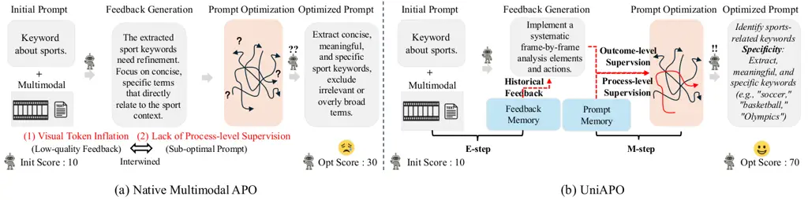
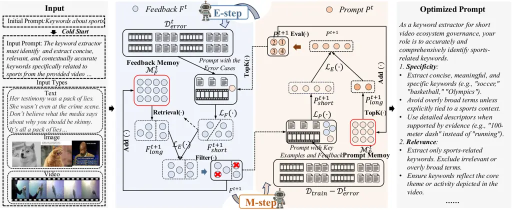

# UniAPO: Unified Multimodal Automated Prompt Optimization

Qipeng Zhu Note: All authors marked with ^(⋆) are co-first authors.   
Yanzhe Chen^(⋆)    Huasong Zhong^(⋆) Yan Li Note: Project Leader.    Jie
Chen    Zhixin Zhang    Junping Zhang    Zhenheng Yang
Note: Corresponding Author

###### Abstract

Prompting is fundamental to unlocking the full potential of large
language models. To automate and enhance this process, automatic prompt
optimization (APO) has been developed, demonstrating effectiveness
primarily in text-only input scenarios. However, extending existing APO
methods to multimodal tasks—such as video-language generation—introduces
two core challenges: (i) visual token inflation, where long visual-token
sequences restrict context capacity and result in insufficient feedback
signals; (ii) a lack of process-level supervision, as existing methods
focus on outcome-level supervision and overlook intermediate
supervision, limiting prompt optimization. We present UniAPO: Unified
Multimodal Automated Prompt Optimization, the first framework tailored
for multimodal APO. UniAPO adopts an EM-inspired optimization process
that decouples feedback modeling and prompt refinement, making the
optimization more stable and goal-driven. To further address the
aforementioned challenges, we introduce a short-long term memory
mechanism: historical feedback mitigates context limitations, while
historical prompts provide directional guidance for effective prompt
optimization. UniAPO achieves consistent gains across text, image, and
video benchmarks, establishing a unified framework for efficient and
transferable prompt optimization.

¹ByteDance

²Fudan University

³National University of Singapore

## Introduction



Figure 1: Motivation Illustration: (a) Naively extending text-based APO
to multimodal inputs introduces visual token inflation and a lack of
process-level supervision. (b) Our proposal adopts an EM-inspired
optimization scheme to iteratively update feedback and prompt memory to
solve the above problems.

Recent advances in automatic prompt optimization (APO) have enabled
large language models to generate and refine prompts without human
intervention (Cui et al. 2025; Li et al. 2025; Ramnath et al. 2025).
These methods—ranging from search-based strategies (Zhou et al. 2022;
Fernando et al. 2024) to feedback-driven approaches (Pryzant et al.
2023; Tang et al. 2025)—have shown promising results across various
natural language tasks (Spiess et al. 2025; Saleem et al. 2025).
Nevertheless, existing methods are largely restricted to unimodal text
settings, limiting their applicability in real-world scenarios involving
multimodal inputs. As multimodal large language models become
increasingly capable and widely deployed (Zhang et al. 2024a; Song
et al. 2025; Chen et al. 2025), there is a growing need for a unified
APO framework that can operate seamlessly across text, image, and video
inputs.

Extending feedback-driven APO from text to multimodal inputs—by naively
appending image or video tokens to existing frameworks—may seem
straightforward but quickly encounters two fundamental challenges (shown
in Figure 1(a)). First, visual token inflation: a single high-resolution
image or short video generates hundreds to thousands of tokens (Cao
et al. 2023; Lee et al. 2024), thereby restricting the number of samples
that can be accommodated and resulting in insufficient feedback signals.
Second, a lack of process-level supervision: multimodal tasks are
inherently more complex (Zhou et al. 2025; Zhang et al. 2024c) and
demand richer supervision signals to effectively optimize prompts.
Relying solely on outcome-level supervision (current feedback) is
insufficient, often leading to unstable and suboptimal prompt. And the
problems caused by these two challenges will also be intertwined with
each other.

These challenges call for rethinking Multimodal APO as disentangled
optimization, expanded feedback signals, and dual-level supervision
(shown in Figure 1(b)). (i) The intertwined problems of insufficient
feedback signals and sub-optimal prompt create a vicious cycle in
multimodal prompt optimization. To break this cycle, we propose a
framework inspired by the Expectation-Maximization (EM) algorithm that
decouples these problems. (ii)Visual token inflation quickly saturates
limited context, necessitating a long-short term memory mechanism to
preserve historical feedback and extend the optimization horizon. (iii)
Inspired by reinforcement learning (Yao et al. 2023; Rafailov et al.
2023), we argue that supplementing outcome-level supervision with
process-level supervision is crucial. This dual-supervision approach
stabilizes the optimization toward more performant and robust solutions.

We instantiate these insights in UniAPO (Unified multimodal Automated
Prompt Optimization), the first unified framework adopting an
EM-inspired optimization scheme that explicitly decouples feedback
modeling from prompt refinement. In the E-step, UniAPO aggregates valid
and diverse feedback using both current errors and semantically relevant
historical feedback, ensuring that optimization is informed by a broader
context. In the M-step, it generates new prompts by integrating
short-term candidates with high-quality historical prompts from
long-term memory, effectively anchoring the optimization. These
components enable UniAPO to scale to complex multimodal tasks and
achieve robust, interpretable prompt optimization.

Our contributions are summarized as follows:

- •
  We propose UniAPO, the first unified multimodal APO framework that
  scales across text, image, and video tasks within a single
  architecture, achieving state-of-the-art performance compared to
  existing baselines.
- •
  We introduce an EM-inspired optimization scheme that decouples
  feedback modeling and prompt refinement, yielding a stable
  optimization process.
- •
  We design a long-short term memory mechanism that alleviates visual
  token inflation and lack of process-level supervision via historical
  feedback signals and dual-level supervision.

## Related Work

### Prompt Engineering for MLLMs

Prompt engineering plays a pivotal role in enabling MLLMs to perform
both general reasoning and domain-specific tasks (Chen et al. 2023;
Mohanty, Parthasarathy, and Shahid 2025). A prominent line of research
centers on chain-of-thought (CoT) prompting (Wei et al. 2022; Zhang
et al. 2024d; Shao et al. 2024), where prompts like “Think step by step”
are used to elicit structured reasoning, especially in spatial contexts.
Related works extend this to single-turn reasoning (Zheng et al. 2024;
Wang et al. 2025b; Lin et al. 2025), often prompting MLLMs to generate
intermediate queries or reflections to enhance interpretability and
problem-solving ability. Beyond reasoning, studies have explored prompt
formatting (He et al. 2024; Wang et al. 2025a; Lamott et al. 2024) as a
way to improve response consistency, especially in scenarios requiring
tool use, layout understanding, or constrained output forms. To address
task-specific needs, researchers have developed domain-adapted prompts
across a wide range of applications. This includes open-vocabulary
grounding (Du et al. 2022a; Du et al. 2022b; Li et al. 2024b), semantic
segmentation (Li et al. 2024a; Lee et al. 2025), and visual question
answering (VQA) (Zhao et al. 2024; Keskar, Perisetla, and Greer 2025),
where prompt designs are often tailored to the data modality and task
structure. Despite promising results, these approaches rely heavily on
manual prompt design, which becomes increasingly infeasible as MLLMs are
deployed across more complex, diverse, and open-ended domains. This
limitation has spurred growing interest in automated prompt optimization
techniques (Zhang et al. 2024b), aiming to scale prompt engineering in a
systematic and adaptive manner.

### Automatic Prompt Optimization (APO)

APO aims to automatically discover effective prompts for LLMs and MLLMs,
reducing manual effort while enhancing generalization across diverse
tasks (Cui et al. 2025; Qu et al. 2025; Ramnath et al. 2025; Do et al.
2025). Existing approaches fall into two main paradigms: search-based
optimization and feedback-driven refinement. Search-based methods
explore the prompt space by iteratively sampling and evaluating
candidates (Davari et al. 2025; Zhang, Zhou, and Liu 2024). APE (Zhou
et al. 2022) frames prompt construction as a discrete optimization task,
with LLMs generating and scoring prompts in a closed loop. Subsequent
works adopt evolutionary strategies (Liu et al. 2024; Fernando et al. 2024) or treat LLMs as black-box optimizers (Yang et al. 2023). However,
these methods often suffer from search path explosion in semantically
complex or open-ended settings, limiting their scalability in multimodal
domains. Feedback-driven methods improve stability by introducing an
intermediate phase: models analyze failure cases and generate textual
feedback, which is then used to revise prompts (Agarwal et al. 2025).
APO (Pryzant et al. 2023) pioneered this paradigm, viewing feedback as a
textual “gradient” to guide optimization. Later work extends this idea
with analogical reasoning (Tang et al. 2025), pseudo-gradient
propagation (Yuksekgonul et al. 2024), memory-augmented reflection (Yan
et al. 2025), and strategic self-guidance (Wu et al. 2024), achieving
strong performance in text-only tasks. Despite success in text tasks,
feedback-based APO struggles in multimodal contexts: visual token
inflation and lack of process-level supervision. We alleviates visual
token inflation and lack of process-level supervision via historical
feedback signals and dual-level supervision by designing a long-short
term memory mechanism.



Figure 2: Illustration of our UniAPO framework for UniAPO. Starting with
a simple prompt initialized by an MLLM (left), UniAPO iteratively
refines it into a structurxed and knowledgeable prompt (right) using an
Expectation-Maximization (EM) algorithm. The E-step generates long- and
short-term feedback from the current prompt, which is then used in the
M-step to update the prompt, enabling optimization across diverse data
types.

## Preliminaries

### Problem Formulation and Baseline

Let the datasets be denoted as $`\mathcal{D}_{\text{train}}`$,
$`\mathcal{D}_{\text{dev}}`$, and $`\mathcal{D}_{\text{test}}`$, each
consisting of sample-label pairs $`(x,y)`$. We consider a system of
frozen MLLMs with different system prompts as alternates roles: a task
model $`\mathcal{L}_{T}`$ for prediction, a feedback model
$`\mathcal{L}_{F}`$ for generating feedback, a prompt optimization model
$`\mathcal{L}_{P}`$, and an evolution model $`\mathcal{L}_{E}`$. Details
of system prompts are stated in the Appendix. Our primary objective is
to find the optimal prompt $`P^{*}`$ that maximizes the expected
performance on a given dataset $`\mathcal{D}_{\text{test}}`$:

```math
P^{*}=\underset{P\in\mathcal{P}}{\text{argmax}}\,\mathbb{E}_{(x,y)\in\mathcal{D}_{\text{test}}}[\text{Eval}(\mathcal{L}_{T}(x;P),y)], \tag{1}
```

where $`\mathcal{P}`$ represents the space of all possible prompts and
$`\text{Eval}(\cdot)`$ is the evaluation metric.

Then we establish a baseline method based on feedback-driven Automatic
Prompt Optimization (APO). In a naive multimodal feedback-driven
APO (Pryzant et al. 2023) loop, the optimization process is iterative.
At each step $`t`$, we identify an error set
$`\mathcal{D}^{t}_{\text{error}}\subseteq\mathcal{D}_{\text{train}}`$
where the task model $`\mathcal{L}_{T}`$ fails with the current prompt
$`P^{t}`$. Subsequently, the feedback model $`\mathcal{L}_{F}`$
generates feedback $`F^{t+1}`$ based on
$`\mathcal{D}^{t}_{\text{error}}`$ and $`P^{t}`$. Finally, the prompt
optimization model $`\mathcal{L}_{P}`$ optimizes the prompt $`P^{t}`$
using the feedback $`F^{t+1}`$ to produce an improved prompt
$`P^{t+1}`$. However, this straightforward feedback-driven approach
encounters two significant challenges. Details of system prompts are
stated in the Appendix.

### Core Challenges

A naive multimodal APO framework faces two critical, intertwined
challenges: visual token inflation (Cao et al. 2023; Lee et al. 2024)
and a lack of process-level supervision (Uesato et al. 2022). Visual
token inflation stems from the feedback generator’s ($`L_{F}`$) finite
context, which yields low-quality feedback by failing to process all
historical and current errors. Concurrently, the prompt optimizer
($`L_{P}`$) receives only this outcome-level supervision, leading to
sub-optimal prompts. These issues create a vicious cycle of mutual
degradation, making a simultaneous solution exceptionally difficult.

## Methodology

To tackle the two intertwined challenges of Visual Token Inflation and a
Lack of Process-level Supervision, we propose a novel framework named
Unified Multimodal Automatic Prompt Optimization (UniAPO). Our approach
is inspired by the Expectation-Maximization (EM) algorithm and employs a
divide-and-conquer strategy to decouple the problem, as illustrated in
Figure 2. UniAPO consists of two main steps: an E-step designed to
address Visual Token Inflation, and an M-step to counter a Lack of
Process-level Supervision. This design effectively breaks the vicious
cycle arising from the interplay of these two challenges.

### Overall Architecture

A core component of UniAPO is the integration of memory to leverage
historical information. We introduce a feedback memory,
$`\mathcal{M}_{F}^{t}`$, and a prompt memory, $`\mathcal{M}_{P}^{t}`$,
to store all generated feedback and prompts up to iteration $`t`$.

Specifically, our method begins with a simple phase. We use the prompt
optimization model, $`\mathcal{L}_{P}`$, to refine a simple,
sample-agnostic initial prompt (e.g., “keywords about sports”) to obtain
a superior input prompt, $`P^{0}`$. This ensures that the optimization
process starts from a more reasonable point in the optimization space.
The optimization then proceeds iteratively through the E-step and
M-step.

E-Step: At iteration $`t`$, the current prompt $`P^{t}`$ is used with
the multimodal inputs to perform inference (assised by
$`\mathcal{L}_{T}`$), resulting in an error set
$`\mathcal{D}_{\text{error}}^{t}`$. This error set, along with the
feedback memory $`\mathcal{M}_{F}^{t}`$, is then processed by the
feedback model $`\mathcal{L}_{F}`$ (potentially assisted by a evolution
model $`\mathcal{L}_{E}`$) to generate new, targeted feedback
$`F^{t+1}`$. The feedback memory is subsequently updated with this new
information. The entire process can be expressed as:

```math
(F^{t+1},\mathcal{M}_{F}^{t+1})=\text{E-Step}(\mathcal{D}_{\text{error}}^{t},\mathcal{M}_{F}^{t};\mathcal{L}_{F},\mathcal{L}_{E}). \tag{2}
```

M-Step: In the subsequent M-step, the newly generated feedback
$`F^{t+1}`$ and the prompt memory $`\mathcal{M}_{P}^{t}`$ are used to
guide the prompt optimization model $`\mathcal{L}_{P}`$ (also assisted
by $`\mathcal{L}_{E}`$). This step refines the current prompt $`P^{t}`$
to produce an improved prompt $`P^{t+1}`$ for the next iteration, and
the prompt memory is updated accordingly. This step can be formulated
as:

```math
(P^{t+1},\mathcal{M}_{P}^{t+1})=\text{M-Step}(F^{t+1},\mathcal{M}_{P}^{t},P^{t};\mathcal{L}_{P},\mathcal{L}_{E}). \tag{3}
```

In the following subsections, we will elaborate on how the E-step and
M-step are specifically designed to address the challenges of Visual
Token Inflation and a Lack of Process-level Supervision, respectively.

### E-step: Multimodal Feedback Generation

The E-step is specifically designed to combat the Visual Token Inflation
challenge during the feedback generation phase. The essence of this
problem lies in a practical constraint: the feedback model,
$`\mathcal{L}_{F}`$, has a finite context window. As the generation
process iterates, the cumulative set of all encountered errors can
easily grow to exceed this capacity. Consequently, at iteration $`t`$,
it becomes infeasible to feed the entire raw error history into
$`\mathcal{L}_{F}`$ for consideration.

To overcome this limitation, we introduce a short- and long-term memory
mechanism. Our key insight is that the complete error history can be
effectively represented by two distinct components:

- •
  Short-term Information: The current error set,
  $`\mathcal{D}_{\text{error}}^{t}`$, which captures the model’s most
  recent failures and is used by $`\mathcal{L}_{P}`$ to generate the
  next feedback, $`F^{t+1}`$.
- •
  Long-term Information: The feedback memory, $`\mathcal{M}_{F}^{t}`$,
  which stores a cumulative history of past errors and their associated
  corrective feedback.

The E-step is to first extract information from these two sources and
then unify them, ensuring that a holistic view of all errors can be
processed within the limited context of $`\mathcal{L}_{F}`$.

#### Short-Term Feedback Generation.

A practical challenge remains: even the most recent error set,
$`\mathcal{D}_{\text{error}}^{t}`$, can be too large to fit into the
context window of $`\mathcal{L}_{F}`$ in a single pass. To manage this,
we adopt a hierarchical strategy inspired by techniques in multimodal
Retrieval-Augmented Generation (RAG) (Yu et al. 2024). The procedure
first clusters $`\mathcal{D}_{\text{error}}^{t}`$ to group semantically
similar failures, enabling $`\mathcal{L}_{F}`$ to produce more stable
feedback on common error patterns. Subsequently, to adhere to the
model’s context limit, each resulting cluster is processed in smaller
chunks. Feedback is generated for each chunk and then aggregated to
represent the entire cluster’s error profile, as depicted in Figure 2.
The entire process of generating the short-term feedback, denoted as
$`F^{t+1}_{\text{short}}`$, can be formally expressed as:

```math
\begin{array}[]{cc}F^{t+1}_{\text{short}}&=\mathcal{L}_{\mathcal{F}}(P_{t},\text{Clustering}({D}^{t}_{\text{error}})),\par\end{array} \tag{4}
```

where $`\text{Clustering}(\cdot)`$ is the DBSCAN algorithm using
BGE-m3 (Chen et al. 2024) embeddings.

#### Long-Term Feedback Generation.

A naive inclusion of the entire memory $`\mathcal{M}_{F}^{t}`$ is
suboptimal, as obsolete feedback for corrected errors can introduce
semantic noise. To address this, we shift from simple summarization to
targeted retrieval. Specifically, we use the newly generated short-term
feedback, $`F^{t+1}_{\text{short}}`$, as a dynamic query. The feedback
derived from each error cluster acts as a separate query to retrieve the
most relevant entries from the memory $`\mathcal{M}_{F}^{t}`$. These
retrieved historical records are then aggregated to form a potent and
contextually relevant long-term feedback, $`F^{t+1}_{\text{long}}`$, as
illustrated in Figure 2, where $`\text{Retrieval}(\cdot,\cdot)`$ denotes
the retrieval process. The entire generation process can be formulated
as:

```math
F^{t+1}_{\text{long}}=\text{Retrieval}(F^{t+1}_{\text{short}},\mathcal{M}_{F}^{t}). \tag{5}
```

#### Short- and Long-Term Feedback Evolving

To combine the short-term ($`F^{t+1}_{\text{short}}`$) and long-term
($`F^{t+1}_{\text{long}}`$) feedback, we devise a two-step process.
First, inspired by evolutionary algorithms (Bäck and Schwefel 1993), an
“Evolver” MLLM, $`\mathcal{L}_{E}`$, fuses the two streams, guided by a
system prompt to resolve conflicts and merge salient information.
Second, to guarantee utility, the resulting candidate feedback undergoes
a filtering step, $`\text{Filter}(\cdot)`$, inspired by ERM (Yan et al.
2025). This step validates the feedback by retaining only suggestions
that demonstrably correct errors in the original set
$`\mathcal{D}_{\text{error}}^{t}`$. The generation of the final,
validated feedback $`F^{t+1}`$ is formulated as:

```math
F^{t+1}=\text{Filter}(\mathcal{L}_{E}(F^{t+1}_{\text{short}},F^{t+1}_{\text{long}}),\mathcal{D}_{\text{error}}^{t},P^{t};\mathcal{L}_{T}) \tag{6}
```

where $`F^{t+1}`$ is added into $`\mathcal{M}_{F}^{t}`$ to gain
$`\mathcal{M}_{F}^{t+1}`$ as depicted in Equation (7):

```math
\mathcal{M}_{F}^{t+1}=\text{Add}(\mathcal{M}_{F}^{t},F^{t+1}). \tag{7}
```

### M-step: Multi-modal Prompt Optimization

The M-step resolves the outcome-only supervision problem by synergizing
two distinct supervisory signals for prompt optimization.

- •
  Outcome-level Supervision: Following naitive feedback-driven
  methods (Pryzant et al. 2023), we use the immediate feedback,
  $`F^{t+1}`$, to perform a tactical update on the current prompt,
  $`P^{t}`$, yielding a short-term prompt, $`P^{t}_{\text{short}}`$.
- •
  Process-level Supervision: Inspired by PRMs (Uesato et al. 2022), we
  introduce a novel process-level signal by distilling a long-term
  prompt from the entire prompt history, $`\mathcal{M}_{P}^{t}`$. This
  prompt embodies stable, historically effective strategies.

The final prompt, $`P^{t+1}`$, is synthesized by modulating the
short-term prompt with the strategic guidance from the long-term prompt.
This ensures that our updates are not only responsive to immediate
failures but are also grounded in a history of successful optimizations,
leading to superior robustness and performance.

#### Short-Term Prompt Optimization.

Our process begins with generating a Short-Term Prompt,
$`P^{t+1}_{\text{short}}`$, by leveraging an MLLM optimizer,
$`\mathcal{L}_{P}`$, to refine the current prompt $`P^{t}`$. This
refinement is guided by the recent, coarse-grained feedback $`F^{t+1}`$.
To ensure the optimizer maintains a robust understanding of the
task (Zhang, Zhou, and Liu 2023), we also provide it with a set of
positive examples, $`\text{Sample}(\cdot)`$, sampled from
$`\mathcal{D}_{\text{train}}-\mathcal{D}^{t}_{\text{error}}`$. This
prevents over-fitting to recent failures and is formally expressed as:

```math
P^{t+1}_{\text{short}}=\mathcal{L}_{P}(P_{t},F^{t+1},\text{Sample}\left(\mathcal{D}_{\text{train}}-\mathcal{D}^{t}_{\text{error}})\right) \tag{8}
```

We run the optimizer $`\mathcal{L}_{P}`$ multiple times to generate a
diverse set of candidate prompts, as shown in Figure 2.

#### Long-Term Prompt Generation

To ensure that our process supervision signal is derived from
high-quality prompts, we filter the prompt history rather than using it
wholesale. We recognize that underperforming prompts can provide
misleading guidance. Therefore, we select only the top-$`k`$ historical
prompts from $`\mathcal{M}_{P}^{t}`$ based on their scores on the
$`\mathcal{D}_{\text{dev}}`$. This selection is performed via a Top-K
algorithm, yielding $`P^{t+1}_{\text{long}}`$:

```math
P^{t+1}_{\text{long}}=\text{TopK}(\mathcal{M}_{P}^{t},k) \tag{9}
```

#### Short- and Long-term Prompt Evolving.

To effectively fuse the process and outcome signals, we introduce a step
inspired by evolutionary crossover. We task the MLLM optimizer,
$`\mathcal{L}_{E}`$, to act as a supervisor that intelligently
synthesizes the short-term prompt with the wisdom from the long-term
prompts. This supervised crossover allows the current prompt to adopt
the proven advantages of its predecessors in a structured way. The
process is defined as:

```math
P^{t+1}=\mathcal{L}_{E}(P^{t+1}_{\text{short}},P^{t+1}_{\text{long}}) \tag{10}
```

The generated prompt $`P^{t+1}`$ is first evaluated on
$`\mathcal{D}_{\text{dev}}`$, and its score is recorded as it is
integrated into the prompt memory, which is updated to
$`\mathcal{M}_{P}^{t+1}`$:

```math
\mathcal{M}_{P}^{t+1}=\text{Add}(\mathcal{M}_{P}^{t},P^{t+1}). \tag{11}
```

To prevent premature convergence and expand the optimization horizon, we
then employ a beam search mechanism. Specifically, we select the
top-$`b`$ prompts from $`\mathcal{M}_{P}^{t+1}`$ based on their scores.
These $`b`$ prompts become parallel ‘beams’ for the next iteration.

## Experiment

|                                 |          |      |       |          |           |           |                 |          |       |        |      |
| ------------------------------- | -------- | ---- | ----- | -------- | --------- | --------- | --------------- | -------- | ----- | ------ | ---- |
|                                 | Text CLS |      |       | Text GEN | Image CLS | Video CLS |                 | Video KE |       |        |      |
| Method                          | LIAR     | BBH  | ETHOS | WebNLG   | Meme      | Static    | Occlusion layer | Beauty   | Sport | Travel | Food |
| GPT4o as Predictor              |          |      |       |          |           |           |                 |          |       |        |      |
| Vanilla                         | 25.3     | 69.4 | 88.6  | 50.9     | 25.8      | 71.2      | 25.6            | 36.7     | 55.8  | 43.5   | 24.6 |
| Vanilla + CoT (Wei et al. 2022) | 56.9     | 90.7 | 95.0  | 51.1     | 25.6      | 80.1      | 50.0            | 46.9     | 63.9  | 54.1   | 31.5 |
| EvoPrompt\* (Liu et al. 2024)   | 58.6     | 92.7 | 96.6  | 50.5     | 26.9      | 82.8      | 33.3            | 47.4     | 56.2  | 44.9   | 24.7 |
| ERM\* (Yan et al. 2025)         | 65.2     | 95.4 | 95.6  | 52.1     | 28.6      | 80.1      | 61.5            | 68.3     | 69.3  | 57.4   | 40.3 |
| UniAPO                          | 78.7     | 99.4 | 98.1  | 53.2     | 37.6      | 86.3      | 70.3            | 74.7     | 78.3  | 60.9   | 54.3 |
| QwenVL2.5-72B as Predictor      |          |      |       |          |           |           |                 |          |       |        |      |
| Vanilla                         | 2.0      | 44.7 | 89.0  | 44.3     | 24.7      | 0.0       | 25.6            | 28.7     | 50.0  | 45.9   | 27.6 |
| Vanilla + CoT (Wei et al. 2022) | 49.4     | 93.2 | 97.6  | 46.3     | 24.6      | 54.5      | 41.9            | 43.9     | 58.6  | 47.1   | 25.3 |
| EvoPrompt\* (Liu et al. 2024)   | 50.6     | 94.1 | 98.0  | 46.3     | 25.8      | 78.2      | 30.0            | 44.3     | 52.8  | 46.1   | 27.8 |
| ERM\* (Yan et al. 2025)         | 67.4     | 93.3 | 98.2  | 52.3     | 28.2      | 59.8      | 63.2            | 64.0     | 64.1  | 51.2   | 41.4 |
| UniAPO                          | 73.1     | 95.8 | 98.9  | 54.4     | 35.7      | 83.1      | 67.9            | 75.2     | 76.8  | 63.7   | 48.6 |

Table 1: Performance comparison using GPT-4o vs. QwenVL2.5-72B as the
predictor, optimized by our UniAPO framework. UniAPO’s other internal
components are implemented using GPT-4o. All experiments are conducted
on 11 datasets including text classiifaction (“Text CLS”), text
generation (“Text GEN”), image classification (“Image CLS”) and video
classification (“Video CLS”) and video keyword extraction (“Video KE”).

### Experimental Setting

#### Datasets.

We evaluate UniAPO across text, image, and video domains on both
classification and generation tasks: (1) Text: LIAR (Wang 2017) (fake
news classification), BBH-navigate (Suzgun et al. 2023) (multi-step
instruction following), ETHOS (Mollas et al. 2022) (hate speech
detection), and WebNLG (Gardent et al. 2017) (structured-to-text
generation). (2) Image: Meme (Javaid 2023) (multi-image classification
requiring semantic alignment via prompt reasoning). (3) Video: An
in-house dataset from an international platform, covering static
classification (low-motion detection), occlusion classification
(identifying overlays), and open-domain keyword extraction (generating
keywords from multimodal metadata) across Beauty, Sport, Travel, and
Food themes. More details are stated in Appendix.

#### Evaluation Metrics.

Tasks are grouped by domain with corresponding metrics: Text
classification (LIAR, ETHOS, BBH-navigate): binary F1 score; Text
generation (WebNLG): ROUGE-L; Image classification (Meme): multi-class
F1-micro; Video classification (Static, Occlusion): binary F1;
Multimodal keyword extraction (video, four themes): F1-score More
details are stated in Appendix.

#### Baselines.

For all tasks, we compare UniAPO against standard prompting,
Chain-of-Thought (CoT) prompting (Wei et al. 2022), and two prominent
categories of automatic prompt optimization: (1) Search-based methods
(e.g., EvolPrompt (Liu et al. 2024)), which iteratively mutate and
select prompts; (2) Feedback-based methods (e.g., ERM (Yan et al.
2025)), which update prompts based on performance signals.

#### Implementation Details.

All primary experiments use GPT-4o (Achiam et al. 2023) as the
underlying MLLM across all stages of the UniAPO pipeline. Prompts are
initialized with minimal handcrafted templates, denoted as “Simple
Prompt” to simulate a low-resource setting. In additional experiments,
we replace GPT-4o with QwenVL2.5-72B (Bai et al. 2025) as the predictor
to evaluate cross-model generalization, while keeping the other
components unchanged. We also explore settings with more structured
initial prompts, as detailed in relevant sections.

### Comparision Study

#### Comparision with different tasks.

UniAPO sets a new state-of-the-art across a diverse suite of multimodal
tasks as shown in Table 1, consistently outperforming existing
baselines. Its superior performance and stability, particularly on video
tasks, are driven by our unified memory mechanism that combats visual
token inflation and a lack of process-level supervision. Underscoring
its robustness, UniAPO maintains its effectiveness when the backbone
model is switched from GPT-4o to Qwen2.5VL-72B, proving the
generalizability of our framework.

#### Generalization of UniAPO.

UniAPO demonstrates strong generalization, which we validate through two
key experiments: robustness to initialization and cross-model transfer
(Figure 3).

- •
  Robustness to Initialization: UniAPO is largely insensitive to the
  quality of the initial prompt. It consistently elevates the
  performance of both simple and complex starting prompts, as evidenced
  by the significant gap between “Opt Settings” and “Init Settings” on
  “Test @ 4o”. This robustness is a direct result of its EM framework,
  which iteratively refines the solution, and its process-level
  supervision.
- •
  Cross-Model Transferability: Prompts optimized by UniAPO transfer
  effectively across different architectures. When prompts optimized on
  GPT-4o are transferred to different the testing predictor settings,
  such as Qwen2.5-VL-72B, they retain a substantial performance
  advantage over the original prompts (”Test @ Qw” with ”Opt Settings”
  vs. ”Init Settings”).

Figure 3: Evaluating the robustness and transferability of UniAPO in
beauty keyword extraction. The table compares performance from “Simple”
and “Complex” initial (“Init”) prompts against our optimized prompts
(“Opt”) based on GPT4o. We use “Test @ 4o” and “Test @ Qw” respectively
represent the predictor types when testing.

#### Efficiency of UniAPO.

UniAPO is significantly more efficient than baselines, reaching superior
performance in fewer optimization steps (Figure 4). This is attributed
to its EM-inspired framework, which creates a virtuous cycle: an E-step
refines feedback by mitigating visual inflation, and an M-step uses
dual-level supersion to optimize prompt effectively. This closed-loop
process accelerates convergence, demonstrating that UniAPO delivers
state-of-the-art results with greater sample and compute efficiency.

Figure 4: Optimization efficiency and performance comparison. This
figure illustrates the Testing F1-score progression for UniAPO, ERM\*,
and EvolPrompt\* over iterations.

### Analysis Study

(a) Effect of increasing chunk sizes (“CS”) and historical feedback
(“HF”).

(b) Effect of increasing beam size (“BS”) and historical prompts (“HP”).

Figure 5: UniAPO is proven to be both practically efficient and highly
effective to alleviate visual token inflation and a lack of
process-level supervision.

#### Visual Token Inflation.

Here, we empirically validate the Visual Token Inflation (VLF)
bottleneck and the efficacy of our historical feedback solution
(Figure 5(a)). We first establish that while performance scales with the
number of input errors, it inevitably saturates as it hits the feedback
generator’s context limit. This confirms the VLF problem. Critically,
introducing our historical feedback at this saturation point yields
further, significant performance gains. This result demonstrates that
our long-term memory mechanism effectively compensates for the limited
context window, enriching the feedback generation process with vital
historical information.

#### A Lack of Process-level Supervision.

Figure 5(b) validates our core hypothesis: dual-level supervision is
essential for robust prompt optimization. We show that a feedback-only
baseline (blue line) is insufficient. By augmenting this with
process-level supervision from varying numbers of historical prompts,
our method consistently boosts performance across all tested beam sizes,
critically, with no computational overhead. This demonstrates that
integrating process-level guidance with outcome-based feedback is key to
achieving stable and superior optimization results.

### Ablation Study

| E-step         | M-step         | Video CLS       | Video KE |       |
| -------------- | -------------- | --------------- | -------- | ----- |
|                |                | Occlusion layer | Beauty   | Sport |
|                |                | 25.6            | 36.7     | 55.8  |
| $`\checkmark`$ |                | 59.3            | 66.3     | 75.1  |
|                | $`\checkmark`$ | 61.2            | 67.8     | 73.0  |
| $`\checkmark`$ | $`\checkmark`$ | 70.3            | 75.2     | 78.3  |

Table 2: Ablation of E-step and M-step.

#### Ablation of E-step and M-step.

As shown in Figure 2, our ablation study confirms the synergistic
relationship between UniAPO’s E-step and M-step. While both prompt
optimization (M-step) and feedback generation (E-step) are individually
effective, yielding significant gains when used alone, the full
framework that alternates between them performs best, which validates
that the complementary interaction of these two steps is critical to
UniAPO’s capabilities.

| FG Type | PO Type | Video CLS       | Video KE |       |
| ------- | ------- | --------------- | -------- | ----- |
|         |         | Occlusion layer | Beauty   | Sport |
| ERM\*   | ERM\*   | 61.5            | 68.3     | 69.3  |
| UniAPO  | ERM\*   | 65.5            | 73.1     | 74.3  |
| ERM\*   | UniAPO  | 65.6            | 70.7     | 76.7  |
| UniAPO  | UniAPO  | 70.3            | 75.2     | 78.3  |

Table 3: Comparison with different combainations between Feedback
Generation methods (FG) and Prompt Optimization (PO) methods.

#### Feedback Generators and Prompt Optimizers.

Our ablation study, which created hybrid models by swapping components
with baselines (Table 3), reveals the powerful synergy within UniAPO.
While our feedback generator (FG) and prompt optimizer (PO) each provide
significant, distinct benefits—mitigating visual token inflation and a
lack of process-level supervision, respectively—all hybrid
configurations underperform the complete UniAPO system.

| F-Mem      | P-Mem      | Video CLS       | Video KE |       |
| ---------- | ---------- | --------------- | -------- | ----- |
|            |            | Occlusion layer | Beauty   | Sport |
| Short      | Short      | 63.2            | 68.3     | 70.5  |
| Short-long | Short      | 66.7            | 71.3     | 75.6  |
| Short      | Short-long | 65.2            | 70.9     | 74.0  |
| Short-long | Short-long | 70.3            | 74.7     | 78.3  |

Table 4: Ablation of Short-Term and Long-Short Term memory mechanism in
Feedback Memory (F-Mem) and Prompt Memory (P-Mem).

#### Effect of each component in Memory Mechanism.

Our ablation study confirms that UniAPO’s dual memory system is
critical. The long-term memory in Feedback Generation (FG) is essential
for mitigating visual token inflation, while the long-term memory in
Prompt Optimization (PO) provides process-level supervision. Removing
either component cripples the system by introducing low-quality feedback
or sub-optimal prompt, respectively. UniAPO’s state-of-the-art
performance is attributable to the synergy of these mechanisms in
solving these core multimodal challenges.

### Case Study

A case study on sport keyword extraction as shown in the Appendix
reveals how UniAPO transforms a simple prompt into a sophisticated,
hundred-line directive. This iterative evolution is driven by specific,
class-level feedback—a product of our memory mechanism that successfully
mitigates visual token inflation. The process history also confirms that
the initial prompt’s structure, even when simple, is critical for
establishing a directed optimization path, highlighting the synergy of
our approach.

## Conclusion

We present UniAPO, the first unified framework for automated prompt
optimization (APO) that operates effectively across text, image, and
video tasks. By decoupling feedback modeling from prompt refinement
through an EM-inspired scheme and introducing a long-short term memory
mechanism, UniAPO overcomes key challenges in multimodal APO.
Experiments show that UniAPO consistently surpasses existing baselines
in both performance and generalization. We believe our approach paves
the way for more robust and scalable prompt optimization in future
multimodal language models.

## Appendix A Appendix

### Details of Experimental Setting

#### Datasets

For all text-based datasets, we adopt the data partitioning scheme from
ERM (Yan et al. 2025). Since the original Meme dataset lacks official
validation and test splits, we partition it into training, validation,
and test sets using a 3:3:4 ratio. The data splits for our in-house
video datasets, designed for classification and keyword extraction
tasks, are detailed in Table 5. The splits for the classification tasks
are designed to robustly evaluate the generalization performance of our
models.

|           |            |       |            |      |
| --------- | ---------- | ----- | ---------- | ---- |
| Task      | Sub-task   | Train | Validation | Test |
| Text CLS  | BBH        | 38    | 58         | 144  |
|           | Ethos      | 798   | 200        | 200  |
|           | Liar       | 3681  | 461        | 461  |
| Text GEN  | WebNLG     | 200   | 300        | 300  |
| Image CLS | Meme       | 207   | 207        | 698  |
| Video CLS | Static CLS | 100   | 100        | 834  |
|           | Occlusion  | 91    | 91         | 204  |
| Video KE  | Beauty     | 24    | 25         | 25   |
|           | Sport      | 44    | 45         | 45   |
|           | Travel     | 22    | 23         | 23   |
|           | Food       | 22    | 22         | 22   |

Table 5: Data splits for our in-house video datasets. The numbers
represent the sample counts for each set. “CLS” denotes the
classification task, “GEN” denotes the generation task and “KE” denotes
the keyword extraction task.

For our in-house video dataset, we process each video, which is
approximately 1 to 2 minutes in duration, by uniformly sampling 8 frames
to represent its visual content. In addition to this visual information,
we provide a rich set of accompanying textual modalities. This includes
the video’s title, text extracted from stickers, text obtained via
Optical Character Recognition (OCR) from the video frames, and the audio
transcript generated by Automatic Speech Recognition (ASR).

#### Evaluation Metrics.

For the text-based tasks, we use the F1 score as our evaluation metric,
following the evaluation methodology of ERM (Yan et al. 2025). For the
image classification task (Meme), we use the F1-micro score as our
evaluation metric. For the task of video binary classification, we use
the F1 score as our evaluation metric. For the task of video keyword
extraction, we use the F1 score as our evaluation metric. Specifically,
let $`\tilde{y}`$ denote the set of keywords predicted by the model for
a given video, and let $`y`$ be the corresponding set of ground-truth
keywords. We compute the cosine similarity between predicted keywords
and ground-truth keywords using the BGE-m3 (Chen et al. 2024) model. A
predicted keyword and a ground-truth keyword are considered a match if
their similarity is greater than 0.9.

We then count the number of matched keywords. Let $`\tilde{c}`$ be the
number of keywords in $`\tilde{y}`$ that match at least one keyword in
$`y`$. Similarly, let $`c`$ be the number of keywords in $`y`$ that are
matched by at least one keyword in $`\tilde{y}`$. Precision and recall
are defined as follows:

```math
\text{Precision}=\frac{\tilde{c}}{|\tilde{y}|},\quad\text{Recall}=\frac{c}{|y|} \tag{12}
```

where $`|\cdot|`$ denotes the cardinality of the set.

The F1 score for each sample is the harmonic mean of precision and
recall:

```math
\text{F1}=\frac{2\times\text{Precision}\times\text{Recall}}{\text{Precision}+\text{Recall}} \tag{13}
```

#### Baselines.

In the multimodal domains, where no established APO baselines exist, we
extend EvolPrompt and ERM to multimodal settings, denoted as
EvolPrompt\* and ERM\*, by adapting them to handle multimodal inputs.
All methods are evaluated alongside naive prompting and CoT-style
baselines for fair comparison.

#### Implementation Details.

We split each dataset into training, development, and test sets. In each
iteration of prompt optimization, candidate prompts are trained on the
training set, selected based on development performance, and evaluated
on the test set. We set the maximum number of training iterations to 12.
To prevent overfitting and reduce training time, we employ an early
stopping strategy: training is terminated if the model’s performance on
the validation set does not show improvement. For sequence generation
tasks, we use a beam search with a beam size of 3, which is consistent
with the setup in ERM (Yan et al. 2025). We set the number of historical
feedback instances and historical prompts used by UniAPO to 3 and 2,
respectively.

All primary experiments use GPT-4o (Achiam et al. 2023) as the
underlying MLLM across all stages of the UniAPO pipeline. Prompts are
initialized with minimal handcrafted templates to simulate a
low-resource setting, denoted as “Simple Prompt”. In additional
experiments, we replace GPT-4o with QwenVL2.5-72B (Bai et al. 2025) as
the predictor to evaluate the generalization of UniAPO, while keeping
the other components unchanged. We also explore settings with more
structured initial prompts, as detailed in relevant sections.

### System Prompts of UniAPO


### Results of UniAPO in Sport Keyword Extraction


### Results of EvolPrompt\* in Sport Keyword Extraction


### Results of ERM\* in Sport Keyword Extraction


## References

- Achiam et al. (2023) Achiam, J.; Adler, S.; Agarwal, S.; Ahmad, L.;
  Akkaya, I.; Aleman, F. L.; Almeida, D.; Altenschmidt, J.; Altman, S.;
  Anadkat, S.; et al. 2023. Gpt-4 technical report. _arXiv preprint
  arXiv:2303.08774_.
- Agarwal et al. (2025) Agarwal, E.; Magazine, R.; Singh, J.; Dani, V.;
  Ganu, T.; and Nambi, A. 2025. PromptWizard: Optimizing Prompts via
  Task-Aware, Feedback-Driven Self-Evolution. In _ACL_, 19974–20003.
- Bäck and Schwefel (1993) Bäck, T.; and Schwefel, H.-P. 1993. An
  overview of evolutionary algorithms for parameter optimization.
  _Evolutionary computation_, 1(1): 1–23.
- Bai et al. (2025) Bai, S.; Chen, K.; Liu, X.; Wang, J.; Ge, W.; Song,
  S.; Dang, K.; Wang, P.; Wang, S.; Tang, J.; et al. 2025. Qwen2. 5-vl
  technical report. _arXiv preprint arXiv:2502.13923_.
- Cao et al. (2023) Cao, S.; Yin, Y.; Huang, L.; Liu, Y.; Zhao, X.;
  Zhao, D.; and Huang, K. 2023. Efficient-vqgan: Towards high-resolution
  image generation with efficient vision transformers. In _CVPR_,
  7368–7377.
- Chen et al. (2023) Chen, B.; Zhang, Z.; Langrené, N.; and
  Zhu, S. 2023. Unleashing the potential of prompt engineering in large
  language models: a comprehensive review. _arXiv preprint
  arXiv:2310.14735_.
- Chen et al. (2024) Chen, J.; Xiao, S.; Zhang, P.; Luo, K.; Lian, D.;
  and Liu, Z. 2024. BGE M3-Embedding: Multi-Lingual,
  Multi-Functionality, Multi-Granularity Text Embeddings Through
  Self-Knowledge Distillation. _CoRR_.
- Chen et al. (2025) Chen, Y.; Zhong, H.; Li, Y.; and Yang, Z. 2025.
  UniCode2: Cascaded Large-scale Codebooks for Unified Multimodal
  Understanding and Generation. _arXiv preprint arXiv:2506.20214_.
- Cui et al. (2025) Cui, W.; Zhang, J.; Li, Z.; Sun, H.; Lopez, D.; Das,
  K.; Malin, B. A.; and Kumar, S. 2025. Automatic Prompt Optimization
  via Heuristic Search: A Survey. _arXiv preprint arXiv:2502.18746_.
- Davari et al. (2025) Davari, M.; Garg, U.; Cai, W.; and
  Belilovsky, E. 2025. Rethinking Prompt Optimization: Reinforcement,
  Diversification, and Migration in Blackbox LLMs. _arXiv preprint
  arXiv:2507.09839_.
- Do et al. (2025) Do, X. L.; Dinh, D.; Nguyen, N.-H.; Kawaguchi, K.;
  Chen, N.; Joty, S.; and Kan, M.-Y. 2025. What Makes a Good Natural
  Language Prompt? In _ACL_, 5835–5873.
- Du et al. (2022a) Du, Y.; Wei, F.; Zhang, Z.; Shi, M.; Gao, Y.; and
  Li, G. 2022a. Learning to prompt for open-vocabulary object detection
  with vision-language model. In _CVPR_, 14084–14093.
- Du et al. (2022b) Du, Y.; Wei, F.; Zhang, Z.; Shi, M.; Gao, Y.; and
  Li, G. 2022b. Learning to prompt for open-vocabulary object detection
  with vision-language model. In _CVPR_, 14084–14093.
- Fernando et al. (2024) Fernando, C.; Banarse, D. S.; Michalewski, H.;
  Osindero, S.; and Rocktäschel, T. 2024. Promptbreeder:
  Self-Referential Self-Improvement via Prompt Evolution. In _ICML_,
  13481–13544.
- Gardent et al. (2017) Gardent, C.; Shimorina, A.; Narayan, S.; and
  Perez-Beltrachini, L. 2017. Creating training corpora for nlg
  micro-planning. In _ACL_, 179–188.
- He et al. (2024) He, J.; Rungta, M.; Koleczek, D.; Sekhon, A.; Wang,
  F. X.; and Hasan, S. 2024. Does prompt formatting have any impact on
  llm performance? _arXiv preprint arXiv:2411.10541_.
- Javaid (2023) Javaid, H. 2023. Meme Dataset. Kaggle. Kaggle dataset;
  Twitter data collected via web scraping.
- Keskar, Perisetla, and Greer (2025) Keskar, A.; Perisetla, S.; and
  Greer, R. 2025. Evaluating multimodal vision-language model prompting
  strategies for visual question answering in road scene understanding.
  In _CVPR_, 1027–1036.
- Lamott et al. (2024) Lamott, M.; Weweler, Y.-N.; Ulges, A.; Shafait,
  F.; Krechel, D.; and Obradovic, D. 2024. LAPDoc: Layout-Aware
  Prompting for Documents. In _International Conference on Document
  Analysis and Recognition_, 142–159.
- Lee et al. (2025) Lee, M.; Cho, S.; Lee, J.; Yang, S.; Choi, H.; Kim,
  I.-J.; and Lee, S. 2025. Effective SAM Combination for Open-Vocabulary
  Semantic Segmentation. In _CVPR_, 26081–26090.
- Lee et al. (2024) Lee, S.-H.; Wang, J.; Zhang, Z.; Fan, D.; and
  Li, X. 2024. Video token merging for long video understanding.
  _NeurIPS_, 37: 13851–13871.
- Li et al. (2025) Li, W.; Wang, X.; Li, W.; and Jin, B. 2025. A survey
  of automatic prompt engineering: An optimization perspective. _arXiv
  preprint arXiv:2502.11560_.
- Li et al. (2024a) Li, Y.-J.; Zhang, X.; Wan, K.; Yu, L.; Kale, A.; and
  Lu, X. 2024a. Prompt-Guided Mask Proposal for Two-Stage
  Open-Vocabulary Segmentation. _arXiv preprint arXiv:2412.10292_.
- Li et al. (2024b) Li, Z.; Xu, Q.; Zhang, D.; Song, H.; Cai, Y.; Qi,
  Q.; Zhou, R.; Pan, J.; Li, Z.; Tu, V.; et al. 2024b. GroundingGPT:
  Language Enhanced Multi-modal Grounding Model. In _ACL_.
- Lin et al. (2025) Lin, Y.; Sun, J.; Cheng, Z.-Q.; Wang, J.; Liang, H.;
  Cheng, Z.; Dong, Y.; He, J.-Y.; Peng, X.; and Hua, X.-S. 2025. Why We
  Feel: Breaking Boundaries in Emotional Reasoning with Multimodal Large
  Language Models. In _CVPR_, 5196–5206.
- Liu et al. (2024) Liu, S.; Chen, C.; Qu, X.; Tang, K.; and Ong,
  Y.-S. 2024. Large language models as evolutionary optimizers. In _2024
  IEEE Congress on Evolutionary Computation (CEC)_, 1–8. IEEE.
- Mohanty, Parthasarathy, and Shahid (2025) Mohanty, A.; Parthasarathy,
  V. B.; and Shahid, A. 2025. The Future of MLLM Prompting is Adaptive:
  A Comprehensive Experimental Evaluation of Prompt Engineering Methods
  for Robust Multimodal Performance. _arXiv preprint arXiv:2504.10179_.
- Mollas et al. (2022) Mollas, I.; Chrysopoulou, Z.; Karlos, S.; and
  Tsoumakas, G. 2022. ETHOS: a multi-label hate speech detection
  dataset. _Complex & Intelligent Systems_, 8(6): 4663–4678.
- Pryzant et al. (2023) Pryzant, R.; Iter, D.; Li, J.; Lee, Y. T.; Zhu,
  C.; and Zeng, M. 2023. Automatic Prompt Optimization with” Gradient
  Descent” and Beam Search. In _EMNNLP_.
- Qu et al. (2025) Qu, X.; Gou, G.; Zhuang, J.; Yu, J.; Song, K.; Wang,
  Q.; Li, Y.; and Xiong, G. 2025. Proapo: Progressively automatic prompt
  optimization for visual classification. In _CVPR_, 25145–25155.
- Rafailov et al. (2023) Rafailov, R.; Sharma, A.; Mitchell, E.;
  Manning, C. D.; Ermon, S.; and Finn, C. 2023. Direct preference
  optimization: Your language model is secretly a reward model.
  _NeurIPS_, 36: 53728–53741.
- Ramnath et al. (2025) Ramnath, K.; Zhou, K.; Guan, S.; Mishra, S. S.;
  Qi, X.; Shen, Z.; Wang, S.; Woo, S.; Jeoung, S.; Wang, Y.;
  et al. 2025. A systematic survey of automatic prompt optimization
  techniques. _arXiv preprint arXiv:2502.16923_.
- Saleem et al. (2025) Saleem, S.; Asim, M. N.; Zulfiqar, S.; and
  Dengel, A. 2025. The Evolution of Natural Language Processing: How
  Prompt Optimization and Language Models are Shaping the Future. _arXiv
  preprint arXiv:2506.17700_.
- Shao et al. (2024) Shao, H.; Qian, S.; Xiao, H.; Song, G.; Zong, Z.;
  Wang, L.; Liu, Y.; and Li, H. 2024. Visual cot: Advancing multi-modal
  language models with a comprehensive dataset and benchmark for
  chain-of-thought reasoning. _NeurIPS_, 37: 8612–8642.
- Song et al. (2025) Song, S.; Li, X.; Li, S.; Zhao, S.; Yu, J.; Ma, J.;
  Mao, X.; Zhang, W.; and Wang, M. 2025. How to bridge the gap between
  modalities: Survey on multimodal large language model. _TKDE_.
- Spiess et al. (2025) Spiess, C.; Vaziri, M.; Mandel, L.; and
  Hirzel, M. 2025. Autopdl: Automatic prompt optimization for llm
  agents. _arXiv preprint arXiv:2504.04365_.
- Suzgun et al. (2023) Suzgun, M.; Scales, N.; Schärli, N.; Gehrmann,
  S.; Tay, Y.; Chung, H. W.; Chowdhery, A.; Le, Q. V.; Chi, E. H.; Zhou,
  D.; et al. 2023. Challenging BIG-Bench Tasks and Whether
  Chain-of-Thought Can Solve Them. In _ACL (Findings)_.
- Tang et al. (2025) Tang, X.; Wang, X.; Zhao, W. X.; Lu, S.; Li, Y.;
  and Wen, J.-R. 2025. Unleashing the potential of large language models
  as prompt optimizers: Analogical analysis with gradient-based model
  optimizers. In _AAAI_, volume 39, 25264–25272.
- Uesato et al. (2022) Uesato, J.; Kushman, N.; Kumar, R.; Song, F.;
  Siegel, N.; Wang, L.; Creswell, A.; Irving, G.; and Higgins, I. 2022.
  Solving math word problems with process-and outcome-based feedback.
  _arXiv e-prints_, arXiv–2211.
- Wang et al. (2025a) Wang, C.; Luo, W.; Dong, S.; Xuan, X.; Li, Z.; Ma,
  L.; and Gao, S. 2025a. Mllm-tool: A multimodal large language model
  for tool agent learning. In _WACV_, 6678–6687.
- Wang (2017) Wang, W. Y. 2017. ” liar, liar pants on fire”: A new
  benchmark dataset for fake news detection. _arXiv preprint
  arXiv:1705.00648_.
- Wang et al. (2025b) Wang, Z.; Chen, B.; Yue, Z.; Wang, Y.; Qiao, Y.;
  Wang, L.; and Wang, Y. 2025b. VideoChat-A1: Thinking with Long Videos
  by Chain-of-Shot Reasoning. _arXiv preprint arXiv:2506.06097_.
- Wei et al. (2022) Wei, J.; Wang, X.; Schuurmans, D.; Bosma, M.; Xia,
  F.; Chi, E.; Le, Q. V.; Zhou, D.; et al. 2022. Chain-of-thought
  prompting elicits reasoning in large language models. _NeurIPS_, 35:
  24824–24837.
- Wu et al. (2024) Wu, Y.; Gao, Y.; Zhu, B. B.; Zhou, Z.; Sun, X.; Yang,
  S.; Lou, J.-G.; Ding, Z.; and Yang, L. 2024. StraGo: Harnessing
  Strategic Guidance for Prompt Optimization. In _EMNLP_, 10043–10061.
- Yan et al. (2025) Yan, C.; Wang, J.; Zhang, L.; Zhao, R.; Wu, X.;
  Xiong, K.; Liu, Q.; Kang, G.; and Kang, Y. 2025. Efficient and
  accurate prompt optimization: the benefit of memory in exemplar-guided
  reflection. In _ACL_.
- Yang et al. (2023) Yang, C.; Wang, X.; Lu, Y.; Liu, H.; Le, Q. V.;
  Zhou, D.; and Chen, X. 2023. Large language models as optimizers. In
  _ICLR_.
- Yao et al. (2023) Yao, S.; Yu, D.; Zhao, J.; Shafran, I.; Griffiths,
  T. L.; Cao, Y.; and Narasimhan, K. 2023. Tree of thoughts: Deliberate
  problem solving with large language models, 2023. _URL https://arxiv.
  org/abs/2305.10601_, 3: 1.
- Yu et al. (2024) Yu, S.; Tang, C.; Xu, B.; Cui, J.; Ran, J.; Yan, Y.;
  Liu, Z.; Wang, S.; Han, X.; Liu, Z.; et al. 2024. VisRAG: Vision-based
  Retrieval-augmented Generation on Multi-modality Documents. In _ICLR_.
- Yuksekgonul et al. (2024) Yuksekgonul, M.; Bianchi, F.; Boen, J.; Liu,
  S.; Huang, Z.; Guestrin, C.; and Zou, J. 2024. Textgrad: Automatic”
  differentiation” via text. _arXiv preprint arXiv:2406.07496_.
- Zhang et al. (2024a) Zhang, D.; Yu, Y.; Dong, J.; Li, C.; Su, D.; Chu,
  C.; and Yu, D. 2024a. Mm-llms: Recent advances in multimodal large
  language models. _arXiv preprint arXiv:2401.13601_.
- Zhang et al. (2024b) Zhang, J.; Xiang, J.; Yu, Z.; Teng, F.; Chen, X.;
  Chen, J.; Zhuge, M.; Cheng, X.; Hong, S.; Wang, J.; et al. 2024b.
  Aflow: Automating agentic workflow generation. _arXiv preprint
  arXiv:2410.10762_.
- Zhang et al. (2024c) Zhang, Y.; Zhang, K.; Li, B.; Pu, F.;
  Setiadharma, C. A.; Yang, J.; and Liu, Z. 2024c. Worldqa: Multimodal
  world knowledge in videos through long-chain reasoning. _arXiv
  preprint arXiv:2405.03272_.
- Zhang, Zhou, and Liu (2023) Zhang, Y.; Zhou, K.; and Liu, Z. 2023.
  What makes good examples for visual in-context learning? _NeurIPS_,
  36: 17773–17794.
- Zhang, Zhou, and Liu (2024) Zhang, Y.; Zhou, K.; and Liu, Z. 2024.
  Neural prompt search. _TPAMI_.
- Zhang et al. (2024d) Zhang, Z.; Zhang, A.; Li, M.; Zhao, H.; Karypis,
  G.; and Smola, A. 2024d. Multimodal Chain-of-Thought Reasoning in
  Language Models. _TMLR_, 2024.
- Zhao et al. (2024) Zhao, H. H.; Zhou, P.; Gao, D.; Bai, Z.; and Shou,
  M. Z. 2024. Lova3: Learning to visual question answering, asking and
  assessment. _NeurIPS_, 37: 115146–115175.
- Zheng et al. (2024) Zheng, H. S.; Mishra, S.; Chen, X.; Cheng, H.-T.;
  Chi, E. H.; Le, Q. V.; and Zhou, D. 2024. Take a Step Back: Evoking
  Reasoning via Abstraction in Large Language Models. In _ICLR_.
- Zhou et al. (2025) Zhou, P.; Peng, X.; Song, J.; Li, C.; Xu, Z.; Yang,
  Y.; Guo, Z.; Zhang, H.; Lin, Y.; He, Y.; et al. 2025. OpenING: A
  Comprehensive Benchmark for Judging Open-ended Interleaved Image-Text
  Generation. In _CVPR_, 56–66.
- Zhou et al. (2022) Zhou, Y.; Muresanu, A. I.; Han, Z.; Paster, K.;
  Pitis, S.; Chan, H.; and Ba, J. 2022. Large language models are
  human-level prompt engineers. In _ICLR_.
