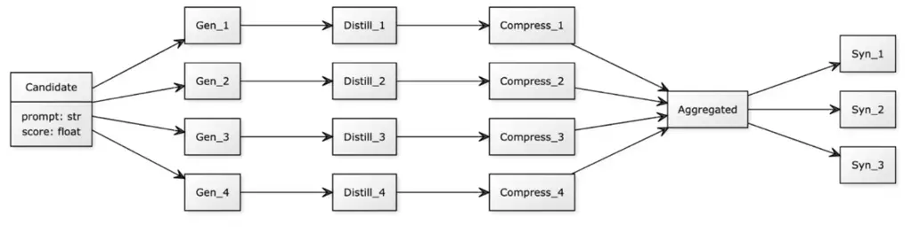

# Automatic Prompt Optimization with Prompt Distillation

 Ernest A. Dyagin

 Nikita I. Kulin

 Artur R. Khairullin

 Viktor N. Zhuravlev

 Alena N. Sitkina Affiliation: Computer Technologies Laboratory
Affiliation: ITMO University Affiliation: Saint-Petersburg, Russia
Affiliation: 334885@niuitmo.ru 242106@niuitmo.ru 368983@niuitmo.ru

###### Abstract

Autoprompting is the process of automatically selecting optimized
prompts for language models, which is gaining popularity due to the
rapid development of prompt engineering driven by extensive research in
the field of large language models (LLMs). This paper presents
DistillPrompt¹¹ 1 Code available as a part of CoolPrompt framework
library: https://github.com/CTLab-ITMO/CoolPrompt/—a novel autoprompting
method based on large language models that employs a multi-stage
integration of task-specific information into prompts using training
data. DistillPrompt utilizes distillation, compression, and aggregation
operations to explore the prompt space more thoroughly. The method was
tested on different datasets for text classification and generation
tasks using the t-lite-instruct-0.1 language model. The results
demonstrate a significant average improvement (e.g., 20.12% across the
entire dataset compared to Grips) in key metrics over existing methods
in the field, establishing DistillPrompt as one of the most effective
non-gradient approaches in autoprompting.

   

|     |
| --- |
|     |

*Keywords* LLM $`\cdot`$ AutoPrompting $`\cdot`$ Prompt Distillation
$`\cdot`$ Prompting $`\cdot`$ Prompt Engineering

## 1 Introduction

In recent years, significant progress has been made in the field of text
processing and generation using artificial intelligence—particularly
large language models (LLMs) \[11, 4\]. Improving model output quality
without modifying its weights falls under the domain of prompt
engineering. This field employs various prompting techniques, including
Few-shot \[2\], Chain-of-Thought (CoT) \[12\], Directional Stimulus
\[6\], among others. Research indicates that, depending on the task,
these techniques can either enhance or significantly degrade model
performance. For instance, applying Chain-of-Thought in tasks where
reasoning may lead to incorrect answers can result in accuracy drops of
tens of percentage points \[7\]. Similarly, with Few-shot prompting, it
was found that for the Deepseek-R1 model, adding examples to the prompt
“consistently degrades its performance” compared to a zero-shot task
description \[3\].

To address this issue, autoprompting methods have emerged—algorithms
that leverage both the model itself and various heuristics to
automatically improve prompt quality. Studies have shown that prompts
generated by these methods often outperform those crafted by humans,
even when designed by domain experts \[14\]. It is worth noting that the
number of prompting techniques continues to grow each year, making
manual prompt engineering increasingly complex and time-consuming. Thus,
the challenge of autoprompting remains highly relevant.

This paper presents a novel and more effective non-gradient-based
autoprompting approach. The core idea of our method is a complex prompt
distillation, which includes: generating diverse prompt candidates,
injecting task-relevant examples from a subset of the training data into
the prompt, aggregating candidates into a final optimized prompt, and
iteratively refining candidates from the final prompt. The proposed
approach was evaluated on different datasets and demonstrated superior
performance compared to existing non-gradient autoprompting methods.

### 1.1 Non-gradient autoprompting methods

In recent years, there has been significant growth in research on large
language models (LLMs) and their applications across various domains.
Given that prompting is an integral part of working with these models,
numerous studies have explored autoprompting methods.

The first such approach was introduced in \[10\], which relied on
fine-tuning an LLM to predict trigger tokens via softmax. However, this
method had several limitations as computational overhead, when the LLM
required retraining and gradient updates to predict tokens and lack of
interpretability, where the generated trigger tokens were not
human-interpretable, making it difficult to logically justify their
effectiveness, even though most LLMs are inherently black-box models.

Subsequently, non-gradient-based autoprompting algorithms emerged,
eliminating the need for gradient updates while allowing the extraction
of interpretable prompt patterns for manual refinement \[8, 9\]. These
approaches leverage semantic parsers, specialized prompt templates, LLMs
themselves as the “brain” of the autoprompting algorithm. However, prior
autoprompting methods suffer from several key drawbacks: insufficient
prompt manipulation-limited transformations applied to the prompt
structure, randomized instruction selection-arbitrary modification of
prompt components without systematic optimization, narrow task
applicability-restricted effectiveness across diverse NLP tasks. This
paper addresses these limitations by proposing a more structured and
generalizable non-gradient approach.

## 2 DistillPrompt

This paper presents an approach that addresses the limitations outlined
in the previous section—DistillPrompt, illustrated in Figure 1. The
method is based on prompt distillation and incorporates ideas from the
Tree-of-Thoughts prompting technique \[5, 13\]. Prompt distillation
refers to manipulating instructions through text compression,
reformulating task descriptions, and incorporating usage examples.
DistillPrompt is an iterative approach where each iteration consists of
five sequential stages.

Figure 1: Workflow of DistillPrompt

The initial best candidate is the provided prompt, and in each
subsequent epoch, the best candidate from the previous iteration is
used, where the best candidate is defined as the one with the highest
target metric score on the training set.

At the start of an epoch, variations of the initial prompt are
generated. This stage involves creating diverse modifications of the
best candidate to explore the task from different perspectives. The
purpose is to “explore” the space of potentially effective prompts and
avoid local optima. As a result, N new prompt candidates are produced
(N=4 in the current implementation). The number of candidates is a
hyperparameter of the algorithm, balancing the trade-off between the
number of large language model (LLM) calls and the coverage of the
prompt space for the given task. Generation is performed via queries to
the LLM with a temperature of 0.7 to enhance creativity while minimizing
the risk of generating uninterpretable prompts.

The next stage is example embedding. While the previous step yielded
four new prompt candidates, they explore the prompt space “blindly”. To
guide them toward the target task while preserving their unique
formulations, we propose embedding examples from the training set.
Initially, we tested direct example insertion (as in one-shot and
few-shot techniques), but this proved less effective than using the LLM
to analyze examples and extract their underlying task-solving
principles, which better captures task-relevant information. For each
prompt candidate, K examples are independently and randomly selected
from the training set (K=5 in this implementation) to guide the LLM in
refining the prompt. However, there is a risk of the LLM “overfitting”
to the examples-focusing on their specific labels and questions rather
than deriving generalizable insights.

To mitigate this, the next stage involves instruction compression, where
the LLM condenses the prompts from the previous step into a few
sentences retaining the core ideas introduced by the examples and the
overarching task objective. This step helps generalize the prompts while
preserving the insights gleaned from the examples.

Next, candidate aggregation is performed. Since examples were selected
independently and randomly for each candidate, the extracted insights
vary. Thus, the natural progression is to merge the compressed
candidates into a single distilled prompt encompassing the collective
ideas.

The final stage generates new candidates from the distilled prompt by
creating variations (as in Stage 1). The resulting candidates are
evaluated on tasks, and the top-performing candidate becomes the new
initial prompt for the next epoch until the epoch limit is reached.
Since the process explores the prompt space, candidates may outperform
or underperform those from previous epochs; thus, the method requires
multiple iterations. The algorithm’s output is the best prompt from the
final epoch.

## 3 Experimental Evaluation

### 3.1 Experimental Setup

To validate the effectiveness of DistillPrompt, we designed the
following experimental setup: each evaluated method was tested across
multiple datasets using the t-lite-instruct-0.1 LLM. This paper
introduces a comprehensive benchmark (a curated dataset collection) for
comparing non-gradient autoprompting methods, including the proposed
solution.

For a robust evaluation framework, we analyzed multiple autoprompting
studies \[9, 5, 13\], to compile diverse datasets. The resulting
benchmark encompasses both classification and question-answering tasks,
along with various text generation challenges. The complete dataset list
is: SST-2, MedQA, GSM8K, MNLI, MR, TREC, SAMSum, BBH (BIG-Bench Hard).
In this benchmark, question-answering datasets involve multiple-choice
responses (similar to exam questions), making them effectively
multiclass classification tasks. The benchmark datasets can be broadly
categorized into classification and generation tasks, each requiring
specific evaluation metrics.

While many autoprompting studies use accuracy for classification
evaluation, its simplicity fails to capture class distribution nuances.
Therefore, we employ macro F1-score as our primary classification
metric. For generation tasks, we selected METEOR \[1\] - an F1-analog
metric that measures word-level precision and recall (with higher recall
weighting), making it particularly suitable for text generation
evaluation. The baseline comparisons include prompting techniques
(baseline prompt—original dataset-provided prompt, few-shot
prompt—baseline prompt augmented with three training examples) and
non-gradient autoprompting approaches (Grips, Protegi). This
experimental design enables systematic comparison of DistillPrompt
against both manual prompting techniques and state-of-the-art
autoprompting methods across diverse NLP tasks.

### 3.2 Results

The experimental results across metrics and datasets are presented in
Tables 1 and 2 for the t-lite-instruct-0.1 model, showing performance on
classification and generation tasks respectively. The BBH metric values
in the tables represent averages across all tasks from the original
benchmark. Notably, Protegi was excluded from Table 2 as its methodology
is not adapted for generation tasks.

| Method                     | sst-2, f1 | mnli, f1 | trec, f1 | mr, f1 | medqa, f1 | bbh, f1 |
| -------------------------- | --------- | -------- | -------- | ------ | --------- | ------- |
| Baseline prompt            | 0.6135    | 0.4178   | 0.28673  | 0.8617 | 0.2957    | 0.2055  |
| Few shot: n = 3            | 0.9328    | 0.3741   | 0.2681   | 0.6031 | 0.2397    | 0.3129  |
| Protegi                    | 0.6397    | 0.4964   | 0.3555   | 0.6363 | 0.2935    | 0.3718  |
| Grips                      | 0.6135    | 0.7407   | 0.3153   | 0.9117 | 0.3032    | 0.2879  |
| DistillPrompt: v1.0 (ours) | 0.9484    | 0.7606   | 0.3526   | 0.9392 | 0.2957    | 0.4045  |

Table 1: Results of DistillPrompt on classification tasks with
t-lite-instruct-0.1

| Method                     | gsm8k, METEOR | samsum, METEOR | bbh, METEOR |
| -------------------------- | ------------- | -------------- | ----------- |
| Baseline prompt            | 0.02932       | 0.44787        | 0.1247      |
| Few shot: n = 3            | 0.0179        | 0.38484        | 0.2100      |
| Grips                      | 0.02643       | 0.45516        | 0.1491      |
| DistillPrompt: v1.0 (ours) | 0.0347        | 0.4579         | 0.2961      |

Table 2: Results of DistillPrompt on generation tasks with
t-lite-instruct-0.1

## 4 Discussion

The conducted experiments demonstrate that DistillPrompt effectively
handles both classification and text generation tasks. Across all
evaluated datasets, DistillPrompt either outperformed or matched the
performance of existing non-gradient autoprompting methods with a
significant average improvement 20.12% across the entire dataset
compared to Grips.

For classification tasks, the average F1-score improved by 36.18%
comparing baseline prompt and by 15.09% comparing the strongest of
baselines—Grips. In text generation tasks, the average METEOR score
increased by 31.03% comparing baseline prompt and by 25.05% comparing
the strongest of baselines - Grips. Comparisons and improvements were
calculated relative to the maximum average metrics achieved by existing
solutions.

This work creates a scope for future research into distillation of
prompts and other non-gradient autoprompting methods. The current
DistillPrompt implementation could potentially be further refined for
more targeted prompt optimization. Moreover, the concept of prompt
distillation could be generalized and adapted to other non-gradient
autoprompting methods, representing a promising direction for future
studies.

## 5 Conclusion

The proposed DistillPrompt algorithm, which employs distillation prompt
technique for prompt optimization, was evaluated on classification and
generation datasets covering various natural language processing
domains. It demonstrated consistent improvements over existing
non-gradient algorithm-based autoprompting methods. DistillPrompt proves
to be a competitive solution, showing that exploring prompt distillation
for autoprompting can yield significant benefits and advance current
methods to new levels of performance.

## References

- \[1\] Satanjeev Banerjee and Alon Lavie. Meteor: An automatic metric
  for mt evaluation with improved correlation with human judgments. In
  Proceedings of the acl workshop on intrinsic and extrinsic evaluation
  measures for machine translation and/or summarization, pages
  65–72, 2005.
- \[2\] Tom B. Brown, Benjamin Mann, Nick Ryder, Melanie Subbiah, Jared
  Kaplan, Prafulla Dhariwal, Arvind Neelakantan, Pranav Shyam, Girish
  Sastry, Amanda Askell, Sandhini Agarwal, Ariel Herbert-Voss, Gretchen
  Krueger, Tom Henighan, Rewon Child, Aditya Ramesh, Daniel M. Ziegler,
  Jeffrey Wu, Clemens Winter, Christopher Hesse, Mark Chen, Eric Sigler,
  Mateusz Litwin, Scott Gray, Benjamin Chess, Jack Clark, Christopher
  Berner, Sam McCandlish, Alec Radford, Ilya Sutskever, and Dario
  Amodei. Language models are few-shot learners, 2020.
- \[3\] DeepSeek-AI, Daya Guo, Dejian Yang, Haowei Zhang, Junxiao Song,
  Ruoyu Zhang, Runxin Xu, Qihao Zhu, Shirong Ma, Peiyi Wang, Xiao Bi,
  Xiaokang Zhang, Xingkai Yu, Yu Wu, Z. F. Wu, Zhibin Gou, Zhihong Shao,
  Zhuoshu Li, Ziyi Gao, Aixin Liu, Bing Xue, Bingxuan Wang, Bochao Wu,
  Bei Feng, Chengda Lu, Chenggang Zhao, Chengqi Deng, Chenyu Zhang,
  Chong Ruan, Damai Dai, Deli Chen, Dongjie Ji, Erhang Li, Fangyun Lin,
  Fucong Dai, Fuli Luo, Guangbo Hao, Guanting Chen, Guowei Li, H. Zhang,
  Han Bao, Hanwei Xu, Haocheng Wang, Honghui Ding, Huajian Xin, Huazuo
  Gao, Hui Qu, Hui Li, Jianzhong Guo, Jiashi Li, Jiawei Wang, Jingchang
  Chen, Jingyang Yuan, Junjie Qiu, Junlong Li, J. L. Cai, Jiaqi Ni, Jian
  Liang, Jin Chen, Kai Dong, Kai Hu, Kaige Gao, Kang Guan, Kexin Huang,
  Kuai Yu, Lean Wang, Lecong Zhang, Liang Zhao, Litong Wang, Liyue
  Zhang, Lei Xu, Leyi Xia, Mingchuan Zhang, Minghua Zhang, Minghui Tang,
  Meng Li, Miaojun Wang, Mingming Li, Ning Tian, Panpan Huang, Peng
  Zhang, Qiancheng Wang, Qinyu Chen, Qiushi Du, Ruiqi Ge, Ruisong Zhang,
  Ruizhe Pan, Runji Wang, R. J. Chen, R. L. Jin, Ruyi Chen, Shanghao Lu,
  Shangyan Zhou, Shanhuang Chen, Shengfeng Ye, Shiyu Wang, Shuiping Yu,
  Shunfeng Zhou, Shuting Pan, S. S. Li, Shuang Zhou, Shaoqing Wu,
  Shengfeng Ye, Tao Yun, Tian Pei, Tianyu Sun, T. Wang, Wangding Zeng,
  Wanjia Zhao, Wen Liu, Wenfeng Liang, Wenjun Gao, Wenqin Yu, Wentao
  Zhang, W. L. Xiao, Wei An, Xiaodong Liu, Xiaohan Wang, Xiaokang Chen,
  Xiaotao Nie, Xin Cheng, Xin Liu, Xin Xie, Xingchao Liu, Xinyu Yang,
  Xinyuan Li, Xuecheng Su, Xuheng Lin, X. Q. Li, Xiangyue Jin, Xiaojin
  Shen, Xiaosha Chen, Xiaowen Sun, Xiaoxiang Wang, Xinnan Song, Xinyi
  Zhou, Xianzu Wang, Xinxia Shan, Y. K. Li, Y. Q. Wang, Y. X. Wei, Yang
  Zhang, Yanhong Xu, Yao Li, Yao Zhao, Yaofeng Sun, Yaohui Wang, Yi Yu,
  Yichao Zhang, Yifan Shi, Yiliang Xiong, Ying He, Yishi Piao, Yisong
  Wang, Yixuan Tan, Yiyang Ma, Yiyuan Liu, Yongqiang Guo, Yuan Ou,
  Yuduan Wang, Yue Gong, Yuheng Zou, Yujia He, Yunfan Xiong, Yuxiang
  Luo, Yuxiang You, Yuxuan Liu, Yuyang Zhou, Y. X. Zhu, Yanhong Xu,
  Yanping Huang, Yaohui Li, Yi Zheng, Yuchen Zhu, Yunxian Ma, Ying Tang,
  Yukun Zha, Yuting Yan, Z. Z. Ren, Zehui Ren, Zhangli Sha, Zhe Fu,
  Zhean Xu, Zhenda Xie, Zhengyan Zhang, Zhewen Hao, Zhicheng Ma, Zhigang
  Yan, Zhiyu Wu, Zihui Gu, Zijia Zhu, Zijun Liu, Zilin Li, Ziwei Xie,
  Ziyang Song, Zizheng Pan, Zhen Huang, Zhipeng Xu, Zhongyu Zhang, and
  Zhen Zhang. Deepseek-r1: Incentivizing reasoning capability in llms
  via reinforcement learning, 2025.
- \[4\] Saurav Kadavath, Tom Conerly, Amanda Askell, Tom Henighan, Dawn
  Drain, Ethan Perez, Nicholas Schiefer, Zac Hatfield-Dodds, Nova
  DasSarma, Eli Tran-Johnson, Scott Johnston, Sheer El-Showk, Andy
  Jones, Nelson Elhage, Tristan Hume, Anna Chen, Yuntao Bai, Sam Bowman,
  Stanislav Fort, Deep Ganguli, Danny Hernandez, Josh Jacobson, Jackson
  Kernion, Shauna Kravec, Liane Lovitt, Kamal Ndousse, Catherine Olsson,
  Sam Ringer, Dario Amodei, Tom Brown, Jack Clark, Nicholas Joseph, Ben
  Mann, Sam McCandlish, Chris Olah, and Jared Kaplan. Language models
  (mostly) know what they know, 2022.
- \[5\] Lei Li, Yongfeng Zhang, and Li Chen. Prompt distillation for
  efficient llm-based recommendation. In Proceedings of the 32nd ACM
  international conference on information and knowledge management,
  pages 1348–1357, 2023.
- \[6\] Zekun Li, Baolin Peng, Pengcheng He, Michel Galley, Jianfeng
  Gao, and Xifeng Yan. Guiding large language models via directional
  stimulus prompting. Advances in Neural Information Processing Systems,
  36:62630–62656, 2023.
- \[7\] Ryan Liu, Jiayi Geng, Addison J. Wu, Ilia Sucholutsky, Tania
  Lombrozo, and Thomas L. Griffiths. Mind your step (by step):
  Chain-of-thought can reduce performance on tasks where thinking makes
  humans worse, 2025.
- \[8\] Archiki Prasad, Peter Hase, Xiang Zhou, and Mohit Bansal. Grips:
  Gradient-free, edit-based instruction search for prompting large
  language models, 2023.
- \[9\] Reid Pryzant, Dan Iter, Jerry Li, Yin Tat Lee, Chenguang Zhu,
  and Michael Zeng. Automatic prompt optimization with "gradient
  descent" and beam search, 2023.
- \[10\] Taylor Shin, Yasaman Razeghi, Robert L. Logan IV, Eric Wallace,
  and Sameer Singh. Autoprompt: Eliciting knowledge from language models
  with automatically generated prompts, 2020.
- \[11\] Jason Wei, Maarten Bosma, Vincent Y. Zhao, Kelvin Guu,
  Adams Wei Yu, Brian Lester, Nan Du, Andrew M. Dai, and Quoc V. Le.
  Finetuned language models are zero-shot learners, 2022.
- \[12\] Jason Wei, Xuezhi Wang, Dale Schuurmans, Maarten Bosma, Brian
  Ichter, Fei Xia, Ed Chi, Quoc Le, and Denny Zhou. Chain-of-thought
  prompting elicits reasoning in large language models, 2023.
- \[13\] Shunyu Yao, Dian Yu, Jeffrey Zhao, Izhak Shafran, Tom
  Griffiths, Yuan Cao, and Karthik Narasimhan. Tree of thoughts:
  Deliberate problem solving with large language models. Advances in
  neural information processing systems, 36:11809–11822, 2023.
- \[14\] Yongchao Zhou, Andrei Ioan Muresanu, Ziwen Han, Keiran Paster,
  Silviu Pitis, Harris Chan, and Jimmy Ba. Large language models are
  human-level prompt engineers. In The eleventh international conference
  on learning representations, 2022.
