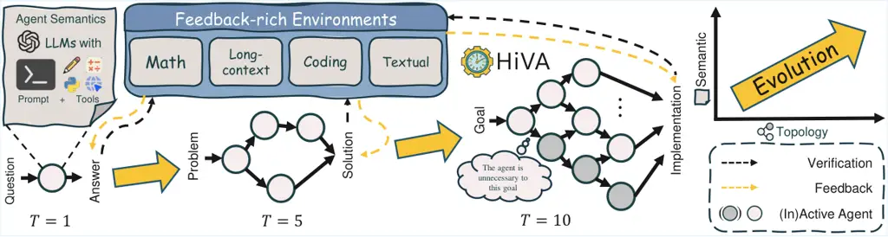
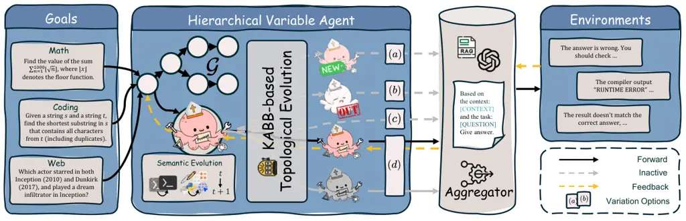
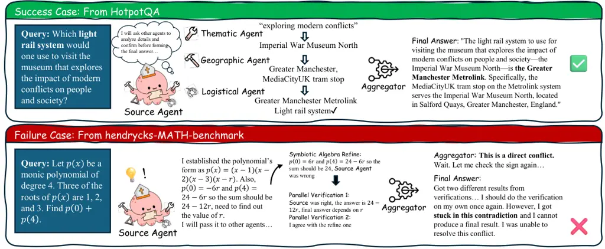
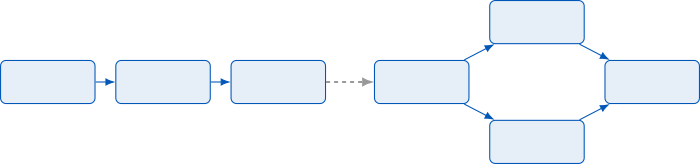
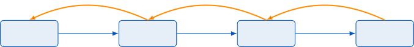
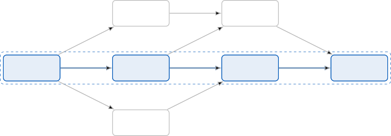

#  HiVA: Self-organized Hierarchical Variable Agent via Goal-driven Semantic-Topological Evolution

Jinzhou Tang ^(†)^(†)thanks: Equal contribution.    Jusheng
Zhang¹¹footnotemark: 1    Qinhan Lv¹¹footnotemark: 1    Sidi Liu    Jing
Yang    Chengpei Tang    Keze Wang ^(†)^(†)thanks: Corresponding author.

###### Abstract

Autonomous agents play a crucial role in advancing Artificial General
Intelligence, enabling problem decomposition and tool orchestration
through Large Language Models (LLMs). However, existing paradigms face a
critical trade-off. On one hand, reusable fixed workflows require manual
reconfiguration upon environmental changes; on the other hand, flexible
reactive loops fail to distill reasoning progress into transferable
structures. We introduce Hierarchical Variable Agent (HiVA), a novel
framework modeling agentic workflows as self-organized graphs with the
Semantic-Topological Evolution (STEV) algorithm, which optimizes hybrid
semantic-topological spaces using textual gradients as discrete-domain
surrogates for backpropagation. The iterative process comprises
Multi-Armed Bandit-infused forward routing, diagnostic gradient
generation from environmental feedback, and coordinated updates that
co-evolve individual semantics and topology for collective optimization
in unknown environments. Experiments on dialogue, coding, Long-context
Q&A, mathematical, and agentic benchmarks demonstrate improvements of
5-10% in task accuracy and enhanced resource efficiency over existing
baselines, establishing HiVA’s effectiveness in autonomous task
execution.

¹Sun Yat-sen University

kezewang@gmail.com

Code — https://anonymous.4open.science/r/HiVA-60C6

## 1 Introduction



Figure 1: Semantic-Topological Evolution from Singleton to
Self-organized Complex Agents. We explore how Large Language Models,
when deployed in feedback-rich environments, can spontaneously form
increasingly complex cognitive roles to refine their decision-making and
tool use. Starting from a single agent with basic capabilities, HiVA
fosters gradual evolution through semantic refinement and topological
reconfiguration. Agents adapt to feedback-derived gradients from
environmental interactions and develop into specialized yet
interconnected sub-agents, thereby forming a complex system.

The pursuit of general-purpose autonomous agents, which are capable of
independently solving complex, open-ended tasks, represents a central
goal of artificial intelligence. (Ye et al. 2025; Webb, Holyoak, and Lu
2022; Raman et al. 2025) Large Language Models (LLMs) have emerged as a
powerful backbone for such agents, enabling them to decompose goals,
plan actions, and invoke tools through natural language reasoning. (Li 2025) However, despite the success of LLM-based agents in applications
such as automated software development and scientific discovery, their
underlying multi-agent coordination paradigms remain fundamentally
limited. (Jimenez-Romero, Yegenoglu, and Blum 2025; Zhang et al. 2025f)

Existing frameworks can be broadly categorized into two categories: (1)
Manually-designed workflows, which rely on fixed, structured agent
interactions to complete tasks. While these offer modularity and reuse,
they suffer from poor generalization to unseen task formats. (Qin et al.
2022; Hu et al. 2025)(2) Reactive agent loops (e.g., ReAct (Yao et al.
2023), AutoGPT (Yang, Yue, and He 2023)), which execute task solving as
a sequence of language-based decisions. While more adaptable, these
reactive agents fail to directly reuse reasoning patterns or continually
improve themselves in dynamic environments (Mialon et al. 2023; Xi
et al. 2023). Though recent efforts have introduced mechanisms to
optimize either agent behaviors or routing strategies (Zhang et al.
2025a; He et al. 2024), they largely treat the coordination structure
and semantics as independent. These approaches focus on incremental
adaptation, i.e., tuning prompts, sampling structures, or adjusting
routes from predefined templates, without a convincing mechanism to
explore how LLMs can spontaneously build a complex from a singleton (Guo
et al. 2024). We argue that general-purpose agents should be
evolutionary systems for dynamic environments: they must learn not only
(1) what each agent should do (i.e., semantic behavior), but also (2)
how agents should interact and organize (i.e., structural topology).
This motivates our central question: Can a multi-agent system evolve
both its internal semantics and collaborative structure from ZERO to
achieve scalable, adaptive, and self-organized intelligence across
diverse tasks?

To this end, we propose Hierarchical Variable Agent (HiVA), a novel
multi-agent framework based on the Semantic-Topological Evolution (STEV)
algorithm. In HiVA, the coordination structure is modeled as a dynamic
computational graph, and each agent is represented as a configurable LLM
module. Optimization occurs in a hybrid space that consists of: (1) a
semantic space for learning agent-level behaviors (e.g., prompts, tool
configurations) (Yuksekgonul et al. 2025), and (2) a topological space
that encodes which agents are connected and how information flows among
them (Zhou et al. 2025). Each optimization round in HiVA involves three
steps: (1) a Forward Pass, where a task is routed through a dynamically
constructed subgraph of agents; (2) a Textual Gradient Feedback, where
language-based diagnostics are generated based on the environmental
feedback to approximate gradient-like signals for optimization in a
non-differentiable space; and (3) a Coordinated Update, where each agent
adjusts both its internal semantic parameters and its structural links
to other agents. This loop enables HiVA to progressively refine its
capabilities and collaboration structure across tasks, resulting in a
self-optimizing, specialized multi-agent system. Experimental results
across diverse benchmarks show that HiVA generally outperforms static
workflows, reactive loops, and mainstream multi-agent optimization
algorithms, achieving better transferability and greater efficiency.

Our contributions are threefold: (i) We propose HiVA, the first
framework to unify semantic and structural evolution from a singleton in
LLM-based multi-agent systems; (ii) We introduce Semantic-Topological
Evolution, a general principle for co-evolving agent behavior and
collaboration; and (iii) We design a dynamic routing and update
mechanism based on bandit exploration and textual gradients.

## 2 Related Works

##### LLM-Based Multi-Agent Systems

Multi-agent systems (MAS) powered by Large Language Models (LLMs) excel
at complex tasks like software development and scientific
discovery (Junda He 2025; Su et al. 2025; Li, Zhang, and Safara 2023;
Zhang et al. 2025d; Sheng 2025). Recent works like ReAct (Yao et al. 2023) and AutoGPT (Yang, Yue, and He 2023) emphasize the reasoning and
long-term planning capabilities of LLM-driven MAS, while lacking the
potential for scalability through reproducing their chain-of-thought
(CoT). MetaGPT (Hong et al. 2024) uses shared message pools, and
DyLAN (Liu et al. 2023) employs layered communication to boost
efficiency. However, their static workflows limit adaptability to novel
tasks. In contrast, our HiVA framework can dynamically evolve, thereby
enhancing flexibility and scalability.

##### Dynamic Self-Improvement Mechanisms

Dynamic self-improvement mechanisms enable agents to adapt through
feedback. Existing approaches can be categorized into two paradigms: the
first involves text-based optimization methods, including both
single-agent semantic (Zhang et al. 2024) and multi-agent collaborative
optimization  (Liang, Xu, and Dong 2025); the second employs
reinforcement learning approaches for agent improvement (Guo et al.
2025). In contrast, HiVA enables co-evolution of agent parameters and
topology from a singleton, achieving effective test-time-scaling for
diverse tasks and scenarios.

##### Hierarchies and Topological Optimization

Hierarchical structures and topological optimization enhance MAS
efficiency. MetaGPT (Hong et al. 2024) and MASAI (Wadhwa et al. 2024)
streamline workflows with modular designs. MASS (Zhang et al. 2025b)
proposes a Multi-Agent System Search for prompt and topology
optimization. G-designer (Zhang et al. 2025c) uses graph neural networks
for topology optimization without semantic integration. HiVA’s
Bayesian-driven hierarchical evolution enables better modeling of
individuals in self-organized MAS.



Figure 2: Evolving mechanism of Hierarchical Variable Agent in a single
iteration. Driven by the goal, HiVA decomposes evolution into two
stages: forward and backward propagation. In the forward pass, each
agent in $`\mathcal{G}`$ utilizes KABB to select relevant successors and
generate instructions for them. The aggregator then uses specific tools
(e.g., RAG) to access MAS context and generate final answers. In the
backward pass, each agent receives feedback from its successor (notably,
aggregator receives feedback from the environments) and evolves their
semantics (prompts and tools) and topologies with four options: (a) add
a successor, (b) delete a successor, (c) connect directly to the
aggregator, and (d) do nothing.

## 3 Methodology

This paper introduces HiVA (Hierarchical Variable Agent), a novel
framework designed to address the problem of adaptive task-flow
optimization in Multi-Agent Systems (MAS). The core idea is to formulate
this optimization problem as a process of generalized gradient descent
within a Hybrid Space, which is constituted by both a semantic space and
a topological space. The theoretical cornerstone of our work is the
Semantic-Topological Evolution (STEV) algorithm, as illustrated in
Figure 1, which enables optimization in the discrete and
non-differentiable space of agentic graphs. Our STEV algorithm
facilitates the simultaneous co-evolution of agents’ internal parameters
(semantics) and their collaborative structures (topology) by introducing
Textual Gradients as a substitute for traditional gradients, combined
with knowledge-aware dynamic computation graph construction.

### 3.1 Semantic-Topological TextGrad

We define a complete solution for a multi-agent system as a point $`s`$
within a hybrid space
$`\mathcal{S}=\mathcal{G}\times\mathcal{P}_{\Theta}`$, where
$`\mathcal{G}`$ is the space of graph topologies and
$`\mathcal{P}_{\Theta}`$ is the space of semantic parameters $`\Theta`$.
The optimization objective is to find a solution $`s^{*}`$ that
minimizes a black-box objective function $`\mathcal{L}(s)`$.

```math
s^{*}=\arg\min_{s\in\mathcal{S}}\mathcal{L}(s)
```

This optimization is non-trivial, as the discrete and non-Euclidean
nature of $`\mathcal{S}`$ renders the traditional gradient
$`\nabla_{s}\mathcal{L}`$ ill-defined. To navigate this, we introduce
the Textual Gradient (Yuksekgonul et al. 2025) as a functional
substitute. We operationalize it using a Textual Gradient Parser,
implemented via an LLM, which translates raw textual feedback into a
structured update instruction, $`\Delta s_{t}`$. The parser diagnoses
whether the gradient applies to an agent’s semantics or its topology,
generating a corresponding command for either the semantic evolution
function ($`f_{P}`$) or the topological evolution function ($`f_{G}`$).
This reframes the optimization as a Generalized Gradient Descent
process, with an update rule
$`s_{t+1}\leftarrow s_{t}\oplus\Delta s_{t}`$, where the parsed gradient
guides targeted updates across the hybrid space.

### 3.2 The Environment: Oracle and Adversary

The interaction space for our optimization problem is defined by the
Environment, $`\mathcal{E}_{\text{env}}`$. Formally, the environment is
a function that accepts the system’s final output,
$`S_{\text{out}}=s(I_{\text{task}})`$, and returns a potentially complex
outcome or feedback. The environment plays a crucial dual role.

First, it acts as an oracle, providing the ground-truth feedback
necessary for learning. The textual loss required for optimization is
computed by an objective function $`\mathcal{L}`$ that maps the
environment’s rich dynamics driven by $`s`$ to a explainable signal:
$`\mathcal{L}(s)=\mathcal{L}(\mathcal{E}_{\text{env}}(s(I_{\text{task}})))`$.

Second, the environment acts as an adversary, defining the complexity
and challenge of the task space. The robustness and adaptability of a
solution $`s`$ are measured by its ability to consistently achieve low
loss across the distribution of problems posed by
$`\mathcal{E}_{\text{env}}`$. The nature of $`\mathcal{E}_{\text{env}}`$
can vary widely, encompassing: (a) programmatic environments with
verifiable outcomes (e.g., code compilation, unit test execution); (b)
data-driven environments where feedback is derived from metrics on a
held-out dataset (e.g., QA); (c) agentic environments that provide
interactive simulators or interfaces (e.g., browser, game, IDE); and (d)
mathematical environments where feedback is qualitative text from a
verifiable math evaluator (e.g., Lean). A successful optimization must
yield a solution robust to the specific challenges of its target
environment.

### 3.3 The Iterative Optimization of HiVA

The optimization process in HiVA is an iterative loop driving the
solution $`s_{t}=(G_{t},\Theta_{t})`$ toward a minimum of the objective
function, as illustrated in Algorithm 1. Each iteration consists of a
coupled forward and backward pass. The function
$`\text{RepairTopology}(\cdot)`$ removes isolated nodes and prevents
cycles; more details can be found in the Algorithmic Details section of
the Appendix.

Definitions:

 Agent $`v_{i}\in\mathcal{V}`$: Entity with prompt $`p_{i}`$, tool
$`\tau_{i}`$, mapping instruction $`x_{i}`$ to output $`y_{i}`$.

 Aggregator $`v_{a}`$: Aggregates outputs.

 Network $`\mathcal{G}`$: DAG with source $`v_{s}`$ and sink $`v_{a}`$.

Input: Instruction $`x_{0}`$, environment function
$`\mathcal{E}_{\text{env}}`$.

Output: Optimized $`\mathcal{G}`$, result $`y`$.

Initialize: Create $`v_{s}`$ ( $`p_{s}`$, $`t_{s}`$), connect
$`v_{s}\to v_{a}`$.

for $`t=1`$ to $`T`$ do

   Forward: Execute ForwardPass($`\mathcal{G},x_{0}`$)

  Loss:
$`\mathcal{L}_{t}\leftarrow\mathcal{L}(\mathcal{E}_{\text{env}}(y))`$,
$`\nabla_{\text{text}}\mathcal{L}_{t}\leftarrow\text{LLM}(y,\mathcal{L}_{t})`$

  Backward:

  for each $`v_{i}\in\text{reverse}(\sigma)`$ do

   $`\frac{\partial\mathcal{L}_{t}}{\partial v_{i}}\leftarrow\nabla_{\text{text}}\mathcal{L}_{t}`$
if $`v_{i}=v_{a}`$, else

   $`\frac{\partial\mathcal{L}_{t}}{\partial v_{i}}\leftarrow\text{LLM}(\{\frac{\partial\mathcal{L}_{t}}{\partial v_{j}}\mid v_{j}\in\text{successors}(v_{i})\},y_{i})`$

   $`p_{i},\tau_{i}\leftarrow f_{P}(p_{i},\tau_{i},\frac{\partial\mathcal{L}_{t}}{\partial v_{i}})`$

   $`\mathcal{G}\leftarrow f_{G}(\mathcal{G},\{\mathcal{R}_{ij}\}_{j\in\text{successor}(v_{i})},\frac{\partial\mathcal{L}_{t}}{\partial v_{i}})`$

  end for

  $`\alpha_{i},\beta_{i}\leftarrow\alpha_{i}^{(t+1)},\beta_{i}^{(t+1)}`$

  $`\mathcal{G}\leftarrow\text{RepairTopology}(\mathcal{G})`$

end for

Return: $`\mathcal{G},y`$

Algorithm 1 Semantic-Topological Evolution

The Forward Pass, as shown in Algorithm 2, probes the potential of the
current solution $`s_{t}`$. It employs a dynamic routing mechanism to
construct a task-specific execution subgraph
$`\mathcal{G}_{\text{exec},t}`$, culminating in the generation of a
final output $`S_{\text{out},t}`$.

This output is then subjected to the Loss Evaluation phase. It is passed
to the environment, $`\mathcal{E}_{\text{env}}`$, and the resulting
outcome is mapped to a textual loss:

```math
\mathcal{L}_{t}=\mathcal{L}(\mathcal{E}_{\text{env}}(S_{\text{out},t})).
```

The loss $`\mathcal{L}_{t}`$ triggers the Backward Pass. The process
begins by estimating a global textual gradient at the sink point
$`v_{a}`$ of $`\mathcal{G}`$ based on the environmental feedback. This
gradient is then decomposed and propagated via a textual chain rule to
each participating node, yielding localized textual gradients.

This backward flow of information culminates in a Coordinated Update of
the current solution $`s_{t}`$. The semantic parameters and graph
topology are co-optimized via textual gradient descent. Finally, the
dynamic routing policy is refined by updating its Bayesian belief
parameters, following KABB (Zhang et al. 2025e).

### 3.4 Knowledge-Based Subgraph Generation

Dynamic routing underpins HiVA’s efficiency and adaptability in
selecting agents for task-specific execution subgraphs. It models agent
selection as a Multi-Armed Bandit (MAB) problem, solved using Thompson
Sampling. With topological order, at each decision point, the system
assigns $`P_{i}`$ to each agent $`A_{i}`$ by sampling from a probability
distribution proportional to:

```math
P_{i}\propto\frac{\alpha_{i}^{(t)}}{\alpha_{i}^{(t)}+\beta_{i}^{(t)}}\cdot\exp\left(-\lambda\cdot\text{Dist}(A_{i},I_{\text{task}})\right)\cdot\zeta(\mathcal{S}_{t})^{\eta}
```

Here,
$`\zeta(\mathcal{S}_{t})=\frac{1}{|\mathcal{S}_{t}|(|\mathcal{S}_{t}|-1)}\sum_{v_{i},v_{j}\in\mathcal{S}_{t},i\neq j}C_{\text{syn}}^{(t)}(v_{i},v_{j})`$
quantifies the collaborative effect within the selected subset
$`\mathcal{S}_{t}`$ which include previous selected agents and
$`A_{i}`$, where $`C_{\text{syn}}^{(t)}(v_{i},v_{j})`$ is the synergy
gain coefficient for pairwise agent interactions, and $`\eta`$ adjusts
its influence. This distribution balances historical performance (via
Bayesian belief parameters $`\alpha_{i},\beta_{i}`$), task relevance,
and team synergy, penalized by a knowledge-based cost function:

```math
\text{Dist}(A_{i},I_{\text{task}})=\log(1+d_{I})\cdot\sum_{k=1}^{4}\omega_{k}\Psi_{k}
```

This cost function uses an external knowledge graph to measure the
mismatch $`\Psi_{k}`$ across four sub-indicators of an agent’s
capabilities against task requirements. The routing mechanism then
constructs efficient, task-specific execution subgraphs
$`G_{\text{exec},t}`$ through Thompson Sampling, which serve as the
foundation for forward propagation. More details can be found in the
Appendix on Knowledge-Based Cost Function.

The routing policy evolves by updating the Bayesian belief parameters
for each agent based on performance and task alignment:

```math
\alpha_{i}^{(t+1)}=\gamma^{\Delta t}\alpha_{i}^{(t)}+\left[r_{i}^{(t)}+\delta\cdot\text{KM}(A_{i},I_{\text{task}})\right]\cdot\mathbb{I}_{\{A_{i}\in\mathcal{S}_{t}\}}
```

```math
\beta_{i}^{(t+1)}=\gamma^{\Delta t}\beta_{i}^{(t)}+\left[1-r_{i}^{(t)}+\delta\cdot\text{KD}(A_{i},I_{\text{task}})\right]\cdot\mathbb{I}_{\{A_{i}\in\mathcal{S}_{t}\}}
```

Here,
$`\text{KM}(A_{i},I_{\text{task}})=\rho_{\text{overlap}}\cdot\zeta(\{A_{i},I_{\text{task}}\})`$
measures task alignment and
$`\text{KD}(A_{i},I_{\text{task}})=1-\text{KM}(A_{i},I_{\text{task}})`$
plays the opposite, incorporating a synergy term scaled by a task
relevance factor $`\rho_{\text{overlap}}`$. The updates combine a reward
signal $`r_{i}^{(t)}`$ reflecting the agent’s contribution, a
knowledge-driven adjustment KM, and an exponential decay factor
$`\gamma^{\Delta t}=e^{-\kappa\Delta t}`$ to prioritize recent
performance. The indicator function
$`\mathbb{I}_{\{A_{i}\in\mathcal{S}_{t}\}}`$ ensures only agents in the
selected subset are updated. This continuous learning process refines
the policy, favoring agents that perform well and align closely with the
task while promoting collaborative subsets, leading to increasingly
effective subgraph generation over time.

### 3.5 Multi-agent Structure as Memory

In our HiVA framework, the multi-agent structure serves not only as an
organizational scheme for computational units but also functions as the
core memory mechanism of the system. Unlike traditional multi-agent
systems that confine memory to internal states of individual agents,
HiVA encodes collective memory within the network topology
$`\mathcal{G}`$ and inter-agent connection weights, achieving
distributed memory storage and retrieval.

Initialize
$`\mathcal{R}_{ij}\leftarrow 0,\forall v_{i},v_{j}\in\mathcal{V}`$

Compute topological order $`\sigma`$ of $`\mathcal{G}`$

for each $`v_{i}\in\sigma`$ do

  if $`v_{i}`$ receives no instruction then

   continue

  end if

  $`y_{i}\leftarrow\tau_{i}(x_{i})`$

  $`s_{j}\sim P_{i}`$, $`v_{j}\in\text{successor}(v_{i})`$

  $`\mathcal{V}^{\prime}=\text{top-}k_{v_{j}\in\text{successor}(v_{i})}(s_{j})`$

  for each $`v_{j}\in\mathcal{V}^{\prime}`$ do

   $`\mathcal{R}_{ij}\leftarrow\mathcal{R}_{ij}+1`$

   Generate $`x_{j}\leftarrow\text{LLM}(x_{i},y_{i},p_{j})`$

  end for

end for

$`y\leftarrow v_{a}.\text{aggregate}(\{y_{i}\mid\text{deg}^{+}(v_{i})=1,\mathcal{R}_{ia}=1\})`$

Return: $`y`$

Algorithm 2 ForwardPass

Specifically, each edge $`(v_{i},v_{j})\in\mathcal{E}`$ in the network
topology $`\mathcal{G}=(\mathcal{V},\mathcal{E})`$ carries a weight
$`C_{\text{syn}}^{(t+1)}(v_{i},v_{j})`$ that encodes the historical
accuracy and task relevance of information transfer from agent $`v_{i}`$
to $`v_{j}`$. These weights evolve continuously through a Bayesian
update mechanism:

```math
C_{\text{syn}}^{(t+1)}(v_{i},v_{j})=C_{\text{syn}}^{(t)}(v_{i},v_{j})+\gamma\cdot\frac{\alpha_{ij}^{(t)}}{\alpha_{ij}^{(t)}+\beta_{ij}^{(t)}}\cdot\mathcal{R}_{ij}^{(t)}
```

where $`\mathcal{R}_{ij}^{(t)}`$ represents the task contribution of
edge $`(v_{i},v_{j})`$ in the $`t`$-th iteration, and $`\gamma`$ is the
learning rate.

Notably, HiVA’s memory mechanism exhibits hierarchical characteristics.
At the macro level, the topological structure $`\mathcal{G}`$ stores
long-term memory of collaboration patterns among agents; at the meso
level, edge weights $`w_{ij}`$ record the effectiveness of specific
collaboration paths; at the micro level, agents’ semantic parameters
$`\Theta_{i}`$ preserve individual specialized knowledge. This ensures
that the system can utilize historical experience at different
granularities.

### 3.6 Semantic-Topological Evolution

HiVA’s core innovation lies in simultaneously optimizing agent semantic
parameters and network topology from singleton through two complementary
functions $`f_{P}`$ and $`f_{G}`$, as illustrated in Figure 2. Detailed
prompting strategies can be found in the Prompting Strategies section of
the Appendix.

Semantic evolution function $`f_{P}`$ handles semantic parameter
evolution. Given textual gradient
$`\frac{\partial\mathcal{L}_{t}}{\partial v_{i}}`$, current semantic
parameters $`p_{t}`$, and tool configuration $`t_{i}`$, it produces
updated parameters. The LLM analyzes the feedback to identify potential
improvements in the agent’s prompt and tool definition, and then
generates refined prompts that address issues.

Topological evolution function $`f_{G}`$ modifies the local topology at
successor nodes of $`v_{i}`$ based on textual gradients, topological
connections, and task contribution matrix $`\mathcal{R}`$. Further,
$`f_{G}`$ instructs an LLM to analyze local topological neighborhoods
and determine optimal structural modifications, including adding
connections, removing redundant edges, or restructuring subgraphs.

|                    |                            |                          |                           |                           |                            |                          |                            |                          |                          |
| ------------------ | -------------------------- | ------------------------ | ------------------------- | ------------------------- | -------------------------- | ------------------------ | -------------------------- | ------------------------ | ------------------------ |
| Method             | Mathematical               |                          | Long-context              |                           | Programmatic               |                          | Textual                    |                          | Avg.                     |
|                    | MATH                       | GSM-8K                   | HotpotQA                  | 2WikihopQA                | HumanEval                  | MBPP                     | MMLU                       | BBH                      |                          |
| Vanilla            | 82.7                       | 91.2                     | 67.4                      | 76.2                      | 86.1                       | 86.7                     | 86.1                       | 86.3                     | 82.6                     |
| CoT                | 84.3\_($`\uparrow`$1.6%)   | 92.1\_($`\uparrow`$0.9%) | 68.8\_($`\uparrow`$1.9%)  | 77.6\_($`\uparrow`$1.7%)  | 87.4\_($`\uparrow`$1.5%)   | 87.3\_($`\uparrow`$0.9%) | 85.2\_($`\downarrow`$0.7%) | 87.6\_($`\uparrow`$1.4%) | 83.8\_($`\uparrow`$1.5%) |
| Self-Consistency   | 84.7\_($`\uparrow`$2.2%)   | 92.6\_($`\uparrow`$1.4%) | 69.1\_($`\uparrow`$2.4%)  | 78.3\_($`\uparrow`$2.4%)  | 88.2\_($`\uparrow`$2.4%)   | 88.2\_($`\uparrow`$1.5%) | 85.6\_($`\downarrow`$0.3%) | 88.1\_($`\uparrow`$2.0%) | 84.4\_($`\uparrow`$2.2%) |
| Self-Refine        | 85.1\_($`\uparrow`$2.8%)   | 93.2\_($`\uparrow`$2.0%) | 69.4\_($`\uparrow`$3.1%)  | 78.6\_($`\uparrow`$3.0%)  | 86.2\_($`\uparrow`$0.1%)   | 87.1\_($`\uparrow`$0.3%) | 85.1\_($`\downarrow`$1.3%) | 87.2\_($`\uparrow`$0.8%) | 84.0\_($`\uparrow`$1.7%) |
| Multi-Agent Debate | 85.4\_($`\uparrow`$3.1%)   | 93.3\_($`\uparrow`$2.2%) | 70.2\_($`\uparrow`$3.9%)  | 79.1\_($`\uparrow`$3.7%)  | 88.1\_($`\uparrow`$2.3%)   | 87.4\_($`\uparrow`$0.9%) | 85.4\_($`\downarrow`$0.7%) | 87.6\_($`\uparrow`$1.4%) | 84.6\_($`\uparrow`$2.4%) |
| DyLAN              | 85.3\_($`\uparrow`$3.0%)   | 92.9\_($`\uparrow`$1.8%) | 69.7\_($`\uparrow`$3.1%)  | 78.8\_($`\uparrow`$3.3%)  | 89.7\_($`\uparrow`$4.2%)   | 87.3\_($`\uparrow`$0.6%) | 85.2\_($`\downarrow`$1.3%) | 87.1\_($`\uparrow`$0.8%) | 84.5\_($`\uparrow`$2.3%) |
| AgentVerse         | 85.6\_($`\uparrow`$3.3%)   | 93.1\_($`\uparrow`$2.1%) | 70.1\_($`\uparrow`$3.9%)  | 79.3\_($`\uparrow`$3.9%)  | 89.6\_($`\uparrow`$4.1%)   | 87.6\_($`\uparrow`$0.9%) | 85.7\_($`\downarrow`$0.7%) | 87.4\_($`\uparrow`$1.4%) | 84.8\_($`\uparrow`$2.7%) |
| ADAS               | 86.1\_($`\uparrow`$4.0%)   | 93.4\_($`\uparrow`$2.5%) | 72.3\_($`\uparrow`$6.8%)  | 80.7\_($`\uparrow`$5.6%)  | 85.2\_($`\downarrow`$1.0%) | 89.2\_($`\uparrow`$2.8%) | 87.2\_($`\uparrow`$1.0%)   | 88.6\_($`\uparrow`$2.5%) | 85.3\_($`\uparrow`$3.3%) |
| MaAS               | 85.7\_($`\uparrow`$3.6%)   | 94.1\_($`\uparrow`$3.2%) | 76.2\_($`\uparrow`$13.1%) | 81.1\_($`\uparrow`$6.4%)  | 92.3\_($`\uparrow`$7.2%)   | 90.1\_($`\uparrow`$3.9%) | 89.4\_($`\uparrow`$3.8%)   | 90.6\_($`\uparrow`$5.0%) | 87.4\_($`\uparrow`$5.8%) |
| HiVA (ours)        | 81.2\_($`\downarrow`$1.8%) | 94.5\_($`\uparrow`$3.6%) | 79.7\_($`\uparrow`$18.3%) | 86.5\_($`\uparrow`$13.5%) | 94.2\_($`\uparrow`$9.4%)   | 92.1\_($`\uparrow`$6.2%) | 91.7\_($`\uparrow`$6.5%)   | 93.4\_($`\uparrow`$8.2%) | 89.2\_($`\uparrow`$8.0%) |

Table 1: Performance comparison across different task-driven
environments on Qwen-2.5-72B-Instruct-Turbo. Results show accuracy
scores (%) for each method across programmatic, textual, long-context,
and mathematical reasoning tasks. Bold indicates best performance.
Subscript values denote standard deviation across three runs.

## 4 Experiment

To comprehensively assess the capabilities of our HiVA framework, we
have conducted experiments across diverse task-driven environments.
These experiments evaluate HiVA’s performance, efficiency, and the
contributions of its key components through ablation studies, comparing
it against state-of-the-art baselines.

### 4.1 Experimental Setup

We evaluated HiVA across mathematical reasoning, long-context multi-hop
question answering, programmatic tasks, textual reasoning, and complex
agentic environments, comparing it against state-of-the-art baselines.
Ablation studies assessed the impact of HiVA’s components: Topological
Evolution (TEV), Semantic Evolution (SEV), Knowledge-Aware
Bayesian-Bandit Routing (KABB), environment feedback (Env), and tool
integration (Tool). Adaptability and scalability experiments are
conducted on the MBPP dataset to assess performance at different
optimization steps. Experiments are conducted on both open-sourced
models (e.g., Qwen2.5-72B-Instruct-Turbo) and close-sourced APIs (e.g.,
GPT-4o-mini). All experiments are conducted with a fixed temperature of
1.0.

#### Datasets

We used the following benchmark datasets to cover diverse task domains:
(1) Mathematical Reasoning: MATH (Hendrycks et al. 2021b) for complex
problems and GSM-8K (Cobbe et al. 2021) for elementary problems; (2)
Long-context Question Answering: HotpotQA (Yang et al. 2018) and
2WikihopQA (Ho et al. 2020) for multi-hop reasoning; (3) Programmatic
Tasks: HumanEval (Chen et al. 2021) and MBPP (Odena et al. 2021) for
code generation and problem-solving, with MBPP also used for
adaptability and scalability experiments; (4) Textual Reasoning:
MMLU (Hendrycks et al. 2021a) for professional knowledge and BBH (Suzgun
et al. 2023) for challenging reasoning; and (5) Complex Agentic
Environments: GAIA (Mialon et al. 2024) for interactive and agent-driven
scenarios.

#### Evaluation Metrics

The performance is measured using accuracy (%) averaged over five runs
on randomly sampled data subsets. For the GAIA dataset, we evaluated
performance using Accuracy (Acc) for task completion and Cost-efficiency
Score (CS), calculated as Accuracy divided by the LLM’s cost in dollars.
Higher CS values indicate better cost-efficiency. The CS calculation
method and sample strategy are detailed in the Appendix on Experimental
Setup Details.

#### Baselines

We compared HiVA against: CoT (Wei et al. 2022): Step-by-step reasoning.
Self-Consistency (Wang et al. 2023): Majority voting over multiple
reasoning paths. Self-Refine (Madaan et al. 2023): Iterative output
refinement. Multi-Agent Debate (Du et al. 2023): Collaborative
multi-agent reasoning. DyLAN (Liu et al. 2023): Dynamic learning agent
network. AgentVerse (Chen et al. 2024): Multi-agent coordination
framework. ADAS (Hu, Lu, and Clune 2025): Adaptive agent optimization.
MaAS (Zhang et al. 2025a): Multi-agent system with specialized roles.

### 4.2 Main Results

We evaluated HiVA and baseline methods across mathematical,
long-context, programmatic, and textual reasoning tasks, as shown in
Table 1. The results highlight HiVA’s superior performance, achieving
the highest average accuracy of 89.2% (+8.0% over Vanilla), with leading
scores in GSM-8K (94.5%, +3.6%), HotpotQA (79.7%, +18.3%), 2WikihopQA
(86.5%, +13.5%), MMLU (91.7%, +6.5%), and BBH (93.4%, +8.2%). HiVA’s
semantic-topological evolution and knowledge-aware routing excel in
tasks requiring multi-step reasoning and complex interactions,
particularly in web-based and textual domains. Compared to MaAS (86.3%
average), which performs strongly in programmatic tasks (94.2% on
HumanEval, 90.1% on MBPP), and ADAS (85.7% average), which leads in MATH
(86.1%), HiVA demonstrates broader robustness. However, HiVA’s
performance on MATH (81.2%, -1.8%) is slightly below Vanilla. As
highlighted in our qualitative case study (Figure 4), this performance
drop can be attributed to the aggregator’s difficulty in resolving
conflicting answers generated by different agents during parallel
verification. When faced with contradictory results, the aggregator can
get “stuck” and fail to produce a final answer, revealing a limitation
in handling tasks that require strict logical consistency across
multiple reasoning paths. Despite this, its strong results in MBPP
(92.1%, +6.2%) and knowledge-intensive reasoning tasks underscore its
effectiveness in handling other types of intricate dependencies.

In the complex agentic environment (GAIA), we assessed both Accuracy
(Acc) and Cost-efficiency Score (CS), as shown in Figure 3. HiVA
consistently outperforms MaAS and AutoGPT in Acc across all task levels
(Level-1: 26.2%, Level-2: 24.3%, Level-3: 11.1% vs. MaAS: 25.2%, 22.0%,
6.3% and AutoGPT: 13.21%, 0.0%, 3.9%). The largest performance gap is in
Level-2, where HiVA achieves 24.3% Acc compared to MaAS’s 22.0% and
AutoGPT’s 0.0%. Additionally, HiVA achieves the highest average CS (5.5)
compared to MaAS (5.2) and AutoGPT (1.3), indicating superior
cost-efficiency with fewer LLM calls. HiVA’s dynamic routing and
adaptive agent coordination enable it to balance high accuracy with
efficient resource use, outperforming workflow-based and
reactive-loop-based methods in GAIA’s multi-step tasks. More experiments
on optimization cost can be found in the Scalability Analysis section of
the Appendix.

Figure 3: Evaluations in complex agentic environments. We compare two
mainstream agentic frameworks (i.e., MaAS, AutoGPT) with HiVA in an
open, complex benchmark (i.e., GAIA) and evaluate their performance
through Accuracy (Acc) and Cost-efficiency Score (CS).

To evaluate HiVA’s adaptability and scalability, we conducted
experiments on the MBPP dataset with tasks of increasing complexity
(Introductory, Interview, Competition). Figure 5 illustrates performance
trends over 10 iterations for HiVA, MaAS, and TextGrad. HiVA
demonstrates superior adaptability, improving from 86.3% to 91.7%
(+5.4%) over 10 iterations, surpassing MaAS (86.3% to 90.6%, +4.3%)
after iteration 4 and TextGrad (86.3% to 87.4%, +1.1%), which plateaus
early. HiVA’s steady performance gains, driven by its topological
optimization and knowledge-aware routing, highlight its ability to scale
effectively with task complexity while maintaining high accuracy.



Figure 4: Comparative Evolution Trajectories: Success vs. Failure Cases.
We evaluate our algorithm on HotpotQA and MATH, and choose two evolution
trajectories (i.e., success and failure cases) from them.

### 4.3 Qualitative Case Study

To gain deeper insights into HiVA’s behavior, we conducted a qualitative
case study on representative tasks from each domain. For mathematical
reasoning (MATH), we observed that HiVA’s textual gradient mechanism
effectively refines intermediate solutions, improving accuracy. In
multi-hop question answering (HotpotQA), its knowledge-aware
bandit-based routing dynamically selects relevant agents, enhancing
multi-hop reasoning. For programmatic tasks (HumanEval), HiVA’s
topological optimization ensures efficient agent collaboration for
robust code generation. In textual reasoning (MMLU), integrating
environment feedback and tools enables precise knowledge retrieval.
These observations highlight HiVA’s ability to synergistically leverage
its components across diverse tasks. Two illustrative cases, shown in
Figure 4, demonstrate HiVA’s capabilities and limitations. More cases
can be found in the Appendix on Qualitative Case Study.

Figure 5: Adaptability and scalability trends of HiVA. Our HiVA is
compared with MaAS and TextGrad across coding tasks in the MBPP of
increasing iteration steps.

The contrasting cases reveal critical factors determining HiVA’s
effectiveness: Task Decomposability: Multi-hop QA benefits from natural
sequential decomposition, while complex bug fixing requires simultaneous
reasoning across multiple interdependent components. Context
Scalability: Success correlates with tasks fitting within LLM context
windows and agent specialization boundaries. Feedback Quality: Clear,
actionable environmental feedback enables effective textual gradient
propagation, while ambiguous signals lead to local optimization traps.

### 4.4 Ablation Studies

|               |                |               |               |      |
| ------------- | -------------- | ------------- | ------------- | ---- |
| Method        | HotpotQA       | MBPP          | MMLU          | Avg. |
| HiVA (ours)   | 79.7           | 92.1          | 91.7          | 87.8 |
| HiVA w/o TEV  | 74.0\_(↓7.3%)  | 88.9\_(↓3.5%) | 88.3\_(↓3.7%) | 83.7 |
| HiVA w/o SEV  | 71.2\_(↓10.7%) | 88.4\_(↓4.0%) | 86.9\_(↓5.2%) | 82.2 |
| HiVA w/o KABB | 76.2\_(↓4.4%)  | 88.1\_(↓4.4%) | 90.6\_(↓1.2%) | 85.0 |
| HiVA w/o Env  | 75.2\_(↓5.7%)  | 89.3\_(↓3.1%) | 89.5\_(↓2.4%) | 84.7 |
| HiVA w/o Tool | 74.8\_(↓6.1%)  | 94.1\_(↑2.2%) | 89.1\_(↓2.8%) | 84.3 |

Table 2: Ablation Study of HiVA. Results show accuracy scores (%) for
each method across HotpotQA, programmatic (MBPP), and textual (MMLU)
reasoning tasks. Bold indicates best performance. Subscript arrows
denote relative change from full HiVA.

To understand the contribution of HiVA’s key components, we conducted
ablation studies by removing Topological Evolution (TEV), Semantic
Evolution (SEV), Knowledge-Aware Bandit-Based Routing (KABB),
environment feedback (Env), and tool integration (Tool). Table 2
presents the results on HotpotQA, MBPP, and MMLU tasks.

The results validate our core hypothesis that both semantic and
topological evolution are essential for adaptive intelligence. Semantic
Evolution (SEV) proves most critical, with removal causing the largest
degradation (10.7% on HotpotQA, 5.2% on MMLU), confirming that agents
must learn “what each agent should do.” Topological Evolution (TEV) is
equally important, particularly for multi-hop reasoning (7.3% drop on
HotpotQA), validating our claim that systems must evolve “how agents
should interact and organize.” The synergistic effect of TEV and SEV
demonstrates our Semantic-Topological Evolution (STEV) algorithm.
Neither component alone achieves optimal performance. Knowledge-Aware
Bandit-Based Routing (KABB) consistently contributes (4.4% decreases),
confirming effective exploration of the evolved topological space.
Environment feedback (Env) provides steady improvements, validating our
textual gradient approach. More details can be found in the Appendix on
Ablation Study Details.

## 5 Conclusion

We introduce HiVA, a framework for self-organized multi-agent systems
that jointly evolves agent behaviors (semantics) and their collaboration
structure (topology). Guided by environmental feedback, HiVA
consistently outperforms baselines in accuracy and cost-efficiency on
complex tasks like mathematical reasoning and code generation. Our work
confirms that this co-evolution of semantics and topology is critical
for optimal adaptation. Future work may develop more operable and
effective tool-calling methods to better handle the challenges of
dynamic environments.

## References

- Chen et al. (2021) Chen, M.; Tworek, J.; Jun, H.; Yuan, Q.;
  de Oliveira Pinto, H. P.; Kaplan, J.; Edwards, H.; Burda, Y.; Joseph,
  N.; Brockman, G.; Ray, A.; Puri, R.; Krueger, G.; Petrov, M.; Khlaaf,
  H.; Sastry, G.; Mishkin, P.; Chan, B.; Gray, S.; Ryder, N.; Pavlov,
  M.; Power, A.; Kaiser, L.; Bavarian, M.; Winter, C.; Tillet, P.; Such,
  F. P.; Cummings, D.; Plappert, M.; Chantzis, F.; Barnes, E.;
  Herbert-Voss, A.; Guss, W. H.; Nichol, A.; Paino, A.; Tezak, N.; Tang,
  J.; Babuschkin, I.; Balaji, S.; Jain, S.; Saunders, W.; Hesse, C.;
  Carr, A. N.; Leike, J.; Achiam, J.; Misra, V.; Morikawa, E.; Radford,
  A.; Knight, M.; Brundage, M.; Murati, M.; Mayer, K.; Welinder, P.;
  McGrew, B.; Amodei, D.; McCandlish, S.; Sutskever, I.; and
  Zaremba, W. 2021. Evaluating Large Language Models Trained on Code.
- Chen et al. (2024) Chen, W.; Su, Y.; Zuo, J.; Yang, C.; Yuan, C.;
  Chan, C.-M.; Yu, H.; Lu, Y.; Hung, Y.-H.; Qian, C.; Qin, Y.; Cong, X.;
  Xie, R.; Liu, Z.; Sun, M.; and Zhou, J. 2024. AgentVerse: Facilitating
  Multi-Agent Collaboration and Exploring Emergent Behaviors. In _The
  Twelfth International Conference on Learning Representations_.
- Cobbe et al. (2021) Cobbe, K.; Kosaraju, V.; Bavarian, M.; Chen, M.;
  Jun, H.; Kaiser, L.; Plappert, M.; Tworek, J.; Hilton, J.; Nakano, R.;
  Hesse, C.; and Schulman, J. 2021. Training Verifiers to Solve Math
  Word Problems. _arXiv preprint arXiv:2110.14168_.
- Du et al. (2023) Du, Y.; Li, S.; Torralba, A.; Tenenbaum, J. B.; and
  Mordatch, I. 2023. Improving factuality and reasoning in language
  models through multiagent debate. In _Forty-first International
  Conference on Machine Learning_.
- Guo et al. (2025) Guo, D.; Yang, D.; Zhang, H.; Song, J.; Zhang, R.;
  Xu, R.; Zhu, Q.; Ma, S.; Wang, P.; Bi, X.; et al. 2025. Deepseek-r1:
  Incentivizing reasoning capability in llms via reinforcement learning.
  _arXiv preprint arXiv:2501.12948_.
- Guo et al. (2024) Guo, T.; Chen, X.; Wang, Y.; Chang, R.; Pei, S.;
  Chawla, N. V.; Wiest, O.; and Zhang, X. 2024. Large Language Model
  Based Multi-agents: A Survey of Progress and Challenges. In _IJCAI_.
- He et al. (2024) He, H.; Yao, W.; Ma, K.; Yu, W.; Dai, Y.; Zhang, H.;
  Lan, Z.; and Yu, D. 2024. WebVoyager: Building an End-to-End Web Agent
  with Large Multimodal Models. In Ku, L.-W.; Martins, A.; and Srikumar,
  V., eds., _Proceedings of the 62nd Annual Meeting of the Association
  for Computational Linguistics (Volume 1: Long Papers)_, 6864–6890.
  Bangkok, Thailand: Association for Computational Linguistics.
- Hendrycks et al. (2021a) Hendrycks, D.; Burns, C.; Basart, S.; Zou,
  A.; Mazeika, M.; Song, D.; and Steinhardt, J. 2021a. Measuring Massive
  Multitask Language Understanding. _Proceedings of the International
  Conference on Learning Representations (ICLR)_.
- Hendrycks et al. (2021b) Hendrycks, D.; Burns, C.; Kadavath, S.;
  Arora, A.; Basart, S.; Tang, E.; Song, D.; and Steinhardt, J. 2021b.
  Measuring Mathematical Problem Solving With the MATH Dataset. In
  _Thirty-fifth Conference on Neural Information Processing Systems
  Datasets and Benchmarks Track (Round 2)_.
- Ho et al. (2020) Ho, X.; Duong Nguyen, A.-K.; Sugawara, S.; and
  Aizawa, A. 2020. Constructing A Multi-hop QA Dataset for Comprehensive
  Evaluation of Reasoning Steps. In _Proceedings of the 28th
  International Conference on Computational Linguistics_, 6609–6625.
  Barcelona, Spain (Online): International Committee on Computational
  Linguistics.
- Hong et al. (2024) Hong, S.; Zhuge, M.; Chen, J.; Zheng, X.; Cheng,
  Y.; Wang, J.; Zhang, C.; Wang, Z.; Yau, S. K. S.; Lin, Z.; Zhou, L.;
  Ran, C.; Xiao, L.; Wu, C.; and Schmidhuber, J. 2024. MetaGPT: Meta
  Programming for A Multi-Agent Collaborative Framework. In _The Twelfth
  International Conference on Learning Representations_.
- Hu et al. (2025) Hu, M.; Zhou, Y.; Fan, W.; Nie, Y.; Xia, B.; Sun, T.;
  Ye, Z.; Jin, Z.; Li, Y.; Chen, Q.; Zhang, Z.; Wang, Y.; Ye, Q.;
  Ghanem, B.; Luo, P.; and Li, G. 2025. OWL: Optimized Workforce
  Learning for General Multi-Agent Assistance in Real-World Task
  Automation. In _Proceedings of the 2025 International Conference on
  Machine Learning (ICML)_.
- Hu, Lu, and Clune (2025) Hu, S.; Lu, C.; and Clune, J. 2025. Automated
  Design of Agentic Systems. In _The Thirteenth International Conference
  on Learning Representations_.
- Jimenez-Romero, Yegenoglu, and Blum (2025) Jimenez-Romero, C.;
  Yegenoglu, A.; and Blum, C. 2025. Multi-agent systems powered by large
  language models: applications in swarm intelligence. _Frontiers in
  Artificial Intelligence_, Volume 8 - 2025.
- Junda He (2025) Junda He, D. L., Christoph Treude. 2025. LLM-Based
  Multi-Agent Systems for Software Engineering: Literature Review,
  Vision, and the Road Ahead. _ACM TRANSACTIONS ON SOFTWARE ENGINEERING
  AND METHODOLOGY_, –.
- Li (2025) Li, X. 2025. A Review of Prominent Paradigms for LLM-Based
  Agents: Tool Use, Planning (Including RAG), and Feedback Learning. In
  Rambow, O.; Wanner, L.; Apidianaki, M.; Al-Khalifa, H.; Eugenio,
  B. D.; and Schockaert, S., eds., _Proceedings of the 31st
  International Conference on Computational Linguistics_, 9760–9779. Abu
  Dhabi, UAE: Association for Computational Linguistics.
- Li, Zhang, and Safara (2023) Li, X.; Zhang, J.; and Safara, F. 2023.
  Improving the Accuracy of Diabetes Diagnosis Applications through a
  Hybrid Feature Selection Algorithm. _Neural Processing Letters_, 55:
  153–169.
- Liang, Xu, and Dong (2025) Liang, S.; Xu, K.; and Dong, Z. 2025. A
  Multi-Agent Approach to Modeling Task-Oriented Dialog Policy Learning.
  _IEEE Access_, 13: 11754–11764.
- Liu et al. (2023) Liu, Z.; Zhang, Y.; Li, P.; Liu, Y.; and
  Yang, D. 2023. Dynamic LLM-Agent Network: An LLM-agent Collaboration
  Framework with Agent Team Optimization. _CoRR_, abs/2310.02170.
- Madaan et al. (2023) Madaan, A.; Tandon, N.; Gupta, P.; Hallinan, S.;
  Gao, L.; Wiegreffe, S.; Alon, U.; Dziri, N.; Prabhumoye, S.; Yang, Y.;
  et al. 2023. Self-Refine: Iterative Refinement with Self-Feedback.
  _Advances in Neural Information Processing Systems_, 36: 46534–46594.
- Mialon et al. (2023) Mialon, G.; Dessi, R.; Lomeli, M.; Nalmpantis,
  C.; Pasunuru, R.; Raileanu, R.; Roziere, B.; Schick, T.; Dwivedi-Yu,
  J.; Celikyilmaz, A.; Grave, E.; LeCun, Y.; and Scialom, T. 2023.
  Augmented Language Models: a Survey. _Transactions on Machine Learning
  Research_. Survey Certification.
- Mialon et al. (2024) Mialon, G.; Fourrier, C.; Wolf, T.; LeCun, Y.;
  and Scialom, T. 2024. GAIA: a benchmark for General AI Assistants. In
  _The Twelfth International Conference on Learning Representations_.
- Odena et al. (2021) Odena, A.; Sutton, C.; Dohan, D. M.; Jiang, E.;
  Michalewski, H.; Austin, J.; Bosma, M. P.; Nye, M.; Terry, M.; and Le,
  Q. V. 2021. Program Synthesis with Large Language Models. In _n/a_,
  n/a. n/a. N/a.
- Qin et al. (2022) Qin, R.; Chen, F.; Wang, T.; Yuan, L.; Wu, X.;
  Zhang, Z.; Zhang, C.; and Yu, Y. 2022. Multi-Agent Policy Transfer via
  Task Relationship Modeling. In _Proceedings of the 21st International
  Conference on Autonomous Agents and Multiagent Systems (AAMAS)_,
  XXX–XXX. IFAAMAS.
- Raman et al. (2025) Raman, R.; Kowalski, R.; Achuthan, K.; Iyer, A.;
  Parthasarathi, S.; Rangan, K.; and Borthakur, D. 2025. Navigating
  artificial general intelligence development: societal, technological,
  ethical, and brain-inspired pathways. _Scientific Reports_,
  15(1): 8443.
- Sheng (2025) Sheng, J. Z. 2025. GAM-Agent: Game-Theoretic and
  Uncertainty-Aware Collaboration for Complex Visual Reasoning.
  https://arxiv.org/abs/2505.23399. ArXiv:2505.23399, arXiv:2505.23399.
- Su et al. (2025) Su, H.; Chen, R.; Tang, S.; Yin, Z.; Zheng, X.; Li,
  J.; Qi, B.; Wu, Q.; Li, H.; Ouyang, W.; Torr, P.; Zhou, B.; and
  Dong, N. 2025. Many Heads Are Better Than One: Improved Scientific
  Idea Generation by A LLM-Based Multi-Agent System. In Che, W.;
  Nabende, J.; Shutova, E.; and Pilehvar, M. T., eds., _Proceedings of
  the 63rd Annual Meeting of the Association for Computational
  Linguistics (Volume 1: Long Papers)_, 28201–28240. Vienna, Austria:
  Association for Computational Linguistics. ISBN 979-8-89176-251-0.
- Suzgun et al. (2023) Suzgun, M.; Scales, N.; Schärli, N.; Gehrmann,
  S.; Tay, Y.; Chung, H. W.; Chowdhery, A.; Le, Q.; Chi, E.; Zhou, D.;
  and Wei, J. 2023. Challenging BIG-Bench Tasks and Whether
  Chain-of-Thought Can Solve Them. In Rogers, A.; Boyd-Graber, J.; and
  Okazaki, N., eds., _Findings of the Association for Computational
  Linguistics: ACL 2023_, 13003–13051. Toronto, Canada: Association for
  Computational Linguistics.
- Wadhwa et al. (2024) Wadhwa, N.; Sonwane, A.; Arora, D.; Mehrotra, A.;
  Utpala, S.; Bairi, R. B.; Kanade, A.; and Natarajan, N. 2024. MASAI:
  Modular Architecture for Software-engineering AI Agents. In _NeurIPS
  2024 Workshop on Open-World Agents_.
- Wang et al. (2023) Wang, X.; Wei, J.; Schuurmans, D.; Le, Q. V.; Chi,
  E. H.; Narang, S.; Chowdhery, A.; and Zhou, D. 2023. Self-Consistency
  Improves Chain of Thought Reasoning in Language Models. In _The
  Eleventh International Conference on Learning Representations_.
- Webb, Holyoak, and Lu (2022) Webb, T.; Holyoak, K. J.; and
  Lu, H. 2022. Emergent Analogical Reasoning in Large Language Models.
  _PNAS Nexus_.
- Wei et al. (2022) Wei, J.; Wang, X.; Schuurmans, D.; Bosma, M.; Xia,
  F.; Chi, E.; Le, Q. V.; Zhou, D.; et al. 2022. Chain-of-thought
  prompting elicits reasoning in large language models. _Advances in
  neural information processing systems_, 35: 24824–24837.
- Xi et al. (2023) Xi, Z.; Chen, W.; Guo, X.; He, W.; Ding, Y.; Hong,
  B.; Zhang, M.; Wang, J.; Jin, S.; Zhou, E.; Zheng, R.; Fan, X.; Wang,
  X.; Xiong, L.; Zhou, Y.; Wang, W.; Jiang, C.; Zou, Y.; Liu, X.; Yin,
  Z.; Dou, S.; Weng, R.; Cheng, W.; Zhang, Q.; Qin, W.; Zheng, Y.; Qiu,
  X.; Huang, X.; and Gui, T. 2023. The Rise and Potential of Large
  Language Model Based Agents: A Survey. _CoRR_, abs/2309.07864.
- Yang, Yue, and He (2023) Yang, H.; Yue, S.; and He, Y. 2023. Auto-GPT
  for Online Decision Making: Benchmarks and Additional Opinions.
  _CoRR_, abs/2306.02224.
- Yang et al. (2018) Yang, Z.; Qi, P.; Zhang, S.; Bengio, Y.; Cohen,
  W. W.; Salakhutdinov, R.; and Manning, C. D. 2018. HotpotQA: A Dataset
  for Diverse, Explainable Multi-hop Question Answering. In _Conference
  on Empirical Methods in Natural Language Processing (EMNLP)_.
- Yao et al. (2023) Yao, S.; Zhao, J.; Yu, D.; Du, N.; Shafran, I.;
  Narasimhan, K. R.; and Cao, Y. 2023. ReAct: Synergizing Reasoning and
  Acting in Language Models. In _The Eleventh International Conference
  on Learning Representations_.
- Ye et al. (2025) Ye, R.; Tang, S.; Ge, R.; Du, Y.; Yin, Z.; Chen, S.;
  and Shao, J. 2025. MAS-GPT: Training LLMs to Build LLM-based
  Multi-Agent Systems. In _Forty-second International Conference on
  Machine Learning_.
- Yuksekgonul et al. (2025) Yuksekgonul, M.; Bianchi, F.; Boen, J.; Liu,
  S.; Lu, P.; Huang, Z.; Guestrin, C.; and Zou, J. 2025. Optimizing
  generative AI by backpropagating language model feedback. _Nature_,
  639: 609–616.
- Zhang et al. (2024) Zhang, C.; Yang, K.; Hu, S.; Wang, Z.; Li, G.;
  Sun, Y.; Zhang, C.; Zhang, Z.; Liu, A.; Zhu, S.; Chang, X.; Zhang, J.;
  Yin, F.; Liang, Y.; and Yang, Y. 2024. ProAgent: Building Proactive
  Cooperative Agents with Large Language Models. In _Proceedings of the
  AAAI Conference on Artificial Intelligence_. Peer‑reviewed full paper.
- Zhang et al. (2025a) Zhang, G.; Niu, L.; Fang, J.; Wang, K.; BAI, L.;
  and Wang, X. 2025a. Multi-agent Architecture Search via Agentic
  Supernet. In _Forty-second International Conference on Machine
  Learning_.
- Zhang et al. (2025b) Zhang, G.; Yue, Y.; Sun, X.; Wan, G.; Yu, M.;
  Fang, J.; Wang, K.; Chen, T.; and Cheng, D. 2025b. G-Designer:
  Architecting Multi-agent Communication Topologies via Graph Neural
  Networks. In _ICLR 2025 Workshop on Foundation Models in the Wild_.
- Zhang et al. (2025c) Zhang, G.; Yue, Y.; Sun, X.; Wan, G.; Yu, M.;
  Fang, J.; Wang, K.; Chen, T.; and Cheng, D. 2025c. G-Designer:
  Architecting Multi-agent Communication Topologies via Graph Neural
  Networks. In _ICLR 2025 Workshop on Foundation Models in the Wild_.
- Zhang et al. (2025d) Zhang, J.; Fan, Y.; Cai, K.; and Wang, K. 2025d.
  Kolmogorov-Arnold Fourier Networks. _arXiv preprint arXiv:2502.06018_.
- Zhang et al. (2025e) Zhang, J.; Huang, Z.; Fan, Y.; Liu, N.; Li, M.;
  Yang, Z.; Yao, J.; Wang, J.; and Wang, K. 2025e. KABB: Knowledge-Aware
  Bayesian Bandits for Dynamic Expert Coordination in Multi-Agent
  Systems. In _Forty-second International Conference on Machine
  Learning_.
- Zhang et al. (2025f) Zhang, S.; Yin, M.; Zhang, J.; Liu, J.; Han, Z.;
  Zhang, J.; Li, B.; Wang, C.; Wang, H.; Chen, Y.; and Wu, Q. 2025f.
  Which Agent Causes Task Failures and When? On Automated Failure
  Attribution of LLM Multi-Agent Systems. In _Forty-second International
  Conference on Machine Learning_.
- Zhou et al. (2025) Zhou, H.; Wan, X.; Sun, R.; Palangi, H.; Iqbal, S.;
  Vulic, I.; Korhonen, A.; and Arik, S. O. 2025. Multi-Agent Design:
  Optimizing Agents with Better Prompts and Topologies. _CoRR_,
  abs/2502.02533.

## Appendix A Prompting Strategies

The operational core of HiVA’s Semantic-Topological Evolution (STEV)
algorithm is a set of structured prompt templates. These prompts serve
as the concrete implementation that translates abstract optimization
concepts—such as forward propagation along a dynamic graph, textual
gradient-based feedback, and coordinated parameter updates—into
executable instructions for the Large Language Models (LLMs) that
constitute each agent. This section provides a detailed exposition of
these core prompts, elucidating their design motivation, structure, and
function within the HiVA framework.

### A.1 Core Prompt Templates for Agent Interaction and Evolution

The interaction, feedback, and evolution loops in HiVA are orchestrated
by a series of carefully designed prompts. Each prompt is engineered to
elicit a specific cognitive task from the LLM, ranging from instruction
formulation to structural network optimization.

#### Forward Propagation

In the forward pass, HiVA dynamically constructs an execution subgraph
tailored to the specific task. For this graph to be computationally
effective, information must flow coherently between connected nodes
(agents). The motivation behind the successor instruction prompt is to
create a robust mechanism for this information transfer. The prompt
detailed in Figure 6 is the key mechanism for generating the “message”
that travels along an edge of the graph, effectively translating the
output of a predecessor agent into a relevant, actionable input for its
successor.


Figure 6: Forward propagation prompt for generating successor
instructions, ensuring context transfer between agents.

#### Backward Propagation

The backward pass is central to HiVA’s learning capability. A key
challenge is converting feedback from the external environment, which is
often a black-box signal, into a usable optimization signal. Since the
agentic graph is discrete and non-differentiable, HiVA employs the
concept of a “textual gradient.” This process is operationalized in two
stages.

First, a global textual gradient is generated from the raw environmental
feedback. The prompt shown in Figure 7 tasks the aggregator agent with
this diagnostic role, creating a high-level error signal that identifies
the primary deficiency in the final output. Subsequently, this global
gradient must be localized for agent-specific updates. The prompt in
Figure 8 performs this crucial credit assignment. It decomposes the
feedback received by successors and attributes responsibility to the
current agent’s output, generating a localized gradient with specific
critiques for the agent’s prompt and tool.


Figure 7: Backward propagation prompt for generating system-level
feedback based on environmental outcomes.


Figure 8: Backward propagation prompt for generating agent-specific
feedback from successor agents.

#### Semantic and Topological Evolution

Once localized textual gradients are generated, the final step is to
apply them to evolve the multi-agent system. HiVA’s core innovation is
the co-evolution of both agent semantics and network topology. The
prompt in Figure 9 operationalizes semantic evolution ($`f_{P}`$) by
instructing the LLM to rewrite an agent’s parameters (e.g., its prompt)
to incorporate the received feedback. This process is analogous to a
text-based gradient descent step. Complementing this, the prompt in
Figure 10 drives topological evolution ($`f_{G}`$). It frames the
network modification as a structured decision-making task, allowing an
agent to adapt its local connectivity based on performance and task
structure.


Figure 9: Prompt for generating updated system prompts based on textual
gradients from feedback.


Figure 10: Prompt for deciding local topology changes, such as adding or
removing successor agents.

### A.2 Prompt Evolution Examples

To render the abstract process more concrete, Figure 11 illustrates a
complete, single-iteration trajectory of semantic evolution. It
demonstrates how a generic ‘Reasoning Agent’ receives a targeted textual
gradient and subsequently refines its system prompt to be more specific
and robust, leading to a higher-quality output. This case highlights the
direct impact of the feedback loop on agent behavior.


Figure 11: Evolution of a Reasoning Agent’s prompt, showing improvement
driven by textual gradients.

### A.3 Evolvable Tool Subsystem

In the HiVA framework, tools are not static plugins but are treated as
first-class, evolvable components of an agent’s semantic identity. An
agent’s effectiveness is determined by both its intent (system prompt)
and its capabilities (equipped tools). Consequently, we have designed a
comprehensive tool subsystem that supports the entire lifecycle of a
tool: from definition and secure execution to dynamic generation and
feedback-driven evolution. This subsystem is architected upon the
principles of structured representation, governed execution, and
adaptive evolution.

#### Structured Representation and Governed Execution

The foundation of our tool subsystem is the principle that every tool is
formalized as a structured schema rather than an opaque function. This
schema encapsulates essential metadata, including a natural-language
description of the tool’s purpose, a formal definition of its
input/output parameters, and explicit safety or operational constraints.
A central registry maintains these schemas, tracking versioning and
performance metrics.

When a tool is invoked, its execution is managed by a governed runtime
environment that enforces operational policies (e.g., timeouts, retries)
and performs security validation to prevent unsafe operations. This
robust process ensures that even dynamically evolved tools adhere to
strict safety protocols, guaranteeing the stability of the multi-agent
system.

#### Adaptive Evolution through Synthesis and Refinement

The subsystem’s most advanced capability is the adaptive evolution of
tools, which is realized through a dual mechanism of synthesis and
refinement. This allows the multi-agent system to autonomously expand
and improve its functional repertoire.

- •
  De Novo Synthesis (Tool Generation): The framework can synthesize
  entirely new tools from a high-level capability description. This
  generative process, driven by the prompt shown in Figure 12, allows
  the system to create novel functionalities on demand to address
  unforeseen problems.
- •
  Iterative Refinement (Tool Update): Existing tools undergo continuous
  improvement. Performance failures or inefficiencies generate a
  ‘TOOL_FEEDBACK’ gradient. This textual gradient, along with the tool’s
  current source code, is used to operationalize the refinement process.
  The prompt detailed in Figure 13 guides a code-synthesis LLM to
  rewrite the tool’s logic, patching bugs or adding functionality in
  response to the feedback.

Through these mechanisms, the toolset of the agent collective is not a
fixed asset but a dynamic, constantly improving component of the
system’s intelligence.


Figure 12: The prompt template used by the ‘ToolGenerator’ to synthesize
a new tool from a high-level description. This enables the agent system
to dynamically acquire new skills.


Figure 13: The prompt template used by the ‘ToolUpdater’ to evolve an
existing tool. This process treats the tool’s code as a mutable
parameter that is optimized using textual gradients, directly realizing
the concept of tool evolution.

## Appendix B Experimental Setup Details

This section provides comprehensive details on the experimental setup
for evaluating the HiVA framework, ensuring reproducibility and
transparency.

### B.1 Random Sampling Methodology

To ensure a fair and comprehensive evaluation across a wide range of
tasks while maintaining computational tractability, we employed a
rigorous random sampling methodology. For each benchmark, we sampled
from the official test or validation sets. All sampling procedures were
performed using NumPy’s programmatic functions with a fixed random seed
(seed=42) to guarantee the reproducibility of our test partitions. The
specific strategy for each benchmark is detailed below:

- •
  Mathematical Reasoning (MATH & GSM-8K): For the MATH dataset, which
  covers a wide range of difficulties, we performed stratified sampling
  to select 500 problems from the 12,000-problem test set. The
  stratification ensures that the proportion of problems from each
  subject (e.g., Prealgebra, Algebra, Geometry, etc.) in our sample
  mirrors that of the original dataset. For the simpler GSM-8K dataset,
  we randomly sampled 500 problems from its official test set.
- •
  Long-Context QA (HotpotQA & 2WikihopQA): For HotpotQA, known for its
  multi-hop reasoning requirements, we sampled 200 questions from the
  development set, ensuring an equal representation of “bridge” and
  “comparison” question types through stratification. Similarly, for
  2WikihopQA, we randomly sampled 200 questions from its validation set.
- •
  Programmatic Tasks (HumanEval & MBPP): For HumanEval, we randomly
  sampled 50 distinct coding tasks from the full set of 164 problems.
  For the MBPP dataset, which is also used in our scalability analysis,
  we sampled 100 problems from its test set, stratified across the
  documented difficulty levels to ensure a balanced evaluation.
- •
  Textual Reasoning (MMLU & BBH): Evaluating on the massive MMLU
  benchmark required careful sampling. We constructed a 500-question
  subset by performing stratified sampling across its 57 subjects. The
  number of questions sampled from each subject was proportional to its
  representation in the original test set, ensuring broad domain
  coverage. For the BBH (BIG-Bench Hard) suite, we sampled 20 instances
  from each of its 27 challenging sub-tasks, resulting in a test bed of
  540 instances.
- •
  Complex Agentic Environments (GAIA): Due to the small size and high
  complexity of the GAIA benchmark’s test set, we did not perform random
  sampling. Instead, we conducted a full evaluation on all available
  Level 1, 2, and 3 tasks to provide a complete and definitive
  assessment of performance in these complex, multi-step scenarios.

### B.2 Cost-efficiency Score Calculation

The cost-efficiency score balances performance and computational cost.
For a task $`t`$, let $`P(t)\in[0,1]`$ be the performance (e.g.,
accuracy for MATH, pass@1 for HumanEval), and $`C(t)`$ be the cost in
seconds of inference time. The score is defined as:

```math
S(t)=\frac{P(t)\times 100}{C(t)+\epsilon},
```

where $`\epsilon=0.01`$ prevents division by zero. Cost $`C(t)`$ is
estimated as the total inference cost in dollars across all agents,
measured on the Together.AI API.

### B.3 Hyperparameters

HiVA’s operation is governed by a set of hyperparameters spanning agent,
system, and tool configurations. For agent-level parameters, instruction
generation prompts use a temperature of 1.0 and a maximum of 1000
tokens, while feedback is weighted with 0.7 for system-level changes and
0.3 for tool modifications. System-wide settings include a
parallelizability threshold of 0.5 for topology decisions, a maximum of
5 successors per agent, and a robust tool execution policy with a
30-second timeout and 3 retries. Tool-specific parameters for code
generation are set to a temperature of 0.3 and a maximum of 1000 tokens,
with all dynamic code executed in a code sandbox to ensure stability.

### B.4 Reproducibility Details

Experiments are conducted on a cluster with 8 NVIDIA A100 GPUs, 1024GB
RAM, and Ubuntu 22.04. Software included Python 3.10, PyTorch 2.10, and
Transformers 4.38.0. The LLM backbone is Qwen-2.5-72B-Instruct. Code is
available at https://anonymous.4open.science/r/HiVA-60C6 with seed 42
for all random operations.

## Appendix C Scalability Analysis

While the HiVA framework demonstrates significant adaptive capabilities
through its semantic-topological evolution, the computational overhead
of the evolution process itself is an important consideration and
represents a minor limitation of our approach.

The optimization cost is primarily driven by the multiple Large Language
Model (LLM) calls required within each optimization iteration. These
calls are utilized for the forward pass, which includes dynamic routing
and instruction generation; the backward pass for generating textual
gradients from environmental feedback; and the final coordinated updates
to agent semantics and topology. Consequently, the optimization cost
scales with the number of optimization iterations and the size of the
multi-agent network (i.e., the number of agents, $`|\mathcal{V}|`$).

Theoretically, the worst-case time complexity for a single optimization
iteration is $`O(|\mathcal{V}|^{2})`$. This suggests a potential for
exponential growth in cost as the agent network becomes larger and more
complex. However, HiVA effectively mitigates this issue in practice
through its core design principles:

- •
  Knowledge-Aware Dynamic Routing (KABB): Instead of activating all
  agents at each step, the KABB mechanism dynamically constructs a
  sparse, task-specific execution subgraph. This significantly reduces
  the number of LLM calls required for a single forward pass, avoiding
  the “broadcast” overhead typical in larger networks.
- •
  Topological Pruning: The RepairTopology function periodically removes
  inefficient or redundant connections based on historical performance.
  This ensures that the network topology remains relatively sparse and
  efficient as it evolves, thereby controlling the growth in complexity.

Thanks to these mechanisms, despite the theoretical complexity, the
overall API overhead of HiVA remains competitive when compared to other
multi-agent methods that might rely on extensive trial-and-error or
exhaustive debate rounds.

To provide a concrete cost metric, we analyzed the default settings used
in our experiments (e.g., 10 optimization iterations as demonstrated in
Figure 5). When using the Qwen-2.5-72B-Instruct model, the average API
consumption to perform the full optimization process for a single sample
on the GAIA benchmark is approximately \$0.1. This indicates that while
the optimization cost is a valid concern, the cost-benefit profile is
reasonable given the significant performance improvements that HiVA
delivers.

To provide a concrete cost metric, we analyzed the default settings used
in our experiments (e.g., 10 optimization iterations as demonstrated in
Figure 5). When using the Qwen-2.5-72B-Instruct model, the average API
consumption to perform the full optimization process for a single sample
on the GAIA benchmark is approximately \$0.1. This indicates that while
the optimization cost is a valid concern, the cost-benefit profile is
reasonable given the significant performance improvements that HiVA
delivers.

## Appendix D Knowledge-Based Cost Function

### D.1 Conceptual Framework

A core challenge in dynamic multi-agent systems is efficiently routing
tasks to the most suitable agents. Traditional Multi-Armed Bandit (MAB)
approaches often rely solely on historical performance feedback,
overlooking the crucial semantic relationships between tasks and agent
capabilities. To address this gap, inspired by recent work in
knowledge-aware coordination (Zhang et al. 2025e), our HiVA framework
incorporates a Knowledge-Based Cost Function,
$`Dist(A_{i},I_{\text{task}})`$. Unlike approaches that evaluate the
synergy of an entire expert team, our function is designed to assess the
fitness of an individual agent $`A_{i}`$ for a given task
$`I_{\text{task}}`$. This focus on individual assessment is crucial for
the iterative, agent-by-agent construction and refinement of the
execution graph in HiVA. The function serves as a sophisticated penalty
term within the MAB selection process, providing a principled basis for
routing novel tasks for which no performance history exists. It is
formulated as:

```math
Dist(A_{i},I_{\text{task}})=\log(1+d_{I})\cdot\sum_{k=1}^{4}\omega_{k}\Psi_{k}
```

This formulation is composed of a Task Complexity Factor,
$`\log(1+d_{I})`$, which scales the penalty based on the task’s
intrinsic difficulty, and a Weighted Mismatch Score, a linear
combination of four distinct mismatch indicators ($`\Psi_{k}`$) derived
from a domain knowledge graph.

### D.2 Hyperparameter Settings

The parameters governing the KABB-inspired routing mechanism are
calibrated based on empirical analysis from the source work (Zhang
et al. 2025e) to ensure optimal performance. The specific values and
descriptions are as follows:

- •
  Knowledge Distance Threshold: The system achieves optimal performance
  when this threshold is set to 0.75. A lower threshold tends to include
  irrelevant experts, while a higher threshold makes the selection too
  restrictive, impacting system efficiency and coverage (Zhang et al.
  2025e).
- •
  Time Decay Factor: The optimal value for the time decay factor is set
  to 0.6. This value strikes a balance between leveraging historical
  performance data and adapting to recent changes in agent
  effectiveness. A smaller factor makes the system overly sensitive to
  short-term fluctuations, whereas a larger one can suppress
  adaptability (Zhang et al. 2025e). This factor is used to calculate
  the term $`\gamma^{\Delta t}=e^{-\kappa\Delta t}`$.
- •
  Indicator Weights ($`\omega_{k}`$): The weights $`\omega_{k}`$ for the
  four sub-indicators in the cost function are treated as learnable
  parameters that satisfy the constraint $`\sum\omega_{k}=1`$. They are
  optimized on a held-out validation set to maximize the correlation
  between the cost function and actual task success, rather than being
  fixed constants (Zhang et al. 2025e).
- •
  Other Learnable Parameters: Other key hyperparameters, such as the
  knowledge distance penalty factor ($`\lambda`$), the team synergy
  influence ($`\eta`$), and the knowledge matching correction strength
  ($`\delta`$), are also treated as part of the model’s learnable
  configuration, optimized for the specific task domain rather than
  being pre-set to a single value.

### D.3 Knowledge Graph Architecture

The computation of the cost function is grounded in a domain-specific
Knowledge Graph (KG), which serves as the structured representation of
the problem space and the system’s capabilities. Its architecture is
defined by three primary components: (1) Nodes, which are heterogeneous
and represent Concepts (e.g., “Algebra”, “Python Programming”), Agents
(e.g., $`A_{i}`$), and Tools (e.g., “Code Interpreter”); (2) Edges,
which are typed and directed to capture semantic relationships like
is_a, requires_skill, and has_tool; and (3) Construction and Embeddings,
a process where the graph is semi-automatically built from
domain-specific corpora and each node is associated with a vector
embedding to enable fine-grained semantic similarity calculations.

### D.4 Reward Signal Design

In the KABB update formulas, the reward signal $`r_{i}^{(t)}`$ serves as
a critical learning component that enables the routing policy to adapt
based on performance history. We define this mechanism through a
sophisticated credit assignment process that transforms sparse global
feedback into granular agent-specific rewards.

The reward signal $`r_{i}^{(t)}`$ operates as a binary indicator where
$`r_{i}^{(t)}\in\{0,1\}`$, derived from global task outcomes through
localized credit assignment. This process unfolds across three key
stages.

#### Global Outcome Collection

The system initially receives sparse, environment-level feedback from
$`\mathcal{E}_{env}`$ based on final task completion status. Successful
task execution generates a global success signal, while failures produce
corresponding failure indicators.

#### Textual Gradient-Based Credit Assignment

Since global signals provide insufficient granularity for individual
agent updates, HiVA employs textual gradient backpropagation to
distribute credit appropriately. During the backward pass, each
participating agent $`v_{i}`$ receives a localized textual gradient
($`\frac{\partial\mathcal{L}_{t}}{\partial v_{i}}`$) containing detailed
feedback about its specific contribution to the overall task
performance.

#### Sentiment-Based Reward Generation

The localized textual gradients undergo sentiment analysis through an
LLM to determine individual rewards $`r_{i}^{(t)}`$. Positive or neutral
feedback (such as “The financial data was extracted correctly”)
indicates successful sub-task completion, resulting in
$`r_{i}^{(t)}=1`$. Critical feedback (like “The agent failed to handle
the edge case, causing a runtime error”) leads to $`r_{i}^{(t)}=0`$.

This architecture effectively decomposes sparse global success signals
into nuanced, agent-specific feedback. The resulting granularity enables
the KABB routing policy to learn with enhanced precision, appropriately
rewarding agents that contributed positively to task outcomes, even when
overall execution fails due to errors from other agents in the system.

### D.5 Cost Component Definitions

#### Task Complexity Factor ($`d_{I}`$)

The term $`d_{I}`$ quantifies the specificity of the task instruction
$`I_{\text{task}}`$. Drawing inspiration from topological depth in
knowledge graphs, we define $`d_{I}`$ as the shortest path distance in
the KG from a general root “Task” node to the primary concept node
associated with the instruction. A more specialized task will have a
greater depth and thus a larger $`d_{I}`$. The logarithmic scaling,
$`\log(1+d_{I})`$, ensures that the mismatch penalty is amplified for
more complex tasks where selecting the correct specialist is critical.

#### Mismatch Sub-indicators ($`\Psi_{k}`$)

The four sub-indicators were chosen to provide a holistic measure of
agent-task fitness, capturing distinct dimensions of compatibility. Each
indicator $`\Psi_{k}`$ is normalized to $`[0,1]`$: (i) Semantic Mismatch
($`\Psi_{1}`$) measures the semantic distance between an agent’s
expertise and the task’s requirements, extending prior work’s
Jaccard-based overlap metric by also incorporating the cosine distance
between node embeddings to capture finer semantic nuances; (ii)
Dependency Complexity ($`\Psi_{2}`$) measures the structural effort
required to apply an agent’s skills to the task and is calculated as the
normalized shortest dependency path in the KG; (iii) Historical
Performance Mismatch ($`\Psi_{3}`$) refines the use of historical data
by considering an agent’s success rate only on semantically similar past
tasks, making the metric more context-aware; and (iv) Tool
Incompatibility ($`\Psi_{4}`$), which provides a strong penalty for
functional mismatches, a metric specifically adapted for our
individual-agent assessment in place of team-based synergy.

#### Indicator Weights ($`\omega_{k}`$)

The weights $`\omega_{k}`$ balance the contribution of each indicator
and satisfy $`\sum\omega_{k}=1`$. They are treated as learnable
parameters, optimized on a held-out validation set of tasks to maximize
the correlation between the overall cost function and actual task
success.

## Appendix E Qualitative Case Studies

To provide a granular view of HiVA’s dynamic operational capabilities,
this section presents qualitative analyses of its behavior on complex
tasks. These case studies go beyond quantitative metrics to illustrate
the framework’s core mechanisms, including autonomous task
decomposition, agent specialization, and the process of
semantic-topological evolution in response to environmental feedback.

### E.1 Case Study 1: Successful Self-Organization and Evolution

We present HiVA with a complex research task that requires synthesizing
information from multiple modalities: “Analyze the Q2 2025 earnings
report for ’TechCorp’, cross-reference market sentiment from financial
news articles in the same period, and generate a summary of key risks
and opportunities.”

Initially, at iteration $`t=0`$, the HiVA network consists of a single,
general-purpose agent. This agent attempts the task but produces a
superficial summary, as it lacks the specialized tools and procedures to
parse financial documents and gauge market sentiment. The environmental
feedback is consequently negative, yielding a textual gradient
criticizing the output for its “lack of specific financial metrics and
absence of market context.”

This pointed feedback triggers the evolution process. In the backward
pass, HiVA’s topological evolution function ($`f_{G}`$) hypothesizes
that the task is decomposable. It instigates a structural change,
splitting the single generalist agent into two new, specialized agents:
$`A_{\text{Financial\_Analyzer}}`$, with a system prompt geared towards
extracting key metrics (e.g., revenue, EPS) from structured documents,
and $`A_{\text{Sentiment\_Extractor}}`$, prompted to analyze
unstructured news text for tone and key themes. The network topology
evolves from a single node to a parallel two-agent structure feeding
into the aggregator.

In the subsequent forward pass at iteration $`t=1`$, the query is routed
to both new agents. $`A_{\text{Financial\_Analyzer}}`$ successfully uses
a document parsing tool to extract the financial data. Concurrently,
$`A_{\text{Sentiment\_Extractor}}`$ employs a web search tool to gather
and analyze news articles. The aggregator then receives two distinct,
high-quality streams of information—quantitative data and qualitative
sentiment—which it synthesizes into a comprehensive, nuanced summary
that successfully fulfills the user’s request. This case demonstrates
HiVA’s ability to autonomously evolve from a simple to a complex,
specialized topology to meet task demands.

### E.2 Case Study 2: Failure Analysis in a Local Optimum

To understand HiVA’s limitations, we examined its performance on a
challenging software engineering task: “Refactor the legacy codebase in
‘module.py’ to use asynchronous calls, while ensuring full backward
compatibility with the existing synchronous API.”

HiVA initially demonstrates promise by correctly decomposing the task.
It spawns two agents: a $`A_{\text{Code\_Refactorer}}`$ to convert
synchronous functions to use ‘async/await’, and a
$`A_{\text{Test\_Writer}}`$ to validate the changes. The refactoring
agent successfully modifies the code, and the testing agent generates
new unit tests that confirm the asynchronous functions work as expected.
However, the critical constraint of “backward compatibility” is not
adequately tested by the newly generated tests.

The system receives negative feedback only when the code is evaluated
against an external integration test suite, which calls the original
synchronous API endpoints. The resulting textual gradient is concise but
ambiguous: ‘ “Integration tests failed: legacy API call returned an
error.”’ This localized feedback creates a performance trap. The system
enters a loop, interpreting the gradient as a flaw in either the
refactored code’s logic or the new unit tests. The agents make minor,
iterative changes—the refactorer might tweak an ‘await’ call, or the
tester might adjust an ‘assert’ statement—but neither possesses the
global context to diagnose the true architectural issue: the breaking of
the synchronous API contract. The system becomes stuck in a local
optimum, refining a solution that is internally consistent but
externally invalid, highlighting a limitation where localized gradients
can fail to capture holistic system constraints.

### E.3 Illustrative Reasoning Trace

The final, successful reasoning trace for the financial analysis task in
our first case study exemplifies a clean and effective multi-agent
workflow. The process began with the initial query being routed to two
specialized agents simultaneously. The first, Agent
$`A_{\text{Financial\_Analyzer}}`$, received the instruction “Extract
key financial metrics from the provided Q2 2025 earnings report” and
utilized its ‘Document*Parser’ tool, yielding a structured JSON object
containing revenue, net profit, and EPS data. The second, Agent
$`A*{\text{Sentiment_Extractor}}`$, was concurrently instructed to
“Analyze market sentiment for TechCorp in Q2 2025 from financial news”
and used its ‘Web_Search’ tool to produce a summarized list of positive
and negative themes. Both of these structured outputs were then passed
to the Aggregator agent, which received the final instruction to
“Synthesize the financial data and market sentiment into a summary of
risks and opportunities,” producing the final, comprehensive analysis.

## Appendix F Ablation Study Details

This section provides a detailed breakdown of the ablation study
presented in the main text (Table 2). We elaborate on the specific
configuration of each ablation, offer a detailed analysis of the
per-task results, and report on the statistical significance of our
findings to elucidate the contribution of each core component of the
HiVA framework.

### F.1 Ablation Configurations

To isolate the impact of each component, we defined five distinct
ablation configurations by deactivating a single mechanism from the full
HiVA framework:

- •
  HiVA w/o TEV (Topological Evolution): In this setting, the agent
  graph’s ability to evolve structurally is disabled. While the system
  can still refine agent semantics, it cannot create new connections,
  such as parallel branches for task decomposition. The topology remains
  fixed to the structure it possessed at the end of the initialization
  phase (typically a simple linear chain), thus preventing dynamic,
  self-organizing structural adaptation.
- •
  HiVA w/o SEV (Semantic Evolution): Here, the feedback loop for
  updating agent parameters is severed. The textual gradients generated
  during the backward pass are ignored, and agents operate with their
  initial, static system prompts and tool definitions throughout the
  evaluation. This configuration tests the importance of adaptive agent
  behavior.
- •
  HiVA w/o KABB (Knowledge-Aware Routing): In this configuration, the
  entire knowledge-aware MAB routing mechanism is disabled. Instead of
  selectively routing the task to a few relevant agents, the system
  activates all available successor agents at each step. This transforms
  the dynamic, sparse execution graph into a dense, broadcast-style
  workflow, similar to a naive ensemble method. This ablation is
  designed to measure the efficiency and performance gains derived from
  intelligent, knowledge-based agent selection compared to a
  brute-force, non-selective approach.
- •
  HiVA w/o Env (Environment Feedback): In this setup, the system is
  disconnected from the external, ground-truth environment. Instead of
  receiving objective feedback, the framework falls back to a
  self-evaluation mechanism to generate textual gradients. After
  producing a final answer, the aggregator agent critiques its own
  output based on internal criteria such as logical consistency,
  completeness, and alignment with the initial instruction. This
  self-generated critique then serves as the basis for the backward
  pass. This ablation is designed to measure the performance gap between
  evolving with objective, external feedback versus a purely subjective,
  self-correction loop.
- •
  HiVA w/o Tool (Tool Integration): In this final ablation, agents are
  stripped of their ability to generate or execute external tools. They
  are forced to solve all problems relying exclusively on the intrinsic
  knowledge and reasoning capabilities of the backbone LLM.

### F.2 Detailed Per-Task Analysis

The quantitative results in Table 2 reveal how the importance of each
component varies with the task domain.

On HotpotQA, a multi-hop reasoning task, the removal of Topological
Evolution (TEV) and Semantic Evolution (SEV) causes the most significant
performance drops (-7.3% and -10.7%, respectively). This is expected, as
successfully answering these questions requires dynamically forming
reasoning chains (a topological challenge) and refining agents to be
specialists in information extraction and synthesis (a semantic
challenge).

On MMLU, which tests broad, multi-domain knowledge, SEV and KABB are
shown to be critical. The large performance drop from removing SEV
(-5.2%) indicates that generic agents are insufficient; they must
semantically specialize to handle expert-level questions. The
degradation from removing KABB (-4.4% avg.) highlights the necessity of
an intelligent routing mechanism to select the correct specialized agent
from a diverse pool.

The results on MBPP, a programmatic benchmark, are particularly
insightful. While removing semantic and topological evolution still
degrades performance, we observe that ablating the tool system results
in a slight performance \*increase\* (+2.2%). This suggests that for the
well-defined coding tasks in this benchmark, the backbone LLM’s direct
code generation capabilities are highly effective, and the overhead or
potential for error in the dynamic tool generation and execution process
can occasionally outweigh its benefits.

### F.3 Statistical Significance

To validate our findings, we conducted paired t-tests comparing the
performance of the full HiVA model against each of the five ablated
versions on the sampled test sets for HotpotQA, MBPP, and MMLU. The
performance degradation for the most critical components, TEV and SEV,
was found to be statistically significant across all three benchmarks
($`p<0.01`$). The removal of KABB and environment feedback also resulted
in statistically significant performance drops in most cases
($`p<0.05`$). The slight performance increase observed for the “HiVA w/o
Tool” configuration on MBPP was not statistically significant
($`p=0.12`$), suggesting it may be attributable to task-specific
variance rather than a systematic advantage.

## Appendix G Algorithmic Details

This section provides a more detailed description of HiVA’s core
algorithmic components, focusing on the RepairTopology function as
referenced in the main text, and key implementation notes that ensure
the framework’s robustness and efficiency.

### G.1 The RepairTopology Function

The RepairTopology function is a crucial maintenance subroutine, invoked
specifically after the topology has been modified by the evolution
function $`f_{G}`$ within an optimization iteration (see Algorithm 1).
Its primary role is to ensure the agent graph $`\mathcal{G}`$ remains a
valid, efficient Directed Acyclic Graph (DAG). This process involves
three main, sequential steps. First, for Cycle Prevention, the function
performs a cycle detection check using a standard Depth-First Search
(DFS) algorithm. If a back edge is detected—indicating the latest
modification created a cycle—that modification is immediately reverted
to preserve the DAG property, ensuring predictable information flow.
Second, for Pruning of Isolated Nodes, the function identifies any agent
$`v_{i}`$ (that is not the global source $`v_{s}`$ or sink $`v_{a}`$)
with an in-degree or out-degree of zero. Such nodes are pruned, as they
have become disconnected from the workflow and cannot contribute. The
removal of a node might break a chain of dependencies; the framework
relies on the KABB routing mechanism in the subsequent forward pass to
dynamically discover new, valid pathways rather than attempting complex
“path-stitching”. Finally, the function performs Efficiency-Based Edge
Pruning. It analyzes the historical success rate of each edge, a value
tracked across iterations. If an edge’s success rate falls below a
predefined, tunable hyperparameter (e.g., 0.3), it is pruned. This
threshold represents a trade-off between exploration and exploitation; a
higher value leads to more aggressive pruning of underperforming
pathways. These automated repair mechanisms ensure the agent topology
evolves towards efficient and structurally sound configurations.

### G.2 Implementation Notes

The practical implementation of HiVA relies on several key design
choices to manage complexity, ensure stability, and promote scalability.
The framework is built with a Modular and Asynchronous Architecture,
where each agent is an independent service. This design is realized
using Python’s asyncio library, enabling non-blocking I/O and parallel
execution of agents when the graph topology permits. To mitigate
security risks from dynamically generated code, all tool executions are
performed within a secure Sandboxed Tool Execution environment,
typically implemented using Docker containers or a restricted Python
interpreter. This prevents unauthorized file system or network access. A
critical component is the State Management system. The entire state of
the multi-agent system—including the graph structure $`\mathcal{G}`$,
the Bayesian belief parameters ($`\alpha,\beta`$), and individual agent
prompts—is persisted in a centralized key-value store (like Redis). This
allows for stateless agent services and ensures consistency across
asynchronous operations. The system also incorporates Fault Tolerance
mechanisms; agent or tool invocations have built-in timeout and retry
logic (e.g., 3 retries with exponential backoff) to handle transient
failures, enhancing overall robustness. Regarding Complexity and
Scalability, the worst-case complexity for one iteration is
$`O(|\mathcal{V}|^{2})`$. However, KABB routing and aggressive pruning
ensure the graph remains sparse in practice. Memory usage scales
primarily with the number of agents, peaking at approximately 20GB per
GPU on our test hardware for graphs with around 100 agents.

## Appendix H Visualizations

To complement the formal descriptions provided in the main paper, this
section offers visual illustrations of HiVA’s core dynamic mechanisms.
These diagrams share a unified visual style to provide an intuitive and
consistent understanding of how the framework adapts its structure and
processes information.

### H.1 Topology Evolution

The agent graph in HiVA is not static; it self-organizes over time to
match the complexity of the tasks it encounters. Figure 14 illustrates
this adaptive process. Initially, the system might use a linear chain
with a single ‘Generalist’ agent. As it receives feedback on more
complex, decomposable tasks, the topological evolution function
($`f_{G}`$) may spawn new, specialized agents in parallel, such as an
‘Extractor’ and a ‘Searcher’. Over many iterations, the system converges
to a complex and efficient topology tailored to the problem domain,
demonstrating structural learning.



Figure 14: An illustrative example of topology evolution. The agent
graph transforms from a simple linear chain (left) into a parallelized
structure with specialized agents (right), adapting to the demands of
the task environment.

### H.2 Textual Gradient Flow

The learning and adaptation in HiVA are driven by textual gradients,
which propagate feedback backward through the agent graph. Figure 15
visualizes this process. When the final output receives negative
feedback from the environment, a high-level error signal travels
backward along the execution path. At each step, an LLM decomposes the
feedback, creating a more localized and specific gradient for the
predecessor agent. This demonstrates how high-level outcomes are
translated into actionable, localized feedback for semantic evolution.



Figure 15: Visualization of the textual gradient backpropagation. A
high-level environmental feedback signal is progressively decomposed
into specific, actionable critiques for each agent along the reverse
execution path, enabling targeted semantic updates.

### H.3 Dynamic Subgraph Construction

For any given task, HiVA does not activate its entire network. Instead,
the KABB routing mechanism dynamically constructs a sparse,
task-specific execution subgraph. Figure 16 illustrates this. From the
complete agent graph (grayed out), the router selects a sequence of the
most relevant agents based on the task’s needs (e.g., for a “Code
Generation” task). This forms an efficient, temporary subgraph
(highlighted in blue) that is used for the forward pass, ensuring both
efficiency and accuracy by directing the task to the most suitable
specialists.



Figure 16: Illustration of dynamic subgraph construction. From the
complete agent graph, the KABB routing mechanism activates only a
relevant subset of agents (highlighted in gray) to handle a specific
“Code Generation” task, thereby creating an efficient and specialized
workflow.

## Appendix I Baseline Implementation Details

This section provides detailed descriptions of the configurations,
hyperparameters, and models used for the baseline methods, ensuring a
fair comparison and reproducibility. All baseline experiments were
conducted on the same hardware infrastructure as HiVA, utilizing a
cluster of 8 NVIDIA A100 GPUs and Together.AI API.

### I.1 Baseline Configurations

We implemented a range of baselines, from single-agent prompting
strategies to complex multi-agent frameworks. For baselines with mature
and publicly available codebases, we utilized their official
implementations. In cases where official code was unavailable or could
not be reliably run in our environment, we carefully re-implemented the
methods, faithfully adhering to the architectures, algorithms, and
experimental details described in their respective publications to
ensure a high-fidelity comparison.

The baseline setups are as follows. Vanilla represents the direct,
zero-shot performance of the backbone LLM, where the task instruction
was directly fed to the model. For single-agent methods, CoT
(Chain-of-Thought) was implemented by appending “Let’s think step by
step.” to the prompt. Self-Consistency involved generating five
independent reasoning paths ($`N=5`$) and selecting the final answer by
a majority vote. Self-Refine generated an initial output, which was then
iteratively improved by the same LLM for a maximum of three iterations
($`I=3`$). TextGrad was configured as a single-agent optimization method
that uses textual gradients to refine its prompt, but lacks topological
evolution.

For multi-agent frameworks, Multi-Agent Debate was configured with three
agents ($`M=3`$) engaging in three rounds of debate ($`R=3`$). For
structured frameworks like DyLAN, AgentVerse, ADAS, and MaAS, we
followed their described methodologies, utilizing their predefined agent
roles and communication protocols. Lastly, AutoGPT was evaluated on the
GAIA benchmark using its standard reactive agent loop equipped with
fundamental tools like a web searcher and a file system interface.

### I.2 Hyperparameter Settings

To ensure a fair comparison, we standardized key hyperparameters across
all baselines wherever possible, consistent with the settings used for
HiVA. For all LLM inference, the decoding temperature was set to 1.0 to
encourage output diversity, and the maximum number of generated tokens
was capped at 4096 to accommodate complex tasks. Method-specific
parameters included using five reasoning paths ($`N=5`$) for
Self-Consistency, three refinement iterations ($`I=3`$) for Self-Refine,
and a configuration of three agents engaging in three debate rounds
($`R=3`$) for Multi-Agent Debate. For other complex frameworks, we
adopted the default hyperparameter settings recommended in their
documentation or publications to represent them under their optimal
conditions.

### I.3 Model Versions and Infrastructure

The primary large language model used for all experiments was
Qwen-2.5-72B-Instruct-Turbo. For specific agentic tasks as noted in the
main text, GPT-4o-mini was also employed. These models served as the
backbone for all baseline methods and the agents within HiVA.

## Appendix J Mathematical Derivations

This section provides a formal exposition of the key mathematical and
algorithmic constructs that underpin the HiVA framework, elaborating on
the concepts introduced in the main text.

### J.1 Generalized Gradient Descent in Hybrid Space

The core optimization problem in HiVA is to find an optimal system
configuration $`s^{*}`$ that minimizes a black-box objective function
$`\mathcal{L}(s)`$, which measures performance in a given environment.
The solution $`s`$ exists in a hybrid space
$`\mathcal{S}=\mathcal{G}\times\mathcal{P}_{\Theta}`$, where
$`\mathcal{G}`$ represents the discrete space of possible agent graph
topologies and $`\mathcal{P}_{\Theta}`$ is the semantic space of agent
parameters (e.g., prompts, tool configurations). The primary challenge
is that $`\mathcal{S}`$ is non-Euclidean, discrete, and
non-differentiable, rendering traditional gradient descent inapplicable.
To overcome this, we formulate the optimization as a Generalized
Gradient Descent process. Instead of a numerical gradient vector, we
introduce the concept of a Textual Gradient, $`\Delta s_{t}`$, which is
a structured command object generated by a Large Language Model acting
as a Textual Gradient Parser (TGP). The update rule is defined as a
symbolic operation:

```math
s_{t+1}\leftarrow s_{t}\oplus\Delta s_{t}
```

Here, $`\oplus`$ denotes the application of the structured commands in
$`\Delta s_{t}`$ to the current configuration $`s_{t}`$. The textual
gradient is a composite object
$`\Delta s_{t}=(\Delta\mathcal{G}_{t},\Delta\mathcal{P}_{\Theta,t})`$,
where $`\Delta\mathcal{G}_{t}`$ contains topological commands (e.g.,
‘ADD*SUCCESSOR’, ‘REMOVE_EDGE’) and $`\Delta\mathcal{P}*{\Theta,t}`$
contains semantic modification instructions (e.g., prompt rewrite
directives).

This process is guided by a “textual chain rule” during the backward
pass. First, a global textual gradient
$`\nabla_{\text{text}}\mathcal{L}_{t}`$ is generated at the aggregator
agent $`v_{a}`$ based on environmental feedback. This gradient is then
propagated backward through the execution graph. For any agent
$`v_{i}`$, its localized gradient
$`\frac{\partial\mathcal{L}_{t}}{\partial v_{i}}`$ is derived by an
LLM-based function that synthesizes the feedback from its successors and
its own output:

```math
\frac{\partial\mathcal{L}_{t}}{\partial v_{i}}\approx\text{LLM}\left(\left\{\frac{\partial\mathcal{L}_{t}}{\partial v_{j}}\mid v_{j}\in\text{successors}(v_{i})\right\},y_{i}\right)
```

This localized gradient then informs the generation of the specific
update commands in $`\Delta s_{t}`$ for agent $`v_{i}`$.

### J.2 Bayesian Update for Knowledge-Aware Routing

The agent selection process in the forward pass is managed by the
Knowledge-Aware Bayesian-Bandit (KABB) routing mechanism, which models
the problem as a Multi-Armed Bandit solved with Thompson Sampling. At
each step, the probability of selecting an agent $`A_{i}`$ is
proportional to a score that balances historical performance, task
relevance, and team synergy. The update rules for the Bayesian belief
parameters, $`\alpha_{i}`$ and $`\beta_{i}`$ (representing success and
failure counts for agent $`A_{i}`$), are central to this process. These
parameters evolve according to the following equations, which
incorporate a reward signal, a knowledge-driven adjustment, and a
temporal decay factor:

```math
\alpha_{i}^{(t+1)}=\gamma^{\Delta t}\alpha_{i}^{(t)}+\left[r_{i}^{(t)}+\delta\cdot\text{KM}(A_{i},I_{\text{task}})\right]\cdot\mathbb{I}_{\{A_{i}\in\mathcal{S}_{t}\}}
```

```math
\beta_{i}^{(t+1)}=\gamma^{\Delta t}\beta_{i}^{(t)}+\left[1-r_{i}^{(t)}+\delta\cdot\text{KD}(A_{i},I_{\text{task}})\right]\cdot\mathbb{I}_{\{A_{i}\in\mathcal{S}_{t}\}}
```

In these equations, $`r_{i}^{(t)}\in\{0,1\}`$ is the observed reward for
agent $`A_{i}`$’s contribution in iteration $`t`$. The term
$`\gamma^{\Delta t}=e^{-\kappa\Delta t}`$ is an exponential decay factor
that prioritizes recent information, where $`\kappa`$ is a decay
constant and $`\Delta t`$ is the time elapsed. The indicator function
$`\mathbb{I}_{\{A_{i}\in\mathcal{S}_{t}\}}`$ ensures that only agents
selected for the current task are updated. The terms
$`\text{KM}(A_{i},I_{\text{task}})`$ and
$`\text{KD}(A_{i},I_{\text{task}})`$ represent a knowledge-driven bonus
and penalty, respectively, which are derived from an external knowledge
graph to measure the semantic alignment between an agent’s capabilities
and the task’s requirements. The hyperparameter $`\delta`$ controls the
influence of this knowledge-based component. This formulation allows the
system to make informed decisions even for novel tasks where historical
performance data ($`r_{i}^{(t)}`$) is sparse.

### J.3 Evolution of Structural Memory Weights

The agent graph itself functions as a form of distributed memory, where
the strength of inter-agent collaborations is encoded in edge weights.
As described in the main text, the synergy coefficient
$`C_{\text{syn}}(v_{i},v_{j})`$ for an edge from agent $`v_{i}`$ to
$`v_{j}`$ evolves over time. This update rule combines the existing
weight with a term representing the most recent performance of that
specific interaction:

```math
C_{\text{syn}}^{(t+1)}(v_{i},v_{j})=C_{\text{syn}}^{(t)}(v_{i},v_{j})+\gamma^{\prime}\cdot\frac{\alpha_{ij}^{(t)}}{\alpha_{ij}^{(t)}+\beta_{ij}^{(t)}}\cdot\mathcal{R}_{ij}^{(t)}
```

Here, $`\gamma^{\prime}`$ is a learning rate for the synergy update. The
term $`\frac{\alpha_{ij}^{(t)}}{\alpha_{ij}^{(t)}+\beta_{ij}^{(t)}}`$ is
the expected success rate of the specific interaction path
$`(v_{i},v_{j})`$, estimated from a dedicated Beta distribution with
parameters $`\alpha_{ij}`$ and $`\beta_{ij}`$ that track that edge’s
historical performance. $`\mathcal{R}_{ij}^{(t)}`$ is a measure of the
utility or contribution of the edge in the $`t`$-th iteration, often
derived from the textual gradient analysis. This mechanism ensures that
frequently used and successful collaboration pathways are structurally
reinforced over time.
