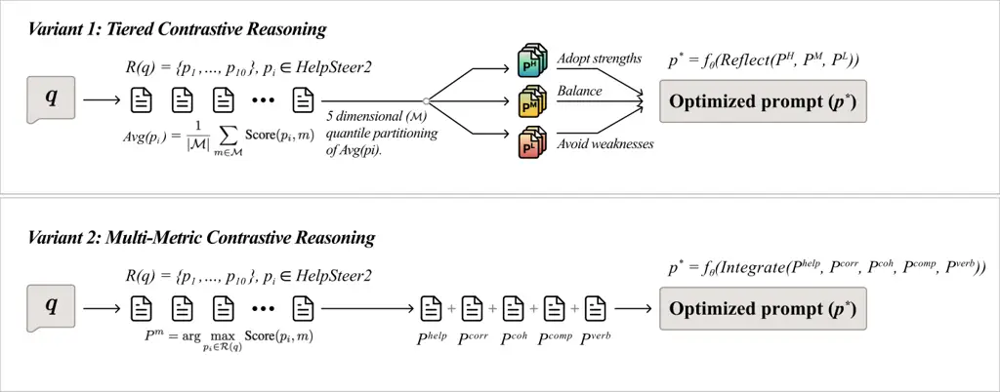

# Better by Comparison: Retrieval-Augmented Contrastive Reasoning for Automatic Prompt Optimization

Juhyeon Lee\* ^(†)^(†)thanks: The authors denoted as \* have contributed
equally to this work. Author order is determined alphabetically by first
name. Affiliation: Peking University  
Beijing, China  
leejuhyeon@pku.edu.cn    Wonduk Seo\* Affiliation: Enhans  
Seoul, South Korea  
wonduk@enhans.ai    Hyunjin An Affiliation: Enhans  
Seoul, South Korea  
hyunjin@enhans.ai    Seunghyun Lee Affiliation: Enhans  
Seoul, South Korea  
seunghyun@enhans.ai    Yi Bu† ^(†)^(†)thanks: † denotes corresponding
author. Affiliation: Peking University  
Beijing, China  
buyi@pku.edu.cn

###### Abstract

Automatic prompt optimization has recently emerged as a strategy for
improving the quality of prompts used in Large Language Models (LLMs),
with the goal of generating more accurate and useful responses. However,
most prior work focuses on direct prompt refinement or model
fine-tuning, overlooking the potential of leveraging LLMs’ inherent
reasoning capability to learn from contrasting examples. In this paper,
we present Contrastive Reasoning Prompt Optimization (CRPO), a novel
framework that formulates prompt optimization as a retrieval-augmented
reasoning process. Our approach retrieves top-$`k`$ reference
prompt-response pairs from the _HelpSteer2_ dataset, an open-source
collection where each response is annotated for helpfulness,
correctness, coherence, complexity, and verbosity, and constructs two
complementary optimization paradigms: (1) _tiered contrastive
reasoning_, where the LLM compares high-, medium-, and low-quality
exemplars (both prompts and responses) to refine its own generation
through reflective reasoning, and (2) _multi-metric contrastive
reasoning_, where the LLM analyzes the best exemplars along each
evaluation dimension and integrates their strengths into an optimized
prompt. By explicitly contrasting high- and low-quality exemplars, CRPO
enables the model to deduce why certain prompts succeed while others
fail, thereby achieving more robust and interpretable optimization.
Experimental results on the HelpSteer2 benchmark demonstrate that CRPO
significantly outperforms baselines. Our findings highlight the promise
of contrastive, retrieval-augmented reasoning for advancing automatic
prompt optimization.

###### Index Terms: 

Automatic Prompt Optimization, Contrastive Reasoning,
Retrieval-Augmented Generation, Large Language Models (LLMs),
Helpfulness Alignment.



Fig. 1: Overview of CRPO: The framework of CRPO-Tiered Contrastive
Reasoning(top) and CRPO-Multi-Metric Contrastive Reasoning(bottom).

## I Introduction

Large Language Models (LLMs) have demonstrated remarkable capabilities
across a wide spectrum of natural language processing (NLP) tasks,
including reasoning, summarization, and code generation. However, their
performance is highly sensitive to the quality of the input prompt \[1,
2\]. As a result, automatic refining prompts to elicit better responses
has become a critical research direction.

Early prompt optimization methods focused on continuous soft prompt
tuning \[3, 4, 5\] or discrete token search \[6, 7, 8\], which were
effective in white-box settings but inapplicable to black-box LLMs
accessed via API. More recent work has shifted to black-box approaches
that explore prompts through trial-and-error, such as PromptAgent’s
Monte Carlo Tree Search \[9\], hierarchical multi-agent workflows
\[10\], and multi-agent topology optimization \[11\]. In parallel, some
methods treat LLMs themselves as optimizers, for instance, OPRO \[12\]
frames optimization as iterative natural language refinement, while
evolutionary approaches like PromptBreeder \[13\] and branching
structures such as AMPO \[14\] adapt prompts through mutation,
selection, and pruning.

Despite these advances, current methods share several key limitations:
(1) They often optimize prompts in isolation, failing to learn from the
comparative lessons offered by better and worse exemplars; (2) Many
approaches also depend on handcrafted optimization pipelines, reducing
their generality and scalability across domains; (3) Finally, most
existing methods focus primarily on improving answer quality, often
neglecting human-centered dimensions such as interpretability and
usability, which are essential for practical deployment in real-world
human–AI interaction.

To address these limitations, we introduce Contrastive Reasoning Prompt
Optimization (CRPO), a retrieval-augmented framework that explicitly
leverages contrastive reasoning across prompts of varying quality.
Unlike methods that only consider prompt text and scores, CRPO retrieves
top-$`k`$ reference prompt-response pairs from the HelpSteer2
dataset \[15\] using sparse retrieval over prompt text, where each pair
is annotated for helpfulness, correctness, coherence, complexity, and
verbosity. By incorporating both the retrieved prompts and their
responses, CRPO allows the model to reason not only about how prompts
are phrased but also how they shape the quality of generated outputs. It
then performs two novel optimization strategies: (1) _tiered contrastive
reasoning_, where the model reflects on high-, medium-, and low-quality
exemplars to refine its own generation, and (2) _multi-metric
contrastive reasoning_, where the best exemplars along individual
metrics are analyzed and integrated into an optimized prompt.

CRPO improves prompt quality without model updates by explicitly
reasoning about why prompts succeed or fail; on HelpSteer2 it
consistently outperforms direct generation, Chain-of-Thought prompting
(CoT) \[16\], and simple retrieval augmentation¹¹ 1 Detailed
implementations of baselines are detailed in Section IV., underscoring
the promise of contrastive, retrieval-augmented optimization for
aligning LLM outputs toward more helpful, factual, and coherent
responses.

## II Dataset

We conduct our experiments on the HelpSteer2 dataset \[15\], a benchmark
designed for evaluating prompt optimization and response helpfulness in
Large Language Models (LLMs). The dataset consists of human-annotated
prompt-response pairs and is divided into training and validation
splits. Specifically, it contains a training set of 20.3k rows and a
validation set of 1.04k rows, which we adopt for retrieval and
evaluation, respectively.

Each prompt–response pair in HelpSteer2 is annotated across five
evaluation dimensions. Scores for each attribute range from 0 (lowest)
to 4 (highest), providing a fine-grained scale of response quality.
These annotations capture diverse aspects of quality, making the dataset
suitable for studying contrastive reasoning in prompt optimization.

| Attribute   | Description                                                                                      |
| ----------- | ------------------------------------------------------------------------------------------------ |
| Helpfulness | Overall helpfulness of the response to the prompt.                                               |
| Correctness | Inclusion of all pertinent facts without errors.                                                 |
| Coherence   | Consistency and clarity of expression.                                                           |
| Complexity  | Intellectual depth required to write the response (e.g., basic competency vs. domain expertise). |
| Verbosity   | Amount of detail included in the response relative to what is asked.                             |

TABLE I: HelpSteer2 Annotation Dimensions. Five human-annotated metrics,
each scored on a 0–4 scale.

|                                             |             |             |           |            |           |            |
| ------------------------------------------- | ----------- | ----------- | --------- | ---------- | --------- | ---------- |
| Model                                       | Helpfulness | Correctness | Coherence | Complexity | Verbosity | Avg. Score |
| GPT-4o                                      |             |             |           |            |           |            |
| Direct Generation                           | 0.3616      | 0.4700      | 0.7723    | 0.3280     | 0.4913    | 0.4846     |
| Chain-of-Thought (CoT)                      | 0.2981      | 0.3958      | 0.7169    | 0.2888     | 0.4709    | 0.4341     |
| Retrieval Augmented Generation (RAG)        | 0.4903      | 0.5745      | 0.8642    | 0.4161     | 0.6567    | 0.6003     |
| CRPO-Tiered Contrastive Reasoning^(†)       | 0.5274      | 0.6006      | 0.8711    | 0.4360     | 0.6506    | 0.6171     |
| CRPO-Multi-Metric Contrastive Reasoning^(†) | 0.5219      | 0.6274      | 0.8876    | 0.4386     | 0.6982    | 0.6347     |
| LLaMA-3-8B                                  |             |             |           |            |           |            |
| Direct Generation                           | 0.2616      | 0.3636      | 0.7078    | 0.2942     | 0.4421    | 0.4139     |
| Chain-of-Thought (CoT)                      | 0.1600      | 0.2545      | 0.6291    | 0.2421     | 0.3812    | 0.3334     |
| Retrieval Augmented Generation (RAG)        | 0.3990      | 0.4711      | 0.7989    | 0.3722     | 0.5814    | 0.5245     |
| CRPO-Tiered Contrastive Reasoning^(†)       | 0.4224      | 0.5023      | 0.8092    | 0.3993     | 0.6435    | 0.5554     |
| CRPO-Multi-Metric Contrastive Reasoning^(†) | 0.4264      | 0.5070      | 0.8159    | 0.4146     | 0.6404    | 0.5609     |

TABLE II: Comparison across five evaluation metrics—helpfulness,
correctness, coherence, complexity, and verbosity—and their mean (Avg.
Score). Results are reported separately for GPT-4o and LLaMA-3-8B. The
best value within each language model is bold, the second best is
underlined, and methods marked with † denote our proposed CRPO variants.

## III Methodology

We formulate the prompt optimization problem not as directly fine-tuning
model parameters, but as a task that maximizes the inherent reasoning
capability of LLMs by facilitating learning from reference exemplars.
Specifically, our framework Contrastive Reasoning Prompt Optimization
(CRPO) first retrieves the top-$`k`$ relevant prompt-response pairs from
the _HelpSteer2_ training set, and then applies contrastive reasoning to
construct optimized prompts. We design two complementary variants,
illustrated in Figure 1.

### III-A Retrieval of Reference Prompt–Response Pairs

Given an input query $`q`$, CRPO retrieves a set of reference
prompt–response pairs

```math
\mathcal{R}(q)=\{(p_{1},r_{1}),\dots,(p_{k},r_{k})\},\quad(p_{i},r_{i})\in\text{HelpSteer2},
```

where $`p_{i}`$ denotes a prompt and $`r_{i}`$ its associated response.
Each pair is annotated along five evaluation dimensions
$`\mathcal{M}=\{\text{help},\text{corr},\text{coh},\text{comp},\text{verb}\}`$.
To ensure sufficient coverage across all dimensions, we require
$`k\geq 5`$, so that at least one candidate pair is available per
metric. These exemplars (including both prompts and responses) serve as
contrasting cases that enable the LLM to perform explicit reasoning.

### III-B Variant 1: Tiered Contrastive Reasoning

We partition $`\mathcal{R}(q)`$ into 3 tiers according to overall
quality scores. Specifically, for each retrieved pair $`(p_{i},r_{i})`$,
we compute its average score across all five evaluation dimensions:

```math
\text{Avg}(p_{i},r_{i})=\frac{1}{|\mathcal{M}|}\sum_{m\in\mathcal{M}}\text{Score}((p_{i},r_{i}),m), \tag{1}
```

where
$`\mathcal{M}=\{\text{help},\text{corr},\text{coh},\text{comp},\text{verb}\}`$.
Pairs are then partitioned into high-quality ($`P^{H}`$), medium-quality
($`P^{M}`$), and low-quality ($`P^{L}`$) tiers based on quantile
thresholds of $`\text{Avg}(p_{i},r_{i})`$. The optimized prompt
$`p^{*}`$ is generated via contrastive reasoning:

```math
p^{*}=f_{\theta}\big(\text{Reflect}(P^{H},P^{M},P^{L})\big), \tag{2}
```

where $`f_{\theta}`$ is the LLM and $`\text{Reflect}(\cdot)`$ instructs
the model to (i) avoid weaknesses in $`P^{L}`$, (ii) adopt strengths
from $`P^{H}`$, and (iii) use $`P^{M}`$ as a stabilizing anchor that
reduces bias. In particular, incorporating $`P^{M}`$ prevents
overfitting to extreme cases, ensuring balanced refinement that
maintains robustness while still progressing toward high-quality
prompts.

### III-C Variant 2: Multi-Metric Contrastive Reasoning

For each metric $`m\in\mathcal{M}`$, we select the top pair:

```math
P^{m}=\arg\max_{(p_{i},r_{i})\in\mathcal{R}(q)}\text{Score}((p_{i},r_{i}),m).
```

The optimized prompt is then constructed as:

```math
p^{*}=f_{\theta}\big(\text{Integrate}(P^{\text{help}},P^{\text{corr}},P^{\text{coh}},P^{\text{comp}},P^{\text{verb}})\big), \tag{3}
```

where $`\text{Integrate}(\cdot)`$ encourages the LLM to combine
complementary strengths across evaluation axes, grounded in both prompts
and their associated responses.

## IV Experiments

### IV-A Setup

We evaluate CRPO on the HelpSteer2 dataset, ensuring fairness by using
the same retrieval pool and evaluation settings as the baselines.

#### IV-A1 LLM and Retrieval Models

We use GPT-4o and LLaMA-3-8B, both with temperature $`0`$ and otherwise
default hyperparameters. BM25 is specifically used for prompt retrieval,
selecting top-$`k`$ reference prompts $`\{p_{1},\dots,p_{k}\}`$ per
query with $`k=10`$ to balance coverage across the 5 evaluation
dimensions and efficiency.

#### IV-A2 Evaluation Model and Metrics

We employ the ArmoRM-Llama3-8B-v0.1 reward model as an interpretable
multi-objective judge ($`>90\%`$ benchmark accuracy), which
automatically scores response quality.

For evaluation metrics, we assess effectiveness by feeding the optimized
prompt $`p^{*}`$ together with its generated response $`r^{*}`$ to the
evaluation model $`\mathcal{E}`$, which returns five HelpSteer2
scores—helpfulness, correctness, coherence, complexity, verbosity—each
in $`[0,4]`$:

```math
\text{Score}(p^{*},r^{*})=\big[s_{\text{help}},s_{\text{corr}},s_{\text{coh}},s_{\text{comp}},s_{\text{verb}}\big]. \tag{4}
```

Each score is normalized by dividing by 4 and then averaged to yield a
final $`[0,1]`$ quality score:

```math
\mathrm{Score}(p^{*},r^{*})=\tfrac{1}{|\mathcal{M}|}\sum_{m\in\mathcal{M}}\tfrac{s_{m}(p^{*},r^{*})}{4}. \tag{5}
```

$`(p^{*},r^{*})`$ is judged under identical conditions to the baselines.

#### IV-A3 Baselines

We compare our framework against three representative baselines, all of
which optimize the prompt based only on the prompt text and evaluation
scores, without incorporating structured reasoning assets:

- •
  Direct Generation: The LLM directly produces an optimized prompt from
  the input query, without retrieval or iterative refinement.
- •
  Chain-of-Thought (CoT): The LLM is instructed to perform step-by-step
  reasoning on the input query before generating an optimized prompt,
  relying solely on the original prompt text and scores.
- •
  Retrieval-Augmented Generation (RAG): The LLM receives the input query
  along with the top-$`k`$ retrieved training prompts (with $`k=10`$ for
  fair comparison) and generates an optimized prompt based on these
  examples and their scores, but without leveraging the associated
  reasoning assets.

### IV-B Main Experiment Results

Baseline methods demonstrate modest, albeit limited improvements. Direct
Generation often produces shallow or inconsistent outputs, since no
external context is used. Chain-of-Thought (CoT) prompting encourages
stepwise reasoning but tends toward verbosity and repetition without
improving factuality. Retrieval-Augmented Generation (RAG) provides
contextual grounding through retrieved prompts, but introduces
redundancy and lacks a clear mechanism to filter high-quality signals.
Importantly, all three baselines optimize prompts only with respect to
prompt text and evaluation scores, without leveraging the responses
associated with those prompts. As a result, while baselines improve over
one another incrementally, they remain insufficient for producing
balanced and robust outputs.

In contrast, CRPO addresses these shortcomings through explicit
contrastive reasoning over prompt–response pairs. The multi-metric
variant integrates the strongest exemplars along helpfulness,
correctness, coherence, complexity, and verbosity, ensuring
complementary strengths are preserved. The tiered variant contrasts
high-, medium-, and low-quality pairs, adopting strengths from the best,
avoiding weaknesses from the worst, and stabilizing with medium-quality
anchors. Together, these strategies yield optimized prompts—and
consequently generated responses—that are more robust, interpretable,
and human-aligned than those produced by Direct Generation, CoT, or RAG.

### IV-C Ablation studies

#### IV-C1 Trimaximal-Prompt Selection (TPS)

To assess the role of contrastive reasoning, we conduct an ablation
where CRPO is reduced to using only the top-$`3`$ highest-ranked
prompts, as shown in Figure 2. In contrast, both CRPO variants
consistently outperform the ablated setting by explicitly reasoning over
contrasts—adopting strengths from high-quality prompts, avoiding
weaknesses from low-quality ones, and integrating complementary aspects
across dimensions. This result shows that the gains of CRPO stem not
from retrieval alone, but from its reflective reasoning process, which
yields more stable and interpretable optimization.

Fig. 2: Ablation 1. Performance comparison of the simplified method vs
CRPO variants. Overall stands for the average score of 5 metrics.

Fig. 3: Ablation 2. Overall score comparison across Top-K settings in
the RAG stage of CRPO, averaged over five metrics.

#### IV-C2 Optimal K validation

To identify the optimal evidence of retrieved pool size in our RAG
framework, we evaluate CRPO with $`k\in\{5,10,15,20\}`$. As shown in
Figure 3, performance improves when moving from a small evidence set to
a moderate pool, but declines as the pool grows further. Fixing $`k=10`$
yields the best trade-off between evidence diversity and inference cost,
producing the most stable gains across language models and CRPO
variants.

## V Conclusion

In this paper, we introduced Contrastive Reasoning Prompt Optimization
(CRPO), a retrieval-augmented framework that improves prompt quality
through tiered and multi-metric contrastive reasoning. Unlike prior
methods that optimize prompts based only on prompt text and scores, CRPO
explicitly reflects on high-, medium-, and low-quality prompt–response
pairs, leveraging both the prompts and their generated responses to
guide optimization. By integrating complementary strengths across
multiple evaluation dimensions, CRPO enables LLMs to produce more
robust, interpretable, and human-aligned outputs without fine-tuning.
Experimental results on the HelpSteer2 dataset show that CRPO
consistently outperforms baselines, including direct generation, CoT
prompting, and simple retrieval augmentation, with ablation studies
confirming the central role of contrastive reasoning over
prompt–response pairs in achieving these gains.

## References

- \[1\] Z. Zhao, E. Wallace, S. Feng, D. Klein, and S. Singh, “Calibrate
  before use: Improving few-shot performance of language models,” in
  International conference on machine learning, pp. 12697–12706,
  PMLR, 2021.
- \[2\] Y. Lu, M. Bartolo, A. Moore, S. Riedel, and P. Stenetorp,
  “Fantastically ordered prompts and where to find them: Overcoming
  few-shot prompt order sensitivity,” arXiv preprint
  arXiv:2104.08786, 2021.
- \[3\] B. Lester, R. Al-Rfou, and N. Constant, “The power of scale for
  parameter-efficient prompt tuning,” arXiv preprint
  arXiv:2104.08691, 2021.
- \[4\] X. L. Li and P. Liang, “Prefix-tuning: Optimizing continuous
  prompts for generation,” arXiv preprint arXiv:2101.00190, 2021.
- \[5\] E. J. Hu, Y. Shen, P. Wallis, Z. Allen-Zhu, Y. Li, S. Wang,
  L. Wang, W. Chen, et al., “Lora: Low-rank adaptation of large language
  models.,” ICLR, vol. 1, no. 2, p. 3, 2022.
- \[6\] T. Shin, Y. Razeghi, R. L. Logan IV, E. Wallace, and S. Singh,
  “Autoprompt: Eliciting knowledge from language models with
  automatically generated prompts,” arXiv preprint
  arXiv:2010.15980, 2020.
- \[7\] M. Deng, J. Wang, C.-P. Hsieh, Y. Wang, H. Guo, T. Shu, M. Song,
  E. P. Xing, and Z. Hu, “Rlprompt: Optimizing discrete text prompts
  with reinforcement learning,” arXiv preprint arXiv:2205.12548, 2022.
- \[8\] T. Zhang, X. Wang, D. Zhou, D. Schuurmans, and J. E. Gonzalez,
  “Tempera: Test-time prompting via reinforcement learning,” arXiv
  preprint arXiv:2211.11890, 2022.
- \[9\] X. Wang, C. Li, Z. Wang, F. Bai, H. Luo, J. Zhang, N. Jojic,
  E. P. Xing, and Z. Hu, “Promptagent: Strategic planning with language
  models enables expert-level prompt optimization,” arXiv preprint
  arXiv:2310.16427, 2023.
- \[10\] Y. Liu, J. Singh, G. Liu, A. Payani, and L. Zheng, “Towards
  hierarchical multi-agent workflows for zero-shot prompt optimization,”
  arXiv preprint arXiv:2405.20252, 2024.
- \[11\] H. Zhou, X. Wan, R. Sun, H. Palangi, S. Iqbal, I. Vulić,
  A. Korhonen, and S. Ö. Arık, “Multi-agent design: Optimizing agents
  with better prompts and topologies,” arXiv preprint
  arXiv:2502.02533, 2025.
- \[12\] C. Yang, X. Wang, Y. Lu, H. Liu, Q. V. Le, D. Zhou, and
  X. Chen, “Large language models as optimizers,” in The Twelfth
  International Conference on Learning Representations, 2023.
- \[13\] C. Fernando, D. Banarse, H. Michalewski, S. Osindero, and
  T. Rocktäschel, “Promptbreeder: Self-referential self-improvement via
  prompt evolution,” arXiv preprint arXiv:2309.16797, 2023.
- \[14\] S. Yang, Y. Wu, Y. Gao, Z. Zhou, B. B. Zhu, X. Sun, J.-G. Lou,
  Z. Ding, A. Hu, Y. Fang, et al., “Ampo: Automatic multi-branched
  prompt optimization,” arXiv preprint arXiv:2410.08696, 2024.
- \[15\] Z. Wang, Y. Dong, O. Delalleau, J. Zeng, G. Shen, D. Egert,
  J. Zhang, M. N. Sreedhar, and O. Kuchaiev, “Helpsteer 2: Open-source
  dataset for training top-performing reward models,” Advances in Neural
  Information Processing Systems, vol. 37, pp. 1474–1501, 2024.
- \[16\] J. Wei, X. Wang, D. Schuurmans, M. Bosma, F. Xia, E. Chi, Q. V.
  Le, D. Zhou, et al., “Chain-of-thought prompting elicits reasoning in
  large language models,” Advances in neural information processing
  systems, vol. 35, pp. 24824–24837, 2022.
