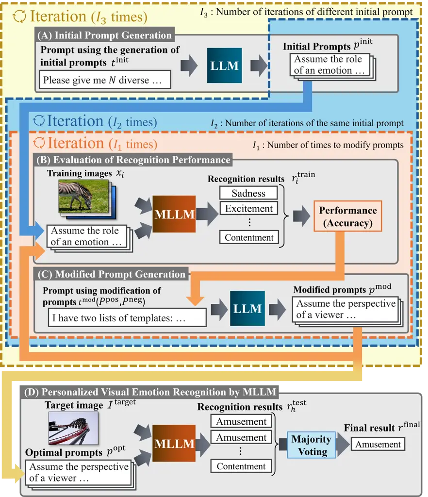
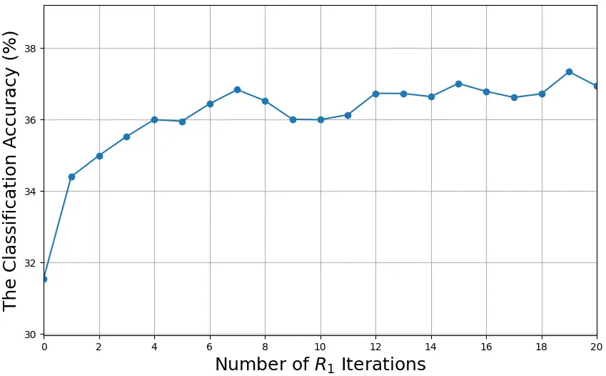
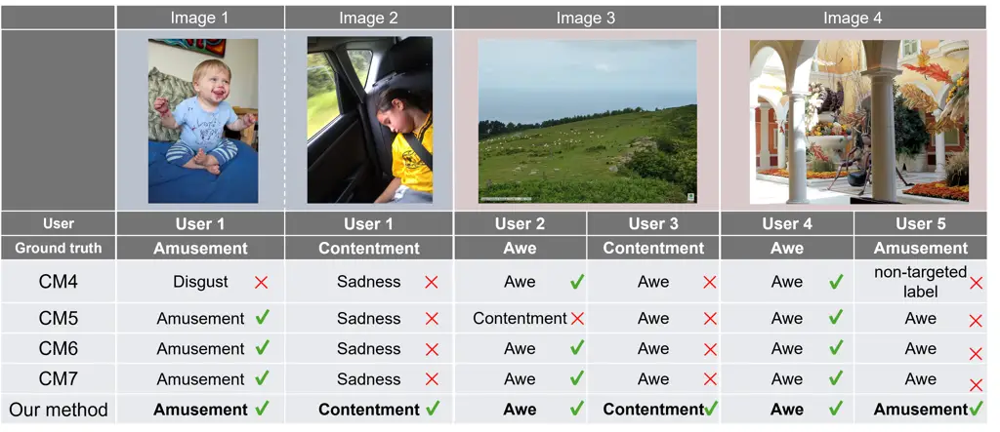
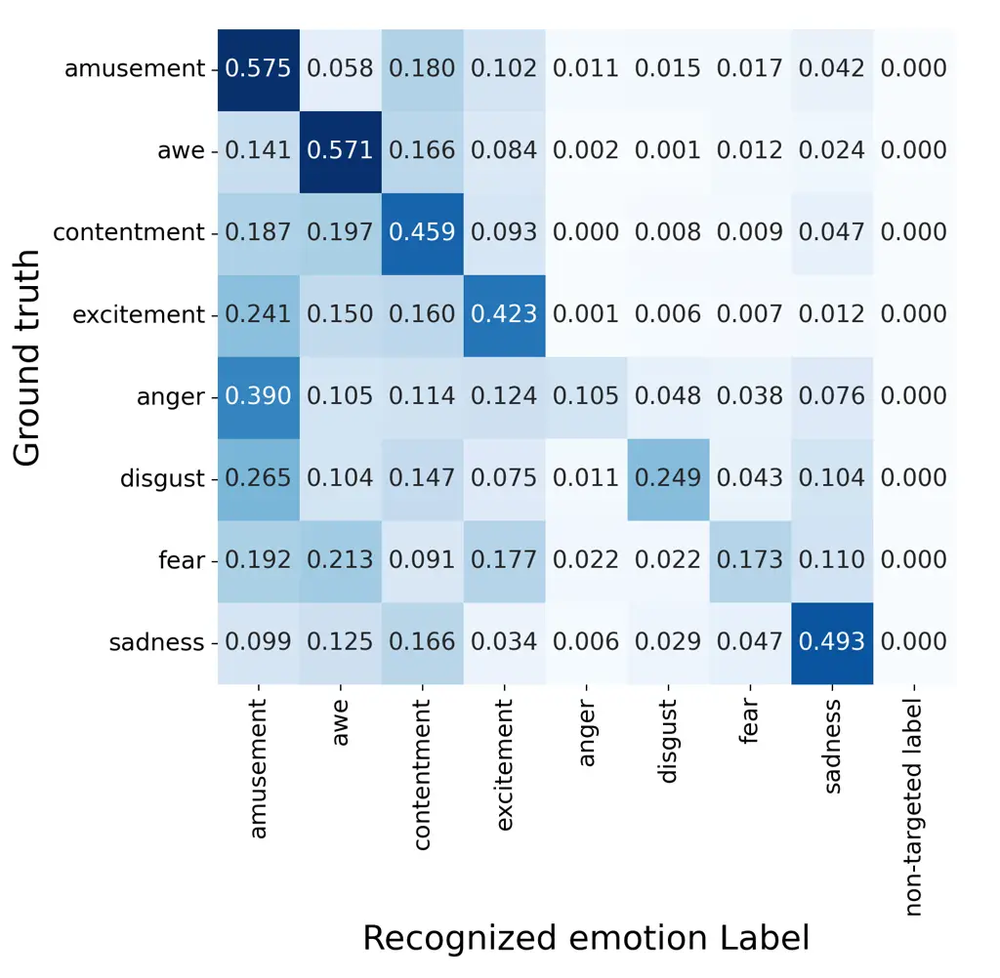
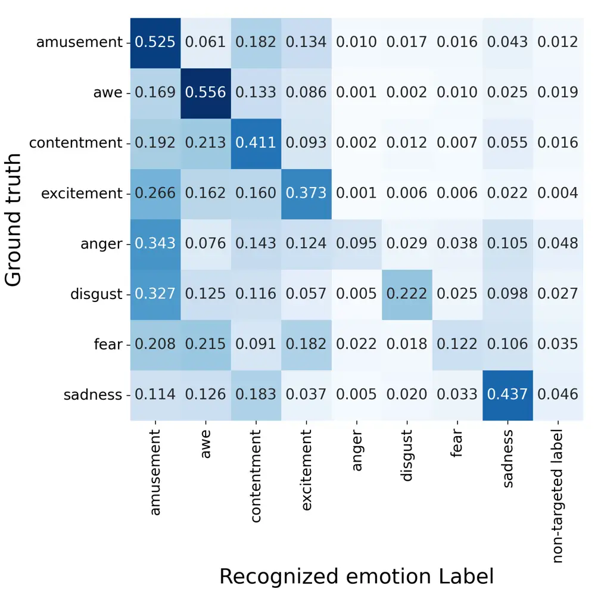

# Discrete Prompt Tuning via Recursive Utilization of Black-box Multimodal Large Language Model for Personalized Visual Emotion Recognition

RYO TAKAHASHI¹    NAOKI SAITO²    KEISUKE MAEDA³    TAKAHIRO OGAWA³   
MIKI HASEYAMA³

###### Abstract

Visual Emotion Recognition (VER) is an important research topic due to
its wide range of applications, including opinion mining and
advertisement design. Extending this capability to recognize emotions at
the individual level further broadens its potential applications.
Recently, Multimodal Large Language Models (MLLMs) have attracted
increasing attention and demonstrated performance comparable to that of
conventional VER methods. However, MLLMs are trained on large and
diverse datasets containing general opinions, which causes them to favor
majority viewpoints and familiar patterns. This tendency limits their
performance in a personalized VER, which is crucial for practical and
real-world applications, and indicates a key area for improvement. To
address this limitation, the proposed method employs discrete prompt
tuning inspired by the process of humans’ prompt engineering to adapt
the VER task to each individual. Our method selects the best natural
language representation from the generated prompts and uses it to update
the prompt for the realization of accurate personalized VER.

###### Index Terms: 

Visual emotion recognition, multimodal large language model, discrete
prompt tuning.

^(†)^(†)address: Graduate School of Information Science and Technology,
Hokkaido University, Sapporo 060-0814, Japan^(†)^(†)address: Office of
Institutional Research, Hokkaido University, Sapporo 060-0808,
Japan^(†)^(†)address: Faculty of Information Science and Technology,
Hokkaido University, Sapporo 060-0814, Japan^(†)^(†)titlenote: This work
was partly supported by JSPS KAKENHI Grant Numbers JP24K02942,
JP23K21676 and JP23K11211.^(†)^(†)corresponding: Corresponding author:
Miki Haseyama (e-mail: mhaseyama@lmd.ist.hokudai.ac.jp).

## I Introduction

Recognizing human emotions is crucial for computers to respond
appropriately to users’ questions and requests. In particular, research
on human-induced emotion recognition by visual stimuli is typically
addressed as Visual Emotion Recognition (VER) \[1, 2, 3, 4\]. VER is
expected to have various applications, including advertisement \[5\],
education \[6\], mental health \[7\], image retrieval \[8, 9\], and
product recommendation \[10\]. Although VER is a challenging research
task because it deals with ambiguous information such as emotions,
various methods have been proposed because of their vast
applicability \[11, 12, 13\].

Recently, Multimodal Large Language Models (MLLMs) pretrained with
numerous images and texts have demonstrated high performance on various
tasks \[14, 15\]. MLLMs are easy to use and can be applied to various
tasks, which have been the subject of many studies. MLLMs can understand
the relationship between different modalities, and various responses can
be obtained by changing the prompt. In the VER, many MLLM-based VER
methods have been proposed, achieving high performance \[16, 17, 18, 19,
20, 21\].

Emotional responses elicited by visual stimuli vary across individuals.
For example, an image of a roller coaster may invoke feelings of
“excitement,” in some viewers but “fear” in others. To apply VER
technology to practical, real-world services, personalization of VER
systems is essential. However, existing MLLM-based VER methods face
challenges in generating recognition outcomes that reflect individual
variability in emotional elicitation. This is because MLLMs are trained
on a large number of texts and images, which contain extensive general
information and opinions; thus, they tend to learn majority opinions and
common patterns. \[22, 23, 24\].

Fine-tuning is generally considered necessary to adapt an MLLM to a
specific task. However, high-accuracy MLLMs tend to have numerous
parameters, which poses the challenge of requiring substantial
computational resources for fine-tuning. To address this issue, prompt
tuning is a potential approach for adapting MLLMs to specific tasks such
as personalized VER. Unlike fine-tuning, prompt tuning does not modify
the parameters of the MLLM. Instead, it adjusts the input prompts using
techniques such as gradient-based optimization or soft prompt tuning so
that the MLLM can perform effectively on specific tasks. Gradient-based
prompt tuning \[25\] is typically applied to white-box models, because
these models allow access to model parameters and loss gradients.
However, recent MLLMs with superior reasoning capabilities, such as
Gemini¹¹ 1 https://gemini.google.com/ and GPT-4 omni (GPT-4o)²² 2
https://openai.com/index/hello-gpt-4o/, are frequently deployed as
black-box models, where access to parameters and loss gradients is
restricted. This is primarily due to commercial, ethical, legal,
security, and other concerns surrounding the release of model internals.
In prompt-based learning, an extensively used technique is “soft
prompts” \[26, 27, 28\]. Soft prompts are learnable parameters
represented as continuous vector embeddings that are prepended to the
input of a pretrained language model. They are effective for improving
model performance. However, they are numerical and lack explicit
semantics, making it difficult for humans to understand their meaning,
particularly when interpreting decisions involving ambiguous emotions.
In addition, training with soft prompts requires access to gradient
information. This poses a challenge in scenarios where users cannot
access or modify the model internals, such as when interacting with
models through restricted application programming interfaces or
black-box systems. To address these issues, researchers have proposed
“discrete prompt tuning” approaches \[29, 30, 31\]. Discrete prompts
comprise natural language tokens, which makes them more interpretable
for humans and allows them to be used without relying on gradients.
Therefore, there is a potential to adapt MLLMs to VER tasks by employing
discrete prompt tuning, while maintaining interpretability and the
adaptability of black-box models.

In this paper, we propose a personalized VER method that introduces
discrete prompt tuning via recursive utilization of a black-box MLLM. We
employ an MLLM capable of processing both images and text to perform the
VER task, and use an LLM for prompt generation and refinement.
Specifically, the proposed method recognizes VER by inputting the target
image and a discrete prompt into an MLLM. The discrete prompt is
obtained via a prompt tuning approach that incorporates iterative
generation and evaluation of discrete prompts inspired by the human
prompt engineering process. In the prompt generation phase, the LLM
generates multiple prompts in natural language suitable for VER. In the
prompt evaluation phase, each generated prompt is input into the MLLM
alongside training images for which the evoked emotions are known in
advance. The recognition results for these images are then obtained, and
the accuracy of these results is used as the performance score for each
prompt. The proposed method then feeds the LLM with several high- and
low-performing prompts and accuracy scores, which are obtained when
these prompts are used to perform the VER task. Based on the information
provided to the LLM, it generates new prompts that are expected to
improve VER performance. The self-correction capability of the LLM
enables the discovery of better prompts. This process of prompt
generation and evaluation is repeated to obtain prompts that are likely
to enhance the accuracy of VER by the MLLM. The proposed method
leverages discrete prompt tuning to derive an optimal prompt for the VER
for each user, which is expected to elicit knowledge related to VER in
an MLLM according to the user’s characteristics. The discrete prompt
tuning in the proposed method does not require changing the parameters
of the MLLM and accessing its loss gradients; thus, it can be applied to
both white-box and black-box MLLMs. This makes the proposed method less
restrictive in its application than previously proposed MLLM-based VER
methods. Finally, the proposed method determines the final results
through a majority vote. The MLLM processes the target images using
several optimal prompts generated via discrete prompt tuning, and the
most frequent label among these outputs is selected.

In summary, the main contributions of this paper are as follows.

- •
  We introduce a discrete prompt tuning approach for a black-box MLLM
  inspired by humans’ prompt engineering to VER.
- •
  We use a discrete prompt tuning approach to improve personalized VER
  performance.
- •
  We achieve accurate VER by introducing a simple merging process of the
  VER results obtained from the MLLM by inputting several optimized
  prompts.

This paper is organized as follows. Section II describes related studies
on VER and prompt-based learning. Section III explains the proposed
method for personalized VER via discrete prompt tuning. In addition,
experimental results are reported in Section IV. Finally, Section V
concludes the paper.

## II Related works

In this section, we explain related studies. The proposed method focuses
on a VER task and a prompt-based learning approach for an MLLM. This
section is organized as follows. Subsection II-A introduces previous VER
studies. Subsection II-B explains prompt-based learning approaches for
MLLMs and their limitations.

### II-A VER

With the advancement of deep learning techniques, VER has significantly
progressed. In particular, Convolutional Neural Network (CNN)-based
approaches have emerged and significantly improved in recognition
performance \[32, 33\]. For example, Chen et al. \[34\] proposed
DeepSentiBank, which classifies a visual sentiment via a deep CNN. This
method automatically extracted adjective–noun pairs and was trained on
approximately one million images. DeepSentiBank has several limitations,
such as noisy and weak labels and domain adaptation challenges. You et
al. \[35\] introduced PCNN, which combines progressive training and
transfer learning to improve performance to deal with the limitations of
DeepSentiBank. In addition, She et al. \[36\] proposed WSCNet, a weakly
supervised coupled network that integrates local regions evoking
emotions with global image features. Focusing on the hierarchical
structure of emotions, Xu et al. \[2\] presented MDAN, a multilevel
dependent attention network built on CNNs, achieving fine-grained
emotion classification via a hierarchy-aware learning strategy.

With the recent advancements in multimodal foundation models, various
approaches leveraging these models have been proposed for VER, achieving
recognition accuracies that exceed those of conventional methods based
on CNNs and similar architectures \[37, 38, 39, 40\]. Among various
foundation models, CLIP \[41\], which learns from large-scale image–text
pairs to align visual and linguistic representations in a common
embedding space, has become a common backbone. For instance, Deng et
al. \[42\] proposed a CLIP-based VER method that dynamically composes
diverse prompts according to image content and emotion category,
significantly outperforming fixed-prompt VER baselines. Then, Deng et
al.  \[37\] proposed a generation approach of knowledge-rich prompts by
incorporating emotion words and entity-level information extracted from
images. This approach enables more sophisticated affective understanding
by leveraging linguistic structures beyond conventional label-based
supervision. In addition, MLLM-based VER methods such as GPT‑4o and
Gemini have been proposed, and these methods have demonstrated high
recognition performance even in zero‑shot settings for VER tasks \[17,
18\].

However, MLLM-based VER methods cannot consider the individual
differences in emotional elicitation for the realization of personalized
VER. This is because MLLMs are trained on large and diverse datasets
containing general opinions, causing them to favor majority viewpoints
and familiar patterns. To overcome this limitation, a promising strategy
is to adjust the parameters of MLLMs to enable specialization in
personalized VER for each target user, i.e., a fine-tuning approach.
However, fine-tuning these parameters requires a large number of
training samples, and it is challenging to collect sufficient data
specific to a target user’s VER. Therefore, achieving effective
fine-tuning for personalized VER remains difficult. Our approach focuses
on prompt tuning, which aims to improve VER performance by optimizing
the instructions provided to the MLLM, rather than fine-tuning the model
parameters. Unlike conventional fine-tuning, prompt tuning can achieve
task-specific performance even with a limited amount of training data,
making it a promising approach for realizing personalized VER using
MLLMs. The following subsection explains related studies on prompt
tuning of MLLMs.

### II-B Prompt tuning of MLLMs

In recent years, many researchers have proposed prompt tuning methods as
efficient alternatives to full fine-tuning, improving task performance
while substantially reducing computational cost. A notable
gradient-based approach is P-Tuning, proposed by Liu et al. \[25\],
which uses continuous trainable embeddings instead of discrete manually
crafted prompts and optimizes them via backpropagation. Similarly,
Lester et al.  \[28\] introduced prompt tuning, which freezes the
language model parameters and optimizes only a small set of
task-specific soft prompts. To further leverage gradient-based
optimization for vision-language tasks, models such as
InstructBLIP \[43\] and EmoVIT \[3\] have been proposed to align prompts
with supervised instruction datasets.

However, the emergence of powerful black-box models, which do not reveal
internal parameters or gradients, has made gradient-based tuning
approaches impractical in many real-world scenarios. In response,
researchers have developed gradient-free prompt optimization techniques
that function effectively in black-box settings. For example, Pryzant et
al. \[31\] proposed ProTeGi, a method in which the language model
generates natural language feedback to identify prompt weaknesses,
thereby guiding its iterative refinement without relying on gradient
signals. Similarly, Cheng et al. \[44\] introduced black-box prompt
optimization, which trains a sequence-to-sequence model to rewrite
prompts by learning from examples of both effective and ineffective
responses. More recently, Liu et al. \[29\] proposed a dialogue-based
framework that employs language models as interactive prompt engineers.

We introduce a prompt tuning approach applicable to black-box models for
VER. The proposed method enables personalized VER by obtaining optimal
prompts tailored to each individual.



Fig. 1: Overview of the proposed method. The proposed method comprises
four processes: initial prompt generation, evaluation of recognition
performance, modified prompt generation, and recognition by an MLLM. The
proposed method iterates these processes and obtains the final
recognition result.

Input: Training samples $`\{x_{l},y_{l}\}_{l=1}^{L}`$, number of times
to modify prompts $`I_{1}`$, number of iterations of the same initial
prompts $`I_{2}`$, number of iterations of different initial prompt
$`I_{3}`$, number of initial prompts $`N`$, number of prompts to
generate modified prompts $`k`$, target image
$`\mathcal{I}^{\text{target}}`$, and number of recognition results to
derive final result $`H`$.  
Output: VER result $`r^{\text{final}}`$.

1:  $`P^{\text{all}}\leftarrow\varnothing`$

2:  for $`1`$ to $`I_{3}`$ do

3:   $`P^{\text{init}}\leftarrow\text{LLM}(t^{\text{init}})`$

4:   for $`1`$ to $`I_{2}`$ do

5:    $`P^{\text{rank}}\leftarrow P^{\text{init}}`$

6:    for $`1`$ to $`I_{1}`$ do

7:     $`P^{\text{pos}}\leftarrow`$ prompts with $`\text{top-}k`$
$`\text{ACC}(p)_{p\in P^{\text{rank}}}`$

8:     $`P^{\text{neg}}\leftarrow`$ prompts with $`\text{worst-}k`$
$`\text{ACC}(p)_{p\in P^{\text{rank}}}`$

9:     Get new prompts
$`P^{\text{mod}}\leftarrow\text{LLM}(t^{\text{mod}}(P^{\text{pos}},P^{\text{neg}}))`$

10:     $`P^{\text{rank}}\leftarrow P^{\text{rank}}\cup P^{\text{mod}}`$

11:    end for

12:    $`P^{\text{all}}\leftarrow P^{\text{all}}\cup P^{\text{rank}}`$

13:   end for

14:  end for

15:  $`P^{\text{used}}\leftarrow\varnothing`$

16:  for $`1`$ to $`H`$ do

17:
  $`P^{\text{all}}\leftarrow P^{\text{all}}\setminus P^{\text{used}}`$

18:
  $`p^{\text{opt}}_{h}\leftarrow\arg\max_{p^{\text{all}}_{m}\in P^{\text{all}}}\text{ACC}(p^{\text{all}}_{m})`$

19:
  $`r^{\text{test}}_{h}\leftarrow\text{MLLM}(\mathcal{I}^{\text{target}},p^{\text{opt}}_{h})`$

20:
  $`P^{\text{used}}\leftarrow P^{\text{used}}\cup p^{\text{opt}}_{h}`$

21:  end for

22:  $`r^{\text{final}}\leftarrow`$ emotion label by majority voting
from
$`\{r^{\text{test}}_{1},r^{\text{test}}_{2},\cdots,r^{\text{test}}_{H}\}`$.

Algorithm 1 VER via discrete prompt tuning of MLLM

## III Personalized VER via Discrete Prompt Tuning

In this section, we describe the proposed method. The proposed method
inputs images and user-specific discrete prompts optimized for emotion
recognition into an MLLM. Our method performs discrete prompt tuning
based on the literature \[29\] inspired by the typical workflow of
humans’ prompt engineering process. We recognize the personalized
emotion from the target image using the MLLM, inputting the optimized
prompt. Figure 1 shows an overview of the proposed method. The precise
processes of the proposed method are shown in Algorithm 1. The prompt
tuning approach in the proposed method comprises the following
iterations: (A) creating initial prompts for VER; (B) evaluating the
recognition performance of prompts; (C) creating new modified prompts
based on the prompt performance evaluation results obtained by (B), and
then, repeatedly performing (B) and (C); (D) selecting the prompt with
the highest recognition performance as the final discrete prompt. The
proposed method can generate discrete prompts that are suitable for the
VER of each user using the above iterative workflow. In addition, using
multiple suitable prompts, the proposed method performs VER on the
target image several times and obtains multiple recognition results.
Then, through majority voting from these results, one emotion label is
selected as the final recognition result. Consequently, stable and
highly accurate VER becomes feasible using the proposed method.

This section is organized as follows. Subsection III-A explains the
generation approach of initial prompts. Subsection III-B describes the
recognition performance evaluation of the generated prompts.
Subsection III-C presents the modification scheme of the generated
prompts for personalized VER. Subsection III-D explains the recognition
approach using the final discrete prompts.

### III-A Initial Prompt Generation

In this subsection, we explain the generation approach of initial
prompts. The proposed method constructs initial prompts to obtain
suitable discrete prompts for personalized VER using an MLLM.
Specifically, an LLM is used to generate the initial prompt set
$`P^{\text{init}}=\{p^{\text{init}}_{1},p^{\text{init}}_{2},\cdots,p^{\text{init}}_{N}\}`$
($`N`$ being the number of initial prompts) as follows:

```math
P^{\text{init}}=\text{LLM}(t^{\text{init}}), \tag{1}
```

where $`\text{LLM}(\cdot)`$ denotes the LLM used for generating initial
prompts and $`t^{\text{init}}`$ denotes the natural language sentence
given to the LLM as a prompt to generate the initial prompts for VER.
The proposed method uses the sentence $`t^{\text{init}}`$ shown in
TABLE I. To explore diverse instructional strategies, the LLM is guided
to generate various prompts. Based on these initial prompts, the
proposed method generates suitable prompts for personalized VER through
the following sequential steps.

### III-B Evaluation of Recognition Performance

In this subsection, we describe the VER performance evaluation of the
generated prompts. The proposed method evaluates the recognition
performance of the generated prompts by measuring the recognition
accuracy as a basis for generating prompts. Let
$`S_{L}=\{x_{l},y_{l}\}\quad(l=1,2,\dots,L;L`$ being the number of
training images) be the $`l`$-th training image for personalized VER,
where $`x_{l}`$ denotes the $`l`$-th training image. In addition,
$`y_{l}`$ denotes the emotion label evoked when the target user sees the
image $`x_{l}`$. The proposed method calculates the recognition accuracy
$`\text{ ACC}(p)`$ defined in the following equation for VER using an
MLLM with a prompt $`p`$.

```math
\text{ACC}({p})=\frac{1}{L}\sum_{l=1}^{L}{C}_{l}({p}), \tag{2}
```

```math
{C}_{l}({p})=\begin{cases}1&\text{if }r^{\text{train}}_{l}({p})=y_{l},\\
0&\text{otherwise},\end{cases} \tag{3}
```

where $`r^{\text{train}}_{l}({p})`$ denotes the recognition result of
the $`l`$-th training image obtained using the MLLM with the prompt
$`p`$. Based on the recognition accuracy, the proposed method modifies
the prompts to achieve high-performance VER, as discussed in the next
subsection.

|                                                                                                                                                                                                                                                                                                                                                                                                                                |
| ------------------------------------------------------------------------------------------------------------------------------------------------------------------------------------------------------------------------------------------------------------------------------------------------------------------------------------------------------------------------------------------------------------------------------ |
| Please provide me with \colorboxyellow$`N`$ diverse prompts that are suitable for input into the MLLM. The prompts should be diverse, such as detailed and straightforward, and should give the LLM a role. The prompts should make the LLM classify the emotions that people evoke when they see the image. The emotion label should prompt the LLM to choose one of the following emotions: \colorboxyellow{Emotion labels}. |
| Here are my requirements:                                                                                                                                                                                                                                                                                                                                                                                                      |
| - Please only reply with the template.                                                                                                                                                                                                                                                                                                                                                                                         |
| - Each template should start with ‘-’ in a separate line.                                                                                                                                                                                                                                                                                                                                                                      |
| - Ensure that the output is in a clear and consistent format.                                                                                                                                                                                                                                                                                                                                                                  |

TABLE I: Sentence $`t^{\text{init}}`$ using the generation of initial
prompts in the proposed method.

|                                                                                                                                                                                                                                                          |
| -------------------------------------------------------------------------------------------------------------------------------------------------------------------------------------------------------------------------------------------------------- |
| I have two lists of templates: one with good templates and the other with bad templates. Based on the characteristics that make a template good or bad, please provide $`T`$ better templates. Here is the list of good templates with their accuracies: |
| Top-$`k`$: \colorboxyellow\[prompts with top-$`k`$ accuracy\]                                                                                                                                                                                            |
| Here is the list of bad templates with their accuracies:                                                                                                                                                                                                 |
| Worst-$`k`$: \colorboxyellow\[prompts with worst-$`k`$ accuracy\]                                                                                                                                                                                        |
| Here are my requirements:                                                                                                                                                                                                                                |
| - Please only reply with the template.                                                                                                                                                                                                                   |
| - Each template should start with ‘-’ in a separate line.                                                                                                                                                                                                |
| - Ensure that the output is in a clear and consistent format.                                                                                                                                                                                            |

TABLE II: Prompt sentence
$`t^{\text{mod}}(P^{\text{pos}},P^{\text{neg}})`$ using the modification
of prompts in the proposed method.

### III-C Modified Prompt Generation

This subsection describes the procedure for generating modified prompts
based on the recognition accuracy obtained in the previous subsection.
The proposed method generates modified discrete prompts that achieve
high-performance personalized VER using an MLLM. First, the proposed
method uses top-$`k`$ and bottom-$`k`$ prompts to improve recognition
accuracy. Let $`P^{\text{pos}}`$ and $`P^{\text{neg}}`$ be the sets of
appropriate and inappropriate prompts, separately selected from the
previously generated set of prompts $`P^{\text{rank}}`$. The proposed
method generates a new set of modified prompts $`P^{\text{mod}}`$ by
inputting the prompt $`t^{\text{mod}}(P^{\text{pos}},P^{\text{neg}})`$
to an LLM as follows:

```math
P^{\text{mod}}=\text{LLM}(t^{\text{mod}}(P^{\text{pos}},P^{\text{neg}})), \tag{4}
```

where $`t^{\text{mod}}(P^{\text{pos}},P^{\text{neg}})`$ denotes the
prompt with $`P^{\text{pos}}`$ and $`P^{\text{neg}}`$. Specifically, the
proposed method uses the natural language prompt
$`t^{\text{mod}}(P^{\text{pos}},P^{\text{neg}})`$ in TABLE II. Then, the
proposed method obtains $`T`$ modified prompts, which are added to the
set $`P^{\text{rank}}`$. Thus, the proposed method constructs modified
prompts that facilitate more personalized VER using an MLLM. The
modification information includes both appropriate and inappropriate
prompts. The LLM refines prompt representations by increasing and
decreasing their similarities to appropriate and inappropriate examples,
respectively. These implicit gradients indicate the direction toward the
optimal prompt for the user, thereby enabling the efficient generation
of prompts that suit each user.

### III-D Personalized VER by MLLM

In this subsection, we explain the recognition approach using an MLLM
inputting the optimal prompts. The proposed method iteratively generates
prompts and performs VER using them to identify optimal prompts.
Specifically, the proposed method performs $`I_{1}`$ iterations of
evaluating and modifying discrete prompts, and ultimately obtains the
prompts with the highest accuracy using the training images. In
addition, after repeating the acquisition of prompts via evaluation and
modification processes, these processes are repeated $`I_{2}`$ times
using the same initial prompt by assigning $`P^{\text{init}}`$ to
$`P^{\text{rank}}`$. Then, these processes are repeated $`I_{3}`$ times
by generating new initial prompts $`P^{\text{init}}`$. Note that the
generated prompts are denoted as
$`P^{\text{all}}=\{p^{\text{all}}_{1},p^{\text{all}}_{2},\cdots,p^{\text{all}}_{M}\}`$
($`M`$ denoting the total number of prompts generated in all previous
iterations). The proposed method obtains the optimal prompt
$`p^{\text{opt}}_{h}(h=1,2,\dots,H;H`$ denoting the number of used
prompts for the target) for the final VER task as follows:

```math
p^{\text{opt}}_{h}=\arg\max_{p^{\text{all}}_{m}}\text{ACC}(p^{\text{all}}_{m}), \tag{5}
```

where the prompt $`p^{\text{opt}}_{h}`$ is used to obtain the
recognition result.

In the proposed method, the recognition result
$`r^{\text{test}}_{h}`$ ($`h\in\{1,2,\dots,H\}`$) for the target image
$`\mathcal{I}^{\text{target}}`$ using an MLLM is as follows:

```math
r^{\text{test}}_{h}=\text{MLLM}(\mathcal{I}^{\text{target}},p^{\text{opt}}_{h}). \tag{6}
```

The proposed method selects the optimal prompt $`p^{\text{opt}}_{h+1}`$
once again among the prompts $`P^{\text{all}}`$ excluding the prompt
used $`P^{\text{used}}`$, and performs VER. Multiple recognition results
$`\{r^{\text{test}}_{1},r^{\text{test}}_{2},\cdots,r^{\text{test}}_{H}\}`$
are obtained by repeating this process. The emotion label obtained
through the majority voting of these recognition results becomes the
final recognition result. Consequently, the proposed method enables
accurate and stable personalized VER.

## IV Experimental Results

### IV-A Experimental settings

In this experiment, we verify the effectiveness of the proposed method
for personalized VER. This experiment evaluated the performance of the
proposed method by classifying images based on the emotion labels
assigned to each user. To evaluate personalized VER performance, we used
the Affective Explanations (Affection) dataset \[45\], which comprises
images and emotion labels elicited from each viewer. In the Affection
dataset, each image was assigned eight types of emotion labels based on
Mikel’s wheel from the psychological model \[46\]: amusement, awe,
contentment, excitement, anger, disgust, fear, and sadness. This
experiment used images labeled with emotion labels from 15 users in the
Affection dataset. These users were selected because they provided
multiple images for each emotion label; individuals with either a small
number of responses or an extremely large number of responses were
excluded. Note that the average number of images used per user was 864,
and the total number of used images was 12,964. In practical use cases,
it is challenging to obtain numerous image–emotion label sets from a
specific user for VER because of the considerable effort required \[47,
48\]. Therefore, this experiment assumed that emotion recognition would
be performed using a few image–emotion label pairs as training data.
Specifically, we used 30% of each user’s image-emotion label pairs as
training data and the remaining 70% as test data.

In this experiment, we employed the Large Language and Vision Assistant
v1.6-Mistral-7B (LLaVA-v1.6-Mistral-7B) \[49\] as the MLLM to recognize
emotions and GPT-4o as the LLM to facilitate discrete prompt tuning. In
each iteration of the proposed method, this experiment used six initial
prompts ($`N=6`$) and generated five modified prompts ($`T=5`$). In
addition, the number of prompts used for each of the top and worst
inputs for $`k`$ was three. Furthermore, $`I_{1}`$ = 20, $`I_{2}`$ = 2,
$`I_{3}`$ = 3, and $`H`$ = 5.

To evaluate the effectiveness of the proposed method, its recognition
performance was compared with that of three baseline methods (CMs 1–3)
and four ablation study cases (CMs 4–7). CM1 is a CNN-based emotion
recognition method \[36\], and CM2 employs Transformer-based
recognition \[50\]. A recognition method by an MLLM inputting a prompt
proposed in the previous study \[18\] is used as CM3, and CM4 is a
recognition method that uses an initial prompt. CM5 is a recognition
method using a prompt modified in one iteration, $`i.e.`$,
$`I_{2}=I_{3}=1`$, and CM6 is a recognition method using discrete
prompts tuned to another user who is not the target user. Additionally,
CM7 is a recognition method that uses a single modified prompt without
majority voting.

Three types of evaluation indices were used to evaluate VER performance:
recognition accuracy, Emotion Confusion Confidence (ECC), and Emotional
Misclassification Confidence (EMC). ECC and EMC are metrics proposed
in \[51\] for evaluating the performance of an emotion recognition
method, utilizing the concept of emotional distance to mitigate
misrecognition based on Mikel’s wheel from psychological theory. The
three evaluation indices are defined as follows:

```math
\begin{split}\text{Accuracy}&=\frac{N_{\text{correct}}}{N_{\text{test}}}\\
&=\frac{\sum_{\alpha\in\text{labels}}\sum_{\beta\in\text{labels}}S_{\alpha\beta}\times M_{\alpha\beta}}{N_{\text{test}}},\end{split} \tag{7}
```

```math
M_{\alpha\beta}=\begin{cases}1&\text{if }\alpha=\beta,\\
0&\text{otherwise},\end{cases} \tag{8}
```

```math
\begin{split}\text{ECC}&=\frac{\sum_{\alpha\in\text{labels}}\sum_{\beta\in\text{labels}}S_{\alpha\beta}\times\frac{1}{W_{\alpha\beta}}}{N_{\text{test}}}\\
&=\text{Accuracy}+\frac{\sum_{\alpha\in\text{labels}}\sum_{\beta\in\text{labels},\alpha\neq\beta}S_{\alpha\beta}\times\frac{1}{W_{\alpha\beta}}}{N_{\text{test}}},\end{split} \tag{9}
```

```math
\text{EMC}=\frac{\sum_{\alpha\in\text{labels}}\sum_{\beta\in\text{labels},\alpha\neq\beta}S_{\alpha\beta}\times\frac{1}{W_{\alpha\beta}-1}}{N_{\text{test}}-N_{\text{correct}}}, \tag{10}
```

where $`N_{\text{test}}`$ and $`N_{\text{correct}}`$ denote the number
of test images and correctly recognized images, respectively, labels
denote a set of the target emotion labels and $`S_{\alpha\beta}`$
represents the number of images recognized from the correct emotion
label $`\alpha`$ to the label $`\beta`$. In addition,
$`W_{\alpha\beta}`$ denotes the emotional distance, which is defined as
follows:

```math
W_{\alpha\beta}=\begin{cases}1+\text{dist}(\alpha,\beta)&\text{if }\alpha,\beta\in{C}_{e}({p}),\\
C+\text{dist}(\alpha,\beta)&\text{otherwise},\end{cases} \tag{11}
```

where $`\text{dist}(\alpha,\beta)`$ denotes the number of steps on
Mikel’s wheel, and $`C`$ represents a constant that scales the
importance of polarity, and it is set to four to ensure that thedistance
between emotions of the same polarity is always smaller than that of
emotions with different polarities following the method established
in \[51\]. $`{C}_{e}({p})`$ denotes a set of target emotion labels with
the same polarity. Note that VER task using an MLLM occasionally outputs
non-targeted labels, such as “happy” and “sad,” which are considered
incorrect results in this experiment.

|            |                     |                     |                     |
| ---------- | ------------------- | ------------------- | ------------------- |
|            | Accuracy            | ECC                 | EMC                 |
| CM1        | 36.7% $`\pm`$ 10.3% | 56.7% $`\pm`$ 8.09% | 54.0% $`\pm`$ 8.20% |
| CM2        | 30.7% $`\pm`$ 9.43% | 53.0% $`\pm`$ 7.59% | 55.1%$`\pm`$ 8.08%  |
| CM3        | 39.1% $`\pm`$ 9.70% | 59.8% $`\pm`$ 6.81% | 59.9% $`\pm`$ 7.90% |
| CM4        | 40.6% $`\pm`$ 8.27% | 60.1% $`\pm`$ 5.93% | 56.8%$`\pm`$ 7.07%  |
| CM5        | 41.6% $`\pm`$ 9.18% | 60.9% $`\pm`$ 6.34% | 57.2%$`\pm`$ 6.90%  |
| CM6        | 40.4% $`\pm`$ 8.64% | 59.9%$`\pm`$ 6.12%  | 56.6%$`\pm`$ 6.45%  |
| CM7        | 43.1% $`\pm`$ 8.63% | 61.8% $`\pm`$ 6.05% | 56.7%$`\pm`$ 6.95%  |
| Our method | 44.9% $`\pm`$ 9.62% | 63.4% $`\pm`$ 6.61% | 58.8%$`\pm`$ 7.92%  |

TABLE III: Accuracy, ECC, and EMC of VER results obtained using proposed
and comparative methods.

### IV-B Quantitative experimental results

TABLE III shows the mean and standard deviation of the accuracy, ECC,
and EMC values calculated from the VER results performed for each user
using the proposed and comparative methods. These results demonstrate
that the proposed method achieves the highest VER performance compared
with the comparative methods. The proposed method is also effective in
scenarios in which the MLLM is a black box model and does not allow for
soft prompt injection. Compared with CM1 and CM2, both the baseline
methods using MLLM and the proposed method outperform the CNN- and
Transformer-based methods in terms of VER performance. These results
confirm that the proposed method can realize a high-performance VER
compared with methods based on conventional deep learning architectures.
The linguistic capabilities of MLLMs are assumed to contribute to the
recognition of not only objects in images but also the relationships
between objects and people, thereby enhancing VER.

Compared with CMs 3–7, the proposed method, which applied prompt tuning
to the MLLM, achieved the highest VER performance in terms of accuracy
and ECC. These results demonstrate the importance of tailoring prompts
to the MLLM. In contrast, CM3 achieved the highest EMC score compared
with the proposed method. The EMC metric evaluates the plausibility of
the predicted labels for images that were not correctly classified. Some
of these images may have features that make it easy to infer emotional
labels. This may have contributed to the relatively high EMC score of
CM3. Compared with CM4, the discrete prompt tuning approach of the
proposed method improves the performance by generating suitable prompts
for personalized VER. Figure 2 shows the transition of the recognition
accuracy of the training samples by modifying the prompts. This
transition confirms that the performance improvement in the proposed
method is not simply due to the selection of high-accuracy prompts from
a set of randomly generated candidates but rather is attributable to the
introduction of discrete prompt tuning. As the number of iterations
increases, the generated prompts evolve to incorporate features that are
more suitable for each user, thereby improving accuracy. Because the
proposed method outperforms CM5, we can conclude that the iterative
process of repeating the initial prompts achieves high-performance
recognition. This is because the proposed method generates various
prompts that are not fixed to a single pattern. Furthermore, compared
with CM6, the proposed method generates suitable prompts for each user’s
emotion recognition. Therefore, we can confirm that the prompts
generated by the proposed method are personalized, rather than generic
for VER users in general. Finally, a comparison of the emotion
recognition results of the proposed method and CM7 verifies that the
majority voting approach effectively obtains the final recognition
results. Using the majority voting scheme, the proposed method obtains
the final recognition results by considering various prompts.
Consequently, the influence of prediction errors and outliers by
multiple prompts is averaged out, enabling the proposed method to derive
stable and robust recognition results. The proposed approach ultimately
results in improved recognition accuracy.



Fig. 2: Transition of recognition accuracy of training images by
modifying prompts.

|              |                                                              |          |                                                                                                                                                                                                                                                     |
| ------------ | ------------------------------------------------------------ | -------- | --------------------------------------------------------------------------------------------------------------------------------------------------------------------------------------------------------------------------------------------------- |
|              | Iteration conditions                                         | Accuracy | Prompt sentences $`p^{\text{opt}}_{1}`$                                                                                                                                                                                                             |
| Prompt (i)   | $`I_{1}`$ = 1, $`I_{2}`$ = 1, $`I_{3}`$ = 1 (Initial prompt) | 39.4%    | Given the image, identify the primary emotion it evokes: {amusement, awe, contentment, excitement, anger, disgust, fear, sadness}.                                                                                                                  |
| Prompt (ii)  | $`I_{1}`$ = 10, $`I_{2}`$ = 1, $`I_{3}`$ = 1                 | 42.8%    | As a professional in emotion analysis, assess this image and choose the most prominent emotion it conveys: {amusement, awe, contentment, excitement, anger, disgust, fear, sadness}. Provide a short justification for your choice.                 |
| Prompt (iii) | $`I_{1}`$ = 20, $`I_{2}`$ = 1, $`I_{3}`$ = 1                 | 43.9%    | As a professional in emotional interpretation, scrutinize this image and determine the most evident emotion it projects: {amusement, awe, contentment, excitement, anger, disgust, fear, sadness}. Offer a concise justification for your decision. |
| Prompt (iv)  | $`I_{1}`$ = 20, $`I_{2}`$ = 2, $`I_{3}`$ = 3 (Final prompt)  | 45.4%    | As a choreographer expressing feelings through movement, recognize the emotion most evident in this image. Select from {amusement, awe, contentment, excitement, anger, disgust, fear, sadness}.                                                    |

TABLE IV: Optimal prompts for each iteration by proposed method.



Fig. 3: Examples of target images and their VER results by proposed and
comparative methods.



(a) (i) Our method



(b) (ii) CM4

Fig. 4: Confusion matrices of VER results obtained from proposed method
and CM4.

### IV-C Qualitative experimental results

TABLE IV shows the example prompts with the highest recognition accuracy
in the training samples for different numbers of iterations. prompt (i)
is a simple command that only performs a VER task. In contrast, prompt
(ii) indicates a specific role, and prompt (iii) follows a valid prompt
representation for VER. This indicates that in the modification process,
the LLM analyzes the valid parts of the prompts that are highly accurate
and generates prompts suitable for the user. Finally, the use of prompt
(iv) in the proposed method results in a more unique role for the model.
From the recognition accuracy obtained using prompt (iv), we can confirm
that this unique text representation enables the MLLM to extract
emotional knowledge tailored to the user.

Figure 3 shows examples of images, ground truth emotion labels, and
recognition results obtained by the proposed method and ablation study
cases: CMs 4–7. In image 1, compared with CM4 using the initial prompt,
the proposed and other comparative methods recognized detailed
information, such as facial expressions in person. A reason for this is
that methods other than CM4 modify the prompts to recognize more
advanced information for VER. In image 2, only the proposed method
classified the image correctly. Specifically, compared with CM5, which
included a majority voting approach and discrete prompt tuning, a more
accurate emotion recognition was achieved using the proposed method.
Images 3 and 4 show different emotion labels classified by different
users. Many of the comparative methods are not well personalized to the
user and uniformly classify images. CM4 outputs an emotion other than
the target emotion for user 5 because the prompt fails to convey the
task correctly. In contrast, the proposed method selects emotion labels
tailored to each user. These results confirm that the prompt used in the
proposed method enables advanced consideration of the same object based
on various elements of the image, not only the object. Therefore, these
examples demonstrate that discrete prompt tuning can adapt MLLM to
personalized VER.

### IV-D limitations

The proposed method still has several limitations. Figure 4 shows the
confusion matrices for the proposed method and CM4. Although the
accuracy improves for most emotion labels, the performance for anger
does not exhibit a noticeable improvement. As observed from the
predicted emotion labels where the ground truth is anger, the results
are extensively scattered across different categories. One possible
reason is the class imbalance problem, because the number of anger
images in the dataset is relatively small, resulting in biased learning
and insufficient generalization. In future studies, it is necessary to
design a model that can better leverage the knowledge of MLLMs to
address class imbalance and achieve robust performance even with limited
training samples.

## V Conclusion

This study proposes a personalized VER method based on the discrete
prompt tuning of an MLLM. The proposed method enables the generation of
user-specific discrete prompts that can be seamlessly applied to various
black-box MLLMs. The experimental results demonstrate that these
personalized prompts significantly improve VER performance. Notably,
because the proposed method does not require access to model parameters
or gradient information, it allows for the flexible integration of
state-of-the-art, high-performance MLLMs without the need for additional
fine-tuning. This approach not only enhances the adaptability and
scalability of personalized VER systems but also opens up new
possibilities for leveraging rapidly advancing MLLM technologies in
diverse real-world applications.

## References

- \[1\] X. Zhu, L. Li, W. Zhang, T. Rao, M. Xu, Q. Huang, and D. Xu,
  “Dependency exploitation: a unified cnn-rnn approach for visual
  emotion recognition,” in _Proceedings of the International Joint
  Conference on Artificial Intelligence_, 2017, pp. 3595–3601.
- \[2\] L. Xu, Z. Wang, B. Wu, and S. Lui, “MDAN: Multi-level dependent
  attention network for visual emotion analysis,” in _Proceedings of the
  IEEE/CVF Conference on Computer Vision and Pattern Recognition_, 2022,
  pp. 9479–9488.
- \[3\] H. Xie, C.-J. Peng, Y.-W. Tseng, H.-J. Chen, C.-F. Hsu, H.-H.
  Shuai, and W.-H. Cheng, “Emovit: Revolutionizing emotion insights with
  visual instruction tuning,” in _Proceedings of the IEEE/CVF Conference
  on Computer Vision and Pattern Recognition_, 2024, pp. 26 596–26 605.
- \[4\] J. Zhu, S. Zhao, J. Jiang, Z. Xu, W. Tang, and H. Yao, “Learning
  class prototypes for visual emotion recognition,” in _Proceedings of
  the IEEE International Conference on Acoustics, Speech and Signal
  Processing_, 2025, pp. 1–5.
- \[5\] K. Poels and S. Dewitte, “How to capture the heart? reviewing 20
  years of emotion measurement in advertising,” _Journal of Advertising
  Research_, vol. 46, no. 1, pp. 18–37, 2006.
- \[6\] C. E. Lopez and C. S. Tucker, “From mining affective states to
  mining facial keypoint data: The quest towards personalized feedback,”
  in _International Design Engineering Technical Conferences and
  Computers and Information in Engineering Conference_, vol. 58110,
  2017, p. V001T02A039.
- \[7\] S. C. Guntuku, D. Preotiuc-Pietro, J. C. Eichstaedt, and L. H.
  Ungar, “What twitter profile and posted images reveal about depression
  and anxiety,” in _Proceedings of the international AAAI conference on
  web and social media_, vol. 13, 2019, pp. 236–246.
- \[8\] L. Pang, S. Zhu, and C.-W. Ngo, “Deep multimodal learning for
  affective analysis and retrieval,” _IEEE Transactions on Multimedia_,
  vol. 17, no. 11, pp. 2008–2020, 2015.
- \[9\] S. C. Guntuku, J. T. Zhou, S. Roy, W. Lin, and I. W. Tsang, “Who
  likes what and, why?’insights into modeling users’ personality based
  on image ‘likes,” _IEEE Transactions on Affective Computing_, vol. 9,
  no. 1, pp. 130–143, 2016.
- \[10\] S. Jaiswal, S. Virmani, V. Sethi, K. De, and P. P. Roy, “An
  intelligent recommendation system using gaze and emotion detection,”
  _Multimedia Tools and Applications_, vol. 78, pp. 14 231–14 250, 2019.
- \[11\] Y. Moroto, Y. Ye, K. Maeda, T. Ogawa, and M. Haseyama,
  “Zero-shot visual sentiment prediction via cross-domain knowledge
  distillation,” _IEEE Open Journal of Signal Processing_, vol. 5, pp.
  177–185, 2023.
- \[12\] H.-R. Kim, Y.-S. Kim, S. J. Kim, and I.-K. Lee, “Building
  Emotional Machines: Recognizing image emotions through deep neural
  networks,” _IEEE Transactions on Multimedia_, vol. 20, no. 11, pp.
  2980–2992, 2018.
- \[13\] L. Li, X. Zhu, Y. Hao, S. Wang, X. Gao, and Q. Huang, “A
  hierarchical CNN-RNN approach for visual emotion classification,” _ACM
  Transactions on Multimedia Computing, Communications, and
  Applications_, vol. 15, no. 3s, pp. 1–17, 2019.
- \[14\] C. Wu, J. Lei, Q. Zheng, W. Zhao, W. Lin, X. Zhang, X. Zhou,
  Z. Zhao, Y. Zhang, Y. Wang _et al._, “Can GPT-4v (ision) serve medical
  applications? case studies on GPT-4v for multimodal medical
  diagnosis,” _arXiv preprint arXiv:2310.09909_, 2023.
- \[15\] C. Zhang, K. Lin, Z. Yang, J. Wang, L. Li, C.-C. Lin, Z. Liu,
  and L. Wang, “MM-Narrator: Narrating long-form videos with multimodal
  in-context learning,” in _Proceedings of the IEEE/CVF Conference on
  Computer Vision and Pattern Recognition_, 2024, pp. 13 647–13 657.
- \[16\] M. Tzelepi and V. Mezaris, “Disturbing image detection using
  LMM-elicited emotion embeddings,” in _Proceedings of the IEEE
  International Conference on Image Processing Challenges and
  Workshops_, 2024, pp. 4191–4196.
- \[17\] M. Nadeem, S. S. Sohail, L. Javed, F. Anwer, A. K. J. Saudagar,
  and K. Muhammad, “Vision-enabled large language and deep learning
  models for image-based emotion recognition,” _Cognitive Computation_,
  vol. 13, pp. 1–14, 2024.
- \[18\] Z. Lian, L. Sun, H. Sun, K. Chen, Z. Wen, H. Gu, B. Liu, and
  J. Tao, “GPT-4v with Emotion: A zero-shot benchmark for generalized
  emotion recognition,” _Information Fusion_, vol. 108, pp.
  102 367–102 380, 2024.
- \[19\] F. Bai, Y. Du, T. Huang, M. Q.-H. Meng, and B. Zhao, “M3D:
  Advancing 3D medical image analysis with multi-modal large language
  models,” _arXiv preprint arXiv:2404.00578_, 2024.
- \[20\] R. Zhang, D. Jiang, Y. Zhang, H. Lin, Z. Guo, P. Qiu, A. Zhou,
  P. Lu, K.-W. Chang, Y. Qiao, P. Gao, and H. Li, “MATHVERSE: Does your
  multi-modal LLM truly see the diagrams in visual math problems?” in
  _Proceedings of the European Conference on Computer Vision_, 2025, pp.
  169–186.
- \[21\] H. Lu, X. Niu, J. Wang, Y. Wang, Q. Hu, J. Tang, Y. Zhang,
  K. Yuan, B. Huang, Z. Yu, D. He, S. Deng, H. Chen, Y. Chen, and
  S. Shan, “GPT as psychologist? preliminary evaluations for GPT-4v on
  visual affective computing,” in _Proceedings of the IEEE/CVF
  Conference on Computer Vision and Pattern Recognition Workshops_,
  2024, pp. 322–331.
- \[22\] S. Mirchandani, F. Xia, P. Florence, B. Ichter, D. Driess,
  M. G. Arenas, K. Rao, D. Sadigh, and A. Zeng, “Large language models
  as general pattern machines,” in _Proceedings of The Conference on
  Robot Learning_, vol. 229, 2023, pp. 2498–2518.
- \[23\] J. Li, Y. Cao, S. Huang, and J. Chen, “Formality is favored:
  Unraveling the learning preferences of large language models on data
  with conflicting knowledge,” in _Proceedings of the Conference on
  Empirical Methods in Natural Language Processing_, 2024, pp.
  5307–5320.
- \[24\] E. Sheng, K.-W. Chang, P. Natarajan, and N. Peng, “The woman
  worked as a babysitter: On biases in language generation,” in
  _Proceedings of the Conference on Empirical Methods in Natural
  Language Processing and the International Joint Conference on Natural
  Language Processing_, 2019, pp. 3407–3412.
- \[25\] X. Liu, K. Ji, Y. Fu, W. Tam, Z. Du, Z. Yang, and J. Tang,
  “P-tuning: Prompt tuning can be comparable to fine-tuning across
  scales and tasks,” in _Proceedings of the Annual Meeting of the
  Association for Computational Linguistics_, 2022, pp. 61–68.
- \[26\] X. L. Li and P. Liang, “Prefix-tuning: Optimizing continuous
  prompts for generation,” in _Proceedings of the Annual Meeting of the
  Association for Computational Linguistics and the International Joint
  Conference on Natural Language Processing_, 2021, pp. 4582–4597.
- \[27\] Y. Gu, X. Han, Z. Liu, and M. Huang, “PPT: Pre-trained prompt
  tuning for few-shot learning,” in _Proceedings of the Annual Meeting
  of the Association for Computational Linguistics_, 2022, pp.
  8410–8423.
- \[28\] B. Lester, R. Al-Rfou, and N. Constant, “The power of scale for
  parameter-efficient prompt tuning,” in _Proceedings of the Conference
  on Empirical Methods in Natural Language Processing_, 2021, pp.
  3045–3059.
- \[29\] S. Liu, S. Yu, Z. Lin, D. Pathak, and D. Ramanan, “Language
  models as black-box optimizers for vision-language models,” in
  _Proceedings of the IEEE/CVF Conference on Computer Vision and Pattern
  Recognition_, 2024, pp. 12 687–12 697.
- \[30\] S. Diao, Z. Huang, R. Xu, X. Li, Y. Lin, X. Zhou, and T. Zhang,
  “Black-box prompt learning for pre-trained language models,” _arXiv
  preprint arXiv:2201.08531_, 2022.
- \[31\] R. Pryzant, D. Iter, J. Li, Y. Lee, C. Zhu, and M. Zeng,
  “Automatic prompt optimization with “gradient descent” and beam
  search,” in _Proceedings of the Conference on Empirical Methods in
  Natural Language Processing_, 2023, pp. 7957–7968.
- \[32\] K.-C. Peng, T. Chen, A. Sadovnik, and A. C. Gallagher, “A mixed
  bag of emotions: Model, predict, and transfer emotion distributions,”
  in _Proceedings of the IEEE/CVF Conference on Computer Vision and
  Pattern Recognition_, 2015, pp. 860–868.
- \[33\] Q. You, J. Luo, H. Jin, and J. Yang, “Building a large scale
  dataset for image emotion recognition: The fine print and the
  benchmark,” in _Proceedings of the AAAI Conference on Artificial
  Intelligence_, vol. 30, no. 1, 2016.
- \[34\] T. Chen, D. Borth, T. Darrell, and S.-F. Chang, “DeepSentiBank:
  Visual sentiment concept classification with deep convolutional neural
  networks,” _arXiv preprint arXiv:1410.8586_, 2014.
- \[35\] Q. You, J. Luo, H. Jin, and J. Yang, “Robust image sentiment
  analysis using progressively trained and domain transferred deep
  networks,” in _Proceedings of the AAAI conference on Artificial
  Intelligence_, vol. 29, no. 1, 2015.
- \[36\] D. She, J. Yang, M.-M. Cheng, Y.-K. Lai, P. L. Rosin, and
  L. Wang, “WSCNet: Weakly supervised coupled networks for visual
  sentiment classification and detection,” _IEEE Transactions on
  Multimedia_, vol. 22, no. 5, pp. 1358–1371, 2020.
- \[37\] S. Deng, L. Wu, G. Shi, L. Xing, W. Hu, H. Zhang, and Y. Xiang,
  “Simple but powerful, a language-supervised method for image emotion
  classification,” _IEEE Transactions on Affective Computing_, vol. 14,
  no. 4, 2023.
- \[38\] C. Bustos, C. Civit, B. Du, A. Solé-Ribalta, and A. Lapedriza,
  “On the use of vision-language models for visual sentiment analysis: a
  study on clip,” in _Proceedings of the International Conference on
  Affective Computing and Intelligent Interaction_, 2023, pp. 1–8.
- \[39\] B. Wang, G. Tu, B. Liang, Z. Bai, M. Yang, X. Zeng, L. Yao, and
  R. Xu, “Enhancing emotion reasoning for image multi-emotion
  prediction,” in _Proceedings of the IEEE International Conference on
  Acoustics, Speech and Signal Processing_, 2025, pp. 1–5.
- \[40\] Q. Xu, Y. Wei, S. Yuan, J. Wu, L. Wang, and C. Wu, “Learning
  emotional prompt features with multiple views for visual emotion
  analysis,” _Information Fusion_, vol. 108, p. 102366, 2024.
- \[41\] A. Radford, J. W. Kim, C. Hallacy, A. Ramesh, G. Goh,
  S. Agarwal, G. Sastry, A. Askell, P. Mishkin, J. Clark, G. Krueger,
  and I. Sutskever, “Learning transferable visual models from natural
  language supervision,” in _Proceedings of the International Conference
  on Machine Learning_, vol. 139, 2021, pp. 8748–8763.
- \[42\] S. Deng, L. Wu, G. Shi, L. Xing, M. Jian, Y. Xiang, and
  R. Dong, “Learning to compose diversified prompts for image emotion
  classification,” _Computational Visual Media_, vol. 10, no. 6, pp.
  1169–1183, 2024.
- \[43\] W. Dai, J. Li, D. LI, A. Tiong, J. Zhao, W. Wang, B. Li, P. N.
  Fung, and S. Hoi, “InstructBLIP: Towards general-purpose
  vision-language models with instruction tuning,” in _Proceedings of
  the Advances in Neural Information Processing Systems_, vol. 36, 2023,
  pp. 49 250–49 267.
- \[44\] J. Cheng, X. Liu, K. Zheng, P. Ke, H. Wang, Y. Dong, J. Tang,
  and M. Huang, “Black-box prompt optimization: Aligning large language
  models without model training,” _arXiv preprint
  arXiv:2311.04155_, 2024.
- \[45\] P. Achlioptas, M. Ovsjanikov, L. Guibas, and S. Tulyakov,
  “Affection: Learning affective explanations for real-world visual
  data,” in _Proceedings of the IEEE/CVF Conference on Computer Vision
  and Pattern Recognition_, 2023, pp. 6641–6651.
- \[46\] J. A. Mikels, B. L. Fredrickson, G. R. Larkin, C. M. Lindberg,
  S. J. Maglio, and P. A. Reuter-Lorenz, “Emotional category data on
  images from the international affective picture system,” _Behavior
  research methods_, vol. 37, no. 4, pp. 626–630, 2005.
- \[47\] O. Korovina, M. Baez, and F. Casati, “Reliability of
  crowdsourcing as a method for collecting emotions labels on pictures,”
  _BMC research notes_, vol. 12, pp. 1–6, 2019.
- \[48\] X. Huang, J. Xu, W. Zheng, Q. Mao, and A. Dhall, “A survey of
  deep learning for group-level emotion recognition,” _arXiv preprint
  arXiv:2408.15276_, 2024.
- \[49\] H. Liu, C. Li, Q. Wu, and Y. J. Lee, “Visual instruction
  tuning,” in _Proceedings of the Advances in Neural Information
  Processing Systems_, vol. 36, 2023, pp. 34 892–34 916.
- \[50\] Z. Liu, Y. Lin, Y. Cao, H. Hu, Y. Wei, Z. Zhang, S. Lin, and
  B. Guo, “Swin transformer: Hierarchical vision transformer using
  shifted windows,” in _Proceedings of the IEEE/CVF International
  Conference on Computer Vision_, 2021, pp. 10 012–10 022.
- \[51\] C. Zhao, J. Shi, L. Nie, and J. Yang, “To err like human:
  Affective bias-inspired measures for visual emotion recognition
  evaluation,” in _Proceeding of the Advances in Neural Information
  Processing Systems_, 2024, pp. 134 747–134 769.

|                                                                                |                                                                                                                                                                                                                                                                                                                                                                                                                                   |
| ------------------------------------------------------------------------------ | --------------------------------------------------------------------------------------------------------------------------------------------------------------------------------------------------------------------------------------------------------------------------------------------------------------------------------------------------------------------------------------------------------------------------------- |
| ![[Uncaptioned image]](arxiv-2509-04480v1--b01dbaeb6233.figures/figure-6.webp) | Ryo Takahashi (Graduate Student Member, IEEE) received his B.S. degree in electronics and information engineering from Doshisha University, Japan, in 2024, where he is currently pursuing his M.S. degree with the Graduate School of Information Science and Technology, Hokkaido University. His research interests include multimodal large language models and their applications. He is a student member of IEICE and IEEE. |

|                                                                                |                                                                                                                                                                                                                                                                                                                                                                                                                                                                                                                                                    |
| ------------------------------------------------------------------------------ | -------------------------------------------------------------------------------------------------------------------------------------------------------------------------------------------------------------------------------------------------------------------------------------------------------------------------------------------------------------------------------------------------------------------------------------------------------------------------------------------------------------------------------------------------- |
| ![[Uncaptioned image]](arxiv-2509-04480v1--b01dbaeb6233.figures/figure-7.webp) | Naoki Saito (Member, IEEE) received his B.S. degree in electrical and electronic engineering from the National Institution for Academic Degrees and University Evaluation, Japan, in 2014, and his M.S. and Ph.D. degrees from Hokkaido University, Japan, in 2016 and 2019, respectively. He is currently an Assistant Professor with the Office of Institutional Research, Hokkaido University. His research interests include multimodal signal processing, machine learning, and their applications. He is a member of IEICE , JSAI, and IEEE. |

|                                                                                |                                                                                                                                                                                                                                                                                                                                                                                                                                                         |
| ------------------------------------------------------------------------------ | ------------------------------------------------------------------------------------------------------------------------------------------------------------------------------------------------------------------------------------------------------------------------------------------------------------------------------------------------------------------------------------------------------------------------------------------------------- |
| ![[Uncaptioned image]](arxiv-2509-04480v1--b01dbaeb6233.figures/figure-8.webp) | Keisuke Maeda (Member, IEEE) received his B.S., M.S., and Ph.D. degrees in electronics and information engineering from Hokkaido University, Japan, in 2015, 2017, and 2019, respectively. He is currently an Associate Professor with the Faculty of Information Science and Technology, Hokkaido University. His research interests include multimodal signal processing and machine learning and its applications. He is a member of IEICE and IEEE. |

|                                                                                |                                                                                                                                                                                                                                                                                                                                                                                                                                                                                                                                                                                                                                                                                                                                                                                                                                                                                                                                                                  |
| ------------------------------------------------------------------------------ | ---------------------------------------------------------------------------------------------------------------------------------------------------------------------------------------------------------------------------------------------------------------------------------------------------------------------------------------------------------------------------------------------------------------------------------------------------------------------------------------------------------------------------------------------------------------------------------------------------------------------------------------------------------------------------------------------------------------------------------------------------------------------------------------------------------------------------------------------------------------------------------------------------------------------------------------------------------------- |
| ![[Uncaptioned image]](arxiv-2509-04480v1--b01dbaeb6233.figures/figure-9.webp) | Takahiro Ogawa (Senior Member, IEEE) received his B.S., M.S., and Ph.D. degrees in electronics and information engineering from Hokkaido University, Japan, in 2003, 2005, and 2007, respectively. He joined the Graduate School of Information Science and Technology, Hokkaido University, in 2008. He is currently a Professor with the Faculty of Information Science and Technology, Hokkaido University. His research interests include artificial intelligence, the Internet of Things, big data analysis for multimedia signal processing, and its applications. He is a member of ACM, IEICE, ITE, and IEEE. He was the Special Session Chair of IEEE ISCE2009, the Doctoral Symposium Chair of ACM ICMR2018, the Organized Session Chair of IEEE GCCE2017-2019, the TPC Vice Chair of IEEE GCCE2018, and the Conference Chair of IEEE GCCE2019. Furthermore, he has been an Associate Editor of ITE Transactions on Media Technology and Applications. |

|                                                                                 |                                                                                                                                                                                                                                                                                                                                                                                                                                                                                                                                                                                                                                                                                                                                                                                                                                                                                                                                                                                                                       |
| ------------------------------------------------------------------------------- | --------------------------------------------------------------------------------------------------------------------------------------------------------------------------------------------------------------------------------------------------------------------------------------------------------------------------------------------------------------------------------------------------------------------------------------------------------------------------------------------------------------------------------------------------------------------------------------------------------------------------------------------------------------------------------------------------------------------------------------------------------------------------------------------------------------------------------------------------------------------------------------------------------------------------------------------------------------------------------------------------------------------- |
| ![[Uncaptioned image]](arxiv-2509-04480v1--b01dbaeb6233.figures/figure-10.webp) | Miki Haseyama (Senior Member, IEEE) received her B.S., M.S., and Ph.D. degrees in electronics from Hokkaido University, Japan, in 1986, 1988, and 1993, respectively. She joined the Graduate School of Information Science and Technology, Hokkaido University, as an Associate Professor, in 1994. She was a Visiting Associate Professor with Washington University, USA, from 1995 to 1996. She is currently a Professor with the Faculty of Information Science and Technology, Hokkaido University. Her research interests include image and video processing and its development into semantic analysis. She is a fellow of ITE and a member of IEICE, ASJ, and IEEE. She has been the Vice-President of the Institute of Image Information and Television Engineers (ITE), Japan, an Editor-in-Chief of ITE Transactions on Media Technology and Applications, and the Director of International Coordination and Publicity at the Institute of Electronics, Information and Communication Engineers (IEICE). |
