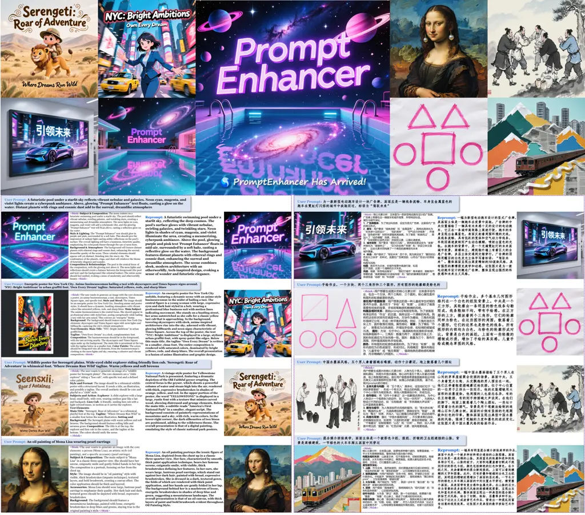
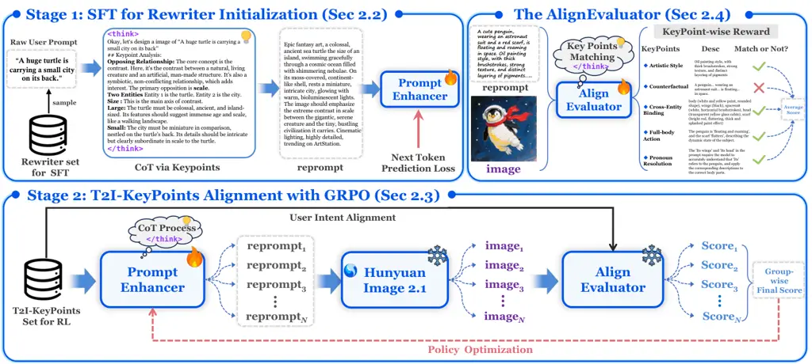
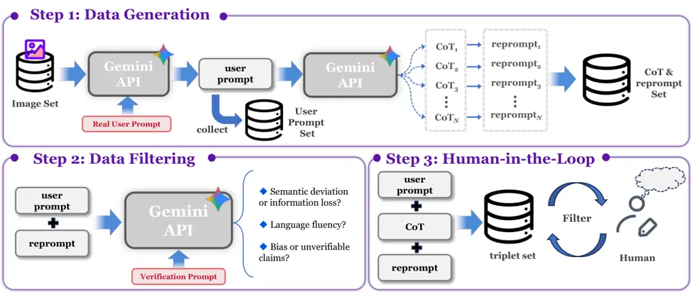
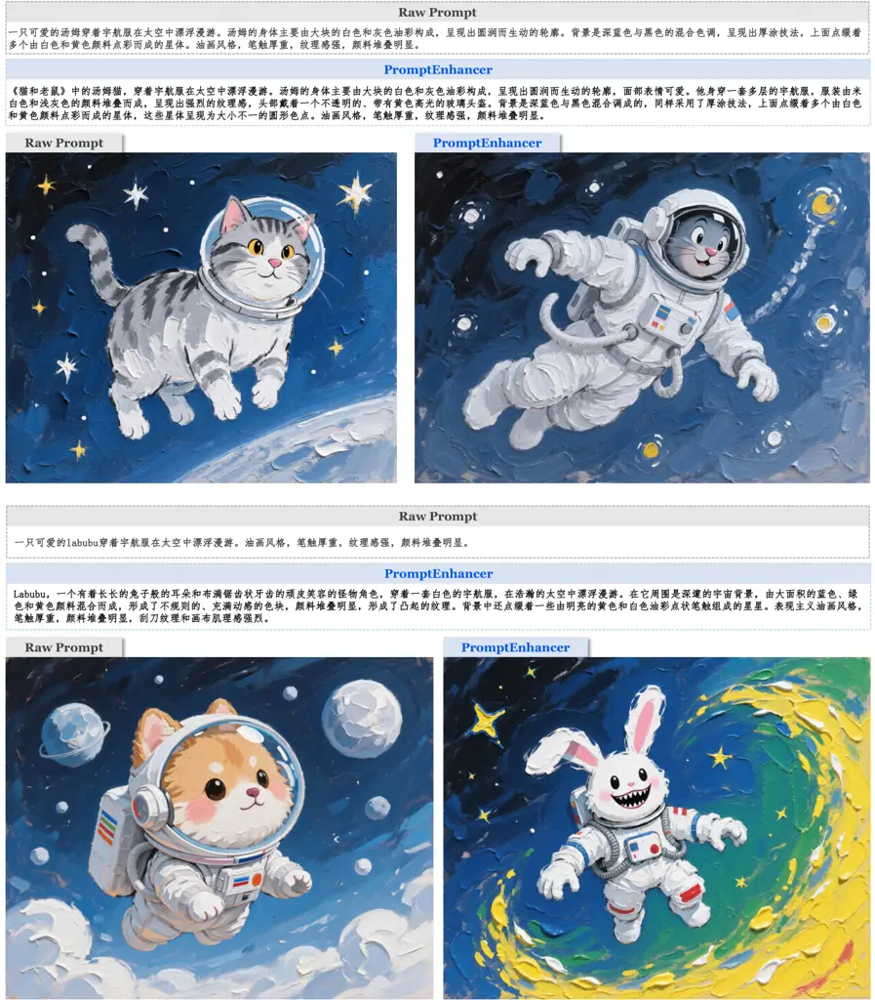
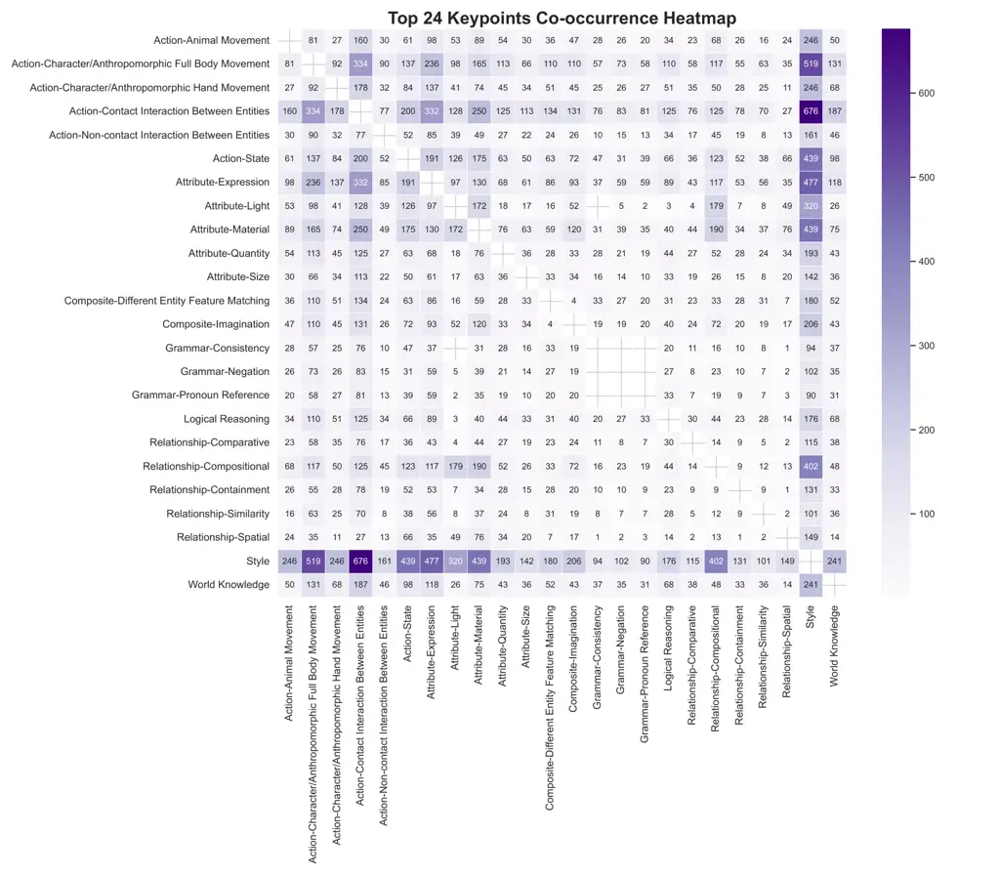
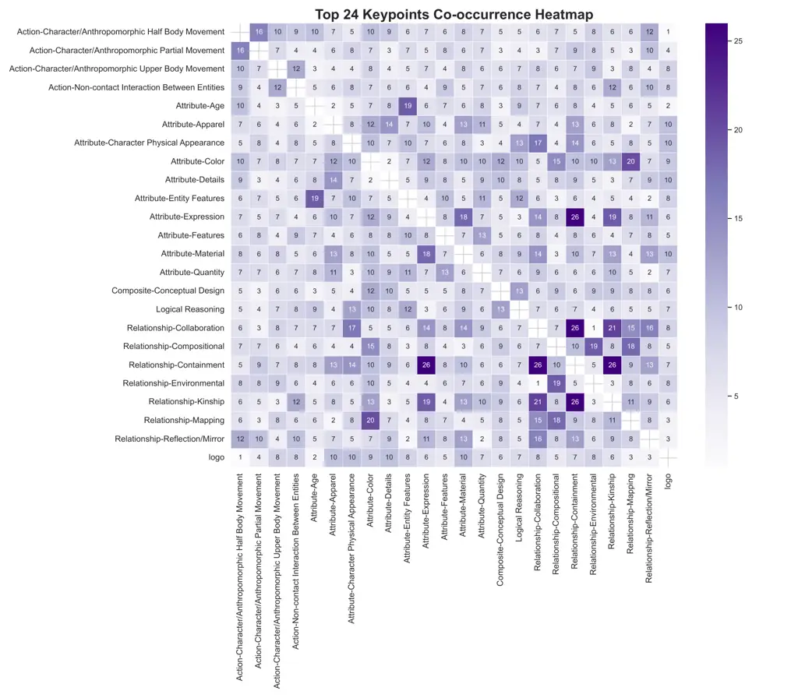
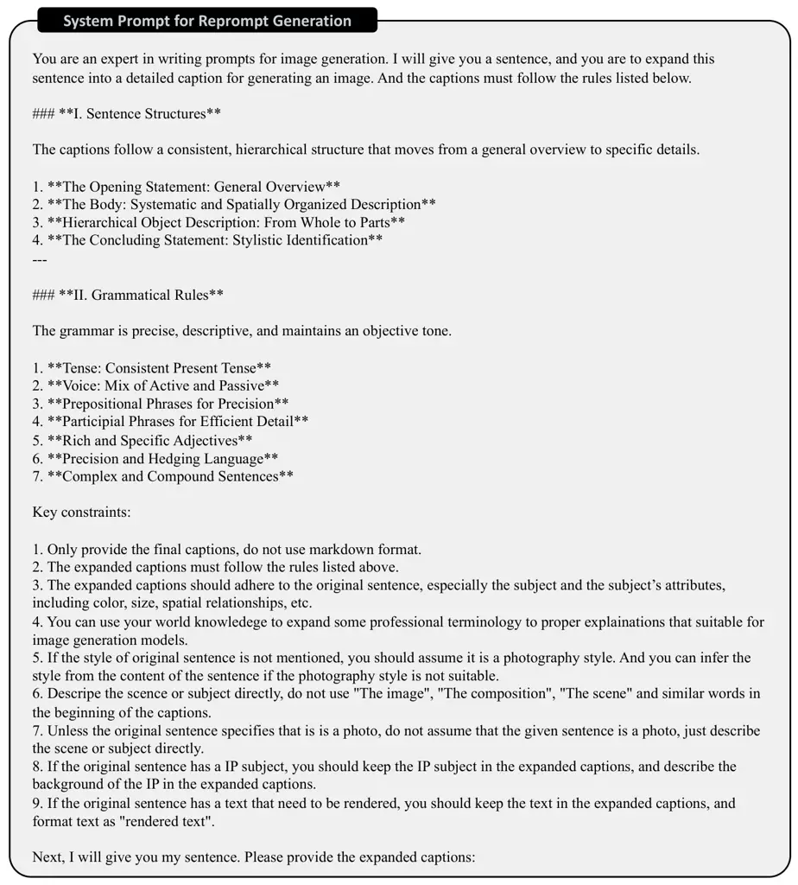
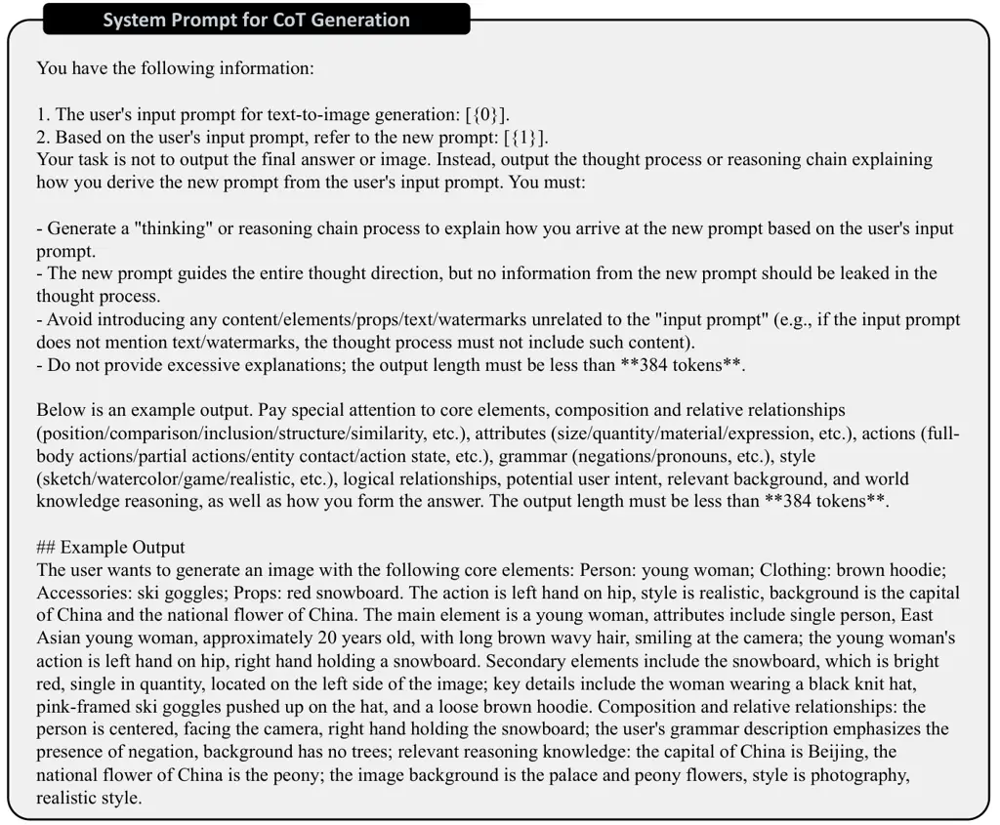

# PromptEnhancer: A Simple Approach to Enhance Text-to-Image Models via Chain-of-Thought Prompt Rewriting

Tencent Hunyuan

###### Abstract

Recent advancements in text-to-image (T2I) diffusion models have
demonstrated remarkable capabilities in generating high-fidelity images.
However, these models often struggle to faithfully render complex user
prompts, particularly in aspects like attribute binding, negation, and
compositional relationships. This leads to a significant mismatch
between user intent and the generated output. To address this challenge,
we introduce PromptEnhancer, a novel and universal prompt rewriting
framework that enhances any pretrained T2I model without requiring
modifications to its weights. Unlike prior methods that rely on
model-specific fine-tuning or implicit reward signals like image-reward
scores, our framework decouples the rewriter from the generator. We
achieve this by training a Chain-of-Thought (CoT) rewriter through
reinforcement learning, guided by a dedicated reward model we term the
AlignEvaluator. The AlignEvaluator is trained to provide explicit and
fine-grained feedback based on a systematic taxonomy of 24 key points,
which are derived from a comprehensive analysis of common T2I failure
modes. By optimizing the CoT rewriter to maximize the reward from our
AlignEvaluator, our framework learns to generate prompts that are more
precisely interpreted by T2I models. Extensive experiments on the
HunyuanImage 2.1 model demonstrate that PromptEnhancer significantly
improves image-text alignment across a wide range of semantic and
compositional challenges. Furthermore, we introduce a new, high-quality
human preference benchmark to facilitate future research in this
direction.

>

|                                                                                |                                                                                                                      |
| ------------------------------------------------------------------------------ | -------------------------------------------------------------------------------------------------------------------- |
| ![[Uncaptioned image]](arxiv-2509-04545v5--ce32ce192ba1.figures/figure-1.webp) | [https://hunyuan-promptenhancer.github.io](https://hunyuan-promptenhancer.github.io)                                 |
|                                                                                | [https://github.com/Hunyuan-PromptEnhancer/PromptEnhancer](https://github.com/Hunyuan-PromptEnhancer/PromptEnhancer) |

## 1 Introduction

The proliferation of large-scale text-to-image (T2I) diffusion models
(Ho et al., 2020; Ramesh et al., 2021; Saharia et al., 2022; Rombach et
al., 2022; Peebles & Xie, 2023; Esser et al., 2024; Hurst et al., 2024),
such as Imagen (Saharia et al., 2022), Stable Diffusion (Rombach et al.,
2022; Podell et al., 2024; Esser et al., 2024), HunyuanDiT (Li et al.,
2024), Flux (Labs, 2024), and Qwen-Image (Wu et al., 2025a), has
revolutionized content creation by enabling the synthesis of diverse and
photorealistic images from natural language. Despite their impressive
capabilities, the quality and accuracy of the generated output are
heavily contingent on the user’s ability to craft precise and detailed
prompts. A persistent challenge lies in the inherent ambiguity and
conciseness of typical user inputs, which often causes T2I models to
misinterpret crucial details, such as failing to bind attributes to the
correct objects, ignoring negations, or struggling with complex spatial
relationships. This discrepancy highlights a fundamental gap between
human intention and model interpretation.

To bridge this gap, prior research has explored various prompt rewriting
techniques (Wu et al., 2025b; Hao et al., 2023). These methods aim to
automatically enrich a user’s initial prompt to provide more explicit
guidance to the T2I model. However, a major limitation of existing
approaches is their lack of universality. Many rewriters require
model-specific fine-tuning or are co-trained with a particular
generator. Others rely on optimizing for generic, implicit reward
signals such as CLIP scores (Radford et al., 2021) or general human
preference scores (Xu et al., 2023; Wu et al., 2023b). These rewards
offer only a coarse measure of overall image-text similarity and lack
the specificity to diagnose and correct fine-grained errors. This
dependency on specific T2I architectures and ambiguous reward functions
renders them difficult to adapt to new models and computationally
expensive, restricting their practical applicability in the rapidly
evolving landscape of generative models.

Figure 1: PromptEnhancer enables high-fidelity and stylistically diverse
image generation from user prompts. Using HunyuanImage 2.1 as the base
T2I model, our method demonstrates its versatility across various
domains, including photorealism, digital art, abstract geometry, and
multilingual text-in-image generation. The examples showcase how minimal
user inputs are transformed into rich, detailed prompts that yield
high-quality visual outputs, bridging the gap between user intent and
model execution.

In this paper, we propose PromptEnhancer, a universal and model-agnostic
prompt rewriting framework designed to enhance any pretrained T2I model
without the need for retraining or architectural changes. The core idea
is to completely decouple the task of prompt refinement from the image
generation process. Our framework introduces a sophisticated rewriter
that employs a Chain-of-Thought (CoT) method (Wei et al., 2022). This
approach emulates a human-like reasoning process, allowing the rewriter
to systematically deconstruct the initial prompt into its core semantic
components, identify potential ambiguities, and then enrich it with
explicit details concerning object attributes, spatial arrangements, and
complex interactions. The resulting detailed prompt can then be used by
a T2I model to generate a more faithful image.

The key to our framework’s effectiveness lies in how the CoT rewriter is
trained. We introduce a novel reward model, the AlignEvaluator, which is
specifically designed for fine-grained, multi-faceted evaluation.
Instead of relying on a single, holistic score, the AlignEvaluator
assesses a generated image against a comprehensive set of 24 distinct
key points. These points are meticulously organized into six distinct
categories, covering a wide spectrum of challenges including linguistic
understanding (_e.g_., negation, pronoun reference), visual attribute
accuracy, compositional relationships, and world knowledge. By
optimizing the CoT rewriter to generate prompts that maximize the
explicit, structured reward from the AlignEvaluator, we effectively
align the prompt generation process with a nuanced understanding of
human preferences. This ensures that the rewritten prompts are not
merely longer, but are structured in a way that elicits higher-quality
and more accurate results from the downstream T2I model.

Our main contributions are as follows:

- •
  We propose PromptEnhancer, a novel and universal prompt rewriting
  framework. It introduces a Chain-of-Thought (CoT) mechanism to
  systematically deconstruct and enrich user prompts, significantly
  improving the performance of existing T2I models without requiring any
  modification to their weights.
- •
  We develop a multi-faceted reward model, the AlignEvaluator, trained
  on 24 distinct key points organized into 6 categories, enabling
  fine-grained evaluation and effective alignment of the rewriter.
- •
  We provide extensive empirical evidence of our method’s effectiveness
  on a state-of-the-art T2I model and contribute a new, high-quality
  benchmark based on human evaluation to the community.

## 2 Methodology

Figure 2: An overview of the training framework for PromptEnhancer. Our
framework trains a universal Rewriter to enhance pretrained
Text-to-Image (T2I) model without altering its weights. This is achieved
through a two-stage process guided by a specialized reward model. Stage
1: SFT for Rewriter Initialization (Sec 2.2). The CoT Rewriter is first
initialized via SFT on (user prompt, reprompt) pairs. This stage teaches
the model to generate structured, chain-of-thought style responses using
a standard next-token prediction loss, establishing a strong foundation
for refinement. Stage 2: Policy Alignment with GRPO (Sec 2.3). The
initialized rewriter is further refined using GRPO. The rewriter
generates multiple reprompt candidates, which are used by a frozen T2I
model to create images. The pre-trained AlignEvaluator then assesses
each (image, user prompt) pair and provides a scalar reward. This reward
signal optimizes the rewriter’s policy, steering it toward generating
prompts that maximize the alignment between the image and the user’s
intent. The AlignEvaluator (Sec 2.4). Central to our framework is the
AlignEvaluator, a pre-trained reward model. It is trained on a
large-scale dataset annotated against a taxonomy of 24 fine-grained key
points (T2I-KeyPoints, Tab. 1). This enables it to provide a robust and
nuanced reward signal, which is crucial for the policy alignment stage.

In this section, we delineate the methodology of PromptEnhancer. Our
framework is centered around two core components: a CoT Rewriter, which
enriches user prompts into detailed instructions, and an AlignEvaluator,
a reward model that provides fine-grained feedback on image-text
alignment. The primary objective is to train the CoT Rewriter through a
two-stage pipeline. First, we initialize the rewriter via Supervised
Fine-Tuning (SFT, Sec. 2.2) to master the Chain-of-Thought format.
Second, we refine it using Group Relative Policy Optimization (GRPO,
Sec. 2.3) (Shao et al., 2024), where the AlignEvaluator (Sec. 2.4)
guides the rewriter to generate prompts that are optimally understood by
downstream Text-to-Image (T2I) models.

### 2.1 Overall Framework

As illustrated in Figure 2, the PromptEnhancer framework consists of
three main components:

- •
  The CoT Rewriter a.k.a PromptEnhancer: A policy model based on a large
  vision-language model, which is responsible for reformulating an
  initial user prompt into an enriched one.
- •
  The AlignEvaluator: A reward model that assesses a generated (image,
  prompt) pair based on 24 fine-grained key points and outputs a scalar
  reward signal.

Training Objective. The entire training process aims to optimize the
CoT-based Rewriter. It first undergoes SFT for basic instruction
following and then is refined using feedback from the AlignEvaluator in
a reinforcement learning loop.

### 2.2 Stage 1: Supervised Fine-Tuning for Rewriter Initialization

Objective of SFT. The first stage of our pipeline is Supervised
Fine-Tuning, which equips the CoT-based Rewriter with the fundamental
ability to generate structured, chain-of-thought style responses. The
objective is not to perfect the rewriter, but to provide it with a
strong initialization point for the subsequent alignment stage.

Instruction Data Distillation. To achieve this, we construct a
high-quality dataset of (user prompt, reprompt) pairs by leveraging a
powerful proprietary large model (_e.g_., Gemini-2.5-Pro (Comanici et
al., 2025) for English and DeepSeekV3 (Liu et al., 2024) for Chinese) as
a “teacher” for distillation. For a given short user prompt, the teacher
model produces a detailed breakdown of the prompt’s elements, analyzes
potential ambiguities, and finally synthesizes a comprehensive, enriched
prompt. The CoT Rewriter is then fine-tuned on this dataset using a
standard language modeling objective.

### 2.3 Stage 2: Policy Alignment with GRPO

Policy Alignment via GRPO. After SFT, the rewriter can generate
plausible long prompts, but they are not explicitly optimized for
image-text alignment. The second stage therefore employs Group Relative
Policy Optimization (GRPO (Shao et al., 2024)) to align the user prompt
with the fine-grained preferences captured by our AlignEvaluator.

The GRPO Training Loop. This training process is iterative. For a given
user prompts $`\{p_{1},p_{2},...,p_{N}\}`$, the CoT Rewriter first
generates $`N`$ candidate rewritten prompts
$`\{p^{\prime}_{1},p^{\prime}_{2},...,p^{\prime}_{N}\}`$. Each of these
prompts is then fed into the frozen T2I model to generate a
corresponding image $`I_{i}`$. Subsequently, our AlignEvaluator
calculates a scalar reward $`r_{i}`$ for each pair $`(p_{i},I_{i})`$.
Finally, these rewards $`\{r_{1},r_{2},...,r_{N}\}`$ are used to update
the rewriter’s policy, creating a preference ranking that encourages the
generation of prompts leading to higher rewards.

### 2.4 The AlignEvaluator: A Multi-faceted Reward Model

Motivation for Fine-grained Reward. A generic reward signal like a CLIP
score (Radford et al., 2021) is insufficient for our goal, as it fails
to capture nuanced aspects of prompt following. We therefore developed
the AlignEvaluator, a reward model trained specifically to assess
image-text alignment across a wide array of challenges.

Taxonomy of T2I-KeyPoints. The evaluator is built upon a taxonomy of 24
fine-grained key points, organized into six major categories. These
categories cover a comprehensive spectrum of abilities, including:
Linguistic and Grammatical Understanding, which assesses the
interpretation of core language structures like Negation; Visual
Attributes, which focuses on rendering properties like Object Count;
Actions and Interactions, which measures the depiction of dynamic
states; Relational and Compositional Structure, which evaluates the
handling of complex scenes; and higher-level abilities covered by
Knowledge and Imagination and In-image Text and Layout. The distribution
of these dimensions within our evaluation dataset is detailed in Figure
5, which highlights a significant focus on challenging aspects like
artistic style, complex interactions, and full-body actions.

Reward Model Training. The AlignEvaluator is trained on a large-scale
dataset of (reprompt, image) pairs, each annotated with scores for these
24 key points. This process yields a robust and explicit reward signal
that is essential for effectively training the CoT Rewriter.

Figure 3: Overview of the construction and filtering pipeline for the
PromptEnhancer training data. The process involves user prompt
simulation, Gemini-based generation, human-in-the-loop selection, and
automated filtering to ensure high quality.

## 3 Data Pipeline

A high-quality dataset is critical for training an effective prompt
rewriter. In this section, we present a multi-stage data curation
pipeline designed to produce a large-scale, high-fidelity corpus for
both Supervised Fine-Tuning (SFT) and subsequent policy alignment. The
overall process is illustrated in Figure 3.

### 3.1 SFT Data for Rewriter Initialization

We construct the SFT dataset through a four-stage process: (1)
simulating realistic user prompts from a large image pool; (2)
generating Chain-of-Thought (CoT) and multiple reprompt candidates using
a powerful large language model; (3) selecting the optimal reprompt via
human-in-the-loop evaluation; and (4) performing automated quality
filtering. This pipeline yields a final dataset of 485,119 high-quality
instances, each comprising a (user prompt, CoT, reprompt) triplet.

Based on fig. 4, the dataset exhibits a thematic distribution across
several creative domains. Design constitutes the largest portion at 27%,
followed by Art at 23%, and Film & Story at 22%. Illustration accounts
for 18%, and Creative tasks make up 10% of the dataset.

1. User Prompt Simulation. To emulate concise user queries at scale, we
   begin with a diverse pool of 3.26 million images (1.53M Chinese-centric
   and 1.73M English-centric). We employ an image captioning model to
   generate short, naturalistic descriptions for these images. This step
   results in a collection of 2.26 million proxy user prompts that serve as
   the foundation for our data generation.

2. CoT and Reprompt Generation. For each simulated user prompt, we
   leverage the generative power of Gemini-2.5-Pro (Comanici et al., 2025).
   Guided by the system prompts detailed in the Appendix, the model
   produces a detailed CoT reasoning sequence and multiple enriched
   reprompt candidates. This one-to-many generation strategy is crucial for
   exploring diverse rewriting possibilities, from which we can later
   select the optimal one.

3. Automated Filtering. The initial stage involves a rigorous automated
   filtering process aimed at enhancing data quality. We utilize
   Gemini-2.5-Pro to programmatically detect and discard samples with
   issues such as semantic deviation, information loss, or linguistic
   incoherence. This process reduces the dataset from 1 million instances
   to 611,921 triplets.

4. Human-in-the-Loop Selection. To further ground our dataset in
   perceptual quality, we introduce a critical human evaluation step. For
   each set of generated reprompt candidates, we use the Hunyuan
   Text-to-Image model to synthesize corresponding images. Professional
   annotators then evaluate these images, selecting the reprompt that best
   aligns with the user’s intent and produces the highest-quality visual
   output. This human-in-the-loop process results in a final curated set of
   485,119 triplets.

### 3.2 Prompt Set for Policy Alignment

For the reinforcement learning stage, we require a distinct set of
prompts to drive the GRPO policy optimization. We construct a set of
approximately 50,000 prompts using the same simulation method as the SFT
data but sourced from a disjoint set of images.

Data Segregation and Purpose. Crucially, this prompt set is kept
entirely separate from the SFT dataset to prevent data leakage and
ensure the model learns to generalize its rewriting capabilities. Unlike
SFT data, these prompts do not have ground-truth CoTs or reprompts; the
learning signal is provided dynamically by the AlignEvaluator during
online training. The thematic distribution of this RL prompt set mirrors
that of the SFT data to maintain a consistent optimization landscape.

Figure 4: Distribution of Categories in the Dataset. The chart on the
left shows the primary categories, while the chart on the right provides
a detailed breakdown into 20 sub-categories.

Figure 5: Distribution of evaluation dimensions in our dataset. (a) The
detailed percentage of each of the 24 fine-grained KeyPoints, sorted in
descending order. (b) The aggregated percentage for each of the six main
Super-Categories, calculated by summing the percentages of their
constituent KeyPoints. In both charts, colors represent the
Super-Category, visually linking the detailed points to their broader
classification.

|                             |                    |                                                        |                                                                                                    |          |
| --------------------------- | ------------------ | ------------------------------------------------------ | -------------------------------------------------------------------------------------------------- | -------- |
| Super-Category              | Category           | Key Point                                              | Example                                                                                            | Criteria |
| Linguistic Comprehension    | Logical Ops        | Negation – interpret negatives                         | Prompt: A bowl of beef noodles, no scallions. (No scallions)                                       | TIC      |
|                             | Logical Ops        | Attribute Consistency – one attribute bound to many    | Prompt: Five people all wearing red clothes. (All red)                                             | TIC      |
|                             | Co-reference       | Pronoun Resolution – resolve ambiguity                 | Prompt: The large ball broke the table because it was made of metal. (“it” = ball)                 | TIC      |
| Visual Attributes           | Obj-level          | Counting – numeracy ($`n\geq 3`$)                      | Prompt: A picture with four dogs. (Four dogs)                                                      | TIC      |
|                             | Obj-level          | Size – relative comparison                             | Prompt: Two large spheres. (Large spheres)                                                         | TIC      |
|                             | Obj-level          | Material – render different materials                  | Prompt: An ice sculpture of an eagle. (Ice sculpture)                                              | TIC      |
|                             | Obj-level          | Expression – capture facial emotions                   | Prompt: A strong man, low-angle shot, with a contemptuous expression.                              | TIC      |
|                             | Global Style       | Artistic Style – adhere to style                       | Prompt: Eight galloping horses in Chinese ink wash.                                                | TIC      |
| Action & Interaction        | Individual Action  | Full-body Action – complex movement                    | Prompt: A girl performing a Thomas flare.                                                          | TIC&SI   |
|                             | Individual Action  | Hand Action – detailed hand/finger structure           | Prompt: A hand using chopsticks to pick up food.                                                   | TIC&SI   |
|                             | Individual Action  | Animal Action – actions performed by animals           | Prompt: A puppy happily running.                                                                   | TIC&SI   |
|                             | Interaction        | Contact Interaction – physical interaction             | Prompt: A boxer lands a punch on a punching bag.                                                   | TIC&SI   |
|                             | Interaction        | Interaction w/o Contact – non-physical interaction     | Prompt: Einstein looking at Hawking.                                                               | TIC      |
|                             | State              | State – continuous state of being or action            | Prompt: A gust of wind blows, cherry blossoms dance in the air.                                    | TIC      |
| Relations & Structure       | Semantic Rel.      | Comparative Relation – attribute comparison            | Prompt: Woman in red dress taller than woman in yellow.                                            | TIC      |
|                             | Semantic Rel.      | Compositional Relation – entity composed of others     | Prompt: A cat made of orange slices.                                                               | TIC      |
|                             | Semantic Rel.      | Containment Relation – container holds an entity       | Prompt: A cup full of soda water.                                                                  | TIC      |
|                             | Semantic Rel.      | Similarity Relation – resemblance in shape             | Prompt: A lake shaped like a guitar.                                                               | TIC      |
|                             | Spatial Layout     | Cross-Entity Binding – distinct attributes to entities | Prompt: Man (buzz cut, blue shirt) and woman (long hair, yellow shirt).                            | TIC      |
|                             | Spatial Layout     | Entity Layout – specific arrangement of entities       | Prompt: A race car on a city track, with a mini-map in the top-left corner.                        | TIC      |
| World Knowledge & Reasoning | World Knowledge    | Knowledge Application – famous entities                | Prompt: The Great Wall of China / Marie Curie.                                                     | TIC      |
|                             | Abstract Reasoning | Counterfactual – surreal impossible scenes             | Prompt: A girl held onto the stem of a huge dandelion with both hands, suspended above the clouds. | TIC      |
| Scene Text & Typography     | In-Image Text      | Text Rendering – render text content accurately        | Prompt: Poster with text “Game of Thrones” at the bottom.                                          | TIC      |
|                             | In-Image Text      | Text Layout – position text as instructed              | Prompt: Poster of a woman on a throne of waves, text ”Game of Thrones” at the bottom.              | TIC      |

Table 1: A Multi-dimensional Evaluation Framework for Text-to-Image
Generation. TIC = Text-Image Consistency, SI = Structural Integrity,
TIC&SI = both.

Figure 6: Qualitative Comparison of Prompt Rewriting. This figure
demonstrates the effectiveness of the PromptEnhancer prompt rewriter.
Each comparison pair shows an image generated from a simple ”Raw Prompt”
alongside an image generated from the detailed prompt created by
PromptEnhancer. As illustrated, the enriched prompts, which add specific
details like character identity (“Tom cat from Tom & Jerry”) and
artistic style (“oil painting style, heavy brushstrokes”), guide the
model to produce images with significantly greater detail, stylistic
accuracy, and fidelity to the user’s intent.

## 4 T2I-Keypoints Evaluation Benchmark

To facilitate a comprehensive and fine-grained evaluation of
Text-to-Image (T2I) models, we introduce the T2I-Keypoints-Align
benchmark.¹¹ 1 The benchmark is publicly available at:
[https://huggingface.co/datasets/PromptEnhancer/T2I-Keypoints-Eval](https://huggingface.co/datasets/PromptEnhancer/T2I-Keypoints-Eval)
This benchmark is specifically designed to assess a model’s ability to
accurately render complex prompts by breaking them down into constituent
semantic ‘keypoints‘. Our dataset comprises a total of 6,687 prompts,
balanced between English (3,000 records, 44.9%) and Chinese (3,687
records, 55.1%). Each prompt is meticulously annotated with multiple
keypoint categories—such as actions, attributes, and
relationships—enabling a granular analysis of model performance across
various conceptual dimensions.

To better understand the characteristics of our benchmark, we conducted
a statistical analysis of the prompts and their associated keypoints,
with key findings visualized in Figure 7 and Figure 8.

(a) Chinese data

(b) English data

Figure 7: Co-occurrence heatmaps of the top 24 most frequent keypoints,
comparing the Chinese (a) and English (b) portions of our benchmark. The
color intensity reflects the co-occurrence frequency. The Chinese data
shows strong correlations between ‘Style‘ and ‘World Knowledge‘, while
the English data displays more varied pairings.

(a) Chinese data

(b) English data

Figure 8: Statistical distributions of prompt characteristics, comparing
the Chinese (a) and English (b) datasets. Each subfigure displays the
distribution of prompt length (characters) and keypoint density (number
of keypoints per prompt). A significant difference is observed in prompt
length, with English prompts being substantially longer and more
descriptive.

Figure 8 reveals significant structural differences between the prompts
in the two languages. The Chinese prompts (left) are concise, with
lengths tightly clustered around a mean of approximately 100 characters.
Their keypoint density peaks at 4, with most prompts containing 3 to 5
keypoints. Conversely, the English prompts (right) are substantially
more verbose and descriptive, with lengths centered around 500
characters. Their keypoint density is more uniformly distributed, with a
high and consistent number of prompts containing 3, 4, 5, or 6
keypoints. This distinction highlights that the English subset tests a
model’s ability to parse longer narratives with high compositional
complexity, while the Chinese subset focuses on efficiently capturing
the essence of more succinct requests. Together, they form a robust
benchmark for evaluating T2I models against diverse prompt styles.

## 5 Experiments

In this section, we conduct a comprehensive set of experiments to
validate the efficacy of our proposed PromptEnhancer framework. Our
evaluation is designed to demonstrate that PromptEnhancer significantly
improves a T2I model’s ability to follow complex prompts, and that these
improvements are both quantitatively measurable and perceptually
preferred by humans.

### 5.1 Experimental Setup

All experiments are conducted using the HunyuanImage 2.1 as the base
Text-to-Image model. Its weights remain frozen throughout our training
process to demonstrate the plug-and-play capability of PromptEnhancer.
Our CoT Rewriter is initialized from the Hunyuan-7B-Instruct model
(Tencent-Hunyuan-Team, 2025). All training and inference are performed
on 8 NVIDIA H800 GPUs.

Evaluation Benchmark. To rigorously assess performance, all methods are
evaluated on our newly curated benchmark. This benchmark features
challenging prompts specifically designed to test the wide range of
fine-grained alignment capabilities detailed in Section 2.4 and Table 1.

### 5.2 Implementation Details

We detail the training hyperparameters for the two stages of our
framework in Table 2.

Stage 1: Supervised Fine-Tuning (SFT). The CoT Rewriter is fine-tuned on
our curated SFT dataset for 10 epochs. We use a learning rate of
$`1.0\times 10^{-5}`$ with a cosine learning rate scheduler and a warmup
ratio of 10%. The effective batch size is 128, achieved with a
per-device batch size of 8 and 2 gradient accumulation steps across 8
GPUs. We leverage bfloat16 mixed-precision training to improve
efficiency.

Stage 2: Policy Alignment with GRPO. Following SFT, the rewriter is
further optimized using the GRPO algorithm for 10 epochs. We lower the
learning rate to $`1.0\times 10^{-6}`$ for stable policy refinement.
During the rollout phase for each prompt, we generate $`N=8`$ candidate
reprompts to estimate the policy gradient. A KL-divergence penalty with
a coefficient of $`0.001`$ is applied to regularize the policy updates
and prevent deviation from the SFT-initialized model. The global
training batch size is 64.

|                         |                       |                       |
| ----------------------- | --------------------- | --------------------- |
| Hyperparameter          | SFT Stage             | GRPO Stage            |
| Base Model              | Hunyuan-7B-Instruct   | SFT-tuned Rewriter    |
| Learning Rate           | $`1.0\times 10^{-5}`$ | $`1.0\times 10^{-6}`$ |
| LR Scheduler            | Cosine                | Constant              |
| Warmup Ratio            | 0.1                   | N/A                   |
| Epochs                  | 2                     | 1                     |
| Effective Batch Size    | 128                   | 64                    |
| Precision               | bfloat16              | bfloat16              |
| Rollout Samples ($`N`$) | N/A                   | 8                     |
| KL Coefficient          | N/A                   | 0.001                 |

Table 2: Key hyperparameters for the SFT and GRPO training stages.

### 5.3 Quantitative Analysis

Figure 9: Quantitative Evaluation of PromptEnhancer’s Impact on Prompt
Following Accuracy. The figure presents a comparative analysis of
text-to-image generation accuracy with and without the PromptEnhancer
framework across 24 distinct semantic categories. The left panel
illustrates the percentage point (pp) improvement for each category,
highlighting significant gains (blue) in areas like grammatical
understanding and compositional reasoning, as well as regressions (red)
in others. The right panel provides a direct comparison of the absolute
accuracy scores, showing the performance of the baseline model (“w/o
Ours”) versus the enhanced model (“w/ Our”).

As illustrated in Figure 9, our framework provides a significant and
broad-spectrum enhancement to the T2I model’s prompt-following
capabilities. On average, PromptEnhancer boosts the accuracy across all
24 evaluation dimensions by a substantial +5.1%. This overall
improvement is underpinned by widespread gains, with performance
increasing in 20 out of 24 categories.

Significant Gains in Complex Reasoning. The most pronounced improvements
are concentrated in categories that demand sophisticated semantic and
compositional understanding. Notably, we observe dramatic boosts in
Similarity Relation (+17.3%), Counterfactual reasoning (+17.2%), and
Counting (+15.0%). These results underscore our method’s ability to help
the T2I model interpret abstract relationships and precise numerical
constraints. Furthermore, significant enhancements are seen in
fine-grained linguistic and visual challenges, including Pronoun
Resolution (+13.9%), rendering nuanced facial Expression (+12.0%), and
maintaining Cross-Entity Binding (+11.3%). In total, 15 distinct
categories exhibit an accuracy improvement of more than 5.0%,
demonstrating the comprehensive impact of our prompt rewriting strategy.

Areas of Neutrality and Minor Regression. While the impact is
overwhelmingly positive, the gains are not uniform. Performance in
Contact Interaction and Size remains unchanged (+0.0%), and Artistic
Style shows only a marginal improvement (+0.9%), suggesting the baseline
model is already relatively competent in these areas. We identify minor
performance regressions in two categories: Text Layout (-0.7%) and
Interaction w/o Contact (-0.9%). These isolated cases represent valuable
areas for future work, indicating that for certain simple concepts, the
rewriting process might occasionally introduce ambiguity or
over-specification. Nevertheless, these minor trade-offs are far
outweighed by the extensive and significant improvements across the vast
majority of challenging categories.

Figure 10: The system prompt designed to guide Gemini-2.5-Pro for
“Reprompt Generation”. This prompt expands a simple input sentence into
a structured, detailed description suitable for image generation,
following a sophisticated framework. This framework consists of three
core parts: I. Sentence Structures (defining a four-level descriptive
hierarchy from macro to micro), II. Grammatical Rules (specifying seven
conventions to ensure objectivity and precision), and 9 key constraints,
which together guarantee the quality and consistency of the generated
content.

Figure 11: The system prompt for generating a Chain-of-Thought. The core
task is not to output a final answer, but to generate a reasoning
process that explains how the system derives a new, optimized prompt
(\[{1}\]) from the user’s initial input (\[{0}\]). The prompt requires
the model to focus on a series of analytical dimensions (_e.g_., core
elements, composition, attributes, style, world knowledge) and specifies
the required format and depth through a detailed “Example Output”.

## 6 Related Work

### 6.1 Text-to-Image Generation

The field of Text-to-Image (T2I) synthesis has witnessed a paradigm
shift with the advent of diffusion models (Ho et al., 2020; Song et al.,
2021), which have largely superseded earlier GAN-based approaches (Reed
et al., 2016). Seminal models like DALL-E (Ramesh et al., 2021), Imagen
(Saharia et al., 2022), and Stable Diffusion (Rombach et al., 2022;
Podell et al., 2024; Esser et al., 2024) established a powerful
foundation for generating high-fidelity and diverse images. This
frontier continues to be pushed by state-of-the-art systems such as
DALL-E 3 (Betker et al., 2023), and more recent architectures like
FLUX.1 (Labs et al., 2025), which have dramatically improved
photorealism and text rendering.

However, despite this progress, a fundamental challenge persists: the
prompt alignment gap. Models often struggle with compositional
complexity, failing to correctly bind attributes to objects, comprehend
spatial or logical relationships (_e.g_., negation), and maintain
fidelity to intricate details (Huang et al., 2023). This gap places a
significant “alignment tax” on users, forcing them to engage in tedious
and often unintuitive prompt engineering. Our work directly targets this
gap, not by inventing a new generator, but by creating a universal
interface that teaches any T2I model to better understand human intent.

### 6.2 Prompt Rewriting and Optimization

To bridge the user-model communication gap, researchers have
increasingly focused on prompt optimization. One foundational strategy
is recaptioning, where high-quality, descriptive captions are
synthesized to fine-tune the T2I model itself, as famously implemented
in DALL-E 3 (Betker et al., 2023).

A more direct approach is on-the-fly prompt rewriting, where user
prompts are enhanced before being passed to a frozen T2I model. These
methods include: (1) Iterative Refinement, where an LLM critiques and
revises a prompt in a loop to improve the generated output (Wu et al.,
2024; Yang et al., 2024b); (2) Automatic Prompt Engineering, which
learns to generate or select stylistically potent or compositionally
robust prompts (Cao et al., 2023; Mañas et al., 2024); and (3)
Agent-based Systems, which employ multimodal LLM agents to plan,
generate, and edit in complex workflows (Wang et al., 2024; Qin et al.,
2024).

While powerful, these methods often rely on general-purpose LLMs
(_e.g_., GPT-4 (Hurst et al., 2024)) that lack a specialized
understanding of T2I-specific failure modes. Our approach charts a new
path by training a dedicated rewriter that is explicitly optimized
against a fine-grained, T2I-centric reward model, enabling it to learn
the nuances of visual generation.

### 6.3 Chain-of-Thought for Controllable Generation

Chain-of-Thought (CoT) reasoning (Wei et al., 2022), which decomposes
complex problems into intermediate steps, has proven highly effective
for improving controllability in multimodal generation. Instead of
asking a model to synthesize a complex scene in one shot, CoT-inspired
methods impose a structured, step-wise process. For instance, some
frameworks leverage a powerful multimodal LLM to first generate an
explicit plan—such as a scene layout, object coordinates, or a sequence
of rendering steps—which then guides a constrained diffusion process to
enhance compositional accuracy (Yang et al., 2024a; Zhang et al., 2025).
Other approaches integrate step-wise reasoning directly into the
generative model’s architecture (Wang et al., 2025).

These methods have significantly advanced compositional fidelity.
However, they often create a tight coupling between the reasoner and a
specific T2I model architecture. Our framework innovates by leveraging
CoT purely within the prompt rewriting process. We create a decoupled
CoT rewriter that is model-agnostic and trained via reinforcement
learning. This allows it to be universally applied as a plug-and-play
module to enhance existing, pre-trained T2I models without any
architectural modifications.

### 6.4 Fine-Grained Evaluation and Reward Modeling

The maturation of T2I models has necessitated a parallel evolution in
evaluation methodologies, moving beyond holistic metrics like FID or
CLIP Score. A major advancement was the development of reward models
trained on large-scale human preferences, such as ImageReward (Xu et
al., 2023), HPSv2 (Wu et al., 2023b; Wu et al., 2023a), which capture a
more human-aligned sense of aesthetic quality and overall prompt
fidelity.

However, a single preference score can obscure critical, fine-grained
errors in compositionality. This has spurred the creation of specialized
benchmarks with detailed, multi-faceted annotations, such as
T2I-CompBench (Huang et al., 2023) and EvalMuse (Han et al., 2024),
which probe specific capabilities like attribute binding and spatial
relations.

Our work makes a key contribution by closing the loop between
fine-grained evaluation and model optimization. We first introduce the
‘AlignEvaluator‘, a reward model trained on a new, comprehensive
taxonomy of 24 key points that synthesizes and expands upon existing
criteria. Crucially, we then use this detailed, multi-faceted reward
signal to directly optimize our prompt rewriter via reinforcement
learning. This transforms fine-grained evaluation from a passive
measurement tool into an active training signal, directly teaching the
rewriter to avoid common T2I failure modes.

## 7 Conclusion

In this paper, we introduced PromptEnhancer, a novel framework to help
text-to-image (T2I) models better understand complex user prompts. T2I
models often struggle to follow detailed instructions, leading to images
that don’t match the user’s intent. Our method fixes this by
automatically rewriting the user’s initial prompt into a more detailed
one that any T2I model can easily interpret. Our key innovation is a
prompt rewriter that uses a Chain-of-Thought (CoT) process. We train
this rewriter using reinforcement learning, guided by a custom reward
model we call the AlignEvaluator. This evaluator provides specific,
fine-grained feedback on 24 different aspects of image-text alignment,
allowing the rewriter to learn how to create high-quality prompts.
Crucially, our framework is universal and works with any pre-trained T2I
model without needing to modify it. Experiments show that PromptEnhancer
significantly improves the alignment between the generated image and the
user’s prompt across a wide range of challenges. By decoupling the task
of prompt enhancement from image generation, our work offers an
effective and scalable solution to improve the control and accuracy of
T2I systems.

## 8 Contributors and Acknowledgements

- •
  Project leaders: Qinglin Lu^(‡), Chunyu Wang^(†)
- •
  Core Contributors: Linqing Wang^(\*), Ximing Xing^(\*)
- •
  Contributors: Yiji Cheng, Zhiyuan Zhao, Donghao Li, Tiankai Hang,
  Jiale Tao, Qixun Wang, Ruihuang Li, Comi Chen, Xin Li, Mingrui Wu,
  Xinchi Deng, Shuyang Gu
- •
  Acknowledgements: We would like to thank Kai Song, Zhengkai Jiang for
  their valuable inputs and suggestions.

^(\*) Equal Contribution.  
^(†) Project Lead: Chunyu Wang  
^(‡) Corresponding Author: Qinglin Lu

## References

- Betker et al. (2023) James Betker, Gabriel Goh, Li Jing, Tim Brooks,
  Jianfeng Wang, Linjie Li, Long Ouyang, Juntang Zhuang, Joyce Lee,
  Yufei Guo, et al. Improving image generation with better captions.
  _Computer Science. https://cdn. openai. com/papers/dall-e-3. pdf_,
  2(3):8, 2023.
- Cao et al. (2023) Tingfeng Cao, Chengyu Wang, Bingyan Liu, Ziheng Wu,
  Jinhui Zhu, and Jun Huang. Beautifulprompt: Towards automatic prompt
  engineering for text-to-image synthesis. _arXiv preprint
  arXiv:2311.06752_, 2023.
- Comanici et al. (2025) Gheorghe Comanici, Eric Bieber, Mike
  Schaekermann, Ice Pasupat, Noveen Sachdeva, Inderjit Dhillon, Marcel
  Blistein, Ori Ram, Dan Zhang, Evan Rosen, et al. Gemini 2.5: Pushing
  the frontier with advanced reasoning, multimodality, long context, and
  next generation agentic capabilities. _arXiv preprint
  arXiv:2507.06261_, 2025.
- Esser et al. (2024) Patrick Esser, Sumith Kulal, Andreas Blattmann,
  Rahim Entezari, Jonas Müller, Harry Saini, Yam Levi, Dominik Lorenz,
  Axel Sauer, Frederic Boesel, et al. Scaling rectified flow
  transformers for high-resolution image synthesis. In _Forty-first
  international conference on machine learning (ICML)_, 2024.
- Han et al. (2024) Shuhao Han, Haotian Fan, Jiachen Fu, Liang Li, Tao
  Li, Junhui Cui, Yunqiu Wang, Yang Tai, Jingwei Sun, Chunle Guo, et al.
  Evalmuse-40k: A reliable and fine-grained benchmark with comprehensive
  human annotations for text-to-image generation model evaluation.
  _arXiv preprint arXiv:2412.18150_, 2024.
- Hao et al. (2023) Yaru Hao, Zewen Chi, Li Dong, and Furu Wei.
  Optimizing prompts for text-to-image generation. _Advances in Neural
  Information Processing Systems_, 36:66923–66939, 2023.
- Ho et al. (2020) Jonathan Ho, Ajay Jain, and Pieter Abbeel. Denoising
  diffusion probabilistic models. _Advances in neural information
  processing systems (NeurIPS)_, 33:6840–6851, 2020.
- Huang et al. (2023) Kaiyi Huang, Kaiyue Sun, Enze Xie, Zhenguo Li, and
  Xihui Liu. T2i-compbench: A comprehensive benchmark for open-world
  compositional text-to-image generation. _Advances in Neural
  Information Processing Systems (NeurIPS)_, 36:78723–78747, 2023.
- Hurst et al. (2024) Aaron Hurst, Adam Lerer, Adam P Goucher, Adam
  Perelman, Aditya Ramesh, Aidan Clark, AJ Ostrow, Akila Welihinda, Alan
  Hayes, Alec Radford, et al. Gpt-4o system card. _arXiv preprint
  arXiv:2410.21276_, 2024.
- Labs (2024) Black Forest Labs. Flux, 2024. URL
  [https://github.com/black-forest-labs/flux](https://github.com/black-forest-labs/flux).
- Labs et al. (2025) Black Forest Labs, Stephen Batifol, Andreas
  Blattmann, Frederic Boesel, Saksham Consul, Cyril Diagne, Tim
  Dockhorn, Jack English, Zion English, Patrick Esser, et al. Flux. 1
  kontext: Flow matching for in-context image generation and editing in
  latent space. _arXiv preprint arXiv:2506.15742_, 2025.
- Li et al. (2024) Zhimin Li, Jianwei Zhang, Qin Lin, Jiangfeng Xiong,
  Yanxin Long, Xinchi Deng, Yingfang Zhang, Xingchao Liu, Minbin Huang,
  Zedong Xiao, et al. Hunyuan-dit: A powerful multi-resolution diffusion
  transformer with fine-grained chinese understanding. _arXiv preprint
  arXiv:2405.08748_, 2024.
- Liu et al. (2024) Aixin Liu, Bei Feng, Bing Xue, Bingxuan Wang, Bochao
  Wu, Chengda Lu, Chenggang Zhao, Chengqi Deng, Chenyu Zhang, Chong
  Ruan, et al. Deepseek-v3 technical report. _arXiv preprint
  arXiv:2412.19437_, 2024.
- Mañas et al. (2024) Oscar Mañas, Pietro Astolfi, Melissa Hall, Candace
  Ross, Jack Urbanek, Adina Williams, Aishwarya Agrawal, Adriana
  Romero-Soriano, and Michal Drozdzal. Improving text-to-image
  consistency via automatic prompt optimization. _arXiv preprint
  arXiv:2403.17804_, 2024.
- Peebles & Xie (2023) William Peebles and Saining Xie. Scalable
  diffusion models with transformers. In _Proceedings of the IEEE/CVF
  international conference on computer vision (ICCV)_, pp.
  4195–4205, 2023.
- Podell et al. (2024) Dustin Podell, Zion English, Kyle Lacey, Andreas
  Blattmann, Tim Dockhorn, Jonas Müller, Joe Penna, and Robin Rombach.
  SDXL: Improving latent diffusion models for high-resolution image
  synthesis. In _The Twelfth International Conference on Learning
  Representations (ICLR)_, 2024. URL
  [https://openreview.net/forum?id=di52zR8xgf](https://openreview.net/forum?id=di52zR8xgf).
- Qin et al. (2024) Jie Qin, Jie Wu, Weifeng Chen, Yuxi Ren, Huixia Li,
  Hefeng Wu, Xuefeng Xiao, Rui Wang, and Shilei Wen. Diffusiongpt:
  Llm-driven text-to-image generation system. _arXiv preprint
  arXiv:2401.10061_, 2024.
- Radford et al. (2021) Alec Radford, Jong Wook Kim, Chris Hallacy,
  Aditya Ramesh, Gabriel Goh, Sandhini Agarwal, Girish Sastry, Amanda
  Askell, Pamela Mishkin, Jack Clark, et al. Learning transferable
  visual models from natural language supervision. In _International
  conference on machine learning (ICML)_, pp. 8748–8763. PmLR, 2021.
- Ramesh et al. (2021) Aditya Ramesh, Mikhail Pavlov, Gabriel Goh, Scott
  Gray, Chelsea Voss, Alec Radford, Mark Chen, and Ilya Sutskever.
  Zero-shot text-to-image generation. In _International conference on
  machine learning (ICML)_, pp. 8821–8831. Pmlr, 2021.
- Reed et al. (2016) Scott Reed, Zeynep Akata, Xinchen Yan, Lajanugen
  Logeswaran, Bernt Schiele, and Honglak Lee. Generative adversarial
  text to image synthesis. In _International conference on machine
  learning (ICML)_, pp. 1060–1069. Pmlr, 2016.
- Rombach et al. (2022) Robin Rombach, Andreas Blattmann, Dominik
  Lorenz, Patrick Esser, and Björn Ommer. High-resolution image
  synthesis with latent diffusion models. In _Proceedings of the
  IEEE/CVF conference on computer vision and pattern recognition
  (CVPR)_, pp. 10684–10695, 2022.
- Saharia et al. (2022) Chitwan Saharia, William Chan, Saurabh Saxena,
  Lala Li, Jay Whang, Emily L Denton, Kamyar Ghasemipour, Raphael
  Gontijo Lopes, Burcu Karagol Ayan, Tim Salimans, et al. Photorealistic
  text-to-image diffusion models with deep language understanding.
  _Advances in neural information processing systems (NeurIPS)_,
  35:36479–36494, 2022.
- Shao et al. (2024) Zhihong Shao, Peiyi Wang, Qihao Zhu, Runxin Xu,
  Junxiao Song, Xiao Bi, Haowei Zhang, Mingchuan Zhang, YK Li, Yang Wu,
  et al. Deepseekmath: Pushing the limits of mathematical reasoning in
  open language models. _arXiv preprint arXiv:2402.03300_, 2024.
- Song et al. (2021) Yang Song, Jascha Sohl-Dickstein, Diederik P
  Kingma, Abhishek Kumar, Stefano Ermon, and Ben Poole. Score-based
  generative modeling through stochastic differential equations. In
  _International Conference on Learning Representations (ICLR)_, 2021.
  URL
  [https://openreview.net/forum?id=PxTIG12RRHS](https://openreview.net/forum?id=PxTIG12RRHS).
- Tencent-Hunyuan-Team (2025) Tencent-Hunyuan-Team. Hunyuan-a13b, 2025.
  URL
  [https://github.com/Tencent-Hunyuan/Hunyuan-A13B](https://github.com/Tencent-Hunyuan/Hunyuan-A13B).
- Wang et al. (2025) Yi Wang, Mushui Liu, Wanggui He, Longxiang Zhang,
  Ziwei Huang, Guanghao Zhang, Fangxun Shu, Zhong Tao, Dong She, Zhelun
  Yu, et al. Mint: Multi-modal chain of thought in unified generative
  models for enhanced image generation. _arXiv preprint
  arXiv:2503.01298_, 2025.
- Wang et al. (2024) Zhenyu Wang, Aoxue Li, Zhenguo Li, and Xihui Liu.
  Genartist: Multimodal llm as an agent for unified image generation and
  editing. _Advances in Neural Information Processing Systems_,
  37:128374–128395, 2024.
- Wei et al. (2022) Jason Wei, Xuezhi Wang, Dale Schuurmans, Maarten
  Bosma, Fei Xia, Ed Chi, Quoc V Le, Denny Zhou, et al. Chain-of-thought
  prompting elicits reasoning in large language models. _Advances in
  neural information processing systems (NeurIPS)_,
  35:24824–24837, 2022.
- Wu et al. (2025a) Chenfei Wu, Jiahao Li, Jingren Zhou, Junyang Lin,
  Kaiyuan Gao, Kun Yan, Sheng-ming Yin, Shuai Bai, Xiao Xu, Yilei Chen,
  et al. Qwen-image technical report. _arXiv preprint arXiv:2508.02324_,
  2025a.
- Wu et al. (2025b) Mingrui Wu, Lu Wang, Pu Zhao, Fangkai Yang, Jianjin
  Zhang, Jianfeng Liu, Yuefeng Zhan, Weihao Han, Hao Sun, Jiayi Ji, et
  al. Reprompt: Reasoning-augmented reprompting for text-to-image
  generation via reinforcement learning. _arXiv preprint
  arXiv:2505.17540_, 2025b.
- Wu et al. (2024) Tsung-Han Wu, Long Lian, Joseph E Gonzalez, Boyi Li,
  and Trevor Darrell. Self-correcting llm-controlled diffusion models.
  In _Proceedings of the IEEE/CVF Conference on Computer Vision and
  Pattern Recognition_, pp. 6327–6336, 2024.
- Wu et al. (2023a) Xiaoshi Wu, Yiming Hao, Keqiang Sun, Yixiong Chen,
  Feng Zhu, Rui Zhao, and Hongsheng Li. Human preference score v2: A
  solid benchmark for evaluating human preferences of text-to-image
  synthesis. _arXiv preprint arXiv:2306.09341_, 2023a.
- Wu et al. (2023b) Xiaoshi Wu, Keqiang Sun, Feng Zhu, Rui Zhao, and
  Hongsheng Li. Human preference score: Better aligning text-to-image
  models with human preference. In _Proceedings of the IEEE/CVF
  International Conference on Computer Vision (ICCV)_, pp. 2096–2105,
  October 2023b.
- Xu et al. (2023) Jiazheng Xu, Xiao Liu, Yuchen Wu, Yuxuan Tong, Qinkai
  Li, Ming Ding, Jie Tang, and Yuxiao Dong. Imagereward: Learning and
  evaluating human preferences for text-to-image generation. _Advances
  in Neural Information Processing Systems (NeurIPS)_,
  36:15903–15935, 2023.
- Yang et al. (2024a) Ling Yang, Zhaochen Yu, Chenlin Meng, Minkai Xu,
  Stefano Ermon, and Bin Cui. Mastering text-to-image diffusion:
  Recaptioning, planning, and generating with multimodal llms. In
  _Forty-first International Conference on Machine Learning_, 2024a.
- Yang et al. (2024b) Zhengyuan Yang, Jianfeng Wang, Linjie Li, Kevin
  Lin, Chung-Ching Lin, Zicheng Liu, and Lijuan Wang. Idea2img:
  Iterative self-refinement with gpt-4v for automatic image design and
  generation. In _European Conference on Computer Vision_, pp. 167–184.
  Springer, 2024b.
- Zhang et al. (2025) Yuyao Zhang, Jinghao Li, and Yu-Wing Tai.
  Layercraft: Enhancing text-to-image generation with cot reasoning and
  layered object integration. _arXiv preprint arXiv:2504.00010_, 2025.
