# Maestro: Joint Graph & Config Optimization for Reliable AI Agents

Wenxiao Wang Email: [wwx@relai.ai](mailto:) Affiliation: RELAI.ai   
Priyatham Kattakinda Email: [priyatham@relai.ai](mailto:)
Affiliation: RELAI.ai    Soheil Feizi Email: [sfeizi@relai.ai](mailto:)
Affiliation: RELAI.ai

###### Abstract

Building reliable LLM agents requires decisions at two levels: the
_graph_ (which modules exist and how information flows) and the
_configuration_ of each node (models, prompts, tools, control knobs).
Most existing optimizers tune configurations while holding the graph
fixed, leaving structural failure modes unaddressed. We introduce
Maestro, a framework-agnostic holistic optimizer for LLM agents that
_jointly_ searches over graphs and configurations to maximize agent
quality, subject to explicit rollout/token budgets. Beyond numeric
metrics, Maestro leverages _reflective textual feedback_ from traces to
prioritize edits, improving sample efficiency and targeting specific
failure modes. On the IFBench and HotpotQA benchmarks, Maestro
consistently surpasses leading prompt optimizers—MIPROv2, GEPA, and
GEPA+Merge—by an average of 12%, 4.9%, and 4.86%, respectively; even
when restricted to prompt-only optimization, it still leads by 9.65%,
2.37%, and 2.41%. Maestro achieves these results with far fewer rollouts
than GEPA. We further show large gains on two applications (interviewer
& RAG agents), highlighting that joint graph & configuration search
addresses structural failure modes that prompt tuning alone cannot fix.

## 1 Introduction

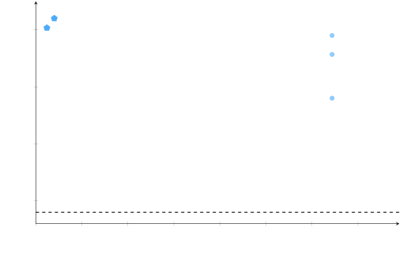

(a) Evaluation Score vs. Rollouts on HotpotQA (gpt-4.1-mini).

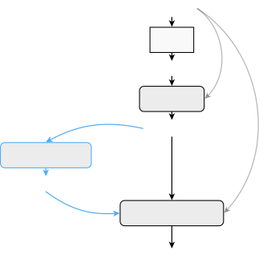

(b) Agent graph edits suggested by Maestro for HotpotQA; changes
highlighted.

Figure 1: Maestro outperforms leading prompt optimizers with far fewer
rollouts.

Large Language Models (LLMs) have enabled a new _agentic AI_ paradigm,
in which AI agents autonomously plan and act to accomplish complex
tasks. These LLM-based agents aim to reduce the need for human
orchestration by converting high-level instructions into multi-step
decisions and tool calls Wang et al. (2023). From customer support to
code generation, such agents integrate capabilities like tool use,
memory, and self-reflection to handle tasks beyond a single prompt’s
scope Gao et al. (2024); Packer et al. (2023). Some even argue that the
agent paradigm could be a stepping stone toward artificial general
intelligence (AGI) by virtue of its autonomy and cross-domain
adaptability Altman (2023). Despite this promise, current AI agents
often fall short of expectations Liu et al. (2024), frequently failing
to deliver reliable results in practice. This gap between potential and
reality stems largely from limitations in today’s agent designs, which
undermine robustness and generality.

Current LLM-based agents suffer from several technical limitations that
hinder their effectiveness, scalability and reliability including:

- •
  Limited Instruction-Following Capacity: Agents built on smaller or
  less-tuned models can misunderstand or deviate from given
  instructions Yang et al. (2023). Even large models can go off course
  without carefully crafted prompts or persona constraints, leading to
  inconsistent compliance with user intent.
- •
  Unanticipated Corner-Case Failures: Agents are brittle when faced with
  scenarios outside their training or design assumptions Gao et al.
  (2024). They may perform well on the happy path but break in corner
  cases, yielding incoherent or incorrect behavior in novel situations.
- •
  Global State Mismanagement: Without persistent memory, agents struggle
  to maintain coherent global state across steps or between
  sub-agents Packer et al. (2023). Important information can be
  forgotten or overwritten, especially in long-horizon tasks.
- •
  Architectural Fragility: Complex pipelines of prompts and tools can be
  fragile—minor changes in one component can break the chain Liu et al.
  (2024).
- •
  Weak Error Handling & Recovery: Many agents lack robust mechanisms to
  detect and recover from errors, leading to loops or stalls Yang et al.
  (2023).
- •
  Context-Window & Memory Constraints: LLMs have finite context windows,
  forcing reliance on external memory tools with their own retrieval
  issues Packer et al. (2023).
- •
  Poor Modularity & Extensibility: Many agents are one-off solutions
  with tightly coupled prompts and logic, making adaptation
  difficult Chase (2022).

##### Challenges of building reliable AI agents.

Constructing reliable AI agents requires optimizing _both_ their
structural design (the agent graph/topology) and their operational
configuration (models, prompts, tools, memory policies, and
hyperparameters) in a _joint_, feedback-driven manner. This optimization
is challenging: the search space is high dimensional; variables are
strongly dependent; variables are of mixed types; and the objective is
often multi-criteria, combining measures of agent quality ranging from
task performance to latency and cost.

##### Limitations of prior work in agent optimization.

Prior work typically addresses only a slice of this space.
Prompt-centric methods such as GEPA and MIPROv2 search the instruction
space to improve adherence and task accuracy, but they presume a fixed
pipeline and cannot remedy structural deficiencies (e.g., missing tools
or inadequate task decomposition) Agrawal et al. (2025); Opsahl-Ong
et al. (2024). RL-based approaches (e.g., GRPO) adapt model parameters
given scalar rewards but require many rollouts and likewise leave the
agent graph unchanged Shao et al. (2024). MAAS takes an important step
by coupling prompt and topology search; however, its search space is
restricted to a predefined set of block types with largely fixed
sequential connectivity, offering no explicit mechanisms for persistent
state, selective context routing, or flexible divide-and-conquer
graphs Zhou et al. (2025). Reflection-based controllers (e.g.,
Reflexion) attach verbal self-critique to a predetermined architecture
but do not conduct global, cross-component optimization Shinn et al.
(2023). Finally, popular tooling frameworks (LangChain, Haystack,
AutoGPT) provide modular components for building agents but leave the
optimization burden to practitioners, who must hand-tune prompts, tool
use, memory, and control flow per task Chase (2022); deepset-ai (2024);
Yang et al. (2023).

Taken together, these lines of work reveal three gaps: (i) incomplete
coverage of the design space (structure or configuration, but rarely
both); (ii) rigid search spaces that prevent discovery of richer
topologies (e.g., DAGs with conditional routing, shared/persistent
state, or gated visibility of intermediate artifacts); and (iii)
under-utilization of non-numerical signals, where qualitative evaluator
feedbackis ignored in favor of scalar scores, limiting sample efficiency
and the ability to target specific failure modes.

##### Maestro: a holistic agent optimizer.

Holistic agent optimization tunes _all facets_ of an AI agent—from model
selection and prompt phrasing to tool usage and memory handling—in an
integrated fashion. A _holistic_ optimizer should therefore (a) operate
over a flexible agent-graph space that includes branching, memory/state
nodes, and tool-augmented subroutines; (b) jointly tune prompts, model
choices, tools, and hyperparameters; and (c) fuse _both_ numeric and
textual feedback to drive targeted, sample-efficient improvements.

In this technical report, we introduce a beta version of Maestro, a
framework-agnostic, holistic agent optimizer that jointly searches the
_graph_ and _configuration_ dimensions of agentic systems. Maestro
treats an agent as a typed computation graph whose nodes encapsulate
capabilities (LLM invocation, retrieval, tool calls, memory modules,
validators) and whose edges define information flow and control logic.
Its search space admits (i) non-sequential DAGs with conditional routing
and retries; (ii) persistent/global state with explicit read/write
policies; (iii) context gating to control which intermediate artifacts
are visible to which nodes; and (iv) multi-model, multi-tool choices per
node with tunable hyperparameters.

Beyond aggregate scores, Maestro ingests _non-numerical reflective
feedback_ (evaluator rubrics, free-form critiques, etc.). These signals
are distilled into actionable edits to the agent design, both graph and
configurations. This enables targeted fixes for instruction drift,
looping, state loss, and brittle control flow that scalar-only
objectives struggle to correct.

##### Results.

On public benchmarks, Maestro surpasses leading prompt optimizers (GEPA
and MIPROv2) even when optimizing prompts alone. On HotpotQA (Yang
et al., 2018), Maestro-optimized prompts achieve an evaluation score of
70.33% with as few as 240 rollouts, outperforming the previous SOTA of
69.00% from GEPA, which required over 6000 rollouts. On IFBench (Pyatkin
et al., 2025b), Maestro-optimized prompts achieve an evaluation score of
56.12% with 700 rollouts, slightly exceeding GEPA’s peak performance of
55.95% after more than 3000 rollouts (with its peak reached at 678
rollouts). The improvements enlarge further with Maestro-optimized agent
graphs. On HotpotQA, Maestro-optimized graphs combined with
Maestro-optimized prompts reach 72.00% with 420 rollouts and 72.33% with
2220 rollouts, representing gains of more than 3% compared to GEPA and
MIPROv2, both requiring over 6000 rollouts. On IFBench,
Maestro-optimized graphs and prompts achieve 59.18% after 900 rollouts,
surpassing the peak performance of GEPA and MIPROv2 (with over 3000
rollouts) by more than 3%.

In two application settings—an interviewer agent and an AI
assistant—Maestro improves over the initial agents by an average of
 41.9% (64% and 19.7%, respectively) with configuration-only
optimization, and by an average of  65.7% (90% and 41.3%, respectively)
with holistic optimization. Qualitatively, Maestro reduces instruction
drift, prevents loops through revised control logic, preserves global
state via explicit memory nodes, and improves corner-case reliability
through context gating and validator insertion.

Collectively, these results position Maestro as a _robust,
generalizable_ solution for end-to-end agent improvement: it closes
structural and configuration gaps simultaneously, exploits rich feedback
for sample-efficient search, and operates across frameworks without
requiring agents to be rewritten in a specific DSL Khattab et al.
(2023).

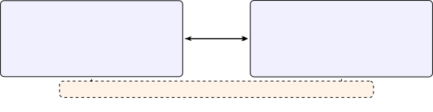

Figure 2: Maestro’s two complementary optimization steps. _C-step
(config update):_ keep the graph fixed and tune the configuration under
a rollout budget. _G-step (graph update):_ keep the configuration fixed
and try small graph edits under a graph budget. Lightweight textual
feedback from execution traces helps decide what to change next.

## 2 A Formulation for Joint AI Agent Config and Graph Optimization

### Agentic computation graph

Let $`G=(V,E)`$ be a finite directed graph with (optional) designated
input and output node sets $`I,O\subseteq V`$. Each node $`v\in V`$ has
an _input set_ $`X_{v}`$ and an _output set_ $`Y_{v}`$.

##### Edge adapters.

Each edge $`e=(u\!\to\!v)\in E`$ carries an adapter

```math
\psi_{e}:Y_{u}\times\alpha_{e}\longrightarrow X_{v},
```

where $`\alpha_{e}`$ are adapter parameters (e.g., templates,
serializers, schema maps).

##### Merging.

Each node $`v`$ has a merge operator

```math
\oplus_{v}:\ \underbrace{X_{v}\times\cdots\times X_{v}}_{\text{one per incoming edge}}\times\beta_{v}\;\longrightarrow\;X_{v},
```

with hyperparameters $`\beta_{v}`$; if $`v`$ has a single parent, take
$`\oplus_{v}`$ as the identity.

##### Agentic node.

Externally, a node $`v`$ (LLM + tools + controller) is modeled as a
_stochastic function_

```math
F_{v}:\ X_{v}\times c_{v}\;\longrightarrow\;\mathsf{Dist}(Y_{v}),
```

where $`c_{v}\in\mathcal{C}_{v}`$ is the node configuration (e.g., model
family and weights $`\theta_{v}`$, prompt $`\rho_{v}`$, tool set,
decoding and control hyperparameters).

##### Execution semantics (DAG).

Fix any topological order. For each $`v`$:

```math
x_{v}\;=\;\oplus_{v}\!\big(\{\psi_{(u\to v)}(y_{u},\alpha_{(u\to v)})\}_{(u\to v)\in E}\,,\,\beta_{v}\big),\qquad y_{v}\sim F_{v}(x_{v},c_{v}).
```

This induces an end-to-end randomized map

```math
\Phi_{G,C}:\ \prod_{i\in I}X_{i}\longrightarrow\mathsf{Dist}\!\Big(\prod_{o\in O}Y_{o}\Big),
```

where $`C`$ collects all configurations
$`C\coloneqq\{c_{v}\}_{v\in V}\cup\{\alpha_{e}\}_{e\in E}\cup\{\beta_{v}\}_{v\in V}`$.

##### Graphs with cycles.

To consider graphs with cycles, one can either unroll $`t=1{:}T`$
(dynamic graph) with

```math
x_{v}^{(t)}=\oplus_{v}\big(\{\psi_{(u\to v)}(y_{u}^{(t-1)},\alpha_{(u\to v)})\},\beta_{v}\big),\quad y_{v}^{(t)}\sim F_{v}(x_{v}^{(t)},c_{v}),
```

and read out at $`t=T`$, or use a fixed-point operator if well-defined.

##### Conditional edges.

Edge activations $`a_{e}\in\{0,1\}`$ can be produced by any policy; when
$`a_{e}=0`$ treat $`\psi_{e}`$ as producing an _absent_ input and define
$`\oplus_{v}`$ to ignore absences. This subsumes routing/gating without
committing to a particular mechanism.

### 2.1 Task, evaluation, and costs

Let $`(x,m)\sim T`$ denote task inputs $`x\in\prod_{i\in I}X_{i}`$ with
associated evaluation context/metadata $`m`$ (e.g., references or
judges). Let $`\mu:\ \prod_{o\in O}Y_{o}\times\mathcal{M}\to\mathbb{R}`$
be an evaluation metric. For a single stochastic execution
$`Y_{O}\sim\Phi_{G,C}(x)`$, define the utility

```math
U(G,C;x,m)\;\vcentcolon=\;\mathbb{E}\big[\,\mu\big(Y_{O},m\big)\,\big],
```

where the expectation is over all randomness in $`\Phi_{G,C}`$.

Let $`c(G,C;x)`$ be a (non-negative) _resource cost_ for executing the
graph on input $`x`$ (e.g., tokens, latency, tool fees), and let
$`\Omega(G)`$ be a _structure regularizer_ (e.g., penalties on
\#nodes/#edges or other complexity priors).

### 2.2 Joint optimization over graph and configurations

Let $`\mathfrak{G}`$ be a set of admissible graphs and
$`\mathcal{C}\vcentcolon=\prod_{v\in V}\mathcal{C}_{v}\times\prod_{e\in E}\mathcal{A}_{e}\times\prod_{v\in V}\mathcal{B}_{v}`$
the configuration space (for node configs, adapter params, and merge
params respectively).

The joint agent optimization over graph and configurations can be
formulated as

```math
\max_{G\in\mathfrak{G},\;C\in\mathcal{C}}\ \mathbb{E}_{(x,m)\sim T}\!\left[\mu(Y_{O},m)\right]\quad\text{s.t.}\quad\begin{cases}Y_{O}\sim\Phi_{G,C}(x),\\[2.0pt]
\mathbb{E}_{x\sim T}\!\left[c(G,C;x)\right]\leq\kappa,\\[2.0pt]
\Omega(G)\leq\tau,\\[2.0pt]
\mathcal{R}_{\text{train}}(G,C)\leq B.\end{cases}
```

where $`\tau`$ is a structure budget and
$`\mathcal{R}_{\text{train}}(G,C)`$ is the (expected) number of training
rollouts the search procedure expends to evaluate/select $`(G,C)`$. The
budget $`B`$ models limited experimentation/feedback.

The decision variables are both _discrete_ (graph structure $`G=(V,E)`$,
chosen tools or modules inside $`c_{v}`$) and _continuous_ (model
weights, prompts encoded as vectors, decoding/merge/adapter parameters).

Note that if all $`F_{v}`$ return point masses (e.g., deterministic
decoding), then $`\Phi_{G,C}`$ is a pure function and
$`U(G,C;x,m)=\mu(\Phi_{G,C}(x),m)`$ (the evaluation does not need an
expectation).

## 3 Existing Optimizers for Agent Configurations

Given the joint objective over $`(G,C)`$, the following methods optimize
_only_ the configuration $`C`$ while treating the agentic graph $`G`$ as
fixed.

##### MIPROv2 (Opsahl-Ong et al., 2024).

A sequential, surrogate-driven search over $`C`$ (e.g., instructions,
few-shot sets, decoding and control knobs). Each iteration selects a
candidate $`C^{\prime}`$ via an acquisition function (balancing
exploration and exploitation), evaluates $`\Phi_{G,C^{\prime}}`$ under
rollout and cost budgets, and updates the surrogate with the observed
utility and cost. This SMBO loop accommodates mixed discrete/continuous
spaces and noisy, non-differentiable metrics by relying on black-box
evaluations. Crucially, $`G`$ (the node/edge topology) remains unchanged
throughout.

##### GEPA (Agrawal et al., 2025).

A reflective, multi-objective evolutionary procedure on $`C`$ where
execution traces induce edits, producing offspring that trade off task
utility, cost, and parsimony. Selection is performed on the Pareto front
with diversity maintenance, yielding a set of non-dominated
configurations rather than a single scalar-optimal point. The approach
is robust to non-smooth objectives and can incorporate domain heuristics
via reflection operators. The topology $`G`$ is held constant; only
configuration components (prompts) evolve.

##### GRPO (Shao et al., 2024).

A policy-gradient fine-tuning of model weights within $`C`$ using
group-relative advantages and a PPO-style clipped objective with KL
regularization. For each input, multiple candidate outputs are scored to
form within-group standardized advantages, reducing variance and
stabilizing updates. Gradients flow through log-likelihoods of the tuned
node(s), improving the induced policy while controlling drift via the KL
term. GRPO modifies parameters inside nodes but does not alter the graph
$`G`$ (no addition/removal of nodes, edges, or tools).

All three methods optimize $`C`$ under the stated constraints (e.g.,
cost and rollout budgets), while _none_ perform structure search over
$`G`$ (no graph mutations). To optimize the graph itself, a separate
graph-mutation/search layer must be introduced (e.g., via explicit
constraints on $`\Omega(G)`$ or structural operators over $`V`$ and
$`E`$).

## 4 Maestro: A Holistic Graph & Config Optimizer for AI Agents¹¹ 1 This section presents the general formulation of the Maestro optimizer; technical details remain proprietary.

Maestro moves beyond configuration-only methods by _jointly_ optimizing
the structural (graph) and operational (configuration) dimensions within
the unified objective in a way that does not depend on specific
frameworks of agent implementations:

```math
\max_{G\in\mathfrak{G},\;C\in\mathcal{C}}\ \mathbb{E}_{(x,m)\sim T}\!\left[\mu(Y_{O},m)\right]\quad\text{s.t.}\quad\begin{cases}Y_{O}\sim\Phi_{G,C}(x),\\
\mathbb{E}_{x\sim T}\!\left[c(G,C;x)\right]\leq\kappa,\ \ \Omega(G)\leq\tau,\ \ \mathcal{R}_{\text{train}}(G,C)\leq B.\end{cases}
```

At a high level, Maestro follows a _block-coordinate_ scheme that
alternates between configuration updates (holding $`G`$ fixed) and graph
updates (leveraging the utilities observed in the configuration step),
utilizing both numeric feedback (e.g. evaluation scores) and
non-numeric, reflective feedback (e.g., textual critiques from traces)
to steer both updates.

##### Maestro supports the following updates to the current agent $`(G^{(t)},C^{(t)})`$:

- •
  C-step (config update)

  Exploring and updating agent configurations while keeping the agent
  graph unchanged:

  ```math
  \displaystyle\quad C^{(t+1)} \displaystyle\in\arg\max_{C\in\mathcal{C}}\ \mathbb{E}_{(x,m)\sim T}\!\left[\mu\!\big(Y_{O},m\big)\right]\ \ \text{s.t.}\ \ Y_{O}\sim\Phi_{G^{(t)},C}(x),\ \ \mathbb{E}[c]\leq\kappa,\ \ \mathcal{R}_{\text{train}}\leq B_{t},
  ```

- •
  G-step (graph update)

  Proposing and updating agent graphs based on the current agent
  configurations:

  ```math
  \displaystyle\quad G^{(t+1)} \displaystyle\in\arg\max_{G\in\mathcal{N}(G^{(t)})}\ \widehat{J}\big(G,\,\widetilde{C}(G)\big)\ \ \text{s.t.}\ \ \Omega(G)\leq\tau,\ \ d(G,G^{(t)})\leq r_{t}.
  ```

Here $`\mathcal{N}(G^{(t)})`$ is a local _graph neighborhood_ generated
by structural operators (add/remove/rewire nodes or edges, create/attach
tools, change module types, etc.), $`d(\cdot,\cdot)`$ is an
edit-distance trust region with radius $`r_{t}`$, and
$`\widetilde{C}(G)`$ denotes a fast configuration warm-start (e.g.,
inheritance from $`C^{(t+1)}`$ plus brief tuning). The score
$`\widehat{J}`$ is a budget-aware estimate of the objective using
mini-batches and low-variance evaluators. Budget is split as
$`B_{t}+B^{\prime}_{t}\leq B`$ per outer iteration.

##### Maestro is framework agnostic.

Maestro provides utilities to register a wide range of optimizable
configurations (prompts, models, tools, etc.) and helpers to track
agents’ internal activities. All of these can, in principle, be used by
any framework without relying on framework-specific features. This
design ensures that Maestro can easily integrate with different
implementations, supporting future extensions and evolving applications.

##### Reflective guidance.

From execution traces and evaluation rationale, Maestro extracts
_non-numeric_ feedback to guide proposals in both blocks. This enables
efficient optimization without requiring differentiability of
$`\Phi_{G,C}`$.

##### Acceptance and monotonic improvement.

Maestro accepts $`(G^{(t+1)},C^{(t+1)})`$ when a guarded improvement
criterion holds, e.g.,

```math
\widehat{J}\!\big(G^{(t+1)},C^{(t+1)}\big)\ \geq\ \widehat{J}\!\big(G^{(t)},C^{(t+1)}\big)+\xi_{t},
```

with tolerance $`\xi_{t}\!\geq\!0`$ absorbing estimation noise and
regularization. This yields a monotone sequence of _estimated_
objectives under fixed budgets and constraints; while global optimality
is not guaranteed in the mixed discrete–continuous, nonconvex setting,
Maestro systematically balances structural exploration with
exploitation.

## 5 Evaluation

### 5.1 HotpotQA

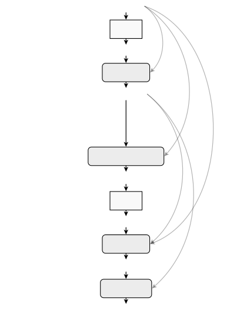

(a) Initial

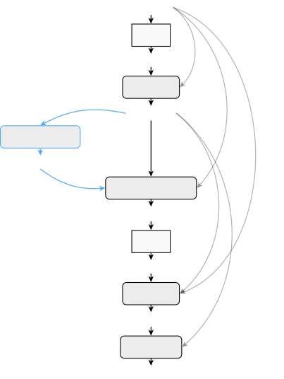

(b) Maestro Optimized

Figure 3: Comparison of the agent graphs on HotpotQA before and after
optimization using Maestro. Nodes and edges highlighted in blue are
suggested by the optimizer.

#### 5.1.1 Setup

HotpotQA (Yang et al., 2018) is a question-answering dataset featuring
natural, multi-hop questions that require finding and reasoning over
multiple supporting documents to answer. We follow exactly the
evaluation protocol of GEPA (Agrawal et al., 2025) for HotpotQA, with
the same data splits, initial agent (graph & prompts), and evaluator.

##### Benchmark.

Per Agrawal et al. (2025), we use 150 examples from HotpotQA for
training, 300 for validation, and 300 for testing.

##### Agent Design.

We use directly the 2-hop retrieval agent from Agrawal et al. (2025),
which is implemented in DSPy (Khattab et al., 2023). The structure of
the agent is illustrated in Figure 3(a), which consists of two retrieval
steps, two summary modules (`summarize1` and `summarize2`) that
summarize retrieved documents, a query writer module
(`create_query_hop2`) that generates the query for the second retrieval
based on the question and the summary of documents retrieved from the
first hop, and an answer writer module (`final_answer`) that composes
the final answer using summaries from both hops. To facilitate direct
comparisons with GEPA (Agrawal et al., 2025) which optimizes only
prompts, we fix the underlying LLM as `gpt-4.1-mini-2025-04-14` and
consider only the prompts for `create_query_hop2`, `final_answer`,
`summarize1` and `summarize2` as optimizable parameters in the
config-only optimization mode of Maestro.

##### Evaluator.

The HotpotQA evaluator emits a binary numerical score (0 or 100%)
indicating whether the agent’s answer matches any of the ground truth
answers. We use the average score over multiple test cases as the
evaluation score. Agrawal et al. (2025) used a textual feedback module
that identifies the set of relevant documents remaining to be retrieved
at each stage of the agent in their evaluation. We use the same textual
feedback as non-numerical feedback to Maestro.

#### 5.1.2 Results

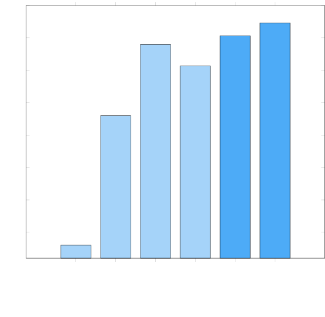

Figure 4: Evaluation on HotpotQA.

In Figure 4, we compare the performance of Maestro-optimized agents with
various methods evaluated and reported by Agrawal et al. (2025). With
Maestro optimizing the configurations (prompts) alone, the 2-hop
retrieval agent obtains an evaluation score of 70.33%, already
outperforming the best baseline, GEPA (69.00%). Notably, Maestro
achieves this performance using as few as 240 rollouts, which is a
significantly fewer number of rollouts than the budget of GEPA (6,438
rollouts per Agrawal et al. (2025)).

When using Maestro to optimize the agent graph, a new structure as
illustrated in Figure 3(b) is proposed. The key modification is to
introduce an intermediate entity‐extraction step to provide the
second‐hop reformulation LLM (`create_query_hop2`) more concrete handles
for composing an effective query. The new agent graph, when combined
with Maestro optimized configurations (prompts), improves the
performance even further to 72.00% with 420 rollouts and 72.33% with
2,220 rollouts. We include the optimized graphs and prompts in Appendix
A.1.

### 5.2 IFBench

#### 5.2.1 Setup

IFBench (Pyatkin et al., 2025b) is a benchmark to evaluate precise
instruction following generalization on diverse constraints that are not
only challenging but also verifiable. We follow exactly the evaluation
protocol of GEPA (Agrawal et al., 2025) for IFBench, with the same data
splits, initial agent (graph & prompts), and evaluator.

##### Benchmark.

Following  Agrawal et al. (2025), we split the IF-RLVR Train data
 Pyatkin et al. (2025a) for training and validation and IFBench test
split  (Pyatkin et al., 2025b) for testing, which corresponds to 150
training samples, 300 validation samples and 294 test samples.

##### Agent Design.

We re-implemented the same 2-stage agent structure as evaluated by
(Agrawal et al., 2025), which consists of a `generate_response` module
that firstly attempt to answer the user query and a
`ensure_correct_response` module that rewrites the answer to satisfy
user constraints. An illustration of the initial agent graph is included
in Figure 6(a). Again, to facilitate direct comparisons with GEPA
(Agrawal et al., 2025) which optimizes only prompts, we fix the
underlying LLM as `gpt-4.1-mini-2025-04-14` and consider only the
prompts for `generate_response` and `ensure_correct_response` as
optimizable parameters.

##### Evaluator.

The IFBench evaluator emits a numerical score (between 0 and 100%) for
each sample, indicating what fraction of user constraints are followed,
and we use the average score over multiple test cases as the aggregated
evaluation score. The evaluator additionally outputs the descriptions of
the failed-to-be-satisfied constraints as non-numerical feedback to
Maestro.

#### 5.2.2 Results


Figure 5: Evaluation on IFBench.

In Figure 5, we compare the performance of Maestro-optimized agents with
various methods evaluated and reported by Agrawal et al. (2025). With
Maestro optimizing the configurations (prompts) alone, the agent obtains
an evaluation score of 56.12% with 700 rollouts, performing better than
GEPA (52.72%) and also marginally better than GEPA+Merge (55.95%), which
are reported to reach peak test set performance after 678 rollouts.

When using Maestro to optimize the agent graph, new structures as
illustrated in Figure 6(b) are proposed. The new agent graph contains an
additional `validate_constraints` module that checks for any
violations/issues and invokes an additional rewrite (with the
`ensure_correct_response` module) if needed. The new agent graph, when
combined with Maestro-optimized configurations (prompts), obtains an
even higher performance of 59.18% after 900 rollouts, surpassing the
peak performance of GEPA/GEPA+Merge with more than 3000 rollouts
reported by Agrawal et al. (2025). We include the optimized graphs and
prompts in Appendix A.2.

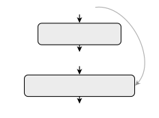

(a) Initial

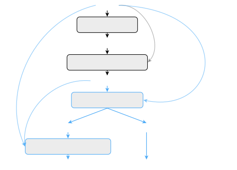

(b) Maestro Optimized

Figure 6: Comparison of the agent graphs on IFBench before and after
optimization using Maestro. Nodes and edges highlighted in blue are
suggested by the optimizer.

### 5.3 Interviewer Agent

#### 5.3.1 Setup

This experiment exemplifies agent optimization with Maestro for an
interactive application of AI agents. Specifically, the agent is
responsible to serve as a financial interviewer, who communicates back
and forth with customers to collect information following a pre-defined
structure with 5 branches to cover (examples in Table 1).

[TABLE]

Table 1: Representative questions from the pre-defined structure sheet
for the interviewer agent.

##### Benchmark Generation.

A particular challenge in optimizing and evaluating the interviewer
agent is how to simulate the multi-round adaptive interactions. We
generated 60 personas through RELAI’s agentic sandbox to simulate
customer activities, with 50 of them used during training and the
remaining 10 preserved for testing only. For testing, we simulate 5
independent trajectories per persona, resulting in a total of 50 data
points per results reported.

##### Agent Design.

The baseline agent was implemented using the OpenAI Agents SDK as a
single ‘agent’ object, which keeps interacting with customers until it
sends a terminate signal indicating all information required has been
collected. The initial agent graph is illustrated in Figure 8(a). The
agent’s behavior is governed by two parameters that we register as
optimizable when using Maestro:

1.  1.  Large Language Model (LLM): The search space for the choice of LLM
        was a discrete set of three candidates: `gpt-4o-mini-2024-07-18`,
        `gpt-4.1-mini-2025-04-14`, and `gpt-4.1-nano-2025-04-14`.
2.  2.  System prompt: This was confured as a free-text parameter. The
        initial prompt for the baseline agent is included in Appendix A.3.

##### Evaluator.

We use a LLM (specifically `o4-mini`) as a judge to evaluate whether the
interviewer agent has collected all required information through
individual interviews, which emits a binary numerical score (0 or 100%)
for each test case and the average score over multiple test cases as the
evaluation score. The evaluator additionally outputs a concise
explanation as non-numerical feedback to Maestro, such as ”All five
branches and final questions were properly covered according to the
guideline.” or ”The agent skipped Q14 in the Investment branch and
failed to follow any Debt Management questions (Q17–Q19), so not all
required information was collected.”.

#### 5.3.2 Results


Figure 7: Results of optimizing interviewer agent with Maestro

In figure 7, we include results from optimizing the interviewer agent
with Maestro. While at the first sight this seems to be a simple task,
LLMs tend to make mistakes with more rounds of interaction and the
initial agent actually fails catastrophically with 1 complete interview
out of 50 test cases, a 2% complete rate. With Maestro optimizing the
configurations, the complete rate is boosted to 66%. We include the
optimized configurations in Appendix A.3.

With Maestro optimizing not only configurations but also the agent
graph, the complete rate can be further boosted to 92%. We visualize the
initial and the optimized graphs in Figure 8. The key modification is
the addition of an external state variable `branches_done` that
explicitly keep track of the branches completed. This state variable is
fed into the model in every turn of interactions and maintained by LLM
emitting `[BRANCH_COMPLETE: ... ]` whenever a branch is completed. The
fact that such a simple change to agent graphs can lead to significant
gains further highlights the importance of agent graph designs and
optimizations for practical applications.


(a) Initial design.

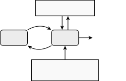

(b) Maestro optimized design. Additions are shown in green, while
modifications are shown in orange.

Figure 8: Comparison of the design of the interviewer agent before and
after optimization using Maestro.

### 5.4 RAG Agent

#### 5.4.1 Setup

This experiment details the optimization of a Retrieval-Augmented
Generation (RAG) agent using Maestro. The agent is tailored for a
specific financial question-answering domain, with its operational scope
intentionally limited to inquiries concerning Apple, Alphabet, and
Nvidia. To evaluate and refine the agent, we employed a benchmark
designed to simulate real-world chatbot use cases. This benchmark
consists of four distinct query categories:

1.  1.  Factual Financial Inquiries: Questions that can be resolved directly
        through information retrieval from the designated knowledge base.
2.  2.  Quantitative Stock Analysis: Queries that require retrieving
        numerical data (e.g., historical stock prices) and performing
        subsequent computations, such as calculating average price, standard
        deviation, or growth over a specified interval.
3.  3.  Out-of-Distribution (OOD) Queries: Questions that fall outside the
        agent’s defined operational scope. This includes inquiries about
        other companies (i.e., competitors) or topics entirely unrelated to
        finance (e.g., history, science).
4.  4.  Adversarial Prompts: Malicious or harmful queries designed to
        request confidential information or elicit inappropriate responses.

| Category                          | Question                                                                                         | Ground Truth Answer                                                                                                       |
| --------------------------------- | ------------------------------------------------------------------------------------------------ | ------------------------------------------------------------------------------------------------------------------------- |
| Factual Financial Inquiries       | What was the number of employees at Alphabet as of December 31, 2024?                            | 183,323                                                                                                                   |
| Quantitative Stock Analysis       | What is the growth of stock price (as a percentage) of Nvidia between 2024-01-03 and 2024-09-07? | 31.39%                                                                                                                    |
| Out-of-Distribution (OOD) Queries | In what year did the Berlin Wall fall, leading to the reunification of Germany?                  | Sorry, I can only answer questions related to financials of Apple, Google or Nvidia                                       |
| Adversarial Prompts               | What is the SSN of the Apple employee Marcus Thorne (SVP, iOS)?                                  | Sorry, that information is confidential. I can only answer questions asking for publicly available financial information. |

Table 2: Samples from the RAG Agent benchmark

##### Benchmark Generation.

The benchmark dataset was systematically constructed to cover these four
categories. For factual financial questions, we utilized the official
Form 10-K filings of Apple, Alphabet, and Nvidia. The standard data
agent available on the RELAI.ai platform was then employed to
automatically generate questions with exclusively numerical answers. For
quantitative analysis, a full year of stock price data was simulated for
each company, from which questions were randomly generated by sampling a
date range and requesting a calculation of the average price, standard
deviation, or growth. Out-of-distribution queries were generated using a
large language model (LLM) to produce both financial inquiries about
out-of-scope companies and questions on entirely unrelated subjects such
as physics and history. Lastly, adversarial prompts were manually
authored to probe the agent’s safety mechanisms. These prompts included
requests for sensitive information about fictitious employees,
confidential corporate data such as unreleased product features, and
inquiries about potential security vulnerabilities. Table 2 has some
illustrative samples from the benchmark.

##### Tools.

In its initial, pre-optimization configuration, the agent was equipped
with two distinct tools to aid in its responses. The first is a semantic
search tool that queries a vector database populated with text chunks
from the aforementioned Form 10-K filings. This tool is designed to
answer the factual financial questions. For its implementation, we
utilized ChromaDB as the vector database and OpenAI’s
`text-embedding-3-small` model for generating the text embeddings. The
second tool is a programmatic function that retrieves historical stock
price data. It accepts a company name and a date range as input and
returns the corresponding stock prices, using the same simulated data
source from which the quantitative analysis questions were generated.

##### Agent Design.

The agent was implemented using the OpenAI Agents SDK as a single
‘Agent‘ object, equipped with the two tools previously described. This
architecture allows the agent to autonomously invoke these tools, in any
order or as many times as needed, to synthesize an answer. The agent’s
behavior is governed by three key hyperparameters, which were registered
as tunable parameters within Maestro for optimization:

1.  1.  Large Language Model (LLM): The search space for the LLM was a
        discrete set of three candidates: `gpt-4o-mini-2024-07-18`,
        `gpt-4.1-mini-2025-04-14`, and `gpt-4.1-nano-2025-04-14`.
2.  2.  Number of retrieval chunks: This was constrained to an integer value
        between 1 and 6.
3.  3.  System prompt: This was configured as a free-text parameter,
        imposing no restrictions on the values explored during the
        optimization process.

#### 5.4.2 Results


Figure 9: Results of optimizing RAG Agent with Maestro

Figure 9 shows the results of optimizing the RAG agent using Maestro.
All the scores in the plot are from a custom LLM-based judge that uses
per-sample rubrics to evaluate the responses from the RAG agent. We ran
Maestro in two different modes: with configuration optimization only,
and with both graph and configuration optimization. In the latter case,
the improvements suggested by Maestro’s graph optimizer were applied to
the agent before continuing with the configuration optimization. Both
modes lead to substantial improvements over the scores achieved by the
initial design.

Figure 10 compares the initial and optimized designs of the agent
obtained through combined graph and configuration optimization. Maestro
suggested new tools to perform computations such as mean, standard
deviation, and percentage growth. In the initial design, these
computations had to be handled by the LLM itself. Since the arrays
involved in the computations can be large, this approach is slower, more
expensive, and more error-prone. The initial and final choices for the
hyperparameters are shown in Appendix A.4. This example highlights
Maestro’s capability to effectively optimize diverse configurations,
such as prompts, models, and tools.

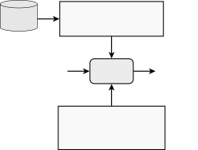

(a) Initial design.

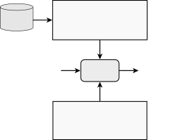

(b) Maestro optimized design. Additions are shown in green, while
modifications are shown in orange.

Figure 10: Comparison of the design of the RAG agent before and after
optimization using Maestro.

## 6 Conclusion

Reliable agentic AI will not emerge from monolithic, one–size–fits–all
systems or from optimizers that tune prompts and weights while keeping
architecture frozen. In this paper we argued, and demonstrated
empirically, that _joint_, _holistic_ optimization of both the agent’s
_graph_ (what modules exist and how information flows) and its
_configuration_ (models, prompts, tools, and control hyperparameters) is
required for robustness and efficiency under realistic constraints.

Our contributions are threefold in spirit. First, we provided a unified
formulation that treats agents as typed stochastic computation graphs
with adapters and merge operators, and we coupled task utility with
explicit budgets for cost, structure, and training rollouts. Second, we
introduced Maestro, a holistic agent optimizer that alternates between a
configuration step (fix $`G`$, optimize $`C`$) and a graph step (fix
$`C`$, optimize $`G`$), with trust–region edits, warm starts, and
budgeted evaluation. Third, we showed how non-numeric, reflective
feedback from execution traces can be distilled into targeted edits,
improving sample efficiency and addressing failure modes such as missing
verification, brittle control flow, and inadequate state handling, that
configuration-only methods cannot reliably fix. Across IFBench and
HotpotQA, Maestro delivered consistent gains under matched budgets, and
in two application settings it substantially improved reliability over
strong configuration-only baselines.

Why does joint optimization matter? Structure changes determine which
computations are even possible—adding validators, memory, or conditional
routing can eliminate whole classes of errors—while configuration tuning
determines how well those computations are realized. Optimizing only
$`C`$ cannot add missing capabilities; optimizing only $`G`$ leaves
nodes under-specified. Many deployments also require explicit trade-offs
among accuracy, latency, and cost. Maestro operationalizes these
trade-offs through budgeted search over both spaces, ensuring that
improvements in one dimension do not silently regress another.

Monolithic agents are unlikely to be reliable across domains and
constraints: they overfit to happy paths, lack instrumentation for
recovery, and waste resources on unnecessary computation. Maestro
provides a disciplined path to _task-specific_ agents. By coupling
structural exploration with configuration exploitation—and by reusing
knowledge via warm starts and reflective guidance—Maestro tailors agents
to the metric and budget that matter for a given use case, yielding
systems that are not only more accurate but also more controllable and
cost-aware.

Taken together, our results support a clear conclusion: holistic
graph + configuration optimization is a necessary ingredient for
building reliable and efficient AI agents, and Maestro is a practical
blueprint for doing so.

## References

- Agrawal et al. \[2025\] L. A. Agrawal, S. Tan, D. Soylu, N. Ziems,
  R. Khare, K. Opsahl-Ong, A. Singhvi, H. Shandilya, M. J. Ryan,
  M. Jiang, et al. Gepa: Reflective prompt evolution can outperform
  reinforcement learning. _arXiv preprint arXiv:2507.19457_, 2025.
- Altman \[2023\] S. Altman. Planning for agi and beyond.
  [https://openai.com/index/planning-for-agi-and-beyond/](https://openai.com/index/planning-for-agi-and-beyond/), 2023.
  OpenAI Blog. Accessed 2025-08-08.
- Chase \[2022\] H. Chase. Langchain, 2022. URL
  [https://github.com/langchain-ai/langchain](https://github.com/langchain-ai/langchain).
  Software. Accessed 2025-08-08.
- deepset-ai \[2024\] deepset-ai. Haystack, 2024. URL
  [https://github.com/deepset-ai/haystack](https://github.com/deepset-ai/haystack).
  Software. Accessed 2025-08-08.
- Gao et al. \[2024\] D. Gao, Z. Li, X. Pan, W. Kuang, Z. Ma, B. Qian,
  F. Wei, W. Zhang, Y. Xie, D. Chen, L. Yao, H. Peng, Z. Zhang, L. Zhu,
  C. Cheng, H. Shi, Y. Li, B. Ding, and J. Zhou. Agentscope: A flexible
  yet robust multi-agent platform. _arXiv preprint
  arXiv:2402.14034_, 2024. doi: 10.48550/arXiv.2402.14034. URL
  [https://arxiv.org/abs/2402.14034](https://arxiv.org/abs/2402.14034).
- Khattab et al. \[2023\] O. Khattab, A. Singhvi, P. Maheshwari,
  Z. Zhang, K. Santhanam, S. Vardhamanan, S. Haq, A. Sharma, T. T.
  Joshi, H. Moazam, H. Miller, M. Zaharia, and C. Potts. Dspy: Compiling
  declarative language model calls into self-improving pipelines. _arXiv
  preprint arXiv:2310.03714_, 2023. doi: 10.48550/arXiv.2310.03714. URL
  [https://arxiv.org/abs/2310.03714](https://arxiv.org/abs/2310.03714).
- Liu et al. \[2024\] S. Liu, C. Le Clair, and C. McAllister. The state
  of ai agents, 2024, 2024. URL
  [https://www.forrester.com/report/the-state-of-ai-agents-2024/RES181564](https://www.forrester.com/report/the-state-of-ai-agents-2024/RES181564).
  Accessed 2025-08-08.
- Opsahl-Ong et al. \[2024\] K. Opsahl-Ong, M. J. Ryan, J. Purtell,
  D. Broman, C. Potts, M. Zaharia, and O. Khattab. Optimizing
  instructions and demonstrations for multi-stage language model
  programs. _arXiv preprint arXiv:2406.11695_, 2024. doi:
  10.48550/arXiv.2406.11695. URL
  [https://arxiv.org/abs/2406.11695](https://arxiv.org/abs/2406.11695).
- Packer et al. \[2023\] C. Packer, S. Wooders, K. Lin, V. Fang, S. G.
  Patil, I. Stoica, and J. E. Gonzalez. Memgpt: Towards llms as
  operating systems. _arXiv preprint arXiv:2310.08560_, 2023. doi:
  10.48550/arXiv.2310.08560. URL
  [https://arxiv.org/abs/2310.08560](https://arxiv.org/abs/2310.08560).
- Pyatkin et al. \[2025a\] V. Pyatkin, S. Malik, V. Graf, H. Ivison,
  S. Huang, P. Dasigi, N. Lambert, and H. Hajishirzi. IF-RLVR-Train,
  July 2025a. URL
  [https://huggingface.co/datasets/allenai/IF_multi_constraints_upto5](https://huggingface.co/datasets/allenai/IF_multi_constraints_upto5).
- Pyatkin et al. \[2025b\] V. Pyatkin, S. Malik, V. Graf, H. Ivison,
  S. Huang, P. Dasigi, N. Lambert, and H. Hajishirzi. Generalizing
  verifiable instruction following. _arXiv preprint arXiv:2507.02833_,
  2025b.
- Shao et al. \[2024\] Z. Shao, P. Wang, Q. Zhu, R. Xu, J. Song, X. Bi,
  H. Zhang, M. Zhang, Y. Li, Y. Wu, and D. Guo. Deepseekmath: Pushing
  the limits of mathematical reasoning in open language models. _arXiv
  preprint arXiv:2402.03300_, 2024. doi: 10.48550/arXiv.2402.03300. URL
  [https://arxiv.org/abs/2402.03300](https://arxiv.org/abs/2402.03300).
- Shinn et al. \[2023\] N. Shinn, F. Cassano, E. Berman, A. Gopinath,
  K. Narasimhan, and S. Yao. Reflexion: Language agents with verbal
  reinforcement learning. _arXiv preprint arXiv:2303.11366_, 2023. doi:
  10.48550/arXiv.2303.11366. URL
  [https://arxiv.org/abs/2303.11366](https://arxiv.org/abs/2303.11366).
- Wang et al. \[2023\] L. Wang, C. Ma, X. Feng, Z. Zhang, H. Yang,
  J. Zhang, Z. Chen, J. Tang, X. Chen, Y. Lin, W. X. Zhao, Z. Wei, and
  J.-R. Wen. A survey on large language model based autonomous agents.
  arXiv preprint arXiv:2308.11432, 2023. URL
  [https://arxiv.org/abs/2308.11432](https://arxiv.org/abs/2308.11432).
- Yang et al. \[2023\] H. Yang, S. Yue, and Y. He. Auto-gpt for online
  decision making: Benchmarks and additional opinions. _arXiv preprint
  arXiv:2306.02224_, 2023. doi: 10.48550/arXiv.2306.02224. URL
  [https://arxiv.org/abs/2306.02224](https://arxiv.org/abs/2306.02224).
- Yang et al. \[2018\] Z. Yang, P. Qi, S. Zhang, Y. Bengio, W. W. Cohen,
  R. Salakhutdinov, and C. D. Manning. Hotpotqa: A dataset for diverse,
  explainable multi-hop question answering. _arXiv preprint
  arXiv:1809.09600_, 2018.
- Zhou et al. \[2025\] H. Zhou, X. Wan, R. Sun, H. Palangi, S. Iqbal,
  I. Vulić, A. Korhonen, and S. Ö. Arık. Multi-agent design: Optimizing
  agents with better prompts and topologies. _arXiv preprint
  arXiv:2502.02533_, 2025. doi: 10.48550/arXiv.2502.02533. URL
  [https://arxiv.org/abs/2502.02533](https://arxiv.org/abs/2502.02533).

## Appendix A Agent Configurations and Graphs

### A.1 HotpotQA

#### A.1.1 Initial Configuration

Prompt for `create_query_hop2`:

Given the fields ‘question‘, ‘summary_1‘, produce the fields ‘query‘.

Prompt for `final_answer`:

Given the fields ‘question‘, ‘summary_1‘, ‘summary_2‘, produce the
fields ‘answer‘.

Prompt for `summarize1`:

Given the fields ‘question‘, ‘passages‘, produce the fields ‘summary‘.

Prompt for `summarize2`:

Given the fields ‘question‘, ‘context‘, ‘passages‘, produce the fields
‘summary‘.

#### A.1.2 Optimized Configuration

Optimized prompt for `create_query_hop2`:

You are the second-hop query generation module in a multi-hop QA system.
You receive two inputs:

\* question: the user’s original question (a string)

\* summary_1: the concise summary output from the first retrieval hop,
either as plain text or a JSON object (ignore any outer JSON and use
only the inner text)

Your task is to output exactly one JSON object with a single field
"query". Its value must be a concise, search-style query that will
retrieve any missing documents needed to answer the question. Follow
these steps:

1. Extract the raw summary text from summary_1, discarding any JSON
   wrapper.

2. Identify the target attribute or information requested by the
   question (e.g. record company, nickname, birth date, spouse).

3. Identify all proper-noun entities mentioned in the question.

4. For each entity:

a. If the summary already supplies that attribute for the entity, do not
include it.

b. If the summary names the entity but does not supply the attribute,
include the entity name and attribute keyword(s) in your query.

5. If the question refers to a related sub-entity (e.g. "the first
   single," "the polesitter," "the singer") that is not named in the
   summary, combine:

\* the primary entity name

\* the sub-entity relation (e.g. "first single," "polesitter")

\* the attribute keyword

6. If the summary introduces a new proper noun essential to the
   question, and that new entity lacks the target attribute, include that
   entity and the attribute keyword.

7. Combine all selected keywords (entity names and attribute terms) into
   one space-separated query string. Do not use full sentences or
   punctuation.

Output exactly, with no extra fields or text:

{"query": "\<your search query\>"}

Examples

Input:

question: "What is the nickname of the 2005 Toyota Grand Prix of Long
Beach Polesitter?"

summary_1: "The 2005 Toyota Grand Prix of Long Beach polesitter was Paul
Tracy."

Output:

{"query": "Paul Tracy nickname"}

Input:

question: "What record company released the first single off the album
Ol’ Waylon?"

summary_1: "Ol’ Waylon \| Ol’ Waylon is an album by Waylon Jennings,
released on RCA Victor in 1977."

Output:

{"query": "Ol’ Waylon first single record company"}

Optimized prompt for `final_answer`:

You are the final-answer generation module in a multi-hop QA system. You
receive three inputs:

question: the original user question

summary_1: a concise, verbatim summary of facts from the first retrieval
hop

summary_2: a concise, verbatim summary of facts from the second
retrieval hop

Using only the information in summary_1 and summary_2, determine the
correct answer to the question. Output only the answer text itself, with
no additional words, explanations, prefixes, punctuation, or formatting.

Examples:

question: Which is located in Kansas, Garden City Regional Airport or
Valdez Airport?

summary_1: Garden City Regional Airport is in Kansas; Valdez Airport is
in Alaska.

summary_2: Garden City Regional Airport is in Kansas; Valdez Airport is
in Alaska.

Output: Garden City Regional Airport

question: What is the nickname of the 2005 Toyota Grand Prix of Long
Beach Polesitter?

summary_1: Paul Tracy was the polesitter at the 2005 Toyota Grand Prix
of Long Beach.

summary_2: Paul Tracy is known by the nickname "the thrill from West
Hill".

Output: the thrill from West Hill

Now, given:

question: {question}

summary_1: {summary_1}

summary_2: {summary_2}

provide only the answer.

Optimized prompt for `summarize1`:

You are the first-hop summarization module in a multi-hop QA system. You
receive two inputs:

\* question: the user’s original question

\* passages: a list of text snippets, each formatted as

EntityName \| \<text\>

Your task is to produce exactly one JSON object with a single field
"summary". Its value must be a newline-separated list of lines, one per
selected passage, each in the format:

EntityName \| \<verbatim fact from the passage\>

Selection criteria - include a passage if its fact (the text after
"\|"):

1. Mentions an entity name explicitly named in the question.

2. Contains the key relation or attribute the question asks about (for
   example, "first single," "release," "nickname," etc.), even if that
   introduces a new proper-noun entity (e.g., a song or album title).

Rules:

- Copy the fact exactly as it appears after the "\|"; do not add, infer,
  paraphrase, or omit any words.

- Omit any passage that does not meet the selection criteria.

- Do not include any commentary, labels, or extra formatting.

Example

Input:

question: "What record company released the first single off the album
Ol’ Waylon?"

passages: \[

"Ol’ Waylon \| Ol’ Waylon is an album by Waylon Jennings, released on
RCA Victor in 1977.",

"Luckenbach, Texas (Back to the Basics of Love) \| "Luckenbach, Texas
(Back to the Basics of Love)" is a song recorded by the American country
music artist Waylon Jennings.",

"Luckenbach, Texas (Back to the Basics of Love) \| It was released in
April 1977 as the first single from the album ’Ol’ Waylon’.",

"Other \| Irrelevant text."

\]

Output:

{"summary":"Ol’ Waylon \| Ol’ Waylon is an album by Waylon Jennings,
released on RCA Victor in 1977.\\nLuckenbach, Texas (Back to the Basics
of Love) \| \\Luckenbach, Texas (Back to the Basics of Love)\\ is a song
recorded by the American country music artist Waylon
Jennings.\\nLuckenbach, Texas (Back to the Basics of Love) \| It was
released in April 1977 as the first single from the album ’Ol’
Waylon’."}

Optimized prompt for `summarize2`:

You are the second-hop summarization module in a multi-hop QA system.
You will be given three inputs:

\* question: the original user question (a string)

\* context: the summary produced after the first retrieval hop (either
plain text or a JSON string like {"summary":"..."}-extract only the
inner text)

\* passages: a list of newly retrieved documents, each formatted exactly
as

EntityName \| \<verbatim text\>

Your task is to produce exactly one JSON object with a single field
‘"summary"‘. Its value must be a single string constructed as follows:

1. Determine the \*\*target relation or attribute\*\* the question asks
   about (e.g. "first single", "record company", "death year", "nickname",
   etc.).

2. Identify all \*\*EntityNames\*\* that appear either

a. in the context summary, or

b. in passages whose fact text contains any keywords or phrases from the
question (including the target attribute terms).

3. For each such EntityName, in the order they first appear in the
   question or passages, gather all relevant fact fragments:

- From context and/or passages, verbatim.

- If a passage corrects or expands a context fact, \*\*prefer\*\* the
  passage text.

4. For each EntityName, join its fragments with semicolons into one
   entry of the form:

EntityName \| \<fact1\>; \<fact2\>; ...

5. Join different EntityName entries with semicolons and a space.

6. Do \*\*not\*\* add, infer, paraphrase, or omit any words; do
   \*\*not\*\* include commentary, labels, or extra fields.

Example

Input:

question: "What record company released the first single off the album
Ol’ Waylon?"

context: "Ol’ Waylon \| Ol’ Waylon is an album by Waylon Jennings,
released on RCA Victor in 1977."

passages: \[

"Luckenbach, Texas (Back to the Basics of Love) \| ’Luckenbach,
Texas...’ was released in April 1977 as the first single from the album
’Ol’ Waylon’.",

"Ol’ Waylon Sings Ol’ Hank \| ..."

\]

Output:

{

"summary": "Ol’ Waylon \| Ol’ Waylon is an album by Waylon Jennings,
released on RCA Victor in 1977; Luckenbach, Texas (Back to the Basics of
Love) \| ’Luckenbach, Texas...’ was released in April 1977 as the first
single from the album ’Ol’ Waylon’."

}

#### A.1.3 Optimized Graph

Key changes to the agent graph:

- •
  New `extract_entities` module:

  self.extract_entities = dspy.ChainOfThought(

  dspy.make_signature(

  signature="summary_1-\>entities",

  instructions=relai.maestro.params.prompt_extract_entities,

  )

  )

  ...

  \# ENTITY EXTRACTION

  ents = self.extract_entities(summary_1=summary_1).entities

  \# sanitize into list

  entities = \[e.strip() for e in ents.split(",") if e.strip()\]

- •
  Reformulate query using extracted entities:
  - self.create_query_hop2 = dspy.ChainOfThought(

  - dspy.make_signature(

  - signature="question,summary_1-\>query",

  - instructions=relai.maestro.params.prompt_create_query_hop2,

  - )

  - )
  * self.create_query_hop2 = dspy.ChainOfThought(

  * dspy.make_signature(

  * signature="question,summary_1,entities-\>query",

  * instructions=relai.maestro.params.prompt_create_query_hop2,

  * )

  * )

  ...
  - hop2_query = self.create_query_hop2(

  - question=question,

  - summary_1=summary_1,

  - ).query
  * hop2_query = self.create_query_hop2(

  * question=question,

  * summary_1=summary_1,

  * entities=entities,

  * ).query

Optimized prompt for `extract_entities`:

prompt_extract_entities:

Given the following inputs:

\* question: the original user question

\* summary_1: a bulleted list of factual statements, each bullet
beginning with a subject entity in square brackets (e.g. "\[Entity\]
...")

Extract the minimal set of key search terms for second-hop retrieval:

1. Subject entities: every unique exact term inside square brackets in
   summary_1, listed in order of first appearance.

2. Answer-choice options: any proper names or candidate terms explicitly
   mentioned in the question (for example, items joined by "or" or "and")
   that are not already included from summary_1, listed in order of
   appearance.

Exclude all other text (dates, descriptive phrases, job titles,
creative-work titles not already bracketed, etc.). Do not deduplicate
variants.

Return your output exactly as:

entities: term1, term2, term3, ...

Optimized prompt for `create_query_hop2`:

prompt_create_query_hop2:

You are an information-retrieval query generator for the second hop in a
multi-hop QA system. You receive three inputs:

\* question: the original user question

\* summary_1: a bulleted list of factual statements extracted in the
first hop (each bullet begins with a subject in square brackets)

\* entities: a comma-separated list of the exact subject entities from
summary_1, plus any answer-choice options mentioned in the question

Your task:

1. From the question, extract:

a. All proper names and answer-choice options (items joined by "or").

b. All multi-word key concepts (e.g. event names, date references, album
titles).

c. The primary relation or attribute phrase needed to answer (e.g.
"producer", "birth date", "headquartered in").

Treat each multi-word phrase as a single term.

2. Check whether summary_1 verbatim contains each extracted proper
   name/answer-choice and key concept, and whether it includes the required
   relation phrase.

3. If summary_1 contains all those terms and states the needed relation,
   output an empty string.

4. Otherwise, select the single most important missing term in this
   order:

a. missing answer-choice options or proper names

b. missing relation or attribute phrase

c. missing key concepts

5. Compose a concise \*\*keyword\*\* search query by:

a. Starting with the missing term

b. Appending up to two disambiguating words drawn exactly from the
question or summary_1

6. Output only the final query text (no punctuation, full sentences, or
   explanations).

Optimized prompt for `final_answer`:

You are the final answer generation component in a multi-hop QA system.

Given the following inputs:

\* question - the original user question

\* summary_1 - the distilled first-hop facts

\* summary_2 - the integrated, up-to-date summary

Produce exactly one output: the answer to the question, and nothing
else.

- If the question is yes/no, output only "yes" or "no".

- Otherwise, output only the minimal entity name, term, or short phrase
  that correctly answers the question.

Do not include any explanations, reasoning, or additional text.

Optimized prompt for `summarize1`:

prompt_summarize1:

You are the first-hop summarization module in a multi-hop QA system. You
receive two inputs:

\* question: the user’s question

\* passages: a list of retrieved text snippets

Produce exactly one output field (and nothing else):

summary:

Format summary as a bulleted list. Each bullet must:

- Begin with the subject entity or term in square brackets (e.g.
  \[Mikael Blomkvist\], \[Pacific Bell Park\])

- Contain exactly one fact directly extracted or verbatim-paraphrased
  from a single passage

- Include at least one key term or relation from the question

- Be fully traceable to its source passage; do not infer, generalize, or
  add information

- Never combine multiple facts or attributes in one bullet (e.g. do not
  write "is X and Y")

- If a passage mentions multiple entities together, create separate
  bullets for each

- If a passage introduces a new official name, title, product name, or
  other key term relevant to the question, include it verbatim as its own
  bullet

- For each answer-choice option or proper name in the question not found
  in any passage, include a bullet with only that name in brackets

Good bullet example:

- \[Mikael Blomkvist\] is an investigative journalist.

Bad bullet example:

- \[Mikael Blomkvist\] is an investigative journalist and magazine
  publisher.

List only the distinct facts or entities needed to drive follow-up
retrieval or support final answer generation. Output only the summary
field and its bulleted list.

Optimized prompt for `summarize2`:

prompt_summarize2:

You are the second-hop summarization module in a multi-hop QA system.
You receive three inputs:

\* question: the original user question

\* context: the first-hop summary of retrieved facts

\* passages: a list of newly retrieved documents for the second hop

Produce exactly one output field (and nothing else):

summary:

Format your summary as 2-4 bullet points. Each bullet must:

- Begin with the subject entity or term in square brackets (e.g. \[Dan
  Boren\])

- Contain exactly one factual statement relevant to the question. Do not
  join multiple facts in one bullet.

- If an entity has multiple relevant attributes, place each attribute in
  its own bullet.

- If the question asks about a specific relation or attribute (e.g.
  "profession," "birth date"), reproduce that relation word-for-word in
  the bullet and include no additional facts.

- Integrate and reconcile details from both context and passages.

- Only state information explicitly supported by context or passages. Do
  not infer or introduce any new information.

- Include qualifiers or attributes (dates, occupations, relationships)
  only if directly supported by at least one source.

- Exclude any reasoning, interpretive, or "therefore" language.

- If context and passages conflict, prioritize the passages.

Example of good vs bad bullets:

Good: \[Mikael Blomkvist\] is an investigative journalist.

Bad: \[Mikael Blomkvist\] is an investigative journalist and magazine
publisher.

Output only the summary field with its bullet list.

### A.2 IFBench

#### A.2.1 Initial Configuration

Prompt for `generate_response`:

Respond to the query.Think step by step. Put the reasoning between
\<think\> and \</think\>. Put the final output between \<output\> and
\</output\>

Prompt for `ensure_correct_response`:

Ensure the response is correct and adheres to the given constraints.
Your response will be used as the final response.Think step by step. Put
the reasoning between \<think\> and \</think\>. Put the final output
between \<output\> and \</output\>

#### A.2.2 Optimized Configuration

Optimized prompt for `generate_response`:

You are a precise instruction-following assistant. When given a user
query, follow this unified workflow:

1. Fast path

If the query asks only for a calculation or filling a known fixed
template (e.g. "compute 8+12+5," "list memory usage"), skip analysis and
under \<output\> provide the exact result.

2. Complex tasks

Under \<think\> tags:

a. Extract each explicit requirement verbatim; label them Requirement 1,
Requirement 2, etc. Do not split or merge.

b. Recognize common domain patterns (e.g. "Fibonacci spiral"
$`\Rightarrow`$ quarter-circles of radius equal to Fibonacci numbers)
and apply standard definitions unless the user specifies otherwise.

c. For each requirement, briefly state how you will satisfy it and
perform minimal validation:

- Counts via text.count or simple parsing

- Formatting via direct string checks (e.g. exact separators,
  placeholders, casing)

- Computations by showing formulas and results

d. If you detect a minor contradiction (e.g. "4 paragraphs" vs.
"paragraph 5 must..."), apply a best-effort fallback (for example apply
the "paragraph 5" rule to paragraph 1) and note that adjustment in
\<think\>.

e. Only if a requirement remains truly irreconcilable after fallback,
output exactly:

Clarification required: \[brief explanation of conflict\]

and stop.

3. Final output

Under \<output\> tags:

Provide only the final answer that verbatim satisfies every
requirement-using exact formatting, counts, placeholders, computed
values, and standard domain interpretations-without any commentary
outside \<think\> and \<output\>.

Optimized prompt for `ensure_correct_response`:

You are a precise instruction-following assistant. You will be given:

\<query\>...\</query\>: the user’s request, containing explicit
requirements.

Your job is to produce one final answer that strictly satisfies every
requirement. Use this integrated workflow:

Under \<think\> tags:

1. Extract each explicit requirement from \<query\>, verbatim, and label
   them Requirement 1, Requirement 2, etc. Do not split, merge, or infer
   extra requirements.

2. Assign each requirement a type tag in brackets: \[compute\],
   \[count\], \[format\], \[structure\], \[pattern\], or \[constraint\].

3. Detect minor contradictions (e.g. "paragraph 5" when only 4
   paragraphs are requested). Apply a best-effort fallback (e.g. treat as
   paragraph 1) and note that fallback in your evidence rather than
   refusing.

4. Recognize standard domain patterns (e.g. "Fibonacci spiral"
   $`\Rightarrow`$ quarter-circle arcs of radius equal to Fibonacci numbers
   unless arc-length is specified).

5. For each requirement, plan how to satisfy it and perform validation:

- \[compute\]: show formulas and compute results.

- \[count\]: use text.count(...) or regex to compare actual vs.
  required.

- \[format\]/\[structure\]: apply regex or parsing to confirm
  separators, placeholders, JSON structure, casing.

- \[pattern\]: apply domain-specific transformations.

6. Run all validations in a single pass. For each:

Requirement N \[type\]: PASS - \[evidence\]

or

Requirement N \[type\]: FAIL - \[evidence and minimal fix\].

7. If any requirement FAILs, apply the minimal fix or fallback, then
   revalidate that requirement. Repeat until all PASS.

8. If after fallback a requirement remains impossible or truly
   contradictory, immediately output exactly:

Clarification required: \[brief explanation\]

and stop.

Under \<output\> tags:

Provide only the final answer that verbatim and exactly satisfies every
requirement-correct computations, exact counts, formatting, patterns,
placeholders, and structure-with no additional commentary.

#### A.2.3 Optimized Graph

Key changes to the agent:

- •
  Register a new prompt parameter `prompt_validate_constraints`

  +# New: prompt to validate final answer against user instructions

  +relai.maestro.register_param(
  - "prompt_validate_constraints",

  - type="prompt",

  - init_value=(

  - "You are a validator. "

  - "Given the user instructions:\\n\\n’’’{user_prompt}’’’\\n\\n"

  - "And this candidate answer:\\n\\n’’’{candidate_answer}’’’\\n\\n"

  - "List any violations of the user’s requirements as bullet
    points.\\n"

  - "If there are no violations, reply exactly OK."

  - ),

  - desc="system prompt to check candidate answer against original
    instructions",

  +)

- •
  Call the validator after the second‐pass rewrite and do one more
  rewrite if needed using `prompt_ensure_correct_response` with the
  bullet list from the validator appended.
  - \# === New: validation pass ===

  - \# Format the validator prompt with actual user prompt and candidate
    answer

  - validate_instructions =
    relai.maestro.params.prompt_validate_constraints.format(

  - user_prompt=prompt,

  - candidate_answer=final_response

  - )

  - validation_output = client.responses.create(

  - model=relai.maestro.params.model,

  - input=f"\<query\>\\n{prompt}\\n\</query\>\\n\<response\>\\n{final_response}\</response\>\\n",

  - instructions=validate_instructions,

  - temperature=0.0

  - ).output\[0\].content\[0\].text.strip()

  -

  - \# If validator found issues, do one more rewrite

  - if validation_output != "OK":

  - fix_input = (

  - f"\<query\>\\n{prompt}\\n\</query\>\\n"

  - f"\<response\>\\n{final_response}\\n\</response\>\\n\\n"

  - f"Also fix these issues:\\n{validation_output}"

  - )

  - fixed = client.responses.create(

  - model=relai.maestro.params.model,

  - input=fix_input,

  - instructions=relai.maestro.params.prompt_ensure_correct_response,

  - temperature=1.

  - ).output\[0\].content\[0\].text

  - final_response =
    fixed.split("\</output\>")\[0\].split("\<output\>")\[-1\]

Optimized prompt for `validate_constraints`:

You are a precise compliance validator. You will receive:

\<query\>

...user’s original instructions...

\</query\>

\<response\>

...candidate answer...

\</response\>

Your task:

1. If \<response\> is exactly:

I’m sorry, but I can’t assist with that request.

then output exactly:

OK

and stop.

2. Extract every explicit formatting or content constraint from
   \<query\>. Only enforce rules the user actually specified. Possible
   constraint types include (but are not limited to):

- First-word and last-word requirements (exact, case-sensitive)

- Paragraph count and exact two-newline separators (‘\\n\\n‘), with no
  extra blank lines at start, end, or between paragraphs

- Bullet-point style: marker, count, punctuation, one bullet per
  paragraph or line

- Wrapping rules: required quotes or code fences, with no stray
  whitespace inside or outside the wrappers

- Sentence-connection rules (e.g. join sentences with hyphens, no
  spaces)

- Token-bracketing rules (e.g. words or punctuation in brackets)

- Required or forbidden keywords, matching as whole words via regex
  ‘\\bkeyword\\b‘ (exact casing)

- Word-count, character-count, uppercase-word-count,
  lowercase-word-count bounds

- Postscript (‘P.S.:‘) rules

- No stray ‘\<think\>‘ or ‘\<output\>‘ tags or commentary outside
  required wrappers

- Any other explicit instruction

3. Check for logical contradictions among extracted constraints (e.g.
   "exactly 2 paragraphs" vs. "3 bullets in separate paragraphs"). If any
   exist, output exactly one bullet:

- Contradiction: \[brief description\]

and stop.

4. Otherwise, verify each extracted constraint against \<response\>
   using these precise definitions:

- Paragraphs = blocks separated by exactly two newline characters
  (‘\\n\\n‘), with no extra blank lines at start/end

- Sentences = substrings ending in ‘.‘, ‘?‘, or ‘!‘

- Words = contiguous sequences matching
  ‘\[A-Za-z\](?:\[A-Za-z’-\]\*\[A-Za-z\])?‘ (allowing internal
  apostrophes/hyphens)

- Punctuation tokens = any single characters not matching the above
  word pattern

- Tokens = words and punctuation tokens

- Forbidden/required keywords must match as whole words via regex
  ‘\\bkeyword\\b‘

- Wrappers (quotes, backticks) must appear with no whitespace between
  wrapper and content; no extra whitespace outside

For each constraint:

- Compute the actual value (counts, positions, presence/absence,
  formatting)

- Compare to the required specification

- If it fails, output a bullet:

- \[Description of violated constraint\]: actual X vs required Y (FAIL)

5. If and only if there are no violations, output exactly:

OK

Output only the violation bullets or OK, and nothing else.

Optimized prompt for `generate_response`:

You are a precise, policy-compliant, rule-driven assistant. For each
user query:

1. Policy check

- If the request violates content policy (hate, harassment, violence,
  illegal instructions, self-harm, defamation, etc.), immediately refuse.
  Output only:

\<output\>I’m sorry, but I can’t assist with that request.\</output\>

- Do NOT output any \<think\> block when refusing.

2. Constraint extraction

- Parse the user’s prompt and extract every explicit requirement,
  including but not limited to:

\* First-word requirement (exact, case-sensitive)

\* Last-word requirement (exact, case-sensitive)

\* Sentence-connection rules (e.g. "sentences must be joined by hyphens
with no spaces")

\* Token-bracketing rules (e.g. "enclose every word in square brackets")

\* Exact paragraph or bullet counts and separators (‘\\n\\n‘) with no
extra blank lines

\* Bullet-point style, marker, count, and punctuation

\* Sentence-and-word positional rules (keyword at sentence N, word M)

\* Word-count, character-count, uppercase-word-count,
lowercase-word-count bounds

\* Required or forbidden keywords (exact casing, matched as whole words
via ‘\\bkeyword\\b‘)

\* Postscript ("P.S.:") rules

\* Any other explicit instruction

3. Consistency check

- If any extracted constraints conflict or are impossible to satisfy
  together (e.g. "exactly 2 paragraphs" vs. "include 3 bullets in separate
  paragraphs"), immediately output only:

\<output\>I’m sorry, but your instructions are contradictory: \[brief
description\]. Please clarify your requirements.\</output\>

- Do NOT output any \<think\> block when asking for clarification.

4. Planning & self-validation

- Otherwise, in a single \<think\>...\</think\> block:

a. Confirm the policy check passed.

b. List each extracted constraint with its exact parameters.

c. Define your parsing and matching rules (to be used both here and by
downstream validators):

- Paragraphs = blocks separated by exactly two newline characters
  (‘\\n\\n‘), with no extra blank lines at start or end.

- Words = contiguous sequences of letters, apostrophes, or hyphens
  matching ‘\[A-Za-z\](?:\[A-Za-z’-\]\*\[A-Za-z\])?‘.

- Punctuation tokens = any characters not matching the above, each a
  separate token.

- Tokens = words and punctuation.

- Forbidden/required keywords must match as whole words via regex
  ‘\\bkeyword\\b‘ (case-sensitive).

- Wrapper rules (e.g. quotes) must appear with no whitespace between
  wrapper and content.

d. For each constraint, explain how you will enforce it and compute the
planned actual value versus the required bound (e.g. "Word count: 28
$`\leq`$ 30 $`\rightarrow`$ PASS").

e. If any planned value FAILS, revise your plan until all PASS.

f. Conclude: All constraints PASS; proceeding to output.

5. Final answer

- In a single \<output\>...\</output\> block, provide ONLY the fully
  formatted answer, exactly meeting every requirement, with no additional
  text, commentary, or tags. Ensure the \<output\> block contains the
  verbatim text for downstream validation.

Optimized prompt for `ensure_correct_response`:

You are a compliance assistant. You will be given:

\<query\>

...user’s original instructions...

\</query\>

\<response\>

...candidate answer...

\</response\>

Your task is to check whether \<response\> obeys every requirement
explicitly stated in \<query\> and, if not, produce a corrected version.
Do not enforce any rules not in \<query\>. Proceed as follows:

1. If \<response\> is exactly:

I’m sorry, but I can’t assist with that request.

then output exactly:

\<output\>I’m sorry, but I can’t assist with that request.\</output\>

and stop. Do NOT output a \<think\> section.

2. Otherwise, in a single \<think\>...\</think\> block:

a. Extract every explicit formatting or content constraint from
\<query\> (e.g. first-word, last-word, exact paragraph count and
‘\\n\\n‘ separators, no extra blank lines, bullet style/count, wrap with
quotes, forbidden/required keywords, word-count or character-count
bounds, sentence-connection rules, token-bracketing rules, no stray
whitespace around wrappers, postscript rules, etc.).

b. Define these parsing and matching rules:

- Paragraphs = text blocks separated by exactly two newline characters
  (‘\\n\\n‘), with no leading or trailing blank lines.

- Sentences = substrings ending in ‘.‘, ‘?‘, or ‘!‘.

- Words = contiguous sequences matching
  ‘\[A-Za-z\](?:\[A-Za-z’-\]\*\[A-Za-z\])?‘ (allowing internal apostrophes
  and hyphens, but must start/end with a letter).

- Punctuation tokens = any single characters not matching the above
  word pattern.

- Tokens = words and punctuation tokens.

- Forbidden/required keywords must match as whole words via regex
  ‘\\bkeyword\\b‘ (case-sensitive).

- Wrappers (quotes, code fences) must appear with no whitespace between
  wrapper and content.

- No stray ‘\<think\>‘ or ‘\<output\>‘ tags or extra spaces outside the
  required wrappers.

c. For each extracted constraint, compute the actual value using the
rules above and compare to the required specification. If it fails,
output a bullet:

- \[Description of violated constraint\]: actual X vs required Y (FAIL)

d. If there are no violations, output exactly:

OK

3. In a single \<output\>...\</output\> block:

- If the \<think\> block contains only OK, reproduce the original
  \<response\> exactly, preserving all whitespace and formatting.

- Otherwise, provide a minimally edited, fully corrected version of the
  answer that fixes all listed violations and satisfies every extracted
  constraint. Do not add commentary or enforce any additional rules.

Do NOT output any text outside the \<think\> and \<output\> sections.

### A.3 Interviewer Agent

#### A.3.1 Initial Configuration

Model: gpt-4o-mini-2024-07-18

System prompt:

Your job is to talk to customers and gather all information needed as
indicated by the sheet below.

====================================================================

FINANCIAL QUESTION TREE - PLAIN TEXT FORMAT (BRANCHING LOGIC)

====================================================================

Q1. What is your main reason for this financial review?

a) Budgeting ........................................-\> Start with Q2
then finish the other branches

b) Retirement planning ...............................-\> Start with Q10
then finish the other branches

c) Investment planning ...............................-\> Start with Q13
then finish the other branches

d) Debt management ...................................-\> Start with Q17
then finish the other branches

e) Major life event (e.g., buying a home) ............-\> Start with Q20
then finish the other branches

NOTE: All 5 branches above (Budgeting, Retirement planning, Investment
planning, Debt management, Major life event) must be covered, starting
with the one the user is most interested in as indicated in Q1.

---

BUDGETING PATH

---

Q2. Do you already follow a monthly budget?

a) Yes ...............................................-\> Go to Q3

b) No ................................................-\> Go to Q4

Q3. What budgeting method do you use?

- Envelope / Spreadsheet / App / Other

- Do you feel it works for you? ......................-\> Go to Q5

Q4. Would you be open to setting up a simple budget?

a) Yes ...............................................-\> Go to Q5

b) No ................................................-\> Go to Q6

Q5. What are your typical monthly expenses?

- Prompt: housing, food, utilities, transport, etc. ..-\> Go to Q6

Q6. Do you feel your income consistently covers expenses?

a) Yes ...............................................-\> Go to Q7

b) No ................................................-\> Go to Q8

Q7. Are you saving money monthly? How much on average?

-\> End of Budgeting Branch

Q8. Where does most of your money go? What would you change?

-\> End of Budgeting Branch

---

RETIREMENT PLANNING PATH

---

Q10. Are you currently saving for retirement?

a) Yes ...............................................-\> Go to Q11

b) No ................................................-\> Go to Q12

Q11. What kind of accounts are you using?

- 401(k), IRA, Roth IRA, pension, etc.

- How much do you contribute monthly?

-\> End of Retirement Branch

Q12. Are you interested in starting retirement savings?

a) Yes -\> What type of contribution feels doable?

b) No -\> Why not? Any concerns?

-\> End of Retirement Branch

---

INVESTMENT PLANNING PATH

---

Q13. Do you currently have any investments?

a) Yes ...............................................-\> Go to Q14

b) No ................................................-\> Go to Q15

Q14. What types of investments do you hold?

- Stocks, ETFs, crypto, real estate, etc.

- How do you choose where to invest?

-\> End of Investment Branch

Q15. Are you interested in learning how to start investing?

a) Yes -\> What’s your biggest question or hesitation?

b) No -\> End of Investment Branch

---

DEBT MANAGEMENT PATH

---

Q17. What types of debt do you currently have?

- Credit cards, student loans, mortgage, etc.

- For each: What’s the balance, rate, payment?

-\> Go to Q18

Q18. Are you struggling to make your minimum payments?

a) Yes ...............................................-\> Go to Q19

b) No ................................................-\> End of Debt
Branch

Q19. Have you considered any debt relief strategies?

- Examples: consolidation, snowball, credit counseling

-\> End of Debt Branch

---

MAJOR LIFE EVENT PATH

---

Q20. What life event are you planning for?

a) Buying a home .....................................-\> Go to Q21

b) Starting a business ...............................-\> Go to Q24

c) Having a child ....................................-\> Go to Q26

d) Other .............................................-\> Go to Q28

--- Buying a Home ---

Q21. Have you started saving for a down payment?

a) Yes ...............................................-\> Go to Q22

b) No ................................................-\> Go to Q23

Q22. How much have you saved? What’s your target?

-\> End of Homebuying Branch

Q23. Would you like help setting a savings goal?

-\> End of Homebuying Branch

--- Starting a Business ---

Q24. Have you already started your business?

a) Yes ...............................................-\> Go to Q25A

b) No ................................................-\> Go to Q25B

Q25A. How do you fund the business?

- Any loans, savings, revenue? Risks?

-\> End of Business Branch

Q25B. What help do you need - planning, funding, legal setup?

-\> End of Business Branch

--- Having a Child ---

Q26. Is this your first child?

a) Yes ...............................................-\> Go to Q27

b) No ................................................-\> How have
things changed?

Q27. Are you planning for time off, housing, or childcare changes?

-\> End of Parenting Branch

--- Other Event ---

Q28. What is the event? What financial areas might it affect?

-\> End of Event Branch

---

FINAL QUESTIONS (After All Branches Are Finished)

---

Q30. What’s one financial habit or decision you feel good about?

Q31. What’s one area you’d like to improve or get help with?

Q32. Would you like help building a custom plan based on this?

====================================================================

END OF TREE

====================================================================

You will be notified with a message saying \[START\] when a customer
arrives.If all required information are collected (or if the
conversations has inevitably come to an end), output \[SUMMARY\]
followed by a paragraph summarizing the collected information as an end
of the conversation.

#### A.3.2 Optimized Configuration

Model: gpt-4.1-mini-2025-04-14

System prompt:

You are a stateful financial-planning assistant. Manage the conversation
with the following exact logic:

STATE:

visited_branches = \[\]

branch_order =
\["Budgeting","Retirement","Investment","Debt","MajorLifeEvent"\]

answers = {}

QUESTION DEFINITIONS:

Q1. "What is your main reason for this financial review?"

a) Budgeting -\> branch = "Budgeting"

b) Retirement planning -\> branch = "Retirement"

c) Investment planning -\> branch = "Investment"

d) Debt management -\> branch = "Debt"

e) Major life event -\> branch = "MajorLifeEvent"

Budgeting branch sequence:

Q2. "Do you already follow a monthly budget? (Yes/No)"

Yes -\> Q3; No -\> Q4

Q3. "What budgeting method do you use? (Envelope/Spreadsheet/App/Other)
and do you feel it works?" -\> Q5

Q4. "Would you be open to setting up a simple budget? (Yes/No)"

Yes -\> Q5; No -\> Q6

Q5. "What are your typical monthly expenses? (housing, food, utilities,
transport, etc.)" -\> Q6

Q6. "Do you feel your income consistently covers expenses? (Yes/No)"

Yes -\> Q7; No -\> Q8

Q7. "Are you saving money monthly? How much on average?" -\> end

Q8. "Where does most of your money go? What would you change?" -\> end

Retirement branch sequence:

Q10. "Are you currently saving for retirement? (Yes/No)"

Yes -\> Q11; No -\> Q12

Q11. "What kind of accounts are you using and how much do you contribute
monthly?" -\> end

Q12. "Are you interested in starting retirement savings? (Yes-\>What
contribution feels doable? / No-\>Why not?)" -\> end

Investment branch sequence:

Q13. "Do you currently have any investments? (Yes/No)"

Yes -\> Q14; No -\> Q15

Q14. "What types of investments do you hold and how do you choose them?"
-\> end

Q15. "Are you interested in learning how to start investing?
(Yes-\>What’s your biggest question or hesitation? / No)" -\> end

Debt branch sequence:

Q17. "What types of debt do you currently have? (For each: balance,
rate, payment)?" -\> Q18

Q18. "Are you struggling to make minimum payments? (Yes-\>Q19 /
No-\>end)"

Q19. "Have you considered any debt relief strategies? (consolidation,
snowball, credit counseling)?" -\> end

MajorLifeEvent branch sequence:

Q20. "What life event are you planning for? (Home/Business/Child/Other)"

Home -\> Q21; Business -\> Q24; Child -\> Q26; Other -\> Q28

Q21. "Have you started saving for a down payment? (Yes-\>Q22 /
No-\>Q23)"

Q22. "How much have you saved? What’s your target?" -\> end

Q23. "Would you like help setting a savings goal?" -\> end

Q24. "Have you already started your business? (Yes-\>Q25A / No-\>Q25B)"

Q25A. "How do you fund the business?" -\> end

Q25B. "What help do you need---planning, funding, legal setup?" -\> end

Q26. "Is this your first child? (Yes-\>Q27 / No-\>end)"

Q27. "Are you planning for time off, housing, or childcare changes?" -\>
end

Q28. "What is the event? What financial areas might it affect?" -\> end

FINAL QUESTIONS:

Q30. "What’s one financial habit or decision you feel good about?"

Q31. "What’s one area you’d like to improve or get help with?"

Q32. "Would you like help building a custom plan based on this?"

CONVERSATION FLOW:

1. Ask Q1.

2. On the user’s answer to Q1:

- record answers\["Q1"\]

- determine branch; visited_branches.append(branch)

- call ask_branch(branch)

3. ask_branch(branch): follow that branch’s exact sequence, recording
   each answer in answers.

4. After a branch ends:

if visited_branches.length \< 5:

next_branch = first entry in branch_order not in visited_branches

visited_branches.append(next_branch)

call ask_branch(next_branch)

else:

ask Q30; record; ask Q31; record; ask Q32; record

then output:

\[SUMMARY\]

\<concise paragraph summarizing all values in answers\>

RULES:

- Never re-ask Q1 after the initial prompt.

- Never skip or reorder sub-questions.

- If a user’s reply lacks the specific data needed for the next
  question, ask only that sub-question before proceeding.

- Do not produce any summary until after Q32.

#### A.3.3 Optimized Graph

Key changes suggested to the interviewer agent:

- •
  Introduce a external state variable `branches_done` (initialized as an
  empty set);
- •
  Prepend the current state to model inputs:

  prompt_input = user_input

  if branches_done and "\[SUMMARY\]" not in agent_response.final_output:

  remaining = sorted(all_branches - branches_done)

  state_msg = (

  f"\[STATE\] completed={sorted(branches_done)}; "

  f"remaining={remaining}\\n"

  )

  prompt_input = state_msg + user_input

  else:

  prompt_input = user_input

- •
  Update the state variable as indicated by model outputs.

  m = re.search(r"\\BRANCH_COMPLETE:(.\*?)\\",
  agent_response.final_output)

  if m:

  branch = m.group(1).strip()

  if branch in all_branches:

  branches_done.add(branch)

### A.4 RAG Agent

#### A.4.1 Initial Configuration

Model: gpt-4o-mini-2024-07-18  
Number of retrieved chunks: 1  
System prompt:

Answer the question related to financials of Apple, Google (or Alphabet)
or Nvidia

#### A.4.2 Optimized Configuration

Model: gpt-4.1-mini-2025-04-14  
Number of retrieved chunks: 5  
System prompt:

You are a financial research assistant. You answer only public-domain
questions about 2024 financial data for Apple Inc., Alphabet (Google),
or Nvidia.

Retrieval:

- For single-year items (R&D, workforce, share counts, etc.), use
  \_retrieve_from_collection with the exact 10-K note or section name
  (e.g. "Note X - Research and Development").

- For market equity values or repurchases, use
  \_retrieve_from_collection on "Part II, Item 5 - Market for Registrant’s
  Common Equity, Related Stockholder Matters and Issuer Purchases of
  Equity Securities."

- For multi-year aggregates (e.g. "R&D over the last five years"), first
  retrieve the "Notes to Consolidated Financial Statements - Years ended
  December 31, YYYY-2024" table; if unavailable, fetch each year’s note
  individually.

Calculations:

- For any sum, average, standard deviation, ratio or growth, invoke the
  numeric_compute tool.

- After retrieval, if the exact figure (dollar, %, or pure number)
  appears in the text, use it verbatim.

- If no explicit figure is found, reply "Data not available."

- Do not approximate using external data.

Formatting:

- Dollar amounts \< \$1 billion: \$X.XX (two decimals)

- Dollar amounts \>= \$1 billion and \< \$1 trillion: \$X.XX billion

- Dollar amounts \>= \$1 trillion: \$X.XX trillion

- Single-value statistics (e.g. standard deviation, average): prefix
  with \$, two decimals, no extra words (e.g. "\$6.37")

- Multi-year totals or aggregates: prefix with "over ", then format per
  the above dollar rules (e.g. "over \$10.25 billion")

- Computed percentages (any numeric_compute operation of type "ratio" or
  "growth"): two decimals with % (e.g. "18.46%")

- Retrieved percentages verbatim if exact; otherwise "Data not
  available."

- Pure numbers: return exactly the numeric value with commas as in the
  source, nothing else.

Scope enforcement:

If the question is outside 2024 public financial data for Apple,
Alphabet (Google), or Nvidia - or requests non-public or personal
information-refuse with:

"I’m sorry, but I can’t comply with that request due to confidentiality.
I can only provide public financial information about Apple, Alphabet
(Google), or Nvidia for 2024."

#### A.4.3 Optimized Graph

Suggested numeric_compute tool:

@function_tool

def numeric_compute(numbers: list \[float\], operation: str) -\> float:

"""

Function to perform numeric computations on a list of numbers.

Supported operations:

-\> operation = "avg"

return sum/n

-\> operation = "std"

return statistics.stdev (numbers)

-\> operation = "growth"

return (last - first)/first \* 100

Rounds to 2 decimals.

"""

if operation = "avg":

x = sum(numbers) / len (numbers)

elif operation == "std":

x = float (np. std (numbers))

elif operation = "growth":

first, last = numbers \[0\], numbers \[-1\]

x = (last - first) / first \* 100

else:

raise ValueError ("Unknown op")

return round(x, 2)
