# Calibrating MLLM-as-a-judge via Multimodal Bayesian Prompt Ensembles

Eric Slyman Affiliation: Adobe Affiliation: Oregon State University   
Mehrab Tanjim Affiliation: Adobe    Kushal Kafle Affiliation: Adobe   
Stefan Lee Affiliation: Oregon State University

###### Abstract

Multimodal large language models (MLLMs) are increasingly used to
evaluate text-to-image (TTI) generation systems, providing automated
judgments based on visual and textual context. However, these “judge”
models often suffer from biases, overconfidence, and inconsistent
performance across diverse image domains. While prompt ensembling has
shown promise for mitigating these issues in unimodal, text-only
settings, our experiments reveal that standard ensembling methods fail
to generalize effectively for TTI tasks. To address these limitations,
we propose a new multimodal-aware method called Multimodal
Mixture-of-Bayesian Prompt Ensembles (MMB). Our method uses a Bayesian
prompt ensemble approach augmented by image clustering, allowing the
judge to dynamically assign prompt weights based on the visual
characteristics of each sample. We show that MMB improves accuracy in
pairwise preference judgments and greatly enhances calibration, making
it easier to gauge the judge’s true uncertainty. In evaluations on two
TTI benchmarks, HPSv2 and MJBench, MMB outperforms existing baselines in
alignment with human annotations and calibration across varied image
content. Our findings highlight the importance of multimodal-specific
strategies for judge calibration and suggest a promising path forward
for reliable large-scale TTI evaluation.

## 1 Introduction

Modern large vision-language models (LVLMs) and multimodal large
language models (MLLMs) \[46, 3, 50, 4, 43, 71, 15, 74\] are rapidly
advancing in their ability to understand and respond to human-like
instructions across various tasks. In general, these models can
interpret both textual and visual content through a unified natural
language interface, such as image-captioning \[41, 70\], visual question
answering \[2\], visual dialogue \[17\], and more \[37\]. Similarly,
text-to-image (TTI) generators \[54, 51, 6, 12\] can invert this process
and render new images from textual prompts. Recent efforts have even
begun to consolidate diverse multimodal capabilities into low-technical
barrier unified ecosystems such as OpenAI-o1 \[47\] with DALL-E \[12\],
or Gemini \[58\] with Imagen \[55\]) which can do both analyses _e.g_.
“_Please caption this photo_” and generation _e.g_. “_Draw me an image
of a space explorer!_”

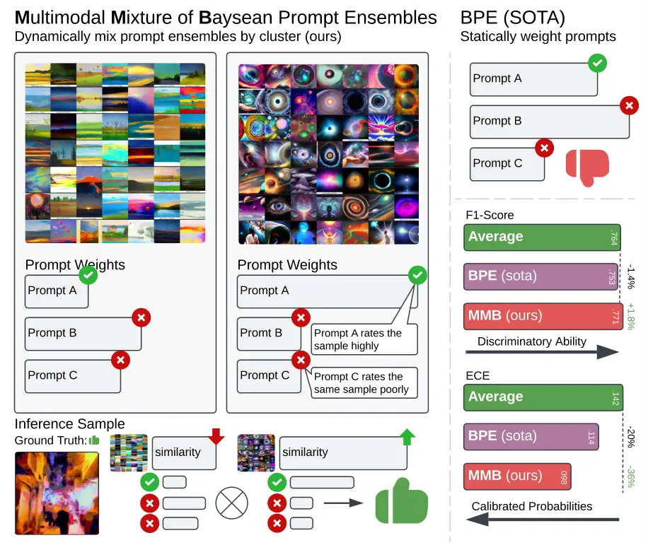

Figure 1: A high-level comparison on the HPSv2 \[65\] dataset between an
average ensemble baseline (Avg.), current SOTA BPE \[59\], and our MMB
method. We show F1 Score (higher is better $`\uparrow`$) and ECE (lower
is better $`\downarrow`$). While BPE somewhat lowers the model’s
discriminative ability (F1) relative to the baseline, MMB both recovers
that loss (+1.8% F1 vs. Avg.) and achieves stronger calibration (-36%
ECE vs. Avg.). All differences are statistically significant at 95%
confidence via a permutation test.

As a result, these models produce diverse and frequently subjective
multimodal outputs, which makes evaluating them a significant challenge.
Traditional metrics for text (BLEU \[49\], ROUGE \[40\], SPICE \[1\])
and image generation quality (_e.g_., FID \[27\], Inception \[57\],
Precision-Recall \[36\]) often fail to capture the open-ended, creative
nature of responses that generative models can produce \[73\]. TTI
generation, in particular, must be judged on aesthetic qualities,
coherence with textual prompts, realism, and creativity dimensions that
are often subjective and difficult to evaluate using fixed metrics. A
challenge that has led to an array of preference scores, including
CLIPScore \[53\], PickScore \[34\], and PreferenceScore \[65\], that
attempt to generally capture the “_goodness_” of an image. On the other
hand, human evaluation—although more reliable for subtle qualities like
image realism or appropriateness—can be too costly or slow to be
practical at scale.

A related trend in the unimodal (text-only) domain involves using large
language models (LLMs) themselves as judges to evaluate text-generation
quality \[38, 39, 22\]. This concept is also readily extended to LVLMs
and MLLMs being used as judges through frameworks like
GPT-4V(ision) \[72, 14\], X-IQE \[10\], MLLM-Bench \[19\], ViGOR \[67\],
and even Text-to-3D \[64\]. Yet while these “_judge_” models can
approximate human assessments of relevance, clarity, and creativity,
they still exhibit biases. For instance, they may favor outputs from
sharing their training lineage \[44, 48\], reward verbosity \[56\], or
change their evaluations when prompts are slightly altered \[60\]. They
often struggle with commonsense reasoning \[25, 35, 29\] and can
inadvertently amplify social biases \[68, 38\]. Addressing these
pitfalls is crucial to ensuring fair and accurate assessments of
advanced multimodal model capabilities.

A further complication is that many of the most performant and
accessible MLLMs are closed-source and available only through restricted
APIs. This limitation curtails researchers’ ability to fine-tune or
directly inspect the judge for a given use case. Recent work proposes
ensembling and reweighting prompts \[63, 31, 28, 59\] to partially
mitigate these issues by improving calibration and accuracy in black-box
large language models. At a high level, a calibrated model’s
probabilities align with actual outcome frequencies \[23\]. In other
words, it reduces the frequency of high-confidence but incorrect and
low-confidence but correct outcomes in these models. While a calibrated
model can be more accurate than an uncalibrated model, the main goal is
to reduce these extreme misclassifications and align a model’s
confidence with the actual frequency of correctly predicted outcomes.
Hence, a low-confidence judgment from a calibrated model can be deferred
to another model or human reviewers and a high-confidence judgment can
be accepted with lower risk of it being a false-positive, compared to an
uncalibrated model. Yet it remains unclear how to reliably apply such
techniques to _multimodal_ tasks like text-to-image (TTI) generation,
which require a judge to produce outputs based on both visual and
textual context. These subtleties remain relatively underexplored in
current research. Moreover, prior work often assumes ideal conditions
(e.g., all prompts are equally performant, prompting is “_free_” to
perform ad infinitum), assumptions that rarely hold in real-world
multimodal evaluations. Consequently, many challenges in MLLM-based
evaluation remain unsolved.

In this paper, we study _text-to-image_ generation as an exemplar of
these open-ended vision-language tasks and address the problem of
producing a well-calibrated judge, ensuring that the MLLM-based judge
accurately appraises its uncertainty and delivers stable, contextually
coherent TTI evaluations. Achieving robust calibration in the multimodal
domain not only leads to fair and trustworthy metrics for TTI tasks, but
also lays the groundwork for future applications—such as selective
classification \[26\] or partial human oversight \[45\] of automated
judgments—if so desired.

Contributions. Put briefly, in this work we —

- •
  Identify limitations of standard prompt ensemble methods when applied
  to multimodal evaluation, demonstrating their failure to generalize
  effectively to TTI judgment.
- •
  Propose Multimodal Mixture-of-Bayesian Prompt Ensembles, a novel
  method incorporating image clusters to condition prompt selection,
  improving calibration and judgment consistency in MLLM-based TTI
  evaluation.
- •
  Conduct extensive experiments on HPSv2 and MJBench, showing that MMB
  significantly improves calibration and alignment with human
  preferences compared to SOTA.
- •
  Analyze the practical implications of MMB, demonstrating its benefits
  for cost-aware evaluation pipelines, where low-confidence judgments
  can be selectively accepted or deferred to human reviewers for more
  precise review.

## 2 Related Work

(M)LLM-As-a-Judge. (M)LLM-as-a-judge has seen much interest in recent
years, serving as an economical and scalable alternative to human
evaluation. Proprietary models such as GPT-4(V) have been used as
general-purpose judges for various use text-only and multimodal
judgments. To this end, several benchmarks have been recently proposed
in both text-only evaluations, such as LLaVA-Bench \[43\], GAVIE \[42\],
LAMM \[69\], and VisIT-Bench \[7\], and multimodal evaluations, such as
X-IQE \[10\], MLLM-Bench \[19\], ViGOR \[67\] etc. Open-source
alternatives to these proprietary models have also been recently
introduced \[66\], aiming to improve MLLMs in their capacity to act as
judges. Our work is complementary to these developments. We seek to
improve the calibration of these (M)LLMs when they’re used as judges so
that we can properly quantify when they are less confident in their
evaluation. This helps improve the reliability, fairness, and accuracy
of these models when used as judges and can also act as a filter,
whereby only the less confident judgments need to be verified by humans.

Model Calibration. We tackle model calibration, a well-established
subfield in ML literature, e.g., \[23\]. A calibrated model allows
selective prediction of outputs \[20, 16\], or selectively defer \[45\]
or abstain \[62\] from producing an output when the model is not
confident that it can produce a correct output. Contrary to our work,
these works introduce various statistical and post-training
interventions to improve the calibration of ML models. Our work tackles
improving the calibration of black-box models, including proprietary
models where we do not have access to the models’ weights.

Prompt Ensembles. As LLMs are highly sensitive to prompt engineering
\[32, 61\], researchers have explored various prompt ensembling
techniques to mitigate this sensitivity and improve calibration. For
example, \[63, 31\] investigated methods to generate diverse prompts
aimed at enhancing calibration, treating all prompts within the ensemble
as equally important. In contrast, Hou et al. \[28\], Tonolini et al.
\[59\] assign different weights to prompts within the ensemble and
optimize these weights using a validation set. Unlike Hou et al. \[28\]
approach, Tonolini et al. \[59\] does not require modifying the prompts
themselves, making it more practical for real-world applications. To
achieve this, the authors in \[59\] proposed Bayesian Prompt Ensembles
(BPE), a Bayesian approach to learning the varying importance of
different prompts. This technique is particularly relevant when an LLM
acts as a judge with multiple task instruction prompts that are assumed
to be equally relevant. However, in multimodal evaluations, such
assumptions might not always hold, as the relevance of a prompt can also
depend on the image itself. This paper aims to address this issue and
propose a more generalized solution.

## 3 Preliminaries

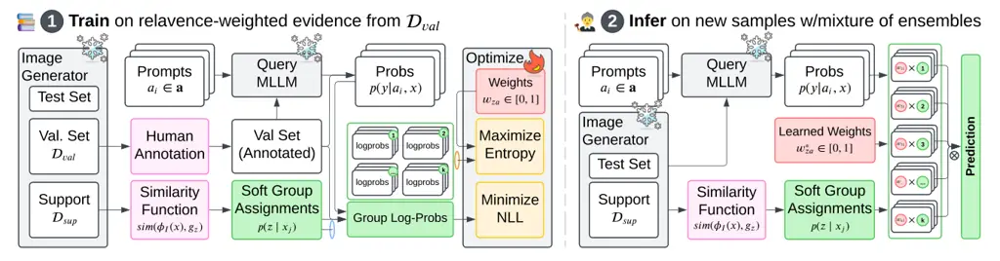

Figure 2: Overview of our MMB for multimodal prompt ensembles.

Train: We query an MLLM with multiple prompts and discount the resulting
log-probabilities inverse to a relevance function that scores how well
each image fits a learned embedding-based group. We optimize the
image-conditional prompt weights by minimizing negative log-likelihood
on validation data, balanced by an entropy regularizer.

Infer: Learned prompt weights then mix MLLM outputs at test time for
more accurate, calibrated predictions.

One fundamental requirement for reliable model _judge_ deployment is
_calibration_: the idea that a model’s predicted probabilities should
accurately reflect the true likelihood that its predictions are correct.
Given an input $`x`$ (_e.g_., an image pair), a predicted label
$`\hat{y}`$, and a ground truth label $`y^{*}`$ (_e.g_., a known
preference), a well-calibrated model satisfies:

```math
\displaystyle P(y^{*}=\hat{y}\mid f(\hat{y}\mid x)=p)=p \tag{1}
```

where $`f(\hat{y}\mid x)`$ denotes the model’s predicted probability for
label $`\hat{y}`$ given input $`x`$. In other words, if a model outputs
a 90% probability of being correct on some sample, we should find
that—over many samples assigned that same 90% confidence—it is indeed
correct about 90% of the time.

### 3.1 Bayesian Prompt Ensembles (BPE)

Our work builds on _Bayesian Prompt Ensembles_ (BPE) \[59\], originally
proposed to improve calibration in black-box language models. Although
BPE was introduced for purely textual (NLP) classification tasks, our
goal is to generalize its principles to _multimodal_ model
evaluation—where images, prompts, and model outputs all interact. To
apply this framework to our MLLM setting, we assume:

- •
  A set of $`N`$ semantically equivalent _task prompts_
  $`\boldsymbol{a}=\{a_{1},\dots,a_{N}\}`$. Each prompt describes the
  same classification or preference task (e.g., “_Which of these two
  images is more realistic?_”) in slightly different wording.
- •
  A small validation set
  $`\mathcal{D}_{val}{=}\{(x_{j},y^{*}_{j})\}_{j=1}^{M}`$. Here,
  $`x_{j}`$ are inputs (which could be text, images, or both), and
  $`y_{j}^{*}`$ are ground truth labels (e.g., human preferences).
- •
  A fixed black-box model (e.g., an MLLM) providing class probabilities
  $`p(y|x,a)`$ given input $`x`$ and a prompt $`a`$.

Prompts as Latent Variables. BPE treats each prompt $`a`$ as a latent
variable in a Bayesian sense. For an (M)LLM-based classifier, the
desired predictive distribution is:

```math
\displaystyle p(y\mid x,\mathcal{D}_{val})\;=\;\int p\bigl(y\mid x,a\bigr)\,p\bigl(a\mid\mathcal{D}_{val}\bigr)\,da. \tag{2}
```

Since $`p(y|x,a)`$ is fixed once the (M)LLM and prompt are chosen, the
goal is to approximate the posterior $`p(a|\mathcal{D}_{val})`$.

Variational Inference. BPE introduces a variational distribution
$`q(a)`$ to approximate $`p(a|\mathcal{D}_{val})`$, minimizing the KL:

```math
\displaystyle q^{*}(a)\;=\;\operatorname*{arg\,min}_{q(a)}KL\bigl[q(a)\,\|\,p(a\mid\mathcal{D}_{val})\bigr]. \tag{3}
```

By standard variational arguments (see, e.g., \[21\]),

```math
\displaystyle q^{*}(a)\;=\;\operatorname*{arg\,max}_{q(a)}\;\Bigl(\mathbb{E}_{q(a)}[\log \displaystyle p(\boldsymbol{y}^{*}\mid\boldsymbol{x},a)] \tag{4}
```

```math
\displaystyle\;-\;KL[\,q(a)\,\|\,p(a)\,]\Bigr).
```

Intuitively, $`q(a)`$ places higher density on prompts that explain the
validation data well.

Discrete Reparameterization. In practice, we only have a finite set
$`\boldsymbol{a}=\{a_{i}\}_{i=1}^{N}`$. BPE thus represents $`q(a)`$
with discrete weights $`w_{a}{\geq}0`$ such that $`\sum_{a}w_{a}{=}1`$
and $`w_{a}{=}q(a)/NC`$. Assuming a uniform constant prior
$`p(a)\approx C`$, this yields:

```math
\displaystyle\operatorname*{arg\,max}_{\bf w}\sum_{a}w_{a}\Bigl[\sum_{j=1}^{M} \displaystyle\log p\bigl(y_{j}^{*}\mid x_{j},a\bigr)\Bigr] \tag{5}
```

```math
\displaystyle\;-\;\sum_{a}w_{a}\,\log w_{a},
```

where the first term rewards prompts whose likelihood on
$`\mathcal{D}_{val}`$ is high, and the second term is an entropy term
that prevents the solution from collapsing onto a single prompt unless
it decisively outperforms the rest.

Inference. Once the weights $`w_{a}^{*}`$ are learned, the final class
probability for a new sample $`x`$ becomes:

```math
\displaystyle p(y\mid x)\;\approx\;\sum_{a}w_{a}^{*}\;p\bigl(y\mid x,a\bigr). \tag{6}
```

Hence BPE combines the model outputs from multiple task prompts,
reweighting them for better calibration.

### 3.2 Limitations & Our Multimodal Generalization

BPE focuses on textual classification, assuming all task prompts are
_equally relevant a priori_. Multimodal judging tasks, however, may
demand different prompts for different _types of images_: for example, a
prompt that references lighting or artistic style might be more reliable
for photos than for abstract digital art. Consequently, BPE can be
suboptimal when the best prompt for a given validation sample varies by
_image category_ or other visual attributes.

In the remainder of this paper, we propose a _multimodal generalization_
of BPE that conditions on an image embedding to cluster or group related
images. Each group can then favor the prompts best suited for that
group. Our method thus preserves BPE’s variational formulation but
learns more _image-specific_ weights, significantly improving both
accuracy and calibration in MLLM-based evaluation.

## 4 Multimodal Bayes. Prompt Ensembles

We now propose Multimodal Mixture-of-Bayesian Prompt Ensembles (MMB), a
technique for learning _image-aware_ prompt weights that generalize BPE
into the multimodal domain. Our key idea is model an underlying group
structure based on _image embeddings_ — allowing the model to learn
group-specific prompt weights and individual samples to be classified by
their combination based on group affinity. This helps address scenarios
where different prompts may be more reliable for certain types of
images. See Fig. 2 for a high-level graphical overview.

Soft Image Grouping. To model this group structure, we presume the image
space can be partitioned into $`K`$ groups which may each have different
prompt weights that are more appropriate for the image in group. More
formally, we introduce random variables $`z{\mid}x`$ to denote the
membership of image $`x`$ in group $`z\in\{1,...,K\}`$. To realize this
grouping, we assume access to an unlabeled image set
$`\mathcal{D}_{sup}`$ drawn i.i.d from the image generator we seek to
evaluate (_i.e_. $`\mathcal{G}:*\to x`$) and an image embedding function
$`\phi_{I}:X\to\mathbb{R}^{d}`$ (for instance, via a pretrained image
encoder). Applying a grouping algorithm (e.g., k-means) to image
embeddings, we can partition $`\mathcal{D}_{sup}`$ into $`K`$ groups
$`g_{1},...,g_{K}`$. For a similarity function
$`\mbox{sim}(\phi_{I}(x),g_{i})`$ between the image embedding of $`x`$
and group $`g_{z}`$, we can define the probability of $`z\mid x`$ as
$`p(z|x)\propto exp({\mbox{sim}\left(\phi_{I}(x),g_{z}\right)/\tau})`$,
where $`\tau`$ is a temperature scale hyperparameter. For $`\tau\to 0`$,
$`p(z|x)`$ approaches a one-hot hard assignment and a uniform
distribution for $`\tau\to\inf`$. This distribution can be viewed as a
soft assignment of $`x`$ to each of the $`K`$ groups.

### 4.1 Learning Objective

Given this group structure, we can derive the evidence lower bound for
the log likelihood of $`\mathcal{D}_{val}`$. To start, the log
likelihood for a given point $`x,y`$ can be written as:

```math
\displaystyle\log p(y|x) \displaystyle{=} \displaystyle\log\sum_{a}\sum_{z}p(y{\mid}x,a)p(a{\mid}z)p(z{\mid}x) \tag{7}
```

where conditional independencies $`a{\perp}x{\mid}z`$ and
$`y{\perp}z{\mid}a`$ are applied. For these, recall that we assume
prompt weights are determined entirely by group assignment and our
underlying model’s output depends only on the input and prompt.
Introducing a variational distribution $`q(a|z)`$ to model the unknown
group-specific prompt weights and following standard manipulations
yields an evidence lower bound of $`\log p(y|x)`$ equal to

```math
\displaystyle\log p(y|x) \displaystyle{\geq} \displaystyle\mathbb{E}_{p(z|x)}\left[\vphantom{\sum}~~\mathbb{E}_{q(a|z)}\log p(y|x,a)\right. \tag{8}
```

```math
\displaystyle~~~~~~~~~~~~~~\left.\vphantom{\sum}-\mbox{KL}(q(a|z)||p(a|z))~~\right]~~~
```

Note that the terms inside $`\mathbb{E}_{p(z|x)}`$ mirror BPE in Eq. 4
but now have group-specific weights $`q(a{\mid}z)`$ and priors
$`p(a{\mid}z)`$. As we’ve defined it, the expectation over
$`p(z{\mid}x)`$ serves to weigh point $`x`$’s per-group contribution
based on similarity to each group. See Appendix C for full derivation.

Setting a uniform prior $`p(a{\mid}z)~\forall z`$ and parameterizing the
variational distribution $`q(a|z)`$ via learnable weights $`w_{za}`$,
the training objective for our MMB formulation is then to find weights
which maximize the following:

```math
\displaystyle\sum_{j=1}^{M}\sum_{z}\overbrace{p(z|x_{j})\vphantom{\left[\sum_{a}\right.}}^{\mbox{\footnotesize\shortstack{Soft Group\\
Assignment}}}\overbrace{\vphantom{\left[\sum_{a}\right.}\left[\sum_{a}w_{za}\log p(y_{j}^{*}|x_{j},a)\right.}^{\mbox{\footnotesize\shortstack{Per-Group \\
Log Likelihood}}}
```

```math
\displaystyle\underbrace{\left.-\sum_{a}w_{za}\log w_{za}~~\right]}_{\mbox{\footnotesize\shortstack{Per-Group Entropy\\
Regularizer}}} \tag{9}
```

With our complete objective written, it is worth revisiting our
temperature hyperparameter $`\tau`$ used in defining $`p(z{\mid}x)`$. We
note that extreme settings will map the above objective to either (i)
independent BPE per group when all $`p(z{\mid}x_{i})`$ become one-hot
($`\tau\to 0`$) or (ii) one single over-parameterized BPE for all data
when all $`p(z{\mid}x_{i})`$ become uniform ($`\tau\to\inf`$). For
intermediate settings, data points can selective share partial
membership across image groups based on their semantic or visual
similarity.

### 4.2 Inference

Solving Eq. 9 for $`w_{za}^{*}`$, enables us to evaluate new inputs
$`x`$ as an expectation over group assignments and prompts,

```math
p(y\mid x)\approx\sum_{z}p(z|x)\sum_{a}w_{za}^{*}\;p\bigl(y{\mid}x,a_{i}\bigr), \tag{10}
```

where $`p(z|x)`$ is computed based on $`x`$’s group similarities.

|         |         |                                             |               |                 |                |                |                                        |               |                 |                |                |                                     |               |                 |                |                |
| ------- | ------- | ------------------------------------------- | ------------- | --------------- | -------------- | -------------- | -------------------------------------- | ------------- | --------------- | -------------- | -------------- | ----------------------------------- | ------------- | --------------- | -------------- | -------------- |
| prompts | samples | Expected Calibration Error ($`\downarrow`$) |               |                 |                |                | Max Calibration Error ($`\downarrow`$) |               |                 |                |                | AUC Precision-Recall ($`\uparrow`$) |               |                 |                |                |
|         |         | Std. (single)                               | Best (single) | Avg. (ensemble) | BPE (ensemble) | MMB (ensemble) | Std. (single)                          | Best (single) | Avg. (ensemble) | BPE (ensemble) | MMB (ensemble) | Std. (single)                       | Best (single) | Avg. (ensemble) | BPE (ensemble) | MMB (ensemble) |
| 5       | 5       | .238                                        | .155          | .155            | .127           | .113           | .399                                   | .351          | .286            | .305           | .245           | .731                                | .812          | .835            | .830           | .835           |
|         | 10      | .239                                        | .132          | .155            | .121           | .108           | .406                                   | .320          | .286            | .304           | .239           | .731                                | .841          | .835            | .847           | .838           |
|         | 20      | .243                                        | .130          | .155            | .120           | .108           | .411                                   | .313          | .286            | .308           | .241           | .724                                | .842          | .835            | .849           | .838           |
|         | 50      | .261                                        | .122          | .155            | .121           | .107           | .424                                   | .310          | .286            | .307           | .236           | .708                                | .853          | .835            | .853           | .839           |
| 10      | 5       | .271                                        | .150          | .142            | .121           | .092           | .409                                   | .346          | .250            | .291           | .201           | .694                                | .818          | .844            | .835           | .844           |
|         | 10      | .260                                        | .134          | .142            | .120           | .095           | .401                                   | .328          | .250            | .293           | .196           | .702                                | .842          | .844            | .837           | .844           |
|         | 20      | .260                                        | .127          | .142            | .114           | .091           | .401                                   | .317          | .250            | .285           | .189           | .702                                | .847          | .844            | .848           | .845           |
|         | 50      | .267                                        | .121          | .142            | .116           | .088           | .408                                   | .301          | .250            | .289           | .188           | .696                                | .854          | .844            | .851           | .845           |
| 20      | 5       | .263                                        | .153          | .133            | .111           | .080           | .422                                   | .342          | .210            | .274           | .172           | .716                                | .812          | .849            | .841           | .847           |
|         | 10      | .265                                        | .135          | .133            | .117           | .082           | .422                                   | .324          | .210            | .288           | .169           | .713                                | .835          | .849            | .841           | .848           |
|         | 20      | .270                                        | .126          | .133            | .114           | .080           | .426                                   | .311          | .210            | .279           | .160           | .708                                | .847          | .849            | .844           | .848           |
|         | 50      | .267                                        | .117          | .133            | .113           | .076           | .422                                   | .291          | .210            | .275           | .154           | .708                                | .855          | .849            | .851           | .849           |

Table 1: Expected Calibration Error (ECE) and Max Calibration Error
(MCE) are shown (lower is better $`\downarrow`$), along with AUC
Precision-Recall (higher is better $`\uparrow`$) on HPSv2 \[65\]. We
compare Std. (single)—a random single prompt, Best (single)—the single
prompt with highest validation accuracy, Avg. (ensemble)—an unweighted
average, BPE (ensemble)—the current state of the art, and MMB
(ensemble)—our proposed method. Bold entries are either the Best score
or not significantly different from the Best at $`{\geq}95\%`$
confidence via a permutation test. We account for Type I error inflation
across multiple tests per metric using the Benjamini–Yekutieli FDR
procedure \[5\].

## 5 Experimental Setup

We conduct experiments on two contemporary benchmarks:

HPSv2: Discriminative Power and Calibration \[65\]. HPSv2 is a
large-scale dataset capturing human preferences among images generated
from the same textual prompts; it encompasses $`\sim\!\!800{k}`$
preference choices over $`\sim\!\!430{k}`$ images. Of these, $`400`$
groups (each containing 9 images) serve as a test set, and $`108k`$
groups (each containing 4 images) comprise the training pool. We focus
on pairwise preferences drawn from these groups. For calibration
(_i.e_., learning our ensemble weights), we randomly select a small
number of pairwise comparisons—one per training group as needed—ensuring
that each validation sample is distinct. We denote this validation set
by $`\mathcal{D}_{val}`$ and from the remaining training data for
$`\mathcal{D}_{sup}`$. After calibration, we evaluate the final models
on all $`\smash{\binom{9}{2}}\times 400=14.4k`$ pairwise comparisons
from the test set. We systematically explore several experimental
factors, including the number of prompts used ($`\boldsymbol{a};`$ 5,
10, or 15) and the number of validation samples ($`\mathcal{D}_{val}`$;
5, 10, 20, or 50). Our support set ($`\mathcal{D}_{sup}`$) is always
composed of $`256{\times}K`$ samples, where $`K`$ denotes the number of
groups used in MMB. Across each configuration, we repeat experiments
with multiple random seeds for training (3), data sampling (50), and
clustering (5) for a total of $`52.2k`$ unique experimental
configurations. This yields a broad factorial design allowing for
thorough comparisons of calibration and discriminative ability. We
provide a summary of the experimental configurations in Appendix A.

MJBench: Visually Salient Human Social Bias \[11\]. MJBench-Bias is a
targeted evaluation set for measuring demographic biases in multimodal
judge models. It comprises images of subjects from diverse backgrounds
(_e.g_., different ages, genders, or socioeconomic statuses) with
prompts describing occupations or educational pursuits. The goal is to
assess whether a judge model’s scoring or ranking of how well an image
aligns with a prompt is free from systematic demographic bias. Because
MJBench-Bias provides pools of similar images per prompt—rather than
pairs—and lacks a standard training set, we construct one to facilitate
experimentation. Specifically, we create a lower-preference variant of
each image by applying aesthetically degrading transformations (such as
extreme contrast, motion blur, brightness shifts, random occlusions, and
noise). We then form an artificial training set by pairing each original
image with its transformed counterpart, chosen from images generated
under the same prompt. We adopt a 10-fold, leave-one-group-out procedure
stratified by prompt: in each fold, the remaining nine folds serve as
the validation ($`\mathcal{D}_{val}`$) and support
($`\mathcal{D}_{sup}`$) sets—containing distorted pairs—while the
held-out fold is reserved for testing. On the test set, we generate all
image pairs sharing a caption; under the assumption of no bias, neither
image should be more or less preferable. Consequently, we argue that an
unbiased model in this scenario should predict with the lowest possible
confidence—50%. See Appendix F for synthetic preferences examples.

Models. Throughout all experiments, we select GPT-4o \[30\] as our
_judge_ model. GPT-4o is a state-of-the-art, closed-source MLLM that is
frequently employed in multimodal judge scenarios due to its high
performance. We consider text-conditioned image generators
$`\mathcal{G}\!:\text{text}\times\text{noise}\!\to\!\text{image}`$ as
the underlying image producers for our datasets dataset which can be
used to generate $`\mathcal{D}_{sup}`$. The embedding function
$`\phi_{I}`$ is implemented using a pretrained CLIP-ViT-B16 \[52\],
chosen for its strong alignment with natural language and visual content
understanding. To form our K-group relevance function $`\mathcal{Z}`$,
we perform spherical k-means clustering on image embeddings via FAISS
\[33\] with cosine similarity based distance between image pairs
$`(x_{1},x_{2})`$:

```math
dist(x_{1},x_{2})=1-\phi(x_{1})^{T}\phi(x_{2})\ /\ \lVert\phi(x_{1})\rVert\lVert\phi(x_{2})\rVert
```

We take the cosine similarity between each image and the $`K`$ cluster
centroids as our similarity function $`\mbox{sim}(\cdot,\cdot)`$.

|          |       |          |            |            |          |          |         |
| -------- | ----- | -------- | ---------- | ---------- | -------- | -------- | ------- |
|          | Model | NLL\_(↓) | Brier\_(↓) | Kappa\_(↑) | Acc\_(↑) | ROC\_(↑) | F1\_(↑) |
| Single   | Std.  | 1.002    | .271       | .315       | .667     | .780     | .526    |
|          | Best  | .618     | .152       | .610       | .812     | .897     | .763    |
| Ensemble | Avg.  | .473     | .151       | .600       | .804     | .897     | .764    |
|          | BPE   | .547     | .147       | .602       | .810     | .897     | .753    |
|          | MMB   | .430     | .135       | .627       | .820     | .900     | .778    |

Table 2: Performance on HPSv2 \[65\] showing NLL and Brier score (lower
is better $`\downarrow`$) alongside Kappa, Accuracy (Acc), ROC-AUC
(ROC), and F1 (higher is better $`\uparrow`$). We compare two
single-prompt baselines (Std. and Best) against three ensemble methods:
Avg. (unweighted average), BPE (SOTA), and MMB (ours). Methods
insignificantly different from the best method by column at 95%
confidence from a permutation test are in bold. We control for Type I
error from multiple testing with the Benjamini–Yekutieli FDR
procedure \[5\]. 10 prompts, 20 validation samples.

Baselines. We benchmark our proposed MMB approach against two single
prompt and two ensemble baselines:

- •
  _Standard_: A single randomly chosen prompt.
- •
  _Best_: The single prompt with greatest $`\mathcal{D}_{val}`$
  accuracy.
- •
  _Average_: A simple average over all available prompts.
- •
  _BPE_: A state-of-the-art Bayesian method originally developed for
  text-only prompt ensembling \[59\].

We draw all prompts from a pool of 100 diverse and semantically
equivalent instructions, combining manual definitions, structured
templates, and LLM-driven rephrasings. See Appendix B for further prompt
generation details.

Metrics. Following standard practice, we use the _Expected Calibration
Error (ECE)_ and _Maximum Calibration Error (MCE)_ \[23\] to measure
calibration. In short, these methods summarize the discrepancy between
model confidence and actual correctness across bins in a reliability
diagram. Discriminative ability and alignment with human annotations are
measured using _Cohen’s Kappa (Kappa)_ \[13\], _ROC-AUC_ \[8\], and _AUC
Precision-Recall (PR)_ \[18\], along with traditional metrics such as
_Accuracy (Acc)_, _F1-score_, Brier score \[9\] and test-set NLL \[24\].
To succinctly summarize our methods’ discriminative power and
calibration across conditions, we present detailed results primarily for
ECE, MCE, and AUC-PR. Results for additional metrics are fully reported
for one representative setting (10 prompts, 20 validation samples). For
MJBench, we report average confidence on our synthetic equal-preference
task by method.

## 6 Results

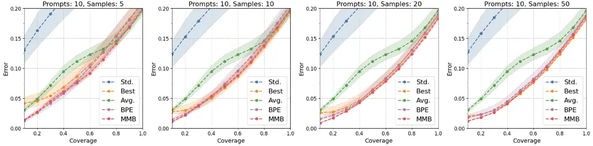

Figure 3: Error–coverage curves on HPSv2 \[65\] with 10 prompts across
varying numbers of validation samples (5, 10, 20, 50). Each curve
represents an average over multiple runs, with 95% confidence intervals
(shaded regions) from bootstrapped sampling of the mean. Our MMB
approach consistently achieves the lowest error across coverage levels
and displays the narrowest intervals, indicating more stable and
reliable performance. We show similar curves across additional
experimental configurations in Appendix D Fig. 5.

For each $`nprompt\times nsample`$ prompt-ensemble configuration, we
perform a paired permutation test on the mean difference in performance
between the best-performing model and each other method. To control for
Type-I error inflation from multiple testing, we apply the
Benjamini–Yekutieli False Discovery Rate correction \[5\] on a
per-metric basis. As shown in Tab. 1, MMB outperforms both single-prompt
approaches (Std. and Best) and existing prompt ensembling techniques
(Avg. and BPE) in our multimodal setup overall. Looking deeper into the
specific 10 prompt 20 sample configuration, Tab. 2 shows additional
evidence that MMB consistently delivers improved calibration (_e.g_.,
ECE, Brier) and stronger discriminative metrics (_e.g_., AUC-PR), across
a variety of measures. Notably, MMB performs well even when the number
of prompts and validation samples is low, though performance generally
improves as we increase either of those information sources.

|     |          |          |            |            |          |          |         |
| --- | -------- | -------- | ---------- | ---------- | -------- | -------- | ------- |
| K   | ECE\_(↓) | NLL\_(↓) | Brier\_(↓) | Kappa\_(↑) | Acc\_(↑) | ROC\_(↑) | F1\_(↑) |
| 4   | .090     | .432     | .140       | .627       | .819     | .899     | .777    |
| 8   | .090     | .430     | .135       | .627       | .820     | .899     | .778    |
| 16  | .091     | .430     | .135       | .627       | .820     | .900     | .779    |
| 32  | .091     | .430     | .135       | .627       | .820     | .900     | .778    |
| 64  | .091     | .430     | .135       | .627       | .820     | .900     | .778    |

Table 3: Effect of varying MMB cluster count $`K`$ on HPSv2 \[65\] using
10 prompts and 20 validation samples, showing NLL and Brier score (lower
is better $`\downarrow`$) alongside Kappa, Accuracy (Acc), ROC-AUC
(ROC), and F1 (higher is better $`\uparrow`$). Performance improves
slightly as $`K`$ increases, then saturates at around 32 clusters.
$`K`$’s insignificantly different from the best by column at 95%
confidence from a permutation test are in bold. Type I error from
multiple testing controlled with the Benjamini–Yekutieli \[5\] method.

Qualitative Observations. In order to understand better _why_ MMB is
successfully, we visualize several clusters alongside their highest
weighted prompt when running MMB in exceptionally favorable settings.
That is to say, with many clusters (64) and a large number of validation
samples (200). In this scenario, most clusters which are meaningful tend
towards the best prompt for that cluster as entropy is essentially
dropped over the increasing NLL sum. Interestingly, we find that there
is good correspondence between the personas mentioned in the best
performing prompts and the images they’re judging. For example in
Fig. 4, our pastel drawings of fields and plains are best judged by the
landscape artist persona, and the vibrant sci-fi renderings of galaxy
and space are best rated by the graphic designer persona. See Appendix E
for additional examples.

Comparison Across Clusters. Tab. 3 further examines the effect of the
number of clusters in MMB. Even a relatively small number of clusters
(e.g., 8 or 16) already confers most of the performance advantage,
beyond which performance starts to saturate. Hence, MMB is robust to a
range of cluster granularities and does not require an excessively large
$`K`$ to achieve benefits. These results also suggest that excessively
values of $`k`$ ($`{>}{64}`$) may degrade performance.

|         |         |               |               |                 |                |                |
| ------- | ------- | ------------- | ------------- | --------------- | -------------- | -------------- |
| prompts | samples | Std. (single) | Best (single) | Avg. (ensemble) | BPE (ensemble) | MMB (ensemble) |
| 5       | 5       | .838          | .830          | .683            | .738           | .726           |
|         | 10      | .838          | .831          | .683            | .739           | .727           |
|         | 20      | .838          | .831          | .683            | .742           | .727           |
|         | 50      | .838          | .832          | .683            | .744           | .728           |
| 10      | 5       | .839          | .831          | .656            | .713           | .704           |
|         | 10      | .839          | .831          | .656            | .714           | .705           |
|         | 20      | .839          | .831          | .656            | .715           | .705           |
|         | 50      | .839          | .832          | .656            | .720           | .705           |
| 20      | 5       | .834          | .831          | .654            | .711           | .702           |
|         | 10      | .834          | .831          | .654            | .711           | .703           |
|         | 20      | .834          | .832          | .654            | .712           | .703           |
|         | 50      | .834          | .832          | .654            | .715           | .703           |

Table 4: Average confidence (lower is better $`\downarrow`$) on our
synthetic MJBench no-preference test split. The best and second best
models in each row are in bold and italics, respectively.

MJBench Results. Tab. 4 reports the average confidence of each method on
our synthetic MJBench-Bias no-preference test split. The Average
ensemble consistently produces the lowest confidence scores, suggesting
it is the most cautious judge in scenarios where no preference should
exist. However, this comes at the cost of lower overall performance in
discriminative tasks, as seen in our main results. In contrast, MMB
achieves the second-lowest confidence scores while maintaining strong
overall performance, making it the most balanced method. This suggests
that MMB is the most fair method that remains performant enough for
real-world use, mitigating overconfidence in ambiguous cases without
sacrificing accuracy in general evaluation tasks.

## 7 Discussion

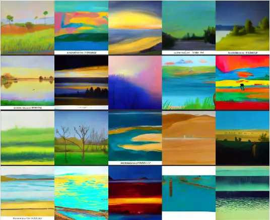

(a) “_You are a landscape artist skilled in assessing lighting, color
and composition \[…\]_”

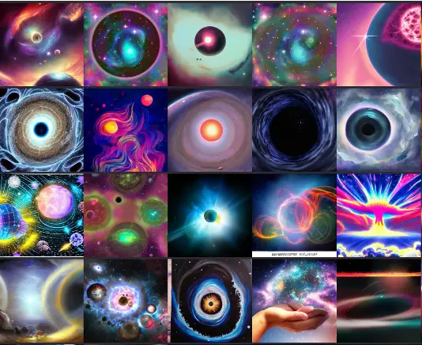

(b) “_You are a graphic designer with experience in visual clarity and
technical image quality \[…\]_”

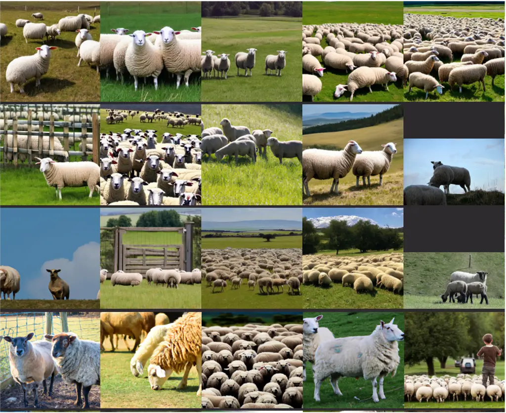

(c) “_You are a photographer skilled in assessing lighting, focus, and
exposure \[…\]_”

Figure 4: Clusters from MMB’s grouping, each matched to its
best-performing prompt by largest weight in $`\boldsymbol{w_{k}}`$. In
(a), a prompt posing the user as a “_landscape artist_” is weighted
highest for images featuring fields and skies, while in (b), a “_graphic
designer_” prompt better suits the cosmic artwork. This demonstrates
MMB’s prompt utilization aligning with each cluster’s style. See
Appendix E for more.

One motivation for a well-calibrated MLLM-based judge is to enable
_selective_ or _cost-aware_ evaluation pipelines. For instance, a system
can elect to trust automatically produced ratings only for samples on
which it is sufficiently confident, and refer low-confidence cases for
human review. In Fig. 3, we show coverage-error curves to illustrate how
MMB behaves in such a scenario. Here, _coverage_ is the fraction of
examples whose confidence surpasses a chosen threshold. _Error_ is the
misclassification rate among just those covered samples. Ideally, as
coverage increases, accuracy remains high. We see that MMB consistently
yields the lowest error across coverage levels and exhibits narrower
confidence intervals (shaded regions in the plot) than either single
prompts or prior ensemble methods. This consistency implies that one can
safely raise the confidence threshold (thus covering more samples
automatically) without a large spike in error. Notably, error-coverage
curves are created independent of the confidence thresholds which would
generate each point. A well-calibrated model allows a developers to
effectively select confidence thresholds which map to points on the
error-coverage diagram due to alignment between the y-axis error and
confidence values. Together, this means MMB produces desirable
error-coverage curves, and allows for trustworthy threshold selection to
align with developer needs. See Appendix D for additional plots.

Behavior Under Extreme Settings. We note special cases reducing the
behavior of MMB to a simpler alternative:

- •
  _No validation data_ ($`|\mathcal{D}_{val}|=0`$): MMB reduces to an
  average ensemble, without any ground-truth labels to distinguish
  prompt performance, the weights remain uniform.
- •
  _Excessive validation data_ ($`|\mathcal{D}_{val}|\to\infty`$): MMB
  converges on the best single prompt for each cluster, provided the
  validation set covers a wide variety of image content.
- •
  _Degenerate clustering_ ($`K=1`$): MMB collapses to BPE.

As $`K`$ grows large, each cluster becomes more specialized, but may
also have fewer supporting samples in the validation set, leading to
potential overfitting or redundant clusters whose weights remain near
uniform. Empirically, we find ($`K\approx 16`$) obtains a good
specialization-stability trade-off.

Extensions. MMB readily generalizes beyond TTI quality evaluation. In
VQA, it can prioritize prompts whose semantics align with the scene’s
content, style, or latent structure, leading to better-calibrated answer
probabilities without fine-tuning the base model. The same mechanism can
highlight domain-specific cues–such as distinguishing cartoon from
photographic violence–in content moderation to reduce false positives
while still leveraging closed-source models. For ordinal outputs like
Likert ratings, the MMB scaffold remains unchanged; the task’s threshold
function can instead return an error interval rather than confidence.

Limitations. MMB inherits the typical limitations associated with
clustering-based approaches. primarily introducing additional
hyperparameters–most notably, the choice of cluster count $`K`$.
Although our experiments indicate that the method is robust to a wide
range of values for $`K`$, excessively large or small values can still
impact performance. Additionally, MMB has greater computational
complexity than the original Bayesian Prompt Ensembles due to the
embedding of images into clusters and larger number of parameters.
However, the computational cost is primarily incurred during the
embedding of images in $`\mathcal{D}_{sup}`$ rather than the
optimization and inference of additional prompt parameters. After
extracting embeddings, we train and test MMB on a consumer laptop and
have found it only takes 1-2s to train and test our method in a single
experiment.

## 8 Conclusion

Assessing multimodal models is an important challenge in LVLM research,
especially for text-to-image generation, where subjective factors
complicate reliable scoring with automated methods and manual evaluation
is costly. Existing MLLM judge models provide a potential alternative
but also struggle with inconsistencies, overconfidence, and biases,
limiting their usefulness as reliable automated evaluators. This work
introduced Multimodal Mixture-of-Bayesian Prompt Ensembles, a novel
approach to enhance judge accuracy and calibration by conditioning
prompt ensemble weights on clustered image features. Our experiments on
HPSv2 and MJBench demonstrate that MMBPE outperforms choosing a
single-prompt as well as SOTA ensemble-based methods, achieving stronger
calibration and better human alignment in TTI evaluation.

## References

- \[1\] Peter Anderson, Basura Fernando, Mark Johnson, and Stephen
  Gould. Spice: Semantic propositional image caption evaluation. In
  _Computer Vision–ECCV 2016: 14th European Conference, Amsterdam, The
  Netherlands, October 11-14, 2016, Proceedings, Part V 14_, pages
  382–398. Springer, 2016.
- \[2\] Stanislaw Antol, Aishwarya Agrawal, Jiasen Lu, Margaret
  Mitchell, Dhruv Batra, C. Lawrence Zitnick, and Devi Parikh. VQA:
  Visual Question Answering. _ICCV_, 2015.
- \[3\] Anas Awadalla, Irena Gao, Josh Gardner, Jack Hessel, Yusuf
  Hanafy, Wanrong Zhu, Kalyani Marathe, Yonatan Bitton, Samir Gadre,
  Shiori Sagawa, Jenia Jitsev, Simon Kornblith, Pang Wei Koh, Gabriel
  Ilharco, Mitchell Wortsman, and Ludwig Schmidt. Openflamingo: An
  open-source framework for training large autoregressive
  vision-language models. _arXiv_, 2023.
- \[4\] Jinze Bai, Shuai Bai, Shusheng Yang, Shijie Wang, Sinan Tan,
  Peng Wang, Junyang Lin, Chang Zhou, and Jingren Zhou. Qwen-vl: A
  versatile vision-language model for understanding, localization, text
  reading, and beyond. _arXiv_, 2023.
- \[5\] Yoav Benjamini and Daniel Yekutieli. The control of the false
  discovery rate in multiple testing under dependency. _Annals of
  statistics_, pages 1165–1188, 2001.
- \[6\] James Betker, Gabriel Goh, Li Jing, Tim Brooks, Jianfeng Wang,
  Linjie Li, Long Ouyang, Juntang Zhuang, Joyce Lee, Yufei Guo, Wesam
  Manassra, Prafulla Dhariwal, Casey Chu, Yunxin Jiao, and Aditya
  Ramesh. Improving image generation with better captions.
  _arXiv_, 2023.
- \[7\] Yonatan Bitton, Hritik Bansal, Jack Hessel, Rulin Shao, Wanrong
  Zhu, Anas Awadalla, Josh Gardner, Rohan Taori, and Ludwig Schmidt.
  Visit-bench: A benchmark for vision-language instruction following
  inspired by real-world use. _NeurIPS, Datasets and Benchmarks_, 2024.
- \[8\] Andrew P. Bradley. The use of the area under the ROC curve in
  the evaluation of machine learning algorithms. _Pattern Recognition_,
  30(7):1145–1159, 1997.
- \[9\] Glenn W. Brier. Verification of forecasts expressed in terms of
  probability. _Monthly Weather Review_, 78(1):1–3, 1950.
- \[10\] Yixiong Chen, Li Liu, and Chris Ding. X-iqe: explainable image
  quality evaluation for text-to-image generation with visual large
  language models. _arXiv_, 2023.
- \[11\] Zhaorun Chen, Yichao Du, Zichen Wen, Yiyang Zhou, Chenhang Cui,
  Zhenzhen Weng, Haoqin Tu, Chaoqi Wang, Zhengwei Tong, Qinglan Huang,
  et al. Mj-bench: Is your multimodal reward model really a good judge
  for text-to-image generation? _arXiv preprint arXiv:2407.04842_, 2024.
- \[12\] Jaemin Cho, Abhay Zala, and Mohit Bansal. Dall-eval: Probing
  the reasoning skills and social biases of text-to-image generation
  models. _ICCV_, 2023.
- \[13\] Jacob Cohen. A coefficient of agreement for nominal scales.
  _Educational and Psychological Measurement_, 20(1):37–46, 1960.
- \[14\] Xiao Cui, Qi Sun, Wengang Zhou, and Houqiang Li. Exploring
  GPT-4 vision for text-to-image synthesis evaluation. _ICLR, Tiny
  Papers_, 2024.
- \[15\] Wenliang Dai, Junnan Li, Dongxu Li, Anthony Meng Huat Tiong,
  Junqi Zhao, Weisheng Wang, Boyang Li, Pascale N Fung, and Steven Hoi.
  Instructblip: Towards general-purpose vision-language models with
  instruction tuning. _NeurIPS_, 2024.
- \[16\] Corentin Dancette, Spencer Whitehead, Rishabh Maheshwary,
  Ramakrishna Vedantam, Stefan Scherer, Xinlei Chen, Matthieu Cord, and
  Marcus Rohrbach. Improving selective visual question answering by
  learning from your peers. In _Proceedings of the IEEE/CVF Conference
  on Computer Vision and Pattern Recognition_, pages 24049–24059, 2023.
- \[17\] Abhishek Das, Satwik Kottur, Khushi Gupta, Avi Singh, Deshraj
  Yadav, José M.F. Moura, Devi Parikh, and Dhruv Batra. Visual Dialog.
  _CVPR_, 2017.
- \[18\] Jesse Davis and Mark Goadrich. The relationship between
  precision-recall and ROC curves. In _Proceedings of the 23rd
  International Conference on Machine Learning (ICML)_, pages
  233–240, 2006.
- \[19\] Wentao Ge, Shunian Chen, Guiming Chen, Junying Chen, Zhihong
  Chen, Shuo Yan, Chenghao Zhu, Ziyue Lin, Wenya Xie, Xidong Wang,
  et al. Mllm-bench, evaluating multi-modal llms using gpt-4v.
  _arXiv_, 2023.
- \[20\] Yonatan Geifman and Ran El-Yaniv. Selective classification for
  deep neural networks. _NeurIPS_, 30, 2017.
- \[21\] Alex Graves. Practical variational inference for neural
  networks. _Advances in neural information processing systems_,
  24, 2011.
- \[22\] Jiawei Gu, Xuhui Jiang, Zhichao Shi, Hexiang Tan, Xuehao Zhai,
  Chengjin Xu, Wei Li, Yinghan Shen, Shengjie Ma, Honghao Liu, et al. A
  survey on llm-as-a-judge. _arXiv preprint arXiv:2411.15594_, 2024.
- \[23\] Chuan Guo, Geoff Pleiss, Yu Sun, and Kilian Q. Weinberger. On
  calibration of modern neural networks. In _Proceedings of the 34th
  International Conference on Machine Learning (ICML)_, pages
  1321–1330, 2017.
- \[24\] Trevor Hastie, Robert Tibshirani, and Jerome Friedman. _The
  Elements of Statistical Learning_. Springer, New York, NY, USA, 2001.
- \[25\] Tianxing He, Jingyu Zhang, Tianle Wang, Sachin Kumar, Kyunghyun
  Cho, James R. Glass, and Yulia Tsvetkov. On the blind spots of
  model-based evaluation metrics for text generation. _ACL_, 2023.
- \[26\] Kilian Hendrickx, Lorenzo Perini, Dries Van der Plas, Wannes
  Meert, and Jesse Davis. Machine learning with a reject option: A
  survey. _Machine Learning_, pages 1–38, 2024.
- \[27\] Martin Heusel, Hubert Ramsauer, Thomas Unterthiner, Bernhard
  Nessler, and Sepp Hochreiter. Gans trained by a two time-scale update
  rule converge to a local nash equilibrium. _Advances in neural
  information processing systems_, 30, 2017.
- \[28\] Bairu Hou, Joe O’connor, Jacob Andreas, Shiyu Chang, and Yang
  Zhang. Promptboosting: Black-box text classification with ten forward
  passes. In _International Conference on Machine Learning_, pages
  13309–13324. PMLR, 2023.
- \[29\] Xinyu Hu, Mingqi Gao, Sen Hu, Yang Zhang, Yicheng Chen, Teng
  Xu, and Xiaojun Wan. Are llm-based evaluators confusing nlg quality
  criteria? _arXiv_, 2024.
- \[30\] Aaron Hurst, Adam Lerer, Adam P Goucher, Adam Perelman, Aditya
  Ramesh, Aidan Clark, AJ Ostrow, Akila Welihinda, Alan Hayes, Alec
  Radford, et al. Gpt-4o system card. _arXiv preprint
  arXiv:2410.21276_, 2024.
- \[31\] Mingjian Jiang, Yangjun Ruan, Sicong Huang, Saifei Liao, Silviu
  Pitis, Roger Baker Grosse, and Jimmy Ba. Calibrating language models
  via augmented prompt ensembles. _ICML Workshop on Deployable
  Generative AI_, 2023.
- \[32\] Zhengbao Jiang, Frank F Xu, Jun Araki, and Graham Neubig. How
  can we know what language models know? _Transactions of the
  Association for Computational Linguistics_, 8:423–438, 2020.
- \[33\] Jeff Johnson, Matthijs Douze, and Hervé Jégou. Billion-scale
  similarity search with GPUs. _IEEE Transactions on Big Data_, 2019.
- \[34\] Yuval Kirstain, Adam Polyak, Uriel Singer, Shahbuland Matiana,
  Joe Penna, and Omer Levy. Pick-a-pic: An open dataset of user
  preferences for text-to-image generation. _arXiv preprint
  arXiv:2305.01569_, 2023.
- \[35\] Ryan Koo, Minhwa Lee, Vipul Raheja, Jong Inn Park, Zae Myung
  Kim, and Dongyeop Kang. Benchmarking cognitive biases in large
  language models as evaluators. _arXiv_, 2023.
- \[36\] Tuomas Kynkäänniemi, Tero Karras, Samuli Laine, Jaakko
  Lehtinen, and Timo Aila. Improved precision and recall metric for
  assessing generative models. _Advances in neural information
  processing systems_, 32, 2019.
- \[37\] Bohao Li, Yuying Ge, Yixiao Ge, Guangzhi Wang, Rui Wang, Ruimao
  Zhang, and Ying Shan. Seed-bench: Benchmarking multimodal large
  language models. _CVPR_, 2024a.
- \[38\] Dawei Li, Bohan Jiang, Liangjie Huang, Alimohammad Beigi,
  Chengshuai Zhao, Zhen Tan, Amrita Bhattacharjee, Yuxuan Jiang, Canyu
  Chen, Tianhao Wu, Kai Shu, Lu Cheng, and Huan Liu. From generation to
  judgment: Opportunities and challenges of llm-as-a-judge. _arXiv
  preprint arXiv: 2411.16594_, 2024b.
- \[39\] Haitao Li, Qian Dong, Junjie Chen, Huixue Su, Yujia Zhou,
  Qingyao Ai, Ziyi Ye, and Yiqun Liu. Llms-as-judges: a comprehensive
  survey on llm-based evaluation methods. _arXiv preprint
  arXiv:2412.05579_, 2024c.
- \[40\] Chin-Yew Lin. ROUGE: A package for automatic evaluation of
  summaries. _Text Summarization Branches Out_, 2004.
- \[41\] Tsung-Yi Lin, Michael Maire, Serge Belongie, James Hays, Pietro
  Perona, Deva Ramanan, Piotr Dollár, and C Lawrence Zitnick. Microsoft
  coco: Common objects in context. _ECCV_, 2014.
- \[42\] Fuxiao Liu, Kevin Lin, Linjie Li, Jianfeng Wang, Yaser Yacoob,
  and Lijuan Wang. Mitigating hallucination in large multi-modal models
  via robust instruction tuning. _ICLR_, 2024.
- \[43\] Haotian Liu, Chunyuan Li, Qingyang Wu, and Yong Jae Lee. Visual
  instruction tuning. _NeurIPS_, 2023a.
- \[44\] Yiqi Liu, Nafise Sadat Moosavi, and Chenghua Lin. Llms as
  narcissistic evaluators: When ego inflates evaluation scores. _arXiv_,
  2023b.
- \[45\] David Madras, Toni Pitassi, and Richard Zemel. Predict
  responsibly: improving fairness and accuracy by learning to defer.
  _NeurIPS_, 31, 2018.
- \[46\] OpenAI. Gpt-4v(ision) technical work and authors.
  [https://openai.com/contributions/gpt-4v/](https://openai.com/contributions/gpt-4v/), 2023.
- \[47\] OpenAI. Openai o1 system card.
  [https://openai.com/index/openai-o1-system-card/](https://openai.com/index/openai-o1-system-card/), 2024.
- \[48\] Arjun Panickssery, Samuel R. Bowman, and Shi Feng. Llm
  evaluators recognize and favor their own generations. _arXiv_, 2024.
- \[49\] Kishore Papineni, Salim Roukos, Todd Ward, and Wei-Jing Zhu.
  Bleu: a method for automatic evaluation of machine translation.
  _ACL_, 2002.
- \[50\] Zhiliang Peng, Wenhui Wang, Li Dong, Yaru Hao, Shaohan Huang,
  Shuming Ma, and Furu Wei. Kosmos-2: Grounding multimodal large
  language models to the world. _arXiv_, 2023.
- \[51\] Dustin Podell, Zion English, Kyle Lacey, Andreas Blattmann, Tim
  Dockhorn, Jonas Müller, Joe Penna, and Robin Rombach. Sdxl: improving
  latent diffusion models for high-resolution image synthesis. In
  _International Conference on Learning Representations_, pages
  1–13, 2024.
- \[52\] Alec Radford, Jong Wook Kim, Chris Hallacy, A. Ramesh, Gabriel
  Goh, Sandhini Agarwal, Girish Sastry, Amanda Askell, Pamela Mishkin,
  Jack Clark, Gretchen Krueger, and Ilya Sutskever. Learning
  transferable visual models from natural language supervision. _ICML_,
  2021a.
- \[53\] Alec Radford, Jong Wook Kim, Chris Hallacy, Aditya Ramesh,
  Gabriel Goh, Sandhini Agarwal, Girish Sastry, Amanda Askell, Pamela
  Mishkin, Jack Clark, et al. Learning transferable visual models from
  natural language supervision. In _International conference on machine
  learning_, pages 8748–8763. PMLR, 2021b.
- \[54\] Robin Rombach, Andreas Blattmann, Dominik Lorenz, Patrick
  Esser, and Björn Ommer. High-resolution image synthesis with latent
  diffusion models. In _Proceedings of the IEEE/CVF conference on
  computer vision and pattern recognition_, pages 10684–10695, 2022.
- \[55\] Chitwan Saharia, William Chan, Saurabh Saxena, Lala Li, Jay
  Whang, Emily L Denton, Kamyar Ghasemipour, Raphael Gontijo Lopes,
  Burcu Karagol Ayan, Tim Salimans, et al. Photorealistic text-to-image
  diffusion models with deep language understanding. _Advances in neural
  information processing systems_, 35:36479–36494, 2022.
- \[56\] Keita Saito, Akifumi Wachi, Koki Wataoka, and Youhei Akimoto.
  Verbosity bias in preference labeling by large language models. _arXiv
  preprint arXiv:2310.10076_, 2023.
- \[57\] Tim Salimans, Ian Goodfellow, Wojciech Zaremba, Vicki Cheung,
  Alec Radford, and Xi Chen. Improved techniques for training gans.
  _Advances in neural information processing systems_, 29, 2016.
- \[58\] Gemini Team, Rohan Anil, Sebastian Borgeaud, Jean-Baptiste
  Alayrac, Jiahui Yu, Radu Soricut, Johan Schalkwyk, Andrew M Dai, Anja
  Hauth, Katie Millican, et al. Gemini: a family of highly capable
  multimodal models. _arXiv preprint arXiv:2312.11805_, 2023.
- \[59\] Francesco Tonolini, Nikolaos Aletras, Jordan Massiah, and
  Gabriella Kazai. Bayesian prompt ensembles: Model uncertainty
  estimation for black-box large language models. In _Findings of the
  Association for Computational Linguistics ACL 2024_, pages
  12229–12272, 2024.
- \[60\] Peiyi Wang, Lei Li, Liang Chen, Dawei Zhu, Binghuai Lin, Yunbo
  Cao, Qi Liu, Tianyu Liu, and Zhifang Sui. Large language models are
  not fair evaluators. _arXiv_, 2023.
- \[61\] Jules White, Quchen Fu, Sam Hays, Michael Sandborn, Carlos
  Olea, Henry Gilbert, Ashraf Elnashar, Jesse Spencer-Smith, and
  Douglas C Schmidt. A prompt pattern catalog to enhance prompt
  engineering with chatgpt. _arXiv preprint arXiv:2302.11382_, 2023.
- \[62\] Spencer Whitehead, Suzanne Petryk, Vedaad Shakib, Joseph
  Gonzalez, Trevor Darrell, Anna Rohrbach, and Marcus Rohrbach. Reliable
  visual question answering: Abstain rather than answer incorrectly. In
  _European Conference on Computer Vision_, pages 148–166.
  Springer, 2022.
- \[63\] Gwenyth Portillo Wightman, Alexandra Delucia, and Mark Dredze.
  Strength in numbers: Estimating confidence of large language models by
  prompt agreement. In _Proceedings of the 3rd Workshop on Trustworthy
  Natural Language Processing (TrustNLP 2023)_, pages 326–362, 2023.
- \[64\] Tong Wu, Guandao Yang, Zhibing Li, Kai Zhang, Ziwei Liu,
  Leonidas Guibas, Dahua Lin, and Gordon Wetzstein. Gpt-4v(ision) is a
  human-aligned evaluator for text-to-3d generation. _CVPR_, 2024.
- \[65\] Xiaoshi Wu, Yiming Hao, Keqiang Sun, Yixiong Chen, Feng Zhu,
  Rui Zhao, and Hongsheng Li. Human preference score v2: A solid
  benchmark for evaluating human preferences of text-to-image synthesis.
  _arXiv preprint arXiv:2306.09341_, 2023.
- \[66\] Tianyi Xiong, Xiyao Wang, Dong Guo, Qinghao Ye, Haoqi Fan,
  Quanquan Gu, Heng Huang, and Chunyuan Li. Llava-critic: Learning to
  evaluate multimodal models. _arXiv preprint arXiv:2410.02712_, 2024.
- \[67\] Siming Yan, Min Bai, Weifeng Chen, Xiong Zhou, Qixing Huang,
  and Li Erran Li. Vigor: Improving visual grounding of large vision
  language models with fine-grained reward modeling. _arXiv_, 2024.
- \[68\] Jiayi Ye, Yanbo Wang, Yue Huang, Dongping Chen, Qihui Zhang,
  Nuno Moniz, Tian Gao, Werner Geyer, Chao Huang, Pin-Yu Chen, Nitesh V
  Chawla, and Xiangliang Zhang. Justice or prejudice? quantifying biases
  in llm-as-a-judge. _arXiv preprint arXiv:2410.02736_, 2024.
- \[69\] Zhenfei Yin, Jiong Wang, Jianjian Cao, Zhelun Shi, Dingning
  Liu, Mukai Li, Lu Sheng, Lei Bai, Xiaoshui Huang, Zhiyong Wang, et al.
  Lamm: Language-assisted multi-modal instruction-tuning dataset,
  framework, and benchmark. _NeurIPS, Datasets and Benchmarks_, 2023.
- \[70\] Peter Young, Alice Lai, Micah Hodosh, and Julia Hockenmaier.
  From image descriptions to visual denotations: New similarity metrics
  for semantic inference over event descriptions. _TACL_, 2014.
- \[71\] Renrui Zhang, Jiaming Han, Chris Liu, Peng Gao, Aojun Zhou,
  Xiangfei Hu, Shilin Yan, Pan Lu, Hongsheng Li, and Yu Qiao.
  Llama-adapter: Efficient fine-tuning of language models with zero-init
  attention. _ICLR_, 2024.
- \[72\] Xinlu Zhang, Yujie Lu, Weizhi Wang, An Yan, Jun Yan, Lianke
  Qin, Heng Wang, Xifeng Yan, William Yang Wang, and Linda Ruth Petzold.
  Gpt-4v (ision) as a generalist evaluator for vision-language tasks.
  _arXiv_, 2023.
- \[73\] Lianmin Zheng, Wei-Lin Chiang, Ying Sheng, Siyuan Zhuang,
  Zhanghao Wu, Yonghao Zhuang, Zi Lin, Zhuohan Li, Dacheng Li, Eric P.
  Xing, Haotong Zhang, Joseph Gonzalez, and Ion Stoica. Judging
  llm-as-a-judge with mt-bench and chatbot arena. _NeurIPS_, 2023.
- \[74\] Deyao Zhu, Jun Chen, Xiaoqian Shen, Xiang Li, and Mohamed
  Elhoseiny. Minigpt-4: Enhancing vision-language understanding with
  advanced large language models. _ICLR_, 2024.

Supplementary Material

## Appendix A Additional Experimental Details

|              |          |                   |                                         |
| ------------ | -------- | ----------------- | --------------------------------------- |
|              | Factor   | Levels/Value      | Notes                                   |
| Exps.        | prompts  | 5, 10, 20         | Num. prompts in $`\boldsymbol{a}`$      |
|              | samples  | 5, 10, 20, 50     | Num. samples in $`\mathcal{D}_{val}`$   |
|              | clusters | 4, 8, 16, 32, 64  | Num. clusters $`K`$                     |
| Seeds        | train    | 3 Unique          | Seed for training                       |
|              | data     | 50 Unique         | Seed for sampling $`\mathcal{D}_{val}`$ |
|              | cluster  | 5 Unique          | Seed for sampling $`\mathcal{D}_{sup}`$ |
| Clustering   | method   | Spherical         | KMeans version                          |
|              | samples  | $`256\times K`$   | Num. clustering samples                 |
|              | init     | 3                 | Num. random inits                       |
|              | niter    | 1,000             | Num. training iterations                |
| Optimization | Optim    | L-BFGS            | Optimizer                               |
|              | lr       | 0.01              | Learning rate                           |
|              | history  | 50                | History size                            |
|              | max iter | 100               | Max iterations                          |
|              | search   | strong wolfe      | Search func                             |
| $`\phi_{I}`$ | Model    | CLIP-ViT-B16      | \[52\]                                  |
|              | Weights  | laion2b_s34b_b88k |                                         |

Table 5: Summary of experimental configurations..

See table Tab. 5 for details on experimental factors, clustering
configuration, and other hyperparameters.

## Appendix B Generating Instruction Prompts

We employ a variety of methods to contruct our prompt set
$`\boldsymbol{a}.`$ We both manually, and with the aid of GPT, construct
lists of personas, prompt templates, and task instruction criteria. We
also take these original templates and create “_augmented_” versions by
flipping the order of inputs in the template and changing the response
glyph (_e.g_. “_A)_” _vs_. “_1._”). We provide a sample prompt for
reference —

You are a technical expert at evaluating ’text-to-image’ alignment and
aesthetics. Your task is to assess the quality of two images generated
from the same prompt. The criteria for evaluation are as follows: Image
Quality - The image should have a well-balanced composition with clear
framing and focal point, effective brightness and contrast in lighting,
appealing color harmony and saturation, sharp focus with visible fine
details and minimal digital noise, and be high resolution without
pixelation. Image Artifacts - The image should not have any obvious
artifacts including excessive blur, occlusion, warping, or other issues.
Be objective in your evaluation, do not consider attributes like age,
race, gender, or other demographic information. Respond with a single
letter only. \[IMAGE 1\] \[IMAGE 2\] Caption: \[INPUT PROMPT\] Which of
the two images do you prefer? A) I prefer the first image. B) I prefer
the second image.

## Appendix C Derivation of Multimodal Mixture-of-Bayesian Prompt Ensembles

```math
\displaystyle\log p(y|x) \displaystyle= \displaystyle\log\sum_{z}\sum_{a}p(y,a,z|x)
```

```math
\displaystyle= \displaystyle\log\sum_{z}\sum_{a}p(y|x,a)p(a|z)p(z|x)
```

```math
\displaystyle= \displaystyle\log\sum_{z}\sum_{a}p(y|x,a)p(a|z)p(z|x)*\frac{q(a|z)}{q(a|z)}
```

```math
\displaystyle= \displaystyle\log E_{a\sim q(a|z),z\sim p(z|x)}\left[p(y|x,a)\frac{p(a|z)}{q(a|z)}\right]
```

```math
\displaystyle\geq \displaystyle E_{a\sim q(a|z),z\sim p(z|x)}\left[\log p(y|x,a)+\log\frac{p(a|z)}{q(a|z)}\right]
```

```math
\displaystyle= \displaystyle E_{a\sim q(a|z),z\sim p(z|x)}\left[\log p(y|x,a)\right]-E_{a\sim q(a|z),z\sim p(z|x)}\left[\log\frac{q(a|z)}{p(a|z)}\right]
```

```math
\displaystyle= \displaystyle\left[\sum_{z}p(z|x)\sum_{a}q(a|z)\log p(y|x,a)\right]-\left[\sum_{z}p(z|x)KL(q(a|z)||p(a|z))\right]
```

```math
\displaystyle= \displaystyle\sum_{z}p(z|x)\left[\left[\sum_{a}q(a|z)\log p(y|x,a)\right]-KL\left(q(a|z)||p(a|z)\right)\right]
```

Assuming uniform priors for $`p(a{\mid}z)`$ and parameterizing
$`q(a|z)=w_{za}`$, we can write the training objective for Multimodal
Mixture-of-Bayesian Prompt Ensembles to maximize this lower-bound on the
log-likelihood of all $`M`$ datapoints in $`\mathcal{D}_{val}`$ as:

```math
\displaystyle\operatorname*{arg\,max}_{\bf w}\sum_{j=1}^{M}\sum_{z}p(z|x_{j})\left[\sum_{a}w_{za}\log p(y_{j}^{*}|x_{j},a)-\sum_{a}w_{za}\log w_{za}~~\right] \tag{11}
```

## Appendix D Additional Experiment Configurations

|         |         |                                             |      |      |      |      |                                        |      |      |      |      |                                     |      |      |      |      |
| ------- | ------- | ------------------------------------------- | ---- | ---- | ---- | ---- | -------------------------------------- | ---- | ---- | ---- | ---- | ----------------------------------- | ---- | ---- | ---- | ---- |
| prompts | samples | Expected Calibration Error ($`\downarrow`$) |      |      |      |      | Max Calibration Error ($`\downarrow`$) |      |      |      |      | AUC Precision-Recall ($`\uparrow`$) |      |      |      |      |
|         |         | 4                                           | 8    | 16   | 32   | 64   | 4                                      | 8    | 16   | 32   | 64   | 4                                   | 8    | 16   | 32   | 64   |
|    5    |    5    | .113                                        | .113 | .113 | .113 | .113 | .245                                   | .244 | .245 | .245 | .246 | .834                                | .835 | .835 | .835 | .836 |
|         | 10      | .107                                        | .107 | .108 | .108 | .108 | .239                                   | .239 | .239 | .239 | .239 | .837                                | .837 | .838 | .838 | .838 |
|         | 20      | .108                                        | .108 | .108 | .108 | .109 | .241                                   | .240 | .241 | .241 | .242 | .837                                | .837 | .838 | .838 | .838 |
|         | 50      | .107                                        | .107 | .107 | .107 | .107 | .235                                   | .235 | .236 | .236 | .237 | .839                                | .839 | .839 | .839 | .839 |
| 10      |    5    | .092                                        | .092 | .093 | .092 | .093 | .199                                   | .200 | .201 | .201 | .202 | .842                                | .842 | .843 | .844 | .844 |
|         | 10      | .094                                        | .094 | .095 | .095 | .095 | .194                                   | .195 | .196 | .196 | .197 | .843                                | .843 | .844 | .844 | .845 |
|         | 20      | .090                                        | .090 | .091 | .091 | .091 | .188                                   | .188 | .189 | .189 | .189 | .844                                | .844 | .845 | .845 | .845 |
|         | 50      | .088                                        | .088 | .088 | .088 | .089 | .187                                   | .187 | .188 | .188 | .188 | .845                                | .845 | .845 | .845 | .845 |
| 20      |    5    | .078                                        | .079 | .080 | .080 | .080 | .170                                   | .172 | .172 | .172 | .173 | .845                                | .846 | .847 | .847 | .848 |
|         | 10      | .081                                        | .081 | .082 | .082 | .082 | .168                                   | .169 | .169 | .169 | .169 | .846                                | .847 | .847 | .848 | .848 |
|         | 20      | .080                                        | .080 | .080 | .080 | .081 | .159                                   | .159 | .159 | .160 | .161 | .847                                | .847 | .848 | .848 | .848 |
|         | 50      | .076                                        | .076 | .076 | .076 | .077 | .153                                   | .153 | .153 | .154 | .154 | .848                                | .848 | .849 | .849 | .849 |

Table 6: Expected calibration error. Lower is better. Multiple cluster
sizes. FDR controlled with Benjamini-Yekutieli \[5\]. HPSv2.

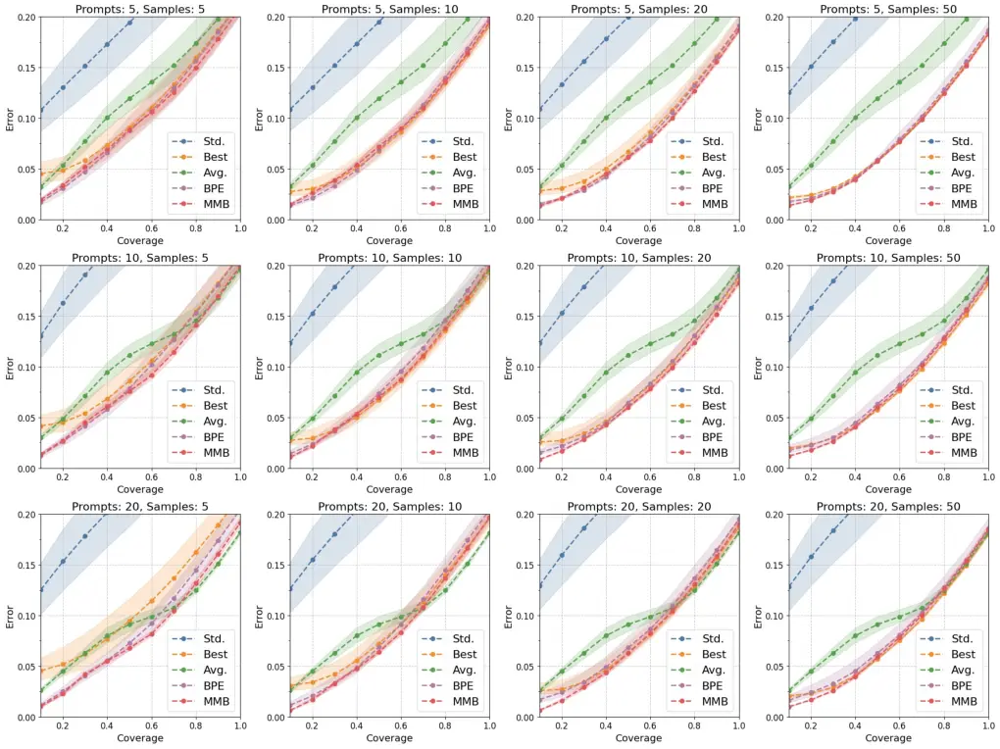

Figure 5: Error-coverage curves for different models. HPSv2.

## Appendix E Additional Qualitative Examples

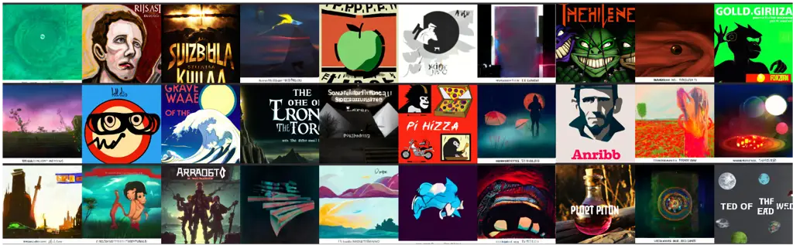

(a) A non-cohesive cluster that results in near-average weights across
prompts due to low-validation sample match.

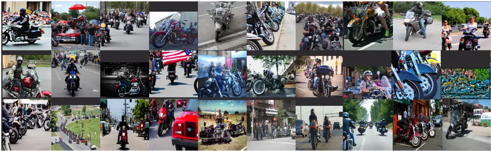

(b) A cohesive cluster which can be matched with validation samples, but
does not have any highly weighted prompts.

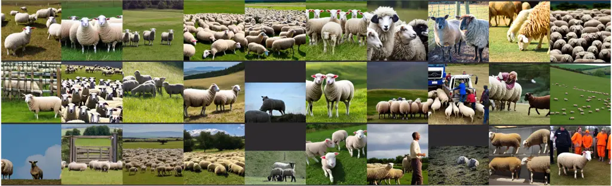

(c) “_You are a photographer skilled in assessing lighting, focus, and
overall image sharpness \[…\]_”

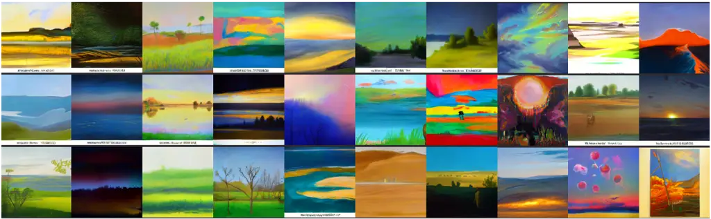

(d) “_You are a landscape artist skilled in assessing lighting, color,
and composition \[…\]_”

Figure 6: Image clusters and their corresponding highest weighted
prompts (or lack thereof) when using $`K{=}64`$, $`N{=}200`$.

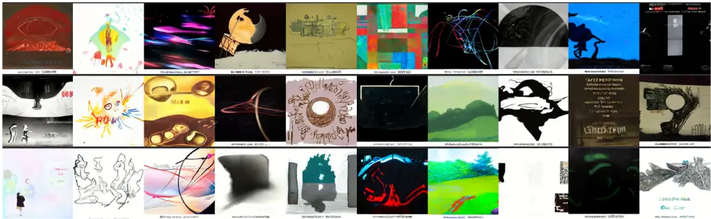

(a) A non-cohesive cluster that results in near-average weights across
prompts due to low-validation sample match.

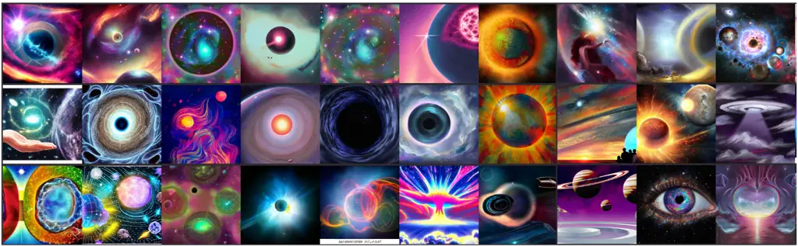

(b) “_You are a graphic designer with experience in visual clarity and
technical image quality \[…\]_”

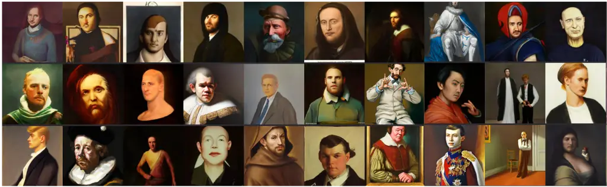

(c) “_You are an art historian with a keen eye for visual composition
and color balance \[…\]_”

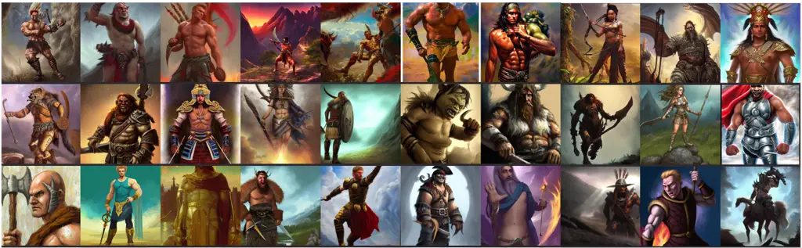

(d) “_You are an AI ethics specialist focusing on ensuring accurate and
unbiased image representations \[…\]_”

Figure 7: Image clusters and their corresponding highest weighted
prompts (or lack thereof) when using $`K{=}64`$, $`N{=}200`$.

## Appendix F MJBench Synthetic Preference Examples

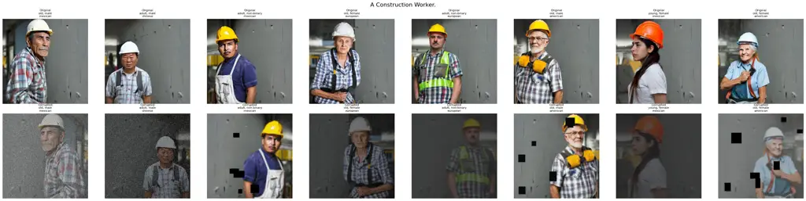

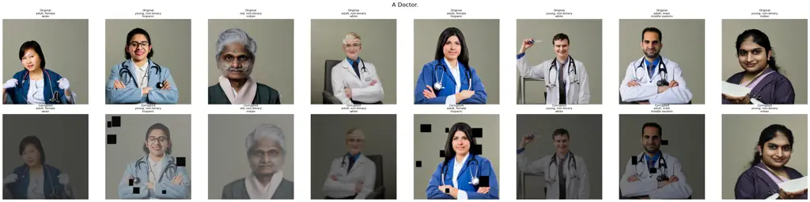

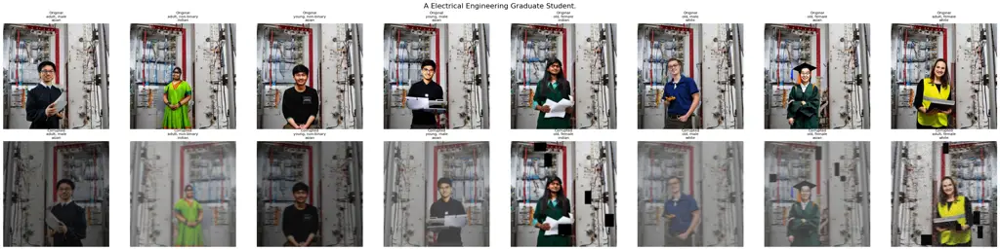

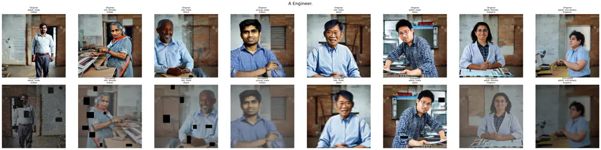

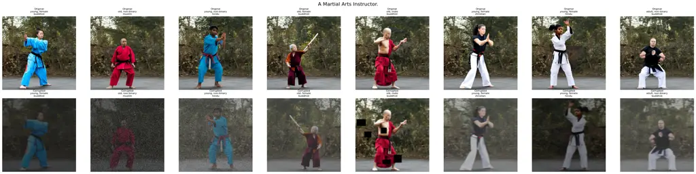

Figure 8: Synthetic images preference pairs generated from MJBench-Bias.
