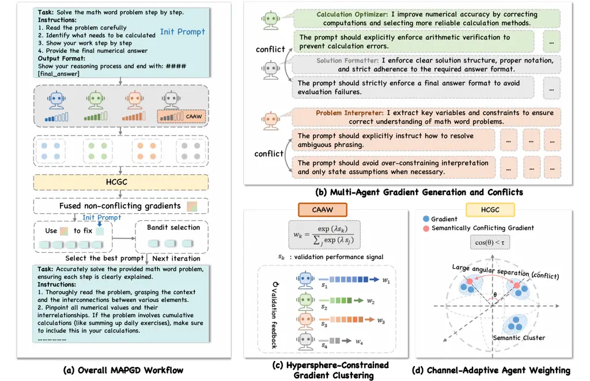

# MAPGD: Multi-Agent Prompt Gradient Descent for Collaborative Prompt Optimization

Yichen Han ^(†)^(†)thanks: \$†\$˜Equal contribution. \*˜Corresponding
authors. Affiliation: South China Normal University;
Email: <mailto:helewei@m.scnu.edu.cnhelewei@m.scnu.edu.cn>    Yuhang Han
Affiliation: Shanghai Jiao Tong University;
Email: <mailto:tys@cs.toronto.edutys@cs.toronto.edu>    Siteng Huang
Affiliation: Zhejiang University;    Guanyu Liu Affiliation: University
of Macau;    Zhengpeng Zhou Affiliation: Shanghai Jiao Tong University;
   Bojun Liu Affiliation: University of Sydney;    Yujia Zhang
Affiliation: University of Alberta;    Isaac N. Shi Affiliation: Silicon
Sapiens LLC;    Lewei He Affiliation: South China Normal University;   
Tianyu Shi Affiliation: University of Toronto

###### Abstract

Prompt engineering is crucial for fully leveraging large language
models, yet existing prompt optimization methods often rely on a single
refinement trajectory, leading to instability, conflicting update
signals, and inefficient use of query budgets. We propose Multi-Agent
Prompt Gradient Descent (MAPGD), a gradient-inspired framework that
coordinates multiple complementary prompt editing signals for robust and
interpretable optimization. MAPGD decomposes prompt refinement into
orthogonal dimensions (e.g., instruction clarity, example selection,
format, and style) and aggregates textual pseudo-gradients via semantic
embedding, conflict-aware clustering, and adaptive fusion. To improve
robustness, we introduce HCGC, which enforces angular separation between
conflicting directions, and CAAW, which dynamically calibrates editing
contributions based on validation feedback. Experiments on diverse
classification and reasoning benchmarks show that MAPGD achieves
consistent gains in accuracy over strong baselines, while ablation
results indicate that coordinated gradient fusion and adaptive weighting
are critical to stable optimization. Together, these findings suggest
that MAPGD offers a robust and interpretable framework for automatic
prompt optimization.

## 1 Introduction

Large Language Models (LLMs), trained on vast web-scale corpora, have
demonstrated remarkable generalization capabilities across a wide range
of natural language processing (NLP) tasks, including classification,
reasoning, and generation Achiam et al. (2023); Bubeck et al. (2023). A
critical factor underlying this performance is the design of prompts,
which serve as the primary interface for steering model behavior.
Despite their importance, prompts are still predominantly crafted
through manual trial-and-error, requiring substantial human effort Jiang
et al. (2022) and domain expertise Reynolds and McDonell (2021);
Zamfirescu-Pereira et al. (2023). This reliance on manual design limits
scalability and motivates the development of automatic or semi-automatic
prompt optimization methods that are both effective and interpretable.

Existing approaches to prompt optimization largely fall into two
categories. The first line of work approximates gradient-based
optimization through auxiliary models or differentiable prompt
representations Qin and Eisner (2021); Deng et al. (2022). While
theoretically appealing, these methods often assume access to internal
model states or parameters Shin et al. (2020); Lester et al. (2021),
making them impractical in real-world, API-only settings. The second
line of work formulates prompt optimization as a discrete search or
reinforcement learning problem, using feedback-driven edits or Monte
Carlo exploration Zhang et al. (2022); Zhou et al. (2022). Although
effective in certain cases, these methods can suffer from high
computational cost, unstable optimization trajectories, and limited
interpretability. Collectively, these limitations highlight the need for
more robust, scalable, and transparent prompt optimization frameworks.

To bridge this gap, Pryzant et al. Pryzant et al. (2023) proposed
ProTeGi, a non-parametric framework that reinterprets prompt
optimization as gradient descent in natural language space. ProTeGi
generates textual pseudo-gradients from model errors and iteratively
refines prompts using beam search and bandit-based selection, achieving
strong empirical performance. However, ProTeGi relies on a single-agent
optimization framework that aggregates heterogeneous refinement signals
into a unified trajectory. Such entanglement may give rise to implicit
objective conflicts, thereby impairing optimization stability and
convergence quality.

A natural extension is to decompose prompt optimization into multiple
specialized perspectives. Multi-agent formulations enable parallel
exploration of heterogeneous refinement dimensions, increasing signal
diversity and reducing premature convergence. However, introducing
multiple agents also makes semantic conflicts inevitable: different
agents may propose mutually incompatible updates, such as simultaneously
expanding illustrative examples while enforcing concise instructions.
Without explicit coordination mechanisms, such conflicts can destabilize
optimization and undermine the benefits of multi-agent collaboration.

In this work, we propose MAPGD, a unified framework that addresses these
challenges by integrating multi-agent specialization with principled
coordination mechanisms (Figure 1). As illustrated in Figure 1(a), MAPGD
decomposes prompt optimization into multiple orthogonal refinement
dimensions and assigns each to a specialized agent. Each agent
independently analyzes model errors and produces textual
pseudo-gradients that capture targeted improvement directions.

However, pseudo-gradients produced by different agents may encode
semantically conflicting refinement intents. To explicitly disentangle
such conflicts, MAPGD proposes Hypersphere-Constrained Gradient
Clustering (HCGC), which embeds agent-generated gradients into a shared
semantic space and separates incompatible optimization directions via
angularly constrained clustering. This design promotes semantic
consistency within clusters while preventing destructive interference
across conflicting refinement signals.

While HCGC addresses conflicts at the directional level, agent
contributions within the same semantic cluster may still vary in
reliability. MAPGD therefore incorporates CAAW, which dynamically
reweights agent channels based on validation performance. By emphasizing
consistently effective signals and attenuating noisy or unstable ones,
CAAW enables robust aggregation of non-conflicting gradients, leading to
stable and effective prompt refinement.

In summary, our contributions are three-fold.

\(1\) We propose MAPGD, a multi-agent pseudo-gradient framework for
stable and interpretable prompt optimization.

\(2\) We introduce HCGC and CAAW to disentangle conflicting refinement
signals and adaptively aggregate reliable agent contributions.

\(3\) We establish theoretical convergence guarantees, showing that
MAPGD preserves classical gradient descent behavior with almost sure
convergence to a local optimum at rate $`\mathcal{O}(1/\sqrt{T})`$.



Figure 1: Overview of MAPGD. MAPGD performs prompt optimization through
collaborative multi-agent pseudo-gradients. Agent-generated gradients
are embedded and clustered via HCGC to resolve semantic conflicts, and
adaptively weighted by CAAW according to validation performance. The
resulting fused gradients iteratively refine the prompt through
candidate generation and selection.

## 2 Related Work

#### Prompt Learning and Optimization.

Early prompt engineering relied on manual design, which is
labor-intensive and difficult to scale. Automated approaches have since
been explored, including reinforcement learning Deng et al. (2022),
evolutionary search Fernando et al. (2023), and Bayesian optimization
Sahoo et al. (2025). Continuous prompt tuning methods, such as prefix
tuning Li and Liang (2021) and soft prompts Lester et al. (2021),
optimize prompts in embedding space but often sacrifice interpretability
and require access to model internals. MAPGD operates in natural
language space, preserving interpretability while enabling
feedback-driven optimization.

#### Gradient-Inspired Prompt Optimization.

Recent work has framed prompt optimization as a gradient-like process in
discrete language space. ProTeGi Pryzant et al. (2023) generates natural
language pseudo-gradients from model errors and iteratively refines
prompts via beam search and bandit-based selection. However, as a
single-agent method, ProTeGi entangles heterogeneous refinement
objectives and lacks explicit mechanisms for resolving conflicting
optimization signals, which can lead to unstable or suboptimal
convergence. This limitation motivates approaches that can disentangle
and coordinate diverse refinement directions.

#### Multi-Agent Collaboration.

Multi-agent formulations enable parallel exploration of diverse
perspectives and have been widely studied in reinforcement learning and
distributed AI. In NLP, multi-agent debate Liang et al. (2023); Du et
al. (2023) and collaborative generation Hong et al. (2024) demonstrate
the benefits of role specialization. However, increased diversity makes
semantic conflicts inevitable, as different agents may propose
incompatible updates. MAPGD adopts a multi-agent design with specialized
roles, while explicitly addressing the resulting coordination and
conflict resolution challenges.

#### Geometric and Adaptive Coordination.

Resolving semantic conflicts requires structured inductive biases beyond
heuristic fusion. In representation learning, contrastive objectives and
angular margin constraints enforce intra-cluster compactness and
inter-cluster separation Wang and Isola (2020); Liu et al. (2017); Wang
et al. (2018); Deng et al. (2019). Chen et al. Chen et al. (2021)
further enhance large-margin contrastive learning via distance
polarization regularization. Inspired by these advances, MAPGD
introduces HCGC for geometry-aware gradient coordination, complemented
by CAAW to adaptively calibrate agent contributions.

#### Concurrent Work.

Concurrent studies such as MAPRO Zhang et al. (2025) and MA-SAPO Seo et
al. (2025) also explore multi-agent prompt optimization under different
assumptions, including explicit interaction structures or external
memory components. These settings are not directly aligned with our
budgeted, task-level optimization protocol. A detailed comparison is
provided in Appendix E.

In summary, MAPGD unifies prompt optimization, gradient-inspired
refinement, multi-agent collaboration, and geometry-aware coordination
into an interpretable framework that explicitly addresses semantic
conflicts.

## 3 Methodology

### 3.1 Framework Overview

MAPGD formulates prompt optimization as a hybrid discrete–continuous
gradient descent process operating directly in natural language space.
Unlike continuous embedding-based approaches such as prefix tuning or
soft prompt optimization Li and Liang (2021); Lester et al. (2021),
MAPGD preserves interpretability by explicitly manipulating textual
prompts while still leveraging gradient-inspired feedback signals for
iterative refinement. As illustrated in Figure 1, MAPGD frames prompt
optimization as a collaborative multi-agent process, in which
specialized agents focus on orthogonal refinement dimensions and produce
textual pseudo-gradients that guide prompt updates.

Building on this formulation, MAPGD instantiates the optimization
procedure through an iterative coordination loop. At each iteration,
specialized agents independently examine the current prompt and
available task feedback, and generate natural language pseudo-gradients
that reflect distinct refinement perspectives. These gradients are
embedded into a shared semantic space, where potential conflicts are
explicitly identified and mitigated via geometry-aware clustering and
adaptive fusion. The resulting fused gradients guide the generation of
successor prompts, which are subsequently evaluated and filtered under a
budgeted selection mechanism. Repeating this process yields an evolving
optimization trajectory that systematically balances exploration across
heterogeneous refinement directions with exploitation of effective
updates.

Formally, the prompt optimization objective is defined as

```math
F(p)=\mathbb{E}_{(x,y)\sim\mathcal{D}}\left[\ell(M(x;p),y)\right], \tag{1}
```

where $`\ell(\cdot,\cdot)`$ denotes a task-specific loss function and
$`M(x;p)`$ represents the model output conditioned on prompt $`p`$. The
optimization goal is

```math
p^{*}=\arg\min_{p}F(p). \tag{2}
```

Since gradients in this discrete textual space are not directly
accessible, MAPGD constructs natural language pseudo-gradients,

```math
\nabla F(p^{(t)})\approx g^{(t)}, \tag{3}
```

which serve as semantic analogues of numerical gradients in classical
optimization.

### 3.2 Specialized Prompt Agents

MAPGD employs multiple specialized agents, each responsible for a
distinct and approximately orthogonal dimension of prompt refinement.
Typical agent roles include instruction clarity, example selection,
output formatting, and stylistic refinement, optionally complemented by
a generic agent for broad exploratory updates. At iteration $`t`$, the
resulting pseudo-gradient set is

```math
G^{(t)}=\{g_{1}^{(t)},g_{2}^{(t)},\dots,g_{K}^{(t)}\}.
```

By decomposing prompt optimization into specialized perspectives, MAPGD
enables parallel exploration of heterogeneous refinement directions,
alleviating the limited signal diversity and premature convergence
commonly observed in single-agent optimization.

### 3.3 Hypersphere-Constrained Gradient Clustering

Inspired by hyperspherical metric learning Wang et al. (2018); Liu et
al. (2017), HCGC resolves semantic conflicts among heterogeneous
pseudo-gradients by enforcing geometry-aware separation on a normalized
hypersphere. Instead of assuming all agent proposals are mutually
compatible, HCGC explicitly detects semantic disagreement and clusters
gradients into coherent refinement directions before fusion.

#### Gradient Embedding and Conflict Signal.

Given agent-generated pseudo-gradients $`G^{(t)}`$, each $`g_{k}^{(t)}`$
is encoded into a $`d`$-dimensional semantic vector
$`v_{k}^{(t)}=\phi(g_{k}^{(t)})`$ and normalized onto the unit
hypersphere:

```math
\hat{v}_{k}^{(t)}=\frac{v_{k}^{(t)}}{\|v_{k}^{(t)}\|},\quad\hat{v}_{k}^{(t)}\in\mathbb{S}^{d-1}. \tag{4}
```

Semantic similarity is measured by cosine similarity,

```math
\mathrm{sim}(\hat{v}_{i},\hat{v}_{j})=\hat{v}_{i}^{\top}\hat{v}_{j}=\cos(\Delta(\hat{v}_{i},\hat{v}_{j})), \tag{5}
```

where $`\Delta(\cdot,\cdot)`$ denotes the angular distance on the
hypersphere. To make “conflict” explicit and measurable, we define two
gradients as being in semantic conflict if their similarity falls below
a threshold:

```math
\mathrm{conflict}(\hat{v}_{i},\hat{v}_{j})\;\Leftrightarrow\;\hat{v}_{i}^{\top}\hat{v}_{j}<\theta_{\text{conflict}}. \tag{6}
```

Intuitively, low cosine similarity indicates substantially different
(and potentially incompatible) refinement intents, motivating explicit
separation in clustering.

#### Clustering and Adaptive Cluster Cardinality.

We perform cosine K-means on the hypersphere to group semantically
coherent directions. Rather than fixing the number of clusters, we adopt
a bounded adaptive strategy:

```math
K^{(t)}=\min\big(|G^{(t)}|,\;K_{\max}\big), \tag{7}
```

where $`|G^{(t)}|`$ is the number of gradients at iteration $`t`$ and
$`K_{\max}`$ is an upper bound. This prevents over-fragmentation when
gradients are few, while allowing multiple distinct directions when
agent proposals are diverse.

#### Angular Margin Constraint.

Initial clustering may still yield weakly separated clusters when
conflicting gradients coexist. HCGC therefore refines assignments with
an angular margin constraint. Let $`u_{i}`$ be the centroid of
$`\hat{v}_{k}`$’s assigned cluster and $`u_{j}`$ any other centroid.
Define $`\alpha=\Delta(\hat{v}_{k},u_{i})`$ and
$`\beta=\Delta(\hat{v}_{k},u_{j})`$. While standard assignment requires
$`\alpha<\beta`$, HCGC strengthens it by a margin scale $`n\geq 1`$:

```math
n\cdot\alpha<\beta, \tag{8}
```

equivalently,

```math
\cos(n\cdot\alpha)>\cos(\beta). \tag{9}
```

Gradients that violate the margin are reassigned to clusters where the
constraint holds, yielding more compact and better-separated semantic
groups.

#### Fusion of Clustered Gradients.

Finally, gradients within each cluster are fused into a single
representative refinement direction via LLM-guided synthesis. To avoid
redundant updates, we apply a diversity filter to discard fused
gradients overly similar to those already selected, controlled by
$`\theta_{\text{diversity}}`$.

Figure 2: Effect of hypersphere-constrained angular margin in HCGC. (a)
Clustering without angular margin constraints may entangle semantically
conflicting pseudo-gradients, leading to ambiguous cluster boundaries.
(b) Enforcing an angular margin on the unit hypersphere improves
intra-cluster compactness and inter-cluster separation, effectively
isolating conflicting refinement directions.

### 3.4 Channel-Adaptive Agent Weighting

Although HCGC resolves structural conflicts between semantic gradient
directions, gradients within the same cluster may still vary in
reliability due to heterogeneous agent expertise and historical
effectiveness. To account for this variability, we introduce CAAW, a
reliability-aware coordination mechanism that adaptively calibrates
agent contributions during gradient fusion. CAAW is inspired by
channel-wise recalibration mechanisms in neural representations Hu et
al. (2018), but operates at the level of agent-generated textual
gradients.

#### Adaptive Weight Estimation.

Let $`s_{k}^{(t)}`$ denote the validation performance gain attributed to
gradient $`g_{k}^{(t)}`$ at iteration $`t`$, estimated from historical
agent performance statistics. CAAW converts these scalar signals into
normalized reliability weights via a softmax transformation:

```math
w_{k}^{(t)}=\frac{\exp(\lambda s_{k}^{(t)})}{\sum_{j\in C}\exp(\lambda s_{j}^{(t)})}, \tag{10}
```

where $`C`$ denotes the set of gradients within the same semantic
cluster and $`\lambda`$ controls the sharpness of the weighting
distribution. This formulation assigns higher weights to agents that
have consistently produced effective refinements, while down-weighting
less reliable channels.

#### Weight-Conditioned LLM Fusion.

Rather than explicitly performing an arithmetic weighted sum over
textual gradients, CAAW injects the estimated weights into the
LLM-driven fusion operator as conditioning signals. Concretely, the
fusion operator

```math
g_{\text{fused}}^{(t)}=\Psi\big(\{g_{k}^{(t)}\}_{k\in C}\,\big|\,\{w_{k}^{(t)}\}_{k\in C}\big) \tag{11}
```

receives both the set of clustered gradients and their corresponding
reliability weights, which are encoded in the fusion prompt to bias the
synthesis process toward more trustworthy agent suggestions. In this
way, agent weights influence the fused gradient implicitly through
prompt-level emphasis, rather than through explicit numerical
combination.

#### Stability Implications.

By conditioning gradient fusion on adaptive reliability weights, CAAW
suppresses noisy or redundant updates while amplifying consistently
effective refinement channels. This weight-aware fusion mechanism
reduces variance in the optimization trajectory and complements HCGC by
addressing intra-cluster reliability differences, thereby promoting
stable convergence toward semantically robust prompt candidates.

### 3.5 Candidate Generation and Selection

Fused gradients generate successor prompts
$`\{p^{\prime}_{1},\dots,p^{\prime}_{n}\}`$. MAPGD applies lightweight
filtering and optional bandit-based evaluation Audibert and Bubeck
(2010) to keep the computation budgeted. Unlike prior work that depends
heavily on bandit selection, MAPGD attains robustness and
interpretability mainly via conflict-aware clustering and adaptive
weighting across agents. Overall algorithm can be found in Algorithm 1.

1: Initial prompt $`p_{0}`$, train data $`D_{\text{train}}`$, dev data
$`D_{\text{dev}}`$, agents $`\{A_{i}\}_{i=1}^{N}`$, iterations $`R`$,
beam width $`k`$

2: Initialize best prompt $`p_{\star}^{(0)}\leftarrow p_{0}`$, beam
$`B_{0}\leftarrow\{p_{0}\}`$; initialize each agent prompt
$`A_{i}.p\leftarrow p_{0}`$

3: for $`t=1`$ to $`R`$ do

4:   $`M_{t}\leftarrow\textsc{SampleMiniBatch}(D_{\text{train}},b)`$

5:
  $`\mathcal{G}_{t}\leftarrow\textsc{GeneAgentGrads}(\{A_{i}\},M_{t})`$
$`\triangleright`$ Alg. 2

6:   $`\tilde{\mathcal{G}}_{t}\leftarrow\textsc{HCGC}(\mathcal{G}_{t})`$
$`\triangleright`$ Alg. 3

7:
  $`F_{t}\leftarrow\textsc{CAAW}(\tilde{\mathcal{G}}_{t},D_{\text{dev}})`$
$`\triangleright`$ Alg. 4

8:
  $`\mathcal{C}_{t}\leftarrow\textsc{ExpandPrompts}(p_{\star}^{(t-1)},F_{t})`$

9:
  $`B_{t},p_{\star}^{(t)}\leftarrow\textsc{BanditSelect}(\mathcal{C}_{t},D_{\text{dev}},k)`$

10:   SyncAgents($`\{A_{i}\},p_{\star}^{(t)}`$) $`\triangleright`$
Alg. 5

11:   if Converged($`p_{\star}^{(t)}`$) then break

12:   end if

13: end for

14: return Best prompt over
$`\{p_{\star}^{(1)},\dots,p_{\star}^{(t)}\}`$

Algorithm 1 MAPGD with HCGC and CAAW

### 3.6 Theoretical Convergence

We provide a theoretical analysis of MAPGD in Appendix G. Here, we
summarize the key assumptions and main implications to clarify how the
proposed framework relates to classical stochastic optimization.

Specifically, our analysis relies on three standard conditions: (i)
bounded second moments of agent-generated pseudo-gradients, (ii)
smoothness (or Lipschitz continuity) of the empirical loss function in
the semantic embedding space, (iii) unbiased sampling induced by the
bandit-based candidate selection mechanism. Under these assumptions,
MAPGD admits an interpretation as a stochastic approximation process and
achieves a sublinear convergence rate of $`\mathcal{O}(1/\sqrt{T})`$ in
both convex and non-convex settings.

Intuitively, the core components of MAPGD play complementary roles in
ensuring stable optimization. HCGC aggregates semantically aligned
refinement directions and mitigates conflicting updates, reducing
variance in the fused pseudo-gradient. CAAW further emphasizes agents
that have demonstrated consistent utility across iterations. Finally,
bandit-based candidate selection maintains sufficient exploration while
preventing systematic bias. Together, these mechanisms ensure that the
overall optimization dynamics remain stable and progressively improve
prompt quality over iterations.

## 4 Experiments

Experiments evaluate MAPGD in terms of effectiveness, efficiency, and
robustness. For fair comparison, we reproduce ProTeGi under identical
settings and further conduct ablations and token consumption analysis. A
real-world text-generation case study is also included (Appendix I) to
demonstrate applicability beyond benchmarks.

### 4.1 Experimental Details

Datasets. Following ProTeGi’s protocol, we evaluate on four
classification benchmarks (Jailbreak, Ethos, LIAR, Sarcasm) and three
arithmetic reasoning datasets (GSM8K, AQUARAT, SVAMP). For each dataset,
we sample 50/150 instances for dev/test and report test F1
(classification) or accuracy (reasoning). Dataset details are in
Appendix A.

Setup. We use the January 2023 gpt-3.5-turbo via Azure OpenAI unless
stated otherwise (temperature $`0.0`$ for classification). Results are
averaged over three runs; F1 is computed by max-pooling over the final
prompt beam. All methods share identical initial prompts, data, and
random seeds, with a fixed budget of $`T{=}10`$ and default
hyperparameters. Unless stated otherwise, MAPGD follows Section 3.3 with
$`\phi{=}\texttt{all-MiniLM-L6-v2}`$,
$`\theta_{\text{conflict}}{=}0.3`$, clustering threshold $`0.7`$,
$`\theta_{\text{diversity}}{=}0.7`$, and UCB selection with 80
evaluations; $`\lambda{=}1`$ (Appendix D). All experiments in
Section 4.2 use these modules unless ablated.

Baselines. We primarily compare against ProTeGi Pryzant et al. (2023)
under identical query budgets and initialization, and additionally
include MC search, RL-style edit methods, AutoGPT, and three reasoning
baselines (InsZero, Instinct, PromptWizard). Full descriptions are in
Appendix B.

### 4.2 Experimental Results

Figure 3: Test performance (F1 score) vs. API query budget per prompt
candidate across four benchmark tasks (evaluated up to 50 queries for
fair comparison with ProTeGi).

Classification benchmarks. Figure 3 reports test F1 under different
per-candidate evaluation budgets (up to 50 queries, following ProTeGi
for fairness). MAPGD consistently achieves the best performance across
all four datasets, with most gains emerging within the first 30–40
evaluations. The improvements are most pronounced on conflict-prone
tasks, suggesting that _explicit conflict disentanglement and adaptive
coordination_ are critical when refinement signals disagree: on
Jailbreak, MAPGD reaches 0.880 at 50 queries (vs. 0.833 for ProTeGi),
and on LIAR it attains 0.710 (vs. 0.660). We attribute these gains to
HCGC, which clusters compatible pseudo-gradients before fusion to reduce
semantic interference, and CAAW, which down-weights unreliable agents to
prevent noisy edits from dominating early iterations, thereby improving
budget efficiency. On the more saturated Ethos dataset, MAPGD still
improves to 0.980 (vs. 0.965), indicating that coordinated multi-agent
feedback can extract residual refinements even near a performance
ceiling. We follow the 50-query budget for strict comparability;
extended-budget results are deferred to Appendix C.

Arithmetic reasoning benchmarks. Table 1 evaluates MAPGD on GSM8k,
AQUARAT, and SVAMP, compared against InsZero, Instinct, and
PromptWizard. MAPGD achieves consistent gains across all three datasets,
most notably on GSM8k (93.5%), improving over the strongest baseline by
+3.5 points. We hypothesize that the benefit on reasoning stems from the
same coordination principle: specialized agents propose complementary
edits (e.g., step-by-step constraints, format strictness, and exemplar
guidance), while HCGC/CAAW suppress incompatible or low-yield
directions, leading to more stable chain-of-thought prompting. MAPGD
also improves the best baseline on AQUARAT (60.3% vs. 58.2%) and SVAMP
(84.1% vs. 82.3%), confirming transfer beyond classification.

| Method       | GSM8k | AQUARAT | SVAMP |
| ------------ | ----- | ------- | ----- |
| InsZero      | 74.2  | 54.3    | 79.5  |
| Instinct     | 74.5  | 54.7    | 81.0  |
| PromptWizard | 90.0  | 58.2    | 82.3  |
| MAPGD        | 93.5  | 60.3    | 84.1  |

Table 1: Arithmetic reasoning accuracy (%) on GSM8k, AQUARAT, and SVAMP.
Best results in bold.

### 4.3 Ablation Study

To isolate the sources of MAPGD’s gains, we conduct a component-wise
ablation by selectively disabling HCGC and CAAW. Table 2 reports four
settings (I–IV), where Setting I removes both modules and serves as a
minimal baseline. Enabling either module leads to consistent
improvements. Introducing HCGC (III vs. I) yields systematic gains,
confirming that geometry-aware clustering prior to fusion is essential
for reducing semantic interference among pseudo-gradients. CAAW alone
(II vs. I) also improves performance, indicating that uniform averaging
is suboptimal under varying agent reliability; adaptive reweighting
based on validation feedback enhances robustness. The combined setting
(IV) consistently outperforms either component alone, suggesting strong
complementarity: HCGC resolves directional incompatibility via conflict
disentanglement, whereas CAAW addresses reliability mismatch through
adaptive credit assignment. Gains are smaller on saturated datasets
(e.g., Ethos), consistent with ceiling effects, while conflict-prone
tasks benefit more from structured coordination.

| Setting | HCGC           | CAAW           | Jailbreak | Ethos | LIAR | Sarcasm |
| ------- | -------------- | -------------- | --------- | ----- | ---- | ------- |
| I       | $`\times`$     | $`\times`$     | 0.82      | 0.91  | 0.62 | 0.83    |
| II      | $`\times`$     | $`\checkmark`$ | 0.84      | 0.94  | 0.62 | 0.87    |
| III     | $`\checkmark`$ | $`\times`$     | 0.85      | 0.95  | 0.63 | 0.88    |
| IV      | $`\checkmark`$ | $`\checkmark`$ | 0.88      | 0.98  | 0.65 | 0.91    |

Table 2: Ablation study on core MAPGD components. $`\checkmark`$
indicates the component is enabled. Results are F1 score (mean over 3
runs).

### 4.4 Robustness to Dataset Sampling Size

Following the standard ProTeGi evaluation protocol, our main results use
50 development and 150 test examples per dataset to ensure direct
comparability. To verify that MAPGD’s gains are not an artifact of small
evaluation sets, we additionally evaluate larger subsamples on three
representative classification benchmarks.

Table 3 reports results under three sampling regimes (50/150, 100/300,
and 200/500). MAPGD consistently outperforms ProTeGi and MC across all
datasets and sampling sizes, indicating that its improvements persist as
the evaluation set grows.

| Dataset   | Method  | 50/150 | 100/300 | 200/500 |
| --------- | ------- | ------ | ------- | ------- |
| Jailbreak | ProTeGi | 0.82   | 0.83    | 0.81    |
|           | MC      | 0.76   | 0.77    | 0.75    |
|           | MAPGD   | 0.86   | 0.86    | 0.84    |
| Ethos     | ProTeGi | 0.93   | 0.94    | 0.94    |
|           | MC      | 0.89   | 0.90    | 0.90    |
|           | MAPGD   | 0.98   | 0.97    | 0.97    |
| LIAR      | ProTeGi | 0.65   | 0.62    | 0.63    |
|           | MC      | 0.62   | 0.63    | 0.63    |
|           | MAPGD   | 0.71   | 0.71    | 0.69    |

Table 3: Robustness to dataset sampling size (F1 score) under three
dev/test splits.

### 4.5 Token Consumption Analysis

Token efficiency is evaluated under the setup of Section 4.1 by counting
both input and output tokens per API call. We report total tokens,
number of calls, and performance-per-token. As shown in Table 4, MAPGD
attains higher F1 with fewer tokens and calls than ProTeGi, reducing
per-iteration token cost by $`\sim`$8% and improving
performance-per-token by $`>`$10%, suggesting reduced redundant queries
via HCGC and CAAW.

|                                 |         |              |
| ------------------------------- | ------- | ------------ |
| Metric                          | ProTeGi | MAPGD (full) |
| Total Tokens                    | 256k    | 236k         |
| Calls                           | 962     | 643          |
| Avg F1                          | 0.83    | 0.87         |
| F1 / Token ($`\times 10^{-6}`$) | 3.24    | 3.69         |

Table 4: Token consumption comparison between ProTeGi and MAPGD
(averaged over 3 runs). MAPGD achieves lower token usage and higher
efficiency.

### 4.6 Computational Overhead Analysis

We compare runtime overhead against ProTeGi under identical settings.
MAPGD shares evaluation, prompt expansion, and bandit selection with
ProTeGi, but adds multi-agent gradient generation and embedding-based
clustering. As shown in Table 5, the extra overhead mainly comes from
multi-agent gradient generation, which scales linearly with the number
of agents. Embedding and HCGC incur an almost constant cost, and with
four agents the overall overhead remains a small fraction of total
runtime.

| Component           | ProTeGi (s) | MAPGD (s) |
| ------------------- | ----------- | --------- |
| Gradient generation | 10.2        | 37.9      |
| Embedding + HCGC    | –           | 24.4      |
| Prompt expansion    | 33.7        | 28.7      |
| Bandit selection    | 30.3        | 26.5      |
| Other               | 85.2        | 84.0      |
| Total               | 159.4       | 201.5     |

Table 5: Runtime breakdown (in seconds) comparing ProTeGi and MAPGD.

### 4.7 Agent Number Sensitivity

To motivate the use of four specialized agents, we vary the number of
agents $`N\in\{2,4,6\}`$ under the setup of Section 4.1. For $`N=2`$,
only the Instruction Specialist and Example Curator are used; for
$`N=6`$, two additional style/format agents are added. As shown in
Figure 4, average F1 improves substantially from $`N=2`$ to $`N=4`$,
while $`N=6`$ yields only marginal gains with higher token cost,
indicating diminishing returns. Thus, $`N=4`$ offers the best
effectiveness–efficiency trade-off.

Figure 4: Agent number sensitivity analysis. Increasing agents from 2 to
4 yields clear improvements, while further increasing to 6 brings
diminishing returns.

### 4.8 Experimental Insights

MAPGD consistently outperforms single-agent ProTeGi and other baselines,
with the largest gains on LIAR and Jailbreak where refinement signals
often conflict. Ablations show HCGC and CAAW are complementary: removing
either hurts performance, and removing both approaches the single-agent
regime. MAPGD is also more token-efficient than ProTeGi (fewer API
calls, $`>`$10% higher performance-per-token) and transfers well to
arithmetic reasoning, surpassing strong baselines on GSM8k, AQUARAT, and
SVAMP. Appendix H provides a qualitative case study illustrating how
HCGC and CAAW resolve conflicting pseudo-gradients.

## 5 Conclusion

This work introduces MAPGD, a coordinated multi-agent framework for
prompt optimization that integrates HCGC and CAAW to resolve conflicting
refinement directions and reduce the impact of unreliable agents. Across
classification and arithmetic reasoning benchmarks, MAPGD consistently
improves over strong baselines while lowering token consumption, and it
admits a sublinear convergence guarantee of $`O(1/\sqrt{T})`$ under
standard stochastic approximation assumptions (Appendix G). Overall,
MAPGD provides an interpretable, robust, and resource-efficient approach
to prompt optimization via structured multi-agent collaboration.

## Limitations

MAPGD relies on semantic embeddings to detect conflicts and cluster
pseudo-gradients; under domain shift or highly specialized jargon,
similarity estimates may become unreliable and degrade coordination
quality. The method also depends on reasonably informative agent
feedback: if multiple agents are systematically misaligned, adaptive
weighting may not fully suppress harmful edits. Finally, compared to
single-agent methods, MAPGD introduces extra overhead from multi-agent
generation and coordination (embedding/clustering), which may limit
deployment under strict latency or budget constraints.

## References

- Achiam et al. (2023) J. Achiam, S. Adler, S. Agarwal, L. Ahmad, I.
  Akkaya, F. L. Aleman, D. Almeida, J. Altenschmidt, S. Altman, S.
  Anadkat, et al. Gpt-4 technical report. arXiv preprint
  arXiv:2303.08774. Cited by: §1.
- Agarwal et al. (2024) E. Agarwal, J. Singh, V. Dani, R. Magazine, T.
  Ganu, and A. Nambi PromptWizard: task-aware prompt optimization
  framework. External Links: 2405.18369,
  [Link](https://arxiv.org/abs/2405.18369) Cited by: 3rd item.
- Audibert and Bubeck (2010) J. Audibert and S. Bubeck Best arm
  identification in multi-armed bandits. In COLT-23th Conference on
  learning theory-2010, pp. 13–p. Cited by: §3.5.
- Bubeck et al. (2023) S. Bubeck, V. Chandrasekaran, R. Eldan, J.
  Gehrke, E. Horvitz, E. Kamar, P. Lee, Y. T. Lee, Y. Li, S. Lundberg,
  et al. Sparks of artificial general intelligence: early experiments
  with gpt-4. arXiv preprint arXiv:2303.12712. Cited by: §1.
- Chen et al. (2023) L. Chen, J. Chen, T. Goldstein, H. Huang, and T.
  Zhou InstructZero: efficient instruction optimization for black-box
  large language models. External Links: 2306.03082,
  [Link](https://arxiv.org/abs/2306.03082) Cited by: 1st item.
- Chen et al. (2021) S. Chen, G. Niu, C. Gong, J. Li, J. Yang, and M.
  Sugiyama Large-margin contrastive learning with distance polarization
  regularizer. In International conference on machine learning,
  pp. 1673–1683. Cited by: §2.
- Cobbe et al. (2021) K. Cobbe, V. Kosaraju, M. Bavarian, M. Chen, H.
  Jun, L. Kaiser, M. Plappert, J. Tworek, J. Hilton, R. Nakano, et al.
  Training verifiers to solve math word problems. arXiv preprint
  arXiv:2110.14168. Cited by: 1st item.
- Deng et al. (2019) J. Deng, J. Guo, N. Xue, and S. Zafeiriou Arcface:
  additive angular margin loss for deep face recognition. In Proceedings
  of the IEEE/CVF conference on computer vision and pattern recognition,
  pp. 4690–4699. Cited by: §2.
- Deng et al. (2022) M. Deng, J. Wang, C. Hsieh, Y. Wang, H. Guo, T.
  Shu, M. Song, E. P. Xing, and Z. Hu Rlprompt: optimizing discrete text
  prompts with reinforcement learning. arXiv preprint arXiv:2205.12548.
  Cited by: §1, §2.
- Du et al. (2023) Y. Du, S. Li, A. Torralba, J. B. Tenenbaum, and I.
  Mordatch Improving factuality and reasoning in language models through
  multiagent debate. In Forty-first International Conference on Machine
  Learning, Cited by: §2.
- Farha and Magdy (2020) I. A. Farha and W. Magdy From arabic sentiment
  analysis to sarcasm detection: the arsarcasm dataset. In The 4th
  Workshop on Open-Source Arabic Corpora and Processing Tools,
  pp. 32–39. Cited by: 4th item.
- Fernando et al. (2023) C. Fernando, D. Banarse, C. Blundell, T.
  Rocktäschel, and S. Osindero PromptBreeder: self-referential
  self-improvement via prompt evolution. arXiv preprint
  arXiv:2309.16797. Cited by: §2.
- Hong et al. (2024) S. Hong, M. Zhuge, J. Chen, X. Zheng, Y. Cheng, C.
  Zhang, J. Wang, Z. Wang, S. K. S. Yau, Z. Lin, L. Zhou, C. Ran, L.
  Xiao, C. Wu, and J. Schmidhuber MetaGPT: meta programming for a
  multi-agent collaborative framework. External Links: 2308.00352,
  [Link](https://arxiv.org/abs/2308.00352) Cited by: §2.
- Hu et al. (2018) J. Hu, L. Shen, and G. Sun Squeeze-and-excitation
  networks. In Proceedings of the IEEE conference on computer vision and
  pattern recognition, pp. 7132–7141. Cited by: §3.4.
- Jiang et al. (2022) E. Jiang, K. Olson, E. Toh, A. Molina, A.
  Donsbach, M. Terry, and C. J. Cai Promptmaker: prompt-based
  prototyping with large language models. In CHI Conference on Human
  Factors in Computing Systems Extended Abstracts, pp. 1–8. Cited by:
  §1.
- Lester et al. (2021) B. Lester, R. Al-Rfou, and N. Constant The power
  of scale for parameter-efficient prompt tuning. arXiv preprint
  arXiv:2104.08691. Cited by: §1, §2, §3.1.
- Li and Liang (2021) X. L. Li and P. Liang Prefix-tuning: optimizing
  continuous prompts for generation. Proceedings of the 59th Annual
  Meeting of the Association for Computational Linguistics and the 11th
  International Joint Conference on Natural Language Processing (Volume
  1: Long Papers), pp. 4582–4597. External Links:
  [Link](https://api.semanticscholar.org/CorpusID:230433941) Cited by:
  §2, §3.1.
- Liang et al. (2023) W. Liang, Y. Wu, M. Lee, E. Chi, D. Zhou, Y. Song,
  and X. L. Li Encouraging divergent thinking in large language models
  through multi-agent debate. arXiv preprint arXiv:2305.19118. Cited by:
  §2.
- Lin et al. (2024) X. Lin, Z. Wu, Z. Dai, W. Hu, Y. Shu, S. Ng, P.
  Jaillet, and B. K. H. Low Use your instinct: instruction optimization
  for llms using neural bandits coupled with transformers. External
  Links: 2310.02905, [Link](https://arxiv.org/abs/2310.02905) Cited by:
  2nd item.
- Ling et al. (2017) W. Ling, D. Yogatama, C. Dyer, and P. Blunsom
  Program induction by rationale generation: learning to solve and
  explain algebraic word problems. arXiv preprint arXiv:1705.04146.
  Cited by: 2nd item.
- Liu et al. (2017) W. Liu, Y. Wen, Z. Yu, M. Li, B. Raj, and L. Song
  Sphereface: deep hypersphere embedding for face recognition. In
  Proceedings of the IEEE conference on computer vision and pattern
  recognition, pp. 212–220. Cited by: §2, §3.3.
- Mollas et al. (2022) I. Mollas, Z. Chrysopoulou, S. Karlos, and G.
  Tsoumakas ETHOS: a multi-label hate speech detection dataset. Complex
  & Intelligent Systems 8 (6), pp. 4663–4678. Cited by: 2nd item.
- Patel et al. (2021) A. Patel, S. Bhattamishra, and N. Goyal Are nlp
  models really able to solve simple math word problems?. arXiv preprint
  arXiv:2103.07191. Cited by: 3rd item.
- Prasad et al. (2022) A. Prasad, P. Hase, X. Zhou, and M. Bansal Grips:
  gradient-free, edit-based instruction search for prompting large
  language models. arXiv preprint arXiv:2203.07281. Cited by: 3rd item.
- Pryzant et al. (2023) R. Pryzant, D. Iter, J. Li, Y. T. Lee, C. Zhu,
  and M. Zeng Automatic prompt optimization with" gradient descent" and
  beam search. arXiv preprint arXiv:2305.03495. Cited by: Appendix B,
  §1, §2, §4.1.
- Qin and Eisner (2021) G. Qin and J. Eisner Learning how to ask:
  querying lms with mixtures of soft prompts. arXiv preprint
  arXiv:2104.06599. Cited by: §1.
- Reynolds and McDonell (2021) L. Reynolds and K. McDonell Prompt
  programming for large language models: beyond the few-shot paradigm.
  In Extended abstracts of the 2021 CHI conference on human factors in
  computing systems, pp. 1–7. Cited by: §1.
- Sahoo et al. (2025) P. Sahoo, A. K. Singh, S. Saha, V. Jain, S.
  Mondal, and A. Chadha A systematic survey of prompt engineering in
  large language models: techniques and applications. External Links:
  2402.07927, [Link](https://arxiv.org/abs/2402.07927) Cited by: §2.
- Seo et al. (2025) W. Seo, J. Lee, J. Koh, H. An, J. Park, S. Lee, H.
  Chen, and Y. Bu Prompt optimization via retrieved reasoning assets and
  multi-agent analysis. External Links: 2510.16635,
  [Link](https://arxiv.org/abs/2510.16635) Cited by: Appendix E,
  Appendix E, §2.
- Shen et al. (2024) X. Shen, Z. Chen, M. Backes, Y. Shen, and Y. Zhang
  " Do anything now": characterizing and evaluating in-the-wild
  jailbreak prompts on large language models. In Proceedings of the 2024
  on ACM SIGSAC Conference on Computer and Communications Security,
  pp. 1671–1685. Cited by: 1st item.
- Shin et al. (2020) T. Shin, Y. Razeghi, R. L. Logan IV, E. Wallace,
  and S. Singh Autoprompt: eliciting knowledge from language models with
  automatically generated prompts. arXiv preprint arXiv:2010.15980.
  Cited by: §1.
- Wang et al. (2018) H. Wang, Y. Wang, Z. Zhou, X. Ji, D. Gong, J.
  Zhou, Z. Li, and W. Liu Cosface: large margin cosine loss for deep
  face recognition. In Proceedings of the IEEE conference on computer
  vision and pattern recognition, pp. 5265–5274. Cited by: §2, §3.3.
- Wang and Isola (2020) T. Wang and P. Isola Understanding contrastive
  representation learning through alignment and uniformity on the
  hypersphere. In International conference on machine learning,
  pp. 9929–9939. Cited by: §2.
- Wang (2021) W. Wang A new benchmark dataset for fake news detection.
  In Proceedings of the 55th Annual Meeting of the Association for
  Computational Linguistics, Vol. 2. Cited by: 3rd item.
- Zamfirescu-Pereira et al. (2023) J. D. Zamfirescu-Pereira, R. Y.
  Wong, B. Hartmann, and Q. Yang Why johnny can’t prompt: how non-ai
  experts try (and fail) to design llm prompts. In Proceedings of the
  2023 CHI conference on human factors in computing systems, pp. 1–21.
  Cited by: §1.
- Zhang et al. (2022) T. Zhang, X. Wang, D. Zhou, D. Schuurmans,
  and J. E. Gonzalez Tempera: test-time prompting via reinforcement
  learning. arXiv preprint arXiv:2211.11890. Cited by: 3rd item, §1.
- Zhang et al. (2025) Z. Zhang, L. Ge, H. Li, W. Zhu, C. Zhang, and Y.
  Ye MAPRO: recasting multi-agent prompt optimization as maximum a
  posteriori inference. External Links: 2510.07475,
  [Link](https://arxiv.org/abs/2510.07475) Cited by: Appendix E,
  Appendix E, §2.
- Zhou et al. (2022) Y. Zhou, A. I. Muresanu, Z. Han, K. Paster, S.
  Pitis, H. Chan, and J. Ba Large language models are human-level prompt
  engineers. In The eleventh international conference on learning
  representations, Cited by: 2nd item, §1.

## Appendix A Datasets Details

To ensure comparability with ProTeGi, we evaluate MAPGD on the same four
benchmark NLP classification tasks that span diverse domains and
languages:

- •
  Jailbreak Shen et al. (2024): a novel task to determine whether a user
  input to an LLM continuation API constitutes a jailbreak attempt.
  Jailbreak attacks are defined as user strategies that aim to make the
  model violate its own safety policies, such as generating harmful
  content or exposing hidden instructions. The dataset contains 1306
  multilingual examples with human-annotated jailbreak labels.
- •
  Ethos Mollas et al. (2022): an English hate speech detection dataset
  with 997 online comments annotated as hateful or non-hateful.
- •
  LIAR Wang (2021): a large-scale dataset for fake news detection,
  consisting of 4,000 short statements labeled with ground-truth
  veracity, along with context information.
- •
  Sarcasm Farha and Magdy (2020): an Arabic sarcasm detection dataset
  with 10,000 online comments, labeled for the presence or absence of
  sarcasm.

Beyond classification, we further evaluate on three arithmetic reasoning
datasets that require multi-step logical inference and symbolic
manipulation:

- •
  GSM8k Cobbe et al. (2021): a widely used benchmark of 8,500
  grade-school math problems that require step-by-step reasoning.
- •
  AQUARAT Ling et al. (2017): a dataset of algebraic word problems
  designed to test symbolic reasoning and program induction.
- •
  SVAMP Patel et al. (2021): a benchmark focusing on simple arithmetic
  word problems with diverse linguistic variations, serving as a testbed
  for robustness to paraphrasing.

In addition, we include a real-world text generation case study in the
Appendix to highlight MAPGD’s applicability beyond controlled
benchmarks.

## Appendix B Baselines Details

To evaluate the effectiveness of MAPGD, we compare it against a set of
non-parametric prompt optimization methods, following the setup of
ProTeGi Pryzant et al. (2023), and additionally include ProTeGi itself
as a strong baseline. Specifically, we consider:

- •
  ProTeGi: the original prompt gradient descent framework, where a
  single agent iteratively generates pseudo-gradients and candidate
  prompts, with bandit-based selection. This serves as our primary
  baseline for comparison.
- •
  Monte-Carlo (MC) Zhou et al. (2022): an iterative but directionless
  Monte Carlo search over the prompt space. For fairness, we match the
  number of samples per candidate to the successors generated by MAPGD.
- •
  Reinforcement Learning (RL) Recent approaches such as GrIPS Prasad et
  al. (2022) and TEMPERA Zhang et al. (2022) formulate prompt
  optimization as a reinforcement learning problem. In these methods,
  the prompt text is first segmented into phrases, and the search space
  is explored via phrase-level edit operations, including addition,
  paraphrasing, swapping, and deletion.
- •
  AutoGPT: an open-source autonomous agent system that improves prompts
  through self-directed feedback loops. We configure AutoGPT with the
  same number of examples and errors as MAPGD, running for the same
  number of optimization steps.

For arithmetic reasoning, we additionally compare against three
competitive baselines, all reported with GPT-3.5-Turbo in a zero-shot
setting:

- •
  InsZero Chen et al. (2023): a zero-shot prompting method with
  instruction tuning.
- •
  Instinct Lin et al. (2024): an instruction-following baseline that
  improves prompting robustness.
- •
  PromptWizard Agarwal et al. (2024): a state-of-the-art prompt
  synthesis framework that iteratively enriches prompts with
  intermediate reasoning steps and examples.

This collection of baselines allows us to evaluate MAPGD not only
against single-agent gradient-based optimization, but also against
strong arithmetic reasoning methods optimized for chain-of-thought style
prompting.

## Appendix C Extended Evaluation Budgets Beyond 50 Queries

To verify whether our conclusions depend on the 50-query budget, we
further extend the evaluation budget to 60 and 70 queries on three
representative datasets (Jailbreak, LIAR, and Sarcasm). We keep the same
evaluation protocol and report results in Table 6. Overall, the method
ranking remains unchanged, and the additional gains beyond 50 are
marginal, suggesting that a 50-query budget is sufficient to capture
MAPGD’s performance while preserving fairness with prior work (e.g.,
ProTeGi).

| Dataset   | Budget | ProTeGi | MC    | MAPGD |
| --------- | ------ | ------- | ----- | ----- |
| Jailbreak | 50     | 0.833   | 0.773 | 0.880 |
|           | 60     | 0.836   | 0.773 | 0.885 |
|           | 70     | 0.842   | 0.773 | 0.887 |
| LIAR      | 50     | 0.660   | 0.630 | 0.710 |
|           | 60     | 0.672   | 0.630 | 0.720 |
|           | 70     | 0.681   | 0.630 | 0.725 |
| Sarcasm   | 50     | 0.876   | 0.853 | 0.913 |
|           | 60     | 0.879   | 0.853 | 0.918 |
|           | 70     | 0.880   | 0.853 | 0.920 |

Table 6: Performance under extended evaluation budgets (60/70 queries).
Gains beyond 50 queries are small and do not change the ranking among
methods.

Across these datasets, MAPGD improves by only +0.007 (Jailbreak), +0.015
(LIAR), and +0.007 (Sarcasm) from 50 to 70 queries, confirming a clear
diminishing-return trend after approximately 30–40 evaluations, while
leaving the main conclusions unchanged.

## Appendix D CAAW Parameter Sensitivity

The CAAW module uses a temperature parameter $`\lambda`$ to control the
emphasis on historically effective agents during gradient fusion. To
evaluate the robustness of MAPGD with respect to $`\lambda`$, we
conducted experiments on two representative datasets: LIAR(binary) and
GSM8K (mathematical reasoning).

We tested three values of $`\lambda`$: 0.5, 1, and 2. Table 7 summarizes
the test accuracy for each setting. The results indicate that moderate
variations of $`\lambda`$ do not significantly affect the overall
performance, supporting the choice of $`\lambda=1`$ in the main
experiments.

| $`\lambda`$ | LIAR Accuracy | GSM8K Accuracy |
| ----------- | ------------- | -------------- |
| 0.5         | 0.709         | 0.927          |
| 1           | 0.717         | 0.935          |
| 2           | 0.711         | 0.933          |

Table 7: Test accuracy of MAPGD under different CAAW weighting parameter
$`\lambda`$. Performance differences are minor, demonstrating robustness
to $`\lambda`$.

As shown in Table 7, the test accuracy exhibits only minor variations
across the three $`\lambda`$ values, with a maximum difference of 0.008
on LIAR and 0.008 on GSM8K. These variations are small relative to the
overall performance gains achieved by multi-agent gradient fusion,
indicating that while $`\lambda`$ influences the sharpness of agent
weighting, MAPGD’s performance remains stable for reasonable choices
around the default setting of $`\lambda=1`$.

## Appendix E Comparison with Recent Concurrent Work

We are aware of two recent concurrent works that are closely related in
spirit to prompt optimization with multi-agent components, namely
MAPRO Zhang et al. (2025) and MA-SAPO Seo et al. (2025). While these
works share a high-level motivation with MAPGD, we did not include them
as baselines in our main experimental comparisons due to comparability
constraints in problem setting and resource assumptions.

#### MAPRO Zhang et al. (2025).

MAPRO studies prompt optimization _within an explicit multi-agent system
(MAS)_: it jointly configures role prompts for multiple agents and
leverages the MAS interaction topology (e.g., DAG-structured
communication) together with node-/edge-level reward modeling and global
inference to select prompt combinations. In contrast, MAPGD targets
_task-level prompt optimization_ under a fixed query budget, where
specialized agents propose pseudo-gradients that are subsequently
coordinated (via HCGC and CAAW) to iteratively refine a _single_ task
prompt. Because MAPRO’s formulation depends on an explicit MAS graph,
per-agent prompts, and interaction-specific rewards, directly porting it
to our benchmark protocol would require redesigning the environment and
supervision signals, making a head-to-head comparison not directly
aligned with our evaluation setting.

#### MA-SAPO Seo et al. (2025).

MA-SAPO optimizes prompts through _retrieved reasoning assets_: it
constructs a searchable library of semi-structured “reasoning cards”
from labeled or scored prompt–response data, and then performs
analysis–refinement guided by top-$`k`$ retrieved assets at test time.
This introduces an additional external memory/resource assumption (i.e.,
an offline asset corpus and its construction pipeline) that is
orthogonal to our training-free, black-box optimization protocol. In our
evaluation, we intentionally restrict methods to operate under the same
query budget without relying on extra annotated corpora or a separately
curated retrieval memory. Under these constraints, implementing MA-SAPO
would either (i) require additional data collection/annotation to build
assets, or (ii) reuse task-specific optimization traces as assets, which
changes the method definition and complicates fairness.

#### Summary and future work.

Overall, MAPRO and MA-SAPO represent complementary directions—MAS-level
joint role-prompt configuration and retrieval-augmented prompt
rewriting—whereas MAPGD focuses on multi-agent pseudo-gradient
coordination for budgeted task-level prompt refinement. Integrating
these paradigms into a unified and strictly comparable evaluation (e.g.,
extending MAPGD with optional retrieval memories or evaluating
MAPRO-style joint prompting on explicit MAS benchmarks) is an important
direction for future work.

## Appendix F Complexity and Parallelism

The computational bottleneck of MAPGD with HCGC and CAAW (see
Algorithm 1) lies in LLM calls for gradient generation, cluster fusion,
and prompt expansion, whereas embedding, clustering, similarity checks,
and adaptive weighting involve comparatively lightweight vector
operations. Multi-agent parallelization significantly reduces wall time,
making the framework scalable for practical deployment. In the
following, we analyze the per-iteration computational and memory costs,
providing a detailed breakdown of the dominant operations and their
respective complexities.

#### Notation.

Let $`N`$ be the number of agents, $`m`$ the number of reasons per
agent, giving $`G=Nm`$ atomic gradients. Embedding dimension $`d`$,
clusters $`K\leq G`$, fused gradients $`|\tilde{\mathcal{G}}|`$,
expansion variants per gradient $`s`$, MC paraphrases per variant
$`n_{\text{mc}}`$, candidate prompts $`|\mathcal{C}|`$, beam width
$`k`$, bandit rounds $`T_{b}`$ with $`K_{\text{eval}}`$ arms and dev
mini-batch size $`b`$.

#### Stage costs (time).

1.  1.  Agent gradient generation: Each of the $`N`$ agents generates $`m`$
        gradients using LLMs, giving $`O(N)`$ LLM calls. Parallelization
        reduces wall time to $`\approx\max t_{\text{LLM}}`$.
2.  2.  HCGC embedding + conflict detection: Embedding each gradient costs
        $`O(Gd)`$; computing pairwise angular conflicts costs $`O(G^{2}d)`$.
        For small $`G`$ (e.g., $`G\sim 16`$), this is negligible compared
        with LLM calls.
3.  3.  HCGC clustering: KMeans clustering over $`G`$ gradients into $`K`$
        clusters with $`I`$ iterations costs $`O(GKId)`$, again minor due to
        small $`G`$.
4.  4.  HCGC fusion (LLM): Clusters with multiple gradients require one LLM
        call per cluster to fuse into a coherent gradient. Total LLM calls
        up to $`O(K_{\text{merge}})`$, parallelizable across clusters.
5.  5.  CAAW weighting and fusion: Per-cluster adaptive weighting is
        $`O(G)`$ vector operations, negligible compared to LLM fusion.
6.  6.  Prompt expansion + MC paraphrasing: Applying each fused gradient:
        $`O(|\tilde{\mathcal{G}}|)`$ gradient applications. MC paraphrasing
        for each variant: $`O(|\tilde{\mathcal{G}}|sn_{\text{mc}})`$ LLM
        calls.
7.  7.  Diversity filtering: Computing embeddings: $`O(|\mathcal{C}|d)`$;
        naive pairwise similarities: $`O(|\mathcal{C}|^{2})`$. For tens of
        candidate prompts, this remains negligible.
8.  8.  Bandit evaluation: Probing $`K_{\text{eval}}`$ arms over
        mini-batches of size $`b`$ for $`T_{b}`$ rounds:
        $`O(K_{\text{eval}}bT_{b})`$, significantly cheaper than exhaustive
        evaluation $`O(|\mathcal{C}|\,|D_{\text{dev}}|)`$.

#### Space complexity.

Text storage: $`O(|\mathcal{C}|L_{\text{avg}})`$. Embeddings:
$`O((G+|\mathcal{C}|)d)`$, typically a few MB. Optional caches (unique
prompts or intermediate LLM outputs) scale linearly with the number of
prompts and clusters.

1: Agents $`\{A_{i}\}`$, mini-batch $`M_{t}`$, task $`T`$, predictor
$`\Pi`$, per-agent error cap $`e`$, feedback count $`m`$

2: for all agent $`A_{i}`$ in parallel do

3:   $`(\hat{y},y)`$ pairs
$`\leftarrow T.\textsc{InferAndLabel}(A_{i}.p,M_{t},\Pi)`$

4:   $`E_{i}\leftarrow\textsc{SelectErrors}(\hat{y},y,e)`$

5:   if $`|E_{i}|=0`$ then
$`E_{i}\leftarrow\textsc{DiverseSamples}(M_{t},e)`$

6:   end if

7:
  $`raw_{i}\leftarrow\textsc{LLMGradientPrompt}(A_{i}.role,A_{i}.p,E_{i},m)`$

8:   $`g_{i}\leftarrow\textsc{ParseGradientBlocks}(raw_{i})`$
$`\triangleright`$ Split by delimiters

9: end for

10: return $`\mathcal{G}_{t}=\{(A_{i}.role,g_{i})\}_{i=1}^{N}`$

Algorithm 2 Multi-Agent Textual Gradient Generation

1: Agent gradients $`\mathcal{G}_{t}`$

2: Embed and normalize: $`\hat{v}_{k}=\phi(g_{k})/\|\phi(g_{k})\|`$

3: Detect conflicts:
$`\mathcal{C}_{\text{conf}}\leftarrow\{(i,j):\cos^{-1}(\hat{v}_{i}^{\top}\hat{v}_{j})>\theta\}`$

4: Cluster gradients:
$`\{S_{k}\}_{k=1}^{K}\leftarrow\textsc{KMeans}(\{\hat{v}_{k}\},K_{\max})`$

5: for $`k=1`$ to $`K`$ do

6:   Apply angular margin: reassign gradients violating
$`\cos(n\cdot\Delta(\hat{v}_{i},c_{k}))>\cos(\Delta(\hat{v}_{i},c_{j}))`$

7:   Fuse cluster $`S_{k}`$ via LLM:
$`f_{k}\leftarrow\textsc{LLMFuse}(S_{k},\mathcal{C}_{\text{conf}})`$

8: end for

9: return Fused clusters:
$`\tilde{\mathcal{G}}_{t}=\{f_{1},\dots,f_{K}\}`$

Algorithm 3 Hypersphere-Constrained Gradient Clustering

1: Clustered gradients $`\tilde{\mathcal{G}}_{t}`$, dev data
$`D_{\text{dev}}`$, temperature $`\lambda`$

2: for all cluster $`\tilde{\mathcal{G}}_{t}`$ do

3:   Compute per-gradient validation gain $`s_{i}`$ on
$`D_{\text{dev}}`$

4:   Assign adaptive weight:
$`w_{i}=\frac{\exp(\lambda s_{i})}{\sum_{j\in S_{k}}\exp(\lambda s_{j})}`$

5:   Fuse cluster gradients:
$`f_{k}=\Psi\Big(\sum_{i\in S_{k}}w_{i}g_{i}\Big)`$

6: end for

7: return $`F_{t}=\{f_{1},\dots,f_{K}\}`$

Algorithm 4 Channel-Adaptive Agent Weighting and Fusion

1: Agents $`\{A_{i}\}_{i=1}^{N}`$, current best prompt
$`p_{\star}^{(t)}`$

2: for each agent $`A_{i}`$ do

3:   $`A_{i}.p\leftarrow p_{\star}^{(t)}`$ $`\triangleright`$ Set the
agent’s current prompt to the global best

4:   ResetGradientHistory($`A_{i}`$) $`\triangleright`$ Optional: clear
outdated gradient history

5:   UpdatePerformanceMemory($`A_{i},p_{\star}^{(t)}`$)
$`\triangleright`$ Record performance feedback for the new prompt

6: end for

7: return Updated agents $`\{A_{i}\}`$

Algorithm 5 SynchronizeAgents

## Appendix G Theoretical Analysis

In this section, we provide convergence guarantees for MAPGD under mild
assumptions, following the stochastic approximation framework. Our goal
is to bridge the gap between the continuous optimization theory of
stochastic gradient descent (SGD) and the discrete prompt optimization
carried out in MAPGD. We show that, despite operating in a structured
and discrete search space, MAPGD achieves the same sublinear convergence
rate of $`O(1/\sqrt{T})`$ in both convex and non-convex settings.

### G.1 Assumptions

We begin with a set of assumptions standard in stochastic optimization
but reinterpreted in the context of multi-agent prompt optimization.

- •
  (A1) Alignment (Unbiasedness). For some $`\mu>0`$, the stochastic
  semantic gradient $`g^{(t)}`$ maintains alignment with the true
  gradient:

  ```math
  \mathbb{E}\!\left[\langle g^{(t)},\nabla F(p^{(t)})\rangle\,\middle|\,p^{(t)}\right]\;\geq\;\mu\|\nabla F(p^{(t)})\|^{2}.
  ```

  This reflects the role of semantic fusion: multi-agent aggregation
  reduces the chance of adversarial or noisy updates, ensuring progress
  along descent directions.

- •
  (A2) Bounded Second Moment. For constants $`\rho,\sigma^{2}\geq 0`$,

  ```math
  \mathbb{E}\!\left[\|g^{(t)}\|^{2}\,\middle|\,p^{(t)}\right]\;\leq\;\rho\|\nabla F(p^{(t)})\|^{2}+\sigma^{2}.
  ```

  This captures the variance-control effect of the bandit-based
  selection mechanism, which prevents uncontrolled explosion of gradient
  magnitude.

- •
  (A3) Smoothness or Lipschitzness. For convex tasks, $`F`$ is
  $`G`$-Lipschitz with domain diameter $`D`$. For non-convex tasks,
  $`F`$ is $`L`$-smooth: $`\|\nabla F(u)-\nabla F(v)\|\leq L\|u-v\|`$.

### G.2 Supporting Lemmas

We restate two standard lemmas, adapted to the MAPGD setting.

#### Lemma 1 (Convex Projection Inequality).

For convex $`F`$ with feasible set $`\mathcal{P}`$, the projected
subgradient update

```math
p^{(t+1)}=\Pi_{\mathcal{P}}\!\left(p^{(t)}-\eta g^{(t)}\right)
```

satisfies

```math
\displaystyle\|p^{(t+1)}-p^{*}\|^{2} \displaystyle\leq\|p^{(t)}-p^{*}\|^{2}-2\eta\langle g^{(t)},\,p^{(t)}-p^{*}\rangle
```

```math
\displaystyle+\eta^{2}\|g^{(t)}\|^{2}.
```

#### Lemma 2 (Non-Convex Descent Lemma).

If $`F`$ is $`L`$-smooth, then for update
$`p^{(t+1)}=p^{(t)}-\eta g^{(t)}`$, we have

```math
F(p^{(t+1)})\;\leq\;F(p^{(t)})-\eta\langle\nabla F(p^{(t)}),g^{(t)}\rangle+\frac{L}{2}\eta^{2}\|g^{(t)}\|^{2}.
```

### G.3 Main Results

#### Convex Convergence.

Suppose $`F`$ is convex, $`G`$-Lipschitz, and $`\mathcal{P}`$ has
diameter $`D`$. Let $`\bar{p}_{T}=\tfrac{1}{T}\sum_{t=1}^{T}p^{(t)}`$.
Under (A1)–(A2) and step size $`\eta=\tfrac{D}{G\sqrt{T}}`$, we obtain:

```math
\mathbb{E}[F(\bar{p}_{T})]-F(p^{*})\;=\;O\!\left(\frac{1}{\sqrt{T}}\right).
```

Proof sketch. By Lemma 1 and convexity:

```math
F(p^{(t)})-F(p^{*})\leq\langle g^{(t)},p^{(t)}-p^{*}\rangle.
```

Summing over $`t=1,\ldots,T`$ and applying (A1)–(A2), we bound the
regret:

```math
\sum_{t=1}^{T}\mathbb{E}[F(p^{(t)})-F(p^{*})]\;\leq\;\frac{D^{2}}{2\eta}+\frac{\eta G^{2}T}{2}.
```

Using Jensen’s inequality for $`\bar{p}_{T}`$ and optimizing $`\eta`$,
we conclude the $`O(1/\sqrt{T})`$ rate.

#### Non-Convex Convergence.

Suppose $`F`$ is $`L`$-smooth and (A1)–(A2) hold. With constant step
size $`\eta=\Theta(1/\sqrt{T})`$, we have

```math
\frac{1}{T}\sum_{t=1}^{T}\mathbb{E}\!\left[\|\nabla F(p^{(t)})\|^{2}\right]=O\!\left(\frac{1}{\sqrt{T}}\right).
```

Proof sketch. Applying Lemma 2 and taking conditional expectation:

```math
\displaystyle\mathbb{E}[F(p^{(t+1)})] \displaystyle\leq\mathbb{E}[F(p^{(t)})]-\eta\mu\mathbb{E}[\|\nabla F(p^{(t)})\|^{2}]
```

```math
\displaystyle\quad+\tfrac{L}{2}\eta^{2}\left(\rho\mathbb{E}[\|\nabla F(p^{(t)})\|^{2}]+\sigma^{2}\right). \tag{12}
```

Summing over $`t=1\ldots T`$ gives

```math
\displaystyle\frac{1}{T}\sum_{t=1}^{T}\mathbb{E}\!\left[\|\nabla F(p^{(t)})\|^{2}\right]\;\leq \displaystyle\frac{2\big(F(p^{(1)})-F_{\inf}\big)}{\mu T\eta}
```

```math
\displaystyle+\;\frac{L\sigma^{2}}{\mu}\eta.
```

Balancing terms with $`\eta=\Theta(1/\sqrt{T})`$ yields the claimed
rate.

### G.4 Summary of Theoretical Guarantees

In this work, we bridge the gap between classical stochastic
optimization, which assumes continuous parameter spaces, and the
inherently discrete, structured nature of prompt optimization. Our
convergence analysis for MAPGD does not require the discrete prompt
space to be continuous. Instead, we show that the framework’s core
mechanisms ensure that the optimization process satisfies the key
conditions of stochastic approximation theory.

The argument unfolds along three main dimensions:

- •
  Directional Alignment (A1): Although textual pseudo-gradients are not
  true mathematical gradients, HCGC aggregates semantically coherent
  suggestions from multiple agents into a fused gradient that
  statistically aligns with the true descent direction.
- •
  Variance Control (A2): Discrete prompt edits are prone to high
  variance, but the bandit-based candidate selection mechanism filters
  out unreliable or detrimental candidates. This effectively bounds the
  second moment of stochastic updates.
- •
  Smoothness Justification (A3): We assume the empirical loss function
  is Lipschitz or smooth in the semantic embedding space, even though
  the prompts themselves are discrete.

Given that these conditions are met, MAPGD inherits the convergence
guarantees of classical stochastic gradient descent. Consequently,
despite operating in a discrete textual space, MAPGD achieves a robust
sublinear convergence rate of $`O(1/\sqrt{T})`$, providing a solid
theoretical foundation for the observed empirical effectiveness of our
multi-agent, geometry-aware approach to prompt optimization.

## Appendix H Qualitative Case Study: From Conflicting Pseudo-Gradients to Prompt Updates

### H.1 Case Setup

We select a representative optimization step on the LIAR task where
multiple specialized agents propose semantically conflicting
pseudo-gradients. This step exhibits clear disagreement among agents
while still leading to a measurable improvement in downstream validation
behavior after gradient fusion.

| Item                       | Value   |
| -------------------------- | ------- |
| Task                       | LIAR    |
| Iteration                  | $`t=3`$ |
| Agents                     | 4       |
| Raw Gradients              | 16      |
| Illustrated Conflict Pairs | 2       |
| HCGC Clusters              | 3       |

At this iteration, agents disagree on whether errors primarily stem from
ambiguous label semantics, missing contextual cues, or insufficient
decision boundary clarification, making it a suitable case for
qualitative inspection.

### H.2 Raw Pseudo-Gradients from Specialized Agents

We focus on two representative conflict pairs extracted from the same
optimization step, which illustrate structurally different failure
diagnoses and motivate the need for explicit conflict handling.

#### Conflict Pair 1: Format Clarity vs Example Diversity.

Format Designer:

> \<START\> The prompt instructs the model to answer with ‘Yes’ or ‘No’,
> but it does not specify what these labels represent. This ambiguity
> can cause the model to misinterpret the classification objective.
> \<END\>

Example Curator:

> \<START\> The provided examples do not cover a sufficiently diverse
> range of statements. Including more varied and representative cases
> could help the model generalize better. \<END\>

The cosine similarity between these two gradients is $`0.13`$ (angle
$`=1.44`$ rad), indicating strong semantic disagreement. Importantly,
the conflict is not superficial: the format-oriented gradient advocates
tightening the input–output contract through explicit label semantics,
while the example-oriented gradient pushes the prompt toward structural
expansion via additional demonstrations. Applying both updates
independently would lead to incompatible prompt modifications—one
emphasizing deterministic label interpretation and the other
reallocating prompt capacity to example coverage.

#### Conflict Pair 2: Example Coverage vs Definition of “Lie”.

Example Curator:

> \<START\> The examples fail to illustrate borderline or ambiguous
> cases, which may limit the model’s ability to generalize across
> different claim types. \<END\>

Instruction Specialist:

> \<START\> The prompt does not clearly define what constitutes a ‘lie’
> versus an inaccurate or exaggerated statement, leading to inconsistent
> decisions. \<END\>

This pair exhibits a cosine similarity of $`0.23`$ (angle $`=1.34`$
rad), reflecting a fundamental disagreement about the source of errors.
The example-focused gradient assumes that misclassification primarily
stems from insufficient empirical coverage, whereas the instruction-
focused gradient attributes failures to an underspecified decision
criterion. These two perspectives induce different optimization
directions: expanding illustrative evidence versus formalizing the
semantic boundary of the task itself.

#### Discussion.

Both conflict pairs arise from valid but incompatible diagnostic
assumptions. Crucially, neither gradient is inherently incorrect; each
targets a distinct aspect of model behavior. This highlights the core
challenge addressed by MAPGD: without explicit conflict detection and
coordination, naïvely aggregating such gradients would obscure their
semantic tension and lead to unstable or diluted prompt updates.

### H.3 Conflict Detection and HCGC Clustering

Based on the two conflict pairs in §H.2, we observe clear semantic
disagreement among agent-proposed directions. In particular, the _Format
Clarity vs Example Diversity_ pair has cosine similarity $`0.13`$ (angle
$`=1.44`$ rad), and the _Example Coverage vs Definition of “Lie”_ pair
has cosine similarity $`0.23`$ (angle $`=1.34`$ rad). The corresponding
angles ($`1.44`$ and $`1.34`$ rad) indicate substantial directional
mismatch, and both similarities fall below the conflict threshold. HCGC
therefore marks them as conflicting and avoids naïve averaging.

After projecting all gradient embeddings onto the unit hypersphere and
applying the angular-margin constraints, HCGC partitions the 16 raw
pseudo-gradients into three coherent clusters, as summarized in Table 8.

| Cluster | Agents Involved     | Semantic Theme                                                                                                     |
| ------- | ------------------- | ------------------------------------------------------------------------------------------------------------------ |
| C1      | instruction, format | label semantics and task definition (binding Yes/No to True/False, clarifying what is being judged)                |
| C2      | example, style      | coverage and contextual cues for borderline cases (exaggeration, unverifiable framing, pragmatic signals)          |
| C3      | instruction only    | decision-boundary calibration (strictness vs recall; discouraging overly permissive acceptance of absolute claims) |

Table 8: HCGC clustering summary for the representative LIAR
optimization step ($`t{=}3`$).

This clustering reflects a key property of HCGC: conflicting gradients
are not forced into a single averaged direction. Instead, they are
separated into semantically consistent groups (Table 8), enabling
subsequent fusion to preserve complementary information (e.g.,
clarifying label semantics in C1 while retaining coverage-oriented
refinements in C2) without letting one channel dominate the other. The
semantic themes are manually summarized by the authors to reflect the
dominant intent of each cluster, rather than being directly emitted by
the model.

### H.4 Channel-Adaptive Agent Weighting

Given the clustered directions above, CAAW assigns each agent a
contribution weight based on its recent performance signal, so that the
subsequent fusion emphasizes gradients that are empirically reliable for
the current task state. At this iteration, the adaptive weights are:

```math
\displaystyle w_{\text{instruction}} \displaystyle=0.41,\quad w_{\text{example}}=0.33,
```

```math
\displaystyle w_{\text{format}} \displaystyle=0.17,\quad w_{\text{style}}=0.09.
```

These weights are consistent with the observed conflict structure.
Clusters C1 and C2 correspond to two _structurally competing_ but both
valid refinement axes: (i) clarifying label semantics and the task
definition (C1), and (ii) improving coverage and contextual handling of
borderline cases (C2). CAAW prioritizes instruction- and example-driven
gradients while down-weighting stylistic adjustments, preventing prompt
capacity from being consumed by surface-level phrasing when the dominant
failures are semantic (label meaning) and epistemic (what constitutes a
lie).

### H.5 Fused Gradient and Prompt Modification

After separating conflicting directions with HCGC and weighting them
with CAAW, MAPGD fuses the cluster-level signals into a single coherent
update that preserves complementary intent across clusters. In this
case, the fused direction primarily integrates (a) C1: explicit label
semantics and task definition, and (b) C2: guidance for borderline or
unverifiable claims, while avoiding excessive prompt expansion.

> Before:  
> “The following statement is either true or false. Answer Yes or No.”
>
> After:  
> “Determine whether the statement is _factually accurate_. Treat Yes as
> True and No as False. If the statement relies on exaggeration, satire,
> or unverifiable claims, judge it as False. Return only Yes or No.”

This modification reflects the fused gradient in two concrete ways: (i)
it resolves the _format/label ambiguity_ highlighted in C1 by explicitly
binding Yes/No to True/False, and (ii) it incorporates the
_borderline-case_ handling emphasized by C2 without requiring lengthy
demonstrations, thereby avoiding the prompt-structure conflict that
would arise from naïvely mixing rule-heavy and example-heavy updates.

### H.6 Behavioral Change on Previously Misclassified Examples

We report qualitative behavioral changes on examples that were
previously misclassified due to (i) label ambiguity and (ii) overly
permissive interpretation of absolute or exaggerated claims.

#### Example 1 (Absolute claim / overgeneralization).

Claim: “The senator has voted against every environmental bill.”

Before: Yes   After: No

The updated prompt instructs the model to treat unverifiable or sweeping
claims as False, which directly corrects the previous tendency to accept
absolute statements (e.g., “every”) as True.

#### Example 2 (Borderline / unverifiable framing).

Claim: “The policy has been a complete disaster for all families.”

Before: Yes   After: No

This change follows the newly added rule that exaggeration or
unverifiable claims should be judged as False, reducing false positives
driven by rhetorical or hyperbolic language (e.g., “complete disaster”).

## Appendix I Case Study: System Prompt Optimization

To further illustrate the applicability of MAPGD, we present a case
study where our method is applied to optimize the system prompt of a
large language model assistant. The original prompt is designed to
support multi-source analysis and financial data interpretation for
decision-making tasks. Using MAPGD, we refine the prompt to enhance
robustness, accuracy, and interpretability by embedding explicit
verification protocols, structured analysis guidelines, and risk
prioritization frameworks. This example highlights how MAPGD can be
deployed in practical LLM applications beyond benchmark datasets,
particularly in domains where data authenticity, reliability, and
interpretability are critical.

Original System Prompt. You are an AI assistant designed to process,
analyze, and synthesize information from multiple sources in order to
answer user questions, generate insights, and prepare detailed reports.
You have specialized capabilities in financial data interpretation,
knowledge retrieval, and multi-source analysis. You support both
operational and strategic decision-making for Golden Section’s portfolio
companies.

Optimized System Prompt via MAPGD. You are an AI assistant specialized
in processing, analyzing, and synthesizing information from multiple
sources to answer user questions, generate insights, and prepare
detailed reports. Your core capabilities include financial data
interpretation, knowledge retrieval, and multi-source analysis, with a
focus on supporting operational and strategic decision-making for Golden
Section’s portfolio companies.

In performing your duties, you must ensure that all input data undergoes
rigorous verification for authenticity, accuracy, and completeness
before any analysis is conducted. This includes implementing protocols
to validate financial figures, legal terms, and other critical
information for alignment with established norms and credible sources.
Your process must involve:

- •
  Cross-referencing information from diverse, credible sources to detect
  and mitigate false, exaggerated, or incomplete data.
- •
  Assessing the reliability of each source, prioritizing primary sources
  where available.
- •
  Identifying and resolving inconsistencies, ambiguities, or potential
  misinformation through systematic checks.
- •
  Ensuring all risk assessments and conclusions are based solely on
  validated and accurate inputs to maintain the integrity of your
  outputs.

Data Authenticity and Completeness Verification

- •
  Scrutinize contextual cues (e.g., “Context: Section: Payback Period:”)
  to ensure alignment with expected data types and structures.
- •
  Check for numerical or factual inconsistencies, such as typos (e.g.,
  “11975” instead of “1975”), exaggerations (e.g., “\$22.0M” without
  supporting context), or missing critical information.
- •
  Validate that all referenced data points are present, logically
  consistent, and contextually appropriate.
- •
  Flag and document any anomalies for further investigation before
  proceeding with classification or analysis.

Context Interpretation and Parsing Guidelines

- •
  Carefully interpret and utilize contextual cues, especially in nested
  or ambiguous contexts (e.g., “Context: Section: Name &
  Headquarters:”).
- •
  Accurately parse section headers and contextual clues to prevent
  misclassification or incomplete analysis in multi-section reports.
- •
  Anchor analysis to the document’s structure by adhering to
  hierarchical or sequential organization.
- •
  Resolve discrepancies in contextual labeling or structure to maintain
  coherence.

Structured Classification and Risk Prioritization Framework

1.  1.  Factual Reporting and Descriptive Analysis: Present verified
        information such as corporate history, operational metrics, and
        financial data neutrally, before transitioning to evaluative
        content.
2.  2.  Business Analysis: Evaluate performance, market positioning, and
        strategic initiatives; assess risks by severity, likelihood, and
        propose contextualized mitigation.
3.  3.  Legal Risk Analysis: Examine compliance, regulatory, and contractual
        risks; assess impact and propose mitigation actions aligned with
        legal context.
4.  4.  Cross-Domain Analysis: For overlapping elements, classify by primary
        context and document dual-category cases with rationale.

Validation Mechanisms for Cross-References

- •
  Distinguish between source types (e.g., governance vs. identity
  records).
- •
  For each statement, explicitly identify the source type and ensure
  contextual alignment.

Empirical Observation. After applying MAPGD, we observe a notable
increase in the comprehensiveness of the generated financial analysis
reports. Specifically, the average report length increased from 1616
words under the original system prompt to 1965 words with the optimized
prompt. This indicates that the optimized prompt encourages the model to
produce more detailed and contextually grounded content. While the
per-report output length becomes longer, the improved accuracy and
completeness reduce the need for repeated generations or manual
corrections, thereby lowering the overall token consumption in practical
workflows. These findings further support that MAPGD enhances the
robustness and effectiveness of system prompts in real-world generation
tasks.

## Appendix J Agent Specialization for Different Tasks

To adapt MAPGD to different domains, we define specialized agent roles
tailored to the unique requirements of each task. Below are the agent
configurations used for the classification, mathematical reasoning, and
financial analysis tasks in our experiments.

### J.1 Agent Roles for Classification Tasks

For general classification tasks, the agents focus on the core
components of a good prompt: instructions, examples, format, and style.

instruction_specialist  
Analyzes and improves task instructions, ensuring clarity, completeness,
and executability.

example_curator  
Focuses on selecting representative, diverse examples and ensuring
consistent formatting.

format_designer  
Designs clear output templates and structured formats for better model
understanding.

style_optimizer  
Optimizes language expression for professionalism and task-specific
adaptation.

### J.2 Agent Roles for Mathematical Reasoning Tasks

For mathematical reasoning, the agent roles are adapted to focus on
logical decomposition, calculation, and problem interpretation.

reasoning_specialist  
Specializes in enhancing mathematical reasoning processes, ensuring
clear step-by-step logic and proper problem decomposition.

calculation_optimizer  
Focuses on improving calculation accuracy, suggesting better
computational methods, and ensuring numerical correctness.

problem_interpreter  
Specializes in interpreting math word problems, extracting relevant
information, and identifying mathematical relationships.

solution_formatter  
Optimizes mathematical solution presentation, ensures clear formatting
and proper answer notation (e.g., \#### \[final_answer\]).

### J.3 Agent Roles for Financial Report Analysis

For the complex task of business and financial analysis, agents are
given highly specialized roles focusing on data verification, structured
report generation, and professional tone.

instruction_specialist  
Crafts clear, executable instructions for generating truthful,
structured reports and rejecting false or exaggerated inputs.
Instructions must include steps to verify input data authenticity (e.g.,
checking financial metrics for realism).

example_curator  
Selects and formats diverse examples that demonstrate truthful report
generation and false data rejection, including both positive (realistic)
and negative (exaggerated) samples.

format_designer  
Specializes in designing clear, structured output templates for reports
(e.g., using \<Business Analysis\>, \<Financial Report\> tags) and error
messages (e.g., \<Error\>).

style_optimizer  
Optimizes language style and tone for generating professional reports in
business, financial, and legal contexts, while ensuring error messages
are direct and unambiguous.

## Appendix K Example Prompts Before and After Optimization

This appendix provides the initial prompts and the final optimized
prompts generated by MAPGD for each of the benchmark datasets used in
our experiments.

### K.1 LIAR Dataset


### K.2 Ethos Dataset


### K.3 Jailbreak Dataset


### K.4 GSM8K Dataset


### K.5 AQUARAT Dataset


### K.6 SVAMP Dataset


