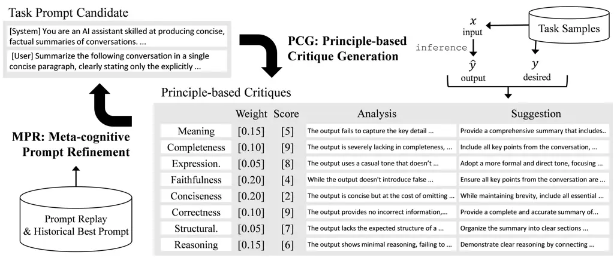
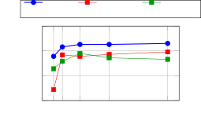
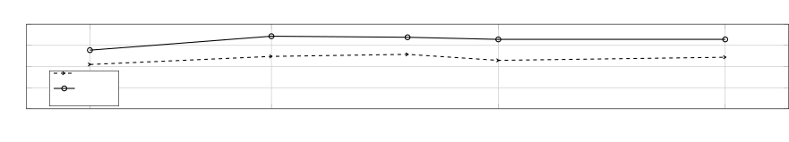
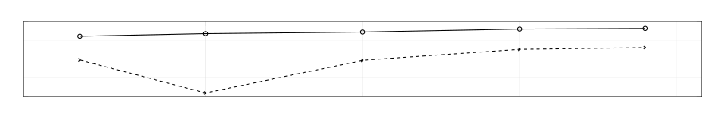
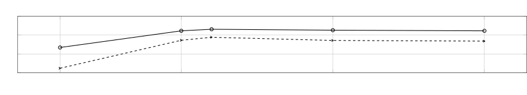
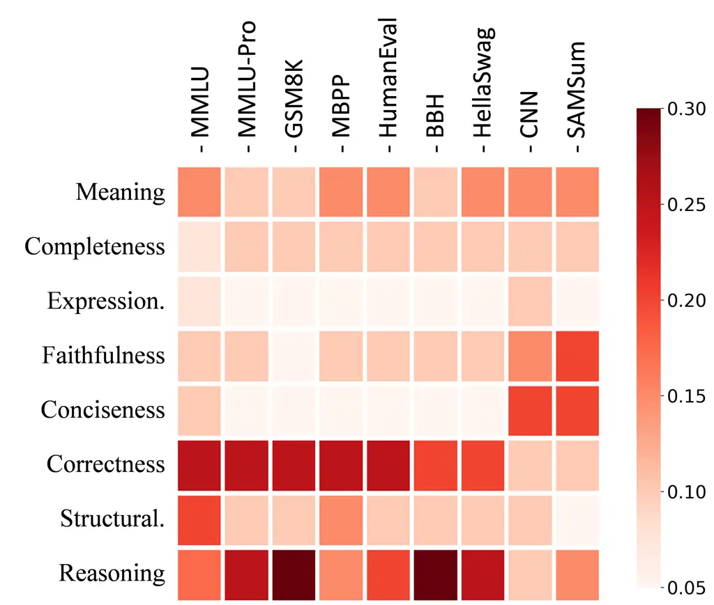

# ZERA: Zero-init Instruction Evolving Refinement Agent From Zero Instructions to Structured Prompts via Principle-based Optimization

Seungyoun Yi    Minsoo Khang Affiliation: Upstage AI Research
Affiliation: {kyle, mkhang, sungrae.park}@upstage.ai    Sungrae Park

###### Abstract

Automatic Prompt Optimization (APO) improves large language model (LLM)
performance by refining prompts for specific tasks. However, prior APO
methods typically focus only on user prompts, rely on unstructured
feedback, and require large sample sizes and long iteration
cycles—making them costly and brittle. We propose ZERA (Zero-init
instruction Evolving Refinement Agent), a novel framework that jointly
optimizes both system and user prompts through principled, low-overhead
refinement. ZERA scores prompts using eight evaluation principles with
automatically inferred weights, and revises prompts based on these
structured critiques. This enables fast convergence to high-quality
prompts using minimal examples and short iteration cycles. We evaluate
ZERA across five LLMs and nine diverse datasets spanning reasoning,
summarization, and code generation tasks. Experimental results
demonstrate consistent improvements over strong baselines. Further
ablation studies highlight the contribution of each component to more
effective prompt construction. Our implementation including all prompts
is publicly available at
[https://github.com/younatics/zera-agent](https://github.com/younatics/zera-agent).

## 1 Introduction

The effectiveness of LLMs significantly depends on the quality of
prompts used to guide their behavior. Crafting effective prompts is
essential not only for general LLM application but also crucial when
integrating LLMs into larger agent-based systems. However, developing
these prompts typically relies on handcrafted templates, domain
intuition, or extensive trial-and-error processes, which pose
considerable challenges in scalability and transferability Brown et al.
(2020); Perez and et al. (2021); Zhao et al. (2021). Moreover, optimal
prompts are often model-specific, necessitating careful tuning of
prompts to the particular LLM being employed.

To address these challenges, automatic prompt optimization (APO) methods
have recently been proposed. The core objective of these approaches is
to systematically derive prompts that yield desired outputs for given
inputs in a specific task. This typically involves an iterative process
where an LLM evaluates the effectiveness of a prompt, identifies
shortcomings, and incrementally updates the prompt to enhance
performance Wang et al. (2024); Yang et al. (2024); He et al. (2025).
However, these methods predominantly rely on task-specific metric scores
and feedback derived solely from the provided examples, making them
prone to overfitting and limiting their robustness in generalization.

To mitigate this limitation, we propose ZERA (Zero-init instruction
Evolving Refinement Agent), a novel APO approach designed to improve the
generality and robustness of optimized prompts. Instead of relying
solely on task-specific feedback or metric scores derived from a small
set of examples, ZERA employs eight evaluation principles for prompt
optimization: Completeness, Conciseness, Correctness, Expression Style,
Faithfulness, Meaning Accuracy, Reasoning Quality, and Structural
Alignment. These principles serve as high-level evaluation criteria that
guide feedback generation and prompt refinement, enabling the system to
generalize beyond individual examples and avoid overfitting.

Specifically, ZERA consists of two iterative stages: Principle-based
Critique Generation (PCG) and Meta-cognitive Prompt Refinement (MPR).
PCG utilizes task-specific sample data to (1) evaluate the relative
importance of each principle for a given task and (2) measure
performance against each principle, generating output analysis and
actionable feedback. MPR integrates this feedback to iteratively refine
task-related meta-information, including task descriptions and the
targeted optimization objectives—system and user prompt.

The iterative interaction between these two stages based on the meta
principles results in the development of highly optimized system and
user prompts. Notably, ZERA can generate effective prompts even when
provided with only a few task samples and no handcrafted prompts or task
descriptions. Furthermore, because task evaluation and definition are
driven by general principles, the optimized prompts exhibit resistance
to overfitting. Additionally, the influence of these general principles
promotes rapid convergence during the prompt optimization steps,
demonstrating ZERA’s practicality and effectiveness.

We validated our proposed method across nine benchmark tasks—MMLU,
MMLU-Pro, GSM8K, MBPP, HumanEval, BBH, HellaSwag, CNN/DM, and
Samsum—optimizing prompts for models such as GPT-3.5, GPT-4o,
LLaMA-3.1-70B-Instruct (LLaMA-3.1), Qwen-2.5-70B-Instruct (Qwen-2.5),
and Mistral-7B-Instruct-v0.3 (Mistral-7B). In most cases, ZERA-derived
prompts outperformed predefined prompts provided for each task.
Additionally, we compared ZERA with recent APO methodologies, including
PromptAgent Wang et al. (2024), OPRO Yang et al. (2024), and CriSPO He
et al. (2025), and observed that ZERA delivered superior performance.
Furthermore, we conducted an ablation study to analyze the distinct
characteristics and effectiveness of individual components within our
proposed approach.

## 2 Related Work

A wide range of methods have been proposed in the field of APO, broadly
categorized by whether they require training or gradient updates  Chen
et al. (2024); Zhang and Sang (2025); Jafari et al. (2024); Chen et al.
(2025); Srivastava and Yao (2025), or operate in a training-free manner
 He et al. (2025); Xiang et al. (2025); Peng et al. (2025); Wang et al.
(2024); Pryzant et al. (2023). Training-based approaches offer the
advantage of task-specific optimization through reinforcement learning
or supervised tuning, often leading to higher performance on narrowly
defined tasks. In contrast, training-free methods are more readily
adaptable to new tasks, as they eliminate the computational and data
requirements associated with model training.

Among training-free methods, one of the earlier notable works is APE
 Zhou et al. (2023) which iteratively generates prompt variants and
selects the best prompt based on task-specific metric scores. While
effective, the use of scalar feedback offers limited guidance for
understanding why a prompt is better or how to improve it further. To
address this, subsequent works such as  Pryzant et al. (2023); Peng
et al. (2025); Wang et al. (2024) enhance the optimization process by
incorporating natural language feedback derived from error examples.
These textual signals offer more descriptive and interpretable
suggestions, guiding the LLM to generate improved prompts through
enriched context.

Building on this trajectory, more recent approaches such as OPRO Yang
et al. (2024) and CriSPO He et al. (2025) further enhance prompt
optimization by incorporating additional signals beyond natural language
feedback. OPRO stabilizes the optimization process by leveraging
historical prompt traces, while CriSPO introduces a multi-aspect
critique–suggestion agent that provides aspect-specific feedback. These
innovations enable more targeted and robust improvements in prompt
quality across iterations.

While ZERA incorporates common strategies from prior work, such as
natural language feedback and historical prompt traces, it distinguishes
itself by grounding the optimization process in eight generalizable
principles. These principles guide structured feedback and drive the
joint optimization of the user prompt, system prompt, and task
description—components that are typically fixed or ignored in earlier
approaches. To the best of our knowledge, ZERA is the first to unify the
optimization of all three prompt types (system prompt, user prompt and
task description) within a principle-driven framework.

## 3 Methodology

ZERA approaches prompt optimization through an iterative, training-free
framework comprising two key stages: evaluation and refinement. This
section introduces the APO formulation and details the core components
of ZERA: principle-based evaluation and meta-cognitive refinement
modules, which work together to iteratively improve prompts from generic
initial prompts.



Figure 1: Overview of the ZERA system. Given task samples and their
corresponding output results, PCG produces the critique comprising of:
importance weight, evaluation score, analysis result and suggestion
across eight principles. MPR refines the task prompt by integrating
prior prompt information with the critiques observed in the current task
examples, along with historical feedback from previous iterations
(Eq. 6).

### 3.1 Problem Formulation

We begin by formalizing the prompt optimization objective and outlining
its core challenges. We define a task $`\mathcal{D}`$ as a set of paired
examples $`(x,y)`$, where $`x`$ is the raw input and $`y`$ is the
desired output. In prompt-based learning, LLMs do not consume $`x`$
directly; rather, it is embedded into a textual prompt
$`p_{\text{task}}`$ that conditions the model’s output. We denote the
output of the LLM as $`\hat{y}=\text{LLM}(x|\;p_{\text{task}}`$).

The objective of APO is to find an optimal prompt function
$`p_{\text{task}}`$ that minimizes the expected distance between model
output and the ground-truth label:

```math
J(p_{\text{task}})=\mathbb{E}_{(x,y)\sim\mathcal{D}}\left[\text{dist}(\text{LLM}(x|\;p_{\text{task}}),y)\right]. \tag{1}
```

Here, $`\text{dist}(\hat{y},y)`$ denotes a distance metric quantifying
the discrepancy between the LLM-generated output $`\hat{y}`$ and the
ground-truth target $`y`$. The goal of APO is to identify an optimal
prompt function $`p^{*}_{\text{task}}`$ that minimizes this objective.
However, there are three key challenges in APO: (1) the LLM is typically
accessed as a black box, offering no gradient or parameter-level
information; (2) optimizing $`p_{\text{task}}`$ is non-trivial, as
traditional gradient-based methods are inapplicable without model
retraining; and (3) the available data for $`\mathcal{D}`$ is often
limited, posing a challenge for generalization.

### 3.2 Design Rationale

To address these challenges, ZERA adopts the following design choices.
As the first two challenges make it infeasible to directly optimize
prompts using task-specific objectives, prior work has explored
training-free alternatives for prompt optimization. Recent work Wang
et al. (2024); He et al. (2025), for example, introduces natural
language-based feedback and optimization frameworks, where LLM-generated
qualitative feedback is used to guide prompt refinement. Following this
line of research, ZERA leverages natural language feedback as the
central supervision signal for iteratively improving prompts.

The third challenge poses a significant risk to generalization. When
prompt optimization relies heavily on LLM-generated evaluations and
feedback, there is a heightened risk that prompts may overfit to a small
set of biased or unrepresentative examples. To address this issue, our
method introduces meta-level principles that serve as high-level guides
for evaluation and feedback. By grounding prompt updates in these
general reasoning frameworks, rather than just task-specific signals,
our approach promotes broader applicability and reduces the risk of
overfitting.

Given these constraints, prompt optimization is best approached in a
heuristic, training-free framework composed of two iterative stages:
evaluation and refinement. These two stages can be described as follows:

```math
\displaystyle\hat{\mathbf{y}}^{(t)}\leftarrow\text{LLM}_{\text{task}}\left(p_{\text{task}}^{(t)}(\mathbf{x}^{(t)})\right) \tag{2}
```

```math
\displaystyle\mathbf{c}^{(t)}\leftarrow\mathcal{A}_{\text{eval}}\left(\mathbf{x}^{(t)},\hat{\mathbf{y}}^{(t)},\mathbf{y}^{(t)}\right) \tag{3}
```

```math
\displaystyle p_{\text{task}}^{(t+1)}\leftarrow\mathcal{A}_{\text{refine}}\left(\mathbf{x}^{(t)},\hat{\mathbf{y}}^{(t)},\mathbf{y}^{(t)},\mathbf{c}^{(t)},p_{\text{task}}^{(t)}\right) \tag{4}
```

Here, $`\mathbf{x}^{(t)}`$ and $`\mathbf{y}^{(t)}`$ denote the input and
reference output sets at iteration $`t`$, and $`\hat{\mathbf{y}}^{(t)}`$
is the set of outputs generated by the task LLM using the current prompt
$`p_{\text{task}}^{(t)}`$. The evaluation agent
$`\mathcal{A}_{\text{eval}}`$ produces critique tuples
$`\mathbf{c}^{(t)}`$ containing natural language suggestions and scores
grounded in the meta-level principles, to assess the quality of the
generated outputs. These critiques, along with the original inputs,
outputs, and prompt, are then passed to the prompt modification agent
$`\mathcal{A}_{\text{refine}}`$, which generates an updated prompt
$`p_{\text{task}}^{(t+1)}`$.

As this formulation highlights, the effectiveness of the overall
optimization process depends critically on the design of both
$`\mathcal{A}_{\text{eval}}`$ and $`\mathcal{A}_{\text{refine}}`$, which
determine how feedback is generated and how prompts are refined.

### 3.3 System Overview and Principles

As illustrated in Figure 1, ZERA follows a two-stage iterative process
of evaluation and refinement. While structurally similar to conventional
APO frameworks, it uniquely integrates principle-based evaluations to
assess the current prompt and guide its refinement. The motivation for
this design is to incorporate pre-defined meta-level information—namely,
a set of general principles—to reduce the risk of bias that may arise
when optimizing prompts from a limited number of task examples.

Based on our analysis across diverse benchmark tasks, we identified
eight generalizable principles that consistently guided effective prompt
evaluation and refinement. These principles were inductively derived
from recurring evaluation criteria observed in summarization,
translation, and reasoning tasks, and are grounded in cognitive science
(e.g., Bloom’s taxonomy), linguistic pragmatics (e.g., Gricean maxims),
and NLP evaluation rubrics (e.g., factuality, fluency, coherence).
Designed to balance coverage, generality, and interpretability, they
enable ZERA to operate across diverse tasks without relying on
handcrafted instructions or dataset-specific scoring rubrics. Summarized
in Table 1, they form the foundation for assessing and improving
prompts, and are systematically applied by both PCG and MPR to ensure
coherence and consistency throughout the optimization process.

|                      |                                                                                                |
| -------------------- | ---------------------------------------------------------------------------------------------- |
| Principle            | Description                                                                                    |
| Meaning Accuracy     | Preserves intended meaning and logical consistency with the expected answer (output fidelity). |
| Completeness         | Includes all key ideas or steps; no critical elements are missing.                             |
| Expression Style     | Matches tone, format, and stylistic elements of the expected answer.                           |
| Faithfulness         | Avoids hallucination; stays true to given input and context.                                   |
| Conciseness          | Maintains brevity; avoids unnecessary or repetitive content.                                   |
| Correctness          | Final answer is factually/logically correct and meets formatting constraints.                  |
| Structural Alignment | Matches the structure, formatting, and layout of the expected answer.                          |
| Reasoning Quality    | Provides logically sound & well-structured reasoning process aligned with task goals.          |

Table 1: Short description of eight principles. The detailed criteria be
found in Appendix A1.

### 3.4 Principle-based Critique Generation (PCG)

Given the task inputs $`\mathbf{x}^{(t)}`$ and the corresponding LLM
outputs $`\hat{\mathbf{y}}^{(t)}`$ generated using the current prompt
$`p^{(t)}_{\text{task}}`$, the evaluation agent
$`\mathcal{A}_{\text{eval}}`$ produces a detailed assessment and
feedback for each sample. Our proposed PCG structures this process
around a set of eight general principles, producing four key outputs.
First, it analyzes the task description to estimate the relative
importance of each principle, assigning a real-valued weight in the
range \[0-1\] to reflect its priority. Second, it evaluates the
generated outputs against each principle, producing a score \[1-10\] per
principle to reflect output quality. Third, it conducts an error
analysis to determine which aspects of the outputs were well-handled or
problematic based on the eight principles. Lastly, it outputs targeted
suggestions for improvement aligned with each principle.

For clarity and formalization, we define the critique tuple for the
$`n`$-th task sample as $`c_{n}=(\alpha_{n},s_{n},a_{n},f_{n})`$. Here,
$`\alpha_{n}`$ is an eight-dimensional vector representing the estimated
importance weights of the eight principles, and $`s_{n}`$ denotes the
corresponding evaluation scores assigned to the generated output. The
component $`a_{n}`$ captures the qualitative analysis of the output with
respect to each principle, while $`f_{n}`$ provides principle-specific
suggestions for improvement.

The critique tuple at time $`t`$ can be identified through the
following:

```math
c^{(t)}_{n}\xleftarrow{}\text{LLM}_{\text{eval}}\left(\text{T}^{(t)}_{\text{task}},\hat{y}^{(t)}_{n},y^{(t)}_{n},x^{(t)}_{n}\middle|\;p_{\text{eval}}\right). \tag{5}
```

Here, $`\text{T}^{(t)}_{\text{task}}`$ denotes the task description at
the $`t`$-th iteration, and $`p_{\text{eval}}`$ corresponds to the
critique generation prompt including predefined principle definitions.
Note that the task prompt, $`p_{\text{task}}`$, is not directly utilized
in this stage; rather, the outputs generated from it on task samples are
evaluated through the lens of the predefined principles.

### 3.5 Meta-cognitive Prompt Refinement (MPR)

In the prompt refinement stage, the core objective is to update the task
prompt using the structured feedback produced during evaluation. Central
to this process is our Meta-cognitive Prompt Refinement Agent, which
leverages multi-dimensional, principle-based evaluations to guide
refinement. By identifying which principles are most critical to the
task—based on scalar importance scores—the agent redefines the task
description and adjusts the prompt accordingly. This principled approach
ensures that the updated prompts align with high-level quality
dimensions such as reasoning, accuracy, and structure, making it the
primary driver of generalizable and task-aligned prompt improvement.

To further stabilize and enhance the refinement process, the agent also
incorporates historical information from past iterations. It considers
(1) recent prompts and their evaluation results, (2) the best-performing
prompt to date and its scores, and (3) exemplar task
samples—specifically, the three with the highest scores and two with the
lowest. These historical references provide meta-level context, helping
the agent maintain consistent progress, avoid local optima, and balance
prompt quality across a range of task instances. While secondary to
principle-based feedback, incorporating the historical information
trajectory enhances optimization stability by enabling the model to
avoid prior errors and reinforce effective strategies He et al. (2025).

For formal description, let $`\text{F}^{(t)}_{\text{task}}`$ be a tuple
of $`(p^{(t)}_{\text{task}},\textbf{c}^{(t)})`$, indicating the task
prompt feedback at the $`t`$-th iteration. For the task sample, we
denote $`\text{F}^{(t)}_{\text{sample}}`$ as a tuple of
$`(\textbf{x}^{(t)},\hat{\textbf{y}}^{(t)},\textbf{y}^{(t)},\textbf{c}^{(t)})`$,
corresponds to the task sample feedback at the $`t`$-th iteration. Using
this definitions, the task prompt and description refinement can be
described as the follow:

```math
\displaystyle p^{(t+1)}_{\text{task}}, \displaystyle\text{T}^{(t+1)}_{\text{task}}\xleftarrow{}\text{LLM}_{\text{refine}}{(}\text{T}^{(t)}_{\text{task}},\text{F}^{(t)}_{\text{task}},\text{F}^{(t-1)}_{\text{task}},\text{F}^{(t-2)}_{\text{task}},
```

```math
\displaystyle\;\;\;\;\;\;\;\;\;\;\text{F}^{(t),*}_{\text{task}},\text{F}^{(t),\text{top-3}}_{\text{sample}},\text{F}^{(t),\text{bottom-2}}_{\text{sample}}{|}\;p_{\text{refine}}{)}, \tag{6}
```

where $`\text{F}^{(t),*}_{\text{task}}`$ represents the tuple showing
the best feedback score among all previous iterations.
$`\text{F}^{(t),\text{top-3}}_{\text{sample}}`$ and
$`\text{F}^{(t),\text{bottom-2}}_{\text{sample}}`$ indicate the top
three and the bottom two of task sample feedback along with the
evaluated scores at the iteration $`t`$. By combining the current task
and sample feedback and the historical records,
$`\text{LLM}_{\text{refine}}`$ refines the task prompt and description.

Since our evaluation is based on multiple principles, it naturally
produces multi-dimensional scores for each output. To identify the best
and worst prompt cases in the historical data, we compute a unified
score that integrates these dimensions. This aggregation relies on the
principle importance weights generated during the evaluation stage,
allowing the system to weigh each criterion according to its relevance
to the task. In other words, for each sample, the unified score,
$`u^{(t)}_{n}`$ is calculated as follows:

```math
u^{(t)}_{n}=\sum_{k}\alpha^{(t)}_{n,k}s^{(t)}_{n,k}, \tag{7}
```

where $`\alpha^{(t)}_{n,k}`$ represents the principle importance ratio
and $`s^{(t)}_{n,k}`$ indicates the evaluation score of
$`\hat{y}^{(t)}_{n}`$ in the view of the $`k`$-th principle. These
scores can be identified from the critique tuple $`c^{(t)}_{n,k}`$. The
weighting vector $`\alpha`$ is adaptively determined based on the
characteristics of each task and sample, allowing the system to assess
the relative importance of different principles. As a result, the
multi-dimensional evaluation scores are aggregated in a way that
reflects what matters most for the specific task. For instance, in tasks
where reasoning is not a critical factor, the weight assigned to the
reasoning principle will be low. Consequently, scores related to
reasoning will have minimal influence in identifying strong or weak task
cases or in guiding prompt refinement.

|                                |          |          |           |              |          |              |       |
| ------------------------------ | -------- | -------- | --------- | ------------ | -------- | ------------ | ----- |
| Method                         | Penguins | Geometry | Epistemic | Object Count | Temporal | Causal Judge | Avg.  |
| Human (0 shot)                 | 0.595    | 0.227    | 0.452     | 0.612        | 0.720    | 0.470        | 0.513 |
| CoT (0 shot)                   | 0.747    | 0.320    | 0.532     | 0.542        | 0.734    | 0.610        | 0.581 |
| PromptAgent Wang et al. (2024) | 0.853    | 0.577    | 0.740     | 0.860\*      | 0.902    | 0.670        | 0.767 |
| ZERA (Ours)                    | 0.877    | 0.520    | 0.940     | 0.930        | 0.951    | 0.690        | 0.818 |

Table 2: Performance across BBH subcategories. All results are
re-evaluated under a consistent setting: GPT-3.5-turbo is used as the
base model for response generation, and GPT-4o is used for prompt
refinement where applicable (e.g., PromptAgent and ZERA). \*Object
Counting score for PromptAgent is taken from the original paper.

### 3.6 Prompt Refinement from Zero Initialization

ZERA is initialized with a deliberately underspecified prompt
configuration, using a generic system prompt ("You are a helpful
assistant") and a minimal user prompt ("Hello! I’m here to help you").
Unlike prior approaches, ZERA does not rely on task-specific evaluation
metrics. Instead, it leverages a multi-principle scoring framework
grounded in generalizable, meta-level principles. Through iterative
evaluation and refinement, ZERA progressively discovers prompts that
guide the LLM toward outputs aligned with target responses. Notably, all
experiments are conducted without access to task-specific knowledge—such
as evaluation metrics or pre-defined task descriptions (often provided
in datasets)—beyond a few example (5-20) instances drawn from the
training data. Note that the “pre-defined task descriptions” mentioned
here refer to those provided in benchmark datasets, and should not be
confused with the task descriptions used earlier in this work, which are
generated and refined as part of the optimization process.

## 4 Experiments

### 4.1 APO Experimental Setting

APO seeks to generate a task-specific prompt that enables a LLM to
perform well on a given task, using only a small number (5-20) of
representative samples. In this setting, the optimization process must
rely on limited data while ensuring generalization across unseen
examples.

To simulate this scenario, we construct a task sample pool using the
training and validation sets from standard benchmark datasets. The
optimized prompt is then evaluated on the benchmark’s held-out test set
using the official evaluation metrics defined for each task. This
experimental protocol aligns with widely adopted practices in prior APO
literature, ensuring consistency and comparability across different
methods.

Our benchmark suite spans nine datasets covering structured,
unstructured, and reasoning-intensive tasks: GSM8K Cobbe et al. (2021),
MMLU-Pro Hendrycks et al. (2021), and BBH Suzgun et al. (2022) require
symbolic or multi-step reasoning; MBPP Austin et al. (2021) and
HumanEval Austin et al. (2021) involve functional code generation;
CNN/DailyMail Hermann et al. (2015), SAMSum Gliwa et al. (2019), and
HellaSwag Zellers et al. (2019) test summarization and commonsense
inference; and MMLU Hendrycks et al. (2021) covers broad-domain factual
QA. This diversity enables a comprehensive evaluation of ZERA’s prompt
generalization capabilities across varying tasks.

### 4.2 Performance Comparison from Baselines

To demonstrate the effectiveness of ZERA, we conducted a series of
comparative experiments against state-of-the-art prompt optimization
methods, including PromptAgent, OPRO, and CriSPO. To ensure fairness,
each comparison was carried out under the original experimental settings
proposed and reproduced by the respective methods. Specifically, we
report results from (1) direct comparisons with OPRO and CriSPO, (2)
head-to-head evaluation with PromptAgent, and (3) performance analysis
across nine benchmark datasets, where ZERA is also compared against the
default prompts provided by each benchmark. All experiments are
conducted using a variety of LLMs to measure robustness and
generalization across models and tasks.

#### 4.2.1 Comparison with OPRO and CriSPO

We compare ZERA with two recent APO baselines, OPRO Yang et al. (2024)
and CriSPO He et al. (2025), on three tasks spanning math reasoning and
summarization: GSM8K, CNN/DailyMail, and SAMSum. Following the original
CriSPO setup, we evaluate all methods on 500 randomly sampled test
instances per dataset using the LLaMA-3.1. Results for OPRO and CriSPO
are reproduced using their official codebase.¹¹ 1
[https://github.com/amazon-science/CriSPO](https://github.com/amazon-science/CriSPO)

|                         |       |       |        |       |
| ----------------------- | ----- | ----- | ------ | ----- |
| Method                  | GSM8K | CNN   | Samsum | Avg.  |
| Baseline (0 shot)       | 0.341 | 0.280 | 0.266  | 0.296 |
| Baseline (5 shot)       | 0.357 | 0.296 | 0.286  | 0.313 |
| OPRO Yang et al. (2024) | 0.892 | 0.295 | 0.273  | 0.487 |
| CRiSPO He et al. (2025) | 0.896 | 0.309 | 0.270  | 0.492 |
| ZERA                    | 0.927 | 0.296 | 0.333  | 0.519 |

Table 3: GSM8K accuracy, CNN/DailyMail and SAMSum ROUGE-L scores
evaluated with LLaMA-3.1.

As shown in Table 3, ZERA achieves the highest average performance
across the three tasks, outperforming both OPRO and CriSPO on GSM8K and
SAMSum. Notably, ZERA delivers a substantial improvement of +6.0 ROUGE-L
on SAMSum, demonstrating strong capabilities in dialogue-style
summarization. Appendix A2 shows the final prompt from ZERA in this
task.

|                        |             |               |             |              |              |
| ---------------------- | ----------- | ------------- | ----------- | ------------ | ------------ |
| Dataset (Metric)       | GPT-4o      | GPT-3.5-turbo | LLaMA-3.1   | Qwen2.5      | Mistral-7B   |
| MMLU (EM)              | 84.1 / 85.5 | 65.4 / 66.9   | 75.8 / 75.4 | 80.4 / 79.8  | 56.4 / 55.7  |
| MMLU-Pro (EM)          | 58.7 / 75.3 | 37.3 / 46.2   | 50.8 / 60.1 | 54.5 / 72.8  | 30.0 / 30.1  |
| GSM8K (EM)             | 95.8 / 95.3 | 72.55 / 78.2  | 34.1 / 92.6 | 92.12 / 96.1 | 11.5 / 53.0  |
| MBPP (pass@1)          | 28.4 / 61.8 | 36.2 / 60.4   | 62.3 / 63.4 | 22.1 / 68.0  | 42.6 / 45.4  |
| HumanEval (pass@1)     | 82.9 / 85.4 | 65.2 / 61.6   | 71.3 / 73.8 | 75.0 / 76.2  | 15.24 / 29.9 |
| BBH (EM)               | 75.4 / 84.1 | 45.9 / 59.8   | 58.7 / 72.9 | 62.3 / 77.4  | 34.5 / 36.2  |
| HellaSwag (EM)         | 90.6 / 90.0 | 46.3 / 66.6   | 81.6 / 84.2 | 87.8 / 89.2  | 66.0 / 62.6  |
| CNN/DM (ROUGE-L)       | 27.8 / 29.0 | 28 / 29.9     | 28 / 29.6   | 26.5 / 30.0  | 28.0 / 29.8  |
| Samsum (ROUGE-L)       | 27.7 / 38.2 | 28.0 / 31.9   | 26.2 / 33.7 | 29.8 / 36.0  | 24.5 / 34.0  |
| Avg. Gain ($`\Delta`$) | +8.1        | +8.5          | +10.8       | +10.6        | +7.6         |

Table 4: Performance comparison between baseline prompts and ZERA
prompts across models and tasks. Each cell shows Baseline / ZERA score
using the task’s standard evaluation metric. All values are reported as
Baseline / ZERA score. EM = exact match, ROUGE-L = recall-oriented
summary metric, pass@1 = functionally correct code generation on first
attempt.

#### 4.2.2 Comparison with PromptAgent

To further assess ZERA’s reasoning capabilities, we evaluate it against
PromptAgent on six BBH sub-tasks—Penguins in a Table, Geometry,
Epistemic Reasoning, Object Counting, Temporal Sequences, and Causal
Judgment—following the experimental setup of the original PromptAgent
paper. All evaluations are conducted using GPT-3.5-turbo as the base
model for response generation, with GPT-4o used as the optimizer for
prompt refinement in both ZERA and PromptAgent.

As shown in Table 2, ZERA outperforms PromptAgent in 5 out of 6
sub-tasks, including substantial gains in epistemic reasoning (+20.0)
and temporal reasoning (+4.9). ZERA also achieves the highest overall
average score (0.818), surpassing PromptAgent’s 0.767. These results
highlight ZERA’s robust capabilities in complex multi-step reasoning and
deep inference. Appendix A3 shows the final prompt from ZERA for the
epistemic task.

#### 4.2.3 Comparison with Primary Prompts

To evaluate ZERA’s generalization across model families and task types,
we benchmark it using five diverse LLMs: GPT-3.5-turboYe et al. (2023),
GPT-4oOpenAI (2024), Qwen2.5-72B-InstructTeam (2024),
LLaMA-3.1-70B-InstructDubey et al. (2024), and
Mistral-7B-Instruct-v0.3Jiang et al. (2023). All models are evaluated
via API or open checkpoints without additional fine-tuning. We use the
same nine benchmark datasets introduced in Section 4, sampling 500 test
instances per task, following the evaluation protocol of previous
literature He et al. (2025); Wang et al. (2024).

For baseline comparison, we adopt minimal yet format-compliant prompts
(See Appendix A4.) that satisfy basic evaluation criteria without manual
optimization. These serve as practical lower bounds for fair and
reproducible measurement. Performance is measured using task-specific
metrics: exact match for reasoning and classification tasks (e.g., MMLU,
BBH, GSM8K), ROUGE-L for summarization (CNN/DailyMail, SAMSum), and
pass@1 for code generation tasks (MBPP, HumanEval).

ZERA consistently improves over baseline prompts across a variety of
models and tasks (Table 4). The gains are especially pronounced on
structured reasoning benchmarks: on GSM8K, for example, ZERA boosts
LLaMA-3.1 to 92.6% accuracy—approaching the 95.1% reported in the
original LLaMA paper using 8-shot chain-of-thought prompting Dubey
et al. (2024). It also outperforms instruction-tuned models such as
Qwen2.5, exceeding their published scores on GSM8K (91.5% vs. 96.1%) and
MMLU-Pro (58.1% vs. 72.8%) Team (2024). These results highlight ZERA’s
robustness across diverse models and tasks, even relative to
expert-tuned few-shot configurations.

#### 4.2.4 APO Efficiency Comparison

|        |        |         |        |        |
| ------ | ------ | ------- | ------ | ------ |
| Method | GSM8K  | CNN     | SAMSum | Avg.   |
| OPRO   | 5,065/ | 15,024/ | 1,607/ | 7,232/ |
|        | 1,767K | 19,913K | 482K   | 7,387K |
| CriSPO | 2,273/ | 1,509/  | 723/   | 1,504/ |
|        | 1,469K | 6,950K  | 661K   | 3,027K |
| ZERA   | 287/   | 205/    | 205/   | 233/   |
|        | 887K   | 759K    | 596K   | 747K   |

Table 5: Inference cost (# of request / \# of tokens) comparison across
OPRO, CriSPO and ZERA.

The APO process diagnoses and improves task prompts based on multiple
LLM calls. The number of LLM calls and tokens processed during the
optimization of a single task prompt indicates the cost involved in
prompt optimization. Table 5 compares the costs required for APO across
three benchmarks. As shown, ZERA demonstrates the lowest number of API
calls due to its principle-based evaluation and improvement approach,
thereby enabling APO with relatively fewer tokens processed.



Figure 2: APO performance comparison across varied task sample sizes,
required to conduct the prompt optimization for GSM8K. The comparison
shows how many task samples are required to identify optimized the task
prompt through APO methods.

Additionally, the number of task samples required for the APO process is
a critical resource, as creating samples to define a task is highly
cost-intensive. Figure 2 illustrates a performance comparison based on
the size of task samples utilized during APO. Despite defining and
utilizing only 20 task samples, ZERA achieves higher performance than
CRiSPO and OPRO, which rely on 200 samples—10 times the quantity. As
demonstrated, ZERA can attain a high level of APO with fewer samples,
showcasing the efficacy of its principle-based prompt critique
mechanism.

### 4.3 Process Analysis of ZERA

As described in Section 3.5, ZERA begins with zero prompt initialization
and optimizes based solely on a small number of task samples—typically
around five per iteration. In this section, we analyze ZERA’s
optimization dynamics from two perspectives: (1) tracking the trajectory
of the unified evaluation score to illustrate how the prompt converges
over iterations, and (2) qualitatively examining how the prompt content
evolves and expands throughout the refinement process.

#### 4.3.1 Analysis on Evaluation Score Trajectory







Figure 3: The trajectories of evaluation scores identified by PCG. Each
iteration samples 5 task examples and evaluate the current prompt based
on the eight principles. Avg. anc Top-3. indicate the average over all
sampled examples and the average of top-3 scored samples.

We analyze how prompt quality evolves over refinement iterations by
tracking the unified evaluation score at each step (up to 20
iterations). Figure 3 shows the score trajectories for three
representative datasets: (GSM8K, BBH, and CNN). Substantial gains often
emerge within the first 1–5 iterations, especially in GSM8K and CNN,
which tend to converge quickly with as few as 5 training examples. In
contrast, BBH, which requires more complex reasoning, show continued
improvement even in later iterations, reflecting the benefit of extended
refinement on more complex task structures.

Although each iteration of ZERA uses only a small number of task
samples, we observe that the resulting prompts yield stable unified
scores across steps. This indicates that the principle-based evaluation
and prompt refinement process remains stable, even as the task samples
vary at each step. These findings suggest that ZERA’s optimization
trajectory is both stable and convergent, with minimal fluctuation in
performance despite changes in the evaluation data per iteration.

#### 4.3.2 Analysis on Prompt Evolution

ZERA incrementally transforms underspecified prompts into task-adapted
formats through iterative self-refinement. Across iterations, the
prompts increasingly encode task structure, role assignments, output
constraints, and formatting conventions—progressively aligning with
task-specific demands. This evolution occurs both semantically (e.g.,
shifting from vague to expert roles) and structurally (e.g., introducing
reasoning steps or enforcing output schemas).

|     |                                                                                                                                                                                                                                                                     |
| --- | ------------------------------------------------------------------------------------------------------------------------------------------------------------------------------------------------------------------------------------------------------------------- |
| \#  | System Prompt                                                                                                                                                                                                                                                       |
| 1   | You are a helpful assistant.                                                                                                                                                                                                                                        |
| 2   | You are a helpful AI assistant. Reason freely through problems before providing precise, concise responses formatted clearly per the question’s requirements.                                                                                                       |
| 19  | You are a logical reasoning expert. Clearly reason each question step-by-step in natural, explicit language. Upon completing your analysis, distinctly separate it from your final concise answer, which must strictly follow the provided formatting instructions. |

|     |                                                                                                                                                                                              |
| --- | -------------------------------------------------------------------------------------------------------------------------------------------------------------------------------------------- |
| \#  | User Prompt                                                                                                                                                                                  |
| 1   | Hello! I’m here to help you.                                                                                                                                                                 |
| 2   | Please answer the following questions clearly and concisely. \[ZERA-generated reasoning exemplar, 1-shot\] Begin now.                                                                        |
| 19  | Solve these logical reasoning problems by explicitly thinking through them step-by-step before providing your final answer.\[ZERA-generated reasoning exemplar, 3-shot\] Now, begin solving. |

Table 6: Prompt evolution across iterations on BBH.

As shown in Table 6, ZERA adaptively introduces self-generated reasoning
exemplars and reasoning scaffolds for BBH, adopts a question → reasoning
→ answer format for BBH. These structures emerge not from handcrafted
examples, but through self-refinement using task-weighted feedback.
These evolved prompts converge toward task-effective formats without
relying on external supervision or manual prompt engineering. More
prompt optimization results on other benchmarks can be found in Appendix
A5.

### 4.4 Ablation Studies

Beyond overall performance, we conduct a focused ablation study to
assess the contribution of key components in ZERA, including its scoring
strategy, evaluation criteria, prompt component coverage, and base model
alignment.



Figure 4: Visualization of task-adaptive scoring weights over nine
benchmarks. The values are averaged over task examples, sampled at the
optimal step from the experiment in section 4.2.3.

|                       |      |          |
| --------------------- | ---- | -------- |
| principle weight type | BBH  | MMLU-Pro |
| Fixed. (uniform)      | 42.6 | 41.1     |
| Dynamic.              | 59.8 | 46.2     |

Table 7: Ablation on task-adaptive principle weight. Fixed. indicates to
ZERA using uniform weights; Dynmaic. refers to ZERA with task-adaptive
weights.

#### 4.4.1 Analysis on Principle Weights

Beyond the structure and content of the prompts themselves, the
evaluation mechanism used during refinement plays a critical role in
overall performance. To assess this, we compare three variants: a
minimal baseline, ZERA with fixed uniform weights, and full ZERA with
dynamically inferred task-specific weights. As shown in Table 7, dynamic
weighting consistently improves performance in BBH and MMLU-Pro,
validating the effectiveness of task-adaptive prioritization. The
fixed-weight variant generally performs between the baseline and full
ZERA, indicating that structure-inducing refinement offers meaningful
benefits, while task-specific weighting further amplifies these gains.

We further investigate how the principle weights vary across different
types of tasks, shown in Figure 4. They guide MPG toward
structure-sensitive prompt strategies tailored to each task’s demands.
For instance, “reasoning quality” receives the highest weight in tasks
such as GSM8K and MMLU-Pro, both of which demand multi-step logical
inference. Meanwhile, “correctness” is also emphasized in MMLU-Pro and
MMLU, reflecting its need for factual precision in knowledge-intensive
QA. In contrast, summarization tasks like CNN and SAMSum assign greater
weight to “conciseness” and “faithfulness”, highlighting the importance
of generating informative yet succinct summaries.

These task-adaptive scoring patterns indicate that PCG aligns evaluation
emphasis with task demands—prioritizing structural, semantic, or
reasoning criteria as needed—without relying on manual heuristics or
fixed weights.

|                                |      |          |
| ------------------------------ | ---- | -------- |
| Criteria                       | BBH  | MMLU-Pro |
| No principles (baseline)       | 45.9 | 37.3     |
| Correctness, reasoning         | 26.2 | 45.4     |
| All w/o correctness, reasoning | 55.2 | 43.2     |
| All eight principles           | 59.8 | 46.2     |

Table 8: Effect of principle-based criteria. Baseline evaluates prompts
without any principles and other utilize the subset or all principles.

#### 4.4.2 Analysis on Principles

We investigate how the number and type of evaluation criteria affect
prompt refinement. Specifically, we compare three variants of ZERA: one
using all eight criteria, one using only two (reasoning quality and
correctness), and one using the remaining six. This split reflects the
high weight scores of Correctness and Reasoning, observed from Figure 4.
As shown in Table 8, using the full set of eight criteria yields the
best performance on both BBH and MMLU-Pro. Reducing the evaluation to
only two dimensions leads to a substantial drop on BBH (–33.6),
highlighting the importance of structural and stylistic signals in tasks
requiring multi-step reasoning. Even when using six criteria,
performance remains slightly below the full setting, suggesting that
ZERA benefits from a holistic view of output quality that balances
reasoning, faithfulness, clarity, and structure.

|                                      |       |       |        |       |       |
| ------------------------------------ | ----- | ----- | ------ | ----- | ----- |
| Method                               | GSM8K | CNN   | Samsum | BBH   | Avg.  |
| w/o $`\text{T}^{(t)}_{\text{task}}`$ | 0.930 | 0.266 | 0.345  | 0.728 | 0.567 |
| User Only                            | 0.914 | 0.270 | 0.327  | 0.726 | 0.559 |
| ZERA                                 | 0.927 | 0.296 | 0.337  | 0.729 | 0.571 |

Table 9: Ablation study on the prompt components. User Only indicates no
use of system prompt in a targeted task prompt.

#### 4.4.3 Ablation on Prompt Components

Complementing the analysis of evaluation criteria diversity, we examine
how the structure of the prompt itself, specifically, the inclusion of
different prompt components, affects performance. We compare the full
version of ZERA, which incorporates the system prompt, task
specification, and user prompt, with two ablated variants: one that
omits the explicit task type definition (w/o Task) and another that uses
only the user prompt (User Only). As shown in Table 9, both variants
result in performance drops across tasks, with the User Only setting
yielding the lowest average score. These results suggest that including
both task specification and system-level intent improves alignment with
evaluation objectives and enables more effective prompt optimization.

|                              |                       |      |          |       |      |
| ---------------------------- | --------------------- | ---- | -------- | ----- | ---- |
| $`\text{LLM}_{\text{ZERA}}`$ | $`\text{LLM}_{task}`$ | BBH  | MMLU-Pro | GSM8K | MBPP |
| GPT-3.5                      | LLaMA                 | 72.9 | 57.3     | 92.6  | 57.9 |
| LLaMA                        | LLaMA                 | 76.9 | 60.7     | 92.7  | 58.3 |

Table 10: Analysis on transferability of optimized prompt by ZERA.
$`\text{LLM}_{\text{ZERA}}`$ indicates LLM model used in both PCG and
MPR.

#### 4.4.4 Analysis on Transferability of Prompt

Lastly, we assess how the alignment between the base model used during
prompt refinement and the model used at inference time affects
performance. Specifically, we compare prompts refined using
GPT-3.5-turbo and LLaMA-3.1, with both evaluated on LLaMA-3.1. As shown
in Table 10, prompts optimized on LLaMA-3.1 consistently outperform
those generated with GPT-3.5, across all tasks. The gap is most notable
on BBH and MMLU-Pro, where alignment between the refinement-time and
inference-time models appears crucial for maximizing performance. While
prompts transferred from GPT-3.5 still yield competitive results (e.g.,
92.6 on GSM8K), model-specific nuances—especially in reasoning or
formatting—are better captured when prompts are tuned on the target
architecture.

## 5 Conclusion

This paper introduces ZERA, a novel APO method that operates solely on
target task samples without relying on predefined initial prompt and
evaluation metrics. ZERA generates critiques of prompt outputs based on
eight generalizable principles and refines prompts accordingly through
an iterative process. By leveraging prompt update history and
principle-based scoring, ZERA achieves stable refinement and
consistently converges toward high-performing prompts. Extensive
experiments across diverse tasks and models demonstrate the efficiency
and effectiveness of the proposed approach. These results highlight
ZERA’s potential as a general-purpose, model-agnostic solution for
scalable and interpretable prompt engineering across a wide range of
domains.

## 6 Limitations

While ZERA demonstrates strong performance across diverse tasks and
models, it has several limitations. First, our score reporting on
summarization tasks such as CNN/DailyMail relies entirely on automatic
metrics (e.g., ROUGE-L) without human judgment, which may overlook
nuances like coherence or factuality. Second, although ZERA operates
with minimal supervision, it still requires a small number of training
samples (typically 5–20) for each task. Fully zero-shot refinement
remains an open challenge. Third, as prompts evolve over iterations,
they often become longer to encode structural or reasoning constraints.
While this improves accuracy, it may lead to increased inference latency
or context overflow in constrained environments. However, we observe
that optimized prompts typically converge to a stable length after the
early refinement stages rather than growing indefinitely. Thus, this
limitation highlights an area for further efficiency improvements rather
than an impractical barrier to deployment. Lastly, ZERA depends on an
internal LLM to provide multi-level criteria feedback. Although
effective in practice, its reliability under ambiguous or adversarial
outputs has not been fully analyzed and may introduce bias in certain
edge cases.

## References

- Austin et al. (2021) Jacob Austin, Augustus Odena, Maxwell Nye,
  Maarten Bosma, Henryk Michalewski, David Dohan, Ellen Jiang, Carrie
  Cai, Michael Terry, Quoc Le, and 1 others. 2021. [Program synthesis
  with large language models](https://arxiv.org/abs/2108.07732). _arXiv
  preprint arXiv:2108.07732_.
- Brown et al. (2020) Tom Brown, Benjamin Mann, Nick Ryder, and 1
  others. 2020. Language models are few-shot learners. In _NeurIPS_.
- Chen et al. (2025) Junhao Chen, Bowen Wang, Zhouqiang Jiang, and Yuta
  Nakashima. 2025. [Putting people in llms’ shoes: Generating better
  answers via question
  rewriter](https://doi.org/10.1609/aaai.v39i22.34527). _Proceedings of
  the AAAI Conference on Artificial Intelligence_, 39(22):23577–23585.
- Chen et al. (2024) Yuyan Chen, Zhihao Wen, Ge Fan, Zhengyu Chen, Wei
  Wu, Dayiheng Liu, Zhixu Li, Bang Liu, and Yanghua Xiao. 2024. Mapo:
  Boosting large language model performance with model-adaptive prompt
  optimization. _arXiv preprint arXiv:2407.04118_.
- Cobbe et al. (2021) Karl Cobbe, Vineet Kosaraju, Mohammad Bavarian,
  Mark Chen, Heewoo Jun, Jared Kaplan, and 1 others. 2021. [Training
  verifiers to solve math word
  problems](https://arxiv.org/abs/2110.14168). _arXiv preprint
  arXiv:2110.14168_.
- Dubey et al. (2024) Abhimanyu Dubey, Abhinav Jauhri, Abhinav Pandey,
  Abhishek Kadian, Ahmad Al-Dahle, Aiesha Letman, Akhil Mathur, Alan
  Schelten, Amy Yang, Angela Fan, and 1 others. 2024. [The llama 3 herd
  of models](https://arxiv.org/abs/2407.21783). _arXiv preprint
  arXiv:2407.21783_.
- Gliwa et al. (2019) Bogdan Gliwa, Iwona Mochol, Michał Biesek, and
  Aleksander Wawer. 2019. [Samsum corpus: A human-annotated dialogue
  summary dataset](https://arxiv.org/abs/1911.12237). _arXiv preprint
  arXiv:1911.12237_.
- He et al. (2025) Han He, Qianchu Liu, Lei Xu, Chaitanya Shivade,
  Yi Zhang, Sundararajan Srinivasan, and Katrin Kirchhoff. 2025.
  [Crispo: Multi-aspect critique-suggestion-guided automatic prompt
  optimization for text
  generation](https://doi.org/10.1609/aaai.v39i22.34575). _Proceedings
  of the AAAI Conference on Artificial Intelligence_,
  39(22):24014–24022.
- Hendrycks et al. (2021) Dan Hendrycks, Collin Burns, Saurav Kadavath,
  Akul Arora, Steven Basart, Dawn Tang, Dawn Song, Jacob Steinhardt, and
  1 others. 2021. [Measuring massive multitask language
  understanding](https://arxiv.org/abs/2009.03300). _arXiv preprint
  arXiv:2009.03300_.
- Hermann et al. (2015) Karl Moritz Hermann, Tomás Kocisky, Edward
  Grefenstette, Lasse Espeholt, Will Kay, Mustafa Suleyman, and Phil
  Blunsom. 2015. [Teaching machines to read and
  comprehend](https://arxiv.org/abs/1506.03340). _Advances in Neural
  Information Processing Systems_, 28.
- Jafari et al. (2024) Yasaman Jafari, Dheeraj Mekala, Rose Yu, and
  Taylor Berg-Kirkpatrick. 2024. [MORL-prompt: An empirical analysis of
  multi-objective reinforcement learning for discrete prompt
  optimization](https://doi.org/10.18653/v1/2024.findings-emnlp.577). In
  _Findings of the Association for Computational Linguistics: EMNLP
  2024_, pages 9878–9889, Miami, Florida, USA. Association for
  Computational Linguistics.
- Jiang et al. (2023) Zhen Jiang and 1 others. 2023. [Mistral
  7b](https://arxiv.org/abs/2310.06825). _arXiv preprint
  arXiv:2310.06825_.
- OpenAI (2024) OpenAI. 2024. [Gpt-4o system
  card](https://arxiv.org/abs/2410.21276). _arXiv preprint
  arXiv:2410.21276_.
- Peng et al. (2025) Dengyun Peng, Yuhang Zhou, Qiguang Chen, Jinhao
  Liu, Jingjing Chen, and Libo Qin. 2025. Dlpo: Towards a robust,
  efficient, and generalizable prompt optimization framework from a
  deep-learning perspective. _arXiv preprint arXiv:2503.13413_.
- Perez and et al. (2021) Ethan Perez and et al. 2021. True few-shot
  learning with language models. _arXiv preprint arXiv:2105.11447_.
- Pryzant et al. (2023) Reid Pryzant, Dan Iter, Jerry Li, Yin Lee,
  Chenguang Zhu, and Michael Zeng. 2023. [Automatic prompt optimization
  with “gradient descent” and beam
  search](https://doi.org/10.18653/v1/2023.emnlp-main.494). In
  _Proceedings of the 2023 Conference on Empirical Methods in Natural
  Language Processing_, pages 7957–7968, Singapore. Association for
  Computational Linguistics.
- Srivastava and Yao (2025) Saurabh Srivastava and Ziyu Yao. 2025.
  Revisiting prompt optimization with large reasoning models-a case
  study on event extraction. _arXiv preprint arXiv:2504.07357_.
- Suzgun et al. (2022) Mirac Suzgun, Nathan Scales, Nathanael Schärli,
  Aitor Lewkowycz, Mikael Stenmark, Shunyu Yao, Adams Yu, Jacob Austin,
  Aakanksha Chowdhery, Quoc Le, and 1 others. 2022. [Challenging
  big-bench tasks and whether chain-of-thought can solve
  them](https://arxiv.org/abs/2210.09261). _arXiv preprint
  arXiv:2210.09261_.
- Team (2024) Qwen Team. 2024. [Qwen2.5 technical
  report](https://arxiv.org/abs/2412.15115). _arXiv preprint
  arXiv:2412.15115_.
- Wang et al. (2024) Xinyuan Wang, Chenxi Li, Zhen Wang, Fan Bai,
  Haotian Luo, Jiayou Zhang, Nebojsa Jojic, Eric Xing, and Zhiting
  Hu. 2024. [Promptagent: Strategic planning with language models
  enables expert-level prompt
  optimization](https://openreview.net/forum?id=22pyNMuIoa). In _The
  Twelfth International Conference on Learning Representations_.
- Xiang et al. (2025) Jinyu Xiang, Jiayi Zhang, Zhaoyang Yu, Fengwei
  Teng, Jinhao Tu, Xinbing Liang, Sirui Hong, Chenglin Wu, and Yuyu
  Luo. 2025. Self-supervised prompt optimization. _arXiv preprint
  arXiv:2502.06855_.
- Yang et al. (2024) Chengrun Yang, Xuezhi Wang, Yifeng Lu, Hanxiao Liu,
  Quoc V Le, Denny Zhou, and Xinyun Chen. 2024. [Large language models
  as optimizers](https://openreview.net/forum?id=Bb4VGOWELI). In _The
  Twelfth International Conference on Learning Representations_.
- Ye et al. (2023) Junjie Ye, Xuanting Chen, Nuo Xu, Can Zu, Zekai Shao,
  Shichun Liu, Yuhan Cui, Zeyang Zhou, Chao Gong, Yang Shen, and 1
  others. 2023. [A comprehensive capability analysis of gpt-3 and
  gpt-3.5 series models](https://arxiv.org/abs/2303.10420). _arXiv
  preprint arXiv:2303.10420_.
- Zellers et al. (2019) Rowan Zellers, Ari Holtzman, Yonatan Bisk, Ali
  Farhadi, and Yejin Choi. 2019. [Hellaswag: Can a machine really finish
  your sentence?](https://arxiv.org/abs/1905.07830) In _Proceedings of
  the 57th Annual Meeting of the Association for Computational
  Linguistics_, pages 4791–4800.
- Zhang and Sang (2025) Yuxiang Zhang and Jitao Sang. 2025. [Encoder of
  thoughts: Enhancing planning ability in language agents through
  structural embedding](https://doi.org/10.1609/aaai.v39i24.34794).
  _Proceedings of the AAAI Conference on Artificial Intelligence_,
  39(24):25994–26002.
- Zhao et al. (2021) Zhengxuan Zhao, Eric Wallace, Shi Wang, and
  et al. 2021. Calibrate before use: Improving few-shot performance of
  language models. In _ICML_.
- Zhou et al. (2023) Yongchao Zhou, Andrei Ioan Muresanu, Ziwen Han,
  Keiran Paster, Silviu Pitis, Harris Chan, and Jimmy Ba. 2023. [Large
  language models are human-level prompt
  engineers](https://openreview.net/forum?id=92gvk82DE-). In _The
  Eleventh International Conference on Learning Representations_.

## Appendix A Appendix

### A.1 Justification for Selecting Eight Principles

We selected eight principles to balance \*\*coverage\*\*,
\*\*interpretability\*\*, and \*\*practical usability\*\*. This decision
was informed by both empirical observations and established best
practices in rubric design.

Educational assessment literature recommends limiting the number of
evaluation dimensions to between 6 and 8 to ensure reliability and
manageability in scoring. According to Stevens and Levi (2005), "more
levels typically means more time spent on assessment," and a rubric
should be designed to "break down a task into components and identify
the importance of these components" without overwhelming the evaluator.

In our case, we began by identifying over a dozen quality dimensions
commonly used across summarization, translation, instruction-following,
and reasoning evaluation settings. We then merged semantically
overlapping or operationally redundant criteria—such as combining
factuality and logical consistency into Correctness, or fluency and
stylistic coherence into Expression Style.

The resulting eight principles are:

### A.2 Detailed Criteria of Eight Principles

Table 11 presents the detailed criteria of principles employed in
$`p_{\text{eval}}`$. The subsequent guidelines elaborate on each
principle, and the PCG framework generates critiques based on these
criteria.

|                      |                                                                                                                                                                                                                                                                                                                          |
| -------------------- | ------------------------------------------------------------------------------------------------------------------------------------------------------------------------------------------------------------------------------------------------------------------------------------------------------------------------ |
| principle            | description                                                                                                                                                                                                                                                                                                              |
| completeness         | Does the output include all key elements present in the expected output?                                                                                                                                                                                                                                                 |
|                      | Are any core ideas, steps, or facts missing compared to the expected answer?                                                                                                                                                                                                                                             |
| conciseness          | Does the output maintain a similar level of brevity as the expected output?                                                                                                                                                                                                                                              |
|                      | Are there unnecessary additions or repeated content beyond what is expected                                                                                                                                                                                                                                              |
|                      | If visible reasoning is expected or allowed by the task, do not penalize the output for justified length due to reasoning steps. Only penalize verbosity that is unrelated to the task objective or that repeats content unnecessarily.                                                                                  |
| correctness          | Does the final output match the correct result, based strictly on factual or logical correctness?                                                                                                                                                                                                                        |
|                      | Do not consider the reasoning or explanation here—only whether the final output is correct and aligned with task constraints.                                                                                                                                                                                            |
|                      | For fixed-format tasks or tasks requiring structured answers, the final answer must match the expected output exactly in format, content, and position (e.g., on a separate line if required)                                                                                                                            |
| expression style     | Does the output follow the format, tone, and structure shown in the expected output?                                                                                                                                                                                                                                     |
|                      | Are there unnecessary differences in sentence style, layout, or tone?                                                                                                                                                                                                                                                    |
| faithfulness         | Does the output avoid adding content not present in the expected output?                                                                                                                                                                                                                                                 |
|                      | Are all statements supported by the original question and context?                                                                                                                                                                                                                                                       |
| meaning accuracy     | Does the output convey the same intended meaning as the expected output?                                                                                                                                                                                                                                                 |
|                      | Is the reasoning process logically consistent with the way the expected output addresses the task?                                                                                                                                                                                                                       |
| reasoning quality    | Is the reasoning process logically valid, step-by-step, and aligned with the task intent?                                                                                                                                                                                                                                |
|                      | Are intermediate steps necessary, accurate, and well-structured?                                                                                                                                                                                                                                                         |
|                      | If the prompt expects visible reasoning, ensure it is included in the output and forms a logically coherent path to the answer.                                                                                                                                                                                          |
| structural alignment | Does the output follow the expected structural organization (e.g., headline-body separation, bullet points, code block structure)?                                                                                                                                                                                       |
|                      | Are the sections, hierarchy, or formatting explicitly aligned with the expected style?                                                                                                                                                                                                                                   |
|                      | If the task expects visible reasoning followed by a final answer, check that the reasoning precedes the final answer and that the final answer is clearly isolated (e.g., on a separate line and in the required format). The final answer must appear in the same structure and format as shown in the expected output. |

Table 11: Detailed Criteria of Eight Principles

### A.3 Optimized Prompt for SAMsum

Table 12 shows the prompt, identified by ZERA from the experiment in
Section 4.2.1. The system and user prompts are adapted by including task
input context.

|               |                                                                                                                                                                                                                                                                                                                                                                                                                                                                                                                                                                                                                                                                                                                                                                                                                                                                                                                                                                                                                                                                        |
| ------------- | ---------------------------------------------------------------------------------------------------------------------------------------------------------------------------------------------------------------------------------------------------------------------------------------------------------------------------------------------------------------------------------------------------------------------------------------------------------------------------------------------------------------------------------------------------------------------------------------------------------------------------------------------------------------------------------------------------------------------------------------------------------------------------------------------------------------------------------------------------------------------------------------------------------------------------------------------------------------------------------------------------------------------------------------------------------------------- |
| Prompt Type   | Content                                                                                                                                                                                                                                                                                                                                                                                                                                                                                                                                                                                                                                                                                                                                                                                                                                                                                                                                                                                                                                                                |
| System Prompt | You are an expert in crafting structured summaries from conversational text. Your task is to distill the conversation into a single, clear sentence, highlighting crucial factual elements like who, what, where, and when. Avoid adding interpretations or including emotional content unless it is directly stated.                                                                                                                                                                                                                                                                                                                                                                                                                                                                                                                                                                                                                                                                                                                                                  |
| User Prompt   | Carefully read the given conversation. Extract the core facts into a single concise sentence summary, ensuring you include who, what, where, and when. Stick to information explicitly stated and refrain from adding personal emotions or relationships unless directly mentioned. TASK HINTS Focus on clear and directly stated facts. Do not infer or fill in gaps unless explicitly prompted by the conversation. Use a single sentence format to convey all necessary details. FEW SHOT EXAMPLES Example 1 Question Dorothy Happy anniversary to you and Sarah!! conversation continues... Answer Damian and Sarah are celebrating their 17th anniversary in Zakopane. Example 2 Question Madelene pizza 5 o’clock? conversation continues... Answer Madelene and John will meet for pizza and prosecco at their usual place at 5 pm. Example 3 Question Tory guys, I need your help conversation continues... Answer Tim will borrow 3 books for Tory. Ensure your summary is succinct and captures all critical factual details to match the example structure. |

Table 12: Optimized Prompt on SAMSum Task. In this optimization,
LLaMA-3.1-70B-Instruct is used for PCG and MPR. The same model is
utilized as a task LLM. The reported performance in Table 3 can be
easily reproducible with the following prompt.

### A.4 Optimized Prompt for Epstemic Task in BBH

Table 13 shows the prompt, identified by ZERA from the experiment in
Section 4.2.1. The system and user prompts are adapted by including task
input context.

|               |                                                                                                                                                                                                                                                                                                                                                                                                                                                                                                                                                                                                                                                                                                                                                                                                                                                                                                                                                                                                                                                                                                                                                                                                                                                                                                                                                                                          |
| ------------- | ---------------------------------------------------------------------------------------------------------------------------------------------------------------------------------------------------------------------------------------------------------------------------------------------------------------------------------------------------------------------------------------------------------------------------------------------------------------------------------------------------------------------------------------------------------------------------------------------------------------------------------------------------------------------------------------------------------------------------------------------------------------------------------------------------------------------------------------------------------------------------------------------------------------------------------------------------------------------------------------------------------------------------------------------------------------------------------------------------------------------------------------------------------------------------------------------------------------------------------------------------------------------------------------------------------------------------------------------------------------------------------------- |
| Prompt Type   | Content                                                                                                                                                                                                                                                                                                                                                                                                                                                                                                                                                                                                                                                                                                                                                                                                                                                                                                                                                                                                                                                                                                                                                                                                                                                                                                                                                                                  |
| System Prompt | You are an expert at solving logical deduction puzzles related to truth-tellers and liars. Reason naturally and freely through each puzzle, exploring logical relationships step-by-step without constraints. Only after fully completing your logical analysis, clearly and succinctly state your conclusion in the exact format: Final Answer: Yes or Final Answer: No                                                                                                                                                                                                                                                                                                                                                                                                                                                                                                                                                                                                                                                                                                                                                                                                                                                                                                                                                                                                                 |
| User Prompt   | Analyze the given statements carefully and determine if the indicated individual tells the truth. Clearly reason step-by-step, explicitly stating after each deduction whether each individual ẗells the truthör l̈ies.̈ Conclude clearly. Example 1: Question: Alejandro lies. Amberly says Alejandro tells the truth. Osvaldo says Amberly lies. Vernell says Osvaldo lies. Shenna says Vernell lies. Does Shenna tell the truth? Reasoning:1. Alejandro lies (given); Alejandro lies.2. Amberly claims Alejandro tells the truth; thus, Amberly lies.3. Osvaldo says Amberly lies, which is accurate; therefore, Osvaldo tells the truth.4. Vernell claims Osvaldo lies, but this is false; Vernell lies.5. Shenna correctly says Vernell lies; Shenna tells the truth.Final Answer: Yes Example 2: Question: Delbert tells the truth. Delfina says Delbert lies. Antwan says Delfina tells the truth. Helene says Antwan lies. Sima says Helene lies. Does Sima tell the truth?Reasoning:1. Delbert tells the truth (given); Delbert tells the truth.2. Delfina claims Delbert lies, making Delfina’s claim false; therefore, Delfina lies.3. Antwan says Delfina tells the truth, but Delfina lies; thus, Antwan lies.4. Helene says Antwan lies, which is accurate; Helene tells the truth.5. Sima claims Helene lies, but Helene is truthful; therefore, Sima lies.Final Answer: No |

Table 13: Optimized Prompt on BBH - epistemic Task. In this
optimization, LLaMA-3.1-70B-Instruct is used for PCG and MPR. The same
model is utilized as a task LLM. The reported performance in Table 3 can
be easily reproducible with the following prompt.

### A.5 Primary Prompts of Benchmarks

Table 14 shows the primary prompts of Benchmarks. The baseline
performance used over the main paper indicate the task performance
utilizing the primary prompts.

|                        |                                                                                                   |
| ---------------------- | ------------------------------------------------------------------------------------------------- |
| Dataset                | Baseline Prompt                                                                                   |
| GSM8K                  | Provide the final answer prefixed with "####". Do not include any explanation.                    |
| MMLU / MMLU-Pro        | Choose the best answer from the options A–D. Answer using only the option letter in parentheses.  |
| BBH                    | Choose the correct option from A–J. Return only the final answer enclosed in parentheses.         |
| CNN/DailyMail / SAMSum | Summarize the passage below in 3–5 sentences. Be concise.                                         |
| MBPP                   | Complete the function definition to pass all test cases. Output only the completed function code. |
| HumanEval              | Implement the function as described. Return only executable Python code.                          |
| HellaSwag              | Select the most plausible ending (A–D). Return only the correct letter.                           |

Table 14: Minimal baseline prompts used for each dataset. These prompts
are deliberately simple, designed only to meet standard evaluation
criteria such as format compliance, without optimization or handcrafted
instruction engineering.

### A.6 Prompt Evolution Examples of ZERA

Table 15 and 16 show another examples of prompt evalution. They start
zero initialization but improve the instruction and guidelines by
observing task samples in the lens of the principles.

|           |                                                                                                                                                                                                                                                                                                                          |                                                                                                                                                                                                                                                                                                                                                                                                                                                                                                                                                                                                                                                                                                              |
| --------- | ------------------------------------------------------------------------------------------------------------------------------------------------------------------------------------------------------------------------------------------------------------------------------------------------------------------------ | ------------------------------------------------------------------------------------------------------------------------------------------------------------------------------------------------------------------------------------------------------------------------------------------------------------------------------------------------------------------------------------------------------------------------------------------------------------------------------------------------------------------------------------------------------------------------------------------------------------------------------------------------------------------------------------------------------------ |
| Iteration | System Prompt                                                                                                                                                                                                                                                                                                            | User Prompt                                                                                                                                                                                                                                                                                                                                                                                                                                                                                                                                                                                                                                                                                                  |
| 1         | You are a helpful assistant.                                                                                                                                                                                                                                                                                             | Hello! I’m here to help you.                                                                                                                                                                                                                                                                                                                                                                                                                                                                                                                                                                                                                                                                                 |
| 2         | You are an expert problem solver who provides clear and concise reasoning before stating the final answer.                                                                                                                                                                                                               | For each math problem, carefully walk through the reasoning step-by-step to solve it. At each calculation step, make sure to show your work using inline explanations with calculations in the format \<\<operation=result\>\>. Once the reasoning is complete, present the final answer on a separate line, formatted with \#́###b́efore the number to match the expected output structure. \[ZERA-generated reasoning exemplar, 2-shot\] By following this guide, focus on allowing natural reasoning while ensuring the output format meets the needed structure.                                                                                                                                           |
| 10        | You are an expert math problem solver specialized in breaking down complex problems through clear and detailed step-by-step reasoning. Ensure logical coherence and mathematical precision in every explanation. Emphasize transparency and clarity in your reasoning to maintain focus on deriving correct conclusions. | For each math problem, walk through the solution process step-by-step, detailing each calculation and logical inference. Use inline explanations in angle brackets (e.g., ‘\<\<operation=result\>\>‘) to clarify each operation and intermediate result. Conclude your solution with the final answer presented on a new line starting with \#́###t́o highlight the answer distinctly. Maintain clarity and conciseness throughout the explanation.\[ZERA-generated reasoning exemplar, 1-shot\] By following this guide, maintain natural reasoning while ensuring the final output aligns with the required structure. Focus on logical flow and seamless progression toward deriving the proper conclusion. |

Shown: GSM8K dataset. Prompt refinement progresses toward structured,
evaluation-aligned formats. At later stages, ZERA introduces
self-generated reasoning exemplars (e.g., 1-shot) tailored to task
feedback.

Table 15: Prompt Structure Evolution Across Iterations (Example: GSM8K)

|           |                                                                                                                                                                                                                                                                                                                                                                                                                                                                                    |                                                                                                                                                                                                                                                                                                                                                                                                                                                                                                                                                                                                                                                                                                                                                                                             |
| --------- | ---------------------------------------------------------------------------------------------------------------------------------------------------------------------------------------------------------------------------------------------------------------------------------------------------------------------------------------------------------------------------------------------------------------------------------------------------------------------------------- | ------------------------------------------------------------------------------------------------------------------------------------------------------------------------------------------------------------------------------------------------------------------------------------------------------------------------------------------------------------------------------------------------------------------------------------------------------------------------------------------------------------------------------------------------------------------------------------------------------------------------------------------------------------------------------------------------------------------------------------------------------------------------------------------- |
| Iteration | System Prompt                                                                                                                                                                                                                                                                                                                                                                                                                                                                      | User Prompt                                                                                                                                                                                                                                                                                                                                                                                                                                                                                                                                                                                                                                                                                                                                                                                 |
| 1         | You are a helpful assistant.                                                                                                                                                                                                                                                                                                                                                                                                                                                       | Hello! I’m here to help you.                                                                                                                                                                                                                                                                                                                                                                                                                                                                                                                                                                                                                                                                                                                                                                |
| 2         | You are an AI assistant skilled at producing concise, factual summaries of conversations. Summarize accurately using only explicit details, avoiding speculation and inference about unstated motivations or beliefs.                                                                                                                                                                                                                                                              | Summarize the following conversation in a single concise paragraph, clearly stating only the explicitly mentioned facts and key details. Do not speculate about unmentioned reasons, emotions, or motivations. \[ZERA-generated reasoning exemplar, 2-shot\] Now summarize this conversation:                                                                                                                                                                                                                                                                                                                                                                                                                                                                                               |
| 6         | You are an AI assistant adept at accurately summarizing short conversations. Focus solely on explicitly mentioned factual details such as people’s names, specific items, tasks to perform, exact locations, precise time references, and explicit instructions. Strictly avoid speculation, inference, humor, or assumptions about unstated motivations or implicit meanings. Provide summaries that are concise, factual, and explicitly reflect only the provided conversation. | Summarize the following conversation explicitly, accurately, and concisely. Clearly state only explicitly mentioned information and include specific people, items, explicit tasks requested, exact locations, and precise instructions or timelines. Do not speculate or infer unstated emotions, motivations, or beliefs. \[ZERA-generated reasoning exemplar, 3-shot\] Now summarize this conversation explicitly and concisely. Explicitly identify people, clearly stated locations, explicitly requested items or tasks, and timelines. Avoid speculation, inference, humor, or emotional interpretation not explicitly mentioned. Double-check exact locations explicitly stated to avoid confusion or misreporting. Preserve explicit ordering of requested tasks and instructions. |

Shown: GSM8K dataset. Prompt refinement progresses toward structured,
evaluation-aligned formats. At later stages, ZERA introduces
self-generated reasoning exemplars (e.g., 1-shot) tailored to task
feedback.

Table 16: Prompt Structure Evolution Across Iterations (Example: SAMSum)
