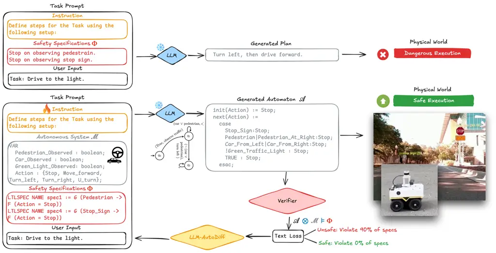
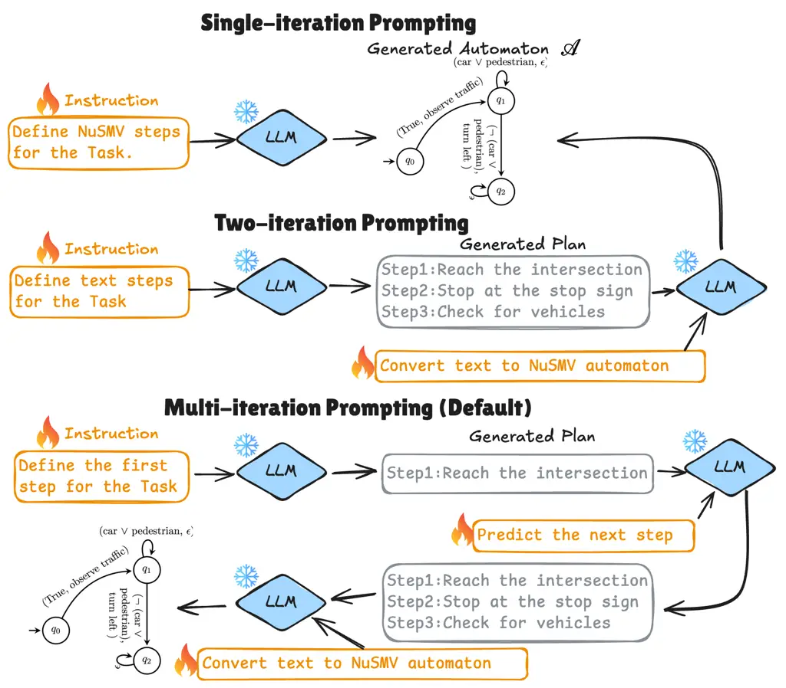
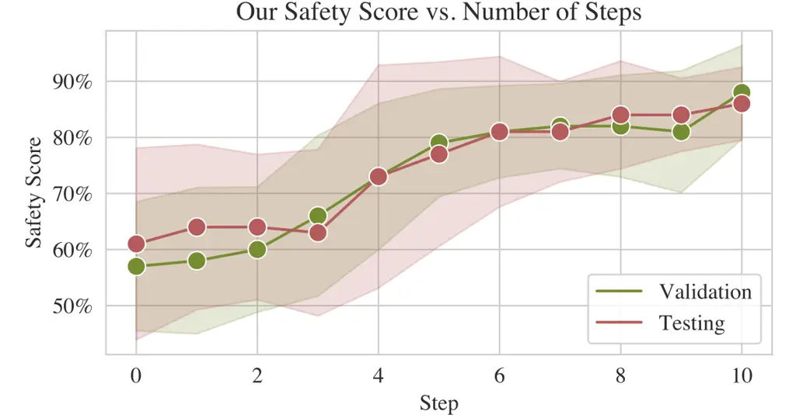
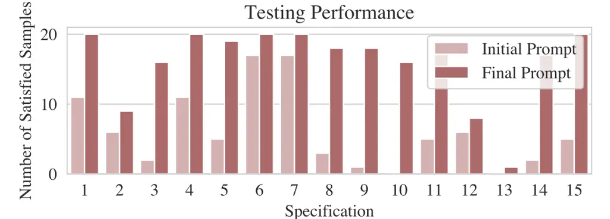
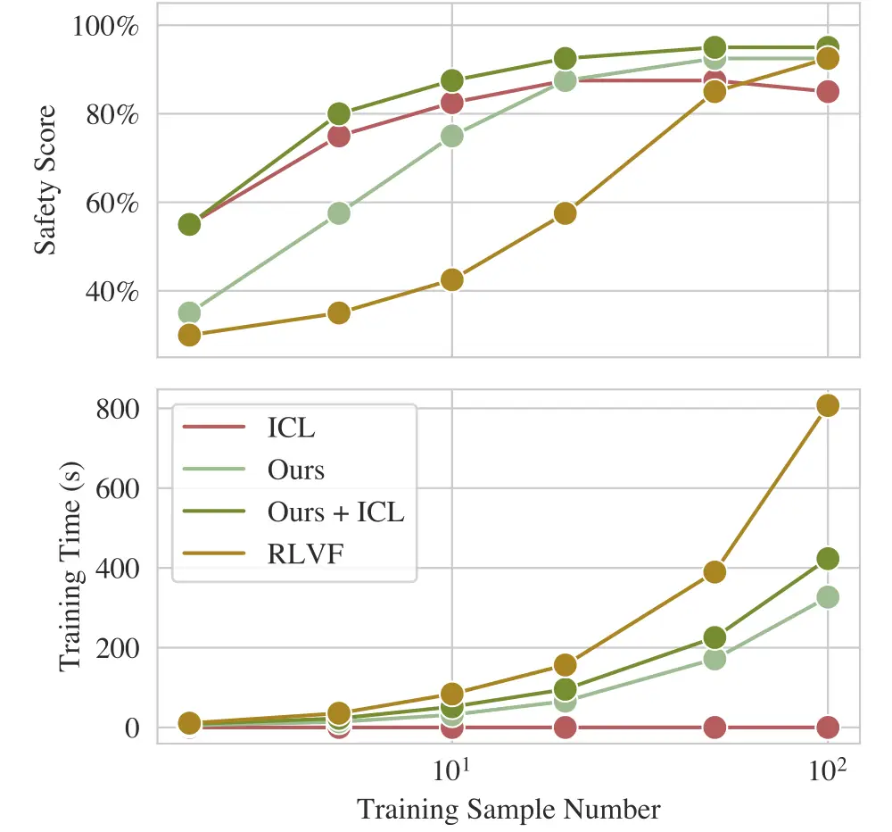
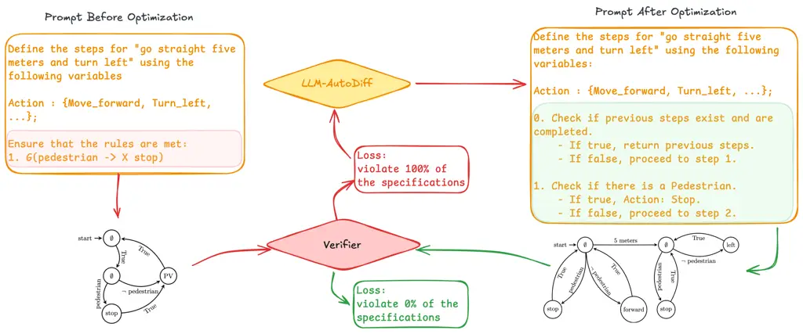
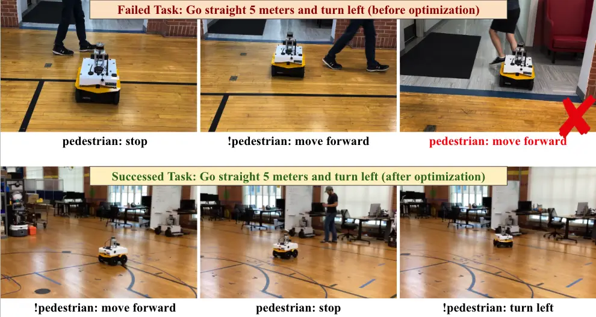
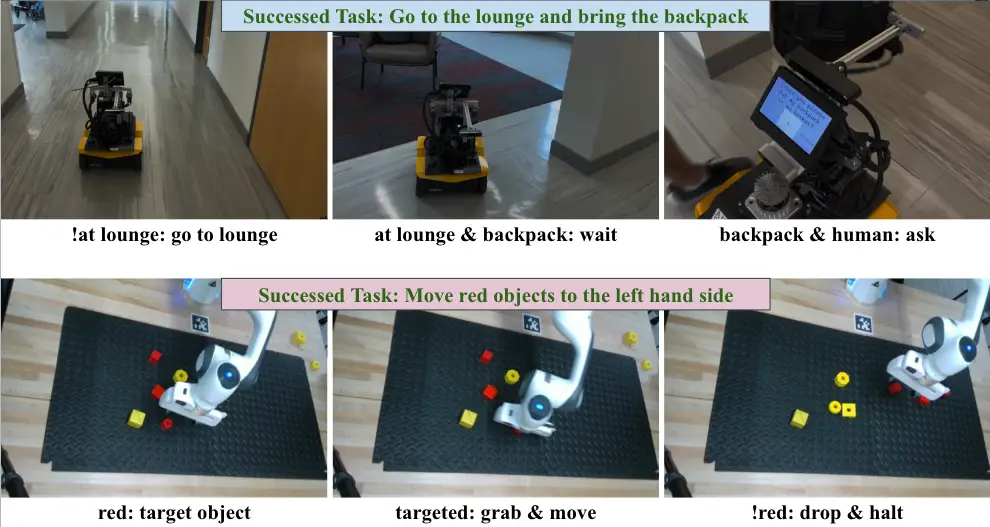

# LAD-VF: LLM-Automatic Differentiation Enables Fine-Tuning-Free Robot Planning from Formal Methods Feedback

Yunhao Yang    Junyuan Hong    Gabriel Jacob Perin Affiliation:  The
University of Texas at Austin, Austin, TX, United States; University of
São Paulo, São Paulo, SP, Brazil;    Zhiwen Fan Affiliation:  Texas A&M
University, College Station, TX, United States    Li Yin Affiliation: 
SylphAI, TX, United States    Zhangyang Wang    Ufuk Topcu

###### Abstract

Large language models (LLMs) can translate natural language instructions
into executable action plans for robotics, autonomous driving, and other
domains. Yet, deploying LLM-driven planning in the physical world
demands strict adherence to safety and regulatory constraints, which
current models often violate due to hallucination or weak alignment.
Traditional data-driven alignment methods, such as Direct Preference
Optimization (DPO), require costly human labeling, while recent
formal-feedback approaches still depend on resource-intensive
fine-tuning. In this paper, we propose LAD-VF, a fine-tuning-free
framework that leverages formal verification feedback for automated
prompt engineering. By introducing a formal-verification-informed text
loss integrated with LLM-AutoDiff, LAD-VF iteratively refines prompts
rather than model parameters. This yields three key benefits: (i)
scalable adaptation without fine-tuning; (ii) compatibility with modular
LLM architectures; and (iii) interpretable refinement via auditable
prompts. Experiments in robot navigation and manipulation tasks
demonstrate that LAD-VF substantially enhances specification compliance,
improving success rates from 60% to over 90%. Our method thus presents a
scalable and interpretable pathway toward trustworthy, formally-verified
LLM-driven control systems.

## I Introduction

Large language models (LLMs) \[1\] have revolutionized high-level
decision making in domains such as robotics \[2, 3\], autonomous
driving \[4\], and software verification \[5\]. LLMs enable the
translation from task instructions in natural language to action plans
that are executable by machines, offering a flexible and general-purpose
interface for downstream tasks \[6, 7\]. However, adapting the LLM-based
method in the physical world faces a major challenge in safety: Running
a robot in the physical world should not only achieve the goal, e.g.,
driving toward the specified spot, but also have to comply with physical
constraints (e.g., safety specifications) or societal regulations (e.g.,
traffic rules). Yet, existing LLMs suffer from hallucination or are not
well aligned for generating constrained action plans, leaving safe
LLM-driven action planning as an open challenge \[8, 9, 10\].

Data-driven alignment is a plausible solution that utilizes human
feedback \[11, 12, 13\] to reward responses against undesired and
maximizes the chance for LLMs to generate desired outputs. For example,
Direct Preference Optimization (DPO) \[11\] contradicts the pair of
preferred and rejected responses in training. Such a method, however, is
labor-intensive and difficult to scale up without sufficient human
labeling of the preference data.



Fig. 1: The diagram illustrates a closed-loop planning framework for
generating and verifying plans for autonomous systems. The user provides
a task prompt, which the language model uses to generate a plan. The
plan is converted into an automaton $`\mathcal{A}`$ and verified against
safety specifications $`\Phi`$ when operating in the system
$`\mathcal{M}`$. The number $`n_{f}`$ of failed specifications is a loss
for LAD-VF to optimize the task prompt iteratively.

Recently, leveraging _formal methods feedback_ for automatic preference
labeling emerged as a promising alternative to the traditional
DPO \[5\]. Yang et al. proposed using formal methods, such as model
checking, to provide feedback for fine-tuning LLMs, enabling them to
generate high-fidelity planning solutions that comply with formal rules.
In particular, this work transforms LLM outputs into finite-state
automata and formally verifies the automata against pre-defined logical
specifications. Then, it treats the number of specifications satisfied
by each automaton as the “reward” for fine-tuning. Yet, existing methods
that enable fine-tuning using formal methods feedback \[5, 14\] demand
more data, and decisions are generated from a black box. While the
methods eliminate the need for human labels, they typically require
massive training data and computational resources for loss convergence,
limiting their scalability to larger models.

In this work, we propose a fine-tuning-free method, LLM-AutoDiff from
Verification Feedback or LAD-VF, that improves the safety compliance via
automatic prompt engineering \[15\] instead of fine-tuning model
parameters. Modern LLMs with large-scale pre-training can be easily
steered via a proper textual prompt, including task instructions and
essential context \[16, 17, 18\]. As demonstrated in Fig. 1, we
streamline the feedback from the verifier to improve the LLM behaviors
via automatically updating the prompts. Given the safety feedback, we
leverage LLMs to generate textual improvement on textual prompts, which
were formulated as LLM-Automatic Differentiation or LLM-AutoDiff \[19\].

Our major technical contribution lies in a novel
formal-verification-informed text loss integrated with the LLM-AutoDiff,
enabling automated prompt engineering from formal feedback. Our approach
has several unique advantages compared to traditional ones:

- •
  Fine-tuning-free adaptation: eliminates the need for costly parameter
  updates, enabling scalable use of LLMs in new safety-critical domains.
- •
  Compatibility with modular LLM architectures: adapts to varied modular
  LLM pipelines, and removes the need for parameter fine-tuning when the
  query format or component structure changes.
- •
  Improved interpretability: enables transparent and auditable changes
  by refining prompts rather than hidden weights, making the improvement
  explainable.

We validate our approach in settings where autonomous agents must follow
natural language instructions while complying with formal task
constraints, such as autonomous driving within rulebooks or robotic
manipulation governed by safety logic. LAD-VF substantially improves
compliance with formal specifications—boosting success rates from 60% to
over 90%—while maintaining generalization and interpretability. More
broadly, our framework unifies automated prompt optimization with formal
verification feedback, offering a scalable path toward _trustworthy and
verifiable LLM-based control systems_.

## II Related Works

Learning from Human Feedback is a well-developed approach for enhancing
foundation models. Reinforcement Learning from Human Feedback (RLHF)
uses human preferences to train a reward model, which in turn guides the
fine-tuning of the language model \[20, 21\]. Then, methods such as
Direct Preference Optimization (DPO) streamline this process by directly
optimizing the model against preference comparisons, avoiding the need
for an explicit reward model \[22\]. These methods have shown strong
empirical performance across various language tasks. However, they are
labor-intensive due to the need for human annotations, and the reliance
on subjective feedback makes them incapable of safety-critical tasks.

Learning from Formal Feedback is an alternative to human feedback, where
system requirements are encoded as structured specifications such as
temporal logic formulas or checklists \[5, 6\]. The generated outputs
can then be verified against these specifications using mathematical
tools such as model checker \[23\]. Existing works have demonstrated
that verification outcomes can be used as feedback for refining models,
either by treating the satisfaction rate of specifications as reward
value or by ranking these rates \[5, 24\]. While such methods eliminate
the need for human labels, they typically require large amounts of
training data and computational resources to converge. In contrast, we
focus on optimizing input prompts rather than model parameters via
formal feedback, alleviating the need for computational resources and
human labels.

Automatic Prompt Engineering (APE) has rapidly evolved into a diverse
line of research aimed at systematically improving prompts for large
language models. The seminal APE framework by \[15\] pioneered the idea
of iteratively refining prompts through paraphrasing and selection,
laying the foundation for treating prompt design as an optimization
problem. Building on this, subsequent approaches explored different
optimization paradigms: DLN1 \[25\] and OPRO \[26\] framed prompt
learning as distributional optimization or iterative refinement with
task demonstrations; TextGrad \[27\] introduced the notion of
interpreting textual feedback as gradients to guide descent; DSPy \[28\]
formalized structured prompt optimization with modular optimizers like
COPRO; and PromptAgent \[29\] extended the paradigm toward agent-based
planning with search strategies. Meanwhile, ProTeGi \[30\] was among the
first to explicitly incorporate gradient descent principles into
automatic prompt generation. More recently, LLM-AutoDiff \[19\] was
proposed to generalize such frameworks to more complicated AI-based
applications, handling cyclic computation graph. Collectively, these
methods highlight the growing recognition of APE as a principled
framework for automating prompt design and, therefore, enable the
self-evolving of AI agents to outperform reinforcement learning \[31\].
Yet, the existing self-improving prompting methods are only applied in
scenarios where the correct answers are given independently of the LLM
outputs (actions). In this paper, we focus on improving LLM prompts
based on dynamic verifications that depend on the actions predicted by
the prompted LLM.

## III Safety-Constrained Robot Planning

In this section, we introduce LAD-VF in robot planning applications
where safety rules are enforced. We query the LLM to generate
robot-executable plans and verify the plans against user-provided safety
specifications expressed in temporal logic formulas \[32\]. We apply
LAD-VF to improve the generated plans by raising the number of safety
specifications being satisfied by those plans.

#### Pipeline Overview

Outlined in Fig. 1, We design a pipeline following \[23\] that queries
an LLM to generate formally verifiable plans for robotic tasks and
applies LAD-VF to optimize the plan based on the verification outcome.
In particular, we first send a natural language task description (e.g.,
go straight at the traffic light intersection) to an LLM and extract a
plan in NuSMV \[33\]—a logic-based formal language. We show an example
of a NuSMV-based plan in Fig. 3. We generate a plan by

```math
\displaystyle\text{PlanGen}(T,\mathcal{P})=\text{LLM}(\pi_{\text{plan}}(T,\mathcal{P})) \tag{1}
```

where $`T`$ is the task description and $`\mathcal{P}`$ is the set of
prompts to be optimized. $`\pi_{\text{plan}}`$ represents a template for
the inference with $`T`$ and $`\mathcal{P}`$.

Next, we provide a set of safety specifications in logic formulas and
apply a model checker \[33\] to mathematically prove whether the
generated plan satisfies the specifications. Then, we record the
percentage of specifications being violated and use this percentage as a
feedback signal (e.g., loss) to LAD-VF, which will eventually optimize
the plans to minimize the percentage of specification violation.

#### Automatic Prompt Engineering via LLM-AutoDiff

A core challenge in our method is how to optimize prompts without
resorting to costly fine-tuning. We want a fine-tuning-free approach
that can adapt prompts at test time while remaining transparent and
interpretable. Automatic Prompt Engineering (APE) \[15\] offers such a
solution by automating the refinement of prompts instead of altering
model weights. It employs a two-engine setup: a “_forward_” LLM performs
the task, while a frozen “_backward_” LLM critiques the outputs and
proposes edits. These critiques, known as textual gradients, function
like gradient descent in neural networks—providing systematic feedback
in natural language to iteratively update prompts, which also enhances
the explainability of the optimization.

However, APE alone becomes insufficient in our setting, where the
pipeline must combine functional modules (e.g., a formal-method
verifier) and sequential multi-step planning. Standard APE methods focus
on optimizing single prompts, but they cannot propagate gradients
through non-LLM components or preserve temporal order when prompts are
invoked across multiple planning steps. LLM-AutoDiff \[27, 19\] emerges
as a unified framework that can back-propagate textual gradients
(feedback) through a complex network. TextGrad first proposed a general
textual gradient framework \[27\]. Later, Adalflow \[19\] further closes
this gap by treating the entire workflow as a differentiable graph:
pass-through gradients allow feedback from functional verifiers to
influence upstream prompts, time-sequential gradients ensure that each
stage in a multi-step plan is updated in order, and selective gradient
computation reduces overhead by focusing only on failed examples. This
unified approach makes LLM-AutoDiff a natural fit for our
verifier-augmented, sequential system, enabling scalable and efficient
optimization where manual prompt engineering or single-node APE would
fall short.

LAD-VF extends Automatic Prompt Engineering into a fully
auto-differentiable framework for optimizing complex LLM pipelines.
Formally, we model the system as a directed graph $`G=(N,E)`$, where
each node $`v\in N`$ can be an LLM module (with trainable prompt
$`P_{v}`$) or a functional module. Given a set of tasks $`\mathcal{T}`$,
the system aims to minimize a loss over the set of prompts
$`\mathcal{P}=\{P_{v}|v\in N\}`$:

```math
\displaystyle\mathcal{P}^{*}=\arg\min_{\mathcal{P}}\bigcup_{T\in\mathcal{T}}\mathcal{L}\!\big(\text{PlanGen}(T,\mathcal{P})\big). \tag{2}
```

This formulation ensures that both LLM prompts and upstream dependencies
of functional nodes can be optimized under a unified objective. During
training, a forward pass executes all nodes in topological order, while
a backward pass propagates _textual gradients_ – the feedback on how to
update the prompt/intermediate outputs. For an internal node $`v`$, the
gradient is aggregated from its successors $`w`$:

```math
\displaystyle\frac{\partial\mathcal{L}}{\partial v}=\bigcup_{w\in\text{SuccessorsOf}(v)}\text{LLM}_{\text{backward}}\!\left(v,w,\frac{\partial\mathcal{L}}{\partial w}\right), \tag{3}
```

where $`\text{LLM}_{\text{backward}}`$ represents a backward inference
generating the feedback by LLMs.

By default, we adopt the Adalflow in our framework for the below two
reasons: (1) Functional nodes (e.g., verifier modules) have no prompts
to update, but Adalflow introduces _pass-through gradients_ so their
outputs still propagate error signals upstream, allowing verifier
feedback to refine earlier prompts. (2) For sequential prompting, where
the same node is invoked multiple times in a plan, Adalflow attaches
timestamps $`t`$ to each call, yielding _time-sequential gradients_,
which ensures that updates respect the chronological order of multi-step
plans. Prompt updates are then synthesized by an optimizer LLM:

```math
\mathcal{P}_{v}^{\text{new}}=\text{LLM}_{\text{opt}}\!\Big(\mathcal{P}_{v},\;\text{GradientContext}(v),\;\frac{\partial\mathcal{L}}{\partial v}\Big). \tag{4}
```

Together, we are able to update prompts without fine-tuning.

#### Formal Verification as Textual Feedback

A central step of the framework is to extract a loss that guides prompt
optimization from formal verification outcomes. We first query the LLM
to convert the generated plan into an automaton, expressed in NuSMV.
This conversion enables the generated plan to be checked against a set
of logical specifications provided by the user.

Once the automaton is generated, we apply a model checker to verify
whether it satisfies the given specifications. Each specification
returns a binary signal (satisfied or violated). To convert these
outcomes into a quantitative supervision signal, we define the formal
feedback loss as $`\mathcal{L}=n_{f}/n_{\text{total}}`$, where $`n_{f}`$
is the number of violated specifications and $`n_{\text{total}}`$ is the
total number of specifications provided.

For example, if a generated plan is verified against $`15`$ safety
specifications and $`3`$ of them are violated, the resulting loss is
$`\mathcal{L}=3/15=0.2`$. As illustrated in Fig. 1, we transform sparse
pass/fail outcomes into a signal that can be propagated backward through
the LAD-VF pipeline. This formal verification procedure utilizes formal
methods techniques to _achieve automated labeling and eliminate the need
for human annotations_. Additionally, formal verification provides
mathematical guarantees to the verified plans, which can be seamlessly
adapted to safety-critical applications.



Fig. 2: A demonstration of single- and multi-iteration queries. All
optimizable prompts are marked in orange boxes.

#### Prompting Strategies.

To systematically generate safety-compliant plans, we explore three
prompting strategies, as shown in Fig. 2. Single-iteration prompting
directly asks the LLM to output a NuSMV-based automaton from the task
description. Two-iteration prompting first decomposes the task into
natural-language step descriptions (e.g., “reach the intersection,”
“stop at the stop sign”), which are then converted into an automaton.
This strategy adds an extra thinking step for the LLM to generate plans.
Multi-iteration prompting further decomposes the process into a sequence
of partial predictions, where the LLM generates one step at a time and
iteratively expands the plan until completion. We employ this
multi-iteration prompting strategy by default because it better captures
sequential dependencies and aligns with the iterative nature of
decision-making, resulting in higher specification compliance in
practice.

## IV Experiments

We evaluate the proposed LAD-VF in safety-constrained robot planning
tasks. We demonstrate three claims in the experiments: (1) LAD-VF
improves the compliance of LLM-generated plans with safety
specifications compared to existing prompt optimization baselines. (2)
LAD-VF is more data- and computationally-efficient than fine-tuning
approaches while achieving the same level of performance. (3) LAD-VF
maintains both compliance and generalization across varied task
settings, specifications, and prompting strategies.

We benchmark LAD-VF against state-of-the-art approaches and conduct
ablation studies to analyze the contribution of different components. We
further provide insights into why our approach achieves better
performance than related textual gradient methods in sequential
decision-making scenarios.


Fig. 3: An example of a NuSMV-based plan.

### IV-A Experimental Setup

#### Baselines and Evaluation Metric

We select two current state-of-the-art LLM optimization methods and two
prompting methods that apply to safety-constrained planning as
benchmarks:

RLVF \[5\]: The method first extracts formally verifiable plans from the
LLM and verifies the plans. Next, it ranks the plans based on the number
of specifications each plan satisfies. Then, it applies DPO \[11\],
which utilizes ranked plans to fine-tune the LLM parameters, ensuring
the LLM prefers to generate the higher-ranked plans.

Prompt+Spec: A simple prompting baseline where the natural language task
description and a set of specifications are directly provided to the
LLM. Note that the LLM may make mistakes and generate plans that violate
the specifications, even when we provide the specifications as inputs.

ICL: We manually provide a set of input–output examples as in-context
demonstrations. The LLM is then queried with a new task description and
expected to follow the semantics of the examples.

We include three variants of LAD-VF:

LAD-VF(TextGrad) \[27\]: The method enables backpropagation of textual
feedback to optimize elements, such as prompts or solutions. To adapt
this method to our planning tasks, we again use the percentage of
specifications being violated as the feedback (e.g., loss).

LAD-VF(Adalflow): The LAD-VF integrates formal verification outcomes
into the LLM-AutoDiff pipeline to iteratively optimize prompts for
safety compliance. By default, Ours and LAD-VF both refer to
LAD-VF(Adalflow).

Ours + ICL: Combines our LAD-VF(Adalflow) optimization with in-context
demonstrations. This hybrid baseline tests whether incorporating
demonstrations alongside iterative prompt optimization leads to further
improvements in specification compliance.

For evaluation, we define safety score $`=1-n_{f}/n_{\text{total}}`$,
where $`n_{f}`$ is the number of violated specifications and
$`n_{\text{total}}`$ is the total number of specifications. A higher
Safety Score indicates better compliance. In our experiments, we set
$`n_{\text{total}}=15`$.

#### Implementation Details

We use GPT-4o-2024 -08-16 to generate NuSMV-based plans as the final
outcome. We present a sample plan in Fig. 3.

During evaluation, we generate plans for a Jackal ground navigation
robot and propose 15 temporal logic specifications regarding driving
safety. For example,

```math
\text{G (Pedestrian }\rightarrow\text{F (Action = Stop))} \tag{5}
```

means “Always (G) stop after (F) a pedestrian is observed.” The
specifications are over the set $`AP`$ of propositions $`AP=\{`$
Pedestrian, Opposite Car, Green Light, Green Left Turn Light, Stop Sign,
Car From Left, Car From Right, Stop, Move Forward, Turn Left, Turn Right
$`\}`$.

### IV-B Quantitative Evaluation Against Baselines



Fig. 4: Convergence Comparison. The top figure shows the safety scores
achieved by LAD-VF at each re-prompting step. We optimize the input
prompts 10 times iteratively, using 20 samples each time to compute the
losses. Error bars represent the standard deviations.



Fig. 5: Specification-level improvements. We examine 20 samples per
specification before and after optimization (10 steps). LAD-VF nearly
doubles the satisfaction rate across all specifications.

| Method           | Safety Score (Validation) | Safety Score (Test) |
| ---------------- | ------------------------- | ------------------- |
| RLVF             | 0.978 $`\pm`$ 0.032       | 0.978 $`\pm`$ 0.032 |
| Prompt+Spec      | 0.156 $`\pm`$ 0.041       | 0.013 $`\pm`$ 0.013 |
| ICL              | 0.825 $`\pm`$ 0.015       | 0.800 $`\pm`$ 0.021 |
| LAD-VF(TextGrad) | 0.725 $`\pm`$ 0.025       | 0.683 $`\pm`$ 0.024 |
| LAD-VF           | 0.880 $`\pm`$ 0.075       | 0.860 $`\pm`$ 0.058 |
| LAD-VF+ ICL      | 0.950 $`\pm`$ 0.036       | 0.950 $`\pm`$ 0.072 |

TABLE I: Safety score comparison between the baselines. Our method is
the best among the training-free methods.

We compare LAD-VF(Adalflow) with prompting-based baselines: Prompt+Spec,
ICL, and LAD-VF(TextGrad), and the fine-tuning baseline RLVF. The safety
scores of the baselines are summarized in Table I, with convergence
behaviors of LAD-VF(Adalflow) shown in Fig. 4 and specification-level
improvements in Fig. 5.

First, LAD-VF(Adalflow) consistently outperforms all prompting-based
baselines. It achieves the highest safety score on both validation and
test sets compared with the prompting-based approaches.

Second, LAD-VF achieves performance comparable to the fine-tuning
baseline with a much faster convergence speed. As shown in Table I, RLVF
achieves the highest score overall, but requires extensive fine-tuning
with many epochs. In contrast, LAD-VF reaches a similar performance
level without updating model parameters. Moreover, when combined with
in-context demonstrations (Ours + ICL), it nearly matches RLVF’s
performance while remaining parameter-free.



Fig. 6: Safety scores achieved by different methods versus training
sample sizes. The figure demonstrates the performance-efficiency
trade-offs of LAD-VF and the fine-tuning method. LAD-VF achieves similar
safety scores with the fine-tuning method while halving the training
time.

|                   |                 |       |       |                        |       |       |           |       |
| ----------------- | --------------- | ----- | ----- | ---------------------- | ----- | ----- | --------- | ----- |
| Step (Validation) | Number of Specs |       |       | Number of Propositions |       |       | Optimizer |       |
|                   | 3               | 5     | 10    | 5                      | 8     | 11    | 4o        | o3    |
| 0                 | 0.400           | 0.490 | 0.470 | 0.400                  | 0.270 | 0.120 | 0.400     | 0.400 |
| 10                | 0.880           | 0.753 | 0.712 | 0.880                  | 0.765 | 0.696 | 0.880     | 0.894 |
| Step (Test)       | 3               | 5     | 10    | 5                      | 8     | 11    | 4o        | o3    |
| 0                 | 0.317           | 0.350 | 0.365 | 0.317                  | 0.216 | 0.130 | 0.317     | 0.317 |
| 10                | 0.860           | 0.668 | 0.710 | 0.860                  | 0.759 | 0.707 | 0.860     | 0.865 |

TABLE II: Safety scores achieved by our pipeline at different numbers of
specifications and propositions. By default, we set the number of
specifications to three, the number of propositions to five, and the
optimizer to GPT-4o. The table displays LAD-VF’s performance at various
complexity levels of specifications and different optimizer models.

### IV-C Ablation Studies

We then conduct ablation studies to test the robustness and efficiency
of our approach. Table II shows the safety scores achieved by LAD-VF
under varying numbers of safety specifications, different specification
complexities (measured by the number of propositions), and different
optimizers. Across all settings, the prompts optimized by LAD-VF
consistently yield significant improvements compared to the unoptimized
prompts.

We also compare the performance of LAD-VF RLVF under different training
sample sizes and show the results in Fig. 6. LAD-VF achieves better
performance–efficiency trade-off. While RLVF can reach a high safety
score, it requires extensive fine-tuning and large training datasets. In
contrast, LAD-VF quickly achieves high safety scores with less than half
the number of samples. Hence, combining our optimization with a small
number of in-context examples offers a practical and efficient
alternative to costly fine-tuning.

### IV-D From Single to Multi-iteration Prompting

We evaluate different prompting methods and compare LAD-VF(Adalflow)
against the LAD-VF(TextGrad). Figure 2 illustrates the prompting
strategies we consider: single-iteration query, two-iteration query, and
multi-iteration query.

| Query Iteration | Optimization Method | Safety Score (Test) |
| --------------- | ------------------- | ------------------- |
| Single          | TextGrad            | 0.775 $`\pm`$ 0.025 |
|                 | Adalflow            | 0.805 $`\pm`$ 0.021 |
| Two             | TextGrad            | 0.683 $`\pm`$ 0.024 |
|                 | Adalflow            | 0.850 $`\pm`$ 0.111 |
| Multi           | TextGrad            | 0.650 $`\pm`$ 0.041 |
|                 | Adalflow            | 0.860 $`\pm`$ 0.058 |

TABLE III: Comparison between LAD-VF(Adalflow) and (TextGrad) under
different query methods. LAD-VF(Adalflow) achieves higher safety scores
as the query iteration increases, whereas TextGrad’s scores are
degraded.

Table III presents the safety scores and the average response times
under these prompting methods. In the result, since Adalflow can handle
sequential prompting, LAD-VF(Adalflow) consistently outperforms
LAD-VF(TextGrad) across all prompting strategies. In particular, the
advantage of using Adalflow backbone is most pronounced in the
multi-iteration query. In contrast, TextGrad is less effective as the
decision-making task involves more iterations. In addition, the result
also indicates the _compatibility of LAD-VF to varied query formats_,
i.e., no re-training is needed for different query formats.

## V Generalization to Real Robots

To assess the practicality of our approach, we deploy LAD-VF in
real-world robotic settings. Through real robot deployments, we
demonstrate that the prompts optimized by LAD-VF can guide the LLM to
produce specification-compliant plans for robot execution.

The demonstrations indicate that LAD-VF successfully generalizes to
real-robot deployments. In navigation tasks such as “go straight at the
intersection,” “turn left safely,” or “navigate to the lounge while
avoiding pedestrians,” the optimized prompts yield executable plans that
satisfy safety constraints during execution.



Fig. 7: A step-by-step illustration of prompt optimization on robot
navigation.





Fig. 8: Demonstrations of real-robot deployment. We deploy LAD-VF on a
Jackal Clearpath robot (left), a Jackal indoor robot (top right), and a
robot arm (bottom right) to complete navigation, delivery, and table-top
manipulation tasks. Optimized prompts yield plans that transfer
successfully to real execution, reducing safety violations compared to
unoptimized prompting.

Fig. 9: The left and right automata represent the plans for robot
delivery (top right of Fig. 8) and table-top manipulation (bottom right
of Fig. 8) tasks.

### V-A Robot Demonstration

We deploy a _Jackal Clearpath robot_ to perform navigation tasks and
demonstrate, step by step, how LAD-VF generates verifiable and
executable plans in Fig. 7. For clarity of this demonstration, we focus
on a single representative safety specification, shown in Equation 5.

First, the automaton generated via the initial prompt (bottom left in
Fig. 7) fails the specification in 5. The pipeline obtains feedback from
the verifier and formulates a textual loss, which is then used to
optimize the prompt. Next, we feed the optimized prompt into the LLM and
obtain an automaton as presented in Fig. 7 (bottom left). This automaton
satisfies the specification, yielding zero violations. We then deploy
the verified plan in the real environment, as illustrated in Fig. 8,
demonstrating that the robot executes the task safely and in full
compliance with the specification.

Besides the improvement in specification compliance, we also demonstrate
better interpretability compared with ordinary gradient update methods,
as shown in Fig. 7. LAD-VF provides human-readable loss for refining
prompts, which enables the tracing of how verification feedback results
in concrete modifications to task instructions.

### V-B Out-of-Domain Generalization

| Method      | Jackal Clearpath | Jackal Indoor | Robot Arm  |
| ----------- | ---------------- | ------------- | ---------- |
| Prompt+Spec | 0.45             | 0.43          | 0.60       |
| ICL         | 0.75             | 0.83 +0.08    | 0.80 +0.05 |
| RLVF        | 0.90             | 0.63 -0.27    | 0.75 -0.15 |
| LAD-VF      | 0.90             | 0.88 -0.02    | 0.85 -0.05 |

TABLE IV: Safety scores across different robotic domains. We display the
generalization gap alongside the safety score. Prompt+Spec provides a
baseline safety score without any optimization. ICL requires
human-provided examples in the prompt and RLVF’s safety scores drop
significantly. Our LAD-VF maintains high safety scores in out-of-domain
tasks without any human interference.

We test whether prompts optimized for navigation (Jackal Clearpath) can
be generalized to other robotic domains. Specifically, we evaluate an
indoor delivery task with a _Jackal indoor robot_ and a table-top
manipulation task with a _robot arm_. For these experiments, only the
propositions and specifications are redefined. At the same time, the
structures and wordings of the optimized prompts remain the same as the
prompts presented in Sec. V-A.

The propositions $`AP`$ and specifications $`\Phi`$ for the Jackal
indoor robot and the robot arm are

$`AP_{indoor}=\{`$at lounge, at classroom, backpack observed, human
observed, go to lounge, go to classroom, ask, wait$`\}`$,

$`AP_{arm}=\{`$red block observed, block targeted, target object, grab,
move, drop, halt$`\}`$,

$`\Phi_{indoor}=\{`$G (human observed $`\rightarrow`$ F ask),  
G (at lounge & !human observed $`\rightarrow`$ X wait )$`\}`$,

$`\Phi_{arm}=\{`$G(! red $`\rightarrow\neg`$ ! X grab )$`\}`$,

where X, F, G means “next,” “eventually,” and “always.”

For visual demonstration, we select a task “go to the lounge and bring
the backpack” for the indoor robot and a task “move red objects to the
left-hand side” for the robot arm. We present the visual representations
of the generated automaton-based plans (in NuSMV) in Fig. 9. The
automata for both tasks passed the verification step and were
successfully executed in the real environment. We show the execution
recordings for both tasks in Fig. 8.

Quantitatively, Table IV shows the safety scores across various robotic
tasks. We query the plans for 20 tasks per robotic domain and compute
the average safety scores. LAD-VF maintains consistent safety scores
across all domains, demonstrating that the optimized prompts capture
general safety reasoning patterns rather than overfitting to a specific
robot or task. While ICL requires human-provided in-context examples for
new domains, LAD-VF generalizes to these new domains without human in
the loop. Simultaneously, LAD-VF outperforms the RLVF fine-tuning
baseline on the out-of-domain tasks, showcasing better generalizability
compared with the fine-tuning methods.

Notably, we show that optimized prompts trained on navigation tasks can
also be applied to other robotic tasks, such as robot arm manipulation,
without re-optimization. By only re-specifying the constraints and task
descriptions in the optimized prompt format, the LLM can generate plans
that meet the new constraints. This demonstrates that the improvements
obtained through LAD-VF are not task-specific but generalize across
domains, further underscoring the scalability of our approach.

## VI Conclusion

We introduced LAD-VF, a fine-tuning-free framework that combines prompt
optimization with formal verification feedback to align language models
with safety specifications. Empirical results indicate that LAD-VF
outperforms prompting-based baselines, achieves compliance comparable to
fine-tuning methods with far greater efficiency, and generalizes across
different tasks and robot platforms without re-optimization. By treating
prompts as trainable parameters, our approach enables transparent and
auditable improvements, paving the way for scalable and trustworthy
LLM-driven control. In future work, we plan to extend LAD-VF to
multimodal inputs such as vision and language, explore probabilistic
guarantees for specification satisfaction, and investigate its
application to broader domains where safety and verifiability are
critical, such as medical applications.

## Acknowledgement

This work was supported in part by ONR under Grant No. N00014-25-1-2479;
by ARL under Grant No. W911NF-23-S-0001; by DARPA under Grant No.
HR0011-24-9-0431 and RTX CW2231110; and by the São Paulo Research
Foundation (FAPESP) under grant 2022/15304-4.

## References

- \[1\] T. B. Brown (2020) Language models are few-shot learners. arXiv
  preprint arXiv:2005.14165. Cited by: §I.
- \[2\] C. H. Song, J. Wu, C. Washington, B. M. Sadler, W. Chao, and Y.
  Su (2022) LLM-planner: few-shot grounded planning for embodied agents
  with large language models. Cited by: §I.
- \[3\] B. L. et al. (2023) LLM+p: empowering large language models with
  optimal planning proficiency. Cited by: §I.
- \[4\] S. Yao, J. Zhao, D. Yu, N. Du, I. Shafran, K. Narasimhan, and Y.
  Cao (2022) React: synergizing reasoning and acting in language models.
  arXiv preprint arXiv:2210.03629. Cited by: §I.
- \[5\] Y. Yang and N. P. B. et al. (2024) Fine-tuning language models
  using formal methods feedback: A use case in autonomous systems. In
  Conference on Machine Learning and Systems, CA, USA. Cited by: §I, §I,
  §II, §IV-A.
- \[6\] Z. Hu, F. Lucchetti, C. Schlesinger, Y. Saxena, A. Freeman, S.
  Modak, A. Guha, and J. Biswas (2024) Deploying and evaluating llms to
  program service mobile robots. IEEE Robotics Autom. Lett. 9 (3),
  pp. 2853–2860. Cited by: §I, §II.
- \[7\] I. Singh, V. Blukis, A. Mousavian, A. Goyal, D. Xu, J.
  Tremblay, D. Fox, J. Thomason, and A. Garg (2022) ProgPrompt:
  generating situated robot task plans using large language models.
  Cited by: §I.
- \[8\] R. Wang, Z. Yang, Z. Zhao, X. Tong, Z. Hong, and K. Qian (2024)
  Llm-based robot task planning with exceptional handling for general
  purpose service robots. In 2024 43rd Chinese Control Conference (CCC),
  pp. 4439–4444. Cited by: §I.
- \[9\] Y. Yang and A. Tomar (2023) On the planning, search, and
  memorization capabilities of large language models. In International
  Conference on Intelligent Vision and Computing, pp. 24–38. Cited by:
  §I.
- \[10\] Y. Chen, A. Pesaranghader, T. Sadhu, and D. H. Yi (2024) Can we
  rely on llm agents to draft long-horizon plans? let’s take
  travelplanner as an example. arXiv preprint arXiv:2408.06318. Cited
  by: §I.
- \[11\] R. Rafailov, A. Sharma, E. Mitchell, C. D. Manning, S. Ermon,
  and C. Finn (2023) Direct preference optimization: your language model
  is secretly a reward model. Advances in Neural Information Processing
  Systems 36, pp. 53728–53741. Cited by: §I, §IV-A.
- \[12\] J. e. al. Achiam (2023) Gpt-4 technical report. arXiv preprint
  arXiv:2303.08774. Cited by: §I.
- \[13\] M. Suzgun, N. Scales, N. Schärli, S. Gehrmann, Y. Tay, H. W.
  Chung, A. Chowdhery, Q. V. Le, E. H. Chi, D. Zhou, et al. (2022)
  Challenging big-bench tasks and whether chain-of-thought can solve
  them. arXiv preprint arXiv:2210.09261. Cited by: §I.
- \[14\] Y. Yang, W. Ward, Z. Hu, J. Biswas, and U. Topcu (2024) Joint
  verification and refinement of language models for safety-constrained
  planning. arXiv preprint arXiv:2410.14865. Cited by: §I.
- \[15\] Y. Zhou, A. I. Muresanu, Z. Han, K. Paster, S. Pitis, H. Chan,
  and J. Ba (2022) Large language models are human-level prompt
  engineers. arXiv preprint arXiv:2211.01910. Cited by: §I, §II, §III.
- \[16\] Q. Dong, L. Li, D. Dai, C. Zheng, J. Ma, R. Li, H. Xia, J.
  Xu, Z. Wu, T. Liu, et al. (2022) A survey on in-context learning.
  arXiv preprint arXiv:2301.00234. Cited by: §I.
- \[17\] J. White and et al. (2023) A prompt pattern catalog to enhance
  prompt engineering with chatgpt. arXiv preprint arXiv:2302.11382.
  Cited by: §I.
- \[18\] G. Marvin, N. Hellen, D. Jjingo, and J.
  Nakatumba-Nabende (2023) Prompt engineering in large language models.
  In International conference on data intelligence and cognitive
  informatics, pp. 387–402. Cited by: §I.
- \[19\] L. Yin and Z. Wang (2025) LLM-autodiff: auto-differentiate any
  llm workflow. arXiv preprint arXiv:2501.16673. Cited by: §I, §II,
  §III.
- \[20\] N. Stiennon, L. Ouyang, J. Wu, D. M. Ziegler, R. Lowe, C.
  Voss, A. Radford, D. Amodei, and P. F. Christiano (2020) Learning to
  summarize from human feedback. arXiv preprint arXiv:2009.01325. Cited
  by: §II.
- \[21\] L. O. et al. (2022) Training language models to follow
  instructions with human feedback. In Advances in Neural Information
  Processing Systems, New Orleans, LA, USA. Cited by: §II.
- \[22\] R. Rafailov, A. Sharma, E. Mitchell, S. Ermon, C. D. Manning,
  and C. Finn (2023) Direct preference optimization: your language model
  is secretly a reward model. arXiv preprint arXiv:2305.18290. Cited by:
  §II.
- \[23\] Y. Yang, C. Neary, and U. Topcu (2024) Multimodal pretrained
  models for verifiable sequential decision-making: planning, grounding,
  and perception. In International Conference on Autonomous Agents and
  Multiagent Systems, New Zealand, pp. 2011–2019. Cited by: §II, §III.
- \[24\] N. P. Bhatt, Y. Yang, R. Siva, D. Milan, Z. Wang, and U.
  Topcu (2025) Know where you’re uncertain when planning with multimodal
  foundation models: a formal framework. In Eighth Conference on Machine
  Learning and Systems, Santa Clara, CA, USA. Cited by: §II.
- \[25\] A. Sordoni and et al. (2023) Joint prompt optimization of
  stacked llms using variational inference. Advances in Neural
  Information Processing Systems 36, pp. 58128–58151. Cited by: §II.
- \[26\] C. Yang, X. Wang, Y. Lu, H. Liu, Q. V. Le, D. Zhou, and X.
  Chen (2024) Large language models as optimizers. In The Twelfth
  International Conference on Learning Representations, Cited by: §II.
- \[27\] M. Yuksekgonul, F. Bianchi, J. Boen, S. Liu, Z. Huang, C.
  Guestrin, and J. Zou (2024) TextGrad: automatic" differentiation" via
  text. arXiv preprint arXiv:2406.07496. Cited by: §II, §III, §IV-A.
- \[28\] O. Khattab A. Singhvi et al. (2024) Dspy: compiling declarative
  language model calls into state-of-the-art pipelines. In The Twelfth
  International Conference on Learning Representations, Cited by: §II.
- \[29\] X. Wang, C. Li, Z. Wang, F. Bai, H. Luo, J. Zhang, N. Jojic, E.
  Xing, and Z. Hu (2024) PromptAgent: strategic planning with language
  models enables expert-level prompt optimization. In The Twelfth
  International Conference on Learning Representations, Cited by: §II.
- \[30\] R. Pryzant, D. Iter, J. Li, Y. T. Lee, C. Zhu, and M.
  Zeng (2023) Automatic prompt optimization with" gradient descent" and
  beam search. arXiv preprint arXiv:2305.03495. Cited by: §II.
- \[31\] L. A. e. al. Agrawal (2025) Gepa: reflective prompt evolution
  can outperform reinforcement learning. arXiv preprint
  arXiv:2507.19457. Cited by: §II.
- \[32\] E. M. Clarke, O. Grumberg, D. Kroening, D. A. Peled, and H.
  Veith (2018) Model checking, 2nd edition. MIT Press, Cambridge,
  Massachusetts, USA. Cited by: §III.
- \[33\] A. C. et al. (2002) NuSMV 2: an opensource tool for symbolic
  model checking. In Computer Aided Verification, Lecture Notes in
  Computer Science, Vol. 2404, NY, USA, pp. 359–364. Cited by: §III,
  §III.
