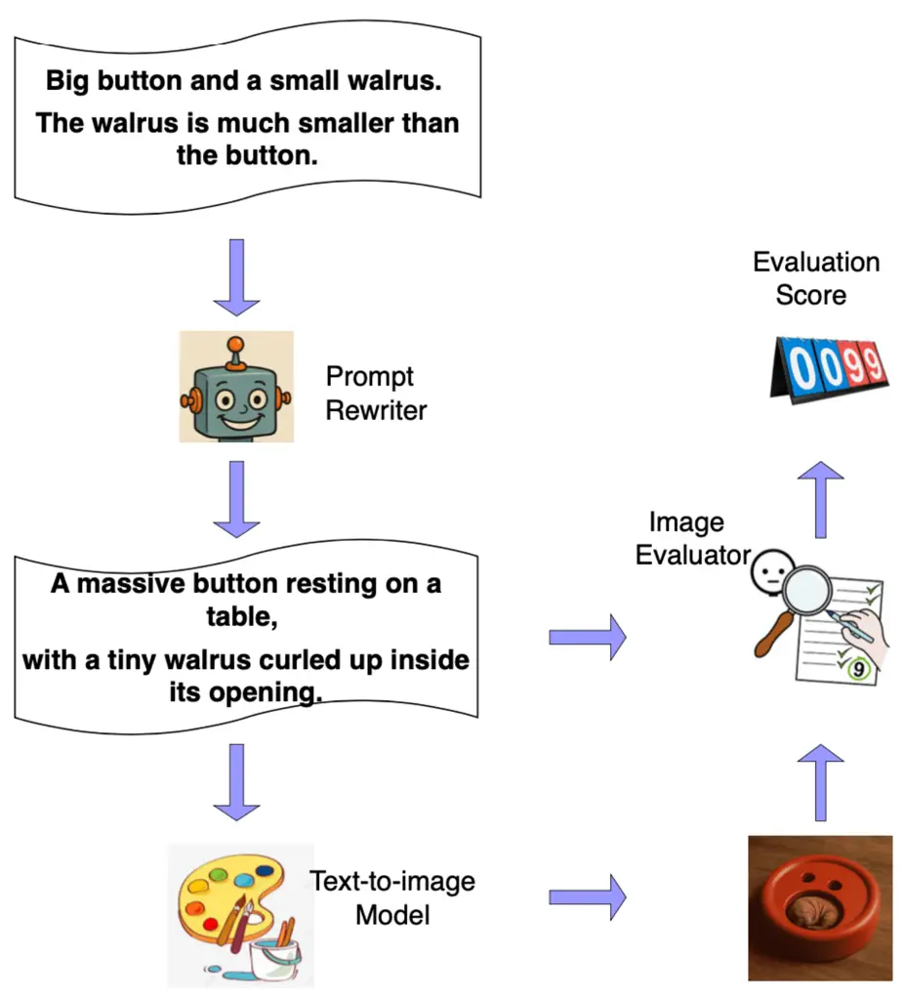
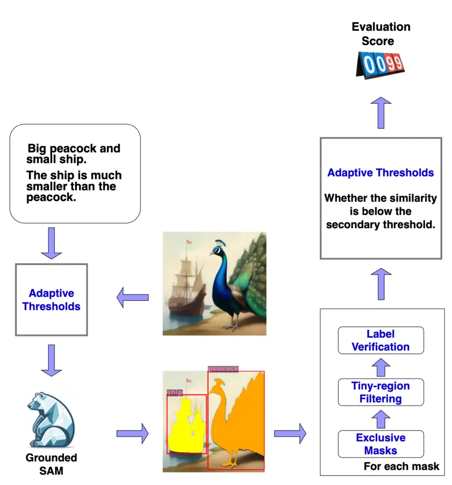
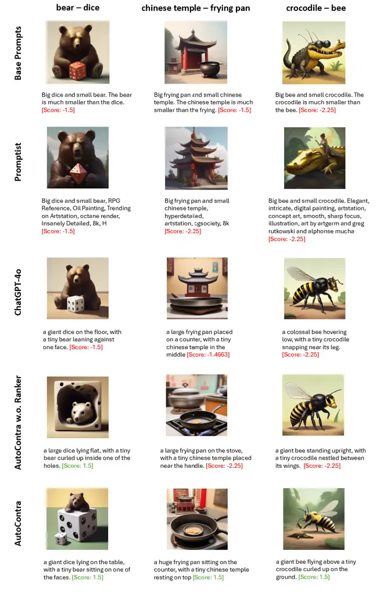

# Automated Prompt Generation for Creative and Counterfactual Text-to-Image Synthesis

Aleksa Jelaca^(†)    Ying Jiao^(†\*) ^(†)^(†)thanks: \* Ying Jiao and
Chang Tian are co-first authors.    Chang Tian^(†\*) ^(†)^(†)thanks:
Corresponding authors: Chang Tian (namechangtian@163.com) and Ying Jiao
(ying.jiao@kuleuven.be).    Marie-Francine Moens^(†)

###### Abstract

Text-to-image generation has advanced rapidly with large-scale
multimodal training, yet fine-grained controllability remains a critical
challenge. Counterfactual controllability, defined as the capacity to
deliberately generate images that contradict common-sense patterns,
remains a major challenge but plays a crucial role in enabling
creativity and exploratory applications. In this work, we address this
gap with a focus on counterfactual size (e.g., generating a tiny walrus
beside a giant button) and propose an automatic prompt engineering
framework that adapts base prompts into revised prompts for
counterfactual images. The framework comprises three components: an
image evaluator that guides dataset construction by identifying
successful image generations, a supervised prompt rewriter that produces
revised prompts, and a DPO-trained ranker that selects the optimal
revised prompt. We construct the first counterfactual size text–image
dataset and enhance the image evaluator by extending Grounded SAM with
refinements, achieving a 114% improvement over its backbone. Experiments
demonstrate that our method outperforms state-of-the-art baselines and
ChatGPT-4o, establishing a foundation for future research on
counterfactual controllability.

###### Index Terms: 

Text-to-image generation, Automatic prompt

^(†)^(†)address: ^(†) KU Leuven, Leuven, Belgium  
{alekjelacamg000}@gmail.com

## 1 Introduction

Deep learning has significantly advanced numerous applications \[1, 2,
3, 4, 5\], with text-to-image generation \[6\] representing an important
area of progress. Text-to-image generation is the task of synthesizing
images from natural language descriptions, enabled by advances in
large-scale multimodal training and diffusion models. Recent works
(\[7\], \[8\], \[9\], \[10\]) have demonstrated remarkable success in
producing photorealistic and stylistically diverse images that align
with complex prompts, supporting applications in creative industries,
design, education, and accessibility.

Despite progress, challenges persist in achieving fine-grained
controllability over generated content. Existing research on
controllable text-to-image generation has primarily focused on
constraining specific visual aspects such as spatial layout \[11\],
object attributes\[12\], style transfer \[13\], or local image editing
\[14\]. These methods are designed to enhance faithfulness to user
prompts and improve alignment with real-world semantics. However,
counterfactual controllability, which guides models to deliberately
generate images that contradict common-sense statistical patterns, is
underexplored. This gap is particularly relevant for creative, artistic,
and exploratory applications, where generating counterfactual images
serves not only as a test of model flexibility but also as a tool for
fostering imagination beyond realistic distributions.

In this paper, we propose an automatic prompt engineering framework that
adapts base prompts to revised prompts that lead to images faithful to
counterfactual requirements as show in Figure 1. This work investigates
counterfactual size as a primary research focus (e.g., generating an
image of a giant button next to a tiny walrus), while the proposed
method is readily extensible to other counterfactual attributes. Our
framework contains three components: an image evaluator, a prompt
rewriter, and a prompt ranker. Since no dataset of prompts paired with
counterfactual size images exists, we construct one with the help of the
image evaluator. The image evaluator measures the degree to which images
satisfy counterfactual size requirements, enabling us to classify
prompts into successful ones (which yield faithful counterfactual
images) and failed ones. Our prompt rewriter is a pretrained language
model fine-tuned with supervised learning on the successful prompt set.
The prompt ranker is another pretrained language model fine-tuned with
Direct Preference Optimization (DPO) \[15\] on both successful and
failed prompts. At inference time, the fine-tuned prompt rewriter
generates multiple candidate prompts, and the reranker selects the top
candidate as the final revised prompt.

We conduct experiments with the open-source text-to-image model CoMat
\[12\]. The results demonstrate that our framework outperforms
state-of-the-art automatic prompt rewriting baselines for text-to-image
generation, and ChatGPT-4o \[16\] when used as a prompt rewriter.

Our contributions are as follows ¹¹ 1 The code and data will be publicly
available upon publication at
https://github.com/jekia2000/Counterfactual-Size-T2I.:

- •
  We present an in-depth investigation of counterfactual controllability
  in text-to-image generation, with a primary focus on counterfactual
  size.
- •
  We design an automatic prompt engineering framework that combines an
  evaluator-guided dataset construction process, a supervised fine-tuned
  rewriter, and a DPO-trained ranker.
- •
  We build the first dataset of counterfactual size prompts and images,
  facilitating future study of this new task.
- •
  We experimentally show that our framework improves counterfactual
  text-to-image generation with respect to size compared to existing
  baselines.



Figure 1: Overview of the proposed method.

## 2 Proposed Method

### 2.1 Image Evaluator

We design an evaluator that assigns a score reflecting how well an image
generated from a text prompt depicts a counterfactual size relationship
between two objects: one that is typically large in reality (the _large_
object) and one that is typically small (the _small_ object). A higher
score indicates better alignment with the counterfactual requirement
that the small object appears larger than the big one. An overview of
the evaluator is shown in Figure 2.

The evaluator relies on segmentation masks from Grounded SAM \[17\].
Each mask is associated with a text label and has a measurable pixel
area. To align the segmentation with human judgment, four refinements
are introduced:

Tiny-region filtering. Detections with very few pixels are discarded as
noise.

Exclusive masks. Grounded SAM may output overlapping masks, where one
covers both the small and big objects. To prevent this, masks are sorted
by area (smallest first), and pixels assigned to smaller masks are
excluded from larger ones. This guarantees mutual exclusivity and avoids
a single mask absorbing both objects.

Label verification. Grounded SAM may mislabel objects. To correct this,
the image region corresponding to each mask is extracted, placed on a
blank background, and then embedded with CLIP \[18\]. The embedding is
compared against a reference database of segmented web objects, and the
label with maximum cosine similarity is assigned:

```math
\text{label}^{\star}=\arg\max_{(l,e)\in\mathcal{D}}\cos\!\left(f(O_{m}),e\right), \tag{1}
```

where $`O_{m}`$ is the image region from mask $`m`$, $`f(\cdot)`$ the
CLIP encoder, and $`\mathcal{D}`$ the reference label–embedding
database. $`l`$ denotes a candidate label in the reference database, and
$`e`$ represents the embedding corresponding to label $`l`$.

Adaptive thresholds. Grounded SAM predictions rely on both box and text
thresholds. Higher thresholds reduce noise but may miss true objects,
whereas lower thresholds detect more regions at the risk of introducing
irrelevant predictions. To balance this, thresholds
$`(\tau_{\text{box}},\tau_{\text{text}})`$ are dynamically adjusted
based on the CLIP similarity between the generated image $`I`$ and the
textual description $`T`$. The CLIP similarity here refers to the cosine
similarity between the embeddings of the image and the text, computed
using the CLIP model:

```math
(\tau_{\text{box}},\tau_{\text{text}})=\begin{cases}(b_{l},t_{l}),&\cos\_sim(I,T)\geq\mu_{a}\\
(b_{g},t_{g}),&\text{otherwise}\end{cases} \tag{2}
```

where $`b_{l},t_{l}`$ and $`b_{g},t_{g}`$ denote lower and greater
box/text thresholds, respectively, and $`\mu_{a}`$ is the main
similarity cutoff. Additionally, a secondary similarity threshold
$`\mu_{b}`$ handles extreme cases: if $`\cos\_sim(I,T)`$ falls below
this threshold, the evaluator assumes only one object is present.

After refinement, the evaluator assigns a score based on object presence
and relative size:

```math
S=\begin{cases}\min\!\left(\tau_{R},\frac{A_{s}}{A_{b}}\right),&\text{both present, size ratio correct},\\[2.84526pt]
\max\!\left(-\tau_{R},-\frac{A_{b}}{A_{s}}\right),&\text{both present, size ratio incorrect},\\[2.84526pt]
-\tau_{R}*(1+g),&\text{one object missing},\\[2.84526pt]
-\tau_{R}*(1+g)^{2},&\text{both objects missing},\end{cases} \tag{3}
```

where $`A_{s}`$ and $`A_{b}`$ denote the largest detected mask areas of
the small and big objects, respectively, in the real scene. $`\tau_{R}`$
is the clipping threshold, and $`g`$ is a penalty factor. Positive
scores are clipped above $`\tau_{R}`$, reflecting that once
counterfactuality is established, further increases in the size ratio do
not matter. Negative scores are similarly clipped.

### 2.2 Dataset Construction

Since no public dataset exists for counterfactual size prompt–image
pairs, we construct a dataset of 91 objects: 46 typically large and 45
typically small. Large objects include animals, vehicles, and monuments,
while small objects comprise animals, household items, clothing,
accessories, and footwear. Pairing each large with each small object
yields 2070 base prompts using the template: “Big \[small object\] and
small \[big object\]. The \[big object\] is much smaller than the
\[small object\].”

We use twelve manually written prompts producing faithful
counterfactual-sized images as few-shot examples for ChatGPT-4o to
generate revised prompts. Each revised prompt is used to generate an
image with CoMat SDXL \[12\] and scored by the Image Evaluator. Prompts
exceeding a reward threshold ($`\tau_{\text{reward}}`$) are labeled
positive, while those with negative scores are labeled negative. From
these, we build a dataset of 7304 triplets—each consisting of a base
prompt, a positive, and a negative rewritten output—for DPO finetuning
of the prompt ranker. For supervised finetuning of the prompt rewriter,
we extract base–positive pairs.

### 2.3 Training and Inference of Prompt Rewriter and Ranker

The prompt rewriter is fine-tuned via supervised learning on the
base–positive prompt pairs constructed in 2.2, learning to transform
base prompts into revised candidates likely to generate faithful
counterfactual size images. The prompt ranker is separately fine-tuned
using DPO on triplets consisting of a base prompt, a positive, and a
negative rewritten output, learning to assign higher scores to more
effective rewrites.

During inference, the fine-tuned prompt rewriter produces multiple
candidate revisions for each base prompt. The prompt ranker then
evaluates these candidates, and the one with the highest score is
selected as the final output. This two-stage framework combines the
generative capacity of the rewriter with the discriminative power of the
ranker, ensuring that the selected prompt consistently produces images
that faithfully reflect the intended counterfactual size relationships.



Figure 2: The holistic view of the Image Evaluator Components. The
detected mask areas for the objects are presented in the figure.

## 3 Experiments

### 3.1 Implementation details

For the image evaluator, we set the height/width threshold for tiny
objects to 32 pixels and the mask area threshold to 2048. Other
parameters include $`b_{l}=0.2`$, $`t_{l}=0.2`$, $`b_{g}=0.3`$,
$`t_{g}=0.25`$, $`\mu_{a}=0.39`$, $`\mu_{b}=0.33`$, $`\tau_{R}=1.5`$,
and $`g=0.5`$. The backbone model of the prompt rewriter is GPT2 \[19\].
We finetune it with a learning rate of $`5\times 10^{-5}`$, a batch size
of 16, maximum sequence length of 64, for up to 20 epochs with patience
of 3 epochs. Optimization uses AdamW \[20\] with gradient accumulation
steps of 1. The backbone model of the prompt ranker is GPT2-large.
Finetuning uses a learning rate of $`5\times 10^{-6}`$, a batch size of
64, maximum sequence length of 64, and runs for 20 epochs. We set
$`\beta=0.1`$, ref_model_mixup_alpha=1, and ref_model_sync_steps=512. We
use AdamW as the optimizer for all finetuning. During inference, the
rewriter generates 15 candidate prompts per base prompt by
non-deterministic sampling with temperature of 0.6 and nucleus sampling
of 1.

All experiments were conducted with three random seeds (40, 41, and 42),
each requiring at least 32 GiB of GPU memory ²² 2
[https://www.hpc.cineca.it/](https://www.hpc.cineca.it/)³³ 3
[https://www.vscentrum.be/](https://www.vscentrum.be/). Further details
are available in our GitHub repository.

### 3.2 Research Questions

Our experiments are designed to address the following research
questions:

RQ1: Can our prompt rewriting framework effectively lead to faithful
counterfactual size images, and how does its performance compare with
baseline methods?

RQ2: Does incorporating the prompt ranker improve the quality of
rewritten prompts and the resulting images, compared to using the prompt
rewriter alone?

RQ3: To what extent does the automatic image evaluator align with human
judgments of counterfactual size faithfulness?

### 3.3 RQ1: Effectiveness of AutoContra

To answer RQ1, we compare AutoContra against two baselines: Promptist
\[21\], an automated prompt optimization method for text-to-image
generation, and ChatGPT-4o, used directly as a prompt rewriter. We
additionally report results for the template base prompts. Accuracy is
measured as the proportion of images scoring at least
$`\tau_{\text{reward}}`$ in the image evaluator. We use a test set of
1004 object pairs.

As shown in Table 1, Promptist performs the worst, likely because its
strategy of adding stylistic descriptors obscures the intended
object–size relationships, preventing the model from capturing
counterfactuality. In contrast, ChatGPT-4o achieves much stronger
results, demonstrating the capability of large language models to
rewrite prompts in ways that align with non-trivial semantic
constraints. Our proposed AutoContra framework outperforms both
baselines. Nevertheless, the overall accuracy remains relatively low,
underscoring the inherent difficulty of this task and the significant
room for improvement in counterfactual controllability.

Figure 3 presents example images generated from different prompt
rewriting strategies along with their image evaluator scores. These
qualitative results complement the quantitative analysis, showing how
AutoContra better capture the intended counterfactual relationships.

| Method                 | Accuracy (%)                     |
| ---------------------- | -------------------------------- |
| Base Prompts           | $`10.2\pm 0.9`$                  |
| Promptist              | $`8.2\pm 0.3`$                   |
| ChatGPT-4o             | $`27.5\pm 1.7`$                  |
| AutoContra w.o. Ranker | $`29.1\pm 0.7`$                  |
| AutoContra (ours)      | $`\textbf{30.3}\pm\textbf{0.8}`$ |

Table 1: Evaluation results with three seeds.

### 3.4 RQ2: Contribution of the Prompt Ranker

As shown in Table 1, adding the prompt ranker improves accuracy from
$`29.1\%`$ to $`30.3\%`$, demonstrating its positive effect on
performance. Qualitative examples in Figure 3 further support this
finding: without the prompt ranker, some generated images contain only
one object, whereas with the prompt ranker, both objects are more
consistently present and correctly follow the counterfactual size
requirement.



Figure 3: Visual Comparison of images of different object pairs across
different prompt rewriting techniques

### 3.5 RQ3: Ablation Study of Image Evaluator

Our image evaluator is built on Grounded SAM with several refinements,
as described in Section 2.1. To assess the impact of each component, we
conduct an ablation study, with results summarized in Table 2.

Experiments are performed on a dataset of 235 diverse images generated
from 50 distinct small–large object pairs, each representing a class
category defined in Section 2.2. Human annotators labeled each generated
image as counterfactual size (True/False), and these annotations serve
as ground truth.

We then apply different variants of the image evaluator to predict
whether a generated image exhibits counterfactual size and compare the
predictions against human annotations. The main objective is to evaluate
whether the evaluator correctly identifies all images that would receive
a positive reward according to human judgment. Importantly, we focus on
detecting positive rewards rather than enforcing the maximum threshold
($`\tau_{R}=1.5`$), since humans typically assess size relations
visually rather than estimating precise ratios. Performance is measured
using the F1 score.

The results highlight several insights: (1) Removing adaptive thresholds
(W.o. Adaptive thresholds) reduces evaluator performance, as Grounded
SAM either masks irrelevant candidates as objects or misses true objects
without appropriate threshold constraints. (2) Excluding both adaptive
thresholds and label verification (W.o. Adaptive thresholds + Label
verification) significantly degrades performance, demonstrating the
necessity of label verification. Grounded SAM is effective at proposing
candidate regions but less accurate at classification, whereas our
reference embedding database provides specialized external knowledge to
support accurate classification. (3) Removing all refinements (W.o. All
refinements) leads to substantial performance deterioration, with the
plain evaluator achieving only 0.41 F1 compared to 0.88 for the complete
evaluator. Overall, these findings confirm the reliability of our image
evaluator and its strong alignment with human judgments.

| Model                                       | F1 score |
| ------------------------------------------- | -------- |
| Image Evaluator (ours)                      | 0.882353 |
| W.o. Adaptive thresholds                    | 0.809756 |
| W.o. Adaptive thresholds+Label verification | 0.441717 |
| W.o. All refinements                        | 0.411428 |

Table 2: F1 scores across model variants. W.o. means without. W.o. All
refinements indicates that only Grounded SAM is used as the image
evaluator variant.

## 4 Conclusion

This work investigates counterfactual controllability in text-to-image
generation, with counterfactual size as the primary focus. We introduce
an automatic prompt engineering framework that integrates an image
evaluator-guided dataset construction process, a supervised prompt
rewriter, and a DPO-trained prompt ranker. By extending Grounded SAM
with adaptive refinements, the image evaluator demonstrates substantial
improvements in identifying faithful counterfactual generations.
Leveraging this evaluator, we construct the first counterfactual size
dataset, enabling systematic study of this underexplored task.
Experimental results showed that our framework consistently outperforms
state-of-the-art baselines and ChatGPT-4o, achieving significant gains
in performance and alignment with human judgments. We believe this work
establishes a foundation for future research on counterfactual image
synthesis, contributing both methodological advances and resources that
support creative, artistic, and exploratory applications.

## References

- \[1\] Chang Tian, Wenpeng Yin, and Marie Francine Moens,
  “Anti-overestimation dialogue policy learning for task-completion
  dialogue system,” in Findings of the Association for Computational
  Linguistics: NAACL 2022, 2022, pp. 565–577.
- \[2\] Chang Tian, Wenpeng Yin, Dan Li, and Marie-Francine Moens,
  “Fighting against the repetitive training and sample dependency
  problem in few-shot named entity recognition,” Ieee Access, vol. 12,
  pp. 37600–37614, 2024.
- \[3\] Chang Tian, Matthew Blaschko, Wenpeng Yin, Mingzhe Xing,
  Yinliang Yue, and Marie Francine Moens, “A generic method for
  fine-grained category discovery in natural language texts,” in
  Proceedings of the 2024 Conference on Empirical Methods in Natural
  Language Processing, 2024, pp. 3548–3566.
- \[4\] Chang Tian, Mingzhe Xing, Zenglin Shi, Matthew B Blaschko,
  Yinliang Yue, and Marie-Francine Moens, “Using causality for enhanced
  prediction of web traffic time series,” arXiv preprint
  arXiv:2502.00612, 2025.
- \[5\] Chang Tian, Matthew B Blaschko, Mingzhe Xing, Xiuxing Li,
  Yinliang Yue, and Marie-Francine Moens, “Large language models
  reasoning abilities under non-ideal conditions after rl-fine-tuning,”
  arXiv preprint arXiv:2508.04848, 2025.
- \[6\] Dan Li, Shuai Wang, Jie Zou, Chang Tian, Elisha Nieuwburg,
  Fengyuan Sun, and Evangelos Kanoulas, “Paint4poem: A dataset for
  artistic visualization of classical chinese poems,” arXiv preprint
  arXiv:2109.11682, 2021.
- \[7\] Chitwan Saharia, William Chan, Saurabh Saxena, Lala Li, Jay
  Whang, Emily L Denton, Kamyar Ghasemipour, Raphael Gontijo Lopes,
  Burcu Karagol Ayan, Tim Salimans, et al., “Photorealistic
  text-to-image diffusion models with deep language understanding,”
  Advances in neural information processing systems, vol. 35, pp.
  36479–36494, 2022.
- \[8\] Hanan Gani, Shariq Farooq Bhat, Muzammal Naseer, Salman Khan,
  and Peter Wonka, “Llm blueprint: Enabling text-to-image generation
  with complex and detailed prompts,” arXiv preprint
  arXiv:2310.10640, 2023.
- \[9\] Nuno Montenegro, “Integrative analysis of text-to-image ai
  systems in architectural design education: pedagogical innovations and
  creative design implications,” Journal of Architecture and Urbanism,
  vol. 48, no. 2, pp. 109–124, 2024.
- \[10\] OpenAI, “DALL-E (Version 3),”
  [https://openai.com/index/dall-e-3/](https://openai.com/index/dall-e-3/),
  2023, \[Text-to-image Generative Model\].
- \[11\] Lvmin Zhang, Anyi Rao, and Maneesh Agrawala, “Adding
  conditional control to text-to-image diffusion models,” in Proceedings
  of the IEEE/CVF international conference on computer vision, 2023, pp.
  3836–3847.
- \[12\] Dongzhi Jiang, Guanglu Song, Xiaoshi Wu, Renrui Zhang, Dazhong
  Shen, Zhuofan Zong, Yu Liu, and Hongsheng Li, “Comat: Aligning
  text-to-image diffusion model with image-to-text concept matching,”
  Advances in Neural Information Processing Systems, vol. 37, pp.
  76177–76209, 2024.
- \[13\] Kihyuk Sohn, Nataniel Ruiz, Kimin Lee, Daniel Castro Chin,
  Irina Blok, Huiwen Chang, Jarred Barber, Lu Jiang, Glenn Entis,
  Yuanzhen Li, et al., “Styledrop: Text-to-image generation in any
  style,” arXiv preprint arXiv:2306.00983, 2023.
- \[14\] Ling Yang, Zhaochen Yu, Chenlin Meng, Minkai Xu, Stefano Ermon,
  and Bin Cui, “Mastering text-to-image diffusion: Recaptioning,
  planning, and generating with multimodal llms,” in Forty-first
  International Conference on Machine Learning, 2024.
- \[15\] Rafael Rafailov, Archit Sharma, Eric Mitchell, Christopher D
  Manning, Stefano Ermon, and Chelsea Finn, “Direct preference
  optimization: Your language model is secretly a reward model,”
  Advances in neural information processing systems, vol. 36, pp.
  53728–53741, 2023.
- \[16\] OpenAI, “Chatgpt-4o,”
  [https://chat.openai.com/chat](https://chat.openai.com/chat), 2024,
  \[Large Language Model\].
- \[17\] Tianhe Ren, Shilong Liu, Ailing Zeng, Jing Lin, Kunchang Li,
  He Cao, Jiayu Chen, Xinyu Huang, Yukang Chen, Feng Yan, et al.,
  “Grounded sam: Assembling open-world models for diverse visual tasks,”
  arXiv preprint arXiv:2401.14159, 2024.
- \[18\] Alec Radford, Jong Wook Kim, Chris Hallacy, Aditya Ramesh,
  Gabriel Goh, Sandhini Agarwal, Girish Sastry, Amanda Askell, Pamela
  Mishkin, Jack Clark, et al., “Learning transferable visual models from
  natural language supervision,” in International conference on machine
  learning. PmLR, 2021, pp. 8748–8763.
- \[19\] Alec Radford, Jeffrey Wu, Rewon Child, David Luan, Dario
  Amodei, Ilya Sutskever, et al., “Language models are unsupervised
  multitask learners,” OpenAI blog, vol. 1, no. 8, pp. 9, 2019.
- \[20\] Ilya Loshchilov and Frank Hutter, “Decoupled weight decay
  regularization,” arXiv preprint arXiv:1711.05101, 2017.
- \[21\] Yaru Hao, Zewen Chi, Li Dong, and Furu Wei, “Optimizing prompts
  for text-to-image generation,” Advances in Neural Information
  Processing Systems, vol. 36, pp. 66923–66939, 2023.
