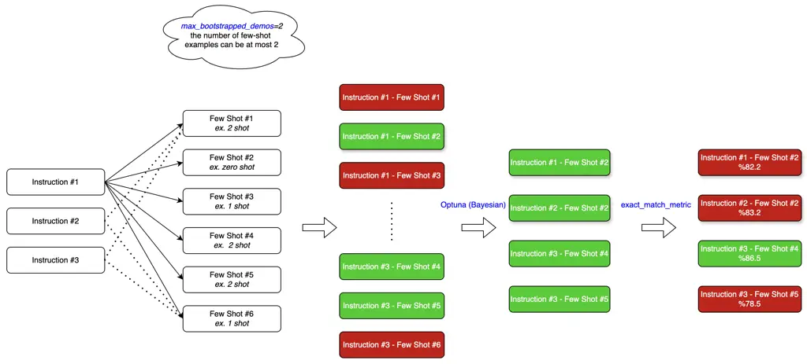
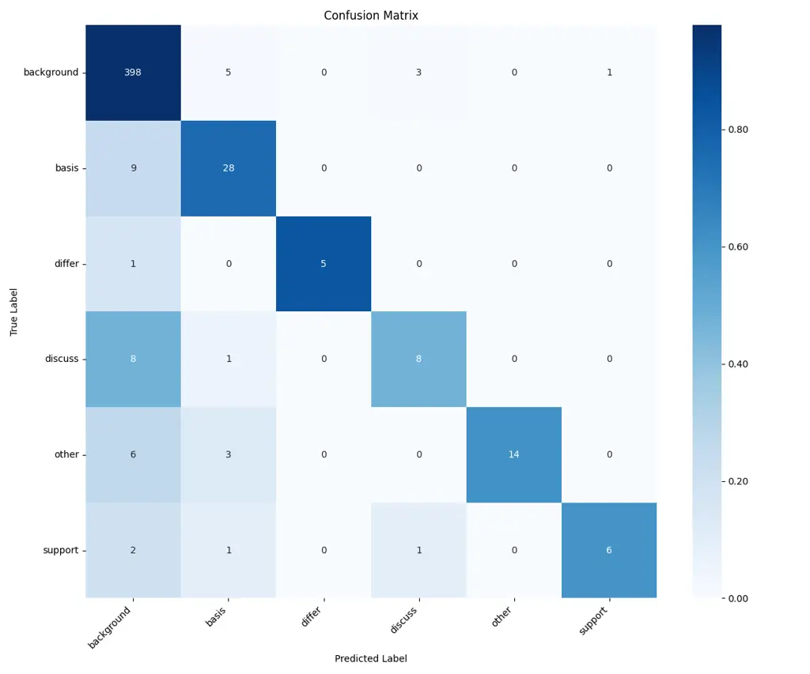

# A Large-Scale Dataset and Citation Intent Classification in Turkish with LLMs Thanks: This work was supported by TÜBİTAK ULAKBİM.

Kemal Sami Karaca Affiliation: Department of Computer Engineering  
TOBB ETU  
Ankara, Türkiye  
kemalsami.karaca@tubitak.gov.tr    Bahaeddin Eravcı
Affiliation: Department of Artificial Intelligence Engineering  
TOBB ETU  
Ankara, Türkiye  
beravci@etu.edu.tr

###### Abstract

Understanding the qualitative intent of citations is essential for a
comprehensive assessment of academic research, a task that poses unique
challenges for agglutinative languages like Turkish. This paper
introduces a systematic methodology and a foundational dataset to
address this problem. We first present a new, publicly available dataset
of Turkish citation intents, created with a purpose-built annotation
tool. We then evaluate the performance of standard In-Context Learning
(ICL) with Large Language Models (LLMs), demonstrating that its
effectiveness is limited by inconsistent results caused by manually
designed prompts. To address this core limitation, we introduce a
programmable classification pipeline built on the DSPy framework, which
automates prompt optimization systematically. For final classification,
we employ a stacked generalization ensemble to aggregate outputs from
multiple optimized models, ensuring stable and reliable predictions.
This ensemble, with an XGBoost meta-model, achieves a state-of-the-art
accuracy of 91.3%. Ultimately, this study provides the Turkish NLP
community and the broader academic circles with a foundational dataset
and a robust classification framework paving the way for future
qualitative citation studies.

###### Keywords: 

Machine learning, Deep learning, Ensemble learning, Few shot learning,
Prompt engineering, Crowdsourcing, Natural Language Processing

## I Introduction

Citation relationships established among academic publications not only
contribute to the advancement of scientific knowledge but also serve as
a fundamental metric in evaluating the impact of research outputs.
However, traditional metrics overlook the context and purpose of
citations, treating all citations as equivalent. In reality, a citation
may serve various intentions, such as supporting, discussing, or
criticizing a previous work. Identifying the intent behind citations
enables more meaningful analyses by capturing these contextual nuances.
This study aims to address a significant gap in the Turkish academic
literature by developing an artificial intelligence model to classify
the intents of citations found in Turkish academic texts.

Understanding citation intent is crucial not only for nuanced research
evaluation but also for powering the next generation of intelligent
scholarly tools. The automated classification of citation function is a
cornerstone for applications that can accelerate scientific discovery,
such as semi-automating systematic literature reviews \[1\] and building
dynamic scientific knowledge graphs that map the conceptual evolution
and argumentative structure of a research field\[2\]. Such technologies
can empower researchers to rapidly identify seminal works, trace the
propagation of ideas, and pinpoint contentious research fronts, tasks
that are becoming increasingly difficult due to the rapid growth of
scientific literature.

Applying these techniques to the Turkish language presents unique and
significant challenges. While foundational datasets like SciCite \[3\]
have provided a strong basis for this task in English, their models and
annotation schemas are not readily transferable. The challenge is
twofold. First, Turkish is an agglutinative language characterized by
complex morphology and a vast number of word forms derived from a single
root, which renders traditional NLP models trained on English corpora
ineffective \[4\]. Second, the domain-specific rhetorical conventions
embedded in citation practices do not always translate directly across
linguistic and academic cultures. These barriers necessitate a ground-up
approach, requiring the creation of a new, large-scale,
language-specific dataset and the development of models capable of
navigating its unique complexities. To execute this, we begin by
introducing the first large-scale, publicly available dataset for
citation intent classification in Turkish, composed of 2650 annotated
examples from Computer Science articles, thereby establishing a
foundational resource for the community. Using this dataset, we conduct
a comprehensive benchmark of modern Large Language Models (LLMs) like
GPT-4o and Gemini, demonstrating the critical performance gains achieved
by advancing from manual prompting to an automated prompt optimization
framework (DSPy). Finally, to ensure maximum robustness, we develop a
high-performance (91.3% accuracy) stacked ensemble meta-model,
establishing a strong and reproducible foundation for future research in
Turkish scholarly NLP. The proposed methodology not only enables
content-oriented evaluation of Turkish academic publications for the
first time but also serves as a potential blueprint for similar analyses
in other low-resource languages.

## II Related Work

The field of Citation Intent Classification (CIC) has evolved
significantly from early rule-based systems \[5, 6\], which were often
limited in scope. The advent of deep learning led to foundational
contributions like the SciCite dataset by Cohan et al. \[3\], which
established a benchmark for training neural models on large-scale data
by incorporating contextual features. More recently, the field has
shifted towards data-efficient, prompt-based learning with Large
Language Models (LLMs). Systems like CitePrompt \[7\] have demonstrated
that carefully engineered prompts with pre-trained models like SciBERT
can achieve high performance with minimal training data, effectively
overcoming the need for massive labeled datasets.

In the Turkish academic landscape, CIC research is emergent. Pioneering
work by Taşkın et al. analyzed citation patterns in specific fields,
proposing custom classification schemes and employing traditional
machine learning methods \[8, 9\]. While valuable, these studies were
often based on different taxonomies or smaller datasets, highlighting a
need for a large, standardized resource to drive progress and enable the
use of more powerful, modern techniques.

This methodological evolution is situated within a broader paradigm
shift in NLP, driven by the emergent capabilities of LLMs. The
introduction of models like GPT-3 demonstrated that large-scale
pre-training enables In-Context Learning (ICL), where models can perform
novel tasks from just a few examples supplied in a prompt without any
parameter updates \[10\]. However, the performance of ICL is critically
dependent on the quality of the prompt, leading to a new bottleneck of
manual prompt engineering. To address this, recent research has focused
on automating prompt discovery. Frameworks like DSPy move beyond simple
automation, treating the pipeline as a program to be compiled and
optimized, systematically generating and refining prompts to maximize
performance on a given task \[11\].

This review of the literature highlights a clear and critical gap: while
the global field of CIC has advanced towards sophisticated, prompt-based
LLMs, research in Turkish has been constrained by a lack of large-scale,
standardized datasets and the continued use of traditional methods
ill-suited for the language’s morphological complexity. Our work is
designed to bridge this divide directly. We address the resource gap by
introducing the first large-scale Turkish CIC dataset and tackle the
methodological gap by moving beyond manual prompting to implement a
state-of-the-art automated optimization pipeline. In doing so, we
establish a robust new foundational resource for modern scholarly NLP in
Turkish.

## III Methodology

### III-A Dataset Creation and Annotation

This section details the creation of the first large-scale, publicly
available Turkish dataset for citation intent classification in the
field of Computer Science. The project was undertaken to address a
significant gap in the Turkish academic literature by providing a
foundational resource for qualitative citation studies.

#### III-A1 Source Selection and Citation Extraction

In this study, the constructed dataset was compiled from academic
journals in the field of Computer Science indexed on the
[https://dergipark.org.tr/](https://dergipark.org.tr/) and
[https://trdizin.gov.tr/](https://trdizin.gov.tr/) platforms. The aim in
selecting these journals was to choose a field where the citation
content is explicitly presented and scientific writing standards are
relatively homogeneous. The Computer Science discipline offers a
suitable sample in this respect, as citations in this field typically
appear as methodological, conceptual, or comparative references. In
contrast, in disciplines such as social sciences or medicine, citations
often appear in footnotes, supplementary paragraphs, or in structurally
ambiguous forms, making automatic citation extraction more difficult.

The publications included in the dataset were limited exclusively to
research articles. This choice was made to enable comparative analysis
with review-type publications that do not contain method sections. It is
known that citations in review articles are generally used to provide
background information and give less space to citations of experimental
methods or results.

For the extraction of citation sentences from designated journals and
research articles, the CEX module \[12\] developed within the GRaSPoS
project and utilizing the GROBID library in the background, was used.
This module is specifically designed for the precise extraction of
citations and contains two models \[13, 14\] trained for this task.
These models are optimized based on the linguistic structures and
citation patterns specific to computer science publications, giving them
the ability to distinguish between different citation types with high
accuracy. In addition, the CEX module was preferred due to its ability
to both generate structured output from the articles in TEI format and
provide the data containing citation contexts in JSON format.

#### III-A2 Citation Annotation Scheme

Datasets used in the task of citation intent classification are
typically collected from various academic disciplines and constructed
using various labeling schemes. One of the pioneering datasets in this
field, ACL-ARC, was gathered from journals in “Computational
Linguistics” and aimed to categorize citations into six classes to
determine their functional aspects \[15\]. Another significant dataset
developed for this purpose is SciCite, which was compiled from journals
in “Computer Science & Medicine.” It divides citations into three
primary classes: BACKGROUND (providing theoretical or contextual
information), METHOD (referencing the methods or techniques used), and
RESULT COMPARISON (comparing experimental results) \[3\] which was also
adopted by the GRaSPoS project.

Furthermore, scite.ai, another tool developed for scientific citation
analysis, classifies the content of citations as `supporting`,
`contradicting`, or `mentioning`. This classification is concerned not
only with the functional aspect of the citation but also with its
sentiment, making it possible to evaluate the citation’s intent in a
positive or negative context \[16\].

This study adopts the five-category citation intent classification
system from the Web of Science (WoS) platform: `Background`, `Basis`,
`Support`, `Differ`, and `Discuss` \[17\]. This scheme was chosen for
its detailed approach to classifying results: where a comparable system
like SciCite uses a single RESULT COMPARISON class, the WoS scheme
subdivides this concept into `Support` for agreeing findings and
`Differ` for conflicting ones. Additionally, the `Basis` class is used
to identify the direct application of a referenced methodology.
Furthermore, since the WoS database contains sources in both Turkish and
English, it offers the potential for future comparative analysis with
classifications in both languages.

#### III-A3 The Annotation and Quality Control Process

To facilitate the labeling process, a web interface was developed for
annotations by academic experts \[18\]. Participants contributed to the
annotation process by logging in either anonymously or with their
institutional credentials via this interface. An analysis of the manual
labeling results revealed that participants exhibited different
approaches, particularly in distinguishing between the `Support` and
`Differ` categories. This finding indicates that evaluating citation
intent requires a holistic contextual assessment, not just a
sentence-level one, and highlights the inherent difficulty in
differentiating between semantically close classes like `Support` and
`Differ`.

Due to these variations in interpretation among participants, a hybrid
approach combining human expertise and AI-assisted automation was
adopted for labeling the citation sentences. The foundation of this
process consists of manual evaluations conducted by academics from
various universities and volunteer users. To support this manual
process, complete missing labels, and resolve ambiguous cases that
lacked consensus, In-Context Learning (ICL) with an LLM is utilized.
Within this framework, classification predictions generated by Large
Language Models (LLMs) such as GPT and Gemini were presented as an
assistive reference to the human annotators before making the final
decision. This approach aimed to enhance the overall quality and
consistency of the dataset.

### III-B Dataset Statistics

The dataset was constructed by processing a total of 723 research
articles from the Computer Science domain. From these documents, an
initial pool of 20,026 citation instances was extracted using the CEX
module. Following the annotation and quality control process detailed in
the previous sections, a final curated dataset of 2,650 labeled citation
sentences was prepared. This final set of 2,650 examples served as the
basis for all subsequent modeling and classification experiments
presented in this study.

### III-C Modeling Citation Intent Classification

Our modeling approach is designed as a multi-stage pipeline that
systematically addresses the complexities of citation intent
classification in Turkish. The methodology proceeds from a standard ICL
method to a more sophisticated, automated prompt optimization framework,
and culminates in a robust ensemble model to ensure high-quality and
stable predictions.

#### III-C1 In-Context Learning (ICL)

As a foundational performance benchmark, we employ In-Context Learning
(ICL), a technique that leverages the ability of Large Language Models
(LLMs) to perform tasks based on a few examples provided directly in the
prompt, without any updates to the model’s parameters. This approach is
ideal for establishing a performance benchmark in a low-resource setting
where fine-tuning a dedicated model may be infeasible \[19\].

Formally, given a citation sentence for classification, $`x_{new}`$, and
a set of $`k`$ example pairs $`(x_{i},y_{i})`$ where $`y_{i}`$ is the
ground-truth label from the set of five intent categories, we construct
a prompt $`P=\{(x_{1},y_{1}),...,(x_{k},y_{k})\}`$. The LLM’s task is to
predict the label $`y_{new}`$ by modeling the conditional probability:

```math
y_{new}=\underset{y\in\mathcal{Y}}{\text{argmax}}\ P(y|P,x_{new}) \tag{1}
```

where $`\mathcal{Y}`$ is the set of all possible intent labels. While
powerful, the efficacy of ICL is highly sensitive to the composition of
the prompt $`P`$, including the choice of few-shot examples and the
phrasing of the instructional text. This sensitivity motivated our
adoption of a more systematic optimization approach.

#### III-C2 Automated Prompt Optimization with DSPy

To overcome the limitations of manual prompt engineering and discover
the most effective prompt structure, we utilize the DSPy framework. DSPy
(Declarative Self-improving Python) automates the process of prompt
optimization by treating the prompt as a program to be compiled and
optimized for a specific task and metric \[20, 21, 22, 23, 24\].

The core objective of DSPy in this study is to find an optimal prompt,
$`P^{*}`$, that maximizes a scoring function, $`S`$ (e.g., accuracy), on
a validation set, $`D_{val}`$. The optimization process can be expressed
as:

```math
P^{*}=\underset{P\in\mathcal{P}}{\text{argmax}}\ S(P,D_{val}) \tag{2}
```

where $`\mathcal{P}`$ represents the search space of possible prompts.
In our implementation, we use the MIPROv2 optimizer within DSPy, which
systematically explores variations in both the instructional components
and the few-shot demonstration sets. This optimization process is
illustrated in Fig.  1. To encourage more explicit reasoning from the
LLM during classification, a Chain of Thought (CoT) module is
incorporated into the prompt structure, prompting the model to generate
intermediate reasoning steps before arriving at a final label.



Fig. 1: DSPy MIPROv2 optimization process

#### III-C3 Robust Classification via Stacked Ensemble Model

To enhance classification accuracy and improve the stability of our
final predictions, we employ ensemble learning, which combines the
outputs from multiple distinct models. The intuition is that by
aggregating diverse predictions, the weaknesses of individual models can
be mitigated. We explored two primary ensemble strategies.

Majority Voting: A straightforward approach where the final label,
$`\hat{y}`$, is the one predicted by the majority of the $`N`$ base
models. For a given input $`x`$, the prediction is:

```math
\hat{y}=\underset{y\in\mathcal{Y}}{\text{argmax}}\sum_{i=1}^{N}\mathbb{I}(h_{i}(x)=y) \tag{3}
```

where $`h_{i}(x)`$ is the prediction of the $`i`$-th model and
$`\mathbb{I}`$ is the indicator function.

Stacked Generalization (Stacking): A more sophisticated, two-stage
approach was adopted for its potential to learn optimal weightings for
each base model.

1.  1.  Stage 1 (Base Models): A set of $`N`$ diverse base models,
        $`h_{1},h_{2},...,h_{N}`$ (representing different LLMs and prompt
        configurations), are trained or prompted to generate predictions on
        the dataset.
2.  2.  Stage 2 (Meta-Model): The predictions from the base models are used
        as features to train a meta-model, $`H`$. For an input sentence
        $`x`$, a new feature vector $`z=[h_{1}(x),h_{2}(x),...,h_{N}(x)]`$
        is constructed. The final prediction, $`\hat{y}`$, is then produced
        by the meta-model:

    ```math
    \hat{y}=H(z) \tag{4}
    ```

For the meta-model $`H`$, we selected a gradient boosting framework
(XGBoost) due to its strong performance in learning from the tabular
feature representation created by the concatenated predictions of the
base models.

## IV Experiments and Results

### IV-A Experimental Setup

For the purpose of reproducibility, this subsection details the specific
configurations used in our experiments. We specify the language models
employed, the partitioning of our dataset, and the optimization
parameters.

- •
  Models: The primary Large Language Models (LLMs) utilized for the
  experiments were OpenAI’s GPT-4o, Google’s Gemini 2.5 Flash, and
  Gemini 2.5 Pro.
- •
  Dataset: The modeling experiments were conducted on a dataset
  comprising a total of 2,650 examples. This dataset was partitioned
  with an 80% allocation for the training set and 20% for the validation
  set.
- •
  DSPy Configuration: The automated prompt optimization was performed
  using the MIPROv2 optimizer within the DSPy framework. The
  configuration adopted the ChainOfThought (CoT) module to encourage the
  model to produce intermediate reasoning steps. Key parameters for the
  optimization included 18 instruction candidates, 9 few-shot
  candidates, and a total of 27 trials. The detailed parameters for this
  configuration are summarized in Table I.

|                            |                |
| -------------------------- | -------------- |
| Config Name                | Value          |
| Module                     | ChainOfThought |
| Train Set – Validation Set | %80 – %20      |
| Instruction candidate      | 18             |
| Few-Shot candidate         | 9              |
| max_bootstrapped_demos     | 6              |
| num_trials                 | 27             |

TABLE I: DSPy Configuration Parameters

### IV-B Performance of Individual Models

This section presents the performance of the individual LLM
configurations, starting from the manual baselines and showing the
significant improvements gained through automated optimization and
shot-selection analysis.

#### IV-B1 ICL Performance with Manual Prompts

The initial performace benchmark was established using In-Context
Learning (ICL) with manually crafted prompts. Experiments showed that
model performance was highly sensitive to the design of the prompt. An
initial prompt version (v000) resulted in an accuracy of 61.3% for
Gemini-2.5-Flash and 52.6% for GPT-4o. A subsequent revision of the
manual prompt (v001) led to a significant performance increase,
achieving 83.9% for Gemini-2.5-Flash and 85.0% for GPT-4o, demonstrating
the critical impact of prompt engineering.

|                  |                |          |
| ---------------- | -------------- | -------- |
| Model            | Prompt Version | Accuracy |
| Gemini-2.5-Flash | v000           | 0.613    |
| ChatGPT-4o       | v000           | 0.526    |
| Gemini-2.5-Flash | v001           | 0.839    |
| ChatGPT-4o       | v001           | 0.85     |
| DSPY             | 0.865          |          |

TABLE II: Accuracy Values According to Models and Prompts

#### IV-B2 Performance Improvement via DSPy Optimization

To address the challenges and performance variance associated with
manual prompt design, we employed the DSPy framework to automate the
prompt engineering process \[11\]. The framework systematically
optimized the instructions and the selection of few-shot examples from
the training data. This automated approach resulted in a model that
achieved a final accuracy of 86.5%, surpassing the manually tuned
prompts and highlighting the effectiveness of the optimization process
(Table II).

#### IV-B3 The Impact of Few-Shot Examples

An analysis was conducted to evaluate the effect of varying the number
of few-shot examples on model performance. The results indicate that
more examples do not uniformly lead to better performance. In a
zero-shot setting, both Gemini-2.5-Flash and GPT-4o achieved an accuracy
of 88.4%. For Gemini-2.5-Flash, performance peaked at 89.1% with a
single example (1-shot) before declining with additional examples (86.6%
for 2-shot and 87.9% for 5-shot). Conversely, the performance of GPT-4o
degraded as examples were introduced, dropping to 81.4% (1-shot) and
78.8% (5-shot).

### IV-C Ensemble Model Performance for Robust Classification

To obtain more stable and robust outcomes, the classification results
from different LLM configurations were aggregated using ensemble
strategies. This approach was designed to leverage the strengths of
multiple models to create a more accurate and reliable final classifier.

|                     |           |        |        |        |
| ------------------- | --------- | ------ | ------ | ------ |
| Model               | Zero-Shot | 1-Shot | 2-Shot | 5-Shot |
| Gemini-2.5-Flash    | 0.884     | 0.891  | 0.866  | 0.879  |
| ChatGPT-4o          | 0.884     | 0.814  | 0.816  | 0.788  |
| Gemini-2.5-Pro      | 0.835     | \-     | \-     | \-     |
| DSPy                | 0,865     |        |        |        |
| Majority Voting     | 0.902     |        |        |        |
| Logistic Regression | 0.910     |        |        |        |
| Meta Model          | 0.913     |        |        |        |

TABLE III: Accuracy Values According to Models and Shots Counts

A baseline ensemble with majority voting , where the most frequently
predicted class was assigned as the final label, achieved an accuracy of
90.2%. To improve upon this, a stacked generalization (stacking)
approach was implemented. This method involves training a meta-model to
learn from the outputs of the base classifiers and combine them
optimally.

While an initial meta-model using Logistic Regression reached an
accuracy of 91.0%, the best performance was achieved using a gradient
boosting-based model (XGBoost). The final stacked ensemble meta-model
achieved a headline accuracy of 91.3%. As shown in Table III, this
result surpassed the individual models and the simpler ensemble method,
demonstrating that integrating model diversity through a learned
weighting scheme produces a more robust classifier.

### IV-D Results Analysis and Discussion

This section interprets the quantitative results, discussing the primary
challenges encountered during the study and the implications of the
findings.

#### IV-D1 The Challenge of Class Imbalance

One of the most significant challenges was the class imbalance within
the dataset. As depicted with the confusion matrix in Fig.  2, the
analysis revealed that the Background class constituted an overwhelming
majority compared to other categories. This distribution is inherent to
the nature of academic writing but substantially influenced the model’s
learning dynamics. The model developed a tendency to overfit the
dominant Background class, which negatively impacted its ability to
accurately recognize less frequent but semantically important categories
like Differ and Basis. Furthermore, this imbalance compromised the
few-shot selection process within the DSPy framework, leading to an
over-selection of examples from the majority class.



Fig. 2: Confusion Matrix

#### IV-D2 Qualitative Analysis of Classification Errors

A key difficulty observed in both manual annotation and automated
classification was differentiating between semantically close
categories. Human annotators showed varied interpretations, particularly
when distinguishing between the Support and Differ classes, highlighting
that citation intent evaluation requires a holistic contextual
assessment beyond a single sentence. This difficulty was mirrored in the
model’s performance, which struggled with the accurate identification of
underrepresented classes such as Differ and Basis.

#### IV-D3 Model Inconsistencies

During the experiments, it was observed that the LLMs could produce
different and inconsistent classifications for the exact same input
sentence when fed the same prompt on separate occasions. For instance, a
single sentence was classified as Basis in one run and Discuss in
another. Similarly, there were cases where an example was labeled as
support in one instance and basis in a subsequent run. This observed
instability underscored the need for the robust, stacked ensemble
approach, which was ultimately used to aggregate predictions and provide
more stable and reliable final classifications.

## V Conclusion

This study addressed the automatic classification of citation intents
within Turkish academic articles, a notable gap in the existing
literature. A primary contribution was the creation of the first
large-scale, publicly available Turkish dataset for this task, focusing
on the Computer Science field. Experiments demonstrated that large
language models like GPT-4o and Gemini, paired with In-Context Learning
(ICL), can effectively perform classification with few examples. To
overcome the performance variability of manual prompting, the DSPy
framework was used to automate prompt optimization, successfully
increasing model accuracy to 86.5%. Ultimately, the highest performance
was achieved with a stacking-based ensemble model that combined the
outputs of different models, reaching a final accuracy of 91.3% and
confirming that integrating diverse models yields a more robust and
reliable classifier.

Looking ahead, our analysis points to several promising research
directions for advancing this work, primarily aimed at addressing the
severe class imbalance uncovered in our dataset. The overwhelming
prevalence of the Background class hindered the model’s ability to
accurately classify semantically critical but less frequent intents like
Differ and Basis. One key avenue involves exploring specialized model
architectures, such as hierarchical classifiers, to create expert models
for more balanced subsets of the data. A second, complementary approach
is data-centric, focusing on targeted data collection or leveraging LLMs
for synthetic data generation to augment the rare classes. Finally,
enhancing the model’s input features by incorporating broader contextual
information—such as preceding and succeeding sentences or document
section metadata—could provide the necessary signals to disambiguate
challenging cases. Pursuing these directions promises to yield models
with greater robustness and a more nuanced understanding of scholarly
discourse.

## References

- \[1\] C. Marshall and B. C. Wallace, “Toward systematic review
  automation: a practical guide to using machine learning tools in
  research synthesis,” _Systematic Reviews_, vol. 8, no. 1, p.
  163, 2019.
- \[2\] X. Jiang, C. Xu, Y. Shen, X. Sun, L. Tang, S. Wang, Z. Shi,
  B. Shang, Z. Chen, Y. Wang, and J. Guo, “On the evolution of knowledge
  graphs: A survey and perspective,” _arXiv preprint
  arXiv:2310.04835v3_, May 2025, revised version (v3) submitted 21
  May 2025.
- \[3\] A. Cohan, W. Ammar, M. van Zuylen, and F. Cady, “Structural
  scaffolds for citation intent classification in scientific
  publications,” _arXiv preprint arXiv:1904.01608v2_, Sep. 2019, revised
  version (v2) submitted 30 September 2019.
- \[4\] K. Oflazer, “Turkish and its challenges for language
  processing,” _Language Resources and Evaluation_, vol. 48, no. 4, pp.
  639–653, Dec. 2014. \[Online\]. Available:
  [https://doi.org/10.1007/s10579-014-9267-2](https://doi.org/10.1007/s10579-014-9267-2)
- \[5\] M. Garzone and R. E. Mercer, “Towards an automated citation
  classifier,” in _Proceedings of the 13th Biennial Conference of the
  Canadian Society on Computational Studies of Intelligence: Advances in
  Artificial Intelligence_, ser. AI ’00. Berlin, Heidelberg:
  Springer-Verlag, 2000, p. 337–346.
- \[6\] H. Nanba, N. Kando, and M. Okumura, “Classification of research
  papers using citation links and citation types: Towards automatic
  review article generation,” in _Proceedings of the 11th ASIS SIG/CR
  Classification Research Workshop_, Medford, NJ, USA, Nov. 2000, pp.
  117–134.
- \[7\] A. Lahiri, D. K. Sanyal, and I. Mukherjee, “Citeprompt: Using
  prompts to identify citation intent in scientific papers,” _arXiv
  preprint arXiv:2304.12730_, Apr. 2023, preprint published 25
  April 2023.
- \[8\] Z. Taşkın and U. Al, “A content-based citation analysis study
  based on text categorization,” _Scientometrics_, vol. 114, no. 1, pp.
  335–357, Jan. 2018. \[Online\]. Available:
  [https://doi.org/10.1007/s11192-017-2560-2](https://doi.org/10.1007/s11192-017-2560-2)
- \[9\] Z. Taşkın, F. Krawczyk, and E. Kulczycki, “Are papers published
  in predatory journals worthless? a geopolitical dimension revealed by
  content-based analysis of citations,” _Quantitative Science Studies_,
  vol. 4, no. 1, pp. 44–67, 2023.
- \[10\] B. Brown, Tom Mann _et al._, “Language models are few-shot
  learners,” in _Advances in Neural Information Processing Systems_,
  H. Larochelle, M. Ranzato, R. Hadsell, M. Balcan, and H. Lin, Eds.,
  vol. 33. Curran Associates, Inc., 2020, pp. 1877–1901. \[Online\].
  Available:
  [https://proceedings.neurips.cc/paper_files/paper/2020/file/1457c0d6bfcb4967418bfb8ac142f64a-Paper.pdf](https://proceedings.neurips.cc/paper_files/paper/2020/file/1457c0d6bfcb4967418bfb8ac142f64a-Paper.pdf)
- \[11\] O. Khattab, A. Singhvi, P. Maheshwari, Z. Zhang, K. Santhanam,
  S. V. A, S. Haq, A. Sharma, T. T. Joshi, H. Moazam, H. Miller,
  M. Zaharia, and C. Potts, “DSPy: Compiling declarative language model
  calls into state-of-the-art pipelines,” in _The Twelfth International
  Conference on Learning Representations_, 2024.
- \[12\] OpenCitations, “Graspos citation extractor (cex) module,”
  [https://github.com/opencitations/cec/blob/main/extractor/README.md](https://github.com/opencitations/cec/blob/main/extractor/README.md), 2024.
- \[13\] O. Pagnotta, “Cex project - grobid annotation aligned gold
  standard (version 1),” Zenodo, 2024. \[Online\]. Available:
  [https://doi.org/10.5281/zenodo.10529646](https://doi.org/10.5281/zenodo.10529646)
- \[14\] ——, “Cex project - trained grobid citation models,”
  Zenodo, 2024. \[Online\]. Available:
  [https://doi.org/10.5281/zenodo.10529709](https://doi.org/10.5281/zenodo.10529709)
- \[15\] S. Bird, R. Dale, B. Dorr, B. Gibson, M. Joseph, M.-Y. Kan,
  D. Lee, B. Powley, D. Radev, and Y. F. Tan, “The ACL Anthology
  reference corpus: A reference dataset for bibliographic research in
  computational linguistics,” in _Proceedings of the 6th International
  Conference on Language Resources and Evaluation (LREC 2008)_. Marrakech, Morocco: European Language Resources Association
  (ELRA), May 2008.
- \[16\] scite.ai, “Smart citations,”
  [https://scite.ai](https://scite.ai), 2025, erişim tarihi: 21
  Haziran 2025.
- \[17\] Clarivate, “Citation context categorization,”
  [https://clarivate.com/webofsciencegroup/wp-content/uploads/sites/2/dlm_uploads/2022/05/202205-WoS-citation-context-final.pdf](https://clarivate.com/webofsciencegroup/wp-content/uploads/sites/2/dlm_uploads/2022/05/202205-WoS-citation-context-final.pdf),
  2022, web of Science Group raporu, erişim tarihi: 21 Haziran 2025.
- \[18\] TUBITAK ULAKBIM, “Citation classifier web ui,”
  [https://atif.ulakbim.gov.tr/ulakbim/cic](https://atif.ulakbim.gov.tr/ulakbim/cic), 2025.
- \[19\] S. N. Kunnath, D. Pride, and P. Knoth, “Prompting strategies
  for citation classification,” in _Proceedings of the 32nd ACM
  International Conference on Information and Knowledge Management (CIKM
  ’23)_. Association for Computing Machinery, 2023, pp. 1127–1137.
- \[20\] O. Khattab, K. Santhanam, X. Li, D. Hall, P. Liang, C. Potts,
  and M. Zaharia, “Demonstrate–search–predict: Composing retrieval and
  language models for knowledge-intensive nlp,” 2022.
- \[21\] O. Khattab, A. Singhvi, P. Maheshwari, Z. Zhang, K. Santhanam,
  S. Vardhamanan, S. Haq, A. Sharma, T. T. Joshi, H. Moazam, H. Miller,
  M. Zaharia, and C. Potts, “Dspy: Compiling declarative language model
  calls into self-improving pipelines,” 2023.
- \[22\] K. Opsahl-Ong, M. J. Ryan, J. Purtell, D. Broman, C. Potts,
  M. Zaharia, and O. Khattab, “Optimizing instructions and
  demonstrations for multi-stage language model programs,” 2024.
- \[23\] D. Soylu, C. Potts, and O. Khattab, “Fine-tuning and prompt
  optimization: Two great steps that work better together,” 2024.
- \[24\] A. Singhvi, M. Shetty, S. Tan, C. Potts, K. Sen, M. Zaharia,
  and O. Khattab, “Dspy assertions: Computational constraints for
  self-refining language model pipelines,” 2023.
