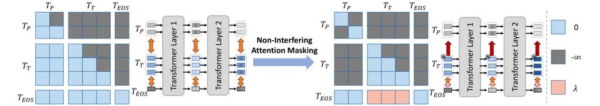
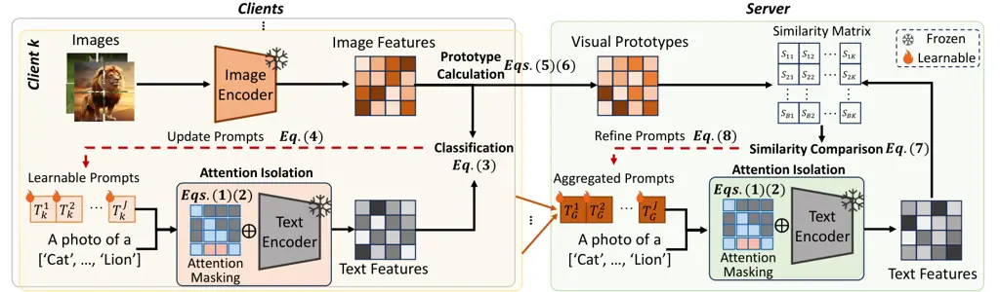
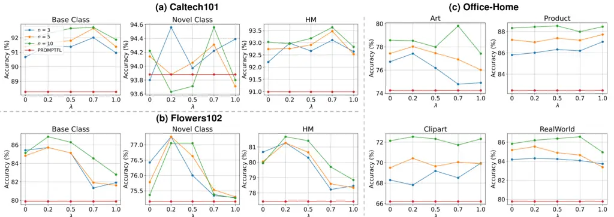
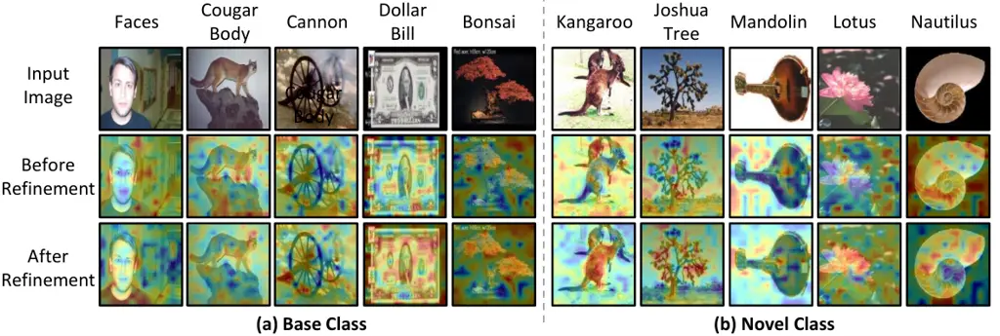
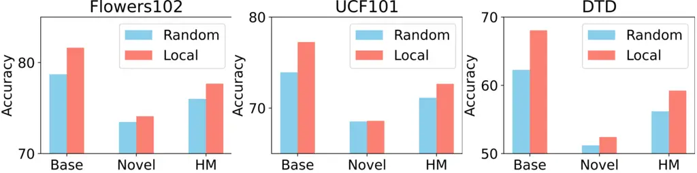
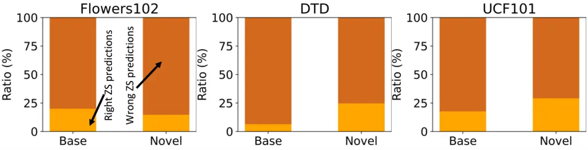
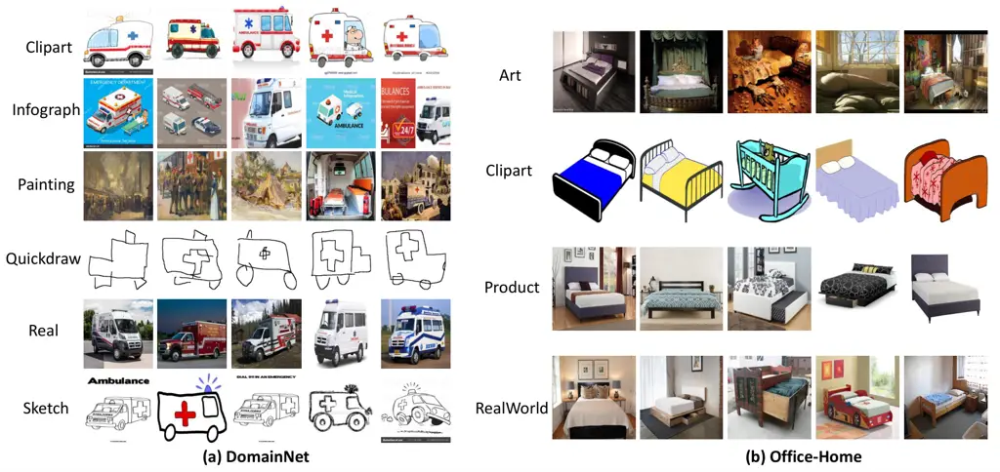

# Global Prompt Refinement with Non-Interfering Attention Masking for One-Shot Federated Learning

Zhuang Qi Affiliation: School of Software, Shandong University, China
Email: [zqi@mail.sdu.edu.cn](mailto:)    Yu Pan Affiliation: School of
Software, Shandong University, China
Email: [202100300334@mail.sdu.edu.cn](mailto:)    Lei Meng
^(†)^(†)thanks: Corresponding author Affiliation: School of Software,
Shandong University, China Email: [lmeng@sdu.edu.cn](mailto:)    Sijin
Zhou Affiliation: AIM Lab, Faculty of Engineering, Monash University,
Clayton, VIC, Australia Email: [sjzhou1995@gmail.com](mailto:)    Han Yu
Affiliation: College of Computing and Data Science, Nanyang
Technological University, Singapore Email: [han.yu@ntu.edu.sg](mailto:)
   Xiaoxiao Li Affiliation: Department of Electrical and Computer
Engineering, University of British Columbia, Canada Affiliation: Vector
Institute, Canada Email: [xiaoxiao.li@ece.ubc.ca](mailto:)    Xiangxu
Meng Affiliation: School of Software, Shandong University, China
Email: [mxx@sdu.edu.cn](mailto:)

###### Abstract

Federated Prompt Learning (FPL) enables communication-efficient
adaptation by tuning lightweight prompts on top of frozen pre-trained
models. Existing FPL methods typically rely on global information, which
is only available after the second training round, to facilitate
collaboration among client models. Therefore, they are inherently
dependent on multi-round communication to fully exhibit their strengths.
Moreover, existing one-shot federated learning methods typically focus
on fitting seen tasks, but lack cross-task generalization. To bridge
this gap, we propose the Global Prompt Refinement with Non-Interfering
Attention Masking (GPR-NIAM) method for one-shot FPL. The core idea is
to design a masking mechanism that restricts excessive interaction
between the original text embeddings and the learnable prompt
embeddings. GPR-NIAM achieves this through the collaboration of two key
modules. Firstly, the attention isolation module suppresses attention
from the learnable prompt tokens to the original text tokens, and
reweights the reverse attention which preserves generalization across
tasks. Secondly, the cross-silo collaborative refinement module
integrates decentralized visual knowledge into a unified base and
calibrates the global prompt through multi-source cross-modal knowledge
alignment, further mitigating the inconsistency caused by data
heterogeneity. Extensive experiments conducted on ten benchmark datasets
under two tasks show that GPR-NIAM outperforms eight state-of-the-art
methods in both class-level and domain-level generalization.

## 1 Introduction

Federated learning (FL) enables collaborative modeling across data
sources in a privacy-preserving manner, which has gained traction across
multiple domains \[1, 2, 3, 4, 5\]. It learns global knowledge by
aggregating model weights or gradients instead of moving data to a
central entity \[6, 7, 8, 9\]. Recently, Federated Prompt Learning (FPL)
has emerged to support parameter-efficient fine-tuning in this setting.
It not only leverages pre-trained models (e.g., CLIP \[10\]) more
effectively, but also reduces communication overhead between FL clients
and the FL server by transmitting only learnable prompts \[11, 12, 13,
14\]. However, heterogeneous data distributions across clients often
degrade model aggregation performance and slow down convergence \[15,
16\]. This is because significant differences in the update directions
across local models can cause conflicts during aggregation \[17, 18, 19,
20, 21\]. As a result, existing FPL methods still require multi-round
communications between clients and the server to reconcile
inconsistencies arising from client-specific training.

To deal with data heterogeneity, early FPL solutions (e.g., PromptFoilo
\[17\] and DP-FPL \[22\]) typically focused on incorporating global
prompt information to constrain the update direction of local prompts in
order to enhance the consistency and stability of federated optimization
\[17, 23, 22, 24\]. However, since global prompt information is
typically available only after the second communication round, these
methods inherently rely on multi-round communications. This poses a
challenge in real-world scenarios with limited communication resources.
To this end, one-shot federated learning (OSFL), which requires only a
single round of client-server interaction, offers a promising direction
for further exploration \[25, 26, 27, 28, 29\]. OSFL significantly
reduces the communication overhead by eliminating iterative exchanges,
making it attractive for real-world deployments with strict latency or
bandwidth constraints \[30, 31, 32\]. However, directly applying
existing OSFL methods to FPL settings is not suitable, as they are
typically optimized for seen tasks while neglecting the preservation of
generalization to unseen tasks.



Figure 1: An overview of the proposed GPR-NIAM method. It supports three
interaction types: full attention (0), hard masking ($`-\infty`$), and
reweighting ($`\lambda`$). Hard masking blocks learnable tokens
$`T_{P}`$ from affecting original text tokens $`T_{T}`$, while
$`\lambda`$-weighted links enable partial influence from special tokens
$`T_{EOS}`$. The upper triangular mask follows causal attention for
autoregressive decoding.

To bridge this important gap, we propose the Global Prompt Refinement
with Non-Interfering Attention Masking (GPR-NIAM) method. It prevents
the modification of the original token embeddings through a masking
mechanism, thereby preserving transferable knowledge across tasks. As
shown in Figure 1, the interaction between the learnable prompt
embeddings and the original text token embeddings is unidirectional,
which ensures that the latter remain unchanged. Specifically, GPR-NIAM
consists of two main modules. Firstly, the Attention Isolation module
selectively regulates the flow of prompt information through a novel
masking strategy. It suppresses attention from the learnable prompt
tokens to the original text tokens across all encoder layers, thereby
effectively preventing alterations to the textual input token
embeddings. In addition, it re-weights the reverse attention to
encourage the model to extract task-relevant features more effectively
from the original texts. Secondly, the cross-silo collaborative
refinement (CSCR) module leverages visual representations extracted from
multiple clients and utilizes multi-source visual supervision to refine
the global prompt in a centralized manner. This further mitigates the
negative impact of data heterogeneity.

We conduct extensive experiments on 10 datasets under two tasks: 1)
base-to-base/novel generalization and 2) leave-one-domain-out
generalization, and carry out performance comparisons, ablation studies,
in-depth analysis and case studies. The results demonstrate that
GPR-NIAM achieves superior overall performance by maintaining a strong
balance between fitting seen tasks and generalizing to unseen ones,
significantly outperforming eight competitive state-of-the-art
approaches.

## 2 Related Work

### 2.1 Federated Prompt Learning

FPL aims to integrate FL with prompt learning by freezing the backbone
model within the FL framework and introducing a set of learnable prompt
parameters \[17, 23, 22, 24, 33, 34, 35, 36\]. This enables efficient
personalization for on-device data while significantly reducing
communication overhead, as only prompt parameters are shared between
clients and the server. To mitigate the challenges posed by data
heterogeneity across clients, popular FPL methods (e.g., FedOTP \[24\],
FedPGP \[23\], PromptFolio \[17\], DP-FPL \[22\]) mostly adopt a shared
prompt paradigm. In this design, a global prompt is constructed on the
server and combined with client-specific information to improve training
stability and generalization under non-IID distributions. However, these
methods are essentially designed for multi-round communications and
require access to global feedback, which limits their effectiveness in
one-shot FL scenarios.

### 2.2 One-Shot Federated Learning

OSFL is a communication-efficient variant of federated learning, where
model training is completed within a single round of client-server
interaction \[25, 26, 37, 27, 28, 38, 39, 40, 41, 42\]. Recent studies
on OSFL mainly focus on generative and ensemble-based approaches. The
former employs generative models to synthesize proxy data or
representations on the server. For example, FedCVAE \[41\] uses a
variational autoencoder to compress local knowledge. FedDISC \[28\] and
FedDEO \[38\] leverage diffusion models to generate synthetic training
data. The latter is dedicated to refining the fusion of model
predictions from different clients. For example, FedOV \[27\] introduces
an open-set recognition-based voting mechanism to address label skew in
OSFL; IntactOFL \[26\] learns weighted or expert-based combinations to
enhance overall performance. However, these methods are only designed
for conventional tasks, aiming to fit the training objective while
overlooking the preservation of cross-task generalization.

## 3 Preliminaries

Suppose there are $`K`$ clients denoted by
$`\mathcal{C}=\{C_{1},C_{2},\dots,C_{K}\}`$, and each client
$`C_{k}\in\mathcal{C}`$ holds a private dataset $`\mathcal{D}_{k}`$. The
goal of traditional FL is to collaboratively train a global model $`f`$
by minimizing the objective:
$`\min_{f}\sum_{k=1}^{K}p_{k}\cdot\mathcal{L}(f,\mathcal{D}_{k})`$,
where
$`p_{k}=\frac{|\mathcal{D}_{k}|}{\sum_{j=1}^{K}|\mathcal{D}_{j}|}`$ is
the weight of client $`k`$, and $`\mathcal{L}(\cdot)`$ is a
task-specific loss function \[43, 44, 45, 46\]. In FPL, each client
$`k`$ optimizes a set of learnable prompts $`\delta_{k}`$ using its
private dataset $`\mathcal{D}_{k}`$, while keeping the backbone model
$`f`$ frozen:
$`\min_{\delta_{k}}\mathcal{L}(f;\delta_{k},\mathcal{D}_{k})`$. To
support class-level prediction, the prompt for class $`c`$ is
constructed by concatenating the learnable prompt and a fixed class
token. Specifically, let
$`\mathbf{p}_{c}\in\mathbb{R}^{N_{t}\times d_{t}}`$ denote the class
token for class $`c`$, and
$`\delta_{k}\in\mathbb{R}^{N_{p}\times d_{t}}`$ denote the learnable
prompt from client $`k`$, where $`N_{t}`$ and $`N_{p}`$ are the lengths
of the fixed and learnable prompts, $`d_{t}`$ is the dimension of hidden
embedding, respectively. The full prompt can be formed as
$`P_{c}^{(k)}=[\delta_{k};\mathbf{p}_{c}]`$. The text feature for class
$`c`$ is computed by feeding the prompt into a text encoder
$`\mathcal{T}(\cdot)`$: $`\mathbf{f}_{t}^{c}=\mathcal{T}(P_{c}^{(k)})`$.
Given an input image $`\mathbf{x}`$, the image feature is extracted by
the frozen image encoder $`f`$: $`\mathbf{f}_{v}=f(\mathbf{x})`$. The
similarity score between the image and class-$`c`$ textual features is
calculated as
$`\rho_{c}=\operatorname{Cosine}(\mathbf{f}_{t}^{c},\mathbf{f}_{v})`$,
and the prediction probability is computed via softmax over
similarities:
$`p(\hat{y}=c\mid\mathbf{x})=\frac{\exp(\rho_{c}/\tau)}{\sum_{j=1}^{K}\exp(\rho_{j}/\tau)}`$.
The training objective is the cross-entropy loss between the
similarity-based prediction and the ground-truth label:
$`\mathcal{L}_{\text{ce}}=\ell(\boldsymbol{\rho},\mathbf{e}_{y})`$,
where $`\boldsymbol{\rho}=[\rho_{1},\dots,\rho_{K}]`$,
$`\mathbf{e}_{y}`$ is the one-hot label vector, and $`\ell`$ denotes the
cross-entropy loss function. After local training, client $`C_{k}`$
uploads its learned prompt $`\delta_{k}`$ to the server. The server then
aggregates the local prompts $`\{\delta_{k}\}_{k=1}^{K}`$ to construct a
global prompt $`\delta_{g}`$, typically by weighted averaging:
$`\delta_{g}=\sum_{k=1}^{K}p_{k}\cdot\delta_{k}`$.

## 4 The Proposed GPR-NIAM Method

In this section, we propose the non-interfering attention masking method
for one-shot federated prompt learning, called GPR-NIAM. Its core idea
is to preserve the transferable knowledge by reducing the influence of
learnable prompt tokens on the input text tokens, as illustrated in
Figure 2.

### 4.1 The Attention Isolation (AttnIso) Module

Prompt tuning typically focuses on fitting local training tasks.
However, data heterogeneity often leads to divergent optimization across
clients and weakens its cross-task generalization. To address this, the
AttnIso module designs attention masks to selectively block the
information flow from learnable prompt tokens to original text tokens
(e.g. “a photo of a \[CLASS\]”). We denote the text attention matrix as
$`M\in\mathbb{R}^{(1+N_{p}+N_{t})*(1+N_{p}+N_{t})}`$, where $`N_{p}`$ is
the number of learnable prompts, $`N_{t}`$ is the length of input
textual feature tokens. The additional 1 corresponds to the \[EOS\]
token. In addition, we apply customized attention control for the
\[EOS\] token to ensure proper aggregation of contextual information
from both the prompt and the input tokens.

To achieve the above goal, the text attention matrix $`M`$ can be
formulated as follows,

```math
M^{i,j}=\begin{cases}-\infty,&\begin{aligned} &\text{if }i\in[1,N_{p}]\land j\in[N_{p}+1,N_{p}+N_{t}]\quad&\\
&\text{or }i\in[N_{p}+1,N_{p}+N_{t}]\land j\in[1,N_{p}]\quad&\\
&\text{or }j=N_{p}+N_{t}+1\quad&\end{aligned}\quad\text{(Hard Masking)}\\
\lambda,&\text{if }i=N_{p}+N_{t}+1\land j\in[N_{p}+1,N_{p}+N_{t}]\quad\text{(Reweighting)}\\
0,&\text{otherwise}\quad\quad\quad\quad\quad\quad\quad\quad\quad\quad\quad\quad\quad\quad\quad\text{(Full Attention)}\end{cases} \tag{1}
```

where $`M^{i,j}`$ denotes the $`i`$-th row and $`j`$-th column element
of $`M`$, and $`\land`$ denotes logical AND. Moreover, to integrate the
attention mask $`M`$ into the text encoder $`\mathcal{T}`$, we replace
the original computation with the following:

```math
\begin{aligned} \mathbf{y}^{(l+1)}=\mathcal{T}_{l+1}(\mathbf{y}^{(l)},&M)=\text{Concat}(h_{1},h_{2},\dots,h_{H})W^{O}=[\tilde{p}_{l+1}^{1},\dots,\tilde{p}_{l+1}^{N_{p}},\tilde{t}_{l+1}^{1},\dots,\tilde{t}_{l+1}^{N_{t}},\tilde{s}_{l+1}^{\text{eos}}],\\
&\text{where }h_{i}=\operatorname{softmax}\left(\frac{Q_{i}K_{i}^{T}}{\sqrt{d_{k}}}+M\right)V_{i},\quad i=1,\dots,H\end{aligned} \tag{2}
```

where $`\mathbf{y}^{(l)}\in\mathbb{R}^{(N_{p}+N_{t}+1)\times d_{t}}`$
and $`\mathbf{y}^{(l+1)}\in\mathbb{R}^{(N_{p}+N_{t}+1)\times d_{t}}`$
are the input and output of the $`(l+1)`$-th encoder layer.
$`\tilde{p}_{l+1}^{i}`$, $`\tilde{t}_{l+1}^{j}`$, and
$`\tilde{s}_{l+1}^{\text{eos}}`$ represent the output embeddings of the
$`i`$-th prompt token, the $`j`$-th text token, and the \[EOS\] token,
respectively.
$`Q_{i},K_{i},V_{i}\in\mathbb{R}^{(N_{p}+N_{t}+1)\times d_{k}}`$ are the
query, key, and value matrices for the $`i`$-th attention head,
$`d_{k}=d_{t}/H`$ denotes the hidden dimension of each attention head.
$`\text{Concat}(h_{1},\dots,h_{H})\in\mathbb{R}^{(N_{p}+N_{t}+1)\times Hd_{k}}`$
denotes the concatenated outputs of all heads, and
$`W^{O}\in\mathbb{R}^{Hd_{k}\times d_{t}}`$ is the output projection
matrix mapping the result back to $`d_{t}`$. Following the masked
encoding process, we obtain the final output of the text encoder as:
$`\mathbf{y}^{(L)}=[\tilde{p}_{L}^{1},\dots,\tilde{p}_{L}^{N_{p}},\tilde{t}_{L}^{1},\dots,\tilde{t}_{L}^{N_{t}},\tilde{s}_{L}^{\text{eos}}]`$.
Afterwards, $`\tilde{s}_{L}^{\text{eos}}`$ is projected into a shared
embedding space via a pre-trained head $`H_{t}(\cdot)`$. On the visual
side, the input image $`\mathbf{x}`$ is encoded by a frozen vision
encoder $`f(\cdot)`$ to obtain the visual representation. Overall, it
focuses on minimizing the objective:

```math
\min_{\delta_{1},\dots,\delta_{K}}\sum_{k=1}^{K}\frac{|\mathcal{D}_{k}|}{|\mathcal{D}|}\cdot\mathbb{E}_{(\mathbf{x},y)\sim\mathcal{D}_{k}}\left[-\log\left(\frac{\exp\left(\operatorname{sim}\left(f_{v}(\mathbf{x}),H_{t}\left(\tilde{s}^{(y)}_{L,k}\right)\right)\right)}{\sum_{c=1}^{C}\exp\left(\operatorname{sim}\left(f_{v}(\mathbf{x}),H_{t}\left(\tilde{s}^{(c)}_{L,k}\right)\right)\right)}\right)\right], \tag{3}
```

where $`\tilde{s}^{(c)}_{L,k}`$ denotes client $`k`$’s \[EOS\] embedding
for class $`c`$, $`\operatorname{sim}(\cdot,\cdot)`$ denotes cosine
similarity function. The learnable prompts can be optimized by gradient
descent in all clients:

```math
\delta_{k}\leftarrow\delta_{k}-\eta\cdot\frac{1}{|\mathcal{B}_{k}|}\sum_{(\mathbf{x},y)\in\mathcal{B}_{k}}\nabla_{\delta_{k}}\left[-\log\left(\frac{\exp\left(\operatorname{sim}\left(f_{v}(\mathbf{x}),H_{t}\left(\tilde{s}^{(y)}_{L,k}\right)\right)\right)}{\sum_{c=1}^{C}\exp\left(\operatorname{sim}\left(f_{v}(\mathbf{x}),H_{t}\left(\tilde{s}^{(c)}_{L,k}\right)\right)\right)}\right)\right],\hskip 10.00002pt\forall k\in[K], \tag{4}
```

where $`\eta`$ denotes the learning rate, $`\mathcal{B}_{k}`$ is a batch
data.



Figure 2: Illustration of the GPR-NIAM framework. The Attention
Isolation module preserves the original text embeddings to reduce the
forgetting of generalized knowledge. The global prompt is refined using
visual prototypes from all clients to mitigate data heterogeneity.

### 4.2 Cross-Silo Collaborative Refinement (CSCR) Module

To further alleviate the inconsistency caused by data heterogeneity, the
CSCR module calibrates the global prompt through prototype-guided
refinement across clients. To support this, each client $`C_{k}`$
extracts class-wise visual prototypes from its local dataset
$`\mathcal{D}_{k}`$. For class $`c`$, the prototype is computed as a
randomly weighted average of the feature vectors from local samples in
that class:

```math
f_{v,k}^{c}=\sum_{\mathbf{x}\in\mathcal{D}_{k}^{c}}\alpha_{\mathbf{x}}\cdot f_{v}(\mathbf{x}),\hskip 10.00002pt\text{where }\sum_{\mathbf{x}\in\mathcal{D}_{k}^{c}}\alpha_{\mathbf{x}}=1,\;\alpha_{\mathbf{x}}\sim\mathcal{U}(0,1). \tag{5}
```

where $`\alpha_{\mathbf{x}}`$ denotes a random weight for each sample
$`\mathbf{x}`$ in class $`c`$, drawn from a uniform distribution and
normalized to ensure the weights sum to 1. Notably, we can randomly
sample the weight vector $`n`$ times to generate multiple diverse
prototypes per class
$`\mathbf{P}_{k}^{c}=\left[f_{v,k}^{c,1},f_{v,k}^{c,2},\dots,f_{v,k}^{c,n}\right]`$,
which enhances representational diversity, which differs from existing
methods \[47, 48, 49, 50, 51\]. $`f_{v,k}^{c,i}`$ denotes $`i`$-th
visual prototypes of class $`c`$ in client $`k`$. Afterwards, each
client $`C_{k}`$ sends
$`\mathbf{P}_{k}=\{\mathbf{P}_{k}^{1},\dots,\mathbf{P}_{k}^{N}\}`$ to
the server, which aggregates all received prototypes into a global pool
$`\mathcal{P}`$:

```math
\mathcal{P}=\bigcup_{k=1}^{K}\mathbf{P}_{k}=\left\{\mathbf{P}_{k}^{c}\mid k\in[K],\;c\in[n]\right\}, \tag{6}
```

To calibrate the global prompt $`\delta_{g}`$, we leverage the global
prototype pool $`\mathcal{P}=\{\mathcal{P}^{1},\dots,\mathcal{P}^{C}\}`$
and enforce the alignment between textual representations and visual
prototypes via a class-level contrastive objective. Specifically, we
design the following loss function:

```math
\min_{\delta_{g}}-\frac{1}{|\mathcal{P}|}\sum_{f\in\mathcal{P}}\log\sigma\left(\operatorname{sim}\left(f,\;H_{t}(\mathcal{T}(\delta_{g},\text{t}_{c}))\right)-\log\sum_{j=1}^{C}\exp\left(\operatorname{sim}\left(f,\;H_{t}(\mathcal{T}(\delta_{g},\text{t}_{j}))\right)\right)\right), \tag{7}
```

where $`\sigma(\cdot)`$ is the sigmoid function, $`\text{t}_{c}`$
denotes ’a photo of c-th classname’. We then follow the gradient descent
method to obtain the optimal parameters:

```math
\delta_{g}\leftarrow\delta_{g}-\eta\cdot\frac{1}{|\mathcal{P}|}\sum_{(f,c)\in\mathcal{P}}\nabla_{\delta_{g}}\log\sigma\left(\operatorname{sim}\left(f,\;H_{t}(\mathcal{T}(\delta_{g},\text{t}_{c}))\right)-\log\sum_{j=1}^{C}\exp\left(\operatorname{sim}\left(f,\;H_{t}(\mathcal{T}(\delta_{g},\text{t}_{j}))\right)\right)\right), \tag{8}
```

where the global prompt $`\delta_{g}`$ is initialized as the weighted
average of all client-specific prompts (i.e.,
$`\delta_{g}\leftarrow\sum_{k=1}^{K}\frac{|\mathcal{D}_{k}|}{|\mathcal{D}|}\cdot\delta_{k}`$),
and $`\eta`$ is a learning rate.

### 4.3 Training Procedure

In this section, we provide the detailed training procedure of GPR-NIAM
in Algorithm 1. As a two-stage optimization strategy, GPR-NIAM consists
of a local prompt tuning phase and a global prompt refinement phase.
Notably, it can be easily integrated into multiple prompt learning
methods such as CoOp and TCP. In the first stage, each client
initializes its local prompt from the global prompt and updates it on
private data with masked attention learning. Simultaneously, class-wise
visual prototypes are obtained by performing randomly weighted
aggregation over local feature representations. Subsequently, the global
prompt is optimized to align with all class prototypes in this pool via
cross-silo collaborative retraining. With the two-stage design, GPR-NIAM
alleviates the challenges posed by heterogeneous client data and
promotes the retention of transferable knowledge for unseen tasks.

Moreover, the local prompt tuning stage is optional. Firstly, this stage
provides a more meaningful initialization for the global prompt by
adapting it to all clients data. Secondly, it generates class-wise
visual prototypes to guide global refinement. While the framework can
still perform global refinement without this phase, since it does not
affect prototype modeling, omitting it might result in less effective
initialization and slightly limit the overall refinement performance.

1:  Initialize the global prompt parameter $`\delta^{0}`$

2:  // Local Prompt Tuning Stage

3:  for each client $`C_{k}\in\mathcal{C}`$ in parallel do

4:   Initialize local prompt parameter $`\delta_{k}=\delta^{0}`$

5:   for $`e=1,\dots,E`$ do

6:    Sample a mini-batch $`\zeta`$ from local data $`\mathcal{D}_{k}`$

7:    Update local prompt $`\delta_{k}`$ using masked attention by
Eq. (4)

8:   end for

9:   Compute visual prototype features for each class using Eq. (5)

10:  end for

11:  // Global Prompt Refinement Stage

12:  Aggregate all visual prototypes to form a global prototype pool
$`\mathcal{P}`$ by Eq. (6)

13:  for $`e^{\prime}=1,\dots,E^{{}^{\prime}}`$ do

14:   Sample a mini-batch of prototypes $`\zeta^{{}^{\prime}}`$ from
$`\mathcal{P}`$

15:   Update global prompt $`\delta_{g}`$ via prototype-guided alignment
using Eq. (8)

16:  end for

Algorithm 1 GPR-NIAM

## 5 Experimental Evaluation

### 5.1 Experiment Settings

##### Datasets

Following existing works \[17, 52\], experiments are conducted on
CIFAR10 \[53\], OxfordPets \[54\], Caltech101 \[55\], DTD \[56\],
FGVCAircraft \[57\], Flowers102 \[58\], StanfordCars \[59\], and UCF101
\[60\] to evaluate base-to-base/novel generalization, and on Office-Home
\[61\] and DomainNet \[62\] to assess leave-one-domain-out
generalization. Their statistics are shown in Table 5.

##### Evaluation Metrics

Following studies \[47, 49, 63\], we report the Top-1 Accuracy (Acc)
results. For base-to-base/novel generalization tasks, we also compute
the harmonic mean
($`\text{HM}=\frac{2\cdot\text{Acc}_{\text{base}}\cdot\text{Acc}_{\text{novel}}}{\text{Acc}_{\text{base}}+\text{Acc}_{\text{novel}}}`$)
of accuracy on base ($`\text{Acc}_{\text{base}}`$) and novel classes
($`\text{Acc}_{\text{novel}}`$) to evaluate overall performance.

| (a) Average over 8 datasets |       |       |       | (b) CIFAR10      |       |       |       | (c) OxfordPets   |       |       |       |
| --------------------------- | ----- | ----- | ----- | ---------------- | ----- | ----- | ----- | ---------------- | ----- | ----- | ----- |
| Method                      | Base  | Novel | HM    | Method           | Base  | Novel | HM    | Method           | Base  | Novel | HM    |
| CLIP                        | 65.79 | 74.32 | 69.70 | CLIP             | 95.30 | 95.50 | 95.39 | CLIP             | 81.53 | 95.33 | 87.89 |
| PromptFL                    | 72.57 | 72.80 | 72.64 | PromptFL         | 95.14 | 96.26 | 95.69 | PromptFL         | 91.31 | 93.70 | 92.48 |
| RPO                         | 70.52 | 73.63 | 71.99 | RPO              | 95.68 | 94.74 | 95.20 | RPO              | 89.00 | 95.49 | 92.13 |
| FedTPG                      | 70.46 | 73.09 | 71.69 | FedTPG           | 95.38 | 96.56 | 95.96 | FedTPG           | 91.66 | 95.13 | 93.36 |
| TCP                         | 72.46 | 74.60 | 73.41 | TCP              | 95.68 | 96.52 | 96.09 | TCP              | 90.01 | 95.39 | 92.62 |
| PromptFolio                 | 73.25 | 73.35 | 73.15 | PromptFolio      | 96.04 | 96.16 | 96.06 | PromptFolio      | 91.13 | 96.10 | 93.54 |
| DP-FPL                      | 71.90 | 71.75 | 69.88 | DP-FPL           | 95.42 | 95.18 | 95.29 | DP-FPL           | 91.97 | 94.80 | 93.36 |
| FedDISC                     | 56.43 | 54.84 | 53.87 | FedDISC          | 94.30 | 92.82 | 93.55 | FedDISC          | 83.83 | 72.07 | 77.50 |
| FedELMY                     | 76.62 | 48.23 | 60.03 | FedELMY          | 95.32 | 40.00 | 79.66 | FedELMY          | 89.28 | 76.47 | 82.38 |
| GPR-NIAM\_(P)               | 75.56 | 73.28 | 74.24 | GPR-NIAM\_(P)    | 95.66 | 97.00 | 96.32 | GPR-NIAM\_(P)    | 91.18 | 95.89 | 93.47 |
| GPR-NIAM\_(T)               | 76.43 | 74.48 | 75.30 | GPR-NIAM\_(T)    | 95.84 | 96.48 | 96.15 | GPR-NIAM\_(T)    | 92.48 | 95.14 | 93.79 |
| (d) Caltech101              |       |       |       | (e) DTD          |       |       |       | (f) FGVCAircraft |       |       |       |
| Method                      | Base  | Novel | HM    | Method           | Base  | Novel | HM    | Method           | Base  | Novel | HM    |
| CLIP                        | 82.27 | 94.05 | 87.77 | CLIP             | 53.35 | 59.05 | 56.06 | CLIP             | 26.51 | 31.21 | 28.67 |
| PromptFL                    | 88.27 | 93.88 | 90.99 | PromptFL         | 60.06 | 53.86 | 56.79 | PromptFL         | 31.19 | 30.91 | 31.05 |
| RPO                         | 89.90 | 93.80 | 91.81 | RPO              | 54.62 | 59.17 | 56.81 | RPO              | 29.27 | 30.43 | 29.84 |
| FedTPG                      | 89.12 | 92.61 | 90.83 | FedTPG           | 56.71 | 55.43 | 56.06 | FedTPG           | 29.57 | 30.25 | 29.90 |
| TCP                         | 88.20 | 95.33 | 91.62 | TCP              | 61.68 | 55.48 | 58.41 | TCP              | 30.77 | 32.71 | 31.71 |
| PromptFolio                 | 87.28 | 93.12 | 90.10 | PromptFolio      | 61.11 | 54.58 | 57.66 | PromptFolio      | 31.37 | 32.39 | 31.87 |
| DP-FPL                      | 87.92 | 93.46 | 90.60 | DP-FPL           | 62.26 | 49.63 | 55.24 | DP-FPL           | 28.85 | 28.15 | 28.49 |
| FedDISC                     | 44.75 | 85.22 | 58.68 | FedDISC          | 71.52 | 38.28 | 49.87 | FedDISC          | 20.87 | 13.20 | 16.17 |
| FedELMY                     | 87.71 | 89.21 | 88.45 | FedELMY          | 70.13 | 16.18 | 26.29 | FedELMY          | 33.77 | 19.48 | 24.70 |
| GPR-NIAM\_(P)               | 91.59 | 94.22 | 92.89 | GPR-NIAM\_(P)    | 68.40 | 53.50 | 60.04 | GPR-NIAM\_(P)    | 30.95 | 29.41 | 30.16 |
| GPR-NIAM\_(T)               | 92.65 | 94.73 | 93.68 | GPR-NIAM\_(T)    | 69.90 | 55.91 | 62.13 | GPR-NIAM\_(T)    | 32.15 | 31.12 | 31.62 |
| (g) Flowers102              |       |       |       | (h) StanfordCars |       |       |       | (i) UCF101       |       |       |       |
| Method                      | Base  | Novel | HM    | Method           | Base  | Novel | HM    | Method           | Base  | Novel | HM    |
| CLIP                        | 62.39 | 78.10 | 69.36 | CLIP             | 56.87 | 69.40 | 62.51 | CLIP             | 68.12 | 71.92 | 69.97 |
| PromptFL                    | 79.88 | 75.15 | 77.44 | PromptFL         | 62.96 | 67.30 | 65.02 | PromptFL         | 71.82 | 71.55 | 71.68 |
| RPO                         | 74.92 | 76.21 | 75.56 | RPO              | 58.64 | 68.73 | 63.29 | RPO              | 72.19 | 70.49 | 71.33 |
| FedTPG                      | 72.30 | 77.26 | 74.70 | FedTPG           | 58.67 | 69.78 | 63.74 | FedTPG           | 70.34 | 67.74 | 69.01 |
| TCP                         | 77.25 | 78.73 | 77.98 | TCP              | 60.19 | 71.18 | 65.22 | TCP              | 75.93 | 71.52 | 73.65 |
| PromptFolio                 | 81.04 | 74.51 | 77.63 | PromptFolio      | 61.22 | 69.91 | 65.27 | PromptFolio      | 76.88 | 69.75 | 73.14 |
| DP-FPL                      | 74.63 | 77.26 | 75.92 | DP-FPL           | 59.07 | 66.05 | 62.36 | DP-FPL           | 75.14 | 69.49 | 72.20 |
| FedDISC                     | 24.95 | 32.21 | 28.11 | FedDISC          | 42.77 | 49.92 | 46.07 | FedDISC          | 68.49 | 55.03 | 61.03 |
| FedELMY                     | 89.79 | 55.15 | 68.33 | FedELMY          | 67.09 | 47.97 | 55.94 | FedELMY          | 79.94 | 41.41 | 54.56 |
| GPR-NIAM\_(P)               | 84.54 | 78.52 | 81.42 | GPR-NIAM\_(P)    | 63.59 | 67.48 | 65.48 | GPR-NIAM\_(P)    | 78.57 | 70.28 | 74.19 |
| GPR-NIAM\_(T)               | 86.88 | 77.05 | 81.67 | GPR-NIAM\_(T)    | 63.54 | 69.18 | 66.24 | GPR-NIAM\_(T)    | 78.04 | 76.27 | 77.14 |

Table 1: Performance comparison between GPR-NIAM and baselines on 8
datasets with $`\beta=0.5`$ in the base-to-base/novel generalization
cases.

##### Implementation Details

In all experiments, we set local training and global refinement epochs
to 10, using the SGD optimizer with a learning rate of 0.001, a weight
decay of 0.001, and a batch size of 32. The number of communication
rounds is 1. We simulate 50 clients for CIFAR-10 and 10 clients for
other datasets in base-to-base/novel generalization, while using 9
clients for Office-Home and 15 for DomainNet. To simulate non-IID data,
we adopt a Dirichlet distribution with parameter $`\beta=0.5`$. Each
client generates $`n\in\{5,10,20\}`$ visual prototypes per class, and
the reweighting parameter $`\lambda`$ is selected from
$`\{0.2,0.5,0.7,1.0\}`$. More details and results can be found in the
Appendix. And each client has one NVIDIA RTX 3090 with 24 GB GPU for
training.

### 5.2 Results and Discussion

This section compares GPR-NIAM-enhanced variants (GPR-NIAM*(P) and
GPR-NIAM*(T), derived by integrating GPR-NIAM into PromptFL and TCP,
respectively) with nine baselines: Zero-Shot CLIP \[10\] with
hand-crafted text prompt template, e.g., “a photo of a \[class\]”
\[64\], PromptFL \[65\], RPO \[66\], FedTPG \[52\], TCP \[67\],
PromptFolio \[17\], DP-FPL \[22\], FedDISC \[28\], FedELMY \[42\]. For
fair comparison, all methods use the same backbone: a frozen CLIP with
ViT-B16 \[10\]. Following prior work, the learnable prompt is a
$`10\times 512`$ parameter matrix, with 10 prompt tokens and a
512-dimensional embedding.

Base-to-Base/Novel Generalization. We evaluate the generalization
capability of GPR-NIAM by comparing its performance on base and novel
classes, and the overall harmonic mean (HM) across all benchmarks. The
results are presented in Table 1 and key observations are summarized as
follows:

- •
  GPR-NIAM attains second-best performance on base classes among all
  methods, showing particular competitiveness against FedMLEY while
  maintaining more balanced capabilities across all classes.
- •
  GPR-NIAM yields competitive performance on novel classes. Notably, it
  ranks first on Flowers102 and UCF101, underscoring its strong
  generalization capability to unseen tasks. Moreover, FedDISC may fail
  on both base and novel classes due to inevitable gaps between
  synthetic and real samples.
- •
  Benefiting from the synergy of attention masking and cross-silo
  collaborative retraining, GPR-NIAM achieves the best HM scores across
  all benchmarks.

|               |             |         |         |           |         |           |           |          |           |       |        |         |
| ------------- | ----------- | ------- | ------- | --------- | ------- | --------- | --------- | -------- | --------- | ----- | ------ | ------- |
| Method        | Office-Home |         |         |           |         | DomainNet |           |          |           |       |        |         |
|               | Art         | Clipart | Product | RealWorld | Average | Clipart   | Infograph | Painting | Quickdraw | Real  | Sketch | Average |
| CLIP          | 74.57       | 62.33   | 80.17   | 79.38     | 74.08   | 92.87     | 77.02     | 85.35    | 43.06     | 98.61 | 94.22  | 81.85   |
| PromptFL      | 74.24       | 66.20   | 82.47   | 79.77     | 75.17   | 93.87     | 80.82     | 87.76    | 49.47     | 98.72 | 94.82  | 84.24   |
| RPO           | 74.86       | 64.33   | 84.31   | 80.74     | 76.06   | 93.53     | 78.32     | 86.15    | 49.35     | 98.83 | 94.87  | 83.50   |
| FedTPG        | 74.04       | 64.55   | 83.32   | 80.01     | 75.48   | 95.14     | 80.93     | 88.25    | 52.89     | 98.97 | 95.40  | 85.26   |
| TCP           | 75.31       | 66.20   | 83.17   | 80.97     | 76.41   | 94.13     | 79.80     | 88.05    | 45.85     | 98.80 | 95.34  | 83.66   |
| PromptFolio   | 77.21       | 67.74   | 84.74   | 81.98     | 77.92   | 94.87     | 81.19     | 88.61    | 47.59     | 98.85 | 95.02  | 84.35   |
| DP-FPL        | 75.03       | 65.91   | 83.71   | 79.82     | 76.12   | 95.03     | 78.41     | 86.74    | 54.03     | 98.83 | 94.85  | 84.64   |
| FedDISC       | 72.27       | 65.40   | 81.77   | 79.11     | 74.63   | 93.82     | 80.42     | 86.17    | 43.74     | 98.66 | 94.05  | 82.81   |
| FedELMY       | 75.11       | 66.34   | 84.12   | 79.69     | 76.31   | 94.21     | 77.65     | 86.81    | 48.78     | 98.83 | 94.88  | 83.53   |
| GPR-NIAM\_(P) | 78.32       | 71.40   | 87.61   | 84.96     | 80.57   | 94.72     | 80.13     | 88.70    | 56.98     | 99.18 | 94.88  | 85.76   |
| GPR-NIAM\_(T) | 79.39       | 72.06   | 88.03   | 85.49     | 81.24   | 95.03     | 80.82     | 87.92    | 56.32     | 99.08 | 95.60  | 85.79   |

Table 2: Performance comparison on Office-Home and DomainNet under the
leave-one-domain-out setting, with each domain’s data randomly split
across 3 clients.

Leave-One-Domain-Out Generalization. Table 2 presents the domain
generalization results under a leave-one-domain-out setting. The main
findings are summarized below:

- •
  GPR-NIAM consistently achieve the highest average accuracy across most
  domains. Notably, GPR-NIAM\_(T) ranks first in 9 out of 12 domains,
  highlighting its strength in cross-domain generalization, especially
  in challenging cases like Infograph and Quickdraw.
- •
  By combining token-level and client-level perspectives, GPR-NIAM
  outperforms single-view methods such as PromptFL and FedTPG, which
  benefits from attention masking for preserving original semantics and
  a unified global prompt for cross-domain knowledge integration.

### 5.3 Ablation Study

This section presents an ablation study to examine the effects of key
components in GPR-NIAM, including the Attention Isolation (AttnIso)
module and the Cross-Silo Collaborative Retraining (CSCR) module. The
results are reported in Table 3.

- •
  Different configurations of the AttnIso module exhibit distinct
  strengths. Hard masking (AttnIso$`{}_{\text{HA}}`$) effectively
  suppresses token interference and enhances novel-class generalization,
  while reweighting (AttnIso$`{}_{\text{RE}}`$) provides a more stable
  improvement. Their combination leads to improved overall
  generalization, showing that the two strategies are complementary.
- •
  The CSCR module plays a vital role in optimizing base-class
  performance by learning a unified prompt that mitigates inter-client
  discrepancies, which can alleviate the negative impact of data
  heterogeneity. However, its contribution to novel-class generalization
  remains limited due to insufficient adaptability to unseen categories.
- •
  By integrating both modules, GPR-NIAM achieves an optimal balance
  between acquiring new knowledge and preserving generalization.
  Importantly, this also suggests a promising direction for future work
  by combining complementary strategies rather than relying on a single
  one.

| Method                                | Base to Base/Novel Generalization |       |       | Leave-One-Domain-Out Generalization |           |
| ------------------------------------- | --------------------------------- | ----- | ----- | ----------------------------------- | --------- |
|                                       | Base                              | Novel | HM    | Office-Home                         | DomainNet |
| PromptFL                              | 64.06                             | 71.48 | 66.98 | 75.17                               | 84.24     |
| + AttnIso$`{}_{\text{HA}}`$           | 62.19                             | 72.27 | 67.04 | 77.26                               | 84.87     |
| + AttnIso$`{}_{\text{RE}}`$           | 64.22                             | 71.51 | 67.76 | 75.67                               | 84.36     |
| + AttnIso$`{}_{\text{HA+RE}}`$        | 64.11                             | 72.66 | 67.87 | 77.83                               | 85.01     |
| + CSCR                                | 73.34                             | 64.89 | 67.24 | 78.59                               | 85.11     |
| + AttnIso$`{}_{\text{HA}}`$ + CSCR    | 69.32                             | 70.78 | 70.06 | 79.13                               | 85.46     |
| + AttnIso$`{}_{\text{RE}}`$ + CSCR    | 70.56                             | 68.11 | 69.65 | 78.42                               | 85.23     |
| + AttnIso$`{}_{\text{HA+RE}}`$ + CSCR | 72.32                             | 69.47 | 70.72 | 80.57                               | 85.76     |

Table 3: Ablation results averaged over 8 datasets (base-to-base/novel
generalization) and across all domains (leave-one-domain-out
generalization).



Figure 3: The impact of hyperparameters on performance is evaluated by
varying $`\lambda`$ from $`\{0,0.2,0.5,0.7,1.0\}`$, the number of
prototypes per class $`n`$ from $`\{3,5,10\}`$ on three datasets.

### 5.4 Sensitivity Analysis

This section evaluates the robustness of GPR-NIAM across varying
hyperparameter settings on the DTD, Flowers102 and Office-Home datasets.
Specifically, we investigate the effects of hyperparameters $`n`$ (the
number of prototypes generated per class on the client side) and
$`\lambda`$ (the weighting factor in the AttnIso module), evaluated over
$`\{3,5,10\}`$ and $`\{0,0.2,0.5,0.7,1.0\}`$, respectively. As depicted
in Figure 3, GPR-NIAM consistently achieves higher overall HM scores
than its baselines in all cases of the base-to-base/novel generalization
task, showcasing its superior balance between retaining transferable
knowledge and learning task-specific knowledge. On the one hand,
GPR-NIAM demonstrates consistent improvements over baselines on base
classes, which benefits from the CSCR module’s capacity to alleviate
data heterogeneity. On the other hand GPR-NIAM exhibits competitive
performance on novel-class generalization, frequently outperforming
other methods, which is attributed to the attention masking mechanism of
the AttnIso module. Furthermore, in the Leave-One-Domain-Out
Generalization task, similar conclusions are drawn, as GPR-NIAM
outperforms the baseline across multiple domains.

### 5.5 Performance Comparison across Different Local Training Epoch Settings

| (a) DTD (Epochs=1)        |       |       |       | (b) DTD (Epochs=5)        |       |       |       | (c) DTD (Epochs=20)        |       |       |       |
| ------------------------- | ----- | ----- | ----- | ------------------------- | ----- | ----- | ----- | -------------------------- | ----- | ----- | ----- |
| Method                    | Base  | Novel | HM    | Method                    | Base  | Novel | HM    | Method                     | Base  | Novel | HM    |
| CLIP                      | 53.35 | 59.05 | 56.06 | CLIP                      | 53.35 | 59.05 | 56.06 | CLIP                       | 53.35 | 59.05 | 56.06 |
| PromptFL                  | 50.34 | 51.69 | 51.01 | PromptFL                  | 55.55 | 56.76 | 56.15 | PromptFL                   | 63.31 | 51.08 | 56.54 |
| RPO                       | 52.77 | 59.42 | 55.90 | RPO                       | 53.24 | 59.78 | 56.32 | RPO                        | 53.93 | 60.26 | 56.92 |
| FedTPG                    | 40.27 | 36.47 | 38.28 | FedTPG                    | 49.88 | 47.22 | 48.51 | FedTPG                     | 56.25 | 56.28 | 56.26 |
| TCP                       | 53.24 | 53.38 | 53.31 | TCP                       | 57.63 | 56.40 | 57.01 | TCP                        | 63.07 | 59.54 | 61.25 |
| PromptFolio               | 52.54 | 53.50 | 53.02 | PromptFolio               | 58.68 | 56.28 | 57.45 | PromptFolio                | 58.68 | 57.60 | 58.13 |
| DP-FPL                    | 43.75 | 41.54 | 42.61 | DP-FPL                    | 59.25 | 50.12 | 54.30 | DP-FPL                     | 64.12 | 47.82 | 54.78 |
| GPR-NIAM\_(P)             | 65.97 | 51.20 | 57.65 | GPR-NIAM\_(P)             | 68.51 | 52.65 | 59.54 | GPR-NIAM\_(P)              | 70.13 | 53.26 | 60.54 |
| GPR-NIAM\_(T)             | 63.07 | 51.81 | 56.89 | GPR-NIAM\_(T)             | 65.85 | 55.07 | 59.98 | GPR-NIAM\_(T)              | 69.67 | 54.83 | 61.36 |
| (d) Flowers102 (Epochs=1) |       |       |       | (e) Flowers102 (Epochs=5) |       |       |       | (f) Flowers102 (Epochs=20) |       |       |       |
| Method                    | Base  | Novel | HM    | Method                    | Base  | Novel | HM    | Method                     | Base  | Novel | HM    |
| CLIP                      | 62.39 | 78.10 | 69.36 | CLIP                      | 62.39 | 78.10 | 69.36 | CLIP                       | 62.39 | 78.10 | 69.36 |
| PromptFL                  | 70.84 | 74.10 | 72.43 | PromptFL                  | 78.42 | 76.00 | 77.19 | PromptFL                   | 80.46 | 73.68 | 76.92 |
| RPO                       | 69.97 | 76.21 | 72.95 | RPO                       | 71.72 | 76.84 | 74.19 | RPO                        | 74.05 | 77.05 | 75.52 |
| FedTPG                    | 68.51 | 77.05 | 72.53 | FedTPG                    | 73.76 | 77.05 | 75.37 | FedTPG                     | 74.34 | 77.05 | 75.67 |
| TCP                       | 75.51 | 78.10 | 76.78 | TCP                       | 76.09 | 79.15 | 77.59 | TCP                        | 79.88 | 78.31 | 79.09 |
| PromptFolio               | 73.76 | 76.42 | 75.06 | PromptFolio               | 79.59 | 75.57 | 77.53 | PromptFolio                | 83.09 | 74.52 | 78.57 |
| DP-FPL                    | 69.38 | 78.31 | 73.58 | DP-FPL                    | 73.76 | 79.57 | 76.55 | DP-FPL                     | 75.80 | 75.78 | 75.79 |
| GPR-NIAM\_(P)             | 82.50 | 75.57 | 78.89 | GPR-NIAM\_(P)             | 84.83 | 78.31 | 81.44 | GPR-NIAM\_(P)              | 85.13 | 77.47 | 81.12 |
| GPR-NIAM\_(T)             | 87.11 | 77.83 | 82.20 | GPR-NIAM\_(T)             | 86.58 | 78.94 | 82.59 | GPR-NIAM\_(T)              | 87.75 | 78.73 | 83.00 |

Table 4: Performance comparison between GPR-NIAM and baselines on DTD
and Flowers102 with local training epochs $`\in\{1,5,20\}`$ in the
base-to-base/novel generalization setting.

To assess the robustness of the proposed GPR-NIAM under different local
training efforts, we evaluate its performance with local epochs
$`\in{1,5,20}`$, a data heterogeneity level of $`\beta=0.5`$, and 10
participating clients. As shown in Table 4, both GPR-NIAM*(P) and
GPR-NIAM*(T) consistently outperform baselines across all datasets and
settings. Notably, GPR-NIAM\_(T) achieves the highest harmonic mean (HM)
in most cases, indicating better generalization across base and novel
classes. On the Flowers102 dataset, it maintains strong performance with
increasing local epochs, reflecting robustness against overfitting.
Overall, both variants remain stable and effective despite changing
local training dynamics.

### 5.6 Effectiveness of Global Prompt Refinement



Figure 4: Visualization of similarity heatmaps between text features and
image patches before and after prompt refinement on Caltech101. In the
similarity maps, red and yellow indicate higher similarity between image
patches and the text features, while blue represents lower similarity.

This section aims to evaluate the effectiveness of the global prompt
refinement method. Specifically, we visualize the similarity maps
between text features and image patches before and after refinement, as
shown in Figure 4. Intuitively, the similarity responses between visual
targets and textual semantics are often scattered and misaligned before
refinement. For example, in the “Dollar Bill” and “Bonsai” samples, the
high similarity responses in the second row primarily concentrate on
background regions near the image boundaries. In contrast, the responses
become significantly more concentrated on semantically relevant regions,
such as the face on the bill or the foliage of the bonsai after
refinement. Notably, this advantage is also evident in novel classes.
For instance, the refined prompts enable the model to better localize
foreground objects while suppressing irrelevant background activations
in “Kangaroo” and “Nautilus” samples. Moreover, it becomes tightly
aligned with the spiral structure of the shell in the “Nautilus”,
indicating enhanced semantic grounding.



Figure 5: Comparison between Random and Local Prompt-Tuning for
Initialization.



Figure 6: Failure case analysis. Most GPR-NIAM errors overlap with
zero-shot CLIP.

### 5.7 Evaluation of Local Prompt Tuning as Initialization

This section evaluates the performance of random initialization and
local prompt tuning (LPT) on Flowers102, UCF101 and DTD datasets. As
shown in Figure 6, LPT yields superior performance compared to random
initialization on all cases. This can be attributed to the local
training that can be more aligned with the target data, allowing the
model to better capture domain-specific features. In particular, LPT
outperforms the random initialization by 6% on the DTD dataset for base
classes, which highlights the method’s ability to adapt more efficiently
to the nuances of the texture.

### 5.8 Failure Case Analysis

This section reports the percentage of cases where the zero-shot CLIP
model also failed in instances where the GPR-NIAM model made incorrect
predictions (Figure 6). Clearly, there is a high overlap in the failure
cases of both models. This reflects that the imprecision of zero-shot
generalized knowledge hinders the model’s generalization, which also
provides insights for future work to address the challenges posed by the
lack of domain-specific adaptation in generalization models.

## 6 Conclusions and Future Work

In this paper, we balance the model capability to learn task-specific
knowledge for downstream tasks with its capacity to retain generalized
knowledge. Specifically, we propose GPR-NIAM for one-shot FPL, which
introduces an attention masking mechanism to limit the interaction
between the learnable prompt tokens and the original text tokens.
Furthermore, it learns a unified prompt through global prompt
refinement, thereby mitigating the data heterogeneity issue.
Experimental results demonstrate that GPR-NIAM significantly improves
the performance of global prompts across diverse visual tasks.

Despite the promising results of GPR-NIAM, there remains room for
improvement. The communication overhead from prototype transmission may
become a bottleneck in large-scale federated systems with limited
bandwidth, which we plan to address in future work. And both the
multi-label \[68, 69\], multi-modal \[70, 71, 72, 73\] problems and
real-world medical imaging tasks \[74, 75, 76\] become considerably more
challenging in federated settings. In addition, several issues discussed
in Section 5.8 remain open and deserve further investigation.

## Acknowledgments

This work is supported in part by the Key Research and Development
Program of Shandong Province (Grant No. 2024TSGC0667); the Ministry of
Education, Singapore, under its Academic Research Fund Tier 1
(RG101/24); the RIE2025 Industry Alignment Fund – Industry Collaboration
Projects (IAF-ICP) (Award I2301E0026), administered by A\*STAR, as well
as supported by Alibaba Group and NTU Singapore through Alibaba-NTU
Global e-Sustainability CorpLab (ANGEL).

## References

- \[1\] Zhuang Qi, Weihao He, Xiangxu Meng, and Lei Meng. Attentive
  modeling and distillation for out-of-distribution generalization of
  federated learning. In 2024 IEEE International Conference on
  Multimedia and Expo (ICME), pages 1–6. IEEE, 2024.
- \[2\] Jinyu Cai, Yunhe Zhan, Zhoumin Lu, Wenzhong Guo, and See-Kiong
  Ng. Towards effective federated graph anomaly detection via
  self-boosted knowledge distillation. In Proceedings of the 32nd ACM
  International Conference on Multimedia, pages 5537–5546, 2024.
- \[3\] Xianjie Guo, Kui Yu, Hao Wang, Lizhen Cui, Han Yu, and Xiaoxiao
  Li. Sample quality heterogeneity-aware federated causal discovery
  through adaptive variable space selection. In Proceedings of the
  Thirty-Third International Joint Conference on Artificial
  Intelligence, pages 4071–4079, 2024.
- \[4\] Tian Li, Anit Kumar Sahu, Ameet Talwalkar, and Virginia Smith.
  Federated learning: Challenges, methods, and future directions. IEEE
  signal processing magazine, 37(3):50–60, 2020.
- \[5\] Lele Fu, Bowen Deng, Sheng Huang, Tianchi Liao, Shirui Pan, and
  Chuan Chen. Less is more: Federated graph learning with alleviating
  topology heterogeneity from a causal perspective. In Forty-second
  International Conference on Machine Learning, 2025.
- \[6\] Jinyu Cai, Yunhe Zhang, Jicong Fan, and See-Kiong Ng. Lg-fgad:
  An effective federated graph anomaly detection framework. In
  Proceedings of the International Joint Conference on Artificial
  Intelligence, pages 3760–3769, 2024.
- \[7\] Xinghao Wu, Jianwei Niu, Xuefeng Liu, Tao Ren, Zhangmin Huang,
  and Zhetao Li. pfedgf: Enabling personalized federated learning via
  gradient fusion. In 2022 IEEE International Parallel and Distributed
  Processing Symposium (IPDPS), pages 639–649, 2022.
- \[8\] Liping Yi, Han Yu, Chao Ren, Gang Wang, Xiaoxiao Li, et al.
  Federated model heterogeneous matryoshka representation learning.
  Advances in Neural Information Processing Systems,
  37:66431–66454, 2024.
- \[9\] Liping Yi, Han Yu, Gang Wang, and Xiaoguang Liu. pfedes: Model
  heterogeneous personalized federated learning with feature extractor
  sharing. arXiv preprint arXiv:2311.06879, 2023.
- \[10\] Alec Radford, Jong Wook Kim, Chris Hallacy, et al. Learning
  transferable visual models from natural language supervision. In
  International conference on machine learning, pages 8748–8763.
  PmLR, 2021.
- \[11\] Zhuang Qi, Sijin Zhou, Lei Meng, Han Hu, Han Yu, and Xiangxu
  Meng. Federated deconfounding and debiasing learning for
  out-of-distribution generalization. arXiv preprint
  arXiv:2505.04979, 2025.
- \[12\] Haodong Zhao, Wei Du, Fangqi Li, Peixuan Li, and Gongshen Liu.
  Fedprompt: Communication-efficient and privacy-preserving prompt
  tuning in federated learning. In ICASSP 2023-2023 IEEE International
  Conference on Acoustics, Speech and Signal Processing (ICASSP), pages
  1–5. IEEE, 2023.
- \[13\] Chao Ren, Han Yu, et al. Advances and open challenges in
  federated foundation models. IEEE Communications Surveys and
  Tutorials, 2025.
- \[14\] Tao Fan, Hanlin Gu, et al. Ten challenging problems in
  federated foundation models. IEEE Transactions on Knowledge and Data
  Engineering, 2025.
- \[15\] Fu-En Yang, Chien-Yi Wang, and Yu-Chiang Frank Wang. Efficient
  model personalization in federated learning via client-specific prompt
  generation. In Proceedings of the IEEE/CVF International Conference on
  Computer Vision, pages 19159–19168, 2023.
- \[16\] Xianjie Guo, Kui Yu, Lizhen Cui, Han Yu, and Xiaoxiao Li.
  Federated causally invariant feature learning. In Proceedings of the
  AAAI Conference on Artificial Intelligence, volume 39, pages
  16978–16986, 2025.
- \[17\] Bikang Pan et al. Federated learning from vision-language
  foundation models: Theoretical analysis and method. Advances in Neural
  Information Processing Systems, 37:30590–30623, 2024.
- \[18\] Wenke Huang, Mang Ye, Zekun Shi, Guancheng Wan, He Li, Bo Du,
  and Qiang Yang. Federated learning for generalization, robustness,
  fairness: A survey and benchmark. IEEE Transactions on Pattern
  Analysis and Machine Intelligence, 2024.
- \[19\] Jiahua Dong, Lixu Wang, Zhen Fang, et al. Federated
  class-incremental learning. In IEEE/CVF Conference on Computer Vision
  and Pattern Recognition (CVPR), June 2022.
- \[20\] Lele Fu, Sheng Huang, Yanyi Lai, Chuanfu Zhang, Hong-Ning Dai,
  Zibin Zheng, and Chuan Chen. Federated domain-independent prototype
  learning with alignments of representation and parameter spaces for
  feature shift. IEEE Transactions on Mobile Computing, 2025.
- \[21\] Jiayuan Zhang, Xuefeng Liu, Yukang Zhang, Guogang Zhu, Jianwei
  Niu, and Shaojie Tang. Enabling collaborative test-time adaptation in
  dynamic environment via federated learning. In Proceedings of the 30th
  ACM SIGKDD Conference on Knowledge Discovery and Data Mining, pages
  4191–4202, 2024.
- \[22\] Linh Tran, Wei Sun, Stacy Patterson, and Ana Milanova.
  Privacy-preserving personalized federated prompt learning for
  multimodal large language models. In The International Conference on
  Learning Representations, pages 1–19, 2025.
- \[23\] Tianyu Cui, Hongxia Li, Jingya Wang, and Ye Shi. Harmonizing
  generalization and personalization in federated prompt learning. arXiv
  preprint arXiv:2405.09771, 2024.
- \[24\] Hongxia Li, Wei Huang, Jingya Wang, and Ye Shi. Global and
  local prompts cooperation via optimal transport for federated
  learning. In Proceedings of the IEEE/CVF Conference on Computer Vision
  and Pattern Recognition, pages 12151–12161, 2024.
- \[25\] Jie Zhang, Chen Chen, Bo Li, Lingjuan Lyu, Shuang Wu, Shouhong
  Ding, Chunhua Shen, and Chao Wu. Dense: Data-free one-shot federated
  learning. Advances in Neural Information Processing Systems,
  35:21414–21428, 2022.
- \[26\] Hui Zeng, Minrui Xu, Tongqing Zhou, Xinyi Wu, Jiawen Kang,
  Zhiping Cai, and Dusit Niyato. One-shot-but-not-degraded federated
  learning. In Proceedings of the 32nd ACM International Conference on
  Multimedia, pages 11070–11079, 2024.
- \[27\] Yiqun Diao, Qinbin Li, and Bingsheng He. Towards addressing
  label skews in one-shot federated learning. In The Eleventh
  International Conference on Learning Representations, 2023.
- \[28\] Mingzhao Yang, Shangchao Su, Bin Li, and Xiangyang Xue.
  Exploring one-shot semi-supervised federated learning with pre-trained
  diffusion models. In Proceedings of the AAAI Conference on Artificial
  Intelligence, volume 38, pages 16325–16333, 2024.
- \[29\] Xinghao Wu, Jianwei Niu, Xuefeng Liu, Guogang Zhu, Shaojie
  Tang, Wanyu Lin, and Jiannong Cao. The diversity bonus: Learning from
  dissimilar clients in personalized federated learning. IEEE
  Transactions on Neural Networks and Learning Systems, pages
  1–15, 2025.
- \[30\] Dezhong Yao, Yuexin Shi, Tongtong Liu, and Zhiqiang Xu. Fedmho:
  Heterogeneous one-shot federated learning towards resource-constrained
  edge devices. arXiv preprint arXiv:2502.08518, 2025.
- \[31\] Yanbiao Ma, Wei Dai, Wenke Huang, and Jiayi Chen. Geometric
  knowledge-guided localized global distribution alignment for federated
  learning. In Proceedings of the Computer Vision and Pattern
  Recognition Conference, pages 20958–20968, 2025.
- \[32\] Ming Hu, Yue Cao, Anran Li, Zhiming Li, Chengwei Liu, Tianlin
  Li, Mingsong Chen, and Yang Liu. Fedmut: Generalized federated
  learning via stochastic mutation. In Proceedings of the AAAI
  conference on artificial intelligence, volume 38, pages
  12528–12537, 2024.
- \[33\] Shangchao Su, Mingzhao Yang, Bin Li, and Xiangyang Xue.
  Federated adaptive prompt tuning for multi-domain collaborative
  learning. In Proceedings of the AAAI Conference on Artificial
  Intelligence, volume 38, pages 15117–15125, 2024.
- \[34\] Yongju Jia, Jiarui Ma, Xiangxian Li, Baiqiao Zhang, Xianhui
  Cao, Juan Liu, and Yulong Bian. Llm-empowered dynamic prompt routing
  for vision-language models tuning under long-tailed distributions.
  arXiv preprint arXiv:2508.15688, 2025.
- \[35\] Tao Guo, Song Guo, and Junxiao Wang. Pfedprompt: Learning
  personalized prompt for vision-language models in federated learning.
  In Proceedings of the ACM Web Conference 2023, pages 1364–1374, 2023.
- \[36\] Wenlong Deng, Christos Thrampoulidis, and Xiaoxiao Li.
  Unlocking the potential of prompt-tuning in bridging generalized and
  personalized federated learning. In Proceedings of the IEEE/CVF
  Conference on Computer Vision and Pattern Recognition, pages
  6087–6097, 2024.
- \[37\] Yichen Li, Xiuying Wang, Wenchao Xu, Haozhao Wang, Yining Qi,
  Jiahua Dong, and Ruixuan Li. Feature distillation is the better choice
  for model-heterogeneous federated learning. arXiv preprint
  arXiv:2507.10348, 2025.
- \[38\] Mingzhao Yang, Shangchao Su, Bin Li, and Xiangyang Xue. Feddeo:
  Description-enhanced one-shot federated learning with diffusion
  models. In Proceedings of the 32nd ACM International Conference on
  Multimedia, pages 6666–6675, 2024.
- \[39\] Youssef Allouah, Akash Dhasade, Rachid Guerraoui, Nirupam
  Gupta, Anne-Marie Kermarrec, Rafael Pinot, Rafael Pires, and Rishi
  Sharma. Revisiting ensembling in one-shot federated learning. arXiv
  preprint arXiv:2411.07182, 2024.
- \[40\] Yi-Han Chiang, Koudai Terai, Tsung-Wei Chiang, Hai Lin, Yusheng
  Ji, and John CS Lui. Optimal transport-based one-shot federated
  learning for artificial intelligence of things. IEEE Internet of
  Things Journal, 11(2):2166–2180, 2023.
- \[41\] Clare Elizabeth Heinbaugh, Emilio Luz-Ricca, and Huajie Shao.
  Data-free one-shot federated learning under very high statistical
  heterogeneity. In The Eleventh International Conference on Learning
  Representations, 2023.
- \[42\] Naibo Wang, Yuchen Deng, Wenjie Feng, Shichen Fan, Jianwei Yin,
  and See-Kiong Ng. One-shot sequential federated learning for non-iid
  data by enhancing local model diversity. In Proceedings of the 32nd
  ACM International Conference on Multimedia, pages 5201–5210, 2024.
- \[43\] Ming Hu, Peiheng Zhou, Zhihao Yue, Zhiwei Ling, Yihao Huang,
  Anran Li, Yang Liu, Xiang Lian, and Mingsong Chen. Fedcross: Towards
  accurate federated learning via multi-model cross-aggregation. In 2024
  IEEE 40th International Conference on Data Engineering (ICDE), pages
  2137–2150. IEEE, 2024.
- \[44\] Zhuang Qi, Runhui Zhang, Lei Meng, Wei Wu, Yachong Zhang, and
  Xiangxu Meng. Global intervention and distillation for federated
  out-of-distribution generalization. arXiv preprint
  arXiv:2504.00850, 2025.
- \[45\] Yichen Li, Haozhao Wang, Yining Qi, Wei Liu, and Ruixuan Li.
  Re-fed+: A better replay strategy for federated incremental learning.
  IEEE Transactions on Pattern Analysis and Machine Intelligence, 2025.
- \[46\] Jiayuan Zhang, Xuefeng Liu, Jianwei Niu, et al. Causality
  inspired federated learning for ood generalization. In Forty-second
  International Conference on Machine Learning.
- \[47\] Zhuang Qi, Lei Meng, Zitan Chen, Han Hu, Hui Lin, and Xiangxu
  Meng. Cross-silo prototypical calibration for federated learning with
  non-iid data. In Proceedings of the 31st ACM International Conference
  on Multimedia, pages 3099–3107, 2023.
- \[48\] Lei Meng, Zhuang Qi, Lei Wu, Xiaoyu Du, Zhaochuan Li, Lizhen
  Cui, and Xiangxu Meng. Improving global generalization and local
  personalization for federated learning. IEEE Transactions on Neural
  Networks and Learning Systems, 36(1):76–87, 2025.
- \[49\] Zhuang Qi, Lei Meng, Weihao He, et al. Cross-training with
  multi-view knowledge fusion for heterogenous federated learning. arXiv
  preprint arXiv:2405.20046, 2024.
- \[50\] Xiangyu Meng, Xiangxian Li, Lin Zhao, Yajuan Shen, Hui Sun,
  Xiaoming Cong, Xianhui Cao, Yunfeng Bi, Juan Liu, and Yulong Bian.
  Robust representation of domain incomplete tabular data via
  cross-modal debiasing and prototype-fused reconstruction. Journal of
  King Saud University Computer and Information Sciences,
  37(7):209, 2025.
- \[51\] Zhuang Qi, Lei Meng, Zhaohcuan Li, Han Hu, and Xiangxu Meng.
  Cross-silo feature space alignment for federated learning on clients
  with imbalanced data. In Proceedings of the AAAI Conference on
  Artificial Intelligence, pages 1–9, 2025.
- \[52\] Chen Qiu, Xingyu Li, Chaithanya Kumar Mummadi, Madan Ravi
  Ganesh, Zhenzhen Li, Lu Peng, and Wan-Yi Lin. Federated text-driven
  prompt generation for vision-language models. In The Twelfth
  International Conference on Learning Representations, 2024.
- \[53\] Alex Krizhevsky, Geoffrey Hinton, et al. Learning multiple
  layers of features from tiny images. 2009.
- \[54\] Omkar M Parkhi, Andrea Vedaldi, Andrew Zisserman, and
  CV Jawahar. Cats and dogs. In 2012 IEEE conference on computer vision
  and pattern recognition, pages 3498–3505. IEEE, 2012.
- \[55\] Li Fei-Fei, Rob Fergus, and Pietro Perona. Learning generative
  visual models from few training examples: An incremental bayesian
  approach tested on 101 object categories. In 2004 conference on
  computer vision and pattern recognition workshop, pages 178–178.
  IEEE, 2004.
- \[56\] Mircea Cimpoi, Subhransu Maji, Iasonas Kokkinos, Sammy Mohamed,
  and Andrea Vedaldi. Describing textures in the wild. In Proceedings of
  the IEEE conference on computer vision and pattern recognition, pages
  3606–3613, 2014.
- \[57\] Subhransu Maji, Esa Rahtu, Juho Kannala, Matthew Blaschko, and
  Andrea Vedaldi. Fine-grained visual classification of aircraft. arXiv
  preprint arXiv:1306.5151, 2013.
- \[58\] Maria-Elena Nilsback and Andrew Zisserman. Automated flower
  classification over a large number of classes. In 2008 Sixth Indian
  conference on computer vision, graphics & image processing, pages
  722–729. IEEE, 2008.
- \[59\] Jonathan Krause, Michael Stark, Jia Deng, and Li Fei-Fei. 3d
  object representations for fine-grained categorization. In Proceedings
  of the IEEE international conference on computer vision workshops,
  pages 554–561, 2013.
- \[60\] Khurram Soomro, Amir Roshan Zamir, and Mubarak Shah. Ucf101: A
  dataset of 101 human actions classes from videos in the wild. arXiv
  preprint arXiv:1212.0402, 2012.
- \[61\] Antonio Torralba and Alexei A Efros. Unbiased look at dataset
  bias. In CVPR 2011, pages 1521–1528. IEEE, 2011.
- \[62\] Xingchao Peng, Qinxun Bai, Xide Xia, Zijun Huang, Kate Saenko,
  and Bo Wang. Moment matching for multi-source domain adaptation. In
  Proceedings of the IEEE/CVF international conference on computer
  vision, pages 1406–1415, 2019.
- \[63\] Haoyuan Liang, Xinyu Zhang, Shilei Cao, Guowen Li, and Juepeng
  Zheng. Tta-feddg: Leveraging test-time adaptation to address federated
  domain generalization. In Proceedings of the AAAI Conference on
  Artificial Intelligence, volume 39, pages 18658–18666, 2025.
- \[64\] Wenhao Li, Qiangchang Wang, Peng Zhao, and Yilong Yin. Knn
  transformer with pyramid prompts for few-shot learning. In Proceedings
  of the 32nd ACM International Conference on Multimedia, pages
  1082–1091, 2024.
- \[65\] Tao Guo, Song Guo, Junxiao Wang, Xueyang Tang, and Wenchao Xu.
  Promptfl: Let federated participants cooperatively learn prompts
  instead of models–federated learning in age of foundation model. IEEE
  Transactions on Mobile Computing, 23(5):5179–5194, 2023.
- \[66\] Dongjun Lee, Seokwon Song, Jihee Suh, Joonmyeong Choi,
  Sanghyeok Lee, and Hyunwoo J Kim. Read-only prompt optimization for
  vision-language few-shot learning. In Proceedings of the IEEE/CVF
  international conference on computer vision, pages 1401–1411, 2023.
- \[67\] Hantao Yao, Rui Zhang, and Changsheng Xu. Tcp: Textual-based
  class-aware prompt tuning for visual-language model. In Proceedings of
  the IEEE/CVF Conference on Computer Vision and Pattern Recognition,
  pages 23438–23448, 2024.
- \[68\] Zhiqiang Kou, Si Qin, Hailin Wang, Mingkun Xie, et al. Label
  distribution learning with biased annotations by learning multi-label
  representation, 2025.
- \[69\] Zhiqiang Kou, Jing Wang, Jiawei Tang, Yuheng Jia, Boyu Shi, and
  Xin Geng. Exploiting multi-label correlation in label distribution
  learning. In Kate Larson, editor, Proceedings of the Thirty-Third
  International Joint Conference on Artificial Intelligence, IJCAI-24,
  pages 4326–4334. International Joint Conferences on Artificial
  Intelligence Organization, 8 2024. Main Track.
- \[70\] Lei Meng, Xiangxian Li, Xiaoshuo Yan, Haokai Ma, Zhuang Qi, Wei
  Wu, and Xiangxu Meng. Causal inference over visual-semantic-aligned
  graph for image classification. In Proceedings of the AAAI Conference
  on Artificial Intelligence, volume 39, pages 19449–19457, 2025.
- \[71\] Zheng Wang, Zhenwei Gao, Yang Yang, et al. Geometric matching
  for cross-modal retrieval. IEEE Transactions on Neural Networks and
  Learning Systems, 36(3):5509–5521, 2025.
- \[72\] Yuqing Wang, Zhuang Qi, Xiangxian Li, Jinxing Liu, Xiangxu
  Meng, and Lei Meng. Multi-channel attentive weighting of visual frames
  for multimodal video classification. In 2023 International Joint
  Conference on Neural Networks (IJCNN), pages 1–8. IEEE, 2023.
- \[73\] Harry Cheng, Yangyang Guo, Tianyi Wang, et al. Voice-face
  homogeneity tells deepfake. ACM Transactions on Multimedia Computing,
  Communications and Applications, 20(3):1–22, 2023.
- \[74\] Wei Feng, Lie Ju, Lin Wang, Kaimin Song, Xin Zhao, and Zongyuan
  Ge. Unsupervised domain adaptation for medical image segmentation by
  selective entropy constraints and adaptive semantic alignment. In
  Proceedings of the AAAI Conference on Artificial Intelligence,
  volume 37, pages 623–631, 2023.
- \[75\] Wei Feng, Sijin Zhou, et al. Neighbor-guided unbiased framework
  for generalized category discovery in medical image classification.
  IEEE Journal of Biomedical and Health Informatics, 2025.
- \[76\] Chengrun Dang, Zhuang Qi, Tao Xu, Mingkai Gu, et al. Deep
  learning-powered whole slide image analysis in cancer pathology.
  Laboratory Investigation, page 104186, 2025.

## Appendix A Appendix

### A.1 Datasets

To conduct our evaluation, we selected 10 diverse visual classification
datasets as benchmarks. Table 5 provides a detailed overview, including
the number of classes, the size of training and testing sets, the number
of domains, and the corresponding federated settings.

For datasets with multiple domains, we adopt the commonly used
Office-Home benchmark, which includes four domains: Art, Clipart,
Product, and RealWorld. In addition, we utilize DomainNet, a large-scale
dataset spanning six domains: Clipart, Infograph, Painting, Quickdraw,
Real, and Sketch. We focus on training with a selected subset of 20
classes from each dataset. Figure 7 illustrates representative raw
instances from the two multi-domain datasets.

|              |         |        |       |       |         |                    |               |
| ------------ | ------- | ------ | ----- | ----- | ------- | ------------------ | ------------- |
| Dataset      | Classes | Train  | Test  |       | Domains | Federated Settings |               |
|              |         |        | Base  | Novel |         | Clients            | Heterogeneity |
| CIFAR10      | 10      | 25,000 | 5,000 | 5,000 | 1       | 5/10/20            | 0.1/0.5       |
| OxfordPets   | 37      | 1,785  | 1,782 | 1,887 | 1       | 5/10/20            | 0.1/0.5       |
| Caltech101   | 100     | 3,310  | 1,416 | 1,178 | 1       | 5/10/20            | 0.1/0.5       |
| DTD          | 47      | 1,440  | 864   | 828   | 1       | 5/10/20            | 0.1/0.5       |
| FGVCAircraft | 100     | 3,333  | 1,667 | 1,666 | 1       | 5/10/20            | 0.1/0.5       |
| Flowers102   | 102     | 2,807  | 343   | 475   | 1       | 5/10/20            | 0.1/0.5       |
| StanfordCars | 196     | 4,052  | 4,002 | 3,998 | 1       | 5/10/20            | 0.1/0.5       |
| UCF101       | 101     | 3,926  | 1,895 | 1,888 | 1       | 5/10/20            | 0.1/0.5       |
| DomainNet    | 20      | 30,777 |       |       | 6       | 9/15               | –             |
| Office-Home  | 65      | 15,588 |       |       | 4       | 15/25              | –             |

Table 5: Statistics and federated settings of the datasets used in our
experiments.



Figure 7: Illustrative examples of class instances across domains:
“Ambulance” from DomainNet and “Bed” from Office-Home.

### A.2 Experimental Results

#### A.2.1 Base-to-Base/Novel Generalization under High-Level Data Heterogeneity

| (a) Average over 8 datasets |       |       |       | (b) CIFAR10      |       |       |       | (c) OxfordPets   |       |       |       |
| --------------------------- | ----- | ----- | ----- | ---------------- | ----- | ----- | ----- | ---------------- | ----- | ----- | ----- |
| Method                      | Base  | Novel | HM    | Method           | Base  | Novel | HM    | Method           | Base  | Novel | HM    |
| CLIP                        | 65.79 | 74.32 | 69.70 | CLIP             | 95.30 | 95.50 | 95.39 | CLIP             | 81.53 | 95.33 | 87.89 |
| PromptFL                    | 69.15 | 72.50 | 70.71 | PromptFL         | 94.72 | 95.68 | 95.19 | PromptFL         | 89.33 | 95.91 | 92.51 |
| RPO                         | 67.81 | 73.66 | 70.57 | RPO              | 95.10 | 94.76 | 94.92 | RPO              | 86.19 | 95.54 | 90.63 |
| FedTPG                      | 67.06 | 71.71 | 69.20 | FedTPG           | 94.30 | 96.64 | 95.45 | FedTPG           | 86.58 | 94.70 | 90.46 |
| TCP                         | 70.30 | 74.19 | 72.13 | TCP              | 95.30 | 95.66 | 95.47 | TCP              | 90.01 | 96.23 | 93.02 |
| PromptFolio                 | 69.49 | 73.44 | 71.33 | PromptFolio      | 95.20 | 96.74 | 95.96 | PromptFolio      | 90.90 | 95.17 | 92.99 |
| DP-FPL                      | 71.90 | 71.75 | 69.88 | DP-FPL           | 94.24 | 95.42 | 94.82 | DP-FPL           | 91.30 | 95.12 | 93.17 |
| FedDISC                     | 52.27 | 54.40 | 50.47 | FedDISC          | 92.47 | 91.37 | 91.91 | FedDISC          | 81.48 | 66.74 | 73.38 |
| FedELMY                     | 68.05 | 47.29 | 53.41 | FedELMY          | 89.84 | 28.90 | 43.73 | FedELMY          | 86.70 | 82.77 | 84.69 |
| GPR-NIAM\_(P)               | 73.87 | 72.84 | 73.18 | GPR-NIAM\_(P)    | 95.88 | 96.84 | 96.35 | GPR-NIAM\_(P)    | 90.57 | 95.23 | 92.84 |
| GPR-NIAM\_(T)               | 73.62 | 74.48 | 73.97 | GPR-NIAM\_(T)    | 96.03 | 96.24 | 96.13 | GPR-NIAM\_(T)    | 91.86 | 94.38 | 93.10 |
| (d) Caltech101              |       |       |       | (e) DTD          |       |       |       | (f) FGVCAircraft |       |       |       |
| Method                      | Base  | Novel | HM    | Method           | Base  | Novel | HM    | Method           | Base  | Novel | HM    |
| CLIP                        | 82.27 | 94.05 | 87.77 | CLIP             | 53.35 | 59.05 | 56.06 | CLIP             | 26.51 | 31.21 | 28.67 |
| PromptFL                    | 87.07 | 93.03 | 89.95 | PromptFL         | 56.36 | 52.53 | 54.38 | PromptFL         | 26.03 | 30.61 | 28.13 |
| RPO                         | 84.95 | 93.80 | 89.16 | RPO              | 53.12 | 60.02 | 56.36 | RPO              | 26.51 | 30.37 | 28.31 |
| FedTPG                      | 85.38 | 93.37 | 89.20 | FedTPG           | 53.35 | 50.00 | 51.62 | FedTPG           | 21.17 | 26.35 | 23.48 |
| TCP                         | 88.41 | 94.16 | 91.19 | TCP              | 58.10 | 57.60 | 57.85 | TCP              | 28.37 | 32.23 | 30.18 |
| PromptFolio                 | 82.41 | 92.61 | 87.21 | PromptFolio      | 53.58 | 55.55 | 54.55 | PromptFolio      | 28.13 | 34.15 | 30.85 |
| DP-FPL                      | 87.57 | 93.54 | 90.46 | DP-FPL           | 51.85 | 45.65 | 48.55 | DP-FPL           | 26.63 | 29.35 | 27.92 |
| FedDISC                     | 22.37 | 81.39 | 35.09 | FedDISC          | 65.23 | 41.23 | 49.87 | FedDISC          | 18.49 | 17.61 | 18.03 |
| FedELMY                     | 85.59 | 90.40 | 87.93 | FedELMY          | 40.27 | 11.95 | 18.43 | FedELMY          | 23.45 | 5.46  | 8.86  |
| GPR-NIAM\_(P)               | 91.24 | 93.88 | 92.54 | GPR-NIAM\_(P)    | 67.59 | 52.89 | 59.34 | GPR-NIAM\_(P)    | 29.69 | 30.81 | 30.23 |
| GPR-NIAM\_(T)               | 90.60 | 94.05 | 92.30 | GPR-NIAM\_(T)    | 65.62 | 57.79 | 61.45 | GPR-NIAM\_(T)    | 29.39 | 29.96 | 29.67 |
| (g) Flowers102              |       |       |       | (h) StanfordCars |       |       |       | (i) UCF101       |       |       |       |
| Method                      | Base  | Novel | HM    | Method           | Base  | Novel | HM    | Method           | Base  | Novel | HM    |
| CLIP                        | 62.39 | 78.10 | 69.36 | CLIP             | 56.87 | 69.40 | 62.51 | CLIP             | 68.12 | 71.92 | 69.97 |
| PromptFL                    | 72.88 | 75.78 | 74.30 | PromptFL         | 57.31 | 67.58 | 62.02 | PromptFL         | 69.55 | 68.90 | 69.22 |
| RPO                         | 72.01 | 76.63 | 74.24 | RPO              | 57.64 | 66.73 | 61.85 | RPO              | 67.01 | 71.45 | 69.16 |
| FedTPG                      | 70.84 | 77.26 | 73.91 | FedTPG           | 56.89 | 69.55 | 62.59 | FedTPG           | 68.02 | 65.83 | 66.91 |
| TCP                         | 73.61 | 77.94 | 75.71 | TCP              | 57.79 | 69.28 | 63.01 | TCP              | 70.88 | 70.43 | 70.65 |
| PromptFolio                 | 75.51 | 76.42 | 75.96 | PromptFolio      | 58.97 | 69.05 | 63.61 | PromptFolio      | 71.29 | 67.84 | 69.52 |
| DP-FPL                      | 68.97 | 71.43 | 70.08 | DP-FPL           | 53.99 | 63.65 | 58.43 | DP-FPL           | 73.61 | 69.80 | 71.66 |
| FedDISC                     | 25.44 | 32.47 | 28.52 | FedDISC          | 42.59 | 51.23 | 46.51 | FedDISC          | 70.12 | 53.23 | 60.51 |
| FedELMY                     | 81.63 | 57.05 | 67.16 | FedELMY          | 60.26 | 49.94 | 54.62 | FedELMY          | 76.72 | 51.90 | 61.92 |
| GPR-NIAM\_(P)               | 79.30 | 77.26 | 78.26 | GPR-NIAM\_(P)    | 60.81 | 66.98 | 63.75 | GPR-NIAM\_(P)    | 75.88 | 68.85 | 72.19 |
| GPR-NIAM\_(T)               | 80.17 | 79.15 | 79.65 | GPR-NIAM\_(T)    | 60.14 | 68.65 | 64.12 | GPR-NIAM\_(T)    | 75.19 | 75.63 | 75.41 |

Table 6: Performance comparison between GPR-NIAM and baselines on 8
datasets with $`\beta=0.1`$ in the base-to-base/novel generalization
setting. The best performance is indicated in bold.

To more comprehensively evaluate the effectiveness of the methods, we
test all approaches on eight datasets under a higher level of
heterogeneity ($`\beta=0.1`$), focusing on their performance in the
base-to-base/novel generalization setting. As presented in Table 6, our
proposed method GPR-NIAM obtains the highest average performance on the
eight datasets. Specifically, GPR-NIAM*(P) and GPR-NIAM*(T) achieve the
top two performances on the base classes, ranking first and second,
respectively. In terms of novel class generalization, GPR-NIAM*(T)
outperforms all baselines, demonstrating its superior capability to
adapt to unseen categories. Furthermore, GPR-NIAM*(T) also achieves the
highest overall performance in terms of harmonic mean (HM), indicating a
strong balance between knowledge retention and generalization. These
results highlight the robustness and adaptability of the proposed method
under highly heterogeneous federated settings.

#### A.2.2 Leave-One-Domain-Out Generalization with Increased Client Diversity

|               |             |         |         |           |         |           |           |          |           |       |        |         |
| ------------- | ----------- | ------- | ------- | --------- | ------- | --------- | --------- | -------- | --------- | ----- | ------ | ------- |
| Method        | Office-Home |         |         |           |         | DomainNet |           |          |           |       |        |         |
|               | Art         | Clipart | Product | RealWorld | Average | Clipart   | Infograph | Painting | Quickdraw | Real  | Sketch | Average |
| CLIP          | 74.57       | 62.33   | 80.17   | 79.38     | 74.08   | 92.87     | 77.02     | 85.35    | 43.06     | 98.61 | 94.22  | 81.85   |
| PromptFL      | 73.71       | 64.49   | 82.81   | 80.39     | 75.35   | 94.93     | 80.09     | 87.94    | 52.68     | 99.00 | 95.63  | 85.04   |
| RPO           | 73.83       | 62.13   | 79.95   | 79.36     | 73.81   | 93.66     | 77.31     | 84.65    | 44.46     | 98.83 | 93.87  | 82.13   |
| FedTPG        | 74.90       | 65.54   | 82.85   | 80.37     | 75.91   | 94.35     | 79.76     | 87.40    | 48.05     | 98.92 | 95.89  | 84.06   |
| TCP           | 75.77       | 65.10   | 83.10   | 80.99     | 76.24   | 93.92     | 79.72     | 87.67    | 46.82     | 98.96 | 95.00  | 83.68   |
| PromptFolio   | 75.81       | 65.36   | 83.53   | 80.39     | 76.27   | 95.51     | 81.00     | 89.33    | 48.82     | 98.99 | 95.20  | 84.80   |
| DP-FPL        | 74.82       | 63.55   | 82.85   | 78.79     | 75.00   | 94.77     | 80.20     | 89.00    | 48.35     | 98.78 | 94.82  | 84.32   |
| FedDISC       | 71.19       | 62.48   | 81.31   | 78.35     | 73.48   | 94.23     | 80.25     | 83.85    | 44.21     | 98.39 | 92.49  | 82.23   |
| FedELMY       | 75.45       | 64.29   | 82.36   | 77.58     | 74.92   | 94.15     | 75.48     | 86.89    | 47.39     | 98.72 | 95.13  | 82.96   |
| GPR-NIAM\_(P) | 78.16       | 72.76   | 89.09   | 83.68     | 80.92   | 94.45     | 80.60     | 87.50    | 58.68     | 99.10 | 94.91  | 85.87   |
| GPR-NIAM\_(T) | 77.66       | 71.95   | 89.47   | 85.93     | 81.25   | 95.19     | 80.49     | 87.23    | 57.96     | 99.07 | 95.37  | 85.88   |

Table 7: Performance comparison between GPR-NIAM and baselines on the
Office-Home and DomainNet datasets under the leave-one-domain-out
generalization setting, where the data from each domain is randomly
partitioned among 5 clients.

To validate the effectiveness of the proposed GPR-NIAM under more
challenging scenarios, we conduct experiments in a leave-one-domain-out
generalization setting \[\] using the Office-Home and DomainNet
datasets. In this setting, the data from each domain is randomly
partitioned among 5 clients, and for each evaluation, one domain is held
out entirely for testing while the remaining domains are used for
federated training. As shown in Table 7, GPR-NIAM*(P) and GPR-NIAM*(T)
consistently outperform existing baselines across both datasets. For the
Office-Home, GPR-NIAM*(T) achieves the highest average accuracy, with
GPR-NIAM*(P) closely following. Notably, GPR-NIAM*(T) yields the best
performance on the “RealWorld" and “Product" domains, while GPR-NIAM*(P)
leads on “Art" and “Clipart". For the DomainNet, both variants of
GPR-NIAM also demonstrate strong cross-domain generalization, achieving
top results in multiple domains. These results highlight the robustness
of our method in handling both domain shift and non-IID data across
clients. In summary, the proposed GPR-NIAM exhibits superior
generalization performance under leave-one-domain-out conditions,
demonstrating its effectiveness in federated scenarios with high domain
and client-level variability.

#### A.2.3 Performance Comparison across Different Local Training Epoch Settings

| (g) StanfordCars (Epochs=1) |       |       |       | (h) StanfordCars (Epochs=5) |       |       |       | (i) StanfordCars (Epochs=20) |       |       |       |
| --------------------------- | ----- | ----- | ----- | --------------------------- | ----- | ----- | ----- | ---------------------------- | ----- | ----- | ----- |
| Method                      | Base  | Novel | HM    | Method                      | Base  | Novel | HM    | Method                       | Base  | Novel | HM    |
| CLIP                        | 56.87 | 69.40 | 62.51 | CLIP                        | 56.87 | 69.40 | 62.51 | CLIP                         | 56.87 | 69.40 | 62.51 |
| PromptFL                    | 58.87 | 68.40 | 63.27 | PromptFL                    | 60.39 | 67.35 | 63.68 | PromptFL                     | 59.74 | 67.83 | 63.52 |
| RPO                         | 56.39 | 69.03 | 62.07 | RPO                         | 57.12 | 69.70 | 62.79 | RPO                          | 57.42 | 70.06 | 63.11 |
| FedTPG                      | 57.09 | 69.73 | 62.78 | FedTPG                      | 58.14 | 69.65 | 63.38 | FedTPG                       | 58.69 | 69.25 | 63.54 |
| TCP                         | 58.04 | 69.40 | 63.22 | TCP                         | 58.72 | 69.91 | 63.82 | TCP                          | 59.29 | 68.68 | 63.64 |
| PromptFolio                 | 58.69 | 69.83 | 63.78 | PromptFolio                 | 60.04 | 69.78 | 64.54 | PromptFolio                  | 61.46 | 69.10 | 65.06 |
| DP-FPL                      | 49.30 | 62.85 | 55.25 | DP-FPL                      | 59.02 | 68.33 | 63.33 | DP-FPL                       | 59.24 | 64.35 | 61.69 |
| GPR-NIAM\_(P)               | 60.61 | 67.58 | 63.91 | GPR-NIAM\_(P)               | 62.09 | 67.05 | 64.48 | GPR-NIAM\_(P)                | 64.46 | 66.38 | 65.41 |
| GPR-NIAM\_(T)               | 61.54 | 67.40 | 64.33 | GPR-NIAM\_(T)               | 60.99 | 69.45 | 64.94 | GPR-NIAM\_(T)                | 63.01 | 69.00 | 65.87 |
| (j) UCF101 (Epochs=1)       |       |       |       | (k) UCF101 (Epochs=5)       |       |       |       | (l) UCF101 (Epochs=20)       |       |       |       |
| Method                      | Base  | Novel | HM    | Method                      | Base  | Novel | HM    | Method                       | Base  | Novel | HM    |
| CLIP                        | 68.12 | 71.92 | 69.97 | CLIP                        | 68.12 | 71.92 | 69.97 | CLIP                         | 68.12 | 71.92 | 69.97 |
| PromptFL                    | 69.55 | 69.01 | 69.28 | PromptFL                    | 73.03 | 72.08 | 72.55 | PromptFL                     | 68.07 | 64.24 | 66.10 |
| RPO                         | 65.96 | 70.55 | 68.17 | RPO                         | 66.80 | 71.50 | 69.07 | RPO                          | 68.75 | 71.13 | 69.92 |
| FedTPG                      | 64.69 | 64.08 | 64.39 | FedTPG                      | 68.86 | 67.47 | 68.16 | FedTPG                       | 68.86 | 66.73 | 67.77 |
| TCP                         | 73.82 | 72.47 | 73.13 | TCP                         | 75.83 | 72.27 | 74.00 | TCP                          | 76.09 | 73.00 | 74.51 |
| PromptFolio                 | 73.72 | 69.80 | 71.71 | PromptFolio                 | 76.56 | 70.12 | 73.20 | PromptFolio                  | 78.15 | 68.37 | 72.94 |
| DP-FPL                      | 72.13 | 70.65 | 71.38 | DP-FPL                      | 74.08 | 71.76 | 72.91 | DP-FPL                       | 73.24 | 68.16 | 70.61 |
| GPR-NIAM\_(P)               | 76.88 | 68.53 | 72.47 | GPR-NIAM\_(P)               | 79.10 | 68.75 | 73.56 | GPR-NIAM\_(P)                | 78.89 | 69.38 | 73.83 |
| GPR-NIAM\_(T)               | 77.78 | 74.62 | 76.17 | GPR-NIAM\_(T)               | 78.15 | 75.79 | 76.95 | GPR-NIAM\_(T)                | 78.04 | 76.58 | 77.31 |

Table 8: Performance comparison between GPR-NIAM and baselines on
StanfordCars and UCF101 with local training epochs $`\in\{1,5,20\}`$ in
the base-to-base/novel generalization setting.

To evaluate the effectiveness of the proposed GPR-NIAM under different
levels of local training effort, this section investigates its
performance across varying local training epochs. Specifically, we
consider three settings with local training epochs $`\in\{1,5,20\}`$,
under a data heterogeneity level ($`\beta=0.5`$) and with 10 clients
participating in training. As shown in Table 4 and Table 8, both
GPR-NIAM*(P) and GPR-NIAM*(T) consistently outperform the baselines
across all datasets and training epochs. Notably, GPR-NIAM$`{T}`$
delivers the best overall performance in terms of harmonic mean (HM) in
most settings, which demonstrates superior generalization across both
base and novel classes. On Flowers102 and UCF101, GPR-NIAM$`{T}`$ shows
strong robustness even when the number of local epochs increases. This
highlights its ability to prevent overfitting to local distributions.
Across datasets, both variants of GPR-NIAM remain stable and effective
even as the local training dynamics change, outperforming methods that
are more sensitive to overfitting or class imbalance under prolonged
local updates.

#### A.2.4 Sensitivity Analysis Regarding the Number of Prompt Tokens.

|             |            |       |       |       |       |       |        |       |       |
| ----------- | ---------- | ----- | ----- | ----- | ----- | ----- | ------ | ----- | ----- |
|             | Caltech101 |       |       | DTD   |       |       | UCF101 |       |       |
|             | Base       | Novel | HM    | Base  | Novel | HM    | Base   | Novel | HM    |
| 5×512       |            |       |       |       |       |       |        |       |       |
| PromptFL    | 88.41      | 93.97 | 91.11 | 59.25 | 52.77 | 55.83 | 76.78  | 69.91 | 73.18 |
| FedTPG      | 86.65      | 93.37 | 89.88 | 60.18 | 56.15 | 58.10 | 74.30  | 70.63 | 72.41 |
| PromptFolio | 89.47      | 93.46 | 91.42 | 61.02 | 56.28 | 57.62 | 74.40  | 70.65 | 72.48 |
| GRP-NIAM_P  | 89.90      | 93.37 | 91.60 | 60.96 | 55.95 | 59.12 | 77.98  | 70.39 | 73.99 |
| 20×512      |            |       |       |       |       |       |        |       |       |
| PromptFL    | 88.91      | 94.31 | 91.53 | 62.50 | 52.53 | 57.08 | 76.83  | 69.12 | 72.77 |
| FedTPG      | 88.84      | 92.86 | 90.81 | 58.10 | 54.83 | 56.41 | 76.30  | 73.41 | 74.41 |
| PromptFolio | 89.97      | 94.22 | 92.05 | 56.13 | 53.98 | 55.03 | 75.72  | 74.41 | 75.06 |
| GRP-NIAM_P  | 90.02      | 94.28 | 92.10 | 61.43 | 56.23 | 58.71 | 77.23  | 74.58 | 75.88 |

Table 9: Comparison of different methods under two settings (5×512 and
20×512) on Caltech101, DTD, and UCF101 datasets. Bold numbers indicate
the best performance.

We have conducted additional sensitivity experiments regarding the
number of prompt tokens. Specifically, we adjusted the prompt length to
5×512 and 20×512. The results show that GPR-NIAM remains robust across
different prompt lengths, while consistently maintaining an advantage
over all baselines in all case.

#### A.2.5 Evaluating Method Scalability with Varying Client Numbers

| (a) DTD (K=20)        |       |       |       | (b) DTD (K=30)        |       |       |       |
| --------------------- | ----- | ----- | ----- | --------------------- | ----- | ----- | ----- |
| Method                | Base  | Novel | HM    | Method                | Base  | Novel | HM    |
| CLIP                  | 53.35 | 59.05 | 56.06 | CLIP                  | 53.35 | 59.05 | 56.06 |
| PromptFL              | 54.16 | 54.22 | 54.19 | PromptFL              | 52.89 | 56.52 | 54.64 |
| RPO                   | 53.24 | 60.02 | 56.42 | RPO                   | 52.77 | 59.66 | 56.00 |
| FedTPG                | 57.83 | 54.93 | 56.34 | FedTPG                | 52.19 | 58.09 | 54.98 |
| TCP                   | 58.21 | 55.93 | 57.04 | TCP                   | 56.82 | 58.42 | 57.60 |
| PromptFolio           | 58.18 | 52.91 | 55.41 | PromptFolio           | 55.43 | 52.41 | 53.88 |
| DP-FPL                | 56.13 | 50.72 | 53.29 | DP-FPL                | 57.06 | 51.20 | 53.97 |
| GPR-NIAM\_(P)         | 63.31 | 52.29 | 57.27 | GPR-NIAM\_(P)         | 60.64 | 51.93 | 55.95 |
| GPR-NIAM\_(T)         | 62.38 | 53.86 | 57.81 | GPR-NIAM\_(T)         | 60.41 | 56.52 | 58.40 |
| (d) Flowers102 (K=20) |       |       |       | (e) Flowers102 (K=30) |       |       |       |
| Method                | Base  | Novel | HM    | Method                | Base  | Novel | HM    |
| CLIP                  | 62.39 | 78.10 | 69.36 | CLIP                  | 62.39 | 78.10 | 69.36 |
| PromptFL              | 74.34 | 74.10 | 74.22 | PromptFL              | 72.01 | 74.73 | 73.34 |
| RPO                   | 71.72 | 76.84 | 74.19 | RPO                   | 71.13 | 76.42 | 73.68 |
| FedTPG                | 74.63 | 78.31 | 76.43 | FedTPG                | 74.92 | 78.31 | 76.58 |
| TCP                   | 75.21 | 77.68 | 76.43 | TCP                   | 73.46 | 78.73 | 76.01 |
| PromptFolio           | 75.51 | 78.31 | 76.88 | PromptFolio           | 73.76 | 78.31 | 75.97 |
| DP-FPL                | 74.34 | 74.10 | 74.22 | DP-FPL                | 69.09 | 75.57 | 72.19 |
| GPR-NIAM\_(P)         | 82.79 | 77.05 | 79.82 | GPR-NIAM\_(P)         | 81.63 | 78.31 | 79.93 |
| GPR-NIAM\_(T)         | 83.96 | 77.05 | 80.36 | GPR-NIAM\_(T)         | 82.50 | 78.94 | 80.68 |

Table 10: Performance comparison between GPR-NIAM and baselines on DTD
and Flowers102 datasets under varying number of clients
$`K\in\{20,30\}`$ in the base-to-base/novel generalization.

| (g) StanfordCars (K=20) |       |       |       | (h) StanfordCars (K=30) |       |       |       |
| ----------------------- | ----- | ----- | ----- | ----------------------- | ----- | ----- | ----- |
| Method                  | Base  | Novel | HM    | Method                  | Base  | Novel | HM    |
| CLIP                    | 56.87 | 69.40 | 62.51 | CLIP                    | 56.87 | 69.40 | 62.51 |
| PromptFL                | 59.82 | 67.03 | 63.22 | PromptFL                | 54.42 | 66.33 | 59.79 |
| RPO                     | 57.22 | 69.65 | 62.83 | RPO                     | 57.24 | 69.60 | 62.82 |
| FedTPG                  | 59.24 | 66.73 | 62.76 | FedTPG                  | 59.42 | 69.08 | 63.88 |
| TCP                     | 58.77 | 67.78 | 62.95 | TCP                     | 59.32 | 68.21 | 63.45 |
| PromptFolio             | 60.91 | 65.78 | 63.25 | PromptFolio             | 59.59 | 65.25 | 62.29 |
| DP-FPL                  | 57.74 | 65.65 | 61.44 | DP-FPL                  | 58.37 | 67.75 | 62.71 |
| GPR-NIAM\_(P)           | 60.04 | 68.23 | 63.87 | GPR-NIAM\_(P)           | 60.09 | 67.40 | 63.54 |
| GPR-NIAM\_(T)           | 61.02 | 69.40 | 64.94 | GPR-NIAM\_(T)           | 60.14 | 69.38 | 64.43 |
| (j) UCF101 (K=20)       |       |       |       | (k) UCF101 (K=30)       |       |       |       |
| Method                  | Base  | Novel | HM    | Method                  | Base  | Novel | HM    |
| CLIP                    | 68.12 | 71.92 | 69.97 | CLIP                    | 68.12 | 71.92 | 69.97 |
| PromptFL                | 75.67 | 68.75 | 72.04 | PromptFL                | 71.34 | 66.04 | 68.59 |
| RPO                     | 66.80 | 71.34 | 69.00 | RPO                     | 66.75 | 71.39 | 68.99 |
| FedTPG                  | 74.88 | 74.78 | 74.83 | FedTPG                  | 76.09 | 74.62 | 75.35 |
| TCP                     | 74.08 | 73.83 | 73.96 | TCP                     | 73.50 | 75.58 | 74.53 |
| PromptFolio             | 74.45 | 71.76 | 73.08 | PromptFolio             | 77.09 | 74.04 | 75.54 |
| DP-FPL                  | 75.51 | 69.75 | 72.52 | DP-FPL                  | 72.71 | 68.96 | 70.79 |
| GPR-NIAM\_(P)           | 76.41 | 69.01 | 72.52 | GPR-NIAM\_(P)           | 76.62 | 72.50 | 74.50 |
| GPR-NIAM\_(T)           | 77.04 | 76.21 | 76.62 | GPR-NIAM\_(T)           | 77.62 | 76.05 | 76.83 |

Table 11: Performance comparison between GPR-NIAM and baselines on
StanfordCars and UCF101 datasets under varying number of clients
$`K\in\{20,30\}`$ in the base-to-base/novel generalization.

This section aims to evaluate the scalability of the proposed GPR-NIAM
with respect to the number of participating clients. We consider two
settings with $`K\in\{20,30\}`$ under a heterogeneity level
$`\beta=0.5`$ and fixed local training epochs of 5. As shown in Table 10
and Table 11, both GPR-NIAM*(P) and GPR-NIAM*(T) consistently outperform
all baselines across datasets and client configurations. GPR-NIAM*(T)
achieves the best overall performance on most datasets and demonstrates
strong generalization to novel classes. For example, on Flowers102 and
UCF101, it achieves the highest harmonic mean (HM) under both client
settings. Meanwhile, GPR-NIAM*(P) maintains strong performance on base
classes. These results show that GPR-NIAM maintains high performance and
stability even as the number of clients increases, demonstrating its
scalability and effectiveness in more challenging cases.

#### A.2.6 Evaluation of Module Contributions

|                  |       |       |       |                |       |       |       |
| ---------------- | ----- | ----- | ----- | -------------- | ----- | ----- | ----- |
| (a) DTD          |       |       |       | (b) Flowers102 |       |       |       |
| Method           | Base  | Novel | HM    | Method         | Base  | Novel | HM    |
| PromptFL         | 55.55 | 56.76 | 56.15 | PromptFL       | 78.42 | 76.00 | 77.19 |
| +NIAM            | 55.78 | 54.73 | 55.25 | +NIAM          | 76.13 | 77.78 | 76.94 |
| +NIAM+CSCR       | 68.51 | 52.65 | 59.54 | +NIAM+CSCR     | 84.83 | 78.31 | 81.44 |
| (c) StanfordCars |       |       |       | (d) UCF101     |       |       |       |
| Method           | Base  | Novel | HM    | Method         | Base  | Novel | HM    |
| PromptFL         | 60.39 | 67.35 | 63.68 | PromptFL       | 73.03 | 72.08 | 72.55 |
| +NIAM            | 55.17 | 68.13 | 60.96 | +NIAM          | 67.96 | 73.02 | 70.39 |
| +NIAM+CSCR       | 62.09 | 67.05 | 64.48 | +NIAM+CSCR     | 79.10 | 68.75 | 73.56 |

Table 12: Ablation study on the effectiveness of NIAM and CSCR modules
under the base-to-base/novel generalization. Results are reported on
four datasets with PromptFL as the baseline.

We evaluate the contributions of the NIAM and CSCR modules by gradually
adding them to the PromptFL baseline. Experiments are conducted on four
datasets using 10 clients, with heterogeneity level $`\beta=0.5`$ and 5
local training epochs. As shown in Table 12, NIAM improves performance
on novel classes by preserving generalized knowledge. CSCR enhances base
class performance through visual supervision. Together, they deliver the
best overall performance in terms of harmonic mean (HM), highlighting
their complementary effects.

#### A.2.7 Sensitive Analysis of Textual Prompt Template

| Template                   | Caltech101 |       |       | DTD   |       |       | UCF101 |       |       |
| -------------------------- | ---------- | ----- | ----- | ----- | ----- | ----- | ------ | ----- | ----- |
|                            | Base       | Novel | HM    | Base  | Novel | HM    | Base   | Novel | HM    |
| A photo of a \[CLASS\]     | 91.59      | 94.22 | 92.89 | 68.40 | 53.50 | 60.04 | 78.57  | 70.28 | 74.19 |
| A picture of a \[CLASS\]   | 91.43      | 94.34 | 92.86 | 67.37 | 52.83 | 59.22 | 78.61  | 69.54 | 73.79 |
| An image showing \[CLASS\] | 91.52      | 93.88 | 92.68 | 68.57 | 54.12 | 60.49 | 78.77  | 70.14 | 74.20 |

Table 13: Prompt template comparison on Caltech101, DTD, and UCF101.
Best numbers in bold.

The model’s performance is not highly sensitive to the choice of textual
prompt templates. Following prior works such as CLIP and PromptFL, we
use “a photo of a \[CLASS\]” as the default template. Since our method
mainly optimizes the learnable prompt tokens ($`T_{P}`$) while keeping
the text tokens ($`T_{T}`$) fixed, the initial template primarily serves
as a starting point for semantic alignment and has limited impact on the
final performance. We also conducted a small-scale experiment comparing
different templates (e.g., “a picture of a \[CLASS\]”, “an image showing
\[CLASS\]”), and the variation in Top-1 accuracy was less than 1%,
indicating that the GPR-NIAM framework is robust to the choice of
templates.

## NeurIPS Paper Checklist

1.  1.  Claims
2.  Question: Do the main claims made in the abstract and introduction
    accurately reflect the paper’s contributions and scope?
3.  Answer: \[Yes\]
4.  Justification: This study outlines the research problem and its
    contributions in both the abstract and introduction.
5.  Guidelines:
    - •
      The answer NA means that the abstract and introduction do not
      include the claims made in the paper.
    - •
      The abstract and/or introduction should clearly state the claims
      made, including the contributions made in the paper and important
      assumptions and limitations. A No or NA answer to this question
      will not be perceived well by the reviewers.
    - •
      The claims made should match theoretical and experimental results,
      and reflect how much the results can be expected to generalize to
      other settings.
    - •
      It is fine to include aspirational goals as motivation as long as
      it is clear that these goals are not attained by the paper.

6.  2.  Limitations
7.  Question: Does the paper discuss the limitations of the work
    performed by the authors?
8.  Answer: \[Yes\]
9.  Justification: The limitations are discussed in the conclusion and
    future work sections.
10. Guidelines:
    - •
      The answer NA means that the paper has no limitation while the
      answer No means that the paper has limitations, but those are not
      discussed in the paper.
    - •
      The authors are encouraged to create a separate ”Limitations”
      section in their paper.
    - •
      The paper should point out any strong assumptions and how robust
      the results are to violations of these assumptions (e.g.,
      independence assumptions, noiseless settings, model
      well-specification, asymptotic approximations only holding
      locally). The authors should reflect on how these assumptions
      might be violated in practice and what the implications would be.
    - •
      The authors should reflect on the scope of the claims made, e.g.,
      if the approach was only tested on a few datasets or with a few
      runs. In general, empirical results often depend on implicit
      assumptions, which should be articulated.
    - •
      The authors should reflect on the factors that influence the
      performance of the approach. For example, a facial recognition
      algorithm may perform poorly when image resolution is low or
      images are taken in low lighting. Or a speech-to-text system might
      not be used reliably to provide closed captions for online
      lectures because it fails to handle technical jargon.
    - •
      The authors should discuss the computational efficiency of the
      proposed algorithms and how they scale with dataset size.
    - •
      If applicable, the authors should discuss possible limitations of
      their approach to address problems of privacy and fairness.
    - •
      While the authors might fear that complete honesty about
      limitations might be used by reviewers as grounds for rejection, a
      worse outcome might be that reviewers discover limitations that
      aren’t acknowledged in the paper. The authors should use their
      best judgment and recognize that individual actions in favor of
      transparency play an important role in developing norms that
      preserve the integrity of the community. Reviewers will be
      specifically instructed to not penalize honesty concerning
      limitations.

11. 3.  Theory assumptions and proofs
12. Question: For each theoretical result, does the paper provide the
    full set of assumptions and a complete (and correct) proof?
13. Answer: \[N/A\]
14. Justification: This paper does not involve theoretical assumptions.
15. Guidelines:
    - •
      The answer NA means that the paper does not include theoretical
      results.
    - •
      All the theorems, formulas, and proofs in the paper should be
      numbered and cross-referenced.
    - •
      All assumptions should be clearly stated or referenced in the
      statement of any theorems.
    - •
      The proofs can either appear in the main paper or the supplemental
      material, but if they appear in the supplemental material, the
      authors are encouraged to provide a short proof sketch to provide
      intuition.
    - •
      Inversely, any informal proof provided in the core of the paper
      should be complemented by formal proofs provided in appendix or
      supplemental material.
    - •
      Theorems and Lemmas that the proof relies upon should be properly
      referenced.

16. 4.  Experimental result reproducibility
17. Question: Does the paper fully disclose all the information needed
    to reproduce the main experimental results of the paper to the
    extent that it affects the main claims and/or conclusions of the
    paper (regardless of whether the code and data are provided or not)?
18. Answer: \[Yes\]
19. Justification: This paper provides a detailed description of the
    experimental setup, including the range of parameter tuning, and the
    code will be uploaded as supplementary material.
20. Guidelines:
    - •
      The answer NA means that the paper does not include experiments.
    - •
      If the paper includes experiments, a No answer to this question
      will not be perceived well by the reviewers: Making the paper
      reproducible is important, regardless of whether the code and data
      are provided or not.
    - •
      If the contribution is a dataset and/or model, the authors should
      describe the steps taken to make their results reproducible or
      verifiable.
    - •
      Depending on the contribution, reproducibility can be accomplished
      in various ways. For example, if the contribution is a novel
      architecture, describing the architecture fully might suffice, or
      if the contribution is a specific model and empirical evaluation,
      it may be necessary to either make it possible for others to
      replicate the model with the same dataset, or provide access to
      the model. In general. releasing code and data is often one good
      way to accomplish this, but reproducibility can also be provided
      via detailed instructions for how to replicate the results, access
      to a hosted model (e.g., in the case of a large language model),
      releasing of a model checkpoint, or other means that are
      appropriate to the research performed.
    - •
      While NeurIPS does not require releasing code, the conference does
      require all submissions to provide some reasonable avenue for
      reproducibility, which may depend on the nature of the
      contribution. For example
      1.  (a)
          If the contribution is primarily a new algorithm, the paper
          should make it clear how to reproduce that algorithm.
      2.  (b)
          If the contribution is primarily a new model architecture, the
          paper should describe the architecture clearly and fully.
      3.  (c)
          If the contribution is a new model (e.g., a large language
          model), then there should either be a way to access this model
          for reproducing the results or a way to reproduce the model
          (e.g., with an open-source dataset or instructions for how to
          construct the dataset).
      4.  (d)
          We recognize that reproducibility may be tricky in some cases,
          in which case authors are welcome to describe the particular
          way they provide for reproducibility. In the case of
          closed-source models, it may be that access to the model is
          limited in some way (e.g., to registered users), but it should
          be possible for other researchers to have some path to
          reproducing or verifying the results.

21. 5.  Open access to data and code
22. Question: Does the paper provide open access to the data and code,
    with sufficient instructions to faithfully reproduce the main
    experimental results, as described in supplemental material?
23. Answer: \[Yes\]
24. Justification: The code will be uploaded as supplementary material.
25. Guidelines:
    - •
      The answer NA means that paper does not include experiments
      requiring code.
    - •
      Please see the NeurIPS code and data submission guidelines
      ([https://nips.cc/public/guides/CodeSubmissionPolicy](https://nips.cc/public/guides/CodeSubmissionPolicy))
      for more details.
    - •
      While we encourage the release of code and data, we understand
      that this might not be possible, so “No” is an acceptable answer.
      Papers cannot be rejected simply for not including code, unless
      this is central to the contribution (e.g., for a new open-source
      benchmark).
    - •
      The instructions should contain the exact command and environment
      needed to run to reproduce the results. See the NeurIPS code and
      data submission guidelines
      ([https://nips.cc/public/guides/CodeSubmissionPolicy](https://nips.cc/public/guides/CodeSubmissionPolicy))
      for more details.
    - •
      The authors should provide instructions on data access and
      preparation, including how to access the raw data, preprocessed
      data, intermediate data, and generated data, etc.
    - •
      The authors should provide scripts to reproduce all experimental
      results for the new proposed method and baselines. If only a
      subset of experiments are reproducible, they should state which
      ones are omitted from the script and why.
    - •
      At submission time, to preserve anonymity, the authors should
      release anonymized versions (if applicable).
    - •
      Providing as much information as possible in supplemental material
      (appended to the paper) is recommended, but including URLs to data
      and code is permitted.

26. 6.  Experimental setting/details
27. Question: Does the paper specify all the training and test details
    (e.g., data splits, hyperparameters, how they were chosen, type of
    optimizer, etc.) necessary to understand the results?
28. Answer: \[Yes\]
29. Justification: The experimental setup is clearly described in both
    the main experiment section and the appendix.
30. Guidelines:
    - •
      The answer NA means that the paper does not include experiments.
    - •
      The experimental setting should be presented in the core of the
      paper to a level of detail that is necessary to appreciate the
      results and make sense of them.
    - •
      The full details can be provided either with the code, in
      appendix, or as supplemental material.

31. 7.  Experiment statistical significance
32. Question: Does the paper report error bars suitably and correctly
    defined or other appropriate information about the statistical
    significance of the experiments?
33. Answer: \[Yes\]
34. Justification: This paper adopts evaluation metrics and assessment
    methods consistent with existing studies.
35. Guidelines:
    - •
      The answer NA means that the paper does not include experiments.
    - •
      The authors should answer ”Yes” if the results are accompanied by
      error bars, confidence intervals, or statistical significance
      tests, at least for the experiments that support the main claims
      of the paper.
    - •
      The factors of variability that the error bars are capturing
      should be clearly stated (for example, train/test split,
      initialization, random drawing of some parameter, or overall run
      with given experimental conditions).
    - •
      The method for calculating the error bars should be explained
      (closed form formula, call to a library function, bootstrap, etc.)
    - •
      The assumptions made should be given (e.g., Normally distributed
      errors).
    - •
      It should be clear whether the error bar is the standard deviation
      or the standard error of the mean.
    - •
      It is OK to report 1-sigma error bars, but one should state it.
      The authors should preferably report a 2-sigma error bar than
      state that they have a 96% CI, if the hypothesis of Normality of
      errors is not verified.
    - •
      For asymmetric distributions, the authors should be careful not to
      show in tables or figures symmetric error bars that would yield
      results that are out of range (e.g. negative error rates).
    - •
      If error bars are reported in tables or plots, The authors should
      explain in the text how they were calculated and reference the
      corresponding figures or tables in the text.

36. 8.  Experiments compute resources
37. Question: For each experiment, does the paper provide sufficient
    information on the computer resources (type of compute workers,
    memory, time of execution) needed to reproduce the experiments?
38. Answer: \[Yes\]
39. Justification: The computational resources used are described in the
    experimental implementation details section.
40. Guidelines:
    - •
      The answer NA means that the paper does not include experiments.
    - •
      The paper should indicate the type of compute workers CPU or GPU,
      internal cluster, or cloud provider, including relevant memory and
      storage.
    - •
      The paper should provide the amount of compute required for each
      of the individual experimental runs as well as estimate the total
      compute.
    - •
      The paper should disclose whether the full research project
      required more compute than the experiments reported in the paper
      (e.g., preliminary or failed experiments that didn’t make it into
      the paper).

41. 9.  Code of ethics
42. Question: Does the research conducted in the paper conform, in every
    respect, with the NeurIPS Code of Ethics
    [https://neurips.cc/public/EthicsGuidelines](https://neurips.cc/public/EthicsGuidelines)?
43. Answer: \[Yes\]
44. Justification: The research conducted in this paper fully conforms
    to the NeurIPS Code of Ethics in every respect.
45. Guidelines:
    - •
      The answer NA means that the authors have not reviewed the NeurIPS
      Code of Ethics.
    - •
      If the authors answer No, they should explain the special
      circumstances that require a deviation from the Code of Ethics.
    - •
      The authors should make sure to preserve anonymity (e.g., if there
      is a special consideration due to laws or regulations in their
      jurisdiction).

46. 10. Broader impacts
47. Question: Does the paper discuss both potential positive societal
    impacts and negative societal impacts of the work performed?
48. Answer: \[Yes\]
49. Justification: As discussed in the introduction, the study
    substantially reduces communication costs by avoiding multiple
    rounds of exchange, which is advantageous for deployment under
    stringent latency or bandwidth limitations.
50. Guidelines:
    - •
      The answer NA means that there is no societal impact of the work
      performed.
    - •
      If the authors answer NA or No, they should explain why their work
      has no societal impact or why the paper does not address societal
      impact.
    - •
      Examples of negative societal impacts include potential malicious
      or unintended uses (e.g., disinformation, generating fake
      profiles, surveillance), fairness considerations (e.g., deployment
      of technologies that could make decisions that unfairly impact
      specific groups), privacy considerations, and security
      considerations.
    - •
      The conference expects that many papers will be foundational
      research and not tied to particular applications, let alone
      deployments. However, if there is a direct path to any negative
      applications, the authors should point it out. For example, it is
      legitimate to point out that an improvement in the quality of
      generative models could be used to generate deepfakes for
      disinformation. On the other hand, it is not needed to point out
      that a generic algorithm for optimizing neural networks could
      enable people to train models that generate Deepfakes faster.
    - •
      The authors should consider possible harms that could arise when
      the technology is being used as intended and functioning
      correctly, harms that could arise when the technology is being
      used as intended but gives incorrect results, and harms following
      from (intentional or unintentional) misuse of the technology.
    - •
      If there are negative societal impacts, the authors could also
      discuss possible mitigation strategies (e.g., gated release of
      models, providing defenses in addition to attacks, mechanisms for
      monitoring misuse, mechanisms to monitor how a system learns from
      feedback over time, improving the efficiency and accessibility of
      ML).

51. 11. Safeguards
52. Question: Does the paper describe safeguards that have been put in
    place for responsible release of data or models that have a high
    risk for misuse (e.g., pretrained language models, image generators,
    or scraped datasets)?
53. Answer: \[N/A\]
54. Justification: The paper utilizes the fully open-source CLIP model
    and publicly available benchmark datasets that are widely used in
    existing literature. Therefore, no additional safeguards are
    necessary for responsible release.
55. Guidelines:
    - •
      The answer NA means that the paper poses no such risks.
    - •
      Released models that have a high risk for misuse or dual-use
      should be released with necessary safeguards to allow for
      controlled use of the model, for example by requiring that users
      adhere to usage guidelines or restrictions to access the model or
      implementing safety filters.
    - •
      Datasets that have been scraped from the Internet could pose
      safety risks. The authors should describe how they avoided
      releasing unsafe images.
    - •
      We recognize that providing effective safeguards is challenging,
      and many papers do not require this, but we encourage authors to
      take this into account and make a best faith effort.

56. 12. Licenses for existing assets
57. Question: Are the creators or original owners of assets (e.g., code,
    data, models), used in the paper, properly credited and are the
    license and terms of use explicitly mentioned and properly
    respected?
58. Answer: \[Yes\]
59. Justification: the paper cites all relevant works, and all utilized
    assets are open-source and used in accordance with their licenses.
60. Guidelines:
    - •
      The answer NA means that the paper does not use existing assets.
    - •
      The authors should cite the original paper that produced the code
      package or dataset.
    - •
      The authors should state which version of the asset is used and,
      if possible, include a URL.
    - •
      The name of the license (e.g., CC-BY 4.0) should be included for
      each asset.
    - •
      For scraped data from a particular source (e.g., website), the
      copyright and terms of service of that source should be provided.
    - •
      If assets are released, the license, copyright information, and
      terms of use in the package should be provided. For popular
      datasets,
      [paperswithcode.com/datasets](https://paperswithcode.com/datasets)
      has curated licenses for some datasets. Their licensing guide can
      help determine the license of a dataset.
    - •
      For existing datasets that are re-packaged, both the original
      license and the license of the derived asset (if it has changed)
      should be provided.
    - •
      If this information is not available online, the authors are
      encouraged to reach out to the asset’s creators.

61. 13. New assets
62. Question: Are new assets introduced in the paper well documented and
    is the documentation provided alongside the assets?
63. Answer: \[Yes\]
64. Justification: The code developed for this work is included as
    anonymized supplementary material
65. Guidelines:
    - •
      The answer NA means that the paper does not release new assets.
    - •
      Researchers should communicate the details of the
      dataset/code/model as part of their submissions via structured
      templates. This includes details about training, license,
      limitations, etc.
    - •
      The paper should discuss whether and how consent was obtained from
      people whose asset is used.
    - •
      At submission time, remember to anonymize your assets (if
      applicable). You can either create an anonymized URL or include an
      anonymized zip file.

66. 14. Crowdsourcing and research with human subjects
67. Question: For crowdsourcing experiments and research with human
    subjects, does the paper include the full text of instructions given
    to participants and screenshots, if applicable, as well as details
    about compensation (if any)?
68. Answer: \[N/A\]
69. Justification: The paper does not involve crowdsourcing nor research
    with human subjects.
70. Guidelines:
    - •
      The answer NA means that the paper does not involve crowdsourcing
      nor research with human subjects.
    - •
      Including this information in the supplemental material is fine,
      but if the main contribution of the paper involves human subjects,
      then as much detail as possible should be included in the main
      paper.
    - •
      According to the NeurIPS Code of Ethics, workers involved in data
      collection, curation, or other labor should be paid at least the
      minimum wage in the country of the data collector.

71. 15. Institutional review board (IRB) approvals or equivalent for
        research with human subjects
72. Question: Does the paper describe potential risks incurred by study
    participants, whether such risks were disclosed to the subjects, and
    whether Institutional Review Board (IRB) approvals (or an equivalent
    approval/review based on the requirements of your country or
    institution) were obtained?
73. Answer: \[N/A\]
74. Justification: The paper does not involve crowdsourcing nor research
    with human subjects.
75. Guidelines:
    - •
      The answer NA means that the paper does not involve crowdsourcing
      nor research with human subjects.
    - •
      Depending on the country in which research is conducted, IRB
      approval (or equivalent) may be required for any human subjects
      research. If you obtained IRB approval, you should clearly state
      this in the paper.
    - •
      We recognize that the procedures for this may vary significantly
      between institutions and locations, and we expect authors to
      adhere to the NeurIPS Code of Ethics and the guidelines for their
      institution.
    - •
      For initial submissions, do not include any information that would
      break anonymity (if applicable), such as the institution
      conducting the review.

76. 16. Declaration of LLM usage
77. Question: Does the paper describe the usage of LLMs if it is an
    important, original, or non-standard component of the core methods
    in this research? Note that if the LLM is used only for writing,
    editing, or formatting purposes and does not impact the core
    methodology, scientific rigorousness, or originality of the
    research, declaration is not required.
78. Answer: \[N/A\]
79. Justification: This paper only uses LLMs for grammar checking and
    editing.
80. Guidelines:
    - •
      The answer NA means that the core method development in this
      research does not involve LLMs as any important, original, or
      non-standard components.
    - •
      Please refer to our LLM policy
      ([https://neurips.cc/Conferences/2025/LLM](https://neurips.cc/Conferences/2025/LLM))
      for what should or should not be described.
