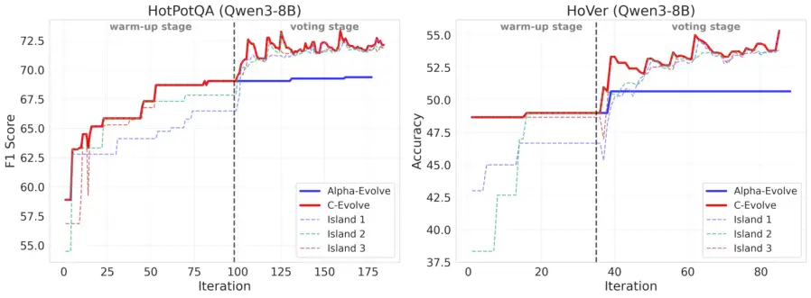
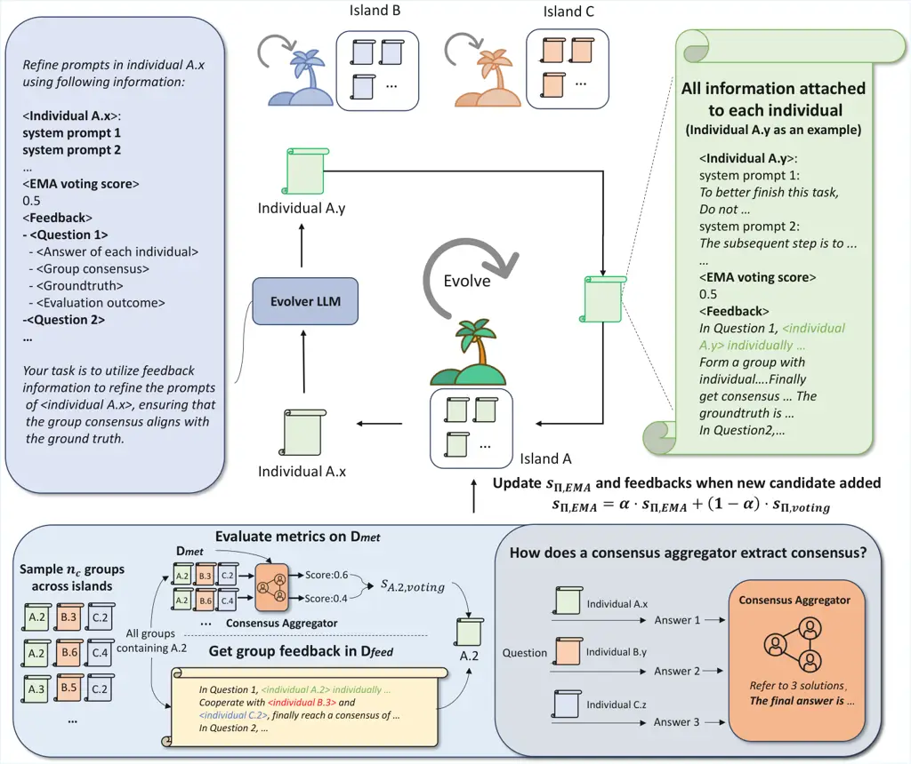
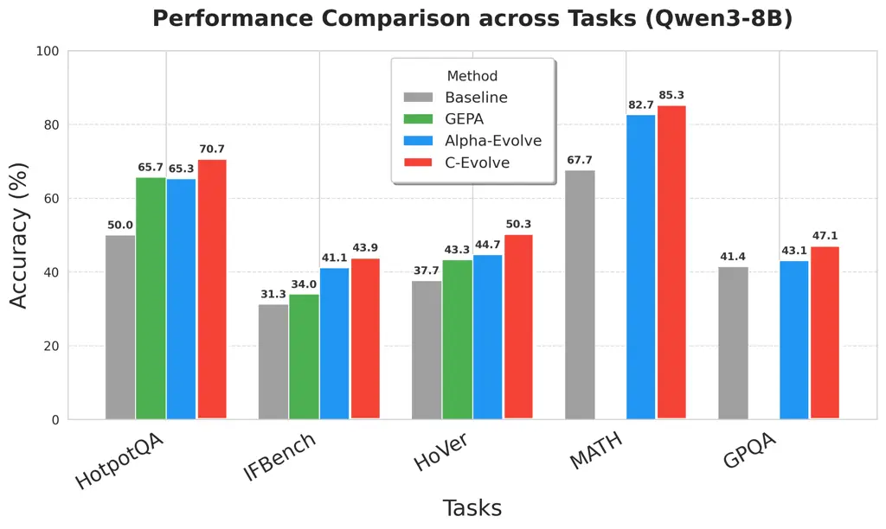
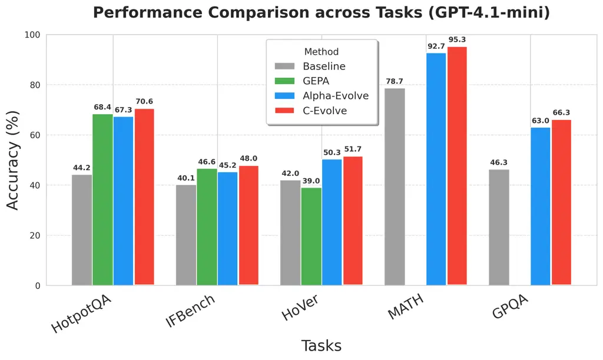
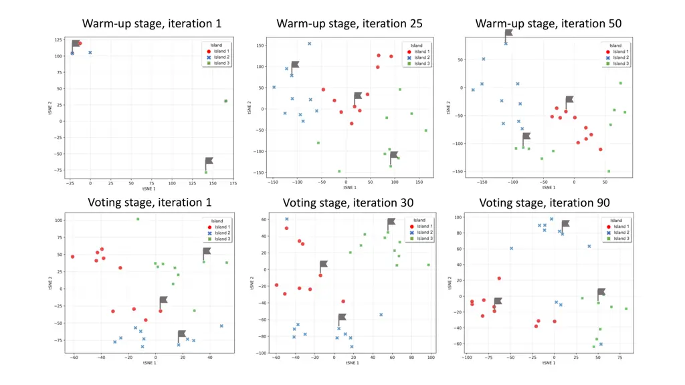
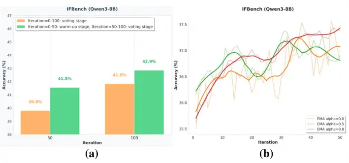

# C-Evolve: Consensus-based Evolution for Prompt Groups

Tiancheng Li^(†),Yuhang Wang^(†)    Zhiyang Chen
Email: [guojunq@gmail.com](mailto:)    Zijun Wang    Liyuan MaGuo-Jun
Qi^(\*)School of Engineering, Westlake University & MAPLE Lab
Email: [{litiancheng, wangyuhang, chenzhiyang, wangzijun,
maliyuan}@westlake.edu.cn](mailto:)

###### Abstract

Prompt evolution algorithms offer a powerful paradigm for enhancing AI
systems based on closed-source models, while few work explores whether
aggregating results from multiple prompts to reach a _consensus_ can
further advance the system capability boundary. In this paper, we
introduce _Consensus-Evolve_ (C-Evolve), an evolutionary algorithm that
discovers a group of prompts whose aggregated outputs after majority
voting achieve optimal performance. More specifically, C-Evolve employs
an island-based evolutionary algorithm to maintain population diversity,
and prompts from distinct islands are selected to form groups to
aggregate their outputs. The key difference from single individual
evolution is a voting score, which evaluates each individual prompt’s
contribution within groups. We take this as the fitness score for
evolution instead of individual performance. Consequently, C-Evolve is
more likely to produce and maintain prompts with higher potential to
form a high-performing group and eliminate low-performing ones,
gradually improving the group performance after reaching consensus. Our
method achieves state-of-the-art performance across a wide range of
tasks, including both open-ended tasks like HotpotQA and closed-ended
tasks like MATH. On Qwen3-8B, C-Evolve achieves 70.67% on HotpotQA and
43.88% on IFBench, which are 4.95% and 2.73% higher than GEPA,
respectively. For GPT-4.1-mini, the accuracy on IFBench is further
improved to 47.96% and reaches 95.33% in the MATH benchmark. These
results demonstrate the C-Evolve’s competitive performance.

|     |
| --- |
|     |

^(†)^(†)footnotetext: This project was initiated and supported by MAPLE
Lab at Westlake University.^(†)^(†)footnotetext: ^(†) Equal
contribution.^(†)^(†)footnotetext: ^(∗) Corresponding author.

## 1 Introduction

The advancement of Large Language Models (LLMs) has significantly
accelerated progress in natural language processing (Liu et al., 2024;
Thirunavukarasu et al., 2023). However, many state-of-the-art models,
such as GPT-4.1 (OpenAI, 2025) and Claude (Anthropic, 2024), remain
closed-source and are accessible only via API interfaces. This restricts
researchers from performing parameter fine-tuning to adapt these models
to specific downstream tasks. To leverage the capabilities of such
black-box models, a new paradigm prompt-based optimization methods have
emerged (Opsahl-Ong et al., 2024; Câmara et al., 2025; Agarwal et al.,
2025; Fernando et al., 2023). By refining system prompts, these methods
enhance model performance without updating internal weights.

Among these paradigms, evolutionary algorithms represent a promising
direction (Agrawal et al., 2025; Novikov et al., 2025) without access to
the weight gradients of black-box models. Indicated with a predefined
fitness function, these methods iteratively refine a population of
prompts and select the individual with the highest fitness as the
globally optimal prompt. However, in complex task environments, a single
optimal prompt often suffers from inherent expressive limitations,
struggling to fully capture multi-faceted task requirements. This
shortcoming can be alleviated through cooperation among multiple
different prompts — while any single prompt may fail in certain cases,
its weaknesses can be compensated by others. By aggregating their
responses, the system has a higher probability of producing the correct
answer. This could also be motivated by the findings in traditional
machine learning, where ensemble methods improve performance compared to
individual classifiers (Khan et al., 2024; Sun et al., 2024; Webb &
Zheng, 2004). Despite this insight, existing work in this direction
largely overlooks the systematic exploration of the mechanism to
aggregate results from multiple prompts, limiting the performance of
LLM-based systems in complex scenarios.

To release the potential of consensus from multiple prompts, we propose
_Consensus-Evolve (C-Evolve)_. Instead of evolving a single prompt from
populations, the proposed method evolves a group of prompts that
collectively achieve better performance after reaching consensus. These
prompts contribute by first generating outputs individually, and then
their outputs are aggregated to form the final answer. To evolve the
prompts for this consensus target, we introduce a “voting score” to
evaluate the contribution of each prompt within groups, which is
calculated by averaging the performance of all the groups in which it
participates, as well as being moving averaged over iterations to adapt
to the evolving populations that form the groups. This mechanism
encourages the selection and reproduction of individuals more likely to
form a high-performing group, while eliminating under-performing ones.
To maintain population diversity, C-Evolve adopts an island-based
evolutionary algorithm (Izzo et al., 2012; Romera-Paredes et al., 2024),
where prompts on different islands evolve mostly in isolation. Then we
sample a prompt from each island to form a voting group where prompts
could complement each other. Once evolution is completed, the top-scored
prompts from each island are assembled to form a final group to predict
their consensus on the test set.

The proposed method achieves the state-of-the-art performance across a
wide range of tasks, including both open-ended tasks like HotpotQA Yang
et al. (2018) and IFBench Pyatkin et al. (2025), and closed-ended tasks
like Hover He et al. (2025), MATH Lightman et al. (2023) and GPQA Rein
et al. (2023), on both open-source (Qwen3-8B Yang et al. (2025)) and
closed-source (GPT-4.1-mini OpenAI (2025)) models. On Qwen3-8B, C-Evolve
achieves 43.88% on IFBench and 70.67% on HotpotQA, 4.95% and 2.73%
higher than GEPA respectively. On GPT-4.1-mini, the accuracy on IFBench
is further improved to 47.96% and reaches 95.33% on MATH Benchmark.
These results demonstrate the strong performance of C-Evolve.



Figure 1: Comparison of our proposed C-Evolve and AlphaEvolve. The blue
line shows AlphaEvolve’s highest individual score across three islands
on the metric set. In C-Evolve, the red line represents the highest
individual score (with dashed lines indicating the islands’ highest
individual scores) during the warm-up stage and the highest EMA voting
score (with dashed lines indicating the islands’ highest EMA voting
scores) during the voting stage.

## 2 Related Work

Prompt Learning. The advent of powerful, closed-source large language
models such as GPT-4.1 and Claude has established a new paradigm in
GenAI. As these models are often accessible only through APIs, directly
fine-tuning network weights is not feasible, making prompt engineering
critical for adapting them to downstream tasks.

Early efforts relied on manual prompt engineering (Wei et al., 2022;
Chen et al., 2025) such as chain-of-thought prompting (Wei et al., 2022)
, which suffered from inefficiency, strong subjectivity, and poor
transferability. To address these challenges, automated prompt
optimization techniques (Zhou et al., 2022; Kepel & Valogianni, 2024)
have been developed. Search-based prompt optimization
methods (Opsahl-Ong et al., 2024) utilize a Bayesian optimization
framework to explore the joint space of instructions and examples,
identifying the prompt configuration that maximizes validation
performance. Another paradigm explores how models can learn online from
interactive feedback. For example, previous work (Monea et al., 2024)
demonstrates that LLMs can learn online from reward signals provided
directly within their context, without requiring parameter updates. In
this setting, the LLM’s context is built from a history of its own
predictions and the resulting feedback, allowing it to improve its
capabilities over time.

Beyond manual approaches, evolutionary prompt optimization has emerged
as a particularly powerful and flexible paradigm. This approach treats
prompts as individuals in a population that can be improved through
iterative cycles of mutation and selection. In the context of LLMs, this
paradigm has been successfully applied to solve complex tasks. For
example, GEPA (Agrawal et al., 2025) employs a genetic algorithm that
incorporates natural language reflection and pareto-based selection to
evolve prompts. AlphaEvolve (Novikov et al., 2025) utilizes an
island-based evolutionary algorithm to evolve entire programs for
scientific discovery, demonstrating the power of evolution with complex
code structures. Although they use different forms of evolutionary
algorithms and operate on different targets (coding versus text
prompts), both are fundamentally designed to discover a single
best-performing solution through evolution. This strategy may limit
generalization – when task complexity increases or task dynamics
changes, it could fail to explore the synergy among different prompts
that complement each other. The advantage of reaching consensus by
aggregating outputs from multiple prompts remains underexplored in the
field of prompt optimization.

Consensus in LLMs. The idea that a committee of experts can outperform
single expert is a cornerstone of many traditional machine learning
algorithms, witnessed by decades of research on ensemble
methods (Rokach, 2019; Polikar, 2012). This principle has been applied
to LLMs through techniques like self-consistency (Wang et al., 2022),
where multiple outputs are generated from multiple prompts and final
answer is chosen by majority voting. Another approach to aggregate
outputs from multiple experts is used in multi-agent systems (Wang
et al., 2024; Tian & Zhang, 2024; Grötschla et al., 2025), where
multiple agents with potentially distinct roles and capabilities
interact with each other to solve complex problems. Our method advances
this idea beyond these paradigms. C-Evolve evolves a group of individual
prompts where consensus mechanism is an intrinsic force driving the
evolution process. This approach systematically evolves a diverse group
of prompts for building a high-quality consensus, ensuring the resulting
prompts are not only individually strong, but also cooperatively
effective in groups.

## 3 Problem Statement

Compound AI System. Following established research, we define a Compound
AI System as any modular system composed of one or multiple LLMs
invocations, potentially interleaved with external tool calls, and
orchestrated through arbitrary control flows. Such a system can be
formalized as $`\Phi=(M,L,\mathcal{X},\mathcal{Y})`$, where
$`M=\left\langle M_{1},\ldots,M_{|M|}\right\rangle`$ denotes the set of
language modules, $`L`$ specifies the control flow logic, and
$`\mathcal{X}`$, $`\mathcal{Y}`$ represent global input and output
schemas. Each module
$`M_{i}=\left(\theta_{i},\mathcal{X}_{i},\mathcal{Y}_{i}\right)`$ is an
LLM subcomponent: $`\theta_{i}`$ denotes the underlying model weights;
and $`X_{i}`$ and $`Y_{i}`$ define module-level input and output
schemas. We define $`\pi_{i}`$ as the system prompt containing
instructions and few-shot examples required by $`M_{i}`$. At runtime,
the control logic orchestrates the sequence and invocation of
modules—for instance, passing outputs from one module to another,
conditionally invoking components, or leveraging tool APIs.

In this paper, we only consider optimizing module prompts in the system.
We denote $`\Pi=\left\langle\pi_{1},\ldots,\pi_{|M|}\right\rangle`$ as
the set of all learnable module prompts. For simplicity, we refer an
instance of $`\Pi`$ as an individual in following sections. To measure
how an individual performs on the target task $`\mathcal{T}`$, we may
denote each instance of this task as $`(x,m)`$, where $`x`$ can be
mapped to the input schema $`\mathcal{X}`$, and $`m`$ denotes metadata
required for evaluation (e.g., gold answers, evaluation rubrics, or test
codes). For each instance, the system produces an output
$`y=\Phi\left(x;\Pi\right)`$. A metric
$`\mu:\mathcal{Y}\times\mathcal{M}\to[0,1]`$ evaluates the quality of
$`y`$ with respect to metadata $`m`$, which can be quantified as scores
like F1 or pass rates. With these notations, a classic evolutionary
algorithm to optimize a single prompt can be formulated as:

```math
\Pi^{*}=\arg\max_{\Pi}\mathbb{E}_{(x,m)\sim\mathcal{T}}\left[\mu\left(\Phi\left(x;\Pi\right),m\right)\right]. \tag{1}
```

In this paper, we will test on several Compound AI systems. We will
elaborate on how they are implemented with multiple language modules in
Appendix I.

Consensus. Consensus is achieved by aggregating the outputs produced by
a group of system prompts
$`\mathcal{G}=\left\langle\Pi^{1},\ldots,\Pi^{|\mathcal{G}|}\right\rangle=\left\langle\left\langle\pi_{1}^{1},\ldots,\pi_{|M|}^{1}\right\rangle,\ldots,\left\langle\pi_{1}^{|\mathcal{G}|},\ldots,\pi_{|M|}^{|\mathcal{G}|}\right\rangle\right\rangle`$
with a consensus aggregator $`C`$. For each task instance, each single
prompt $`\Pi^{i}`$ produces its corresponding output
$`\Phi\left(x;\Pi\right)`$ individually. Then, given $`|\mathcal{G}|`$
individual outputs
$`y^{\mathcal{G}}=\left\langle\Phi\left(x;\Pi^{1}\right),\ldots,\Phi\left(x;\Pi^{|\mathcal{G}|}\right)\right\rangle`$,
the consensus aggregator extracts the final results according to a
majority voting principle: $`y_{\text{final}}=C(y^{\mathcal{G}})`$. For
close-ended tasks such as multi-choice questions and mathematical
calculation, we simply employ majority voting, which selects the answer
with the most votes. For open-ended tasks that demand free text outputs,
we employ an LLM-based aggregator: leveraging an LLM to identify the
most representative response covering the contents of as many responses
as possible within the group. The prompts used by the LLM-based
aggregator for consensus extraction can be found in Appendix K.

To find the best-performing prompt group $`\mathcal{G}^{*}`$ with the
consensus mechanism, the optimization problem is thus formulated as:

```math
\mathcal{G}^{*}=\arg\max_{\mathcal{G}}\mathbb{E}_{(x,m)\sim\tau}\left[\mu\left(\mathrm{C}(y^{\mathcal{G}}),m\right)\right] \tag{2}
```



Figure 2: Evolutionary process in the voting stage of C-Evolve. In each
iteration, C-Evolve samples an individual from each island. Then, we use
the evolver LLM to analyze the feedback samples linked to selected
individual and perform evolution, producing a new individual. After
introducing a new individual into the island, we sample groups to update
$`s_{\Pi,\text{EMA}}`$ and group feedback for individuals in the island.

## 4 C-Evolve: Consensus-based Evolutionary Algorithm

C-Evolve is an evolutionary algorithm designed for optimizing a group of
individuals to improve the performance of a compound AI system. Its key
feature is using a voting score to measure how well a prompt contributes
when operating with others, rather than evaluating it in isolation. This
design ensures that, after evolution, we can sample multiple prompts
that work effectively through output consensus.

### 4.1 Evolution Algorithm Based on Island Model

During evolution, the algorithm iteratively performs sampling,
generation, and evaluation of these individuals to update the
population. Considering we would like to obtain a group of diverse
individuals $`\mathcal{G}`$ that can achieve strong performance after
reaching a consensus, we adopt an island-based evolutionary algorithm
here: we initialize $`|\mathcal{G}|`$ islands
$`\{P_{i}\}_{i=1}^{|\mathcal{G}|}`$, and evolve individuals within each
island in parallel. This parallel evolutionary strategy ensures that
different islands follow distinct evolutionary trajectories, which
promotes population diversity and ultimately benefits effective
consensus. We configure an LLM to refine the prompts within individuals
based on feedback information, which we call the evolver. When refining
individuals, the prompt required by the evolver can be referenced in
Appendix H.

Specifically, this evolutionary process consists of two stages: 1) a
warm-up stage that evolves individuals based on their own performance,
and 2) a voting stage that evolves individuals based on their
performance when grouped with others from different islands. During
evolution, we employ a metric dataset $`D_{\text{met}}`$ with evaluation
metric $`\mu`$ in both warm-up stage and voting stage, and a separate
feedback dataset $`D_{\text{feed}}`$ that supplies additional samples
$`(x,m)`$ to generate detailed execution feedback for each individual.

##### The warm-up stage.

In this stage, we define the metric value evaluated for an individual
$`\Pi`$ on the dataset $`D_{\text{met}}`$ as an individual score
$`s_{\Pi,\text{ind}}`$, and regard it as the fitness score of each
individual. We consider generating exactly one new individual per island
as a single iteration. In each iteration, we first sample a seed
individual from the island using a categorical distribution constructed
from $`\{s_{\Pi,\text{ind}}\}_{\Pi\in P_{i}}`$ (Appendix A Algorithm 1),
so that higher-performing individuals have a greater probability of
being selected. Then, the selected seed individual, together with its
execution feedback on a minibatch (batchsize defaulting to 3) sampled
from $`D_{\text{feed}}`$, is provided to the evolver LLM to produce a
new individual.

To prevent unbounded growth, the number of individuals in each island is
capped at $`N_{max}`$. Whenever this limit is exceeded after producing a
new individual, the worst-performing individual measured on
$`D_{\text{met}}`$ is eliminated. The overall warm-up procedure is
summarized in Appendix A Algorithm 2.

##### The voting stage.

In this stage, each individual’s fitness is determined by its
performance within prompt groups. As shown in Figure 2, after
introducing a new individual into each island, C-Evolve samples
$`n_{c}`$ groups $`\{\mathcal{G}_{k}\}_{k=1}^{n_{c}}`$. Each group
$`\mathcal{G}_{k}`$ is formed by selecting exactly one individual
$`\Pi^{G_{k}(i)}`$ from each island $`i`$, where $`G_{k}(i)`$ denotes
the index of the individual sampled from island $`i`$ for group
$`\mathcal{G}_{k}`$. The outputs of all individuals within a group are
integrated by the consensus aggregator to produce the final answer, and
the group’s performance is then evaluated on the metric set
$`D_{\text{met}}`$.

A naive idea would be to eliminate all member individuals in the
worst-performing group based on consensus results. However, this
approach is problematic due to the possible overlap of members between
the worst-performing group and other better-performing ones.
Aggressively pruning all members of the worst-performing group thus
makes no sense in this context. To address this issue, we define a
voting score $`s_{\Pi,\text{voting}}`$ to measure each individual’s
contribution within consensus-driven groups:

```math
s_{\Pi,\text{voting}}=\frac{\sum_{k=1}^{n_{c}}\mathbb{I}\left(\Pi\in\mathcal{G}_{k}\right)\cdot\mathbb{E}_{(x,m)\sim\mathcal{D}_{\text{met}}}\left[u\left(C\left(\mathbf{y}^{\mathcal{G}_{k}}\right),m\right)\right]}{\sum_{k=1}^{n_{c}}\mathbb{I}\left(\Pi\in\mathcal{G}_{k}\right)} \tag{3}
```

where $`\mathbb{I}\left(\Pi\in G_{k}\right)`$ is an indicator function
that equals 1 if the individual $`\Pi`$ belongs to group
$`\mathcal{G}_{k}`$. This score measures the average metric value over
the consensus results by the groups containing the $`\Pi`$. In other
words, the higher the voting score, the more likely the group containing
this individual could yield a higher metric value. In this sense, the
individuals with higher voting scores ought to be sampled to form a
high-performing group.

In order to balance the voting scores computed in different iterations,
we take the smoothed $`s_{\text{EMA},\Pi}`$ as the fitness score in
evolution, and apply exponential moving average (EMA) to update it:

```math
s_{\Pi,\text{EMA}}\leftarrow\alpha\cdot s_{\Pi,\text{EMA}}+(1-\alpha)\cdot s_{\Pi,\text{voting}} \tag{4}
```

where $`\alpha\in[0,1]`$ is the smoothing factor balancing the weight of
historical performance and current performance. After updating, the
individual with the lowest $`s_{\Pi,\text{EMA}}`$ in each island is then
eliminated. In the initial phase of voting stage, we initialize
$`s_{\Pi,\text{EMA}}`$ with the individual score obtained at the end of
the warm-up stage. Upon completion of all evolutionary iterations, we
select the individual with the highest EMA voting score from each island
to form the final group. During inference, we use the final group to
perform reasoning and aggregate each individual’s opinion to reach a
consensus.

We deliberately avoid using the simple average of an individual’s
performance across all historical groups containing it as its final
score. The rationale is that members from groups formed in the distant
past may have already been eliminated from the current population.
Incorporating these outdated consensus outcomes into the evaluation
metric and assigning them the same weight as recent performance would be
unreasonable, as it fails to faithfully reflect the individual’s actual
contribution within the current population or its recent evolutionary
context. Therefore, we employ an EMA method to assign higher weight to
recent or immediate scores, thereby suppressing the influence of
historical outcomes from the distant past on the individual’s
evaluation.

### 4.2 C-Evolve Based on Group Feedbacks

During the execution of a compound AI system, the reasoning traces
generated by the system on various questions provide valuable insights
for understanding and analyzing an individual prompt. When combined with
the final outcomes (e.g., success, failure, or performance scores),
these traces offer significant diagnostic value, enabling evolver to
figure out when errors may occur and identify potential issues within
specific modules ( ) .

Specifically, during the warm-up stage, to evolve a given individual,
C-Evolve compiles feedback information from the generated reasoning
traces on a feedback dataset $`D_{\text{feed}}`$. This includes details
of the prompts in individual, the inputs and outputs of each language
module within the system, and its individual metric score on
$`D_{\text{met}}`$. The evolver then uses this feedback to produce a
newly evolved individual.

During the voting stage, we incorporate the reasoning traces from a
prompt group into the group feedback. More specifically, the feedback
for each individual includes: information about the prompts in this
individual, its grouping information, each individual’s output in the
group, consensus reached by the group, the metric scores for the group
consensus on $`D_{\text{met}}`$, alongside inputs and outputs by all LLM
modules in the system. Leveraging this group feedback, C-Evolve uses the
evolver to produce a new individual. The overall voting stage is
summarized in Appendix A Algorithm 3.

## 5 Experiments

### 5.1 Benchmark Datasets

To rigorously evaluate the performance of C-Evolve, we conducted
experiments on two distinct task categories, each employing different
consensus aggregators: for closed-ended tasks, we employ majority voting
to select the answer with the most votes, while for open-ended tasks, we
leverage an LLM to identify the most representative response within the
group. We provide a comprehensive elucidation of the datasets and their
splittings, evaluation metrics, consensus aggregators for each task in
Appendix B and detailed feedback content in Appendix J.

### 5.2 Models

We conduct experiments on two large language models: Qwen3-8B Yang
et al. (2025) and GPT4.1-mini OpenAI (2025). These models represent
mainstream open-source and closed-source models respectively. We provide
the detailed configurations of the two models in Appendix C.

### 5.3 Training Details

We select state-of-the-art evolutionary algorithms, GEPA Agrawal et al.
(2025) and AlphaEvolve Novikov et al. (2025), to provide a comprehensive
comparison. For GEPA, we evaluate the optimal system prompts provided in
its paper. For AlphaEvolve, which is not open-sourced, we report results
from our own reimplementation.

All experiments start with the baseline prompts provided in Appendix L.
We set the number of islands to be $`|\mathcal{G}|=3`$, with a
population limit of $`N_{max}=10`$ individuals per island. For each
individual, we sample 3 questions from $`D_{\text{feed}}`$ to construct
the feedback. In each iteration of the voting stage, we sample
$`n_{c}=10`$ groups and evaluate them to update $`s_{\Pi,\text{EMA}}`$.
In addition, we employ a 10% migration rate between islands to avoid
getting stuck in local optima.

### 5.4 Results and Analysis

|                |          |         |       |       |       |             |
| -------------- | -------- | ------- | ----- | ----- | ----- | ----------- |
| Model          | HotpotQA | IFBench | Hover | MATH  | GPQA  | Improvement |
| Qwen3-8B       |          |         |       |       |       |             |
|    Baseline    | 50.03    | 31.29   | 37.66 | 67.66 | 41.43 | \-          |
|    GEPA        | 65.72    | 34.01   | 43.33 | \-    | \-    | +8.02       |
|    AlphaEvolve | 65.31    | 41.15   | 44.66 | 82.66 | 43.08 | +9.75       |
|    C-Evolve    | 70.67    | 43.88   | 50.33 | 85.33 | 47.15 | +13.85      |
| GPT-4.1 mini   |          |         |       |       |       |             |
|    Baseline    | 44.24    | 40.13   | 42    | 78.66 | 46.34 | \-          |
|    GEPA        | 68.39    | 46.59   | 39    | \-    | \-    | +9.2        |
|    AlphaEvolve | 67.31    | 45.24   | 50.33 | 92.66 | 63.01 | +13.42      |
|    C-Evolve    | 70.64    | 47.96   | 51.66 | 95.33 | 66.26 | +16.09      |

Table 1: Performance comparison across multiple tasks: open-ended tasks
(HotpotQA Yang et al. (2018), IFBench Pyatkin et al. (2025)) and
closed-ended tasks(Hover He et al. (2025), MATH Lightman et al. (2023),
GPQA Rein et al. (2023)) using Qwen3-8B and GPT-4.1 mini. “Improvement”
denotes the average relative gain of C-Evolve over baseline across
available tasks for each model. Bold values indicate the best result for
each task.

#### 5.4.1 C-Evolve Outperforms the Single Prompt Evolution

Table 1 presents the performance of C-Evolve on two open-ended and three
closed-ended tasks, using both the open-source model Qwen-3-8B and the
closed-source model GPT-4.1-mini. On Qwen-3-8B, C-Evolve achieves an
average improvement of 13.85% over the baseline, outperforming GEPA by
5.83% and AlphaEvolve by 4.1%. On the more capable GPT-4.1-mini,
C-Evolve still maintains a consistent advantage, yielding a 6.89%
average improvement over GEPA and 2.67% over AlphaEvolve.

To further demonstrate the effectiveness of C-Evolve, the curves in
Figure 1 showcase how the highest EMA voting score in the population
changes during evolution on HotPotQA and HoVer tasks. AlphaEvolve
exhibits rapid improvement in the early stage but soon plateaus, while
C-Evolve continues to improve after entering the voting stage. As shown
in Table 2, the best individuals from the three islands in AlphaEvolve
achieve an accuracy of 41.15%, 36.73%, and 37.07% respectively, with the
overall best individual performance being 41.15% (the first line of
AlphaEvolve result) without any consensus mechanism among islands as in
the original AlphaEvolve. We try to group these best individuals
selected from each island, and apply the LLM-based aggregator to them
directly, which remains 41.15% (the second line of AlphaEvolve result).
This arises because AlphaEvolve evolves the prompts solely based on
their individual scores without considering consensus. In contrast,
C-Evolve evolves the prompts with the EMA voting score as their fitness,
ensuring that individuals with high scores are more likely to perform
well when they are grouped across the islands. Thus, individuals
selected by EMA voting score in C-Evolve reach a higher accuracy of
43.88% after reaching consensus.

| Method      | island 1 | island 2 | island 3 | Final Accuracy     |
| ----------- | -------- | -------- | -------- | ------------------ |
| AlphaEvolve | 41.15    | 36.73    | 37.07    | 41.15 (individual) |
|             |          |          |          | 41.15 (consensus)  |
| C-Evolve    | 40.47    | 39.79    | 38.77    | 43.88              |

Table 2: Comparison between AlphaEvolve and C-Evolve on IFBench. We
select the individual with the highest fitness score, either individual
score in Alpha-Eolve or EMA voting score in C-Evolve, from all three
islands, and the accuracy is reported on the test set. For AlphaEvolve,
we report both the accuracy of the best single prompt, and the accuracy
directly applying the consensus mechanism to the three selected prompts.

|          |         |         |         |         |         |
| -------- | ------- | ------- | ------- | ------- | ------- |
|          | level 1 | level 2 | level 3 | level 4 | level 5 |
| island 1 | 95      | 94.67   | 90.66   | 82.66   | 66.66   |
| island 2 | 96.67   | 96      | 90      | 80      | 63.66   |
| island 3 | 95.66   | 95.66   | 90.33   | 82      | 62.66   |
| C-Evolve | 96.67   | 96      | 92      | 82.66   | 68.33   |

Table 3: Accuracy of individuals evolved by C-Evolve on the test set of
MATH when evaluating on subsets of different difficulty levels. Each
subset contains 300 problems. We report both the accuracy of single
individuals with highest $`s_{\Pi,\text{EMA}}`$ in each island, and the
final accuracy of after reaching a consensus.

#### 5.4.2 Multi-Island Evolution Exhibits Diverse Focuses

C-Evolve maintains population diversity through multi-island evolution.
Appendix E Figure 5 illustrates the evolutionary trajectories, from the
initial individual (baseline) to the ones selected in the final group on
IFBench. We observe that individuals from different islands gradually
developed distinct focuses during evolution. The individual selected in
island 1 focuses on the principles of core constraint prioritization and
refined amendment, while the individual selected in island 2 specializes
in precise constraint pre-declaration and hierarchical verification. The
individual selected in island 3 concentrates on task priority
stratification and critical failure point verification.

When aggregated, these prompts focus on distinct aspects, enabling
stronger and more comprehensive problem-solving capabilities. We
visualize the prompts evolved in each island on IFBench with t-SNE
Laurens & Hinton (2008), as shown in Appendix E Figure 6. We observed
that, during the voting stage, the individuals with the highest EMA
voting scores on each island gradually diverge, and three islands tend
to form distinct clusters.

#### 5.4.3 Consensus Helps on Hard Problems

After evolving on MATH, we select the individuals with the highest EMA
voting scores from each island on the metric set, and evaluate on the
test set both individually and by reaching a consensus with majority
voting. As shown in Table 3, the accuracies of single individuals
consistently declines as task difficulty increases. At Level 5, all
islands fall below 67%, revealing the weakness of single-prompt
solutions for harder problems.

After majority voting, C-Evolve consistently outperforms all islands on
Levels 3–5, achieving accuracies of 92.00%, 82.66%, and 68.33%,
respectively. This indicates that problems unsolvable by a single
optimal prompt can often be addressed through majority voting. This can
be validated with further analysis in Appendix F Table 8: among the
problems that two of the three individuals reach a consensus (25% in all
problems), C-Evolve correctly solves 49.33% of them, while the single
optimal prompt only solves 40%.

| Aggregator    | Accuracy (%) |
| ------------- | ------------ |
| LLM-summary   | 38.66        |
| LLM-selection | 42.85        |

Table 4: Ablation study on LLM-based aggregator for open-ended tasks.
Conducted on IFBench, using Qwen3-8B. Both are trained 50 iterations for
the warm-up stage and 50 iterations for the voting stage.

| Method        | $`\alpha`$ | Accuracy (%) |
| ------------- | ---------- | ------------ |
| Group Average | –          | 41.16        |
| EMA           | 0.5        | 42.51        |
| EMA           | 0.8        | 42.85        |

Table 5: Ablation study on different methods averaging voting scores
across iterations. Conducted on IFBench, using Qwen3-8B. Both are
trained 50 iterations for the warm-up stage and 50 iterations for the
voting stage.

### 5.5 Ablation Study

#### 5.5.1 Ablation Study of LLM-based Aggregator

For open-ended tasks (HotpotQA and IFBench), we use an LLM to aggregate
individual answers into a final answer. We compare two LLM-based
aggregators: (1) LLM-summary, where the LLM generates an answer
synthesizing all individual answers within the group; (2) LLM-selection,
where the LLM selects the most representative answer from individual
answers within the group.

As shown in Table 5, the LLM-selection outperforms LLM-summary. This is
because summarization tends to generate content that is not strictly
grounded in any individual answer, whereas selection preserves the
fidelity of original outputs while identifying the most representative
one.

#### 5.5.2 Ablation Study of Moving Average

In Eq. 4, we apply EMA to update $`s_{\Pi,\text{EMA}}`$ for each
individual. Here we validate its necessity. We first simply average the
individual’s performance across all groups and iterations. It performs
poorly (41.16%) on IFBench, using Qwen3-8B. The simple average assigns
equal weights to all groups regardless of when they were formed, while
many of the groups formed early in evolution may have already been
eliminated. Thus, they cannot represent the individual’s contribution
when grouping with individuals in the current population. Applying EMA
results in more reliable evaluations. As shown in Table 5, C-Evolve
achieves its best performance with $`\alpha`$ = 0.8, reaching an
accuracy of 42.85%.

#### 5.5.3 efficiency and performance trade off

|             |                               |                             |          |
| ----------- | ----------------------------- | --------------------------- | -------- |
|             | Evolving time (min/iteration) | Inference time (s/question) | Accuracy |
| AlphaEvlove | 3.5                           | 0.68                        | 43.08    |
| C-Evolve    | 4.3                           | 0.79                        | 47.15    |

Table 6: Evolving and Inference Time Comparison with Accuracy on GPQA,
using Qwen3 8B.

Due to calculating the voting score in evolving and multi-prompt
reasoning in inference, C-Evolve introduces additional computational
overhead. To this end, we employ two key optimizations to effectively
balance efficiency and performance:

Training Efficiency via Caching. During evolution, each newly generated
prompt is first evaluated on the metric set to generate all answers, and
these answers are cached. When computing the voting score, we reuse
these cached outputs and apply majority voting across individuals within
a group directly, which eliminates the need for repeated LLM calls
during the voting stage. This significantly reduces training time: on
the GPQA task, each iteration in C-Evolve takes only 0.8 minutes per
iteration longer than AlphaEvolve (3.5 min/iteration) in Table 6.

Inference Acceleration via Asynchronous Prompting. During inference, we
leverage asynchronous execution to prompt the LLM with distinct system
prompts in parallel. This enables us to obtain multiple answers
simultaneously, delivering a 9.45% relative improvement in accuracy
compared to AlphaEvolve while only increasing inference time from 0.68
to 0.79 seconds per question. As for open-ended tasks, it indeed needs
another LLM request to complete majority voting.

Additional ablation studies, such as those on the warm-up stage and
voting score, are presented in the Appendix G.

## 6 Conclusion

In this paper, we present Consensus-Evolve (C-Evolve), a
consensus-driven evolutionary algorithm for optimizing a group of
prompts in AI systems. The outputs from these prompts are aggregated for
reaching a consensus. C-Evolve introduces an EMA voting score as the
individual fitness, which evaluates each prompt’s contribution to
consensus within groups. To maintain diversity, we employ a multi-island
evolution system to explore complementarity among prompts.

Our experiments show that C-Evolve achieves state-of-the-art results on
multiple benchmark datasets using both Qwen3-8B and GPT-4.1-mini. To our
best knowledge, C-Evolve is the first algorithm developing the group
consensus among prompts to drive their evolution for making more
accurate predictions. This opens new directions for optimizing compound
AI systems, especially for those built on proprietary models.

## References

- Agarwal et al. (2025) Eshaan Agarwal, Raghav Magazine, Joykirat Singh,
  Vivek Dani, Tanuja Ganu, and Akshay Nambi. Promptwizard: Optimizing
  prompts via task-aware, feedback-driven self-evolution. In _Findings
  of the Association for Computational Linguistics: ACL 2025_, pp.
  19974–20003, 2025.
- Agrawal et al. (2025) Lakshya A Agrawal, Shangyin Tan, Dilara Soylu,
  Noah Ziems, Rishi Khare, Krista Opsahl-Ong, Arnav Singhvi, Herumb
  Shandilya, Michael J Ryan, Meng Jiang, et al. Gepa: Reflective prompt
  evolution can outperform reinforcement learning. _arXiv preprint
  arXiv:2507.19457_, 2025.
- Anthropic (2024) Anthropic. Claude 3.5 sonnet. Large language model,
  June 2024. URL
  [https://www.anthropic.com/news/claude-3-5-sonnet](https://www.anthropic.com/news/claude-3-5-sonnet).
  Released June 2024.
- Câmara et al. (2025) Sara Câmara, Eduardo Luz, Valéria Carvalho, Ivan
  Meneghini, and Gladston Moreira. Moprompt: Multi-objective semantic
  evolution for prompt optimization. _arXiv preprint
  arXiv:2508.01541_, 2025.
- Chen et al. (2025) Banghao Chen, Zhaofeng Zhang, Nicolas Langrené, and
  Shengxin Zhu. Unleashing the potential of prompt engineering for large
  language models. _Patterns_, 2025.
- Fernando et al. (2023) Chrisantha Fernando, Dylan Banarse, Henryk
  Michalewski, Simon Osindero, and Tim Rocktäschel. Promptbreeder:
  Self-referential self-improvement via prompt evolution. _arXiv
  preprint arXiv:2309.16797_, 2023.
- Grötschla et al. (2025) Florian Grötschla, Luis Müller, Jan Tönshoff,
  Mikhail Galkin, and Bryan Perozzi. Agentsnet: Coordination and
  collaborative reasoning in multi-agent llms. _arXiv preprint
  arXiv:2507.08616_, 2025.
- He et al. (2025) Tairan He, Wenli Xiao, Toru Lin, Zhengyi Luo, Zhenjia
  Xu, Zhenyu Jiang, Jan Kautz, Changliu Liu, Guanya Shi, Xiaolong Wang,
  Linxi Fan, and Yuke Zhu. Hover: Versatile neural whole-body controller
  for humanoid robots, 2025. URL
  [https://arxiv.org/abs/2410.21229](https://arxiv.org/abs/2410.21229).
- Hendrycks et al. (2021) Dan Hendrycks, Collin Burns, Saurav Kadavath,
  Akul Arora, Steven Basart, Eric Tang, Dawn Song, and Jacob Steinhardt.
  Measuring mathematical problem solving with the math dataset. _arXiv
  preprint arXiv:2103.03874_, 2021.
- Izzo et al. (2012) Dario Izzo, Marek Ruciński, and Francesco Biscani.
  The generalized island model. In _Parallel architectures and
  bioinspired algorithms_, pp. 151–169. Springer, 2012.
- Kepel & Valogianni (2024) Daan Kepel and Konstantina Valogianni.
  Autonomous prompt engineering in large language models. _arXiv
  preprint arXiv:2407.11000_, 2024.
- Khan et al. (2024) Azal Ahmad Khan, Omkar Chaudhari, and Rohitash
  Chandra. A review of ensemble learning and data augmentation models
  for class imbalanced problems: Combination, implementation and
  evaluation. _Expert Systems with Applications_, 244:122778, 2024.
- Laurens & Hinton (2008) Van Der Maaten Laurens and Geoffrey Hinton.
  Visualizing data using t-sne. _Journal of Machine Learning Research_,
  9(2605):2579–2605, 2008.
- Lightman et al. (2023) Hunter Lightman, Vineet Kosaraju, Yura Burda,
  Harri Edwards, Bowen Baker, Teddy Lee, Jan Leike, John Schulman, Ilya
  Sutskever, and Karl Cobbe. Let’s verify step by step. _arXiv preprint
  arXiv:2305.20050_, 2023.
- Liu et al. (2024) Aixin Liu, Bei Feng, Bing Xue, Bingxuan Wang, Bochao
  Wu, Chengda Lu, Chenggang Zhao, Chengqi Deng, Chenyu Zhang, Chong
  Ruan, et al. Deepseek-v3 technical report. _arXiv preprint
  arXiv:2412.19437_, 2024.
- Monea et al. (2024) Giovanni Monea, Antoine Bosselut, Kianté Brantley,
  and Yoav Artzi. Llms are in-context bandit reinforcement learners.
  _arXiv preprint arXiv:2410.05362_, 2024.
- Novikov et al. (2025) Alexander Novikov, Ngân Vũ, Marvin Eisenberger,
  Emilien Dupont, Po-Sen Huang, Adam Zsolt Wagner, Sergey Shirobokov,
  Borislav Kozlovskii, Francisco JR Ruiz, Abbas Mehrabian, et al.
  Alphaevolve: A coding agent for scientific and algorithmic discovery.
  _arXiv preprint arXiv:2506.13131_, 2025.
- OpenAI (2025) OpenAI. Gpt-4.1 series. Large language model series,
  April 2025. URL
  [https://openai.com/index/gpt-4-1/](https://openai.com/index/gpt-4-1/).
  Released April 2025.
- Opsahl-Ong et al. (2024) Krista Opsahl-Ong, Michael J Ryan, Josh
  Purtell, David Broman, Christopher Potts, Matei Zaharia, and Omar
  Khattab. Optimizing instructions and demonstrations for multi-stage
  language model programs. _arXiv preprint arXiv:2406.11695_, 2024.
- Pedregosa et al. (2011) F. Pedregosa, G. Varoquaux, A. Gramfort,
  V. Michel, B. Thirion, O. Grisel, M. Blondel, P. Prettenhofer,
  R. Weiss, V. Dubourg, J. Vanderplas, A. Passos, D. Cournapeau,
  M. Brucher, M. Perrot, and E. Duchesnay. Scikit-learn: Machine
  learning in Python. _Journal of Machine Learning Research_,
  12:2825–2830, 2011.
- Polikar (2012) Robi Polikar. Ensemble learning. In _Ensemble machine
  learning_, pp. 1–34. Springer, 2012.
- Pyatkin et al. (2025) Valentina Pyatkin, Saumya Malik, Victoria Graf,
  Hamish Ivison, Shengyi Huang, Pradeep Dasigi, Nathan Lambert, and
  Hannaneh Hajishirzi. Generalizing verifiable instruction
  following, 2025. URL
  [https://arxiv.org/abs/2507.02833](https://arxiv.org/abs/2507.02833).
- Rein et al. (2023) David Rein, Betty Li Hou, Asa Cooper Stickland,
  Jackson Petty, Richard Yuanzhe Pang, Julien Dirani, Julian Michael,
  and Samuel R. Bowman. Gpqa: A graduate-level google-proof q&a
  benchmark, 2023. URL
  [https://arxiv.org/abs/2311.12022](https://arxiv.org/abs/2311.12022).
- Rokach (2019) Lior Rokach. _Ensemble learning: pattern classification
  using ensemble methods_. World Scientific, 2019.
- Romera-Paredes et al. (2024) Bernardino Romera-Paredes, Mohammadamin
  Barekatain, Alexander Novikov, Matej Balog, M Pawan Kumar, Emilien
  Dupont, Francisco JR Ruiz, Jordan S Ellenberg, Pengming Wang, Omar
  Fawzi, et al. Mathematical discoveries from program search with large
  language models. _Nature_, 625(7995):468–475, 2024.
- Sun et al. (2024) Zhigang Sun, Guotao Wang, Pengfei Li, Hui Wang, Min
  Zhang, and Xiaowen Liang. An improved random forest based on the
  classification accuracy and correlation measurement of decision trees.
  _Expert Systems with Applications_, 237:121549, 2024.
- Tan et al. (2025) Shangyin Tan, Lakshya A Agrawal, Arnav Singhvi,
  Liheng Lai, Michael J Ryan, Dan Klein, Omar Khattab, Koushik Sen, and
  Matei Zaharia. Langprobe: a language programs benchmark, 2025. URL
  [https://arxiv.org/abs/2502.20315](https://arxiv.org/abs/2502.20315).
- Thirunavukarasu et al. (2023) Arun James Thirunavukarasu, Darren
  Shu Jeng Ting, Kabilan Elangovan, Laura Gutierrez, Ting Fang Tan, and
  Daniel Shu Wei Ting. Large language models in medicine. _Nature
  medicine_, 29(8):1930–1940, 2023.
- Tian & Zhang (2024) Chuan Tian and Yilei Zhang. Optimizing
  collaboration of llm based agents for finite element analysis. _arXiv
  preprint arXiv:2408.13406_, 2024.
- Wang et al. (2024) Junlin Wang, Jue Wang, Ben Athiwaratkun, Ce Zhang,
  and James Zou. Mixture-of-agents enhances large language model
  capabilities. _arXiv preprint arXiv:2406.04692_, 2024.
- Wang et al. (2022) Xuezhi Wang, Jason Wei, Dale Schuurmans, Quoc Le,
  Ed Chi, Sharan Narang, Aakanksha Chowdhery, and Denny Zhou.
  Self-consistency improves chain of thought reasoning in language
  models. _arXiv preprint arXiv:2203.11171_, 2022.
- Webb & Zheng (2004) Geoffrey I Webb and Zijian Zheng. Multistrategy
  ensemble learning: Reducing error by combining ensemble learning
  techniques. _IEEE transactions on knowledge and data engineering_,
  16(8):980–991, 2004.
- Wei et al. (2022) Jason Wei, Xuezhi Wang, Dale Schuurmans, Maarten
  Bosma, Fei Xia, Ed Chi, Quoc V Le, Denny Zhou, et al. Chain-of-thought
  prompting elicits reasoning in large language models. _Advances in
  neural information processing systems_, 35:24824–24837, 2022.
- Yang et al. (2025) An Yang, Anfeng Li, Baosong Yang, Beichen Zhang,
  Binyuan Hui, Bo Zheng, Bowen Yu, Chang Gao, Chengen Huang, Chenxu Lv,
  Chujie Zheng, Dayiheng Liu, Fan Zhou, Fei Huang, Feng Hu, Hao Ge,
  Haoran Wei, Huan Lin, Jialong Tang, Jian Yang, Jianhong Tu, Jianwei
  Zhang, Jianxin Yang, Jiaxi Yang, Jing Zhou, Jingren Zhou, Junyang Lin,
  Kai Dang, Keqin Bao, Kexin Yang, Le Yu, Lianghao Deng, Mei Li,
  Mingfeng Xue, Mingze Li, Pei Zhang, Peng Wang, Qin Zhu, Rui Men, Ruize
  Gao, Shixuan Liu, Shuang Luo, Tianhao Li, Tianyi Tang, Wenbiao Yin,
  Xingzhang Ren, Xinyu Wang, Xinyu Zhang, Xuancheng Ren, Yang Fan, Yang
  Su, Yichang Zhang, Yinger Zhang, Yu Wan, Yuqiong Liu, Zekun Wang, Zeyu
  Cui, Zhenru Zhang, Zhipeng Zhou, and Zihan Qiu. Qwen3 technical
  report, 2025. URL
  [https://arxiv.org/abs/2505.09388](https://arxiv.org/abs/2505.09388).
- Yang et al. (2018) Zhilin Yang, Peng Qi, Saizheng Zhang, Yoshua
  Bengio, William W. Cohen, Ruslan Salakhutdinov, and Christopher D.
  Manning. Hotpotqa: A dataset for diverse, explainable multi-hop
  question answering, 2018. URL
  [https://arxiv.org/abs/1809.09600](https://arxiv.org/abs/1809.09600).
- Zheng et al. (2024) Lianmin Zheng, Liangsheng Yin, Zhiqiang Xie,
  Chuyue Sun, Jeff Huang, Cody Hao Yu, Shiyi Cao, Christos Kozyrakis,
  Ion Stoica, Joseph E. Gonzalez, Clark Barrett, and Ying Sheng. Sglang:
  Efficient execution of structured language model programs, 2024. URL
  [https://arxiv.org/abs/2312.07104](https://arxiv.org/abs/2312.07104).
- Zhou et al. (2022) Yongchao Zhou, Andrei Ioan Muresanu, Ziwen Han,
  Keiran Paster, Silviu Pitis, Harris Chan, and Jimmy Ba. Large language
  models are human-level prompt engineers. In _The eleventh
  international conference on learning representations_, 2022.

## Appendix A Algorithms

In this section, we provide the performance-based sampling algorithm
(Algorithm 1), C-Evolve warm-up stage algorithm (Algorithm 2), and
C-Evolve voting stage algorithm (Algorithm 3).

1: Pool $`P=\{(\Pi^{j},s_{\Pi^{j},.},f^{j})\}_{j=1}^{|P|}`$, where
$`\Pi_{\Phi}^{j}`$ means the j-th individual. $`s_{\Pi^{j},.}`$ and
$`f^{j}`$ are the score and feedback information of j-th individual,
respectively. In the warm-up stage, the variable $`s_{\Pi^{j},.}`$
represents the individual score $`s_{\Pi^{j},\text{ind}}`$, whereas
during the voting stage, $`s_{\Pi^{j},.}`$ denotes the EMA voting score
$`s_{\Pi^{j},\text{EMA}}`$.

2:
$`p_{j}\leftarrow\dfrac{\exp(s_{\Pi^{j},.})}{\sum_{k=1}^{|P|}\exp(s_{\Pi^{k},.})}`$

3: $`j^{*}\sim\text{Categorical}(\{p_{j}\}_{j=1}^{|P|})`$
$`\triangleright`$ Sample from categorical distribution

4: return $`(\Pi^{j^{*}},s_{\Pi^{j^{*}},.},f^{j^{*}})`$

Algorithm 1 Performance-Based Sampling

1: System $`\Phi`$, dataset $`D_{\text{feed}}`$, eval metric $`\mu`$,
initial prompt module $`\Pi^{0}`$ with score $`s_{\Pi^{0},\text{ind}}`$
and feedback $`f^{0}`$, islands $`\{P_{i}\}_{i=1}^{|\mathcal{G}|}`$
where $`P_{i}`$ is initialized as
$`\{(\Pi^{0},s_{\Pi^{0},\text{individual}},f^{0})\}`$. Total number of
iterations $`T`$. The population capacity of each island
$`N_{\text{max}}`$.

2: for $`t\leftarrow 1`$ to $`T`$ do

3:   for each island $`i\in\{1,\dots,|\mathcal{G}|\}`$ do

4:
   $`(\Pi^{*},s_{{\Pi}^{*},\text{ind}},f^{*})\leftarrow\text{PerformanceBasedSample}(P_{i})`$
$`\triangleright`$ See Algorithm 1

5:
   $`\Pi^{\prime}\leftarrow\text{Generate new individual }(\Pi^{*},f^{*})`$

6:    $`D_{\text{batch}}\leftarrow\text{RandomSample}(D_{\text{feed}})`$

7:    $`f^{\prime}\leftarrow`$ feedback of $`\Pi^{*}`$ in
$`D_{\text{batch}}`$

8:
   $`s_{\Pi^{{}^{\prime}},\text{ind}}\leftarrow\mathbb{E}_{(x,m)\sim D_{\text{met}}}u[\Phi(x,\Pi^{\prime}),m]`$

9:
   $`P_{i}\leftarrow P_{i}\cup\{(\Pi^{\prime},s_{\Pi^{{}^{\prime}},\text{ind}},f^{\prime})\}`$

10:    if $`|P_{i}|>N_{\text{max}}`$ then

11:
     $`(\Pi_{\Phi}^{\text{weak}},s_{\Pi^{\text{weak}},\text{ind}},f^{\text{weak}})\leftarrow\underset{(\Pi,s_{\Pi,\text{ind}},f)}{\operatorname{argmin}}s_{\Pi,\text{ind}}`$

12:
     $`P_{i}\leftarrow P_{i}\setminus\{(\Pi^{\text{weak}},s_{\Pi^{\text{weak}},\text{ind}},f^{\text{weak}})\}`$

13:    end if

14:   end for

15: end for

16: return $`\{P_{i}\}_{i=1}^{|\mathcal{G}|}`$

Algorithm 2 C-Evolve Warm-up Stage

1: System $`\Phi`$, dataset $`D_{\text{feed}}`$, eval metric $`u`$,
consensus aggregator $`C`$, island pools
$`\{P_{i}\}_{i=1}^{|\mathcal{G}|}`$ initialized from the end of warm-up
stage, number of iterations $`T`$, groups per round $`n_{c}`$,
population capacity of each island $`N_{\text{max}}`$

2: for $`t\leftarrow 1`$ to $`T`$ do

3:   Step 1: Evolve using performance-based sampling

4:   for each island $`i\in\{1,\dots,|\mathcal{G}|\}`$ do

5:
   $`(\Pi^{*},s_{\Pi^{*},\text{EMA}},f^{*})\leftarrow\text{PerformanceBasedSample}(P_{i})`$
$`\triangleright`$ see Algorithm 1

6:
   $`\Pi^{\prime}\leftarrow\text{Evolve}(\Pi^{*},f^{*})`$$`\triangleright`$
Use evolver LLM

7:
   $`s_{\Pi^{{}^{\prime}},\text{EMA}}\leftarrow s_{\Pi^{*},\text{EMA}}`$
$`\triangleright`$ Inherit parent score initially

8:    $`D_{\text{batch}}\leftarrow\text{RandomSample}(D_{\text{feed}})`$

9:    $`f^{\prime}\leftarrow`$ individual feedback of $`\Pi^{\prime}`$
in $`D_{\text{batch}}`$ $`\triangleright`$ prevent the absence of
feedback for new individuals

10:
   $`P_{i}\leftarrow P_{i}\cup\{(\Pi^{\prime},s_{\Pi^{{}^{\prime}},\text{EMA}},f^{\prime})\}`$

11:   end for

12:   Step 2: Form cross-island consensus-driven groups

13:   for $`k\leftarrow 1`$ to $`n_{c}`$ do

14:    $`\mathcal{G}_{k}\leftarrow\emptyset`$

15:    for each island $`i\in\{1,\dots,|\mathcal{G}|\}`$ do

16:
     $`(\Pi^{G_{k}(i)},s_{\Pi^{G_{k}(i)}},f^{G_{k}(i)})\leftarrow\text{PerformanceBasedSample}(P_{i})`$
$`\triangleright`$ see Algorithm 1

17:
     $`\mathcal{G}_{k}\leftarrow\mathcal{G}_{k}\cup\{\Pi^{G_{k}(i)}\}`$

18:    end for

19:   end for

20:   Step 3: Evaluate consensus performance

21:   for $`k\leftarrow 1`$ to $`n_{c}`$ do

22:
   $`y^{\mathcal{G}_{k}}\leftarrow\langle\Phi(x;\Pi^{G_{k}(1)}),\dots,\Phi(x;\Pi^{G_{k}(|\mathcal{G}|)})\rangle`$,
$`(x,m)\in D_{\text{met}}`$

23:    $`y_{\text{final}}^{k}\leftarrow C(y^{\mathcal{G}_{k}})`$

24:   end for

25:   Step 4: Update EMA voting score and feedback

26:   for each island $`i\in\{1,\dots,|\mathcal{G}|\}`$ do

27:    for each candidate $`(\Pi,s_{\Pi,\text{EMA}},f)\in P_{i}`$ do

28:      if $`\Pi_{\Phi}`$ is contained in $`n_{c}`$ groups sampled in
Step 2 then

29:
      $`s_{\Pi,\text{voting}}\leftarrow\frac{1}{\sum_{k=1}^{n_{c}}\mathbb{I}\left(\Pi\in\mathcal{G}_{k}\right)}\sum_{k=1}^{n_{c}}\mathbb{I}\left(\Pi\in\mathcal{G}_{k}\right)\mathbb{E}_{(x,m)\sim D_{\text{met}}}u(y_{\text{final}}^{k},m)`$

30:       if $`s_{\Pi,\text{EMA}}`$ is directly initialized from
$`s_{\Pi,\text{ind}}`$ in warm-up stage then

31:         updated
$`s_{\Pi,\text{EMA}}\leftarrow s_{\Pi,\text{voting}}`$

32:       else

33:         updated
$`s_{\Pi,\text{EMA}}\leftarrow(1-\alpha)\cdot s_{\Pi,\text{voting}}+\alpha\cdot s_{\Pi,\text{EMA}}`$
$`\triangleright`$ $`\alpha\in[0,1]`$

34:       end if

35:       if $`\Pi`$ is sampled during current round $`r`$ then

36:         updated $`f\leftarrow`$ feedback of groups containing
$`\Pi`$ in minibatch of $`D_{feed}`$

37:       end if

38:      end if

39:    end for

40:   end for

41:   Step 5: Eliminate individual

42:   if $`|P_{i}|>N_{\text{max}}`$ then

43:
   $`(\Pi^{\text{weak}},s_{\Pi^{\text{weak}}},f^{\text{weak}})\leftarrow\underset{(\Pi,s_{\Pi,\text{EMA}},f)}{\operatorname{argmin}}s_{\Pi,\text{EMA}}`$

44:
   $`P_{i}\leftarrow P_{i}\setminus\{(\Pi^{\text{weak}},s_{\Pi^{\text{waek}},\text{EMA}},f^{\text{weak}})\}`$

45:   end if

46: end for

47: return $`\{P_{i}\}_{i=1}^{|\mathcal{G}|}`$

Algorithm 3 C-Evolve Voting Stage

## Appendix B BenchMark Datasets

### B.1 Open-ended Tasks

HotpotQA Yang et al. (2018) is a large-scale Wikipedia-based benchmark
containing 113k question-answer pairs, where each question requires
reasoning over multiple supporting documents to answer. Following Tan
et al. (2025), we take the question as input, perform two rounds of
retrieval and summary to find out the final answer to the question. We
use the F1 Score to evaluate string equivalence between the predicted
answer and the ground truth answer.

IFBench Pyatkin et al. (2025) is a benchmark designed to evaluate the
ability of language models to follow human instructions precisely. We
adopt a two-stage response generation system consistent with GEPA’s
Agrawal et al. (2025) framework: first produces a direct response to the
human instruction, then refines this response to better conform with
specified constraints. We use the accuracy of whether the final
predicted answer follows all instructions as the evaluation metric.

### B.2 Closed-ended Tasks

HoVer He et al. (2025) is an open-domain benchmark for multi-hop fact
extraction and claim verification. Following Tan et al. (2025), we take
the claim as input, perform two rounds of summarization and query
generation, followed by three rounds of retrieval, then return all
retrieval supporting facts. We adopt a majority voting strategy,
retaining only those facts supported by more than half of the islands as
the final predictions. We retain all supporting facts by the islands as
the final prediction results.

MATH Lightman et al. (2023) is a challenging benchmark consisting of
12,500+ high-school and competition-level math problems across diverse
topics. Given a math problem as input, we extract the final answer from
the generated reasoning output and compute accuracy based on an exact
string match with the ground-truth answer. Our voting strategy follows
the most frequently predicted answer is selected if it constitutes a
majority; otherwise, a final answer is randomly sampled from all
candidate outputs.

GPQA Rein et al. (2023) is a rigorously curated benchmark of
multiple-choice questions at the graduate level in biology, physics, and
chemistry. Given a question and its candidate options as input, we
extract the final option from the generated reasoning output. Accuracy
is computed based on an exact match with the ground-truth option. We
then apply the same majority voting strategy as in MATH.

### B.3 Dataset Split

Following the protocol established in GEPA, we partition each of the
five datasets into three disjoint subsets: a feedback set, a metric set,
and a test set. The exact split sizes for each benchmark are summarized
in Table 7.

|          | feedback set | metric set | test set |
| -------- | ------------ | ---------- | -------- |
| HotPotQA | 150          | 300        | 300      |
| IFBench  | 150          | 300        | 294      |
| HoVer    | 150          | 300        | 300      |
| MATH     | 150          | 300        | 300      |
| GPQA     | 100          | 200        | 264      |

Table 7: Dataset split across five benchmarks. The feedback set guides
evolution, the metric set measures evolution fitness, and the test set
is held out for final evaluation.

## Appendix C Models

Qwen3-8B: Qwen3-8B is an open-source large language model containing 8.2
billion parameters. We deploy the model using SGLang  Zheng et al.
(2024) on 8×H800 GPUs, employing data parallelism for efficient parallel
inference. We set the decoding temperature to 1 and the maximal
generation length to 4096 during both evolution and evaluation.

GPT4.1-mini: GPT4.1-mini is a small-scale language model released by
OpenAI in 2025. We access GPT4.1-mini through the OpenAI API, with the
decoding temperature set to 1 and the max generation length set to 4096.

## Appendix D Results

Figure 3 and Figure 4 show the final test set performance for C-Evolve
and other evolutionary algorithms for Qwen3-8B and GPT-4.1-mini.



Figure 3: Final test set performance for C-Evolve and other evolutionary
algorithms for Qwen3-8B.



Figure 4: Final test set performance for C-Evolve and other evolutionary
algorithms for GPT-4.1-mini.

## Appendix E More Results for Section 5.4.2

In Figure 5, circles represent individuals, with colors denoting their
island affiliation, and numerical values indicate their performance
scores. During the warm-up stage, the three islands produced highly
specialized individuals along distinct strategic dimensions: Island 1
yielded prompts focused on the depth and dynamic verification of
processes; Island 2 evolved prompts emphasizing the structure and
prioritization of rule systems; Island 3 generated prompts dedicated to
underlying computational and extraction task support. In the voting
stage, the individual migrated from island 1 to island 2 eventually
became the top-performing individual within island 2 and evolved prompt
details distinct from the best individual on Island 1. Finally, C-Evolve
selected the highest-scoring individuals from each island (marked with
asterisks) to form a cooperative group for actual inference tasks.

In Figure 6, We utilized the TfidfVectorizertool from the Scikit-learn
library (Pedregosa et al., 2011) to extract feature embeddings from all
the prompts contained within each individual, serving as individual
characteristics. These features were then visualized using the t-SNE
(Laurens & Hinton, 2008) method for dimensionality reduction. During the
warm-up stage, as the evolutionary process progressed, individuals from
different islands gradually diverged from one another. In the voting
stage, individuals from various islands did not lose their distinctive
features despite engaging in consensus building. After 100 iterations
within the voting stage, island 0 and island 2 gradually formed distinct
clusters, indicating a continuous enhancement and strengthening of their
respective island-specific characteristics.

Figure 5: C-Evolve progressively incorporates the necessary
considerations for instruction following through evolution, leading to
performance improvement on the IFBench task.



Figure 6: The distribution of individuals from different islands during
both the warm-up and voting stages of C-evolve, visualized with t-SNE.
The individual with the highest fitness score on each island is marked
with a gray flag. Due to the presence of overlapping individuals across
islands during the first iteration of the warm-up stage, only two flags
are marked in this iteration.

## Appendix F More Results for Section 5.4.3

| Case                          | Ratio | Single Prompt Accuracy | Consensus-building Accuracy |
| ----------------------------- | ----- | ---------------------- | --------------------------- |
| All answers the same          | 56%   | 95.23%                 | 95.23%                      |
| two of three answers the same | 25%   | 40%                    | 49.33%                      |
| All answers distinct          | 19%   | 14.03%                 | 17.54%                      |

Table 8: Additional results of C-Evolve on the MATH Level 5 test set. We
categorize problems into three cases: (1) All three prompts produce the
same answer (Row 1), covering 56% of the problems. Both single-prompt
and consensus-building predictions achieve 95.23% accuracy; (2) Two
prompts produce the same answer, covering 25% of the problems. In this
case, majority voting improves accuracy by 9.33% over the best single
prompt; (3) All prompts produce distinct answers (19% of the problems),
and one answer is randomly selected as the group prediction.

## Appendix G More Results for Ablation Study

### G.1 Warm-up Stage

We evaluate the impact of the warm-up stage in C-Evolve on IFBench. Each
experiment run for a total of 100 iterations: when the warm-up stage is
enabled, it comprises 50 iterations of warm-up followed by 50 iterations
in the voting stage (in Figure 7 (a). As illustrated in Table 9, using
warm-up allows the prompt group to achieve better performance (42.85)
than directly starting the voting stage.

| Warm-up Stage | Accuracy |
| ------------- | -------- |
| w/o           | 41.83    |
| w/            | 42.85    |

Table 9: Ablation study on whether to use Warm-up stage.

### G.2 voting score

In this section, we compare the voting score and the max score. The max
score is defined as the highest score for an individual across multiple
groups, rather than taking the average as in Equation 3.

Experiments are conducted on IFBench using the Qwen3-8B model. Both
approaches start from the same warm-up stage and are trained 50
iterations for the voting stage. As shown in Table 10, the max score
underperforms compared to the voting score. This is because the max
score merely picks the highest-scoring group in the metric set, which
generalizes poorly.

| Score        | Accuracy |
| ------------ | -------- |
| Max Score    | 38.44    |
| Voting Score | 42.85    |

Table 10: Ablation Study on max score and voting score

### G.3 Other Results for ablation study

In this section, we provide comparison between C-Evolve with and without
the warm-up stage in Figure 7 (a), and illustrate the highest EMA voting
score during the voting stage using different EMA $`\alpha`$: 0.5, 0.8,
and 0.0 in Figure 7 (b).



Figure 7: (a) Comparison between Evolve with (yellow) or without (green)
the warmup stage. We select the individuals with the highest fitness to
form a group at different iterations, and evaluate them on the test set
of IFBench. (b) The curve of the highest EMA voting score during the
voting stage (yellow line: $`\alpha=0`$, green line: $`\alpha=0.5`$, red
line: $`\alpha=0.8`$). Employing EMA with $`\alpha=0.8`$ produces a more
stable evolution trajectory, and also achieves better performance after
50 iterations.

## Appendix H C-Evolve’s Prompts in Evolution

Here, we provide the system prompt for evolving task prompts used in
compound AI systems with search and replace blocks. Placeholder text is
shown in blue.


## Appendix I Task Description for each Task

Here, we provide the task description used in Appendix H for each task.


## Appendix J Feedback for each Task

Here we elaborate on how we compile the feedback for different tasks.
Placeholder text is shown in blue.

##### HotPotQA

We compile the execution traces, including the retrieved docs and the
summary in each hop, to obtain the feedback. Due to that the retrieved
documents are usually long, we use an LLM to compile feedbacks on
multiple questions used in the evolver LLM, based on the execution
details. The field “score” refer to the F1 score calculated by comparing
“answer” with the ground truth answer.


##### IFBench

We directly organize the instructions, as well as the answers and final
answers generated by the compound AI system in the following format to
compile the feedback. The field “result” indicates the detailed
information of requirements and whether “final_answer” successfully
follows each requirement. The field “score” indicates whether
“final_answer” successfully follows all the requirements in this input
instruction (0 or 1).


##### HoVer

We compile the execution traces, including the retrieved docs and the
summary in each hop, to obtain the feedback. Due to that the retrieved
documents are usually long, we use an LLM to compile feedbacks on
multiple questions used in the evolver LLM, based on the execution
details. The field “score” indicates whether all documents listed in
ground truth are successfully retrieved during execution (0 or 1) for
the given claim.


##### MATH

We directly organize the problems, as well as the answers generated by
the prompt we evolved in the following format to compile the feedback.
The “extracted_answer” refers to the answer extracted from the model
response using the script of Hendrycks et al. (2021). The “score”
indicates whether the answer matches the ground truth (0 or 1).


##### GPQA

We directly organize the problems, as well as the answers generated by
the evolved prompt in the following format to compile the feedback. The
“extracted_answer” refers to the chosen option (A, B, C or D) extracted
from the generated answer. The “score” indicates whether this choice
matches the ground truth (0 or 1).


## Appendix K System Prompt for LLM-based Aggregator

Here, we provide the system prompt for the LLM-based aggregator on
open-ended tasks (HotPotQA and IFBench). Placeholder text is shown in
blue.


## Appendix L Best Prompt Groups For each Task

We provide the baseline prompt, the prompt and the prompt group
generated by AlphaEvolve and C-Evolve for each task.


