# Prompt and Parameter Co-Optimization for Large Language Models

Xiaohe Bo    Rui Li    Zexu Sun Affiliation: Gaoling School of
Artificial Intelligence, Renmin University of China    Quanyu Dai
Affiliation: Huawei Technologies Ltd.    Zeyu Zhang Affiliation: Gaoling
School of Artificial Intelligence, Renmin University of China    Zihang
Tian Affiliation: Gaoling School of Artificial Intelligence, Renmin
University of China    Xu Chen    Zhenhua Dong
Email: [{xiaohe,lirui121200,zeyuzhang,zihangtian,xu.chen}@ruc.edu.cn,sunzexu0826@gmail.com,{daiquanyu,dongzhenhua}@huawei.com](mailto:)
Affiliation: Huawei Technologies Ltd.

###### Abstract

Prompt optimization and fine-tuning are two major approaches to improve
the performance of Large Language Models (LLMs). They enhance the
capabilities of LLMs from complementary perspectives: the former through
explicit natural language, and the latter through implicit parameter
updates. However, prior work has typically studied them in isolation,
leaving their synergistic potential largely underexplored. To bridge
this gap, in this paper, we introduce MetaTuner, a novel framework that
jointly integrates prompt optimization and fine-tuning for LLM training.
Specifically, we introduce two neural networks to generate prompts and
parameters, respectively, while allowing them to share a common bottom
encoding layer to enable knowledge sharing. By the guidance of the final
supervised signals, our framework is optimized to discover the optimal
combinations between the prompts and parameters. Given that prompt
learning involves discrete optimization while fine-tuning operates in a
continuous parameter space, we design a supervised regularization loss
to train our framework effectively. Extensive experiments across diverse
benchmarks show that our method consistently outperforms the baselines.
To benefit the research community, we have released our project at
[https://github.com/BoXiaohe/MetaTuner](https://github.com/BoXiaohe/MetaTuner).

|     |
| --- |
|     |

## 1 Introduction

Large language models (LLMs) have demonstrated remarkable success across
a wide range of domains, including e-commerce (Jin et al., 2024; Peng et
al., 2024; Li et al., 2024; Ren et al., 2024), education (Wang et al.,
2024a; Ghimire et al., 2024; Chu et al., 2025), and social science (Wang
et al., 2025; Mou et al., 2025; Tang et al., 2024; Piao et al., 2025).
Unlike traditional machine learning models, whose capabilities primarily
stem from parameter tuning, LLMs can enhance their performance through
two complementary strategies: prompt optimization and fine-tuning.

Previously, prompt optimization and fine-tuning are often treated as
independent research lines. For example, in the line of prompt
optimization, current methods (Liu et al., 2025b; Austin and Chartock,
2024; Yang et al., 2024b; Choi et al., 2024) mainly focus on discovering
or learning appropriate input context that can elicit the desired
behavior from frozen language models. One group of works (e.g.,
OPRO (Yang et al., 2024a)) focuses on optimizing prompts with LLMs,
whereas another group (e.g., RLPrompt (Deng et al., 2022), BPO (Cheng et
al., 2024)) trains an auxiliary model for prompt generation. In the line
of fine-tuning, existing approaches concentrate on better training
algorithms to adjust the model parameters. Supervised Fine-Tuning (SFT)
proposes to optimize the model with cross-entropy loss, while more
recently, RL-based approaches such as RLHF (Li et al., 2023b) and
DPO (Rafailov et al., 2023) are developed to optimize the model based on
human feedback signals.

While the above models have shown promising results in various domains,
both prompt optimization and fine-tuning have their own limitations.
Specifically, prompt optimization typically focuses on refining general
instructions within prompts to elicit the capabilities of LLMs. However,
it often falls short in adapting the pretrained parameters to the
complex patterns present in large-scale, task-specific datasets,
especially when the knowledge encoded in the prompts and the model
parameters may conflict. Fine-tuning, on the other hand, usually
leverages manually crafted prompts as inputs during model training.
However, the choice of input prompts can significantly affect
fine-tuning outcomes, and existing methods offer no guarantee that these
prompts are optimal for maximizing downstream performance. To further
validate these statements, we conduct a series of preliminary
experiments, and the corresponding results are presented in Figure 1. As
illustrated in the left subfigure, by training the LLM parameters based
on the datasets of MATH (Hendrycks et al., 2021) and HotpotQA (Yang et
al., 2018), the fine-tuning methods substantially outperform the prompt
optimization strategies on average. However, the effectiveness of
fine-tuning is highly sensitive to the choice of prompts. As shown in
the right subfigure, when sub-optimal prompts are used for training, the
performance degrades and can even fall below that of prompt optimization
methods. Motivated by the above mechanistic and empirical analyses, a
natural question arises: Can we design a unified framework to combine
prompt optimization and fine-tuning to mitigate the weaknesses of each
other?

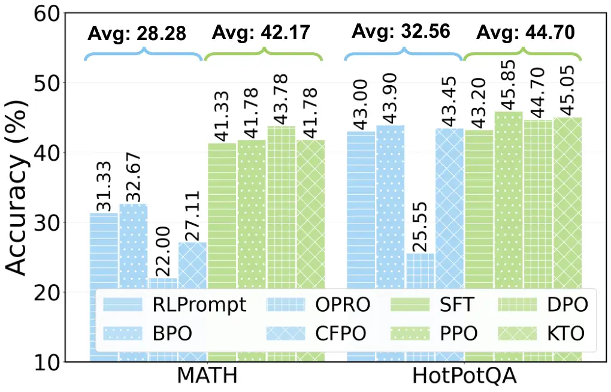

(a) Prompt optimization vs. fine-tuning.

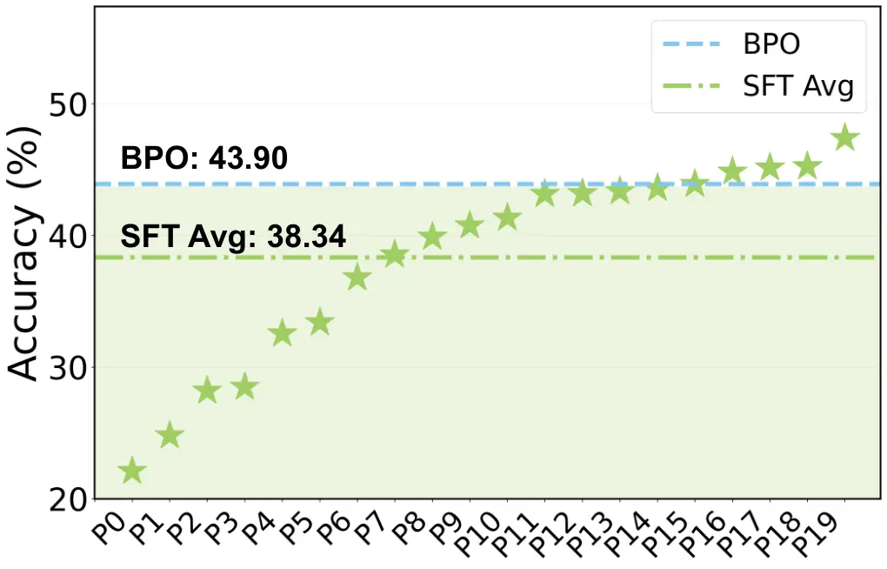

(b) SFT with different prompts on HotpotQA.

Figure 1: Preliminary analysis of prompt optimization and fine-tuning
methods. In the left subfigure, we present a comparison between four
representative prompt optimization strategies and four popular
fine-tuning methods. In the right subfigure, we utilize SFT as the
backbone fine-tuning method and further evaluate the model with
different training prompts, where the corresponding results are marked
with stars. Additional details for the implementation can be found in
the Appendix D.1.

Answering the above question is not straightforward. To begin with,
prompt optimization and fine-tuning have different execution processes
and optimization objectives. The former optimizes the model externally
by finding the suitable input context to activate existing knowledge,
while the latter modifies the model internally by updating parameters to
better fit the target data distribution. Effectively reconciling these
differences to combine the two approaches requires careful design. In
addition, prompt optimization is inherently a discrete optimization
problem, whereas fine-tuning operates in a continuous optimization
space. Combining the two, therefore, introduces mixed optimization
challenges, such as non-differentiable gradients. Effectively leveraging
the final supervision signal to address this discrete-continuous
optimization problem remains a significant challenge.

To overcome the above challenges, we propose MetaTuner, a novel
framework for joint prompt optimization and fine-tuning. Our approach
first employs a meta encoder to encode the input query. The resulting
embedding is then fed into two separate decoders—a prompt decoder and a
parameter decoder—which simultaneously generate query-specific prompts
and parameters for downstream large language models. This design allows
the prompts and parameters to share the common knowledge from the meta
encoder, promoting their mutual improvement. Considering that prompt
learning is a discrete process while the parameter training is
continuous, we design a supervised regularization loss to solve the
mixed discrete-continuous optimization problem. Specifically, we first
select the optimal rollout prompts to optimize the prompt decoder in a
supervised learning manner, and then share the parameters of the prompt
and parameter decoders for joint differentiable training.

The main contributions of this paper are summarized as follows: (1) We
propose the idea of jointly optimizing the prompts and parameters of
LLMs to leverage their complementary strengths and mitigate each other’s
weaknesses. (2) To realize this idea, we introduce a framework called
MetaTuner, which unifies the prompt and parameter generation processes
to enhance the overall task performance. (3) We design a supervised
regularization objective to address the non-differentiability challenge
and effectively optimize the MetaTuner framework. (4) We conduct
extensive experiments on MATH, GSM8K, HotpotQA, and CosmosQA to
demonstrate the effectiveness and robustness of our approach.

## 2 Problem Formulation

In the post-training of LLMs, we typically work with an input-output
pair $`(x,y)`$, where $`x`$ represents a question such as “What is the
capital of France?”, and $`y`$ corresponds to the expected answer like
“Paris”. Unlike traditional machine learning models, LLMs often require
an additional prompt $`p`$ to rephrase the input $`x`$ in a way that
better guides the model to generate the desired output $`y`$. In the
example above, $`p`$ could be “Answer the following question briefly:”.
Let $`\mathcal{M}`$ be the language model, the overall process can be
written as:

```math
\displaystyle{y}=\mathcal{M}(p,x), \tag{1}
```

To enhance the capability of $`\mathcal{M}`$, there are two primary
research directions: (1) Prompt optimization. The core idea of this
approach is to find an optimal prompt $`p`$ that facilitates more
accurate prediction of $`y`$. Given a loss function $`\mathcal{L}`$, the
objective can be formulated as:

```math
\displaystyle\min_{p_{i}}\sum_{i=1}^{N}\mathcal{L}(\mathcal{M}(p_{i},x_{i}),y_{i}), \tag{2}
```

where $`D=\{(x_{i},y_{i})\}_{i=1}^{N}`$ denotes the set of input-output
pairs. We use the subscript $`i`$ in $`p_{i}`$ to indicate that the
prompt is input-sensitive. However, depending on the specific
application, a shared or unified prompt across all inputs is also a
natural extension. (2) Fine-tuning. This method regards the LLM as a
traditional machine learning model, and optimizes its parameters based
on the given input-output pairs. In specific, the objective is
formulated as follows:

```math
\displaystyle\min_{\theta}\sum_{i=1}^{N}\mathcal{L}(\mathcal{M}_{\theta}(p_{i},x_{i}),y_{i}), \tag{3}
```

where we use $`\theta`$ to represent the parameters of the large
language model.

Previous studies have employed various strategies (Li et al., 2023b;
Rafailov et al., 2023; Ethayarajh et al., 2024; Yang et al., 2024a;
Cheng et al., 2024; Deng et al., 2022; Liu et al., 2024a; Meng et al., 2024) to instantiate objectives (2) and (3), respectively. Here, we take
a different perspective by formulating them within a unified framework,
laying the foundation for letting prompt optimization and fine-tuning
mutually enhance each other. Specifically, we regard the prompt as a
“special parameter”, then objectives (2) and (3) can be unified by the
following loss function:

```math
\displaystyle\min_{\theta,p_{i}}\sum_{i=1}^{N}\mathcal{L}(\mathcal{M}_{\theta}(p_{i},x_{i}),y_{i}). \tag{4}
```

Compared with previous studies, this loss function considers prompts and
model parameters as two complementary dimensions that jointly influence
the prediction from $`x_{i}`$ to $`y_{i}`$. By optimizing them within a
unified objective, we are actually finding the optimal combinations
between the prompts and parameters to better fit specific tasks. The
loss function can help to regularize any sub-optimal choices in either
the prompt or parameter space. Readers may find that the above objective
can also be applied to soft-prompting strategies (Liu et al., 2024b; Liu
et al., 2022; Li and Liang, 2021; Lester et al., 2022; Lester et al.,
2021). However, in this paper, we focus on generating explicit prompts,
because the natural language prompts are more explainable, transparent,
and human-friendly.

## 3 The MetaTuner Framework

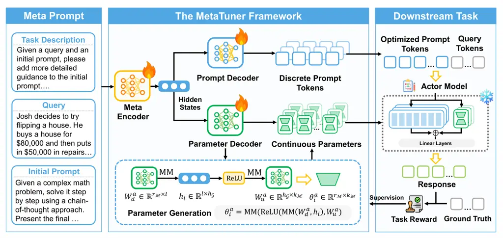

Figure 2: Illustration of the MetaTuner framework. The input query is
first encoded by the meta encoder, and then two parallel decoders are
utilized to generate the prompts and parameters, respectively, which are
finally applied to the downstream actor model for problem solving.

The overall architecture of our framework can be seen in Figure 2. We
first design a neural network with continuous parameters to generate
prompts, effectively transforming the discrete optimization problem into
a continuous task. Next, we unify prompt optimization and fine-tuning by
introducing a shared meta encoder that simultaneously produces input
prompts and model parameters, allowing mutual adaptation to better fit
the training samples. Finally, we design a supervised regularization
loss to address the non-differentiable problem, enabling effective and
stable framework optimization.

### 3.1 Prompt Generation with Continuous Neural Network

In practice, a prompt typically consists of dozens or even hundreds of
words. Generating such a prompt entirely from scratch, without any
reference, poses a significant challenge. To mitigate this difficulty,
we first identify an initial prompt—albeit potentially sub-optimal—and
then leverage a large language model (LLM) to rewrite it, thereby
simplifying the prompt generation task. To reduce the effort of
assigning an independent initial prompt to each input $`x_{i}`$, we let
the LLM automatically explore the prompt space, starting from the same
initial prompt. Formally, let $`\mathcal{G}`$ denote the model for
prompt generation, then the rewritten prompt is represented as follows:

```math
\displaystyle{p}_{i}=\mathcal{G}_{\phi}(\tilde{p},{x}_{i}), \tag{5}
```

where we use $`\phi`$ to indicate the learnable parameters of
$`\mathcal{G}`$, and $`\tilde{p}`$ is the predefined initial prompt.
Based on equation (5), the objective (4) for LLM training is improved as
follows:

```math
\displaystyle\min_{\theta,\phi}\sum_{i=1}^{N}\mathcal{L}(\mathcal{M}_{\theta}(\mathcal{G}_{\phi}(\tilde{p},{x}_{i}),x_{i}),y_{i}), \tag{6}
```

where the optimizable parameters $`\theta`$ and $`\phi`$ are all
continuous.

### 3.2 Joint Prompt and Parameter Generation

Intuitively, both prompts and model parameters aim to enhance the
prediction of outputs $`y_{i}`$ from given inputs $`x_{i}`$, and are
therefore expected to share common underlying knowledge. Furthermore, as
outlined in the introduction, prompt optimization and fine-tuning each
exhibit distinct limitations. This motivates the need for a principled
approach that enables the two strategies to complement one another and
mitigate each other’s shortcomings.

To incorporate the above intuitions into our model design, we do not
treat $`\theta`$ as independent parameters. Instead, we generate them
using a neural network. This approach allows us to share parameters
between the prompt generation and parameter generation models, thereby
establishing a common foundation for both prompt optimization and
fine-tuning. Formally, we partition the parameters of the prompt
generation model $`\mathcal{G}`$ into two components:
$`\phi=\{\phi_{s},\phi_{p}\}`$. Here, $`\phi_{s}`$ denotes the shared
parameters, which are also utilized for LLM parameter generation, while
$`\phi_{p}`$ refers to the parameters exclusively used for prompt
generation. We denote the model for LLM parameter generation as
$`\mathcal{F}`$, and its parameters are also separated into two parts
$`\{\phi_{s},\phi_{q}\}`$, where $`\phi_{q}`$ is tailored to generating
LLM parameters. Based on these formulation, we further improve
objective (4) to obtain the final optimization target as follows:

```math
\displaystyle\min_{\phi_{s},\phi_{p},\phi_{q}}\sum_{i=1}^{N}\mathcal{L}(\mathcal{M}_{\mathcal{F}_{(\phi_{s},\phi_{q})}(\tilde{p},{x}_{i})}(\mathcal{G}_{(\phi_{s},\phi_{p})}(\tilde{p},{x}_{i}),x_{i}),y_{i}). \tag{7}
```

In this target, fine-tuning and prompt optimization are connected
through a shared-private parameterization mechanism. On one hand, the
shared parameters $`\phi_{s}`$ enable mutual regularization between the
two approaches—any sub-optimal solution from one can be corrected by the
other under the unified loss function. On the other hand, the private
parameters $`\phi_{p}`$ and $`\phi_{q}`$ provide each approach with the
flexibility to independently explore and identify its own optimal
solutions.

### 3.3 Optimization with Supervised Regularization

In the above objective (7), the outputs of the prompt generation model
$`\mathcal{G}`$ are discrete tokens, which makes it hard to directly
compute the gradient of $`\phi_{p}`$. To address this challenge, we
further introduce a surrogate loss based on supervised regularization as
follows:

```math
\displaystyle\min_{\phi_{s},\phi_{p},\phi_{q}}\sum_{(x_{i},y_{i})\in D_{1}}\mathcal{L}(\mathcal{M}_{\mathcal{F}_{(\phi_{s},\phi_{q})}(\tilde{p},{x}_{i})}(\mathcal{G}_{(\phi_{s},{\phi}^{\prime}_{p})}(\tilde{p},{x}_{i}),x_{i}),y_{i})+\sum_{(x_{i},p_{i})\in D_{2}}\alpha\cdot\mathcal{L}(\mathcal{G}_{(\phi_{s},\phi_{p})}(\tilde{p},{x}_{i}),p_{i}). \tag{8}
```

In this objective, the first term is identical to (7), except that the
private parameters used to generate the prompt (_i.e._,
$`{\phi}^{\prime}_{p}`$) are kept fixed. The second term acts as a
regularizer, optimizing $`\phi_{s}`$ and $`\phi_{p}`$ under a supervised
learning paradigm. Here, $`D_{1}`$ denotes the original training
dataset, while $`D_{2}`$ is an expert dataset in which each $`p_{i}`$
yields the correct $`y_{i}`$ given $`x_{i}`$. After several optimization
batches, $`{\phi}^{\prime}_{p}`$ is updated using $`\phi_{p}`$. In
practice, one can optimize the above two terms either separately in
sequence or jointly as a single loss. We evaluate both of these
implementations in our experiments.

To address the above non-differentiable problem, we also explored
strategies such as Gumbel-Softmax (Jang et al., 2017), but these methods
generally produced inferior performance. We speculate that our
supervised regularizer is more effective because it provides direct
supervision on the optimal prompts, avoiding intermediate softening
steps or approximations.

### 3.4 Framework Specification

In the above sections, we outlined the general design principles of our
framework. In this section, we turn to the implementation details, with
a particular focus on the key components $`\mathcal{G}`$ and
$`\mathcal{F}`$.

Specification of $`\mathcal{G}`$. In our framework, an LLM such as
Qwen2.5-7B (Team, 2024) is selected as the implementation of
$`\mathcal{G}`$. In specific, we use the first $`k`$ decoder layers as
the meta encoder (_i.e._, $`\phi_{s}`$), while the subsequent layers
serve as the prompt decoder (_i.e._, $`\phi_{p}`$). We denote the hidden
states by $`h_{i}\in\mathbb{R}^{l\times h_{\mathcal{G}}}`$, where $`l`$
represents the input sequence length and $`h_{\mathcal{G}}`$ corresponds
to the hidden size.

Specification of $`\mathcal{F}`$. For training efficiency, we adopt
LoRA (Hu et al., 2022) to fine-tune the downstream LLMs, with
$`\mathcal{F}`$ responsible for generating the LoRA parameters.
Specifically, let $`\Delta W=\theta_{i}^{b}\cdot\theta_{i}^{a}`$ denote
the update matrix, where
$`\theta_{i}^{b}\in\mathbb{R}^{d_{\mathcal{M}}\times r_{\mathcal{M}}}`$
and
$`\theta_{i}^{a}\in\mathbb{R}^{r_{\mathcal{M}}\times k_{\mathcal{M}}}`$.
$`\mathcal{F}`$ first share the same $`\phi_{s}`$ with $`\mathcal{G}`$
to produce $`h_{i}`$. After that, we derive $`{\theta}^{b}_{i}`$ and
$`{\theta}^{a}_{i}`$ from the hidden states $`h_{i}`$ as follows:

```math
\displaystyle{\theta}^{b}_{i} \displaystyle=\text{MM}(\text{ReLU}(\text{MM}(W_{d}^{b},h_{i})),W_{u}^{b}), \tag{9}
```

```math
\displaystyle{\theta}^{a}_{i} \displaystyle=\text{MM}(\text{ReLU}(\text{MM}(W_{d}^{a},h_{i})),W_{u}^{a}),
```

where
$`\phi_{q}=\{W_{d}^{b}\in\mathbb{R}^{d_{\mathcal{M}}\times l},W_{u}^{b}\in\mathbb{R}^{h_{\mathcal{G}}\times r_{\mathcal{M}}},W_{d}^{a}\in\mathbb{R}^{r_{\mathcal{M}}\times l},W_{u}^{a}\in\mathbb{R}^{h_{\mathcal{G}}\times k_{\mathcal{M}}}\}`$
is the parameter decoder. ReLU is the activation function, and MM
denotes the matrix multiplication operation.

## 4 Experiments

In this section, we conduct extensive experiments to demonstrate the
effectiveness of our framework, where we focus on the following research
questions (RQ):

- •
  RQ1: Can MetaTuner achieve better performance than existing
  state-of-the-art methods?
- •
  RQ2: Do the different components of our framework contribute to the
  final performance?
- •
  RQ3: Is the shared-private co-optimization structure in our framework
  effective?
- •
  RQ4: Is the supervised regularization loss effective in enhancing
  model performance?
- •
  RQ5: Can the capabilities of our framework generalize effectively to
  unseen datasets?
- •
  RQ6: How does MetaTuner perform compared to the soft co-optimization
  approach?

In the following, we answer the above questions by reporting and
analyzing the experiment results.

### 4.1 Experimental Setup

Datasets and metrics. We evaluate MetaTuner on four datasets:
MATH (Hendrycks et al., 2021) and GSM8K (Cobbe et al., 2021) for
mathematical reasoning, HotpotQA (Yang et al., 2018) and CosmosQA (Li et
al., 2023a) for multi-hop and commonsense question answering. Each
dataset is divided into training, development, and test sets, with
details of the splits provided in the Appendix D.2. We report the exact
match (EM) accuracy for MATH, GSM8K, and CosmosQA, while for HotpotQA,
we adopt the F1 accuracy following the implementation of (Bo et al.,
2024; Yao et al., 2024).

Baselines. We compare MetaTuner with a series of state-of-the-art
approaches, including: (1) Vanilla Methods: Qwen2.5 (Team, 2024) is
employed as an essential baseline to directly answer queries under the
zero-shot setting. (2) Prompt Optimization Methods: RLPrompt (Deng et
al., 2022), BPO (Cheng et al., 2024), OPRO (Yang et al., 2024a), and
CFPO (Liu et al., 2025a). For RLPrompt and BPO, we use Qwen2.5 as the
base prompt generator, while for LLM-based methods such as OPRO and
CFPO, we use state-of-the-art proprietary LLMs as the prompt optimizer.
(3) Fine-Tuning Methods: SFT, PPO (Ouyang et al., 2022), DPO (Rafailov
et al., 2023), and KTO (Ethayarajh et al., 2024). For RL-based methods
(PPO, DPO, and KTO), we first perform SFT as a warm-up stage and then
construct alignment data following SPIN (Chen et al., 2024). (4) Hybrid
Methods: BetterTogether (Soylu et al., 2024) is a hybrid method that
iteratively optimizes the prompts and weights. However, it does not
incorporate the parameter generation network and knowledge-sharing
mechanism. As mentioned in the Section 3.2, we optimize our model with
two strategies: In MetaTuner-I, we adopt a sequential optimization
strategy, where the two terms in Equation 8 are optimized alternatively.
In MetaTuner-J, we optimize Equation 8 in a unified manner.

Implementation details. We use Qwen2.5-7B and Qwen2.5-3B as the prompt
generator $`\mathcal{G}`$ and the downstream actor model
$`\mathcal{M}`$. Prior to joint training, we initiate an SFT stage to
warm up $`\mathcal{G}`$ and $`\mathcal{M}`$ respectively. The training
is carried out through Llama-Factory (Zheng et al., 2024), with the
epoch set to $`1`$, batch size set to $`64`$, and the learning rate
tuned in {1$`e`$-3, 5$`e`$-4, 1$`e`$-4, 5$`e`$-5}. Details of the stage
can be found in the Appendix D.2. We then search the depth $`k`$ of
$`\phi_{s}`$ in $`\{K/4,K/2,3K/4,K\}`$ to determine the model structure,
where $`K`$ denotes the number of decoder layers in $`\mathcal{G}`$. In
the training process, we search $`r_{\mathcal{M}}`$ in {4, 8, 16, 32},
$`\alpha`$ in {0.1, 0.5, 0.9}, the temperature $`t`$ for online rollouts
in {0, 0.3, 0.5, 0.7, 0.9}, and the learning rate in {1$`e`$-5,
5$`e`$-6, 1$`e`$-6, 5$`e`$-7}. Additionally, we introduce a
hyper-parameter $`\lambda`$ to scale the generated LoRA before adding it
to the original model weights, and search $`\lambda`$ over {0.01, 0.05,
0.1, 0.5}. During the inference stage, we employ greedy decoding to
ensure reproducibility. All the experiments are conducted on eight 80G
GPUs.

|                             |            |       |          |          |            |       |          |          |
| --------------------------- | ---------- | ----- | -------- | -------- | ---------- | ----- | -------- | -------- |
|                             | Qwen2.5-7B |       |          |          | Qwen2.5-3B |       |          |          |
| Methods                     | MATH       | GSM8K | HotpotQA | CosmosQA | MATH       | GSM8K | HotpotQA | CosmosQA |
| Vanilla Methods             |            |       |          |          |            |       |          |          |
| Qwen2.5                     | 18.44      | 51.63 | 19.85    | 36.80    | 17.11      | 49.36 | 3.95     | 25.00    |
| Prompt Optimization Methods |            |       |          |          |            |       |          |          |
| RLPrompt                    | 31.33      | 53.15 | 43.00    | 81.20    | 22.67      | 45.94 | 33.15    | 67.15    |
| BPO                         | 32.67      | 58.00 | 43.90    | 82.05    | 26.44      | 53.90 | 40.45    | 72.90    |
| OPRO                        | 22.00      | 75.06 | 25.55    | 69.10    | 21.00      | 62.62 | 10.55    | 69.35    |
| CFPO                        | 27.11      | 55.64 | 43.45    | 84.80    | 17.78      | 55.27 | 20.05    | 64.20    |
| Fine-Tuning Methods         |            |       |          |          |            |       |          |          |
| SFT                         | 41.33      | 61.41 | 43.20    | 82.65    | 29.33      | 56.18 | 49.00    | 52.05    |
| PPO                         | 41.78      | 62.02 | 45.85    | 84.10    | 34.22      | 55.95 | 51.30    | 52.25    |
| DPO                         | 43.78      | 63.68 | 44.70    | 87.90    | 36.59      | 60.42 | 41.50    | 61.20    |
| KTO                         | 41.78      | 62.47 | 45.05    | 85.00    | 33.78      | 57.70 | 46.90    | 58.70    |
| Hybrid Methods              |            |       |          |          |            |       |          |          |
| BetterTogether              | 41.56      | 67.93 | 52.30    | 89.80    | 35.78      | 66.80 | 41.10    | 86.60    |
| MetaTuner-I                 | 48.22      | 78.54 | 55.75    | 92.15    | 40.89      | 73.46 | 59.05    | 86.55    |
| MetaTuner-J                 | 48.67      | 78.92 | 54.56    | 92.25    | 41.33      | 73.08 | 58.85    | 87.15    |

Table 1: Comparing MetaTuner with baselines. We highlight the best and
second-best results.

### 4.2 Overall Performance

The overall comparison is reported in Table 1, where several
observations can be drawn: (1) The hybrid optimization methods
consistently outperform standalone prompt optimization and fine-tuning
methods, highlighting the complementary strengths of prompt and
parameter optimization. (2) Compared to BetterTogether, two variants of
MetaTuner achieve an average relative improvement of 10.15% and 17.08%
under the 7B and 3B backbone settings, respectively. This demonstrates
that our design, featuring a shared meta encoder and a supervised
regularization loss, captures the deeper synergies between prompts and
parameters. (3) On most tasks, the MetaTuner-J variant yields slightly
stronger results than the MetaTuner-I, suggesting that simultaneous
optimization encourages consistent alignment between prompts and
parameters. While on HotpotQA, the MetaTuner-I variant achieves better
performance, with an average absolute improvement of 0.70% across the
two backbone settings. This indicates that alternating updates may
mitigate gradient interference between the two branches, leading to more
stable training, which is particularly beneficial for challenging
optimization scenarios. For subsequent analyses, we primarily focus on
the MetaTuner-J variant.

### 4.3 Ablation Studies

In the above section, we evaluate our model as a whole. In this section,
we would like to see how different components in our model contribute to
the final performance. In specific, we compare our final model with its
three variants: In MetaTuner (w/o F), we remove the fine-tuning
component, that is, omitting the first term in Equation 8. In MetaTuner
(w/o P), we remove the prompt optimization component, that is, omitting
the second term in Equation 8. In MetaTuner (w/o S), we do not share the
parameters between the prompt and parameter decoder, that is, we set
$`k=0`$ and equip $`\mathcal{F}`$ with an independent
$`\phi_{s}^{\prime}`$ with the same structure as $`\mathcal{G}`$. From
the results in Table 2, we can see: Both terms in our supervised
regularization loss play essential roles, since removing either of them
leads to an average absolute accuracy drop of approximately 0.99% and
1.12%, respectively. These findings indicate that, rather than relying
on the training of a single branch to search for the optimal
prompt–parameter combination, jointly training both branches yields
superior performance. Besides, instead of a simple combination of prompt
optimization and fine-tuning, our framework enables two components to
share common parameters in $`\phi_{s}`$ for mutual enhancement. The
inferior performance of MetaTuner (w/o S) compared to the full model
demonstrates the effectiveness of this design.

|                   |            |       |          |          |            |       |          |          |
| ----------------- | ---------- | ----- | -------- | -------- | ---------- | ----- | -------- | -------- |
|                   | Qwen2.5-7B |       |          |          | Qwen2.5-3B |       |          |          |
| Methods           | MATH       | GSM8K | HotpotQA | CosmosQA | MATH       | GSM8K | HotpotQA | CosmosQA |
| MetaTuner (w/o F) | 48.00      | 77.79 | 54.05    | 91.10    | 40.44      | 72.18 | 56.95    | 86.40    |
| MetaTuner (w/o P) | 46.22      | 78.54 | 53.90    | 91.00    | 39.78      | 72.25 | 57.65    | 86.55    |
| MetaTuner (w/o S) | 46.67      | 77.86 | 53.65    | 91.50    | 40.22      | 72.10 | 57.55    | 86.65    |
| MetaTuner         | 48.67      | 78.92 | 54.56    | 92.25    | 41.33      | 73.08 | 58.85    | 87.15    |

Table 2: Ablation Studies. We highlight the most and the second-most
effective modules.

### 4.4 Effectiveness of the Shared-Private Co-Optimization Structure

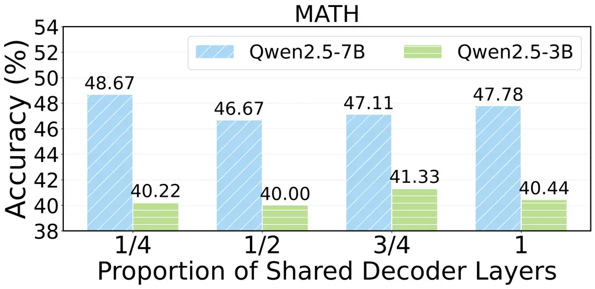

Figure 3: Performance with different proportions of shared decoder
layers.

As demonstrated in the above experiments, parameter sharing between the
fine-tuning and prompt optimization components is important for
performance improvement. To further study the relation between the
amount of shared parameters and the model performance, in this section,
we examine how performance varies with different values of the sharing
depth $`k`$ (introduced in Section 3.4), where $`k`$ is set to
$`\{K/4,K/2,3K/4,K\}`$ and $`K`$ denotes the maximum number of decoder
layers in $`\mathcal{G}`$. From the results in Figure 3, we can observe
that for the 7B model, a smaller sharing ratio (K/4) yields the best
results, whereas for the 3B model, a larger sharing ratio (3K/4)
performs better. This highlights the trade-off between the shared and
private parameters: for the larger 7B model, its representation capacity
is sufficiently strong, and excessive sharing may restrict the
specialization of the prompt and parameter branches. Preserving more
private layers therefore allows the model to better exploit its
potential. In contrast, for the smaller 3B model, a higher sharing ratio
strengthens representational consistency between the two branches,
thereby improving training stability and downstream performance.

### 4.5 Effectiveness of the Supervised Regularization Loss

In our framework, a key design for addressing the mixed
discrete–continuous optimization problem is the incorporation of the
supervised regularizer in the objective (8). To evaluate its
effectiveness, we conduct comprehensive experiments based on four
research questions: (1) Is our method superior to other well-known
differentiable strategies such as Gumbel-Softmax? (2) In selecting the
dataset $`D_{2}`$, should it be derived from the optimized model itself
or from a stronger model? (3) How does the number of rollout samples
affect performance? (4) How does the update frequency of $`\phi_{p}`$
influence the final performance? In the following, we report and analyze
the experiment results.

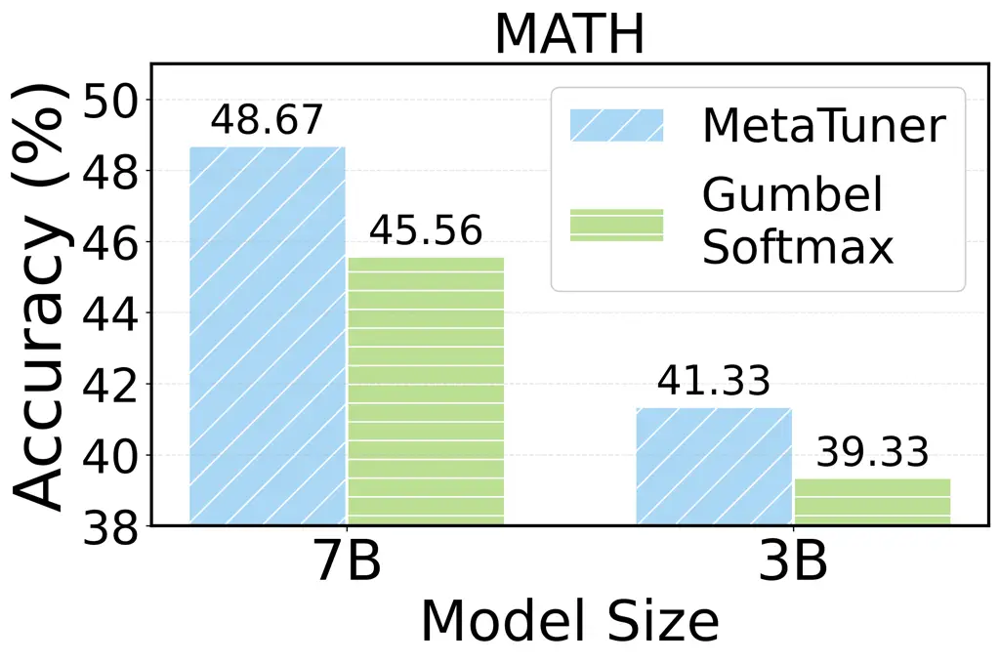

Figure 4: Comparison results between our method with Gumbel-Softmax.

Comparing with other differentiable strategies. We compare our method
with Gumbel-Softmax, where the categorical prompt token sampling is
replaced with a Gumbel-Softmax distribution to enable differentiable
sampling. As shown in Figure 4, our method significantly outperforms
Gumbel-Softmax. The main reason is that Gumbel-Softmax relies on
continuous relaxation to approximate the discrete sampling. Although it
ensures differentiability in theory, such softening operations introduce
gradient bias, so that the generated prompts may deviate semantically
from the truly optimal discrete solutions. In contrast, our methods
directly optimize over the discrete action space, avoiding potential
approximation errors.

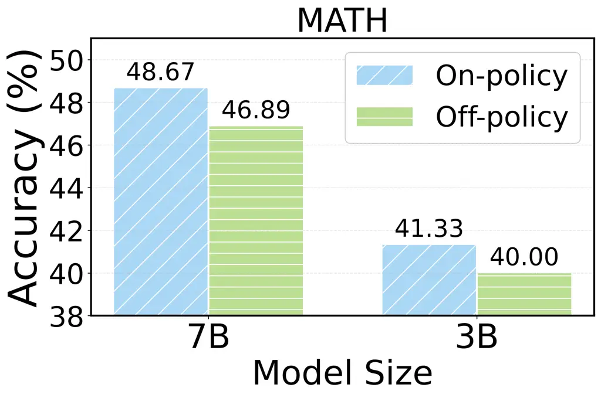

Figure 5: Comparison results between different methods for generating
$`D_{2}`$.

Comparison between different generation methods of $`D_{2}`$. We compare
the performances by generating $`D_{2}`$ using the proprietary expert
LLM or the optimized model itself. As shown in Figure 5, while the
expert method improves training efficiency, our model achieves better
performance. The key reasons are threefold: first, our model ensures
distribution alignment by generating data directly from the current
policy, thereby reducing distribution shift between training and
inference; second, it provides more targeted feedback, as rewards are
based on the model’s own outputs and directly address its weaknesses,
unlike expert samples that may overlook error patterns; third, our model
enables stronger exploration, allowing the policy to continuously
discover new prompts and iteratively refine itself through task
feedback, whereas the expert data remain static and limit long-term
improvement.

Influence of the number of rollout samples. When building $`D_{2}`$, an
important factor is how many rollout samples should be generated for
each query. In this section, we study the relation between this factor
and the model performance. The results in Figure 7 show that as the
number of rollout samples increases, the performance of both model sizes
declines. On one hand, over-exploration may cause the model to
frequently adjust its strategy, and these adjustments may not lead to
short-term performance improvements, potentially interfering with
valuable information the model has already learned. On the other hand,
excessive exploration can cause overfitting, making the model overly
sensitive to noise or irrelevant features in the training data, which
ultimately degrades the downstream performance. Therefore, the number of
rollout samples should be carefully adjusted according to the specific
task and model characteristics to avoid the negative impact of excessive
exploration.

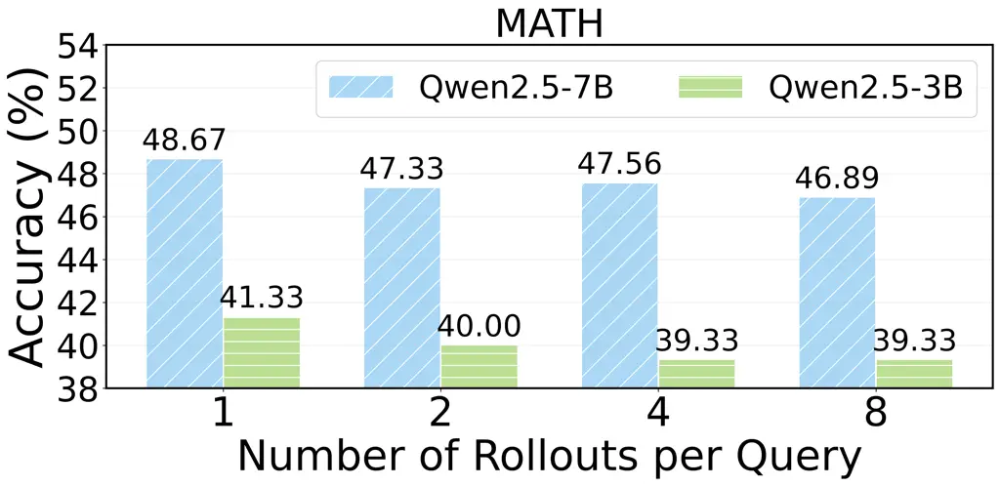

Figure 6: Influence of the rollout number.

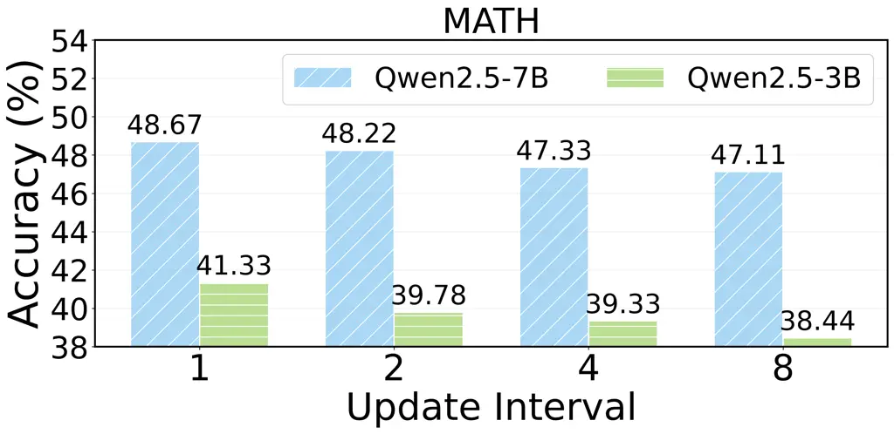

Figure 7: Influence of the update frequency.

Influence of the update frequency of $`\phi_{p}`$. In the first term of
our objective (8), the private parameters $`\phi_{p}`$ for prompt
generation is updated in an asynchronous manner to ensure that the
objective is fully differentiable. Here, we investigate the influence of
different update frequencies and report the results in Figure 7. On the
horizontal axis, the values indicate how many training steps elapse
before $`\phi_{p}`$ used for rollout sampling is replaced with the most
recently trained one. The results on both model sizes consistently show
that sparser updates lead to poorer performance, since frequent updates
allow the sampled prompts to be closely aligned with the current actor
model, thereby providing more effective optimization signals. Moreover,
we observe that the 3B model exhibits a greater performance drop, which
suggests that smaller models are more sensitive to the timeliness of
generated prompts, whereas the 7B model, with its stronger
representational capacity, is more resilient to such lag effects.

### 4.6 Generalization Analysis

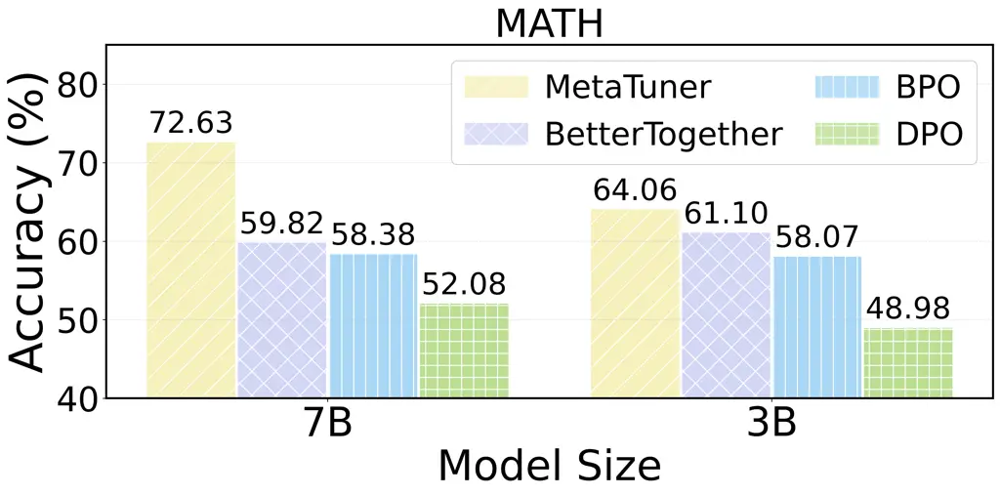

Figure 8: Generalization experiment.

In the above sections, we evaluate our model by training and testing on
the same dataset. To further study the generalization capability of our
method, we conduct out-of-distribution experiments by training the model
on MATH, HotpotQA, and CosmosQA, and evaluate it on GSM8K. For
comparison, we select DPO, BPO, and BetterTogether as the baselines.
From the results in Figure 8, we can see: MetaTuner outperforms all
other methods, confirming the advantage of joint optimization of prompts
and parameters in enhancing the generalization ability. Compared to
BetterTogether, MetaTuner achieves better synergistic optimization,
thereby adapting more effectively to complex and unseen tasks. DPO, as a
fine-tuning method, although effective in parameter adjustment, lacks
support in prompt selection, while BPO, which relies solely on prompt
optimization and fails to fully leverage the model’s capacity, both lead
to poorer generalization performance.

### 4.7 Comparison with Soft Co-Optimization Method

We compare MetaTuner with soft co-optimization methods and report the
results in Figure 9. We employ prefix tuning (Li and Liang, 2021) for
soft prompt optimization, while using LoRA as the fine-tuning approach,
and fine-tune the model with SFT. From the results, we can find that the
optimization of discrete prompts is more stable. Existing work (Bhardwaj
et al., 2022; Razdaibiedina et al., 2023) has shown that soft prompt
tuning can suffer from “representation collapse”, where prompts for
different inputs converge to nearly identical vectors. In MetaTuner, we
optimize discrete prompts, i.e., prompts must take the form of readable
natural language, with each token subject to clear semantic constraints.
This forces the optimization process to search over structured,
human-interpretable instructions rather than arbitrary continuous
vectors, thereby reducing the risk of overfitting.

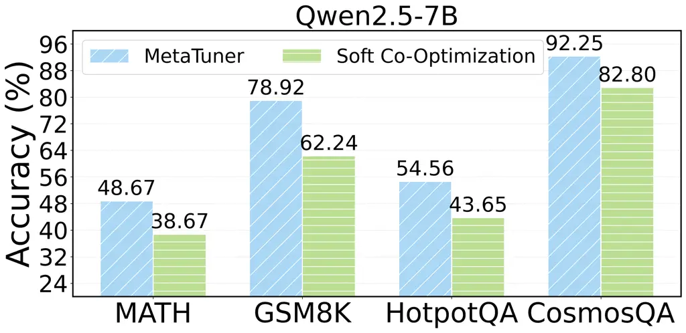

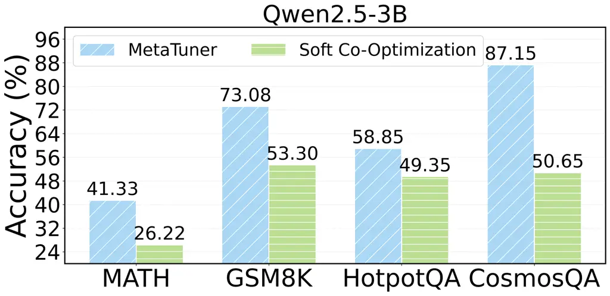

Figure 9: Comparing MetaTuner with Soft Co-Optimization method.

## 5 Related Work

Fine-tuning. Fine-tuning is a standard approach for adapting pre-trained
language models to specific tasks. Recent advances in
parameter-efficient fine-tuning (PEFT) scale this to LLMs by training
small plug-in modules under a frozen backbone. Representative methods
include Adapter Tuning (Houlsby et al., 2019), which inserts lightweight
adapter layers, and LoRA (Hu et al., 2022), which applies low-rank
updates to weight matrices. Building on these, recent works propose
various post-training strategies (Ethayarajh et al., 2024; Guo et al.,
2024; Jung et al., 2024; Xu et al., 2024; Yang et al., 2024a). For
instance, RLHF (Li et al., 2023b) incorporates human feedback to improve
alignment, while DPO (Rafailov et al., 2023) streamlines preference
modeling through contrastive learning.

Prompt optimization. Prompt optimization has become a research hotspot
with the rise of in-context learning. Early works focus on continuous
prompt tuning (Li and Liang, 2021; Lester et al., 2022; Liu et al.,
2024b; Liu et al., 2022; Lester et al., 2021), where learnable vectors
are attached to the input. To mitigate the interpretability
challenge (Wen et al., 2023), recent studies turn to discrete prompt
optimization, which generates prompts in natural language. Existing
approaches fall into two categories. The first employs LLMs as prompt
optimizers (Liu et al., 2025b), typically in a feedback-driven manner,
via strategies such as reflection-based refinement (Yang et al., 2024a;
Yang et al., 2024b; Austin and Chartock, 2024) or Monte Carlo Tree
Search (MCTS) (Wang et al., 2024b; Pryzant et al., 2023; Liu et al.,
2025a). The second (Kong et al., 2024; Juneja et al., 2024; Choi et al.,
2024; Wang et al., 2024b; Chen et al., 2023) trains an auxiliary model
to generate better prompts, most often with reinforcement learning,
since prompts lack explicit ground truth and can be naturally guided by
the task rewards.

Joint optimization. Recently, BetterTogether (Soylu et al., 2024)
proposes to update prompts and model weights together to improve the
task performance. In BetterTogether, prompt optimization and fine-tuning
correspond to discrete and continuous optimization problems,
respectively. During the prompt optimization phase, it samples candidate
demonstration sets from the training data, evaluates them on a
validation set to select the best few-shot prompt. In contrast, the
fine-tuning phase is formulated as a continuous optimization problem,
where supervised fine-tuning is applied to update the model parameters
for better task adaptation. Different from BetterTogether, we first
transform the discrete–continuous optimization into a fully continuous
problem, then propose a knowledge sharing mechanism and a supervised
regularization loss to enable effective end-to-end co-optimization.

## 6 Conclusion

In this paper, we propose MetaTuner, a novel framework that effectively
combines prompt optimization and fine-tuning to enhance the performance
of LLMs. We first introduce a prompt generator to transform the
discrete–continuous optimization problem into a fully continuous one,
and then design a dual-branch framework with a shared meta encoder to
generate prompts and parameters simultaneously. We further propose a
supervised regularization loss to address the non-differentiability
challenge, thereby enabling stable end-to-end training of the framework.
Extensive experiments on four benchmarks demonstrate the effectiveness
and robustness of MetaTuner for joint optimization.

## Acknowledgement

This work is supported in part by National Natural Science Foundation of
China (No. 62472427 and No. 62422215), Major Innovation & Planning
Inter-disciplinary Platform for the “DoubleFirst Class” Initiative,
Renmin University of China, Public Computing Cloud, Renmin University of
China, fund for building world-class universities (disciplines) of
Renmin University of China.

## Reproducibility Statement

We take several steps to ensure the reproducibility of our work.
Firstly, we detail the joint optimization objective and supervised
regularization loss in Sections 3.2 and 3.3, and present the
architectural details in Section 3.4. These descriptions are intended to
make both the methodological design and implementation choices
transparent. Secondly, we document the experimental setup in
Section 4.1, including datasets, evaluation metrics, and training
configurations, to enable the replication of the training and evaluation
procedures. We further elaborate on data splits, the warm-up stage, and
the meta-prompt design in the Appendix D.2 to facilitate replication. We
believe these efforts provide the community with sufficient resources to
reproduce our work and extend it in future research.

## Ethics Statement

The development and deployment of frameworks like MetaTuner, which aim
to enhance the performance of large language models through joint
prompt-parameter optimization, raise several ethical considerations.
First, as with any system based on large-scale language models, there is
a risk of inheriting or amplifying biases present in the training data.
If not carefully addressed, the improved adaptability of MetaTuner could
inadvertently reinforce harmful stereotypes or generate misleading
information. Second, the computational resources required to train and
fine-tune large language models contribute to environmental concerns
related to energy consumption and carbon footprint. Future work should
explore new ways to further reduce the resource demands.

## References

- Austin and Chartock (2024) D. Austin and E. Chartock GRAD-sum:
  leveraging gradient summarization for optimal prompt engineering.
  External Links: 2407.12865 Cited by: §1, §5.
- Bairaktari et al. (2023) K. Bairaktari, G. Blanc, L. Tan, J. Ullman,
  and L. Zakynthinou Multitask learning via shared features: algorithms
  and hardness. In The Thirty Sixth Annual Conference on Learning
  Theory, pp. 747–772. Cited by: §C.2.
- Baxter (2000) J. Baxter A model of inductive bias learning. Journal of
  artificial intelligence research 12, pp. 149–198. Cited by: §C.2.
- Bhardwaj et al. (2022) R. Bhardwaj, A. Saha, S. C. H. Hoi, and S.
  Poria Vector-quantized input-contextualized soft prompts for natural
  language understanding. In Proceedings of the 2022 Conference on
  Empirical Methods in Natural Language Processing, EMNLP 2022, Abu
  Dhabi, United Arab Emirates, December 7-11, 2022, Y. Goldberg, Z.
  Kozareva, and Y. Zhang (Eds.), pp. 6776–6791. External Links:
  [Link](https://doi.org/10.18653/v1/2022.emnlp-main.455),
  [Document](https://dx.doi.org/10.18653/V1/2022.EMNLP-MAIN.455) Cited
  by: §4.7.
- Bo et al. (2024) X. Bo, Z. Zhang, Q. Dai, X. Feng, L. Wang, R. Li, X.
  Chen, and J. Wen Reflective multi-agent collaboration based on large
  language models. In Advances in Neural Information Processing Systems
  38: Annual Conference on Neural Information Processing Systems 2024,
  NeurIPS 2024, Vancouver, BC, Canada, December 10 - 15, 2024,
  pp. 138595–138631. Cited by: §4.1.
- Chen et al. (2023) Y. Chen, Z. Wen, G. Fan, Z. Chen, W. Wu, D. Liu, Z.
  Li, B. Liu, and Y. Xiao MAPO: boosting large language model
  performance with model-adaptive prompt optimization. In Findings of
  the Association for Computational Linguistics: EMNLP 2023, Singapore,
  December 6-10, 2023, pp. 3279–3304. Cited by: §5.
- Chen et al. (2024) Z. Chen, Y. Deng, H. Yuan, K. Ji, and Q. Gu
  Self-play fine-tuning converts weak language models to strong language
  models. In Forty-first International Conference on Machine Learning,
  ICML 2024, Vienna, Austria, July 21-27, 2024, Cited by: §4.1.
- Cheng et al. (2024) J. Cheng, X. Liu, K. Zheng, P. Ke, H. Wang, Y.
  Dong, J. Tang, and M. Huang Black-box prompt optimization: aligning
  large language models without model training. In Proceedings of the
  62nd Annual Meeting of the Association for Computational Linguistics
  (Volume 1: Long Papers), ACL 2024, Bangkok, Thailand, August 11-16,
  2024, pp. 3201–3219. Cited by: §1, §2, §4.1.
- Choi et al. (2024) Y. Choi, S. Bae, S. Ban, M. Jeong, C. Zhang, L.
  Song, L. Zhao, J. Bian, and K. Kim Hard prompts made interpretable:
  sparse entropy regularization for prompt tuning with RL. In
  Proceedings of the 62nd Annual Meeting of the Association for
  Computational Linguistics (Volume 1: Long Papers), ACL 2024, Bangkok,
  Thailand, August 11-16, 2024, pp. 8252–8271. Cited by: §1, §5.
- Chu et al. (2025) Z. Chu, S. Wang, J. Xie, T. Zhu, Y. Yan, J. Ye, A.
  Zhong, X. Hu, J. Liang, P. S. Yu, and Q. Wen LLM agents for education:
  advances and applications. External Links: 2503.11733 Cited by: §1.
- Cobbe et al. (2021) K. Cobbe, V. Kosaraju, M. Bavarian, M. Chen, H.
  Jun, L. Kaiser, M. Plappert, J. Tworek, J. Hilton, R. Nakano, C.
  Hesse, and J. Schulman Training verifiers to solve math word problems.
  External Links: 2110.14168 Cited by: §4.1.
- Deng et al. (2022) M. Deng, J. Wang, C. Hsieh, Y. Wang, H. Guo, T.
  Shu, M. Song, E. P. Xing, and Z. Hu RLPrompt: optimizing discrete text
  prompts with reinforcement learning. In Proceedings of the 2022
  Conference on Empirical Methods in Natural Language Processing, EMNLP
  2022, Abu Dhabi, United Arab Emirates, December 7-11, 2022,
  pp. 3369–3391. Cited by: §1, §2, §4.1.
- D’Eramo et al. (2024) C. D’Eramo, D. Tateo, A. Bonarini, M. Restelli,
  and J. Peters Sharing knowledge in multi-task deep reinforcement
  learning. arXiv preprint arXiv:2401.09561. Cited by: §C.2.
- Ethayarajh et al. (2024) K. Ethayarajh, W. Xu, N. Muennighoff, D.
  Jurafsky, and D. Kiela KTO: model alignment as prospect theoretic
  optimization. External Links: 2402.01306 Cited by: §2, §4.1, §5.
- Ghimire et al. (2024) A. Ghimire, J. Prather, and J. Edwards
  Generative ai in education: a study of educators’ awareness,
  sentiments, and influencing factors. External Links: 2403.15586 Cited
  by: §1.
- Guo et al. (2024) S. Guo, B. Zhang, T. Liu, T. Liu, M. Khalman, F.
  Llinares, A. Rame, T. Mesnard, Y. Zhao, B. Piot, J. Ferret, and M.
  Blondel Direct language model alignment from online ai feedback.
  External Links: 2402.04792 Cited by: §5.
- Hendrycks et al. (2021) D. Hendrycks, C. Burns, S. Kadavath, A.
  Arora, S. Basart, E. Tang, D. Song, and J. Steinhardt Measuring
  mathematical problem solving with the MATH dataset. In Proceedings of
  the Neural Information Processing Systems Track on Datasets and
  Benchmarks 1, NeurIPS Datasets and Benchmarks 2021, December 2021,
  virtual, Cited by: §1, §4.1.
- Houlsby et al. (2019) N. Houlsby, A. Giurgiu, S. Jastrzebski, B.
  Morrone, Q. de Laroussilhe, A. Gesmundo, M. Attariyan, and S. Gelly
  Parameter-efficient transfer learning for NLP. In Proceedings of the
  36th International Conference on Machine Learning, ICML 2019, 9-15
  June 2019, Long Beach, California, USA, Proceedings of Machine
  Learning Research, Vol. 97, pp. 2790–2799. Cited by: §5.
- Hu et al. (2022) E. J. Hu, Y. Shen, P. Wallis, Z. Allen-Zhu, Y. Li, S.
  Wang, L. Wang, and W. Chen LoRA: low-rank adaptation of large language
  models. In The Tenth International Conference on Learning
  Representations, ICLR 2022, Virtual Event, April 25-29, 2022, Cited
  by: §3.4, §5.
- Jang et al. (2017) E. Jang, S. Gu, and B. Poole Categorical
  reparameterization with gumbel-softmax. In 5th International
  Conference on Learning Representations, ICLR 2017, Toulon, France,
  April 24-26, 2017, Conference Track Proceedings, External Links:
  [Link](https://openreview.net/forum?id=rkE3y85ee) Cited by: §3.3.
- Jin et al. (2024) Y. Jin, Z. Li, C. Zhang, T. Cao, Y. Gao, P.
  Jayarao, M. Li, X. Liu, R. Sarkhel, X. Tang, H. Wang, Z. Wang, W.
  Xu, J. Yang, Q. Yin, X. Li, P. Nigam, Y. Xu, K. Chen, Q. Yang, M.
  Jiang, and B. Yin Shopping MMLU: A massive multi-task online shopping
  benchmark for large language models. In Advances in Neural Information
  Processing Systems 38: Annual Conference on Neural Information
  Processing Systems 2024, NeurIPS 2024, Vancouver, BC, Canada, December
  10 - 15, 2024, Cited by: §1.
- Juneja et al. (2024) G. Juneja, N. Natarajan, H. Li, J. Jiao, and A.
  Sharma Task facet learning: a structured approach to prompt
  optimization. External Links: 2406.10504 Cited by: §5.
- Jung et al. (2024) S. Jung, G. Han, D. W. Nam, and K. On Binary
  classifier optimization for large language model alignment. External
  Links: 2404.04656, [Link](https://arxiv.org/abs/2404.04656) Cited by:
  §5.
- Kong et al. (2024) Y. Kong, H. Mao, Q. Zhao, B. Zhang, J. Ruan, L.
  Shen, Y. Chang, X. Wang, R. Zhao, and D. Tao QPO: query-dependent
  prompt optimization via multi-loop offline reinforcement learning.
  External Links: 2408.10504 Cited by: §5.
- Lester et al. (2021) B. Lester, R. Al-Rfou, and N. Constant The power
  of scale for parameter-efficient prompt tuning. In Proceedings of the
  2021 Conference on Empirical Methods in Natural Language Processing,
  EMNLP 2021, Virtual Event / Punta Cana, Dominican Republic, 7-11
  November, 2021, pp. 3045–3059. Cited by: §2, §5.
- Lester et al. (2022) B. Lester, N. Constant, and R. Al-Rfou Guiding
  frozen language models with learned soft prompts. Google AI Blog.
  Cited by: §2, §5.
- Li et al. (2023a) S. Li, J. Chen, and D. Yu Teaching pretrained models
  with commonsense reasoning: a preliminary kb-based approach. External
  Links: 1909.09743 Cited by: §4.1.
- Li and Liang (2021) X. L. Li and P. Liang Prefix-tuning: optimizing
  continuous prompts for generation. In Proceedings of the 59th Annual
  Meeting of the Association for Computational Linguistics and the 11th
  International Joint Conference on Natural Language Processing,
  ACL/IJCNLP 2021, (Volume 1: Long Papers), Virtual Event, August 1-6,
  2021, pp. 4582–4597. Cited by: §2, §4.7, §5.
- Li et al. (2024) Y. Li, S. Ma, X. Wang, S. Huang, C. Jiang, H.
  Zheng, P. Xie, F. Huang, and Y. Jiang EcomGPT: instruction-tuning
  large language models with chain-of-task tasks for e-commerce. In
  Thirty-Eighth AAAI Conference on Artificial Intelligence, AAAI 2024,
  Thirty-Sixth Conference on Innovative Applications of Artificial
  Intelligence, IAAI 2024, Fourteenth Symposium on Educational Advances
  in Artificial Intelligence, EAAI 2014, February 20-27, 2024,
  Vancouver, Canada, pp. 18582–18590. Cited by: §1.
- Li et al. (2023b) Z. Li, Z. Yang, and M. Wang Reinforcement learning
  with human feedback: learning dynamic choices via pessimism. External
  Links: 2305.18438 Cited by: §1, §2, §5.
- Lightman et al. (2024) H. Lightman, V. Kosaraju, Y. Burda, H.
  Edwards, B. Baker, T. Lee, J. Leike, J. Schulman, I. Sutskever, and K.
  Cobbe Let’s verify step by step. In The Twelfth International
  Conference on Learning Representations, ICLR 2024, Vienna, Austria,
  May 7-11, 2024, Cited by: §D.2.
- Liu et al. (2024a) S. Liu, C. Wang, H. Yin, P. Molchanov, Y. F.
  Wang, K. Cheng, and M. Chen DoRA: weight-decomposed low-rank
  adaptation. In Forty-first International Conference on Machine
  Learning, ICML 2024, Vienna, Austria, July 21-27, 2024, Cited by: §2.
- Liu et al. (2022) X. Liu, K. Ji, Y. Fu, W. Tam, Z. Du, Z. Yang, and J.
  Tang P-tuning: prompt tuning can be comparable to fine-tuning across
  scales and tasks. In Proceedings of the 60th Annual Meeting of the
  Association for Computational Linguistics (Volume 2: Short Papers),
  ACL 2022, Dublin, Ireland, May 22-27, 2022, pp. 61–68. Cited by: §2,
  §5.
- Liu et al. (2024b) X. Liu, Y. Zheng, Z. Du, M. Ding, Y. Qian, Z. Yang,
  and J. Tang GPT understands, too. AI Open 5, pp. 208–215. Cited by:
  §2, §5.
- Liu et al. (2025a) Y. Liu, J. Xu, L. L. Zhang, Q. Chen, X. Feng, Y.
  Chen, Z. Guo, Y. Yang, and P. Cheng Beyond prompt content: enhancing
  LLM performance via content-format integrated prompt optimization.
  CoRR abs/2502.04295. External Links:
  [Link](https://doi.org/10.48550/arXiv.2502.04295),
  [Document](https://dx.doi.org/10.48550/ARXIV.2502.04295), 2502.04295
  Cited by: §4.1, §5.
- Liu et al. (2025b) Y. Liu, J. Singh, G. Liu, A. Payani, and L. Zheng
  Towards hierarchical multi-agent workflows for zero-shot prompt
  optimization. External Links: 2405.20252 Cited by: §1, §5.
- Maurer et al. (2016) A. Maurer, M. Pontil, and B. Romera-Paredes The
  benefit of multitask representation learning. Journal of Machine
  Learning Research 17 (81), pp. 1–32. Cited by: §C.2.
- Meng et al. (2024) F. Meng, Z. Wang, and M. Zhang PiSSA: principal
  singular values and singular vectors adaptation of large language
  models. In Advances in Neural Information Processing Systems 38:
  Annual Conference on Neural Information Processing Systems 2024,
  NeurIPS 2024, Vancouver, BC, Canada, December 10 - 15, 2024,
  pp. 121038–121072. Cited by: §2.
- Mou et al. (2025) X. Mou, C. Qian, W. Liu, X. Huang, and Z. Wei
  EcoLANG: efficient and effective agent communication language
  induction for social simulation. External Links: 2505.06904 Cited by:
  §1.
- Ouyang et al. (2022) L. Ouyang, J. Wu, X. Jiang, D. Almeida, C. L.
  Wainwright, P. Mishkin, C. Zhang, S. Agarwal, K. Slama, A. Ray, J.
  Schulman, J. Hilton, F. Kelton, L. Miller, M. Simens, A. Askell, P.
  Welinder, P. F. Christiano, J. Leike, and R. Lowe Training language
  models to follow instructions with human feedback. In Advances in
  Neural Information Processing Systems 35: Annual Conference on Neural
  Information Processing Systems 2022, NeurIPS 2022, New Orleans, LA,
  USA, November 28 - December 9, 2022, S. Koyejo, S. Mohamed, A.
  Agarwal, D. Belgrave, K. Cho, and A. Oh (Eds.), External Links:
  [Link](http://papers.nips.cc/paper%5C_files/paper/2022/hash/b1efde53be364a73914f58805a001731-Abstract-Conference.html)
  Cited by: §4.1.
- Park et al. (2019) W. Park, P. H. Seo, B. Han, and M. Cho Regularizing
  neural networks via stochastic branch layers. In Asian Conference on
  Machine Learning, pp. 678–693. Cited by: §C.2.
- Peng et al. (2024) B. Peng, X. Ling, Z. Chen, H. Sun, and X. Ning
  ECeLLM: generalizing large language models for e-commerce from
  large-scale, high-quality instruction data. In Forty-first
  International Conference on Machine Learning, ICML 2024, Vienna,
  Austria, July 21-27, 2024, Cited by: §1.
- Piao et al. (2025) J. Piao, Y. Yan, J. Zhang, N. Li, J. Yan, X.
  Lan, Z. Lu, Z. Zheng, J. Y. Wang, D. Zhou, C. Gao, F. Xu, F. Zhang, K.
  Rong, J. Su, and Y. Li AgentSociety: large-scale simulation of
  llm-driven generative agents advances understanding of human behaviors
  and society. External Links: 2502.08691 Cited by: §1.
- Pryzant et al. (2023) R. Pryzant, D. Iter, J. Li, Y. T. Lee, C. Zhu,
  and M. Zeng Automatic prompt optimization with "gradient descent" and
  beam search. In Proceedings of the 2023 Conference on Empirical
  Methods in Natural Language Processing, EMNLP 2023, Singapore,
  December 6-10, 2023, H. Bouamor, J. Pino, and K. Bali (Eds.),
  pp. 7957–7968. External Links:
  [Link](https://doi.org/10.18653/v1/2023.emnlp-main.494),
  [Document](https://dx.doi.org/10.18653/V1/2023.EMNLP-MAIN.494) Cited
  by: §5.
- Rafailov et al. (2023) R. Rafailov, A. Sharma, E. Mitchell, C. D.
  Manning, S. Ermon, and C. Finn Direct preference optimization: your
  language model is secretly a reward model. In Advances in Neural
  Information Processing Systems 36: Annual Conference on Neural
  Information Processing Systems 2023, NeurIPS 2023, New Orleans, LA,
  USA, December 10 - 16, 2023, Cited by: §1, §2, §4.1, §5.
- Razdaibiedina et al. (2023) A. Razdaibiedina, A. Khetan, Z. Karnin, D.
  Khashabi, and V. Madan Representation projection invariance mitigates
  representation collapse. In Findings of the Association for
  Computational Linguistics: EMNLP 2023, Singapore, December 6-10,
  2023, H. Bouamor, J. Pino, and K. Bali (Eds.), pp. 14638–14664.
  External Links:
  [Link](https://doi.org/10.18653/v1/2023.findings-emnlp.975),
  [Document](https://dx.doi.org/10.18653/V1/2023.FINDINGS-EMNLP.975)
  Cited by: §4.7.
- Ren et al. (2024) Q. Ren, Z. Jiang, J. Cao, S. Li, C. Li, Y. Liu, S.
  Huo, T. He, and Y. Chen A survey on fairness of large language models
  in e-commerce: progress, application, and challenge. External Links:
  2405.13025 Cited by: §1.
- Soylu et al. (2024) D. Soylu, C. Potts, and O. Khattab Fine-tuning and
  prompt optimization: two great steps that work better together. In
  Proceedings of the 2024 Conference on Empirical Methods in Natural
  Language Processing, EMNLP 2024, Miami, FL, USA, November 12-16, 2024,
  pp. 10696–10710. Cited by: §4.1, §5.
- Tang et al. (2024) J. Tang, H. Gao, X. Pan, L. Wang, H. Tan, D.
  Gao, Y. Chen, X. Chen, Y. Lin, Y. Li, B. Ding, J. Zhou, J. Wang,
  and J. Wen GenSim: a general social simulation platform with large
  language model based agents. External Links: 2410.04360 Cited by: §1.
- Team (2024) Q. Team Qwen2.5: a party of foundation models. External
  Links: [Link](https://qwenlm.github.io/blog/qwen2.5/) Cited by: §3.4,
  §4.1.
- Wang et al. (2025) L. Wang, H. Gao, X. Bo, X. Chen, and J. Wen
  YuLan-onesim: towards the next generation of social simulator with
  large language models. External Links: 2505.07581 Cited by: §1.
- Wang et al. (2024a) S. Wang, T. Xu, H. Li, C. Zhang, J. Liang, J.
  Tang, P. S. Yu, and Q. Wen Large language models for education: a
  survey and outlook. External Links: 2403.18105,
  [Link](https://arxiv.org/abs/2403.18105) Cited by: §1.
- Wang et al. (2024b) X. Wang, C. Li, Z. Wang, F. Bai, H. Luo, J.
  Zhang, N. Jojic, E. P. Xing, and Z. Hu PromptAgent: strategic planning
  with language models enables expert-level prompt optimization. In The
  Twelfth International Conference on Learning Representations, ICLR
  2024, Vienna, Austria, May 7-11, 2024, Cited by: §5.
- Wang et al. (2022) Y. Wang, Z. Zhao, B. Dai, C. Fifty, D. Lin, L.
  Hong, L. Wei, and E. H. Chi Can small heads help? understanding and
  improving multi-task generalization. In WWW ’22: The ACM Web
  Conference 2022, Virtual Event, Lyon, France, April 25 - 29, 2022, F.
  Laforest, R. Troncy, E. Simperl, D. Agarwal, A. Gionis, I. Herman,
  and L. Médini (Eds.), pp. 3009–3019. External Links:
  [Link](https://doi.org/10.1145/3485447.3512021),
  [Document](https://dx.doi.org/10.1145/3485447.3512021) Cited by: §C.2.
- Wen et al. (2023) Y. Wen, N. Jain, J. Kirchenbauer, M. Goldblum, J.
  Geiping, and T. Goldstein Hard prompts made easy: gradient-based
  discrete optimization for prompt tuning and discovery. In Advances in
  Neural Information Processing Systems 36: Annual Conference on Neural
  Information Processing Systems 2023, NeurIPS 2023, New Orleans, LA,
  USA, December 10 - 16, 2023, Cited by: §5.
- Xu et al. (2024) H. Xu, A. Sharaf, Y. Chen, W. Tan, L. Shen, B. V.
  Durme, K. Murray, and Y. J. Kim Contrastive preference optimization:
  pushing the boundaries of LLM performance in machine translation. In
  Forty-first International Conference on Machine Learning, ICML 2024,
  Vienna, Austria, July 21-27, 2024, Cited by: §5.
- Yang et al. (2024a) C. Yang, X. Wang, Y. Lu, H. Liu, Q. V. Le, D.
  Zhou, and X. Chen Large language models as optimizers. In The Twelfth
  International Conference on Learning Representations, ICLR 2024,
  Vienna, Austria, May 7-11, 2024, Cited by: §1, §2, §4.1, §5, §5.
- Yang et al. (2024b) M. Yang, M. Li, Y. Li, Z. Chen, C. Gao, J.
  Zhang, Y. Li, and F. Feng Dual-phase accelerated prompt optimization.
  In Findings of the Association for Computational Linguistics: EMNLP
  2024, Miami, Florida, USA, November 12-16, 2024, pp. 12163–12173.
  Cited by: §D.2, §1, §5.
- Yang et al. (2018) Z. Yang, P. Qi, S. Zhang, Y. Bengio, W. W.
  Cohen, R. Salakhutdinov, and C. D. Manning HotpotQA: A dataset for
  diverse, explainable multi-hop question answering. In Proceedings of
  the 2018 Conference on Empirical Methods in Natural Language
  Processing, Brussels, Belgium, October 31 - November 4, 2018,
  pp. 2369–2380. Cited by: §1, §4.1.
- Yao et al. (2024) W. Yao, S. Heinecke, J. C. Niebles, Z. Liu, Y.
  Feng, L. Xue, R. R. N., Z. Chen, J. Zhang, D. Arpit, R. Xu, P. Mui, H.
  Wang, C. Xiong, and S. Savarese Retroformer: retrospective large
  language agents with policy gradient optimization. In The Twelfth
  International Conference on Learning Representations, ICLR 2024,
  Vienna, Austria, May 7-11, 2024, Cited by: §4.1.
- Zhang et al. (2025) Q. Zhang, F. Lyu, Z. Sun, L. Wang, W. Zhang, W.
  Hua, H. Wu, Z. Guo, Y. Wang, N. Muennighoff, et al. A survey on
  test-time scaling in large language models: what, how, where, and how
  well?. arXiv preprint arXiv:2503.24235. Cited by: §C.2.
- Zheng et al. (2024) Y. Zheng, R. Zhang, J. Zhang, Y. Ye, and Z. Luo
  LlamaFactory: unified efficient fine-tuning of 100+ language models.
  In Proceedings of the 62nd Annual Meeting of the Association for
  Computational Linguistics (Volume 3: System Demonstrations), Y.
  Cao, Y. Feng, and D. Xiong (Eds.), Bangkok, Thailand, pp. 400–410.
  External Links: [Link](https://aclanthology.org/2024.acl-demos.38/),
  [Document](https://dx.doi.org/10.18653/v1/2024.acl-demos.38) Cited by:
  §D.1, §4.1.

## Appendix A LLM Usage

The usage of LLMs in this work includes two aspects: (1) Writing
assistance. We use LLMs to improve the fluency and clarity of certain
parts of the manuscript. All generated text is carefully reviewed,
revised, and validated by the authors to ensure accuracy. (2) Dataset
construction. We employ LLMs as auxiliary tools to generate candidate
prompts as described in the Appendix D.2. After task-reward filtering,
the collected data are used to improve the open-source smaller models’
ability to follow prompt-rewriting instructions. All scientific claims,
methodological designs, implementations, analyses, and conclusions are
original contributions of the authors. LLMs are used solely as
supporting tools, and the authors take full responsibility for the
integrity and accuracy of the work.

## Appendix B Limitations

While MetaTuner presents a promising framework for jointly optimizing
prompts and parameters, there are several limitations that point to
potential directions for future research. First, the RL-based approach
used to address the non-differentiability issue in prompt optimization
relies heavily on task reward signals (e.g., 0/1 accuracy). Such signals
can be overly sparse in certain tasks, which may hinder optimization
efficiency. Future work could explore more fine-grained reward designs,
such as model uncertainty, to provide richer and more informative
optimization signals. Second, MetaTuner generates a dedicated set of
prompt and parameters for each query, which may face computational
challenges in resource-constrained environments. A promising direction
is to integrate the Mixture of Experts (MoE) paradigm: generate and
maintain a fixed pool of expert LoRA modules, and dynamically route each
query to the most suitable expert(s). This design could avoid generating
a new LoRA for every input, thereby improving the efficiency and
scalability.

## Appendix C Additional Experiments

### C.1 Main Results with More Datasets and Base Models

To further validate the effectiveness of MetaTuner across broader
scenarios and model architectures, we conduct additional experiments on
the Checkmate in One Move dataset using multiple base models, including
Llama3.2-3B (Llama-3.2-3B-Instruct), Llama3.1-8B
(Llama-3.1-8B-Instruct), and Mistral-7B (Mistral-7B-Instruct). The
results in Table 3 show that MetaTuner consistently outperforms baseline
methods, demonstrating the efficacy of our proposed prompt–parameter
co-optimization framework, which is built upon parameter sharing and a
supervised regularization loss.

|                             |                       |            |             |             |             |            |
| --------------------------- | --------------------- | ---------- | ----------- | ----------- | ----------- | ---------- |
| Dataset                     | Checkmate in One Move |            |             | MATH        |             |            |
| Base Model                  | Qwen2.5-3B            | Qwen2.5-7B | Llama3.2-3B | Llama3.1-8B | Llama3.2-3B | Mistral-7B |
| Vanilla Methods             |                       |            |             |             |             |            |
| Base Model                  | 0.00                  | 0.00       | 0.00        | 21.33       | 25.11       | 10.89      |
| Prompt Optimization Methods |                       |            |             |             |             |            |
| RLPrompt                    | 0.00                  | 0.00       | 0.00        | 24.00       | 25.56       | 12.00      |
| BPO                         | 0.00                  | 0.86       | 1.43        | 26.22       | 26.22       | 12.44      |
| OPRO                        | 0.00                  | 0.57       | 1.14        | 25.77       | 26.22       | 11.78      |
| CFPO                        | 0.00                  | 0.00       | 1.43        | 25.33       | 27.11       | 11.56      |
| Fine-Tuning Methods         |                       |            |             |             |             |            |
| SFT                         | 13.71                 | 18.00      | 18.85       | 24.44       | 33.11       | 14.00      |
| PPO                         | 14.00                 | 18.29      | 19.43       | 23.78       | 32.22       | 14.67      |
| DPO                         | 13.42                 | 18.86      | 19.14       | 26.44       | 34.00       | 16.00      |
| KTO                         | 14.57                 | 18.57      | 20.00       | 29.78       | 33.56       | 13.78      |
| Hybrid Methods              |                       |            |             |             |             |            |
| BetterTogether              | 15.14                 | 19.71      | 20.57       | 30.44       | 34.44       | 16.44      |
| MetaTuner-J                 | 17.71                 | 20.86      | 21.43       | 31.78       | 18.44       | 35.78      |

Table 3: Main results with more datasets and base models.

### C.2 Additional Generalization Analysis

We provide additional OOD experiments in Figure 10. The results show
that MetaTuner achieves better out-of-distribution generalization
compared to baseline methods. Theoretically, the generalization
capability of our framework stems from the representation sharing
mechanism. In MetaTuner, we can regard prompt generation and parameter
generation as two distinct tasks and enforce them to share a common meta
encoder. This shared-private multi-head architecture inherently induces
a regularization effect (Park et al., 2019; Wang et al., 2022): the
shared encoder must simultaneously support the learning objectives of
multiple heads, compelling it to capture stable, core structural
features that are invariant across tasks and independent of the specific
training distribution. This aligns with classical theoretical results in
multi-task learning (MTL) (Baxter, 2000; Maurer et al., 2016; D’Eramo et
al., 2024; Bairaktari et al., 2023; Zhang et al., 2025): When multiple
tasks share intermediate representations, the effective hypothesis space
of the model is constrained, leading to tighter generalization error
bounds. Intuitively, the model cannot learn highly task-specific,
high-capacity representations independently for each task; instead, all
tasks must find compatible representations within the same shared
feature space. This capacity constraint significantly reduces
overfitting to the idiosyncrasies of the training data distribution,
thereby enhancing generalization across tasks and datasets. We believe
that existing theoretical works on multi-task learning provide a solid
foundation for understanding the generalization properties of MetaTuner.

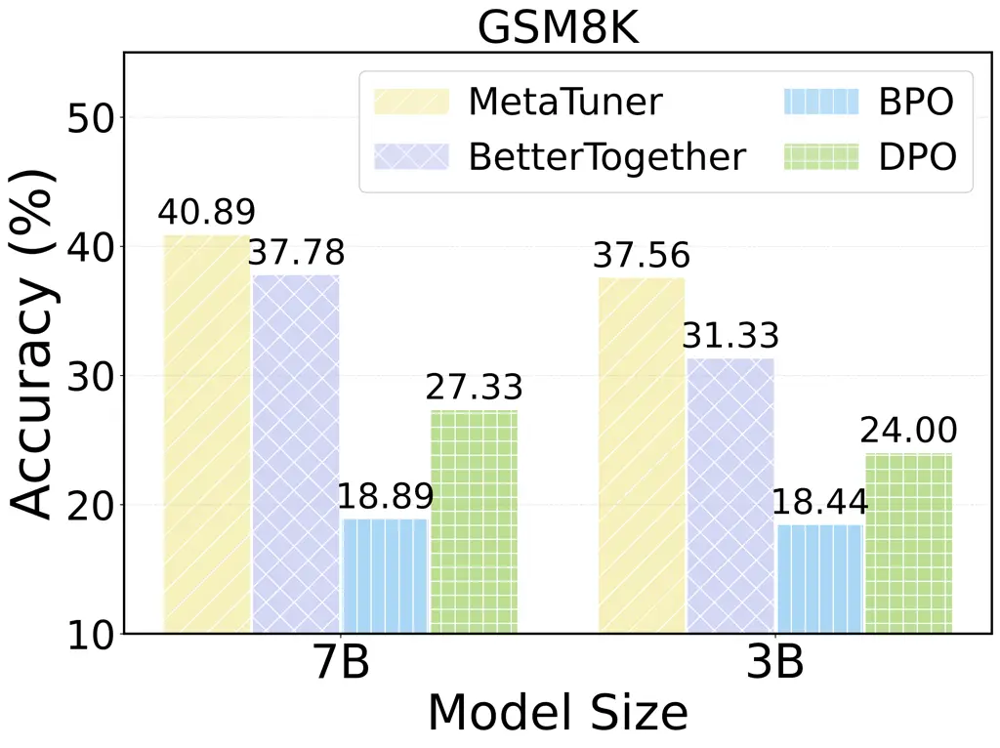

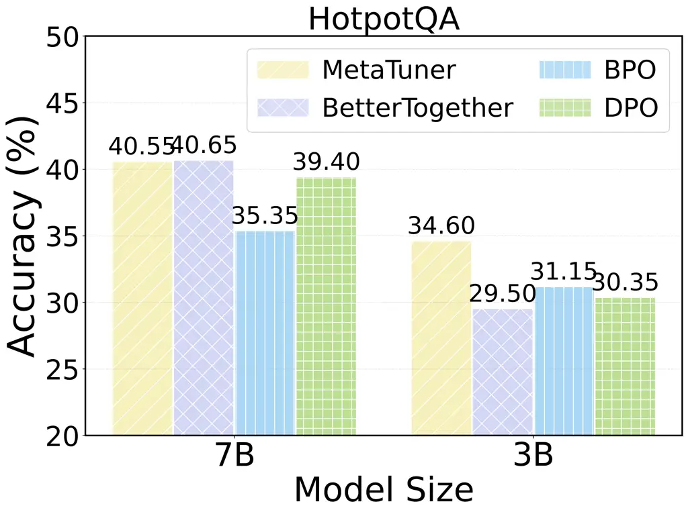

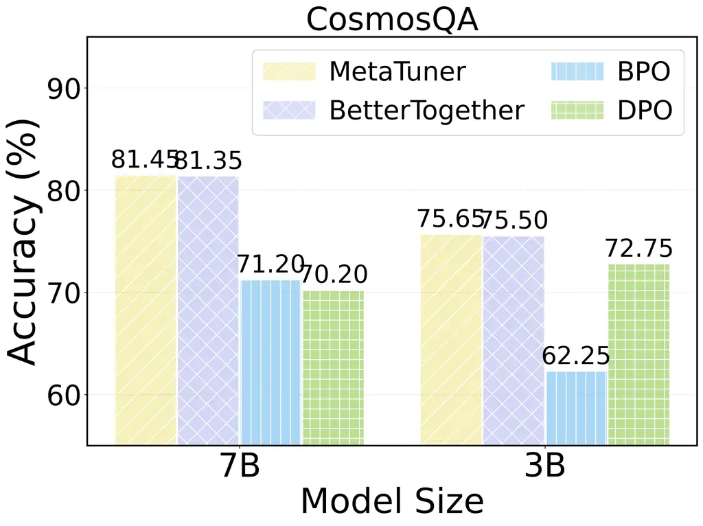

Figure 10: Additional generalization results. We select one dataset from
the four (MATH, GSM8K, HotpotQA, CosmosQA) as the test set and use the
remaining three as the training set.

### C.3 Case Study

Joint optimization for superior reasoning. We present a case from the
MATH dataset in Figure 11 to illustrate the advantages of MetaTuner over
existing methods. Compared with pure prompt optimization approaches such
as BPO, which can produce step-by-step reasoning but often generate
overly lengthy intermediate steps and occasionally commit calculation
errors that lead to incorrect answers, MetaTuner produces reasoning
traces that are both accurate and concise while strictly adhering to the
required output format. This improvement stems from its joint
optimization of prompts and parameters, which allows the model to better
adapt to downstream tasks. In contrast, when compared with traditional
fine-tuning approaches such as DPO, MetaTuner also demonstrates clear
advantages. Although DPO can arrive at the correct numerical solution,
it fails to comply with formatting requirements and tends to generate
relatively rigid and less context-aware reasoning. MetaTuner, by
dynamically generating high-quality prompts that activate relevant
internal knowledge while simultaneously refining model parameters,
effectively combines the strengths of both prompt optimization and
fine-tuning. As a result, MetaTuner achieves more stable, flexible, and
diverse reasoning patterns, demonstrating both correctness and
expressiveness.

Learned prompts for different base models. Below, we provide several
examples in Table 4 to analyze the commonalities and differences of
prompts learned for different base models. As shown in the examples,
both models (Qwen2.5-3B and Qwen2.5-7B) retain the core structure of the
initial prompt (e.g., “step-by-step reasoning,” “answer in \boxed{}”,
and “word limit”), indicating that MetaTuner can stably optimize
instruction formats that respect task constraints across different
models. However, the 7B model tends to generate more task-specific and
procedurally explicit instructions (e.g., for geometry problems,
explicitly instructing “first compute the new dimensions, then calculate
the area change”), whereas the 3B model favors more general guidance
(e.g., “explain the relevant mathematical concepts” or “include a table
or diagram”). We hypothesize that the difference is primarily due to the
varying task-solving capabilities of the base models. For the weaker 3B
model, overly specific instructions risk embedding subtle errors that
can mislead inference. MetaTuner thus learns to generate more robust,
general prompts for smaller models. In contrast, the more capable 7B
model can reliably follow and benefit from detailed, task-specific
guidance, leading MetaTuner to produce finer-grained instructions for
it.

Learned prompts across different tasks. We provide several cases in
Table 5 to demonstrate the learned prompts across different tasks. From
the examples, MetaTuner’s learned prompts exhibit clear cross-task
commonalities and transferable patterns. In MATH and GSM8K, both learned
prompts refine the initial CoT instruction by explicitly guiding step
decomposition, intermediate computation, and clear explanation—despite
differing problem types. In HotpotQA, the prompt preserves the core
principle of concise, evidence-based answering, and sharpened to extract
only task-relevant details while avoiding redundancy. In CosmosQA, the
prompt emphasizes grounding the answer in contextual key details. In
summary, despite differences in task-specific requirements, the prompts
learned by MetaTuner consistently promote clear, logically structured
responses and adapt their instructional details according to the nature
of each task. This indicates that MetaTuner is able to identify and
leverage shared structural patterns across tasks, while tailoring
guidance to individual task needs, thereby enhances the transferability
and adaptability of its prompts across diverse settings.

Figure 11: Case study from the MATH dataset.

| Initial Prompt                                                                                                                                                                                                                       |                                                                                                                                                                                                                                                                                                                                                                                                                                                                                                                                     |
| ------------------------------------------------------------------------------------------------------------------------------------------------------------------------------------------------------------------------------------ | ----------------------------------------------------------------------------------------------------------------------------------------------------------------------------------------------------------------------------------------------------------------------------------------------------------------------------------------------------------------------------------------------------------------------------------------------------------------------------------------------------------------------------------- |
| Given a complex mathematical problem, solve it step by step using a chain-of-thought approach. The answer and reasoning process should not exceed 250 words. Present the final result in LaTeX using a “\boxed{}” without any units. |                                                                                                                                                                                                                                                                                                                                                                                                                                                                                                                                     |
| Case 1                                                                                                                                                                                                                               |                                                                                                                                                                                                                                                                                                                                                                                                                                                                                                                                     |
| Query                                                                                                                                                                                                                                | The lengths of two opposite sides of a square are decreased by 40% while the lengths of the other two sides are increased by 50% to form a rectangle. By what percent does the square’s area decrease?                                                                                                                                                                                                                                                                                                                              |
| Learned Prompt (Qwen2.5-3B)                                                                                                                                                                                                          | Given a complex mathematical problem, solve it step by step using a chain-of-thought approach. The answer and reasoning process should not exceed 250 words. Present the final result in LaTeX using a “\boxed{}” without any units. Additionally, provide a detailed explanation of the mathematical concepts involved in the problem, such as the properties of squares and rectangles, and the relationship between their areas. The explanation should be concise and clear.                                                    |
| Learned Prompt (Qwen2.5-7B)                                                                                                                                                                                                          | Given a complex mathematical problem involving geometric transformations, solve it step by step using a chain-of-thought approach. First, calculate the new dimensions of the rectangle formed by decreasing and increasing the sides of the square. Then, determine the original and new areas of the square and rectangle. Finally, calculate the percentage decrease in the square’s area. The answer and reasoning process should not exceed 250 words. Present the final result in LaTeX using a “\boxed{}” without any units. |
| Case 2                                                                                                                                                                                                                               |                                                                                                                                                                                                                                                                                                                                                                                                                                                                                                                                     |
| Query                                                                                                                                                                                                                                | Find the greatest integer less than ($`\sqrt{7}+\sqrt{5})^{6}`$. (Do not use a calculator!)                                                                                                                                                                                                                                                                                                                                                                                                                                         |
| Learned Prompt (Qwen2.5-3B)                                                                                                                                                                                                          | Given a complex mathematical problem, solve it step by step using a chain-of-thought approach. The answer and reasoning process should not exceed 250 words. Present the final result in LaTeX using a “\boxed{}” without any units. Provide a detailed explanation of the mathematical concepts and techniques used in the solution, including any relevant formulas or theorems. The prompt should also include a table or diagram to illustrate the problem and its solution.                                                    |
| Learned Prompt (Qwen2.5-7B)                                                                                                                                                                                                          | Given a complex mathematical problem, solve it step by step using a chain-of-thought approach. Begin by estimating the values of the square roots involved and then calculate the expression $`(\sqrt{7}+\sqrt{5})^{6}`$. Use algebraic identities and approximations to simplify the process. Ensure that each step is clearly explained and logically follows from the previous one. The answer and reasoning process should not exceed 250 words. Present the final result in LaTeX using a “\boxed{}” without any units.        |

Table 4: Cases of learned prompts with different base models.

Table 4: Cases of learned prompts with different base models.
(Continued)

| MATH           |                                                                                                                                                                                                                                                                                                                                                                                                                                                                                                                                                                                                                                                                                                                                                                                                                                                                                                                                                                                                                                                                                                                                                                                                                                                                                                                                                                                                                                                                                                                                                                                                                                                                                                                                                                                                                                                                                                                                                                                                                                                                                                                                                                                                                                                                                                                                                                                                                                                                                                                     |
| -------------- | ------------------------------------------------------------------------------------------------------------------------------------------------------------------------------------------------------------------------------------------------------------------------------------------------------------------------------------------------------------------------------------------------------------------------------------------------------------------------------------------------------------------------------------------------------------------------------------------------------------------------------------------------------------------------------------------------------------------------------------------------------------------------------------------------------------------------------------------------------------------------------------------------------------------------------------------------------------------------------------------------------------------------------------------------------------------------------------------------------------------------------------------------------------------------------------------------------------------------------------------------------------------------------------------------------------------------------------------------------------------------------------------------------------------------------------------------------------------------------------------------------------------------------------------------------------------------------------------------------------------------------------------------------------------------------------------------------------------------------------------------------------------------------------------------------------------------------------------------------------------------------------------------------------------------------------------------------------------------------------------------------------------------------------------------------------------------------------------------------------------------------------------------------------------------------------------------------------------------------------------------------------------------------------------------------------------------------------------------------------------------------------------------------------------------------------------------------------------------------------------------------------------- |
| Query          | The lengths of two opposite sides of a square are decreased by 40% while the lengths of the other two sides are increased by 50% to form a rectangle. By what percent does the square’s area decrease?                                                                                                                                                                                                                                                                                                                                                                                                                                                                                                                                                                                                                                                                                                                                                                                                                                                                                                                                                                                                                                                                                                                                                                                                                                                                                                                                                                                                                                                                                                                                                                                                                                                                                                                                                                                                                                                                                                                                                                                                                                                                                                                                                                                                                                                                                                              |
| Initial Prompt | Given a complex mathematical problem, solve it step by step using a chain-of-thought approach. The answer and reasoning process should not exceed 250 words. Present the final result in LaTeX using a “\boxed{}” without any units.                                                                                                                                                                                                                                                                                                                                                                                                                                                                                                                                                                                                                                                                                                                                                                                                                                                                                                                                                                                                                                                                                                                                                                                                                                                                                                                                                                                                                                                                                                                                                                                                                                                                                                                                                                                                                                                                                                                                                                                                                                                                                                                                                                                                                                                                                |
| Learned Prompt | Given a complex mathematical problem involving geometric transformations, solve it step by step using a chain-of-thought approach. First, calculate the new dimensions of the rectangle formed by decreasing and increasing the sides of the square. Then, determine the original and new areas of the square and rectangle. Finally, calculate the percentage decrease in the square’s area. The answer and reasoning process should not exceed 250 words. Present the final result in LaTeX using a “\boxed{}” without any units.                                                                                                                                                                                                                                                                                                                                                                                                                                                                                                                                                                                                                                                                                                                                                                                                                                                                                                                                                                                                                                                                                                                                                                                                                                                                                                                                                                                                                                                                                                                                                                                                                                                                                                                                                                                                                                                                                                                                                                                 |
| GSM8K          |                                                                                                                                                                                                                                                                                                                                                                                                                                                                                                                                                                                                                                                                                                                                                                                                                                                                                                                                                                                                                                                                                                                                                                                                                                                                                                                                                                                                                                                                                                                                                                                                                                                                                                                                                                                                                                                                                                                                                                                                                                                                                                                                                                                                                                                                                                                                                                                                                                                                                                                     |
| Query          | Ted the T-Rex was planning to bring potato salad to the dinosaur picnic. He knows that an adult dinosaur will eat 10 lbs of potato salad, and a child will eat half as much as an adult. If there will be 20 adults and 5 children at the picnic, how many pounds of potato salad does Ted need to bring to the picnic if he hopes to have enough to feed everyone?                                                                                                                                                                                                                                                                                                                                                                                                                                                                                                                                                                                                                                                                                                                                                                                                                                                                                                                                                                                                                                                                                                                                                                                                                                                                                                                                                                                                                                                                                                                                                                                                                                                                                                                                                                                                                                                                                                                                                                                                                                                                                                                                                 |
| Initial Prompt | Given a complex mathematical problem, solve it step by step using a chain-of-thought approach.                                                                                                                                                                                                                                                                                                                                                                                                                                                                                                                                                                                                                                                                                                                                                                                                                                                                                                                                                                                                                                                                                                                                                                                                                                                                                                                                                                                                                                                                                                                                                                                                                                                                                                                                                                                                                                                                                                                                                                                                                                                                                                                                                                                                                                                                                                                                                                                                                      |
| Learned Prompt | Solve the following complex mathematical problem step by step using a chain-of-thought approach. Break down the problem into smaller parts, calculate intermediate values, and provide a clear explanation for each step.                                                                                                                                                                                                                                                                                                                                                                                                                                                                                                                                                                                                                                                                                                                                                                                                                                                                                                                                                                                                                                                                                                                                                                                                                                                                                                                                                                                                                                                                                                                                                                                                                                                                                                                                                                                                                                                                                                                                                                                                                                                                                                                                                                                                                                                                                           |
| CosmosQA       |                                                                                                                                                                                                                                                                                                                                                                                                                                                                                                                                                                                                                                                                                                                                                                                                                                                                                                                                                                                                                                                                                                                                                                                                                                                                                                                                                                                                                                                                                                                                                                                                                                                                                                                                                                                                                                                                                                                                                                                                                                                                                                                                                                                                                                                                                                                                                                                                                                                                                                                     |
| Query          | The black cloud’s clinic is full of complex patients who need three referrals apiece. The white cloud’s clinic is full of patients who don’t show up. What finally got me to believe in the power of the black cloud was one resident I worked with last year. One month she was working in the clinic but covering call in the PICU every fourth night (as I am doing this month). Why are you cover call in the PICU this month? A. The schedule for that job rotates monthly and new people have the responsibility of doing it monthly B. I am the best at covering calls at the PICU so I have that job C. None of the above choices. D. I needed to make extra money so I applied for the position                                                                                                                                                                                                                                                                                                                                                                                                                                                                                                                                                                                                                                                                                                                                                                                                                                                                                                                                                                                                                                                                                                                                                                                                                                                                                                                                                                                                                                                                                                                                                                                                                                                                                                                                                                                                            |
| Initial Prompt | Based on the provided context, select the most relevant and accurate option as the correct answer to the question. The answer should be directly related to the context, and must focus on the key details or events described.                                                                                                                                                                                                                                                                                                                                                                                                                                                                                                                                                                                                                                                                                                                                                                                                                                                                                                                                                                                                                                                                                                                                                                                                                                                                                                                                                                                                                                                                                                                                                                                                                                                                                                                                                                                                                                                                                                                                                                                                                                                                                                                                                                                                                                                                                     |
| Learned Prompt | Based on the provided context, select the most relevant and accurate option as the correct answer to the question. Consider the details about the rotation of responsibilities and the nature of the job in the PICU. The answer should be directly related to the context, focusing on the key details or events described.                                                                                                                                                                                                                                                                                                                                                                                                                                                                                                                                                                                                                                                                                                                                                                                                                                                                                                                                                                                                                                                                                                                                                                                                                                                                                                                                                                                                                                                                                                                                                                                                                                                                                                                                                                                                                                                                                                                                                                                                                                                                                                                                                                                        |
| HotpotQA       |                                                                                                                                                                                                                                                                                                                                                                                                                                                                                                                                                                                                                                                                                                                                                                                                                                                                                                                                                                                                                                                                                                                                                                                                                                                                                                                                                                                                                                                                                                                                                                                                                                                                                                                                                                                                                                                                                                                                                                                                                                                                                                                                                                                                                                                                                                                                                                                                                                                                                                                     |
| Query          | (1) UKF is a brand owned by Luke Hood and AEI Media that focuses on sharing all aspects of electronic music. UKF Music was created by Luke Hood, who began sharing bass music through his original two YouTube Channels, UKF Drum & Bass and UKF Dubstep in 2009. On 28 June 2012, UKF celebrated one billion YouTube views since its creation. The UKF brand now has five YouTube Channels: UKF Music, UKF Dubstep, UKF Drum & Bass, UKF Mixes, and UKF Live. UKF has expanded beyond its YouTube Channels to creating compilation series and podcasts, organizing events, offering merchandise as well as its own ticketing platform. (2) Ysabella Brave is an American YouTube personality, artist, vocalist, singer and songwriter signed by Cordless Recordings, a division of the Warner Music Group. She was discovered through the popularity of her YouTube channels, Ysabella Brave and ysabellabravetalk. (3) Steven Jay Williams (born July 24, 1974), also known by his online alias Boogie2988 or just Boogie, is an American YouTube personality best known for his video rants about video games and nerd culture as a character named “Francis”. The Francis character is based on stereotypes of video game players and often parodies trending video game news, reaction and culture. Williams based the character on his early life experiences and has said that he wants viewers to hate the character for embodying gamer stereotypes. Boogie2988 videos range from absurd rants to serious discussions on daily life, such as the ethics of paid promotion on YouTube channels. He won the Trending Gamer award at The Game Awards 2016. (4) Joseph Michael Graceffa (born May 16, 1991) is an American YouTube personality, actor, author, producer, and singer. He has two active YouTube channels, both of which are named after him. One of them is for vlogging and the other is used for video gaming content. They both have a combined total of more than 1.7 billion views. His other YouTube channel, which he no longer uses, called WinterSpringPro, has 60 million views (as of August 2017). He was a contestant on the 22nd and 24th seasons of “The Amazing Race” and has appeared in short films (as web films) and short web television series on YouTube and its subscription-only service YouTube Red. Question: Shane and Friends have interviewed an American YouTube personality who has two active YouTube channels, which have a combined total of how many views? |
| Initial Prompt | Use the relevant information provided to answer the multi-hop reasoning question. Please provide the most accurate and concise answer to the question based on the information provided. The answer should be directly from the dataset, with no extra details or explanations. For yes-no questions, respond with either ‘yes’ or ‘no.’ Avoid long or complex sentences.                                                                                                                                                                                                                                                                                                                                                                                                                                                                                                                                                                                                                                                                                                                                                                                                                                                                                                                                                                                                                                                                                                                                                                                                                                                                                                                                                                                                                                                                                                                                                                                                                                                                                                                                                                                                                                                                                                                                                                                                                                                                                                                                           |
| Learned Prompt | Use the relevant information provided to answer the multi-hop reasoning question. Identify the American YouTube personality mentioned and determine the combined total views of their two active YouTube channels. Provide the most accurate and concise answer directly from the dataset, without extra details or explanations. For yes-no questions, respond with either ‘yes’ or ‘no.’ Avoid long or complex sentences. Focus on extracting the specific information needed to answer the question accurately. Ensure the answer is clear and directly addresses the query.                                                                                                                                                                                                                                                                                                                                                                                                                                                                                                                                                                                                                                                                                                                                                                                                                                                                                                                                                                                                                                                                                                                                                                                                                                                                                                                                                                                                                                                                                                                                                                                                                                                                                                                                                                                                                                                                                                                                     |

Table 5: Cases of learned prompts with Qwen2.5-7B across different
tasks.

Table 5: Cases of learned prompts with Qwen2.5-7B across different
tasks. (Continued)

|            |                |                |              |                |                |
| ---------- | -------------- | -------------- | ------------ | -------------- | -------------- |
| Method     | MetaTuner      | PPO            | DPO          | BPO            | RLPrompt       |
| Qwen2.5-7B | $`\approx`$ 5  | $`\approx`$3.5 | $`\approx`$3 | $`\approx`$3.5 | $`\approx`$2.5 |
| Qwen2.5-3B | $`\approx`$3.5 | $`\approx`$2.5 | $`\approx`$2 | $`\approx`$2   | $`\approx`$1.5 |

Table 6: Training cost of MetaTuner against prompt optimization and
fine-tuning methods (hour).

### C.4 Efficiency Analysis

Training efficiency. We take the MATH dataset as an example to compare
the training overhead of MetaTuner’s joint training process against
conventional prompt optimization and fine-tuning methods. All training
procedures are carried out on two 80GB GPUs, and the associated costs
are reported in Table 6. Since MetaTuner collects training samples
online, to ensure a fair comparison, we include the time required for
additional data collection in the training cost of the baselines as
well. From the results, MetaTuner indeed incurs higher training costs
compared to baseline approaches. However, since this training is
performed only once, we consider the training cost to be practically
acceptable.

Inference efficiency. During the inference stage, for a given query
$`x`$, MetaTuner needs to generate a set of prompts and parameters to
complete the downstream task. Unlike the standard text generation task,
there are additional costs associated with the LoRA parameter
generation. In practice, we generate parameters for the o*proj part of
the decoder layers in the downstream actor model $`\mathcal{M}`$. As
mentioned in Section 3.4, each LoRA parameter is generated by a
hyper-network
$`\phi*{q}=\{W*{d}^{b}\in\mathbb{R}^{d*{\mathcal{M}}\times l},W*{u}^{b}\in\mathbb{R}^{h*{\mathcal{G}}\times r*{\mathcal{M}}},W*{d}^{a}\in\mathbb{R}^{r*{\mathcal{M}}\times l},W*{u}^{a}\in\mathbb{R}^{h*{\mathcal{G}}\times k*{\mathcal{M}}}\}`$.
Therefore, depending on the task scenario and model choice, the
additional cost varies with sequence length $`l`$, the hidden size
$`h*{\mathcal{G}}`$ of the prompt generator, the LoRA rank
$`r*{\mathcal{M}}`$ of the generated parameters, and the number of
decoder layers $`K`$ in the downstream actor model. However, compared to
the parameter quantity of the LLM itself, the hyper-network is
relatively small, so it does not incur significant computational
overhead.

In Table 7 and Table 8, we report the cost of generating prompts and
LoRA parameters, respectively. For reference, we also present the
original inference cost without generating prompts and LoRA parameters,
as well as the average best performance for each category of methods.
From the above results, we can see: (1) Compared to methods with prompt
generation, MetaTuner achieves an absolute performance gain of 5.73% at
the cost of an average additional inference latency of 0.22 seconds. (2)
Compared to Vanilla and Fine-tuning methods, MetaTuner achieves an
absolute performance gain of 10.51% at the cost of an average additional
inference latency of 0.43 seconds.

|                     |             |             |             |             |             |                      |
| ------------------- | ----------- | ----------- | ----------- | ----------- | ----------- | -------------------- |
| Dataset             | MATH        | GSM8K       | HotpotQA    | CosmosQA    | Avg Cost    | Avg Best Performance |
| Answer Generation   | 0.43        | 0.39        | 0.07        | 0.06        | 0.24        | 52.38                |
| +Prompt             | 0.6(+0.17)  | 0.55(+0.16) | 0.23(+0.16) | 0.18(+0.12) | 0.39(+0.15) | 57.57                |
| +Prompt & Parameter | 0.73(+0.30) | 0.66(+0.27) | 0.25(+0.18) | 0.48(+0.42) | 0.53(+0.29) | 65.10                |

Table 7: Average inference cost of Qwen2.5-3B base model per query
(second).

|                     |             |             |             |             |             |                      |
| ------------------- | ----------- | ----------- | ----------- | ----------- | ----------- | -------------------- |
| Dataset             | MATH        | GSM8K       | HotpotQA    | CosmosQA    | Avg Cost    | Avg Best Performance |
| Answer Generation   | 0.71        | 0.68        | 0.14        | 0.11        | 0.41        | 60.30                |
| +Prompt             | 0.99(+0.28) | 0.95(+0.27) | 0.44(+0.30) | 0.36(+0.25) | 0.69(+0.28) | 64.68                |
| +Prompt & Parameter | 1.48(+0.77) | 1.48(+0.80) | 0.47(+0.33) | 0.48(+0.37) | 0.98(+0.57) | 68.60                |

Table 8: Average inference cost of Qwen2.5-7B base model per query
(second).

Improving inference efficiency. To accelerate the inference process, we
further propose MetaTuner-C, which directly clusters the queries in the
test set and then uses the prompt and parameters associated with the
cluster centroid for all samples within that cluster during inference.
Assuming the test set contains N samples and is partitioned into K
clusters, the additional time overhead of MetaTuner-C compared to
vanilla methods can be reduced to $`t=K(t_{p}+t_{q})/N`$, where
$`t_{p}`$ and $`t_{q}`$ denote the time costs for generating the prompt
and parameters for a single query, respectively. Notably, our main
method, MetaTuner-J, can be viewed as a special case of MetaTuner-C when
$`K=N`$. We evaluate MetaTuner-C with various $`K`$ using the Qwen2.5-3B
base model on the MATH dataset and report the results in Table 9 and
Table 10. Our analysis shows that MetaTuner-C achieves strong
performance while significantly reducing inference time. For example,
under the Qwen2.5-3B setting, using the best fine-tuning baseline DPO as
a reference, MetaTuner-C with K=50 attains an absolute performance gain
of 3.41% with only 0.03 seconds of additional latency per query.

|                    |             |                    |                    |                    |       |
| ------------------ | ----------- | ------------------ | ------------------ | ------------------ | ----- |
| Method             | MetaTuner-J | MetaTuner-C (K=50) | MetaTuner-C (K=30) | MetaTuner-C (K=10) | DPO   |
| Performance        | 41.33       | 40.00              | 39.11              | 37.56              | 36.59 |
| Inference Cost (s) | 0.73(+0.30) | 0.46(+0.03)        | 0.45(+0.02)        | 0.437(+0.007)      | 0.43  |

Table 9: Performance of MetaTuner-C with Qwen2.5-3B model on MATH.

|                    |             |                    |                    |                    |       |
| ------------------ | ----------- | ------------------ | ------------------ | ------------------ | ----- |
| Method             | MetaTuner-J | MetaTuner-C (K=50) | MetaTuner-C (K=30) | MetaTuner-C (K=10) | DPO   |
| Performance        | 48.67       | 45.56              | 45.11              | 44.89              | 43.78 |
| Inference Cost (s) | 1.48(+0.77) | 0.80(+0.09)        | 0.76(+0.05)        | 0.73(+0.02)        | 0.71  |

Table 10: Performance of MetaTuner-C with Qwen2.5-7B model on MATH.

## Appendix D Implementation Details

### D.1 Preliminary Experiment

We present the prompts used in the right subfigure of the preliminary
experiment below. For constructing the training data, the prompt $`p`$
is concatenated in front of the query $`x`$ to form the model input,
while the ground truth $`y`$ serves as the expected output. The
supervised fine-tuning process is conducted using Llama-Factory (Zheng
et al., 2024), with the epoch set to 1, the batch size set to 64, and
the learning rate tuned over the values {5$`e`$-4, 1$`e`$-4}.


|            |       |       |          |          |
| ---------- | ----- | ----- | -------- | -------- |
| Base Model | MATH  | GSM8K | HotpotQA | CosmosQA |
| Qwen2.5-7B | 45.33 | 77.48 | 52.20    | 90.05    |
| Qwen2.5-3B | 35.33 | 71.27 | 53.95    | 84.00    |

Table 11: Performance after the warm-up stage.

### D.2 Implementation of MetaTuner

Data splition. We split each dataset into training, validation, and test
sets for model training and evaluation. For MATH, we use the 12K
instances in the training set as specified in (Lightman et al., 2024),
and randomly divide the remaining 500 instances into 50 for validation
and 450 for testing. For GSM8K, the official test set contains 1,319
instances, so we allocate 473 instances for validation and the remaining
7K instances for training. For HotpotQA, we sample 20,000 instances from
the official training set and randomly select 500 for validation and
2,000 for testing from the official dev-set-distractor. For CosmosQA, we
use the entire 25,262 instances in the training set and randomly sample
500 and 2,000 instances from the test set for validation and testing,
respectively.

Details of the warm-up stage. For the warm-up of $`\mathcal{M}`$, we use
the queries $`x`$ from the original dataset as model inputs and the
corresponding ground truth $`y`$ as model outputs for supervised
fine-tuning. For the warm-up of $`\mathcal{G}`$, since there is no
ground truth prompt, we construct the supervised training data with
rejection sampling. Specifically, we first utilize a leading
closed-source LLM to generate expert prompts
$`\mathcal{D}_{\text{expert}}=\{\hat{p}_{i}\}_{i=1}^{N}`$, and then use
the task reward $`\mathcal{R}`$ to filter out positive examples. The
positive samples are then collected as
$`\mathcal{D}_{\text{PO}}=\{(x_{i},\hat{p}_{i})|\mathcal{R}(\mathcal{M}^{*}(\hat{p}_{i},x_{i}))=1\}_{i=1}^{N}`$
for the supervised fine-tuning of prompt generation. Here,
$`\mathcal{M}^{*}`$ and $`\mathcal{G}^{*}`$ represent the model after
warm-up. Naturally, the pre-warmed model can form a pipeline
$`\hat{y_{i}}=\mathcal{M}^{*}(\mathcal{G}^{*}(\tilde{p},x_{i}),x_{i})`$
to complete downstream tasks. We report the results in Table 11.

To further investigate the impact of generated expert data during the
warm-up stage, we additionally study how using a smaller expert dataset
(in Table 12) or a weaker expert model (in Table 13) affects the
MetaTuner’s final performance. Our analysis reveals that MetaTuner
exhibits robust performance under both weaker and smaller expert dataset
settings. As the size of the expert dataset decreases, performance
remains stable both after warm-up and joint training. When a weaker
expert model is used for warm-up, the post-warm-up performance degrades
moderately as the expert model’s capability diminishes. However, this
performance gap is largely mitigated after joint training. This suggests
that the warm-up phase only requires a basic level of prompt-generation
competence. The proposed MetaTuner framework can subsequently discover
superior prompt–parameter combinations during joint training phase,
thereby enhancing overall performance.

|                                  |       |       |       |
| -------------------------------- | ----- | ----- | ----- |
| Data Quantity                    | 100%  | 60%   | 20%   |
| Performance After Warm-up        | 35.33 | 36.67 | 34.44 |
| Performance After Joint Training | 41.33 | 41.33 | 40.89 |

Table 12: Performance of Qwen2.5-3B on MATH with smaller expert
datasets.

|                                  |                 |             |             |
| -------------------------------- | --------------- | ----------- | ----------- |
| Expert Model                     | Proprietary LLM | Qwen2.5-32B | Qwen2.5-14B |
| Performance After Warm-up        | 35.33           | 33.11       | 31.33       |
| Performance After Joint Training | 41.33           | 40.22       | 40.00       |

Table 13: Performance of Qwen2.5-3B on MATH with weaker expert datasets.

Construction of the meta prompts. In this paper, since we adopt a
prompt-rewrite paradigm for prompt generation, each meta prompt contains
a query and an initial prompt, as well as an instruction to describe the
prompt rewrite task. We follow the guidance of (Yang et al., 2024b) to
construct a base version of the prompt for each task as the initial
prompt, which only includes a description of the task and the required
answer format to facilitate answer parsing. For GSM8K, since the base
model already produces highly consistent answer formats, we omit the
answer format requirement in the initial prompt. The meta prompts on
four datasets are presented below.


