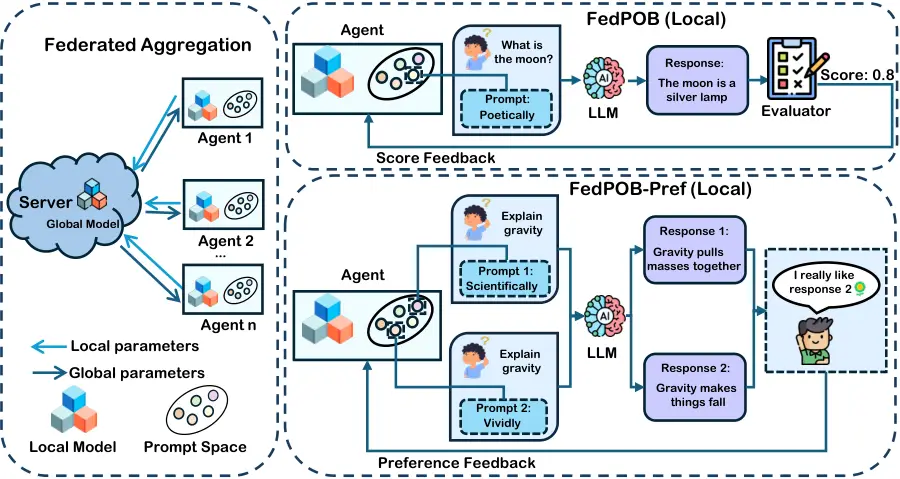
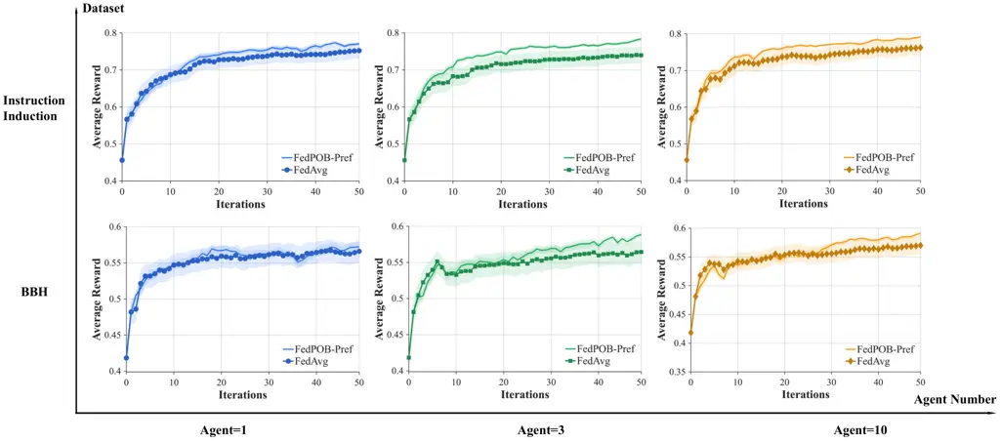
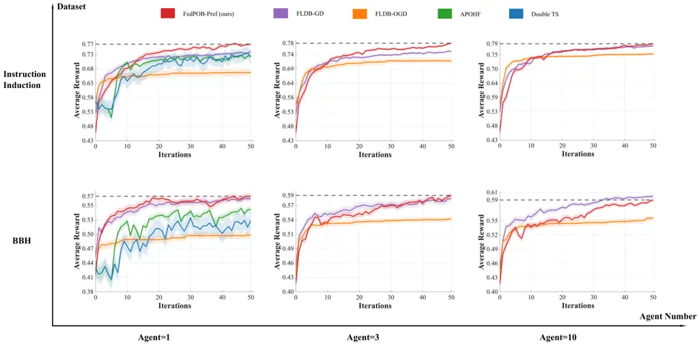
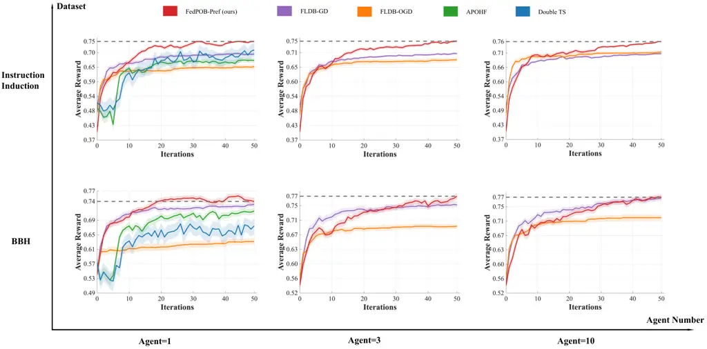
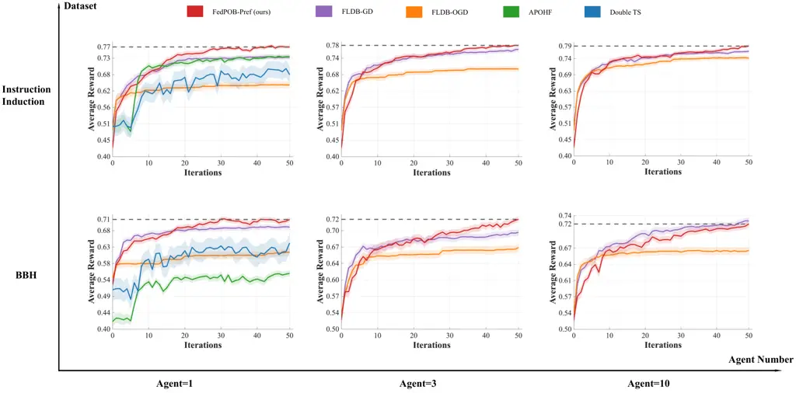

# FedPOB: Sample-Efficient Federated Prompt Optimization via Bandits

Pingchen Lu ^(†)^(†)thanks: Equal contribution. Affiliation: The Chinese
University of Hong Kong, Shenzhen Affiliation: South China University of
Technology    Zhi Hong Affiliation: The Chinese University of Hong Kong,
Shenzhen    Zhiwei Shang Affiliation: The Chinese University of Hong
Kong, Shenzhen    Zhiyong Wang Affiliation: University of Edinburgh   
Yikun Ban, Yao Shu, Min Zhang, Shuang Qiu, Zhongxiang Dai
^(†)^(†)thanks: Corresponding author. Correspondence to
daizhongxiang@cuhk.edu.cn. Affiliation: The Chinese University of Hong
Kong, Shenzhen Affiliation: Beihang University Affiliation: The Hong
Kong University of Science and Technology (Guangzhou) Affiliation: East
China Normal University Affiliation: City University of Hong Kong

###### Abstract

The performance of large language models (LLMs) is highly sensitive to
the input prompt, making prompt optimization a critical task. However,
real-world application is hindered by three major challenges: (1) the
black-box nature of powerful proprietary LLMs, (2) the need for high
sample efficiency due to query costs, and (3) the desire for
privacy-preserving collaboration among multiple users. To address these
challenges simultaneously, we introduce a novel framework for
sample-efficient federated prompt optimization based on multi-armed
bandits (MABs). The MAB framework is uniquely suited for this problem as
it is (1) inherently a black-box optimization method, (2) practically
sample-efficient, and (3) enables collaborative learning with
theoretically guaranteed benefit from more participating agents. We
first propose the _Federated Prompt Optimization via Bandits_ (FedPOB)
algorithm, a federated variant of the Linear UCB algorithm, where agents
collaborate by sharing model parameters instead of raw data. We then
extend our approach to the practical setting of comparative user
feedback by introducing _FedPOB with Preference Feedback_ (FedPOB-Pref),
an efficient algorithm based on federated dueling bandits. Extensive
experiments demonstrate that both FedPOB and FedPOB-Pref significantly
outperform existing baselines and that their performance consistently
improves as more agents participate in the collaboration, validating the
effectiveness of our federated approach.

|     |
| --- |
|     |

## 1 Introduction

Large language models (LLMs) have achieved impressive performance in a
variety of real-world applications (Guo et al., 2025). However, the
performance of LLMs has been shown to be highly sensitive to the input
_prompt_ (Zhou et al., 2023; Lin et al., 2024b). Consequently, _prompt
optimization_, in which we aim to find the best prompt for a task, has
emerged as a critical research area. Despite its growing popularity, the
widespread real-world adoption of prompt optimization is still hindered
by three important challenges.

The first challenge is black-box access. Some of the most powerful LLMs,
such as ChatGPT and Gemini (OpenAI, 2023b; Team et al., 2023), are
proprietary, black-box models that are only accessible via API queries.
This limited access creates an immense challenge to prompt optimization.
The second challenge is sample efficiency. Since querying powerful LLMs
is often costly in both time and financial resources, it is of paramount
importance to develop methods that can identify the optimal prompt for a
given task using a small number of interactions. The third challenge is
enabling collaboration among multiple users. As LLMs become more widely
adopted, a natural and important question arises: how can multiple
users, each with their own prompt optimization tasks, collaborate to
accelerate their progress? A key constraint in such a collaborative
setting is user privacy, as participants are typically unwilling to
share their proprietary data, such as the history of tested prompts and
their corresponding performance scores. This scenario naturally aligns
with the principles of _federated learning_ (FL) (Kairouz et al., 2019;
McMahan et al., 2017), where distributed agents collaborate on their
machine learning tasks without exposing their raw data.

To tackle the combined challenges of black-box access, sample efficiency
and privacy-preserving collaboration, we propose a new class of
federated prompt optimization algorithms built upon the _multi-armed
bandit_ (MAB) framework (Lattimore & Szepesvári, 2020). MABs are
exceptionally well-suited for this problem for three main reasons.
First, MAB algorithms do not require gradient information and are
inherently black-box optimization methods. Second, they are designed to
efficiently balance the exploration-exploitation trade-off, enabling
them to solve complex black-box optimization problems in a
sample-efficient manner, a property that has been successfully leveraged
in recent work on prompt optimization (Lin et al., 2024b; Wu et al.,
2024). Thirdly, federated MAB algorithms (Shi & Shen, 2021; Dubey &
Pentland, 2020; Dai et al., 2023) provide strong theoretical guarantees,
ensuring that performance improves as more agents participate in the
collaboration (Wang et al., 2020).

Our first contribution is the _Federated Prompt Optimization via
Bandits_ (FedPOB) algorithm. This method is based on a federated variant
of the classic Linear Upper Confidence Bound (LinUCB) algorithm
(Abbasi-Yadkori et al., 2011; Wang et al., 2020). In our
FedPOB algorithm, each agent utilizes a pre-trained embedding model to
represent the prompts and a linear model to predict their performance.
Collaboration is achieved by having agents periodically exchange and
aggregate their LinUCB parameters, thereby learning from the collective
experience of all agents without requiring them to share any sensitive
raw data. Importantly, thanks to the solid theoretical guarantees of the
federated LinUCB algorithm (Wang et al., 2020), the performance of our
FedPOB algorithm is theoretically guaranteed to improve with a larger
number of collaborating agents.

In addition, we consider the highly practical setting of prompt
optimization with _preference feedback_, where explicit performance
scores are unavailable and we are only able to observe relative
preference feedback (e.g., the user prefers the response from prompt A
than that from prompt B). This problem was recently introduced by Lin
et al. (2024a) to address scenarios where user feedback is inherently
comparative. To enable sample-efficient federated prompt optimization in
this novel setting, we introduce our second algorithm, _FedPOB with
Preference Feedback_ (FedPOB-Pref). This algorithm is a practical
adaptation and modification of the federated linear dueling bandit
framework proposed by Huang et al. (2025). Specifically, our
FedPOB-Pref algorithm significantly reduces the communication complexity
of the methods from Huang et al. (2025) while maintaining the strong
empirical performance. An overview of both FedPOB and FedPOB-Pref is
illustrated in Fig. 1.



Figure 1: An overview of our proposed federated prompt optimization
frameworks. FedPOB handles direct score feedback, while FedPOB-Pref is
designed for pairwise preference feedback.

We conduct extensive experiments to validate our proposed methods. The
results demonstrate that both FedPOB and FedPOB-Pref achieve
considerably better performance than the previous baseline methods in
various tasks. Furthermore, we empirically verify that the performance
of our algorithms consistently improves as the number of participating
agents increases, highlighting the benefits of our collaborative
approach. In summary, our key contributions are as follows:

- $`\bullet`$
  We propose FedPOB, a novel algorithm for sample-efficient federated
  prompt optimization that enables multiple agents to collaborate on
  finding the best prompts without sharing their raw data.
- $`\bullet`$
  We extend our algorithm to the practical setting of preference-based
  feedback by introducing the FedPOB-Pref algorithm, which is based on
  federated linear dueling bandits.
- $`\bullet`$
  We conduct extensive experiments to validate our approach,
  demonstrating that our algorithms significantly outperform existing
  baselines and scale effectively with more agents.

## 2 Problem Setting

Prompt Optimization. We address the problem of black-box prompt
optimization, where the objective is to find an optimal prompt $`p`$
that maximizes the performance of a black-box LLM on a given task
$`\mathbb{D}=(\mathbb{X},\mathbb{Y})`$. The task consists of a set of
queries $`\mathbb{X}=\{x_{k}\}`$ and their corresponding ground-truth
answers $`\mathbb{Y}=\{y_{k}\}`$. Since the internal parameters of the
black-box LLMs (e.g., GPT-4o-mini) are inaccessible and only API queries
are allowed, we model the performance of the LLM via an external score
function. Specifically, we define

```math
s(p\mid\mathbb{D})=\mathbb{E}_{(x,y)\in\mathbb{D}}\Big[m(\mathrm{LLM}(p,x),y)\Big], \tag{1}
```

in which $`m`$ is a metric function that compares the model response
$`\mathrm{LLM}(p,x)`$ induced by the prompt $`p`$ with the ground-truth
answer $`y`$ and provides a score $`s(p\mid\mathbb{D})`$. The
optimization target is then formulated as

```math
p^{*}=\arg\max_{p\in\mathbb{P}}s(p\mid\mathbb{D}), \tag{2}
```

where $`\mathbb{P}`$ denotes the space of all possible prompts.

Federated Prompt Optimization. We extend the black-box prompt
optimization problem to the federated setting, which involves multiple
agents. We consider a scenario with a set of $`N>1`$ agents, denoted by
$`\mathbb{A}`$, who all aim to solve the same task $`\mathbb{D}`$. To
account for agent heterogeneity, we allow each agent $`a\in\mathbb{A}`$
to have its own prompt space denoted as $`\mathbb{P}_{a}`$. This
increases the generality of our setting by allowing each user to define
a prompt space uniquely suited to their own preferences. Furthermore,
each agent can generate its local prompt space $`\mathbb{P}_{a}`$ using
existing techniques (Zhou et al., 2023). As a result, the federated
prompt optimization problem can be expressed as follows:

```math
p_{a}^{*}=\arg\max_{p_{a}\in\mathbb{P}_{a}}\;\mathbb{E}_{(x,y)\in\mathbb{D}}\Big[m(\mathrm{LLM}(p_{a},x),y)\Big],\;\forall a\in\mathbb{A} \tag{3}
```

Here, each agent $`a\in\mathbb{A}`$ aims to find the optimal prompt
$`p_{a}^{*}`$ from its own prompt space $`\mathbb{P}_{a}`$ that
maximizes its performance on the task $`\mathbb{D}`$. To achieve greater
sample efficiency, all agents in $`\mathbb{A}`$ collaborate without
sharing their raw data (i.e., the history of tested prompts and their
scores). This problem formulation naturally aligns with common paradigms
in the federated bandit literature (Wang et al., 2020; Dai et al.,
2023). Therefore, we adopt the federated bandit framework to tackle this
problem.

Feedback Model. To solve the federated black-box prompt optimization
problem, we cast the optimization process into an iterative protocol,
where we sequentially select candidate prompts for evaluation. At each
round $`t`$, each agent $`a`$ selects one or two candidate prompts and
receives feedback. The selection of the prompts is guided by
theoretically principled bandit policies, which leverage the collective
observation history from all agents to achieve sample-efficient
optimization (more details in Sec. 3). Depending on the type of feedback
available, we consider two settings:

- $`\bullet`$
  Score feedback: In this setting, each agent selects a single prompt
  $`p_{t,a}`$ at each round $`t`$, and receives a numeric score
  $`\hat{s}_{t,a}`$ as feedback, which directly reflects the performance
  of the prompt $`p_{t,a}`$ on task $`\mathbb{D}`$. Specifically, given
  a validation set $`\mathbb{D_{V}}`$ representing the task
  $`\mathbb{D}`$, the score can be obtained as follows:
  $`\hat{s}_{t,a}=\mathbb{E}_{(x,y)\in\mathbb{D_{V}}}\Big[m(\mathrm{LLM}(p_{t,a},x),y)\Big]`$.
- $`\bullet`$
  Preference feedback: In this setting, every agent $`a`$ selects a pair
  of prompts $`(p_{t,a}^{1},p_{t,a}^{2})`$ at round $`t`$, and observes
  a binary signal indicating which of the two performs better, i.e.,
  which prompt yielded the better response. For example, such feedback
  may be directly provided by human evaluators (Lin et al., 2024a).
  Following the common practice from dueling bandits (Bengs et al.,
  2022), we assume that the preference feedback is generated by the
  Bradley–Terry–Luce (BTL) model (Hunter, 2004).

## 3 Federated Prompt Optimization via Bandits

We adopt _linear models_, rather than more complex ones such as neural
networks, to learn the unknown reward function for federated prompt
optimization. Accordingly, our FedPOB and FedPOB-Pref algorithms
(illustrated in Fig. 1) are based on linear bandits (Abbasi-Yadkori
et al., 2011) and linear dueling bandits (Bengs et al., 2022),
respectively. This choice is motivated by the balance linear models
offer between expressiveness, simplicity, and theoretical guarantees:
(1) Modern text embedding techniques powered by transformers are
sufficiently mature and effective (Shi et al., 2024; Hu et al., 2024),
enabling a simple linear function to model the relationship between
prompts and scores. (2) Linear models enable lightweight algorithmic
designs. (3) Unlike federated neural bandits using neural networks for
reward estimation (Dai et al., 2023), federated linear bandit methods
provide theoretical guarantees on collaboration which ensure that _the
performance improves as more agents join the federation_ (Wang et al.,
2020).

### 3.1 The FedPOB Algorithm: Score Feedback

Following recent works on black-box prompt optimization (Shi et al.,
2024; Hu et al., 2024), we first map each discrete prompt $`p`$ into a
continuous embedding vector $`u(p)\in\mathbb{U}`$ using a pre-trained
model. This allows us to leverage rich semantic representations and
simplifies the optimization problem. We then model the score of a prompt
for each agent $`a`$ using a linear model:
$`s_{a}=\langle\theta_{a},u(p_{a})\rangle`$, which is standard in the
multi-armed bandit literature (Abbasi-Yadkori et al., 2011).

1:  Initialize:
$`W_{\text{sync}}=W_{\text{new,a}}=\mathbf{0}_{d\times d}`$,
$`V_{{t,a}}=\lambda I_{d\times d}`$,
$`b_{\text{sync}}=b_{\text{new,a}}=\mathbf{0}_{d}`$,
$`t_{\text{last}}=0`$

2:  for $`t=1,2,\ldots,T`$ do

3:   Compute
$`{V}_{t,a}\leftarrow\lambda I+W_{\text{sync}}+W_{\text{new},a}\ `$

4:   Update local model
$`\hat{\theta}_{t,a}\leftarrow{V}_{t,a}^{-1}(b_{\text{sync}}+b_{\text{new},a})`$

5:   Select prompt
$`p_{t,a}\leftarrow\arg\max_{p\in\mathbb{P}_{a}}\langle\hat{\theta}_{t,a},u(p)\rangle+\nu||u(p)||_{V_{t,a}^{-1}}`$

6:   Query $`p_{t,a}`$ to observe score feedback $`\hat{s}_{t,a}`$

7:   Update
$`W_{\text{new},a}\leftarrow W_{\text{new},a}+u_{t,a}u_{t,a}^{\top},\ b_{\text{new},a}\leftarrow b_{\text{new},a}+u_{t,a}\hat{s}_{t,a}`$

8:   if
$`(t-t_{\text{last}})\cdot\log(\det V_{t,a}/{\det V_{\text{last},a}})>D`$
then

9:    Send a communication request to the central server

10:   if a communication round is started then

11:    Upload $`\{W_{\text{new},a},b_{\text{new},a}\}`$ to the central
server. Reset
$`W_{\text{new,a}}=\mathbf{0}_{d\times d},b_{\text{new,a}}=\mathbf{0}_{d}`$

12:    Receive $`\{W_{\text{sync}},b_{\text{sync}}\}`$ from server

Algorithm 1 FedPOB (Agent $`a\in\mathbb{A}`$)

1:  if Central server receives a communication request from _any agent_
then

2:   Initiate a communication round

3:  receive
$`\{\ W_{\text{new},a}\text{ and }\ b_{\text{new},a}\}_{a\in\mathbb{A}}`$
from each agent

4:  Update
$`W_{\text{sync}}\leftarrow W_{\text{sync}}+\sum_{a\in\mathbb{A}}W_{\text{new},a}\ ,\ \ b_{\text{sync}}\leftarrow b_{\text{sync}}+\sum_{a\in\mathbb{A}}b_{\text{new},a}`$

5:  Broadcast $`\ W_{\text{sync}}\text{ and }\ b_{\text{sync}}\ `$ to
all agents

Algorithm 2 FedPOB (Central Server)

Local Prompt Selection. At the beginning of each round $`t`$, in lines
3-4 of Algo. 1, each agent $`a`$ first updates its information matrix
$`V_{t,a}`$ and estimated linear parameters $`\hat{\theta}_{t,a}`$ using
(1) _the aggregated information from all agents_ received from the
central server (i.e., $`W_{\text{sync}}`$ and $`b_{\text{sync}}`$, more
details below) and (2) its newly collected local information (i.e.,
$`W_{\text{new},a}`$ and $`b_{\text{new},a}`$). Next, using the
parameters $`V_{t,a}`$ and $`\hat{\theta}_{t,a}`$, agent $`a`$ selects
the next prompt to query following the Upper Confidence Bound (UCB)
strategy (line 5 of Algo. 1):

```math
p_{t,a}=\arg\max_{p\in\mathbb{P}_{a}}\langle{\hat{\theta}}_{t},u(p)\rangle+\nu||u(p)||_{V_{t,a}^{-1}} \tag{4}
```

Here the parameter $`\nu`$ balances _exploitation_ (choosing prompts
with large predicted rewards) and _exploration_ (choosing prompts with
large uncertainty). Next, we test the selected prompt $`p_{t,a}`$ using
the validation set $`\mathbb{D_{V}}`$, to obtain score feedback
$`\hat{s}_{t,a}`$ (line 6 of Algo. 1). Then, we update the newly
collected local information $`W_{\text{new},a}`$ and
$`b_{\text{new},a}`$ (line 7 of Algo. 1).

Agent-Server Communication. To reduce the communication cost, we only
start a communication round when the new information collected by any
agent exceeds a threshold $`D`$, i.e., when the criterion in line 8 of
Algo. 1 is satisfied. If a communication request is sent by any agent,
the trusted central server initiates a communication round (line 1-2 of
Algo. 2) and all agents upload their local parameters
$`W_{\text{new},a}`$ and $`b_{\text{new},a}`$ to the central server
(lines 10-11). The central server then aggregates these local parameters
to produce synchronized parameters $`W_{\text{sync}}`$ and
$`b_{\text{sync}}`$ (line 3-4 of Algo. 2), which are then broadcast to
all agents. After the agents receive the aggregated parameters
$`W_{\text{sync}}`$ and $`b_{\text{sync}}`$, they can use them to select
the prompt in the next iteration, and the algorithm repeats.

### 3.2 The FedPOB-Pref Algorithm: Preference Feedback

In many practical applications, obtaining explicit numerical scores is
challenging, whereas collecting pairwise preference feedback is often
more natural and cost-effective. For instance, in human-in-the-loop
scenarios, users can more reliably state a preference between two
generated outputs than assign them absolute scores (Yue et al., 2012;
Lin et al., 2024a). This setting, however, introduces a significant
technical hurdle: _the parameter estimation for linear dueling bandits
does not have a closed-form solution_ (Bengs et al., 2022). This
limitation prevents the use of the simple parameter aggregation strategy
employed by our FedPOB algorithm.

The absence of a closed-form solution naturally leads to gradient-based
optimization approaches. Recent work by Huang et al. (2025) introduced
federated linear dueling bandit algorithms (FLDB-GD and FLDB-OGD) that
achieve collaboration by aggregating local gradients. While
theoretically sound, these methods face a practical dilemma: FLDB-GD
incurs high communication costs, whereas the more
communication-efficient FLDB-OGD suffers significant performance
degradation. We attribute this to the fact that _preference feedback is
inherently noisier and less informative than numerical scores_, making
it particularly challenging to achieve both competitive performance and
communication efficiency. To overcome this, we draw inspiration from
_classical federated learning_ for solving supervised learning problems
(McMahan et al., 2017). Specifically, instead of aggregating gradients,
we aggregate model parameters, which allows us to adopt a dynamic
regularization technique that has proven effective in federated learning
(Acar et al., 2021) for further performance improvement. This leads to
our proposed FedPOB-Pref algorithm (Algos. 3 and 4).

1:  Initialize:
$`W_{\text{sync}}=W_{\text{new,a}}=\mathbf{0}_{d\times d}`$,
$`\hat{\theta}_{0}\sim\mathcal{N}(\mathbf{0},\sigma^{2}I_{d})`$ with
small $`\sigma^{2}`$,

2:  for $`t=1,2,\ldots,T`$ do

3:   Select first prompt
$`p_{t,a}^{1}\leftarrow\arg\max_{p\in\mathbb{P}_{a}}\langle\hat{\theta}_{t-1},u(p)\rangle`$

4:   Select second prompt
$`p_{t,a}^{2}\leftarrow\arg\max_{p\in\mathbb{P}_{a}}\langle\hat{\theta}_{t-1},u(p)-u(p_{t,a}^{1})\rangle+\beta_{t}||u(p)-u(p_{t,a}^{1})||_{W^{-1}_{\text{sync}}}`$

5:   Query $`p_{t,a}^{1},p_{t,a}^{2}`$ to observe preference feedback
$`\hat{\omega}_{t,a}=\mathds{1}(p_{t,a}^{1}\succ p_{t,a}^{2})`$

6:   Update local model
$`\hat{\theta}_{t,a}\leftarrow\arg\min_{p\in\mathbb{P}_{a}}L_{t,a}(\theta)-\langle\nabla L_{a}(\hat{\theta}_{t-1,a}),\theta\rangle+\frac{\lambda}{2}||\theta-\hat{\theta}_{t-1}||^{2}`$

7:   Update
$`\nabla L_{a}{(\theta_{t,a})}\leftarrow\nabla L_{a}{(\theta_{t-1,a})}-\lambda(\hat{\theta}_{t,a}-\theta_{t-1})`$

8:   Compute
$`W_{\text{new,a}}=[u(p_{t,a}^{1})-u(p_{t,a}^{2})][u(p_{t,a}^{1})-u(p_{t,a}^{2})]^{\top}`$

9:   Upload
$`\{\hat{\theta}_{t,a},\nabla L_{a}{(\hat{\theta}_{t,a})},W_{\text{new,a}}\}`$
to server

Algorithm 3 FedPOB-Pref (Agent $`a\in\mathbb{A}`$)

1:  receive
$`\{\hat{\theta}_{t,a},\nabla L_{a}{(\hat{\theta}_{t,a}),W_{\text{new,a}}}\}_{a\in\mathbb{A}}`$
from each agent

2:  Update server model
$`\hat{\theta}_{t}\leftarrow\frac{1}{n}\sum_{a\in\mathbb{A}}\hat{\theta}_{t,a}-\frac{1}{n}\sum_{a\in\mathbb{A}}\frac{1}{\lambda}\nabla L_{a}{(\hat{\theta}_{t,a})}`$

3:  Update
$`W_{\text{sync}}\leftarrow W_{\text{sync}}+\sum_{a\in\mathbb{A}}W_{\text{new},a}\ `$

4:  Broadcast $`\hat{\theta}_{t}\text{ and }\ W_{\text{sync}}\ `$ to all
agents

Algorithm 4 FedPOB-Pref (Central Server)

Our FedPOB-Pref algorithm offers several key advantages: (1) it is
highly sample-efficient, capable of learning the underlying reward model
from a small number of preference queries; (2) it is robust to agent
heterogeneity, and its performance scales effectively with the number of
collaborating agents; and (3) when compared to the baselines from Huang
et al. (2025), FedPOB-Pref simultaneously reduces communication costs
and improves performance (Sec. 4.2).

The overall workflow of FedPOB-Pref is outlined in Algorithms 3 and 4.
At each round $`t`$, every agent $`a`$ selects a pair of prompts based
on the global model $`\hat{\theta}_{t-1}`$. The first prompt,
$`p_{t,a}^{1}`$, represents pure exploitation (line 3), while the
second, $`p_{t,a}^{2}`$, incorporates an exploration bonus to discover
more informative options (line 4). This dueling selection strategy is
grounded in the theory of dueling bandits (Bengs et al., 2022; Verma
et al., 2024). We then obtain binary preference feedback
$`\omega_{t,a}=\mathds{1}_{p_{t,a}^{1}\succ p_{t,a}^{2}}`$ for this pair
of selected prompts (line 5). The core of our method lies in the local
model update (line 6), which optimizes an objective that combines the
standard logistic loss with a dynamic regularizer (Acar et al., 2021).
The first component is the pairwise logistic loss over the agent’s local
history:

```math
{L}_{t,a}(\theta)=-\sum_{\tau=1}^{t-1}\Big(\omega_{\tau,a}\log\sigma\!\left(\theta^{\top}\big[u(p^{1}_{\tau,a})-u(p^{2}_{\tau,a})\big]\right)+(1-\omega_{\tau,a})\log\sigma\!\left(\theta^{\top}\big[u(p^{2}_{\tau,a})-u(p^{1}_{\tau,a})\big]\right)\Big). \tag{5}
```

This term is the negative log-likelihood of the observed preferences
under the BTL model (Bengs et al., 2022). The second component is a
dynamic regularization term consisting of (i) a linear penalty,
$`-\langle\nabla L_{a}(\hat{\theta}_{t-1,a}),\theta\rangle`$, which
corrects for local gradient drift, and (ii) a quadratic penalty, which
prevents the local model from deviating excessively from the previous
global model (Acar et al., 2021). After this local update (lines 6-8),
agents upload their new parameters to the central server for
aggregation, which then broadcasts the aggregated global parameters for
the next round. Of note, we conduct theoretical analysis to motivate the
local objective function of FedPOB-Pref (App. D), providing theoretical
justification for its strong performance (Sec. 4.2).

## 4 Experiments

We adopt MPNet (Song et al., 2020) as the text embedding model, and use
GPT-3.5-turbo (OpenAI, 2023a) in the experiments unless specified
otherwise. Of note, we also test two other models, GPT-4o-mini (OpenAI,
2023b) and Qwen3-235B-A22B-2507 (Bai et al., 2023), in Sec. 5.
Evaluation is performed on the Instruction Induction (Chen et al., 2023;
Lin et al., 2024b) and BIG-Bench Hard datasets (Suzgun et al., 2023),
which collectively cover over 50 tasks that span diverse areas such as
reasoning, language comprehension, and code generation. To account for
agent heterogeneity, we ensure that the prompt domains of all agents
contain both shared prompts and unique prompts. For fair comparisons, we
ensure an equal validation query budget across all algorithms and
analyze the corresponding communication costs in the federated setting.
We defer more details on the experimental setting to App. B.

### 4.1 Score Feedback: FedPOB

In the setting with score-based feedback, every tested prompt receives a
numerical score indicating the quality of its induced response. Here we
assess performance of a prompt using a validation set and adopt the
validation accuracy as the corresponding score. The objective is to
identify the optimal prompt (i.e., the one that achieves the highest
validation score). We compare our FedPOB with a representative baseline
method on federated prompt optimization: FedOne (Wang et al., 2025), as
well as two other baselines on standard prompt optimization: INSTINCT
(Lin et al., 2024b) and PromptBreeder (Fernando et al., 2024).

Table 1 and 2 report the final scores achieved by the best prompt
discovered by each algorithm in various tasks. The results demonstrate
the superior capability of our FedPOB, which achieves the highest score
on the majority of the tasks under the setting of ten agents. Fig. 3
depicts the performance of FedPOB across different iterations, where we
observe a positive correlation between the number of agents and the
achieved prompt score, highlighting the benefits of multi-agent
collaboration. In addition, FedPOB achieves a near-optimal score with a
small batch of samples, demonstrating its sample efficiency.

| Dataset                 | INSTINCT          | PromptBreeder     | FedOne (10 agents) | FedPOB (ours)     |                   |                   |
| ----------------------- | ----------------- | ----------------- | ------------------ | ----------------- | ----------------- | ----------------- |
|                         |                   |                   |                    | 1 Agent           | 3 Agents          | 10 Agents         |
| Active to Passive       | 0.940$`\pm`$0.053 | 1.000$`\pm`$0.000 | 1.000$`\pm`$0.000  | 0.804$`\pm`$0.160 | 0.960$`\pm`$0.014 | 0.972$`\pm`$0.023 |
| Auto Categorization     | 0.313$`\pm`$0.012 | 0.220$`\pm`$0.020 | 0.264$`\pm`$0.004  | 0.272$`\pm`$0.030 | 0.308$`\pm`$0.018 | 0.288$`\pm`$0.023 |
| Antonyms                | 0.767$`\pm`$0.023 | 0.840$`\pm`$0.020 | 0.870$`\pm`$0.005  | 0.792$`\pm`$0.046 | 0.812$`\pm`$0.027 | 0.828$`\pm`$0.023 |
| Common Concept          | 0.217$`\pm`$0.040 | 0.118$`\pm`$0.010 | 0.136$`\pm`$0.003  | 0.188$`\pm`$0.015 | 0.210$`\pm`$0.007 | 0.208$`\pm`$0.018 |
| Informal to Formal      | 0.570$`\pm`$0.020 | 0.521$`\pm`$0.067 | 0.605$`\pm`$0.005  | 0.528$`\pm`$0.028 | 0.528$`\pm`$0.039 | 0.570$`\pm`$0.030 |
| Larger Animal           | 0.993$`\pm`$0.012 | 0.987$`\pm`$0.012 | 0.829$`\pm`$0.037  | 0.984$`\pm`$0.017 | 0.992$`\pm`$0.011 | 0.989$`\pm`$0.011 |
| Negation                | 0.860$`\pm`$0.020 | 0.927$`\pm`$0.012 | 0.897$`\pm`$0.010  | 0.856$`\pm`$0.061 | 0.940$`\pm`$0.014 | 0.920$`\pm`$0.032 |
| Orthography Starts With | 0.767$`\pm`$0.214 | 0.813$`\pm`$0.061 | 0.436$`\pm`$0.024  | 0.804$`\pm`$0.100 | 0.828$`\pm`$0.056 | 0.832$`\pm`$0.087 |
| Rhymes                  | 0.493$`\pm`$0.142 | 0.393$`\pm`$0.031 | 0.916$`\pm`$0.027  | 0.664$`\pm`$0.120 | 0.776$`\pm`$0.187 | 0.844$`\pm`$0.106 |
| Second Word Letter      | 0.847$`\pm`$0.110 | 0.947$`\pm`$0.042 | 0.625$`\pm`$0.034  | 0.792$`\pm`$0.199 | 0.880$`\pm`$0.157 | 0.972$`\pm`$0.023 |
| Sentence Similarity     | 0.467$`\pm`$0.031 | 0.380$`\pm`$0.020 | 0.360$`\pm`$0.035  | 0.540$`\pm`$0.094 | 0.508$`\pm`$0.082 | 0.448$`\pm`$0.018 |
| Sentiment               | 0.973$`\pm`$0.012 | 0.993$`\pm`$0.012 | 0.996$`\pm`$0.002  | 0.988$`\pm`$0.018 | 0.972$`\pm`$0.023 | 0.972$`\pm`$0.027 |
| Synonyms                | 0.327$`\pm`$0.150 | 0.333$`\pm`$0.115 | 0.320$`\pm`$0.023  | 0.324$`\pm`$0.103 | 0.296$`\pm`$0.041 | 0.384$`\pm`$0.124 |
| Taxonomy Animal         | 0.947$`\pm`$0.023 | 0.967$`\pm`$0.042 | 0.805$`\pm`$0.026  | 0.924$`\pm`$0.073 | 0.980$`\pm`$0.024 | 0.972$`\pm`$0.034 |
| Translation En-De       | 0.820$`\pm`$0.020 | 0.820$`\pm`$0.060 | 0.927$`\pm`$0.004  | 0.820$`\pm`$0.047 | 0.840$`\pm`$0.032 | 0.868$`\pm`$0.036 |
| Translation En-Es       | 0.747$`\pm`$0.042 | 0.746$`\pm`$0.023 | 0.950$`\pm`$0.012  | 0.756$`\pm`$0.026 | 0.740$`\pm`$0.072 | 0.728$`\pm`$0.030 |
| Translation En-Fr       | 0.947$`\pm`$0.023 | 0.920$`\pm`$0.040 | 0.919$`\pm`$0.005  | 0.944$`\pm`$0.033 | 0.940$`\pm`$0.283 | 0.948$`\pm`$0.018 |
| Word in Context         | 0.553$`\pm`$0.058 | 0.620$`\pm`$0.040 | 0.409$`\pm`$0.091  | 0.460$`\pm`$0.084 | 0.640$`\pm`$0.020 | 0.608$`\pm`$0.036 |
| Object Counting         | 0.520$`\pm`$0.106 | 0.473$`\pm`$0.110 | 0.497$`\pm`$0.019  | 0.520$`\pm`$0.074 | 0.616$`\pm`$0.039 | 0.588$`\pm`$0.050 |
| Odd One Out             | 0.867$`\pm`$0.058 | 0.833$`\pm`$0.116 | 0.859$`\pm`$0.024  | 0.800$`\pm`$0.122 | 0.900$`\pm`$0.000 | 0.900$`\pm`$0.000 |
| Word Sorting            | 0.753$`\pm`$0.058 | 0.753$`\pm`$0.099 | 0.497$`\pm`$0.026  | 0.756$`\pm`$0.093 | 0.744$`\pm`$0.065 | 0.828$`\pm`$0.063 |
| Word Unscrambling       | 0.687$`\pm`$0.012 | 0.687$`\pm`$0.023 | 0.728$`\pm`$0.005  | 0.724$`\pm`$0.046 | 0.716$`\pm`$0.026 | 0.720$`\pm`$0.028 |
| Average (22 Tasks)      | 0.669             | 0.665             | 0.645              | 0.663             | 0.701             | 0.712             |

Table 1: Average validation accuracy (with standard error) of the best
prompt found by each algorithm in the Instruction Induction dataset,
averaged over 5 independent trials with different random seeds. For
clarity, only a representative subset of challenging tasks. The complete
results for all tasks are provided in Table 5 (App. C.3) and the results
are consistent.

| Dataset                                 | INSTINCT          | PromptBreeder     | FedOne (10 agents) | FedPOB (ours)     |                   |                   |
| --------------------------------------- | ----------------- | ----------------- | ------------------ | ----------------- | ----------------- | ----------------- |
|                                         |                   |                   |                    | 1 Agent           | 3 Agents          | 10 Agents         |
| Boolean Expressions                     | 0.793$`\pm`$0.046 | 0.853$`\pm`$0.012 | 0.883$`\pm`$0.003  | 0.800$`\pm`$0.025 | 0.836$`\pm`$0.021 | 0.844$`\pm`$0.026 |
| Date Understanding                      | 0.587$`\pm`$0.012 | 0.593$`\pm`$0.030 | 0.633$`\pm`$0.007  | 0.580$`\pm`$0.028 | 0.576$`\pm`$0.033 | 0.572$`\pm`$0.030 |
| Disambiguation QA                       | 0.713$`\pm`$0.031 | 0.753$`\pm`$0.023 | 0.858$`\pm`$0.011  | 0.816$`\pm`$0.026 | 0.844$`\pm`$0.017 | 0.840$`\pm`$0.032 |
| Dyck Languages                          | 0.713$`\pm`$0.031 | 0.693$`\pm`$0.012 | 0.722$`\pm`$0.005  | 0.672$`\pm`$0.018 | 0.668$`\pm`$0.023 | 0.680$`\pm`$0.032 |
| Formal Fallacies                        | 0.687$`\pm`$0.031 | 0.967$`\pm`$0.058 | 0.991$`\pm`$0.002  | 0.700$`\pm`$0.121 | 0.872$`\pm`$0.175 | 0.812$`\pm`$0.172 |
| Geometric Shapes                        | 0.453$`\pm`$0.058 | 0.360$`\pm`$0.060 | 0.272$`\pm`$0.007  | 0.436$`\pm`$0.022 | 0.412$`\pm`$0.039 | 0.448$`\pm`$0.036 |
| Hyperbaton                              | 0.913$`\pm`$0.046 | 0.907$`\pm`$0.023 | 0.946$`\pm`$0.003  | 0.868$`\pm`$0.522 | 0.928$`\pm`$0.027 | 0.948$`\pm`$0.018 |
| Logical Deduction Five Objects          | 0.473$`\pm`$0.046 | 0.460$`\pm`$0.053 | 0.466$`\pm`$0.009  | 0.464$`\pm`$0.041 | 0.452$`\pm`$0.030 | 0.476$`\pm`$0.017 |
| Logical Deduction Seven Objects         | 0.513$`\pm`$0.046 | 0.473$`\pm`$0.031 | 0.485$`\pm`$0.002  | 0.476$`\pm`$0.043 | 0.492$`\pm`$0.046 | 0.488$`\pm`$0.415 |
| Logical Deduction Three Objects         | 0.600$`\pm`$0.053 | 0.573$`\pm`$0.046 | 0.635$`\pm`$0.009  | 0.604$`\pm`$0.033 | 0.636$`\pm`$0.017 | 0.644$`\pm`$0.009 |
| Movie Recommendation                    | 0.820$`\pm`$0.069 | 0.767$`\pm`$0.023 | 0.688$`\pm`$0.004  | 0.720$`\pm`$0.037 | 0.720$`\pm`$0.032 | 0.732$`\pm`$0.027 |
| Multistep Arithmetic Two                | 0.647$`\pm`$0.129 | 0.601$`\pm`$0.030 | 0.685$`\pm`$0.017  | 0.580$`\pm`$0.105 | 0.648$`\pm`$0.018 | 0.692$`\pm`$0.046 |
| Navigate                                | 0.707$`\pm`$0.031 | 0.760$`\pm`$0.020 | 0.755$`\pm`$0.028  | 0.688$`\pm`$0.052 | 0.720$`\pm`$0.042 | 0.716$`\pm`$0.026 |
| Penguins in a Table                     | 0.577$`\pm`$0.031 | 0.694$`\pm`$0.016 | 0.581$`\pm`$0.031  | 0.562$`\pm`$0.035 | 0.584$`\pm`$0.031 | 0.605$`\pm`$0.015 |
| Reasoning about Colored Objects         | 0.547$`\pm`$0.023 | 0.593$`\pm`$0.023 | 0.440$`\pm`$0.008  | 0.548$`\pm`$0.036 | 0.528$`\pm`$0.034 | 0.568$`\pm`$0.027 |
| Ruin Names                              | 0.707$`\pm`$0.023 | 0.767$`\pm`$0.042 | 0.625$`\pm`$0.003  | 0.688$`\pm`$0.039 | 0.660$`\pm`$0.042 | 0.724$`\pm`$0.067 |
| Salient Translation Error Detection     | 0.573$`\pm`$0.012 | 0.633$`\pm`$0.070 | 0.500$`\pm`$0.055  | 0.584$`\pm`$0.033 | 0.588$`\pm`$0.018 | 0.600$`\pm`$0.028 |
| Snarks                                  | 0.778$`\pm`$0.022 | 0.770$`\pm`$0.051 | 0.675$`\pm`$0.003  | 0.779$`\pm`$0.022 | 0.791$`\pm`$0.012 | 0.782$`\pm`$0.019 |
| Sports Understanding                    | 0.440$`\pm`$0.106 | 0.540$`\pm`$0.072 | 0.669$`\pm`$0.004  | 0.524$`\pm`$0.114 | 0.552$`\pm`$0.073 | 0.564$`\pm`$0.078 |
| Temporal Sequences                      | 0.647$`\pm`$0.050 | 0.473$`\pm`$0.046 | 0.403$`\pm`$0.019  | 0.612$`\pm`$0.058 | 0.648$`\pm`$0.050 | 0.652$`\pm`$0.052 |
| Tracking Shuffled Objects Five Objects  | 0.300$`\pm`$0.053 | 0.287$`\pm`$0.012 | 0.279$`\pm`$0.030  | 0.296$`\pm`$0.017 | 0.304$`\pm`$0.017 | 0.328$`\pm`$0.023 |
| Tracking Shuffled Objects Seven Objects | 0.280$`\pm`$0.020 | 0.253$`\pm`$0.042 | 0.281$`\pm`$0.006  | 0.268$`\pm`$0.023 | 0.268$`\pm`$0.023 | 0.256$`\pm`$0.029 |
| Tracking Shuffled Objects Three Objects | 0.473$`\pm`$0.046 | 0.440$`\pm`$0.020 | 0.413$`\pm`$0.018  | 0.432$`\pm`$0.039 | 0.420$`\pm`$0.049 | 0.400$`\pm`$0.014 |
| Web of Lies                             | 0.633$`\pm`$0.023 | 0.607$`\pm`$0.012 | 0.627$`\pm`$0.012  | 0.640$`\pm`$0.039 | 0.644$`\pm`$0.043 | 0.636$`\pm`$0.026 |
| Average (24 Tasks)                      | 0.607             | 0.618             | 0.605              | 0.596             | 0.616             | 0.625             |

Table 2: Performance on the Big-Bench Hard (BBH) dataset under the same
experimental settings.

### 4.2 Preference Feedback: FedPOB-Pref

To simulate user preference feedback in our experiments, we adopt the
protocol from Lin et al. (2024a). For any pair of prompts
$`(p_{t,1},p_{t,2})`$, we first compute their ground-truth scores,
$`s(p_{t,1})`$ and $`s(p_{t,2})`$, on a validation set. The preference
probability is then determined by the Bradley-Terry-Luce (BTL) model
(Hunter, 2004):
$`P(p_{t,1}\succ p_{t,2})=\sigma(s(p_{t,1})-s(p_{t,2}))`$, where
$`\sigma(\cdot)`$ is the sigmoid function. A binary preference outcome
$`y_{t}=\mathds{1}\!\left(p_{t,1}\succ p_{t,2}\right)`$ is then sampled
from a Bernoulli distribution with this probability. We compare
FedPOB-Pref against federated baselines FLDB-GD and FLDB-OGD (Huang
et al., 2025), as well as standard prompt optimization methods APOHF
(Lin et al., 2024a) and DoubleTS (Dwaracherla et al., 2024).

The results, summarized in Table 3, demonstrate that
FedPOB-Pref consistently achieves the best performance across different
numbers of agents. Our method establishes a superior trade-off between
performance and communication cost. Specifically, FedPOB-Pref matches
the communication efficiency of FLDB-OGD while delivering substantially
better results. Conversely, while FLDB-GD obtains the second-best
performance, it does so at a considerably higher communication cost.
Fig. 3 further highlights that the sample efficiency of
FedPOB-Pref improves as more agents collaborate. Additional results are
available in Fig. 10 (App. C.2).

\(a\) Instruction Induction

\(b\) BBH

Figure 2: Performance of FedPOB with varying numbers of agents.

\(a\) Instruction Induction

\(b\) BBH

Figure 3: Performance of FedPOB-Pref with varying numbers of agents.

|             |       |                       |       |        |       |
| ----------- | ----- | --------------------- | ----- | ------ | ----- |
| Method      | Agent | Instruction Induction |       | BBH    |       |
|             |       | Perf.                 | Comm. | Perf.  | Comm. |
| APOHF       | \-    | 0.7681                | \-    | 0.5838 | \-    |
| Double TS   | \-    | 0.7859                | \-    | 0.5983 | \-    |
| FLDB-GD     | 1     | 0.7624                | 1500  | 0.5868 | 1500  |
|             | 3     | 0.7959                | 1500  | 0.6204 | 1500  |
|             | 10    | 0.8244                | 1500  | 0.6457 | 1500  |
| FLDB-OGD    | 1     | 0.6872                | 50    | 0.5286 | 50    |
|             | 3     | 0.7687                | 50    | 0.5880 | 50    |
|             | 10    | 0.8123                | 50    | 0.6271 | 50    |
| FedPOB-Pref | 1     | 0.8000                | 50    | 0.6213 | 50    |
|             | 3     | 0.8145                | 50    | 0.6357 | 50    |
|             | 10    | 0.8482                | 50    | 0.6583 | 50    |

Table 3: Score and number of communication rounds under preference
feedback.

Figure 4: Scores of FedPOB with varying communication thresholds $`D`$.

## 5 Ablation Study

##### Performance vs. Communication in FedPOB.

In federated learning, communication is inherently costly, making
frequent interactions with the central server impractical. Thus, an
effective algorithm should maintain strong performance even with
infrequent communications. Here we reduce the interaction frequency by
varying the communication threshold $`D`$ in FedPOB in the range:
$`\{0,10,100,300,1000\}`$. Note that a larger $`D`$ results in less
communication rounds. The results in Fig. 4 reveal a clear trade-off
between performance (the best score after $`20`$ iterations) and
communication, i.e., fewer communication rounds (i.e., larger $`D`$)
result in worse performance. More importantly, our FedPOB still achieves
strong performance even with infrequent communications, demonstrating
its robustness and practical effectiveness in realistic federated
environments.

##### Generalization to Other LLMs.

While the response quality of an LLM depends not only on the prompt
design but also on the inherent capability of the backbone model, we
examine whether the observed performance gains of our algorithms can
generalize to other LLMs. To this end, we replace the GPT-3.5-Turbo
model used in our main experiments by GPT-4o-mini and Qwen (OpenAI,
2023a; OpenAI, 2023b; Bai et al., 2023), while keeping all other
settings fixed. As shown in Fig. 5, our FedPOB consistently discovers
high-score prompts and achieves better performance with a larger number
of agents, regardless of the underlying LLM. Additional results on the
performance of FedPOB-Pref can be found in App. C.4, which lead to
consistent observations.

(a) Instruction Induction  
(GPT-4o-mini)

(b) BBH  
(GPT-4o-mini)

(c) Instruction Induction  
(Qwen)

(d) BBH  
(Qwen)

Figure 5: The performance of FedPOB using GPT-4o-mini and Qwen.

##### Effectiveness of Dynamic Regularization in FedPOB-Pref.

We further assess the necessity of the dynamic regularization term in
FedPOB-Pref, which mitigates the dynamic drift among heterogeneous
clients and accelerates collaboration. We compare the performance of
FedPOB-Pref with and without this term, the latter of which is
equivalent to the classical FedAvg algorithm (McMahan et al., 2017)).
Fig. 6 shows that incorporating dynamic regularization stabilizes
performance, speeds up convergence, and reduces fluctuations caused by
inter-agent heterogeneity. These results highlight its critical role in
enabling efficient and robust federated prompt optimization in
heterogeneous federated environments.



Figure 6: Impact of the dynamic regularization term in FedPOB-Pref.
FedAvg corresponds to removing this term.

## 6 Related Work

##### Federated Prompt Optimization.

Federated Learning enables collaborative model training without sharing
private data (Kairouz et al., 2019; McMahan et al., 2017). However,
applying FL to LLMs faces a critical barrier: the prohibitive cost of
communicating updates for models of such massive scale. A natural
workaround is to combine FL with parameter-efficient prompt tuning (Zhao
et al., 2023; Che et al., 2023; Deng et al., 2024; Wei et al., 2023),
where only lightweight soft prompts are trained and communicated. While
resource-efficient, this paradigm operates in a white-box setting and
thus fails in API-based black-box scenarios. This limitation has
motivated research on black-box federated prompt optimization (Lin
et al., 2023). Early efforts such as FedBPT (Zhang et al., 2023) adopt
soft prompts with gradient-free optimization, but remain incompatible
with API-only LLMs. More recent work addresses discrete prompt
optimization, e.g., FedOne (Wang et al., 2025), which learns categorical
distributions to sample prompts. Despite solving discreteness, these
methods suffer from inefficiency and poor semantic quality, leaving open
the challenge of developing a query-efficient federated method that
produces semantically meaningful discrete prompts for black-box LLMs. We
defer a detailed discussion of the related works on standard
non-federated prompt optimization to App. A due to space constraint.

## 7 Conclusion

In this paper, we introduced FedPOB and FedPOB-Pref, novel algorithms
for sample-efficient federated prompt optimization. Built upon the
theory of federated multi-armed bandits, our methods enable multiple
agents to effectively collaborate to find optimal prompts for black-box
LLMs without sharing raw data. Extensive experiments demonstrate that
our algorithms significantly outperform existing baselines under both
score and preference feedback, with performance consistently improving
with an increasing number of participating agents. Notably,
FedPOB-Pref establishes a superior performance-to-communication
trade-off in the practical preference-based setting.

## References

- Abbasi-Yadkori et al. (2011) Yasin Abbasi-Yadkori, Dávid Pál, and
  Csaba Szepesvári. Improved algorithms for linear stochastic bandits.
  In _Proc. NIPS_, 2011.
- Acar et al. (2021) Durmus Alp Emre Acar, Yue Zhao, Ramon Matas
  Navarro, Paul N. Whatmough Matthew Mattina, and Venkatesh Saligrama.
  Federated learning based on dynamic regularization. In _Proc.
  ICLR_, 2021.
- Bai et al. (2023) Jinze Bai, Shuai Bai, Yunfei Chu, Zeyu Cui, Kai
  Dang, Xiaodong Deng, Yang Fan, Wenbin Ge, Yu Han, Fei Huang, Binyuan
  Hui, Luo Ji, Mei Li, Junyang Lin, Dayiheng Liu, Gao Liu, Chengqiang
  Lu, Keming Lu, Jianxin Ma, Rui Men, Xingzhang Ren, Xuancheng Ren,
  Chuanqi Tan, Sinan Tan, Jianhong Tu, Peng Wang, Shijie Wang, Wei Wang,
  Shengguang Wu, Benfeng Xu, Jin Xu, An Yang, Hao Yang, Jian Yang,
  Shusheng Yang, Yang Yao, Bowen Yu, Hongyi Yuan, Zheng Yuan, Jianwei
  Zhang, Xingxuan Zhang, Yichang Zhang, Zhenru Zhang, Chang Zhou,
  Jingren Zhou, Xiaohuan Zhou, and Tianhang Zhu. Qwen technical report.
  _arXiv preprint arXiv:2309.16609_, 2023.
- Bengs et al. (2022) Viktor Bengs, Aadirupa Saha, and Eyke Hüllermeier.
  Stochastic contextual dueling bandits under linear stochastic
  transitivity models. In _Proc. ICML_, 2022.
- Brown et al. (2020) Tom B. Brown, Benjamin Mann, Nick Ryder, Melanie
  Subbiah, Jared Kaplan, Prafulla Dhariwal, Arvind Neelakantan, Pranav
  Shyam, Girish Sastry, Amanda Askell, Sandhini Agarwal, Ariel
  Herbert-Voss, Gretchen Krueger, Tom Henighan, Rewon Child, Aditya
  Ramesh, Daniel M. Ziegler, Jeffrey Wu, Clemens Winter, Christopher
  Hesse, Mark Chen, Eric Sigler, Mateusz Litwin, Scott Gray, Benjamin
  Chess, Jack Clark, Christopher Berner, Sam McCandlish, Alec Radford,
  Ilya Sutskever, and Dario Amodei. Language models are few-shot
  learners. In _Proc. NeurIPS_, 2020.
- Che et al. (2023) Tianshi Che, Ji Liu, Yang Zhou, Jiaxiang Ren, Jiwen
  Zhou, Victor Sheng, Huaiyu Dai, and Dejing Dou. Federated learning of
  large language models with parameter-efficient prompt tuning and
  adaptive optimization. In _Proc. EMNLP_, 2023.
- Chen et al. (2023) Lichang Chen, Jiuhai Li, Tiejun Zhang, and Bo Zhou.
  InstructZero: A preference-based iterative prompt optimization
  framework. In _Proc. EMNLP_, 2023.
- Dai et al. (2023) Zhongxiang Dai, Arun Verma Yao Shu, Flint Xiaofeng
  Fan, and Bryan Kian Hsiang Low. Federated neural bandits. In _Proc.
  ICLR_, 2023.
- Deng et al. (2022) Mingkai Deng, Jianyu Wang, Cheng-Ping Zhang, Han
  Li, Yaliang Chen, Lidong Zhao, Jing Liu, Yang Chen, and Xiang Liu.
  RLPrompt: Optimizing discrete text prompts with reinforcement
  learning. In _Proc. EMNLP Findings_, 2022.
- Deng et al. (2024) Wenlong Deng, Christos Thrampoulidis, and Xiaoxiao
  Li. Unlocking the potential of prompt-tuning in bridging generalized
  and personalized federated learning. In _Proc. CVPR_, 2024.
- Diao et al. (2023) Shizhe Diao, Zhichao Huang, Ruijie Xu, Xuechun Li,
  Lin Yong, Xiao Zhou, and Tong Zhang. Black-box prompt learning for
  pre-trained language models. _Transactions on Machine Learning
  Research_, 2023.
- Dubey & Pentland (2020) Abhimanyu Dubey and Alex Pentland.
  Differentially-private federated linear bandits. In _Proc. NeurIPS_,
  pp. 6003–6014, 2020.
- Dwaracherla et al. (2024) Vikranth Dwaracherla, Seyed Mohammad
  Asghari, Botao Hao, and Benjamin Van Roy. Efficient exploration for
  LLMs. In _Proc. ICML_, 2024.
- Fernando et al. (2024) Chrisantha Fernando, Dylan Banarse, Henryk
  Michalewski, Simon Osindero, and Tim Rocktäschel. Promptbreeder:
  Self-referential self-improvement via prompt evolution. In _Proc.
  ICLR_, 2024.
- Guo et al. (2025) Daya Guo, Dejian Yang, Haowei Zhang, Junxiao Song,
  Ruoyu Zhang, Runxin Xu, Qihao Zhu, Shirong Ma, Peiyi Wang, Xiao Bi,
  et al. Deepseek-r1: Incentivizing reasoning capability in llms via
  reinforcement learning. _arXiv preprint arXiv:2501.12948_, 2025.
- Guo et al. (2024) Qingyan Guo, Rui Wang, Junzhe Guo, Boyu Li, Kai
  Song, Xu Tan, Guoqing Liu, Jiang Bian, and Yanyang Yang. Connecting
  large language models with evolutionary algorithms yields powerful
  prompt optimizers. In _Proc. ICLR_, 2024.
- Hu et al. (2024) Wenyang Hu, Yao Shu, Zongmin Yu, Zhaoxuan Wu,
  Xiangqiang Lin, Zhongxiang Dai, See-Kiong Ng, and Bryan Kian Hsiang
  Low. Localized zeroth-order prompt optimization. In _Proc.
  NeurIPS_, 2024.
- Huang et al. (2025) Xuhan Huang, Yan Hu, Zhiyan Li, Zhiyong Wang,
  Benyou Wang, and Zhongxiang Dai. Federated linear dueling bandits.
  _arXiv preprint arXiv:2502.01085_, 2025.
- Hunter (2004) David R Hunter. Mm algorithms for generalized
  bradley-terry models. _Annals of Statistics_, 2004.
- Juneja et al. (2025) Gurusha Juneja, Gautam Jajoo, Nagarajan
  Natarajan, Hua Li, Jian Jiao, and Amit Sharma. Task facet learning: A
  structured approach to prompt optimization. In _Proc. ACL_, 2025.
- Kairouz et al. (2019) Peter Kairouz, H Brendan McMahan, Brendan Avent,
  Aurélien Bellet, Mehdi Bennis, Arjun Nitin Bhagoji, Keith Bonawitz,
  Zachary Charles, Graham Cormode, Rachel Cummings, et al. Advances and
  open problems in federated learning. arXiv:1912.04977, 2019.
- Kong et al. (2024) Weize Kong, Spurthi Hombaiah, Mingyang Zhang,
  Qiaozhu Mei, and Michael Bendersky. PRewrite: Prompt rewriting with
  reinforcement learning. In _Proc. ACL Short Papers_, 2024.
- Lattimore & Szepesvári (2020) Tor Lattimore and Csaba Szepesvári.
  _Bandit algorithms_. Cambridge University Press, 2020.
- Lester et al. (2021) Brian Lester, Rami Al-Rfou, and Noah Constant.
  The power of scale for parameter-efficient prompt tuning. In _Proc.
  EMNLP_, 2021.
- Li & Liang (2021) Xiang Lisa Li and Percy Liang. Prefix-Tuning:
  Optimizing continuous prompts for generation. In _Proc. ACL_, 2021.
- Lin et al. (2024a) Xiaoqiang Lin, Zhongxiang Dai, Arun Verma,
  See-Kiong Ng, Patrick Jaillet, and Bryan Kian Hsiang Low. Prompt
  optimization with human feedback. _arXiv preprint arXiv:2405.17346_,
  2024a.
- Lin et al. (2024b) Xiaoqiang Lin, Zhaoxuan Wu, Zhongxiang Dai, Wenyang
  Hu, Yao Shu, See-Kiong Ng, Patrick Jaillet, and Bryan Kian Hsiang Low.
  Use your INSTINCT: Instruction optimization using neural bandits
  coupled with transformers. In _Proc. ICML_, 2024b.
- Lin et al. (2023) Zihao Lin, Yitao Zeng, Sicheng Yu, Lue Tao, Yuxin
  Chen, Wenhao Yu, and Lifu Huang. Efficient federated prompt tuning for
  black-box large pre-trained models. _arXiv preprint
  arXiv:2310.03123_, 2023.
- Liu et al. (2021) Xiao Liu, Yanan Zheng, Zhengxiao Du, Ming Ding,
  Yujie Qian, Zhilin Yang, and Jie Tang. GPT Understands, Too. In _Proc.
  ACL_, 2021.
- Luo et al. (2023) Yichong Luo, Huaxiu Yao, Feng-Shih Chang, Zhi-Kai
  Zhang, and Jian-Yun Nie. Black-box prompt optimization: Aligning large
  language models without model training. _arXiv preprint
  arXiv:2311.02646_, 2023.
- Mañas et al. (2024) O. Mañas, P. Astolfi, M. Hall, C. Ross,
  J. Urbanek, A. Williams, A. Agrawal, A. Romero-Soriano, and
  M. Drozdzal. Improving text-to-image consistency via automatic prompt
  optimization. _arXiv preprint arXiv:2403.17804_, 2024.
- McMahan et al. (2017) H Brendan McMahan, Eider Moore, Daniel Ramage,
  Seth Hampson, et al. Communication-efficient learning of deep networks
  from decentralized data. In _Proc. AISTATS_, 2017.
- OpenAI (2023a) OpenAI. GPT-3.5: Openai language model.
  [https://platform.openai.com/](https://platform.openai.com/), 2023a.
  Accessed: 2025-09-24.
- OpenAI (2023b) OpenAI. GPT-4 technical report. _arXiv preprint
  arXiv:2303.08774_, 2023b.
- Prasad et al. (2023) Archiki Prasad, Peter Hase, Xiang Zhou, and Mohit
  Bansal. GrIPS: Gradient-free, edit-based instruction search for
  prompting large language models. In _Proc. ACL_, 2023.
- Pryzant et al. (2023) Reid Pryzant, Dan Iter, Jerry Li, Yin Tat Lee,
  Chenguang Zhu, and Michael Zeng. Automatic prompt optimization with
  ”gradient descent” and beam search. In _Proc. EMNLP_, 2023.
- Schneider et al. (2024) L. Schneider, M. Wistuba, A. Klein,
  J. Golebiowski, G. Zappella, and F. A. Merra. Hyperband-based bayesian
  optimization for black-box prompt selection. _arXiv preprint
  arXiv:2412.07820_, 2024.
- Shi & Shen (2021) Chengshuai Shi and Cong Shen. Federated multi-armed
  bandits. In _Proc. AAAI_, 2021.
- Shi et al. (2024) Chengshuai Shi, Kun Yang, Jing Yang, and Cong Shen.
  Best arm identification for prompt learning under a limited budget.
  _arXiv preprint arXiv:2402.09723_, 2024.
- Shin et al. (2020) Taylor Shin, Yasaman Razeghi, Robert L. Logan IV,
  Eric Wallace, and Sameer Singh. AutoPrompt: Eliciting knowledge from
  language models with automatically generated prompts. In _Proc.
  EMNLP_, 2020.
- Song et al. (2020) Kaitao Song, Xu Tan, Tao Qin, Jianfeng Lu, and
  Tie-Yan Liu. Mpnet: Masked and permuted pre-training for language
  understanding. In _Proc. NeurIPS_, 2020.
- Suzgun et al. (2023) Mirac Suzgun, Nathan Scales, Nathanael Schärli,
  Sebastian Gehrmann, Yi Tay, Hyung Won Chung, Aakanksha Chowdhery,
  Quoc V Le, Ed H Chi, Denny Zhou, and Jason Wei. Challenging big-bench
  tasks and whether chain-of-thought can solve them. In _Proc. ACL
  Findings_, 2023.
- Team et al. (2023) Gemini Team, Rohan Anil, Sebastian Borgeaud,
  Jean-Baptiste Alayrac, Jiahui Yu, Radu Soricut, Johan Schalkwyk,
  Andrew M Dai, Anja Hauth, Katie Millican, et al. Gemini: a family of
  highly capable multimodal models. _arXiv preprint
  arXiv:2312.11805_, 2023.
- Verma et al. (2024) Arun Verma, Zhongxiang Dai, Xiaoqiang Lin, Patrick
  Jaillet, and Bryan Kian Hsiang Low. Neural dueling bandits:
  Preference-based optimization with human feedback. _arXiv preprint
  arXiv:2407.17112_, 2024.
- Wang et al. (2025) Ganyu Wang, Yuekang Li, Yi Zeng, Tianyu Wang, Kang
  Yang, and Kai Chen. FedOne: Query-efficient federated learning for
  black-box discrete prompt learning. _arXiv preprint
  arXiv:2502.04943_, 2025.
- Wang et al. (2024) Xinyuan Wang, Chenxi Li, Zhen Wang, Fan Bai,
  Haotian Luo, Jiayou Zhang, Nebojsa Jojic, Eric P. Xing, and Zhiting
  Hu. PromptAgent: Strategic planning with language models enables
  expert-level prompt optimization. In _Proc. ICLR_, 2024.
- Wang et al. (2020) Yuanhao Wang, Jiachen Hu, Xiaoyu Chen, and Liwei
  Wang. Distributed bandit learning: Near-optimal regret with efficient
  communication. In _Proc. ICLR_, 2020.
- Wei et al. (2023) Guoyizhe Wei, Feng Wang, Anshul Shah, and Rama
  Chellappa. Dual prompt tuning for domain-aware federated learning. In
  _Proc. ECCV Workshop_, 2023.
- Wei et al. (2022) Jason Wei, Xuezhi Wang, Dale Schuurmans, Maarten
  Bosma, Fei Xia, Ed Chi, Quoc V. Le, and Denny Zhou. Chain-of-thought
  prompting elicits reasoning in large language models. In _Proc.
  NeurIPS_, 2022.
- Wu et al. (2024) Zhaoxuan Wu, Xiaoqiang Lin, Zhongxiang Dai, Wenyang
  Hu, Yao Shu, See-Kiong Ng, Patrick Jaillet, and Bryan Kian Hsiang Low.
  Prompt optimization with EASE? efficient ordering-aware automated
  selection of exemplars. In _Proc. NeurIPS_, 2024.
- Yang et al. (2024) Chengrun Yang, Xuezhi Wang, Yifeng Lu, Hanxiao Liu,
  Quoc V Le, Denny Zhou, and Xinyun Chen. Large language models as
  optimizers. In _Proc. ICLR_, 2024.
- Yang et al. (2025) Chun-Pai Yang, Kan Zheng, and Shou-De Lin. Plhf:
  Prompt optimization with few-shot human feedback. _arXiv preprint
  arXiv:2505.07886_, 2025.
- Ye et al. (2023) Ziyu Ye, Hao-Yang Chen, Yong-Qiang Hu, Zhen-Yu Su,
  Qing-An Yao, Yu-Hong Liu, Xiao-Rong Lai, and Yi-Feng Wu. Align-Pro: A
  principled approach to prompt optimization for llm alignment. _arXiv
  preprint arXiv:2308.11585_, 2023.
- Yue et al. (2012) Yisong Yue, Josef Broder, Robert Kleinberg, and
  Thorsten Joachims. The k-armed dueling bandits problem. _Journal of
  Computer and System Sciences_, 2012.
- Zhang et al. (2023) Ruichen Zhang, Zechu Li, Zhaoxuan Wu, Zhongxiang
  Dai, Yao Shu, and Bryan Kian Hsiang Low. FedBPT: Efficient federated
  black-box prompt tuning for large language models. In _Proc.
  NeurIPS_, 2023.
- Zhao et al. (2023) Haodong Zhao, Wei Du, Fangqi Li, Peixuan Li, and
  Gongshen Liu. Fedprompt: Communication-efficient and
  privacy-preserving prompt tuning in federated learning. In _Proc.
  ICASSP_, 2023.
- Zhou et al. (2023) Yongchao Zhou, Andrei Ioan Muresanu, Ziwen Han,
  Keiran Paster, Silviu Pitis, Harris Chan, and Jimmy Ba. Large language
  models are human-level prompt engineers. In _Proc. ICLR_, 2023.

## Appendix A Additional Related Work

The performance of Large Language Models (LLMs) is highly sensitive to
the quality of input prompts (Zhou et al., 2023; Lin et al., 2024b).
While carefully handcrafted prompts (Brown et al., 2020; Wei et al., 2022) can substantially enhance model capabilities, the manual design
process is time-consuming and heavily reliant on expert intuition. To
address this challenge, early studies focused on white-box prompt
optimization, including AutoPrompt (Shin et al., 2020), Prefix-Tuning
(Li & Liang, 2021), P-Tuning (Liu et al., 2021), and Prompt Tuning
(Lester et al., 2021). More recently, increasing attention has been
devoted to black-box prompt optimization (Yang et al., 2024; Mañas
et al., 2024; Juneja et al., 2025; Schneider et al., 2024), with
representative methods such as GRIPS (Prasad et al., 2023), BDPL (Diao
et al., 2023), PRewrite (Kong et al., 2024), PromptAgent (Wang et al.,
2024), and APO (Pryzant et al., 2023). RLPrompt (Deng et al., 2022)
addresses the discrete black-box setting by optimizing a probability
distribution over prompts, from which candidates are sampled to identify
the optimal one. Evolutionary approaches, such as EvoPrompt (Guo et al., 2024) and Promptbreeder (Fernando et al., 2024), employ mutation and
crossover to iteratively improve prompts. Zhou et al. (Zhou et al., 2023) introduced APE, which leverages an LLM to generate candidate
instructions and refines those with high evaluation scores. However,
these approaches often require extensive sampling and validation, making
them sample-inefficient. A key direction has been reframing black-box
prompt optimization as a continuous problem, as in InstructZero (Chen
et al., 2023) and ZOPO (Hu et al., 2024). Building on this idea,
INSTINCT (Lin et al., 2024b) employs neural bandits to sequentially
select instructions to query, leveraging neural networks to better
capture the relationship between prompts and their performance, thereby
enabling more efficient optimization.

Recent work has investigated prompt optimization in scenarios where
direct human feedback is difficult to obtain and only preference
feedback is available. BPO (Luo et al., 2023) trains an independent
optimizer that automatically rewrites initial prompts using paired
preference data, encouraging black-box LLMs to produce better responses.
Align-Pro (Ye et al., 2023) develops a theoretical framework based on
the Bradley–Terry model to analyze and guide optimization through
pairwise comparisons. APOHF (Lin et al., 2024a) formulates prompt
optimization as a dueling bandits problem, directly leveraging pairwise
preferences (e.g., A is better than B) to efficiently identify the best
prompt among candidates. Building on this idea, PLHF (Yang et al., 2025)
extends preference-based optimization to a few-shot setting,
demonstrating that high-quality prompts can be identified with only a
small number of comparisons, thereby greatly reducing annotation costs.

## Appendix B More Details on the Experimental Setting

### B.1 Datasets and Models

Datasets. We use 29 tasks from the Instruction-Induction dataset (Lin
et al., 2024b), excluding the auto-debugging task which contains only 8
instances, and the Cause-and-Effect task. The Cause-and-Effect task is
an open-ended reasoning problem where multiple answers may be
reasonable, but only one ground-truth is provided. Existing metrics
cannot accurately evaluate responses, and most automatic scores are
generally zero. For example, a few instances are:

- •
  Cause: “The child hurt their knee.” Effect: “The child started
  crying.”
- •
  Cause: “My car got dirty.” Effect: “I washed the car.”
- •
  Cause: “Someone fainted.” Effect: “Someone called 911.”

For the BBH dataset (Suzgun et al., 2023), we adopt 24 tasks, excluding
3 tasks that overlap with Instruction-Induction to avoid double
evaluation.

Models. Our experiments are conducted on three LLMs,
OpenAI/GPT-3.5-turbo-0613, OpenAI/GPT-4o-mini, and
Qwen/Qwen3-235B-A22B-2507 via the OpenRouter API. We use MPNet (Song
et al., 2020) as the embedding model.

### B.2 Prompt Space Generation

To simulate a realistic federated setting, we adopt the APE algorithm
(Zhou et al., 2023) to construct a prompt pool from a small initial task
description (i.e., a set of input–output exemplars). From this pool,
each agent samples both shared and personalized prompts, thereby
capturing the inherent data heterogeneity—where shared prompts model the
common knowledge across agents, while personalized prompts reflect the
distinct distributions, preferences, and contextual variations specific
to each client.

Prompt Template. We follow INSTINCT (Lin et al., 2024b) for prompt
template to automatically generate prompt space. We use 5 exemplars in
datasets to query LLM to induct prompt.


Figure 7: Prompt Generation template for prompt space generation.


Figure 8: Illustrative example of prompt generation with the template.

### B.3 Improved Evaluation Method

Evaluation Challenges. Due to the complex nature of the BBH tasks, we
observed that large language models (LLMs) often generate detailed
explanations along with their final answers, unlike the more direct
outputs seen in the Instruction-Induction tasks. This behavior was
particularly prevalent when using models such as GPT-4o-mini and Qwen3.
A small number of tasks in the Instruction-Induction dataset also
exhibited this tendency toward verbose responses. Standard evaluation
metrics such as exact match, contain, or F1-score proved unreliable in
this context. Since the ground-truth answers are typically concise, the
verbosity of model outputs frequently led to misclassification. In some
cases, a model’s response was fully correct from a human perspective,
yet automated metrics incorrectly assigned a score of zero.

Multi-choice Metric. To mitigate this issue, we designed a new
evaluation metric, termed Multi-choice, specifically tailored to handle
the verbose outputs of LLMs on BBH tasks. Our approach normalizes the
model’s output and checks whether the ground-truth answer is present. In
practice, we extract the final sentence of the model’s prediction and
verify if it contains the ground-truth answer.

Metrics. For BBH, we evaluate on 24 tasks using the Multi-choice metric.
For Instruction-Induction (29 tasks), we follow Lin et al. (2024b) and
adopt the same evaluation setup. Concretely, we use the F1 metric for
“Common concept” and “Informal to formal”; exact set matching for
“Orthography starts with” and “Taxonomy animal”; and label containment
for “Synonyms”. For the remaining tasks, we apply exact match.
Additionally, for “Diff” and “Odd one out”, when evaluated with
GPT-4o-mini or Qwen3 (where verbose explanations are frequent), we
employ the Multi-choice metric instead of exact match.

Cached Prompt Scoring. We leverage the alignment between prompts and
their validation scores. Since our validation set is relatively large
(50 samples), we observed that the scores obtained for a given prompt
remain stable across repeated evaluations. Consequently, for all
algorithms that require optimization over a prompt space (excluding
FedOne and PromptBreeder, which do not depend on a prompt space), we
evaluate each prompt once on the validation set and cache the resulting
score for subsequent use. This strategy substantially reduces
computation time while maintaining evaluation reliability.

### B.4 Hyperparameters of Our Algorithms

In FedPOB, we set $`\lambda=1`$, $`\nu=0.3`$, $`D=10.0`$, and $`d=768`$,
where $`d`$ matches the output feature dimension of MPNet (Song et al.,
2020). For FedPOB-Pref, we set $`\lambda=1`$ and use a learning rate of
0.001 to update $`\theta_{t,a}`$ (line 7 of Algo. 3). Training is
conducted for 30 iterations.

The parameter $`\beta_{t}`$ is time-dependent. Following (Huang et al.,
2025), we set

```math
\beta_{t}=\sqrt{2\log(1/\delta)+d\log\!\left(1+\tfrac{t\kappa_{\mu}}{d\lambda}\right)},
```

where $`\kappa_{\mu}`$ denotes the number of agents and $`d`$ is the
feature dimension (here $`d=768`$ for compatibility with MPNet).

### B.5 Hyperparameters of Baseline and Fair Comparisons

To ensure fairness, we set the total number of validation queries to be
the same across all methods and report them consistently in our
experimental results (see Tables 1, 2, and 3 in Sec. 4, as well as
Table 5 in App. C).

For score feedback baselines, only INSTINCT and our method share the
same evaluation protocol, where each iteration queries the validation
set once. Therefore, we ensure fairness by comparing the best reward
obtained within the first 50 validation queries, rather than rewards at
every single iteration. For preference-feedback baselines, all methods
query the validation set twice per iteration, as two prompts are sampled
for pairwise comparison. Running 50 iterations thus corresponds to 100
validation queries in total. For consistency, we report the score of the
first (exploitation) prompt selected by each method. This is consistent
with the work of Lin et al. (2024a). The reward curves are plotted
across iterations, where the $`x`$-axis represents the number of
iterations (equivalently, preference-feedback steps).

|                     |              |               |                            |
| ------------------- | ------------ | ------------- | -------------------------- |
| Score Feedback      |              |               |                            |
| Method              | Queries/Iter | Total Queries | Reported Metric            |
| FedPOB              | 1            | 50            | Best reward at 50th iter.  |
| INSTINCT            | 1            | 50            | Best reward at 50th iter.  |
| PromptBreeder       | 5            | 50            | Best reward at 10th round. |
| FedOne              | 5            | 50            | Best reward at 50th iter.  |
| Preference Feedback |              |               |                            |
| FedPOB-Pref         | 2            | 100           | Best reward at 50th iter.  |
| FLDB-OGD            | 2            | 100           | Best reward at 50th iter.  |
| FLDB-GD             | 2            | 100           | Best reward at 50th iter.  |
| APOHF               | 2            | 100           | Best reward at 50th iter.  |
| Double-TS           | 2            | 100           | Best reward at 50th iter.  |

Table 4: Query settings and reported metrics for different methods.

Score Feedback. For FedPOB, we run 50 iterations, thus querying the
validation set 50 times. We report the best reward at the 50th
iteration. For INSTINCT, we follow the default settings from their
paper, which are consistent with our protocol (one query per iteration),
and also report the best reward at the 50th iteration. For
PromptBreeder, which is an evolutionary algorithm, half of the
population queries the validation set in each round. With a population
size of 10 (2 mutation prompts $`\times`$ 5 thinking styles), this
results in 5 queries per round and 50 queries in total over 10 rounds;
we report the best reward at the 10th round. For FedOne, we follow the
original paper and construct its vocabulary using the PMI algorithm,
sampling frequent and high-quality words or word pairs from the large
prompt domain generated by APE. The setup involves 10 agents, each
sampling 5 prompts per round for 50 iterations. To ensure a fair
comparison with 50 validation queries, we pair agents and take the
maximum score among the prompts they generate as the final performance
of FedOne.

Preference Feedback. For methods based on preference feedback, including
FedPOB-Pref, FLDB-OGD, FLDB-GD, APOHF, and Double-TS, each iteration
samples two prompts and queries the validation set twice to obtain a
pairwise preference. Running for 50 iterations therefore requires 100
validation queries in total. We report the best reward at the 50th
iteration (based on 100 queries in total). Other hyperparameters follow
their original settings to ensure a fair comparison.

## Appendix C More Experimental Results

### C.1 Additional Experiments on Prompt Domain Generation Methods

Performance and Stability Across Different Prompt Domains. In the
experiment section, we use GPT-3.5-Turbo to generate the prompt domain
via APE. To further validate that our algorithm achieves superior
performance across different prompt domains generated by different
methods, we replace GPT-3.5-Turbo with GPT-4o-mini while keeping all
other settings fixed, such as running both our algorithm and the
baselines under the same LLM model, GPT-3.5-Turbo. As shown in Fig. 9,
Our method consistently achieves strong performance across different
prompt domains, underscoring its robustness to domain variability.
Beyond maintaining high accuracy, it is capable of identifying
near-optimal prompts in a sample-efficient manner, thereby reducing the
overall cost of API queries to LLMs.

(a) FedPOB

(b) FedPOB-Pref

Figure 9: Performance across different prompt domains

### C.2 Complete results in FedPOB-Pref



Figure 10: More detailed comparison for FedPOB-Pref using GPT-3.5-Turbo.

### C.3 Complete Results for FedPOB

Table 5: Performance comparison on the complete set of Instruction
Induction tasks.

| Dataset                 | INSTINCT          | PromptBreeder     | FedOne (10 agents) | FedPOB            |                   |                   |
| ----------------------- | ----------------- | ----------------- | ------------------ | ----------------- | ----------------- | ----------------- |
|                         |                   |                   |                    | 1 Agent           | 3 Agents          | 10 Agents         |
| Active to Passive       | 0.940$`\pm`$0.053 | 1.000$`\pm`$0.000 | 1.000$`\pm`$0.000  | 0.804$`\pm`$0.160 | 0.960$`\pm`$0.014 | 0.972$`\pm`$0.023 |
| Auto Categorization     | 0.313$`\pm`$0.012 | 0.220$`\pm`$0.020 | 0.264$`\pm`$0.004  | 0.272$`\pm`$0.030 | 0.308$`\pm`$0.018 | 0.288$`\pm`$0.023 |
| Antonyms                | 0.767$`\pm`$0.023 | 0.840$`\pm`$0.020 | 0.870$`\pm`$0.005  | 0.792$`\pm`$0.046 | 0.812$`\pm`$0.027 | 0.828$`\pm`$0.023 |
| Common Concept          | 0.217$`\pm`$0.040 | 0.118$`\pm`$0.010 | 0.136$`\pm`$0.003  | 0.188$`\pm`$0.015 | 0.210$`\pm`$0.007 | 0.208$`\pm`$0.018 |
| Diff                    | 1.000$`\pm`$0.000 | 1.000$`\pm`$0.000 | 1.000$`\pm`$0.000  | 0.992$`\pm`$0.018 | 1.000$`\pm`$0.000 | 1.000$`\pm`$0.000 |
| First Word Letter       | 1.000$`\pm`$0.000 | 1.000$`\pm`$1.000 | 0.713$`\pm`$0.089  | 1.000$`\pm`$1.000 | 1.000$`\pm`$1.000 | 1.000$`\pm`$1.000 |
| Informal to Formal      | 0.570$`\pm`$0.020 | 0.521$`\pm`$0.067 | 0.605$`\pm`$0.005  | 0.528$`\pm`$0.028 | 0.528$`\pm`$0.039 | 0.570$`\pm`$0.030 |
| Larger Animal           | 0.993$`\pm`$0.012 | 0.987$`\pm`$0.012 | 0.829$`\pm`$0.037  | 0.984$`\pm`$0.017 | 0.992$`\pm`$0.011 | 0.989$`\pm`$0.011 |
| Letters List            | 1.000$`\pm`$0.000 | 1.000$`\pm`$0.000 | 0.831$`\pm`$0.095  | 0.952$`\pm`$0.107 | 1.000$`\pm`$0.000 | 1.000$`\pm`$0.000 |
| Negation                | 0.860$`\pm`$0.020 | 0.927$`\pm`$0.012 | 0.897$`\pm`$0.010  | 0.856$`\pm`$0.061 | 0.940$`\pm`$0.014 | 0.920$`\pm`$0.032 |
| Num to Verbal           | 1.000$`\pm`$0.000 | 1.000$`\pm`$0.000 | 1.000$`\pm`$0.000  | 1.000$`\pm`$0.000 | 1.000$`\pm`$0.000 | 1.000$`\pm`$0.000 |
| Orthography Starts With | 0.767$`\pm`$0.214 | 0.813$`\pm`$0.061 | 0.436$`\pm`$0.024  | 0.804$`\pm`$0.100 | 0.828$`\pm`$0.056 | 0.832$`\pm`$0.087 |
| Rhymes                  | 0.493$`\pm`$0.142 | 0.393$`\pm`$0.031 | 0.916$`\pm`$0.027  | 0.664$`\pm`$0.120 | 0.776$`\pm`$0.187 | 0.844$`\pm`$0.106 |
| Second Word Letter      | 0.847$`\pm`$0.110 | 0.947$`\pm`$0.042 | 0.625$`\pm`$0.034  | 0.792$`\pm`$0.199 | 0.880$`\pm`$0.157 | 0.972$`\pm`$0.023 |
| Sentence Similarity     | 0.467$`\pm`$0.031 | 0.380$`\pm`$0.020 | 0.360$`\pm`$0.035  | 0.540$`\pm`$0.094 | 0.508$`\pm`$0.082 | 0.448$`\pm`$0.018 |
| Sentiment               | 0.973$`\pm`$0.012 | 0.993$`\pm`$0.012 | 0.996$`\pm`$0.002  | 0.988$`\pm`$0.018 | 0.972$`\pm`$0.023 | 0.972$`\pm`$0.027 |
| Singular to Plural      | 0.993$`\pm`$0.012 | 1.000$`\pm`$0.000 | 1.000$`\pm`$0.000  | 1.000$`\pm`$0.000 | 0.996$`\pm`$0.009 | 1.000$`\pm`$0.000 |
| Sum                     | 1.000$`\pm`$0.000 | 1.000$`\pm`$0.000 | 1.000$`\pm`$0.000  | 0.984$`\pm`$0.036 | 1.000$`\pm`$0.000 | 1.000$`\pm`$0.000 |
| Synonyms                | 0.327$`\pm`$0.150 | 0.333$`\pm`$0.115 | 0.320$`\pm`$0.023  | 0.324$`\pm`$0.103 | 0.296$`\pm`$0.041 | 0.384$`\pm`$0.124 |
| Taxonomy Animal         | 0.947$`\pm`$0.023 | 0.967$`\pm`$0.042 | 0.805$`\pm`$0.026  | 0.924$`\pm`$0.073 | 0.980$`\pm`$0.024 | 0.972$`\pm`$0.034 |
| Translation En-De       | 0.820$`\pm`$0.020 | 0.820$`\pm`$0.060 | 0.927$`\pm`$0.004  | 0.820$`\pm`$0.047 | 0.840$`\pm`$0.032 | 0.868$`\pm`$0.036 |
| Translation En-Es       | 0.747$`\pm`$0.042 | 0.746$`\pm`$0.023 | 0.950$`\pm`$0.012  | 0.756$`\pm`$0.026 | 0.740$`\pm`$0.072 | 0.728$`\pm`$0.030 |
| Translation En-Fr       | 0.947$`\pm`$0.023 | 0.920$`\pm`$0.040 | 0.919$`\pm`$0.005  | 0.944$`\pm`$0.033 | 0.940$`\pm`$0.283 | 0.948$`\pm`$0.018 |
| Word in Context         | 0.553$`\pm`$0.058 | 0.620$`\pm`$0.040 | 0.409$`\pm`$0.091  | 0.460$`\pm`$0.084 | 0.640$`\pm`$0.020 | 0.608$`\pm`$0.036 |
| Object Counting         | 0.520$`\pm`$0.106 | 0.473$`\pm`$0.110 | 0.497$`\pm`$0.019  | 0.520$`\pm`$0.074 | 0.616$`\pm`$0.039 | 0.588$`\pm`$0.050 |
| Odd One Out             | 0.867$`\pm`$0.058 | 0.833$`\pm`$0.116 | 0.859$`\pm`$0.024  | 0.800$`\pm`$0.122 | 0.900$`\pm`$0.000 | 0.900$`\pm`$0.000 |
| Periodic Elements       | 1.000$`\pm`$0.000 | 1.000$`\pm`$0.000 | 0.946$`\pm`$0.017  | 0.976$`\pm`$0.054 | 1.000$`\pm`$0.000 | 1.000$`\pm`$0.000 |
| Word Sorting            | 0.753$`\pm`$0.058 | 0.753$`\pm`$0.099 | 0.497$`\pm`$0.026  | 0.756$`\pm`$0.093 | 0.744$`\pm`$0.065 | 0.828$`\pm`$0.063 |
| Word Unscrambling       | 0.687$`\pm`$0.012 | 0.687$`\pm`$0.023 | 0.728$`\pm`$0.005  | 0.724$`\pm`$0.046 | 0.716$`\pm`$0.026 | 0.720$`\pm`$0.028 |
| Average 29 Task         | 0.7715            | 0.7687            | 0.7356             | 0.7637            | 0.7977            | 0.8068            |

### C.4 Further Evaluation Across LLM Models



Figure 11: More detailed comparison for FedPOB-Pref using GPT-4o-mini.



Figure 12: More detailed comparison for FedPOB-Pref using
Qwen3-235B-A22B-2507.

(a) Instrcution Induction

(b) BBH

Figure 13: The performance of FedPOB-Pref across different iterations
GPT-4o-mini.

(a) Instrcution Induction

(b) BBH

Figure 14: The performance of FedPOB-Pref across different iterations
Qwen3-235B-A22B-2507.

## Appendix D Mathematical Principles of the Local Objective Function Adopted by FedPOB-Pref

This section provides a rigorous mathematical analysis of the local
objective function adopted by FedPOB-Pref for federated optimization. We
derive the first-order optimality conditions and demonstrate the
necessity of the linear dual term for ensuring convergence to a globally
optimal and consistent solution. The results here provide theoretical
support for the design of our FedPOB-Pref algorithm.

### D.1 Problem Formulation

The standard federated learning objective is to minimize a global
function $`F(\theta)`$, defined as the average of $`m`$ local client
objectives $`f_{i}:\mathbb{R}^{d}\to\mathbb{R}`$:

```math
F(\theta)=\frac{1}{m}\sum_{i=1}^{m}f_{i}(\theta).
```

For distributed optimization, this is equivalently formulated as a
constrained problem with local variables $`\theta_{i}`$ and a global
consensus variable $`\theta`$:

```math
\min_{\theta,\{\theta_{i}\}_{i=1}^{m}}\frac{1}{m}\sum_{i=1}^{m}f_{i}(\theta_{i})\quad\text{s.t.}\quad\theta_{i}-\theta=0,\quad\forall i\in\{1,\dots,m\}. \tag{6}
```

### D.2 The Augmented Lagrangian Method

The constrained problem in Eq. equation 6 can be solved using the Method
of Multipliers. We introduce a dual variable (Lagrange multiplier)
$`a_{i}\in\mathbb{R}^{d}`$ for each consensus constraint and add a
quadratic penalty term for the constraint violation. This forms the
augmented Lagrangian function $`\mathcal{L}`$:

```math
\mathcal{L}(\{\theta_{i}\},\theta,\{a_{i}\})=\frac{1}{m}\sum_{i=1}^{m}f_{i}(\theta_{i})+\sum_{i=1}^{m}\langle a_{i},\theta_{i}-\theta\rangle+\frac{\gamma}{2}\sum_{i=1}^{m}\|\theta_{i}-\theta\|^{2},
```

where $`\gamma>0`$ is a penalty parameter. An iterative algorithm then
seeks a saddle point of this function.

### D.3 First-Order Stationarity Conditions

A stationary point of the augmented Lagrangian must satisfy
$`\nabla_{\theta_{i}}\mathcal{L}=0`$ and
$`\nabla_{\theta}\mathcal{L}=0`$. These first-order conditions are
derived as follows.

The partial derivative with respect to a local variable $`\theta_{i}`$
is:

```math
\frac{\partial\mathcal{L}}{\partial\theta_{i}}=\frac{1}{m}\nabla f_{i}(\theta_{i})+a_{i}+\gamma(\theta_{i}-\theta)=0. \tag{7}
```

The partial derivative with respect to the global variable $`\theta`$
is:

```math
\frac{\partial\mathcal{L}}{\partial\theta}=-\sum_{i=1}^{m}a_{i}-\gamma\sum_{i=1}^{m}(\theta_{i}-\theta)=0\quad\implies\quad\sum_{i=1}^{m}a_{i}=-\gamma\sum_{i=1}^{m}(\theta_{i}-\theta). \tag{8}
```

To see the implication of these conditions, we sum Eq. equation 7 over
all clients $`i`$:

```math
\frac{1}{m}\sum_{i=1}^{m}\nabla f_{i}(\theta_{i})+\sum_{i=1}^{m}a_{i}+\gamma\sum_{i=1}^{m}(\theta_{i}-\theta)=0.
```

Substituting the expression for $`\sum_{i}a_{i}`$ from Eq. equation 8
into the above yields:

```math
\frac{1}{m}\sum_{i=1}^{m}\nabla f_{i}(\theta_{i})-\gamma\sum_{i=1}^{m}(\theta_{i}-\theta)+\gamma\sum_{i=1}^{m}(\theta_{i}-\theta)=0,
```

which simplifies to:

```math
\frac{1}{m}\sum_{i=1}^{m}\nabla f_{i}(\theta_{i})=0.
```

This proves that any stationary point of $`\mathcal{L}`$ satisfies that
the average of the local gradients is zero. If the solution is also
primally feasible (i.e., $`\theta_{i}=\theta`$), this condition becomes
precisely the first-order optimality condition for the original global
problem:

```math
\frac{1}{m}\sum_{i=1}^{m}\nabla f_{i}(\theta)=0\quad\Longleftrightarrow\quad\nabla F(\theta)=0.
```

### D.4 Analysis of the Formulation

#### D.4.1 Proof of Necessity for the Linear Dual Term

To prove that the linear term $`\langle a_{i},\theta_{i}-\theta\rangle`$
is necessary, we analyze the case where it is omitted, relying solely on
a quadratic penalty. The objective would be:

```math
\tilde{\mathcal{L}}=\frac{1}{m}\sum_{i}f_{i}(\theta_{i})+\frac{\gamma}{2}\sum_{i}\|\theta_{i}-\theta\|^{2}.
```

The first-order condition with respect to $`\theta_{i}`$ for this
objective is:

```math
\frac{1}{m}\nabla f_{i}(\theta_{i})+\gamma(\theta_{i}-\theta)=0.
```

At a point of consensus where $`\theta_{i}=\theta`$ for all $`i`$, the
penalty term vanishes, and the condition stringently requires that:

```math
\frac{1}{m}\nabla f_{i}(\theta)=0\quad\implies\quad\nabla f_{i}(\theta)=0,\quad\forall i.
```

This is a significantly stronger condition than global optimality, as it
requires the solution $`\theta`$ to be a stationary point for every
client’s objective function simultaneously. Such a point is generally
non-existent for heterogeneous data distributions where local minima
differ. Therefore, the inclusion of the linear dual term is
mathematically essential to relax this condition to the correct global
one, $`\sum_{i}\nabla f_{i}(\theta)=0`$.

#### D.4.2 Interpretation of the Dual Variables at Convergence

In iterative methods that solve for a saddle point of $`\mathcal{L}`$,
the dual variables are typically updated via dual ascent:

```math
a_{i}^{t+1}=a_{i}^{t}+\gamma(\theta_{i}^{t+1}-\theta^{t+1}). \tag{9}
```

If the algorithm converges to a primally feasible solution
$`\theta^{\star}`$, then
$`\lim_{t\to\infty}(\theta_{i}^{t+1}-\theta^{t+1})=0`$. At this limit,
the stationarity condition from Eq. equation 7 must hold. As
$`\theta_{i}\to\theta^{\star}`$ and $`\theta\to\theta^{\star}`$, the
equation implies that the dual variables converge to a fixed point
$`a_{i}^{\star}`$:

```math
\frac{1}{m}\nabla f_{i}(\theta^{\star})+a_{i}^{\star}+\gamma(\theta^{\star}-\theta^{\star})=0\quad\implies\quad a_{i}^{\star}=-\frac{1}{m}\nabla f_{i}(\theta^{\star}).
```

This result provides a clear interpretation of the dual variable at the
optimal solution: $`a_{i}^{\star}`$ is precisely the negative of the
$`i`$-th client’s scaled local gradient at the global optimum. The
condition $`\sum_{i}a_{i}^{\star}=0`$ (from Eq. equation 8 at
convergence) then mathematically guarantees that
$`\sum_{i}\nabla f_{i}(\theta^{\star})=0`$. The dual variables are thus
the mechanism that allows local gradients to be non-zero while ensuring
their sum is zero.

## Appendix E Optimized Prompts From FedPOB and FedPOB-Pref

In this section, we present the optimized prompts together with their
validation-set scores obtained by our FedPOB and FedPOB-Pref across all
53 tasks in both the Instruction Induction and BBH datasets after 50
optimization rounds. For each task in the tables, the upper row reports
the prompt and score optimized by FedPOB, while the lower row
corresponds to those optimized by FedPOB-Pref.

| Task                   | Prompt                                                                                                                                                                                                                                                                                                                                                                                                                                                                                                                                                                  | Score |
| ---------------------- | ----------------------------------------------------------------------------------------------------------------------------------------------------------------------------------------------------------------------------------------------------------------------------------------------------------------------------------------------------------------------------------------------------------------------------------------------------------------------------------------------------------------------------------------------------------------------- | ----- |
| active to Passive      | Rewrite the sentence passively.                                                                                                                                                                                                                                                                                                                                                                                                                                                                                                                                         | 0.972 |
|                        | The sentence should be changed to passive voice: “The sentence is to be changed from active to passive voice.”                                                                                                                                                                                                                                                                                                                                                                                                                                                          | 0.993 |
| antonyms               | change the prefix of the word to make it have the opposite meaning.                                                                                                                                                                                                                                                                                                                                                                                                                                                                                                     | 0.288 |
|                        | find the opposite of each given word.                                                                                                                                                                                                                                                                                                                                                                                                                                                                                                                                   | 0.293 |
| auto categorization    | provide an appropriate category for each group of items.                                                                                                                                                                                                                                                                                                                                                                                                                                                                                                                | 0.828 |
|                        | identify the category or group that each set of inputs belong to.                                                                                                                                                                                                                                                                                                                                                                                                                                                                                                       | 0.840 |
| common concept         | provide a connection between two seemingly unrelated words or phrases.                                                                                                                                                                                                                                                                                                                                                                                                                                                                                                  | 0.208 |
|                        | provide a connection between two seemingly unrelated items.                                                                                                                                                                                                                                                                                                                                                                                                                                                                                                             | 0.250 |
| diff                   | change the prefix of the word to make it have the opposite meaning.                                                                                                                                                                                                                                                                                                                                                                                                                                                                                                     | 1.000 |
|                        | Find the disparity between the initial number and the subsequent number in every input.                                                                                                                                                                                                                                                                                                                                                                                                                                                                                 | 1.000 |
| first word letter      | Return the initial letter of every word provided as input.                                                                                                                                                                                                                                                                                                                                                                                                                                                                                                              | 1.000 |
|                        | State the initial letter of the specified word.                                                                                                                                                                                                                                                                                                                                                                                                                                                                                                                         | 1.000 |
| informal to formal     | rephrase the given sentences, not just provide synonyms. Here are the revised sentences: Input: Can you complete all of these tasks? Output: Are you capable of completing all of these tasks? Input: It is not advisable to take any action at this time. Output: It is not recommended to do anything right now. Input: I’ll see you this evening. Output: I anticipate seeing you tonight. Input: Would you like me to accompany you? Output: Do you want me to go along with you? Input: The entire narrative was fabricated. Output: The entire story was created. | 0.570 |
|                        | rephrase the sentences using different words or phrases with the same meaning.                                                                                                                                                                                                                                                                                                                                                                                                                                                                                          | 0.607 |
| larger animal          | choose the animal with the larger size or more strength.                                                                                                                                                                                                                                                                                                                                                                                                                                                                                                                | 0.989 |
|                        | choose the larger animal in each pair.                                                                                                                                                                                                                                                                                                                                                                                                                                                                                                                                  | 1.000 |
| letters list           | Add a space between each letter within a word.                                                                                                                                                                                                                                                                                                                                                                                                                                                                                                                          | 1.000 |
|                        | Show each individual letter of the given word with a space between each letter.                                                                                                                                                                                                                                                                                                                                                                                                                                                                                         | 1.000 |
| negation               | change the sentences to negative form, indicating that the statements are false.                                                                                                                                                                                                                                                                                                                                                                                                                                                                                        | 0.920 |
|                        | change the statements to the opposite meaning.                                                                                                                                                                                                                                                                                                                                                                                                                                                                                                                          | 0.947 |
| num to verbal          | Create a program that translates a provided number into its equivalent word form.                                                                                                                                                                                                                                                                                                                                                                                                                                                                                       | 1.000 |
|                        | Write out the number in words from one to nine thousand, nine hundred and ninety-nine.                                                                                                                                                                                                                                                                                                                                                                                                                                                                                  | 1.000 |
| object counting        | count the total number of animals/items mentioned in the input sentence.                                                                                                                                                                                                                                                                                                                                                                                                                                                                                                | 0.588 |
|                        | count the number of items listed in the input.                                                                                                                                                                                                                                                                                                                                                                                                                                                                                                                          | 0.660 |
| odd one out            | Find the word that is not the same as the others in the group.                                                                                                                                                                                                                                                                                                                                                                                                                                                                                                          | 0.900 |
|                        | Select the word that is not related to the rest.                                                                                                                                                                                                                                                                                                                                                                                                                                                                                                                        | 1.000 |
| orthography start with | identify and output the word that starts with the specified letter.                                                                                                                                                                                                                                                                                                                                                                                                                                                                                                     | 0.832 |
|                        | identify the word in the sentence that starts with the given letter.                                                                                                                                                                                                                                                                                                                                                                                                                                                                                                    | 0.907 |
| periodic element       | Give the names of the elements that match the provided atomic numbers.                                                                                                                                                                                                                                                                                                                                                                                                                                                                                                  | 1.000 |
|                        | List the names of the elements corresponding to the provided atomic numbers.                                                                                                                                                                                                                                                                                                                                                                                                                                                                                            | 1.000 |
| rhymes                 | find a word that rhymes with the given word, so in the case of ”buy”, the output would be ”buy” as it already rhymes with itself.                                                                                                                                                                                                                                                                                                                                                                                                                                       | 0.844 |
|                        | change the first letter of the word to make a new word.                                                                                                                                                                                                                                                                                                                                                                                                                                                                                                                 | 0.993 |
| second word letter     | Retrieve the second letter from the given word.                                                                                                                                                                                                                                                                                                                                                                                                                                                                                                                         | 0.972 |
|                        | Print the second-to-last letter of the input word.                                                                                                                                                                                                                                                                                                                                                                                                                                                                                                                      | 0.980 |
| sentence similarity    | determine the likelihood that the two sentences are talking about the same topic. The outputs provided are the level of certainty in the similarity of the topics discussed in the sentences.                                                                                                                                                                                                                                                                                                                                                                           | 0.448 |
|                        | compare the similarity between two sentences using a scale from 0 to 5, with 0 being ”definitely not ” similar and 5 being ”perfectly ” similar. The output provided for each pair of sentences indicates the level of similarity between them based on the comparison.                                                                                                                                                                                                                                                                                                 | 0.613 |
| sentiment              | classify the input as either positive or negative based on the given statement.                                                                                                                                                                                                                                                                                                                                                                                                                                                                                         | 0.972 |
|                        | provide an output (positive or negative) based on the given input.                                                                                                                                                                                                                                                                                                                                                                                                                                                                                                      | 1.000 |
| singular to plural     | pluralize the given input words.                                                                                                                                                                                                                                                                                                                                                                                                                                                                                                                                        | 1.000 |
|                        | add the letter ”s” to the end of the word.                                                                                                                                                                                                                                                                                                                                                                                                                                                                                                                              | 1.000 |
| sum                    | Calculate the total by adding the two numbers given as input.                                                                                                                                                                                                                                                                                                                                                                                                                                                                                                           | 1.000 |
|                        | sum the two inputted numbers.                                                                                                                                                                                                                                                                                                                                                                                                                                                                                                                                           | 1.000 |
| synonyms               | provide alternative words for the given inputs.                                                                                                                                                                                                                                                                                                                                                                                                                                                                                                                         | 0.384 |
|                        | provide an antonym, synonym, or rhyme for the given word.                                                                                                                                                                                                                                                                                                                                                                                                                                                                                                               | 0.500 |
| taxonomy animal        | list the animals from the input words.                                                                                                                                                                                                                                                                                                                                                                                                                                                                                                                                  | 0.972 |
|                        | List the animals from the given words.                                                                                                                                                                                                                                                                                                                                                                                                                                                                                                                                  | 1.000 |
| translation en-de      | Translate the specified words from English into German.                                                                                                                                                                                                                                                                                                                                                                                                                                                                                                                 | 0.868 |
|                        | Übersetze die gegebenen englischen Wörter ins Deutsche.                                                                                                                                                                                                                                                                                                                                                                                                                                                                                                                 | 0.887 |
| translation en-es      | traduce cada palabra al español.                                                                                                                                                                                                                                                                                                                                                                                                                                                                                                                                        | 0.728 |
|                        | Convert the following words from English to Spanish: 1. wardrobe - armario 2. care - preocuparse 3. dissatisfaction - insatisfacción 4. pond - estanque 5. trial - prueba                                                                                                                                                                                                                                                                                                                                                                                               | 0.807 |
| translation en-fr      | translate the words provided from the English language to French.                                                                                                                                                                                                                                                                                                                                                                                                                                                                                                       | 0.948 |
|                        | turn the words into French.                                                                                                                                                                                                                                                                                                                                                                                                                                                                                                                                             | 0.960 |
| word in context        | determine if the word is used in the same context in both sentences. In this case, the word ”academy” is used in different contexts in the two sentences, so the output is ”not the same.”                                                                                                                                                                                                                                                                                                                                                                              | 0.608 |
|                        | determine if the two sentences provided have the same meaning based on the given word.                                                                                                                                                                                                                                                                                                                                                                                                                                                                                  | 0.700 |
| word sorting           | sort the words in the provided list in alphabetical order. Each output should be a single line of the sorted words, separated by spaces.                                                                                                                                                                                                                                                                                                                                                                                                                                | 0.828 |
|                        | rearrange the words in the list in alphabetical order.                                                                                                                                                                                                                                                                                                                                                                                                                                                                                                                  | 0.867 |
| word unscrambling      | Solve the jumbled words provided.                                                                                                                                                                                                                                                                                                                                                                                                                                                                                                                                       | 0.720 |
|                        | Arrange the scrambled words in the correct order.                                                                                                                                                                                                                                                                                                                                                                                                                                                                                                                       | 0.793 |

Table 6: Optimized prompts and their scores for the Instruction
Induction tasks

| Task                                    | Prompt                                                                                                                                                                                                                                                                                                                         | Score |
| --------------------------------------- | ------------------------------------------------------------------------------------------------------------------------------------------------------------------------------------------------------------------------------------------------------------------------------------------------------------------------------ | ----- |
| boolean expressions                     | Assess the provided logical expressions and produce the result.                                                                                                                                                                                                                                                                | 0.844 |
|                                         | Assess the provided logical expressions and give the resulting output.                                                                                                                                                                                                                                                         | 0.860 |
| date understanding                      | determine the date a specific number of days or years ago from a given date.                                                                                                                                                                                                                                                   | 0.572 |
|                                         | determine the date one week ago or one week from today based on the given information.                                                                                                                                                                                                                                         | 0.613 |
| disambiguation qa                       | identify the antecedent of the pronoun in each sentence or state if it is ambiguous. The correct antecedent for each sentence is as follows: ’1. (C) Ambiguous 2. (B) The office was Sam’s office 3. (A) The technician completed the repair 4. (A) Alex could not meet 5. (B) Asked the cleaner                               | 0.840 |
|                                         | explain the antecedent of the pronoun in the given sentences or state if it is ambiguous. The correct antecedent for each sentence is provided in the output.                                                                                                                                                                  | 0.793 |
| dyck languages                          | Finish the remaining part of the series and ensure that all parentheses are closed correctly.                                                                                                                                                                                                                                  | 0.680 |
|                                         | Continue the sequence, ensuring that all parentheses are closed correctly.                                                                                                                                                                                                                                                     | 0.740 |
| formal fallacies                        | determine if the argument, given the explicitly stated premises, is deductively valid or invalid. The output for all the provided inputs is ”invalid.”                                                                                                                                                                         | 0.812 |
|                                         | determine whether the arguments, given the explicitly stated premises, are deductively valid or invalid.                                                                                                                                                                                                                       | 1.000 |
| geometric shapes                        | Identify the geometric shape represented by the given SVG path element, with the provided outputs indicating the corresponding shape based on the paths.                                                                                                                                                                       | 0.448 |
|                                         | Determine the shape illustrated by the given SVG path element.                                                                                                                                                                                                                                                                 | 0.487 |
| hyperbaton                              | choose the sentence with the correct adjective order, which is the order of opinion, size, age, shape, color, origin, material, and purpose.                                                                                                                                                                                   | 0.948 |
|                                         | choose the sentence with the correct adjective order.                                                                                                                                                                                                                                                                          | 0.973 |
| logical deduction five objects          | determine which object is in a specific position in the given set of objects based on the information provided in each paragraph.                                                                                                                                                                                              | 0.476 |
|                                         | determine which object finished first in each scenario. The correct outputs are: 1. (C) Ada finished first 2. (E) The falcon is the third from the left 3. (E) Amy finished first 4. (D) The plums are the second-cheapest 5. (D) The orange book is the third from the left.                                                  | 0.473 |
| logical deduction seven objects         | determine which object is in a specific position in the set of seven objects based on the given statements.                                                                                                                                                                                                                    | 0.488 |
|                                         | determine which object is in a specific position in the given arrangement of objects.                                                                                                                                                                                                                                          | 0.540 |
| logical deduction three objects         | determine which object is in a specific position based on the given information. In each case, the correct output is provided based on the logical consistency of the statements within the paragraph.                                                                                                                         | 0.644 |
|                                         | determine which object is in the leftmost position based on the given information.                                                                                                                                                                                                                                             | 0.653 |
| movie recommendation                    | find a movie similar to the given list of movies. The correct options are selected based on the similarity to the movies listed in the input.                                                                                                                                                                                  | 0.732 |
|                                         | find a movie similar to a given list of movies. The correct option for each set of movies is as follows: 1. (C) The Usual Suspects 2. (D) Fargo 3. (A) Pulp Fiction 4. (B) The Matrix 5. (A) Schindler’s List                                                                                                                  | 0.780 |
| multistep arithmetic two                | Find the difference between the first set of parentheses and the second set, and then simplify the expression.                                                                                                                                                                                                                 | 0.692 |
|                                         | determine the outcome of the provided mathematical equation.                                                                                                                                                                                                                                                                   | 0.700 |
| navigate                                | ”Turn right. Take 10 steps. Turn around. Take 10 steps.”                                                                                                                                                                                                                                                                       | 0.716 |
|                                         | take 9 steps left, then 10 steps forward, then 9 steps right, and finally 10 steps backward. By following these instructions, you would return to the starting point, so the output is Yes.                                                                                                                                    | 0.773 |
| penguins in a table                     | determine specific information based on the given table of penguins and provide the correct answer from the options provided.                                                                                                                                                                                                  | 0.605 |
|                                         | determine specific information about the penguins based on the given data and answer the questions accordingly.                                                                                                                                                                                                                | 0.586 |
| reasoning about colored objects         | determine the color or quantity of items based on their arrangement in a row.                                                                                                                                                                                                                                                  | 0.568 |
|                                         | determine the color of the item directly to the right of a specified color in a given arrangement of items.                                                                                                                                                                                                                    | 0.580 |
| ruin names                              | identify the humorous edit of the artist or movie name, and the correct answer for each input is provided in the output.                                                                                                                                                                                                       | 0.724 |
|                                         | find the humorous edit of the artist or movie name.                                                                                                                                                                                                                                                                            | 0.813 |
| salient translation error detection     | Find the mistake in the given translations.                                                                                                                                                                                                                                                                                    | 0.600 |
|                                         | Find the mistake in the German to English translations given.                                                                                                                                                                                                                                                                  | 0.613 |
| snarks                                  | identify the sarcastic statement from the given options. The selected statement typically conveys an opposite meaning or is exaggerated in a way that highlights the absurdity of the situation.                                                                                                                               | 0.782 |
|                                         | identify the sarcastic statement from the given options. In each case, the sarcastic statement is one that implies the opposite of what it literally says, often highlighting absurdity or exaggeration.                                                                                                                       | 0.793 |
| sports understanding                    | determine if the sentences were plausible based on common sports terminology.                                                                                                                                                                                                                                                  | 0.564 |
|                                         | determine if the sentences provided are plausible in a sports context.                                                                                                                                                                                                                                                         | 0.580 |
| temporal sequence                       | determine between what times the person could have gone to the specified location based on the given information about their activities throughout the day. The correct time range is then provided as the output.                                                                                                             | 0.652 |
|                                         | determine between what times the person could have gone to a specific location based on the given information. The correct options for each scenario are as follows: 1. David could have gone to the construction site between 8am to 12pm (Option A). 2. Leslie could have gone to the market between 11am to 5pm (Option B). | 0.700 |
| tracking shuffled objects five objects  | determine who Claire is dancing with at the end of the dance. In the given scenario, at the end of the dance, Claire is dancing with option (B) Sam.                                                                                                                                                                           | 0.328 |
|                                         | determine who ends up with a specific item or partner after a series of swaps or trades.                                                                                                                                                                                                                                       | 0.353 |
| tracking shuffled objects seven objects | determine the final position/book/ball of a specific person/player after a series of swaps.                                                                                                                                                                                                                                    | 0.256 |
|                                         | determine the final partner, gift, ball, or book that a specific person has at the end of the given scenario.                                                                                                                                                                                                                  | 0.293 |
| tracking shuffled objects three objects | determine the final position or item that Bob ends up with after a series of swaps.                                                                                                                                                                                                                                            | 0.400 |
|                                         | determine who ends up with a specific item after a series of swaps in a white elephant gift exchange.                                                                                                                                                                                                                          | 0.433 |
| web of lies                             | determine if Inga tells the truth based on the statements given by the other individuals. In this case, the answer is ”No” because Inga says Fidel tells the truth, but Fidel says Vernell lies. Since there is a contradiction in the statements, Inga does not tell the truth.                                               | 0.636 |
|                                         | determine if Christie tells the truth based on the statements of the other individuals. Christie says that Teressa tells the truth. Since Teressa says that Leda lies, and Leda says that Shaunda lies, and Shaunda says that Ryan tells the truth, we can conclude that Christie is telling the truth.                        | 0.667 |

Table 7: Optimized prompts and their scores for the BBH tasks
