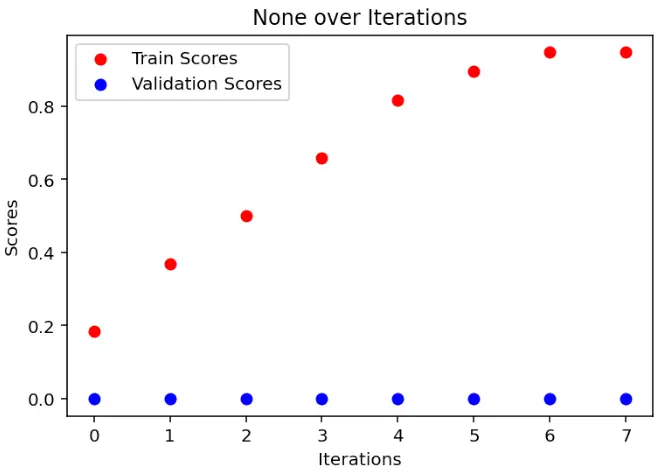
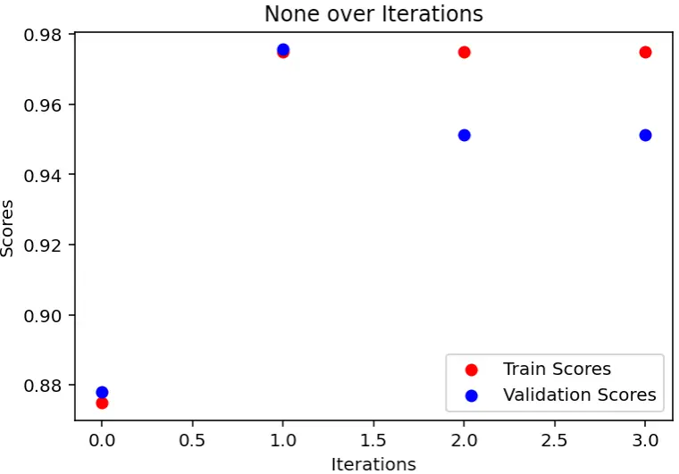

# APRIL: API Synthesis with Automatic Prompt Optimization and Reinforcement Learning

Hua Zhong Affiliation: The University of Texas at Austin, Austin TX
78712, USA E-mail [{hzhong,shanjiang}@utexas.edu,
kuhrshid@ece.utexas.edu](mailto:%7Bhzhong,shanjiang%7D@utexas.edu,%20kuhrshid@ece.utexas.edu)
   Shan Jiang Affiliation: The University of Texas at Austin, Austin TX
78712, USA E-mail [{hzhong,shanjiang}@utexas.edu,
kuhrshid@ece.utexas.edu](mailto:%7Bhzhong,shanjiang%7D@utexas.edu,%20kuhrshid@ece.utexas.edu)
   Sarfraz Khurshid Affiliation: The University of Texas at Austin,
Austin TX 78712, USA E-mail [{hzhong,shanjiang}@utexas.edu,
kuhrshid@ece.utexas.edu](mailto:%7Bhzhong,shanjiang%7D@utexas.edu,%20kuhrshid@ece.utexas.edu)

###### Abstract

APIs are central to modern software development, yet composing new APIs
from large libraries is difficult due to the exponential search space;
traditional component-based synthesis relies on costly exploration and
hand-crafted specifications. While large language models (LLMs) can
generate implementations from natural language, hallucinations and
limited access to up-to-date contextual information often yield
incorrect code. In this paper, we present APRIL, an approach that
combines LLM-based synthesis with Automatic Prompt Optimization (APO)
and Reinforcement Learning from Verifiable Rewards (RLVR): APO
iteratively refines prompts for a frozen model, while RLVR fine-tunes
the policy toward functional correctness, producing an efficient
synthesis pipeline. Evaluated on 81 real-world APIs from widely used
scientific Python libraries and benchmarked against instruction-tuned
but unfine-tuned LLMs guided by expert prompts, APRIL achieves
substantial improvements. These results indicate that integrating APO
and RLVR provides a robust, scalable path for component-based API
synthesis in large libraries.

###### Keywords: 

Component-based Synthesis Large Language Models Automatic Prompt
Optimization Reinforcement Learning

## 1 Introduction

The increasing complexity of modern software systems has made correct
API usage and library integration a significant challenge for developers
\[20\]. Even experienced programmers often spend considerable time
identifying relevant functions within a library and must frequently
combine these with complex control structures to achieve desired
functionalities \[22, 30\]. This complexity complicates program
synthesis, requiring both knowledge of library components and their
effective integration into coherent code. Correct API synthesis need to
capture intended behavior, which is often informal and difficult to
express as formal specifications. While formal methods such as logical
constraints \[11, 32\] and executable specifications \[13, 16\] exist,
synthesizing APIs from input-output examples has become a more
user-friendly and accessible alternative \[30\]. This approach allows
developers—including non-programmers—to specify desired functionality
using examples, bypassing the need for detailed technical specifications
\[10\].

Prior work on program synthesis has largely relied on domain-specific
knowledge—e.g., string manipulation \[23, 10\] or data transformations
\[9, 6\]—or on expert-crafted domain-specific languages (DSLs) \[26\].
Domain-agnostic techniques such as loop-free synthesis \[12\] and
oracle-guided synthesis \[16\] instead require formal specifications of
components; specifying precise behavior for every library primitive is
costly and often infeasible, particularly when intended behavior is
informal or tacit. Although these methods solve various tasks, they
typically target single basic blocks and scale poorly to multi-block
programs with loops, recursion, or complex guards, due to combinatorial
growth in method sequences. To mitigate this, SyPet \[7\], EdSynth
\[36\], and FrAngel \[30\] favor black-box execution over formal
semantics, reducing dependence on DSLs and specifications. SyPet,
however, struggles to synthesize rich control flow; FrAngel introduces
angelic conditions with iterative refinement to construct more complex
programs; and EdSynth leverages program sketches to similar effect.
Live-execution approaches such as LooPy \[8\] involve programmers as
oracles, improving interactivity but reintroducing human dependence and
limiting full automation in API synthesis.

In contrast, large language models have recently demonstrated remarkable
proficiency in natural language understanding and code synthesis
tasks\[24, 18\]. Trained on large datasets, including extensive code
repositories and documentation, LLMs possess an implicit understanding
of programming syntax and semantics. These models can align user inputs
with their pre-existing knowledge and even address tasks that are
uncommon in their training data \[28\]. Unlike traditional synthesis
methods, which often rely on domain-specific knowledge\[7\] or
predefined formal specifications, LLMs excel at managing complex,
open-ended programming tasks. They can synthesis APIs based on function
signature and other part of the module, eliminating the need for
explicit specifications or DSLs. Furthermore, LLMs handle intricate
control structures such as loops and conditionals with ease, making them
highly versatile and efficient. By directly interpreting developer
intent through function signatures and I/O examples, LLMs reduce the
burden on developers, enabling rapid and adaptive solutions for diverse
functionalities.

However, industry experience indicates that large language models (LLMs)
continue to exhibit limitations, such as hallucinations \[25, 17\].
Furthermore, there is a lack of research on systematically evaluating
the ability of LLMs to synthesize code for deep learning libraries. In
this paper, we evaluate the effectiveness of Automatic Prompt
Optimization (APO) \[27\] and Reinforcement Learning from Verifiable
Rewards (RLVR) \[19\] approaches for API synthesis in scientific Python
libraries. APO refers to methods that autonomously refine prompts to
improve task performance in large language models. APO techniques offer
key advantages: they enhance model outputs without requiring access to
model parameters, systematically explore the space of possible prompts,
and produce improvements that remain interpretable to humans. In
addition, RLVR optimizes the policy using rewards derived from
objective, programmatically checkable signals rather than human
preference models. APO refines prompts, instructions, and in-context
examples to bias a frozen LLM toward producing correct implementation.
RLVR prioritizes functional correctness and safe component composition
by grounding feedback in unit-test outcomes and static-analysis
diagnostics, thereby improving pass rates and reliability. This allows
the model to internalize higher-level conventions and reliably apply
them in synthesis tasks.

While both approaches have shown promise in various machine learning
contexts, there has been no systematic comparison of APO and RLVR for
the synthesis of new APIs in scientific Python libraries. Prior research
has largely focused on API invocation accuracy or small-scale code
completion tasks, rather than on the end-to-end generation of
maintainable, idiomatic, and robust API implementations. The reliability
stakes are higher here: a poorly synthesized implementation, once
adopted, can ossify bad patterns across a codebase and become expensive
to replace. In this paper, we present APRIL, the first controlled,
reliability-centric evaluation of APO v.s. RLVR for synthesizing new API
implementations in scientific Python libraries.

This paper makes the following contributions:

- •
  Approach. We present a novel approach to API synthesis using LLMs by
  integrating Automatic Prompt Optimization (APO) and Reinforcement
  Learning from Verifiable Rewards (RLVR). By employing APO to
  iteratively refine prompts and leveraging RLVR for efficient model
  fine-tuning, our method reduces reliance on exhaustive search and
  manual component specification.
- •
  Evaluation. We conduct an experimental evaluation of our approach on
  81 programming tasks sourced from widely used scientific Python
  libraries, including NumPy, SciPy, and scikit-learn. We benchmark our
  method against state-of-the-art, un-finetuned large language models
  (LLMs) that rely on human-curated prompts. Experimental results
  demonstrate that our approach achieves a success rate exceeding 93.8%
  in synthesizing correct, test-passing APIs, substantially
  outperforming baseline LLMs in terms of accuracy.
- •
  Test case generation. To obtain the verification oracles required for
  APO training and RLVR fine-tuning, we employ the Gemini CLI coding
  agent \[1\] to automatically synthesize test suites for scientific
  Python APIs in our training set. We additionally evaluate Gemini CLI’s
  test generation capability, assessing the extent to which the produced
  suites are comprehensive and semantically meaningful for validating
  API behavior. This analysis underscores Gemini CLI’s promise as an
  enabling component for automated API synthesis pipelines and rigorous
  evaluation workflows.

## 2 Problem Definition

This paper proposes a novel methodology for component-based API
synthesis, which leverages large language models (LLMs) to generate an
API from a set of base components and input-output examples. Similar to
traditional techniques, the synthesis problem in our proposed
methodology formally requires the following inputs:

- •
  A test oracle that, given a candidate API, returns a Boolean verdict
  (true/false) indicating whether the candidate satisfies the intended
  task specification. Concretely, we instantiate the validation oracle
  using a comprehensive test suite generated via an AI-agent-based
  methodology. The procedure for constructing this test suite is
  detailed in Section 3.1.
- •
  A method signature that precisely specifies the API’s parameter and
  return types, as well as its invocation modality (in Python, an
  instance method, class method, static method, or module-level method).
- •
  A library of components from which the synthesizer assembles candidate
  implementations of the target API. Specifically, we provide the
  library name and the module path of the API’s intended location to the
  LLM as contextual metadata, enabling it to determine the components
  required for synthesis.
- •
  A set of examples that, for any input within the API’s valid domain,
  returns the reference output of the target API. The example set may be
  a subset of the validation tests or constitute an independent
  collection of tests.

## 3 API Synthesis Methodology

Figure 1: Workflow of APRIL

In this section, we illustrate the architecture of APRIL, and break it
down into different components. The overall workflow of APRIL is shown
in Fig. 1. Our study focuses on synthesizing Scientific Python APIs. As
mentioned in Section 2, validating the correctness of the synthesized
API requires a test-based validation oracle. We construct this oracle
using a methodology powered by Gemini-cli, which automatically generates
the requisite test suite. APRIL further requires a component library,
the target method signature, and a set of tests. These inputs are used
to construct the API-synthesis prompt, after which we employ LLMs to
directly generate candidate method implementations. To improve synthesis
effectiveness, we apply Automatic Prompt Optimization (APO) and RLVR
(Reinforce Learning from Verifiable Rewards) fine-tuning, guiding the
LLMs toward the desired outputs. The details of our prompt-engineering
methodology are presented in the following sections.

1: procedure GenerateValidationTests($`ds`$, $`ri`$)

2:   $`feedback_{t}\leftarrow\varnothing`$

3:   $`feedback_{c}\leftarrow\varnothing`$

4:   while $`true`$ do

5:    $`T_{c}\leftarrow genTests(ds,ri,feedback_{t},feedback_{c})`$

6:    if $`testPass(T_{c},ri)\and isGoodQuality(ds,ri,T_{c})`$ then

7:      return $`T_{c}`$

8:    else

9:      $`feedback_{t}\leftarrow testPass(T_{c},ri)`$

10:      $`feedback_{c}\leftarrow isGoodQuality(ds,ri,T_{c})`$

11:    end if

12:   end while

13: end procedure

Algorithm 1 Validation Tests Generation

### 3.1 Validation Oracle Generation

For each target API, we construct a comprehensive test suite that serves
as its validation oracle. Because this test suite is only used to
validate the synthesized API and is not an input to the synthesizer, we
assume access to the API’s docstrings $`ds`$ (natural-language
documentation embedded in the code) and a correct reference
implementation $`ri`$. These artifacts are supplied to an AI agent,
which generates the corresponding tests. Concretely, given $`ds`$ and
$`ri`$, we instruct the agent to produce a candidate test suite
$`T_{c}`$ intended to validate the API. The agent then executes
$`T_{c}`$ against $`ri`$ and reports the results; if any test fails, the
failure information is fed back to the agent, which regenerates
$`T_{c}`$. Coinciding with this, we submit $`ds`$, $`ri`$, and $`T_{c}`$
to a second LLM acting as an evaluator to assess the quality of
$`T_{c}`$ with respect to comprehensiveness and test coverage (i.e.,
breadth of input scenarios and exercised behaviors). If the evaluator
deems the quality insufficient, its feedback is returned to the AI
agent, which revises $`T_{c}`$ accordingly. We output the revised
$`T_{c}`$ as the final validation oracle once all tests pass and the
quality criteria are satisfied. The algorithmic details of this
test-generation procedure are presented in Algorithm 1.

1 \### Implement a python method inside a python module.

2

3 \*\*Task:\*\*

4

5 Imagine you are a Python developer specialized in machine learning and
scientific libraries. You will be given a python method signature, the
module it belongs to, the library it belongs to, and a set of test
cases. The method can be a instance method of a class or a module
method. Your task is to implement the method using the dependencies from
the module and the library to pass the test cases.

6

7 \*\*Output Format:\*\*

8

9 Put your ouput inside the \<output_api_implementations\> xml element,
and output only the implemented method.

10 \<output_api_implementations\> \[your method implementation here\]
\</output_api_implementations\>

11

12 \*\*Crucial Information:\*\*

13

14 Carefully analyze the provided test cases. Each test case represents
a specific input and the expected output of the method you are
implementing. Your implementation \*must\* satisfy all given test cases.
Consider these test cases as concrete examples of how the method should
behave. Aim to re-use functions from the specified library wherever
possible.

15

16 \*\*Here are some examples:\*\*

17 Method signature: \*\*\*\*

18 Module: \*\*\*\*

19 Library: \*\*\*\*

20 Test cases: \*\*\*\*

21 Output:

22 \<output_api_implementations\>

23 \*\*\*\*

24 \</output_api_implementations\>

25

26 \*\*\*\*

27

28 Method signature: \*\*\*\*

29 Module: \*\*\*\*

30 Library: \*\*\*\*

31 Test cases: \*\*\*\*

32 Output:

33 \<output_api_implementations\>

34 \*\*\*\*

35 \</output_api_implementations\>

36

37 Method signature: {api_signature_rlvr_apo}

38 Module: {module_rlvr_apo}

39 Library: {library_rlvr_apo}

40 Test cases: {tests_rlvr_apo}

41 Output:-

Figure 2: Manually engineered initial prompt

### 3.2 Initial Prompt Construction

We define the initial prompt as the API-synthesis prompt used both as
the input to the baseline model and as the seed prompt for Automatic
Prompt Optimization (APO). We construct this prompt manually using
established prompt-engineering techniques, including: (i) role
conditioning (“assistant creation”), which assigns an explicit persona
to the LLM to situate the task context and constrain response style;
(ii) chain-of-thought prompting, which encourages decomposition of the
synthesis task into smaller subproblems and the production of
intermediate reasoning steps; and (iii) few-shot learning, which
supplies a small set of input–output exemplars to prime the LLM’s
behavior through in-context learning. The resulting initial prompt is
shown in Fig. 2.

### 3.3 Automatic Prompt Optimization

Automatic Prompt Optimization (APO) is a model-agnostic procedure that
operates with minimal prerequisites: a small training dataset, an
initial prompt, and API access to an LLM. The algorithm processes
mini-batches of training examples to elicit “gradient”-like signals:
textual critiques that diagnose limitations of the current prompt. It
then uses these signals to propose and apply prompt edits. In practice,
APO performs iterative prompt refinement analogous to gradient-based
updates.

Figure 3: Example of iterative improvement in the discriminator score
($`DS`$) between APO search iterations

In our approach, we employ the manually engineered prompt from
Section 3.3 as the initial prompt $`P_{0}`$ and use a subset of the
benchmark dataset as the training data set $`\mathcal{A}`$ of $`n`$
training tasks. Within our APO framework, text-gradient generation
serves as the primary mechanism.

To illustrate, consider a prompt candidate $`P`$ and its generated
solution $`{s_{a}},{a\in\mathcal{A}}`$ at the current iteration. We
provide $`P`$, $`s_{a}`$, and $`\mathcal{T}a\in\mathcal{T}`$ (where
$`\mathcal{T}`$ denotes the validation test suite) to a discriminator
prompt that instructs a classification LLM $`llm_{c}`$ to execute the
tests. We first request a binary verdict (fail/pass) from $`llm_{c}`$
and use it to compute a bad-generation penalty $`p_{a}\in{0,1}`$ from
this result. If any test fails, we then request a textual critique
$`e_{a}`$ from $`llm_{c}`$ describing the observed errors produced by
$`p_{a}`$. After processing all $`a\in A`$ in the current iteration, we
compute the discriminator score $`DS=1-\frac{1}{n}\sum_{i=1}^{n}p_{i}`$
and form the iteration’s “text gradient” by concatenating the textual
critiques $`{e_{i}}`$. Figure 3 illustrates the iterative improvement of
the discriminator score ($`DS(P)`$) over successive APO iterations. We
then follow the standard APO procedure to propose edits to the current
prompt and perform beam search over the resulting candidates, using
$`DS(P)`$ to sort prompts at each level of the search tree. The
candidate $`P^{\star}`$ with the highest $`DS(P)`$ in the final
iteration is selected as the output of our APO algorithm.

### 3.4 RLVR Fine-tuning

Loss function adopted by classic fine-tuning on text generation tasks is
typically the Negative Log-Likelihood (NLL) loss. The NLL loss
quantifies the negative log-probability that the model assigns to the
ground-truth next token (i.e., the discrepancy between the predicted
next-token distribution and the empirical distribution concentrated on
the observed token). Minimizing NLL promotes higher probabilities for
correct tokens and lower probabilities for incorrect tokens. In the
context of program synthesis, however, NLL primarily captures
surface-level similarity between the target and LLM-generated
implementations and is insensitive to functional equivalence. This
limitation is consequential, as distinct programs can be semantically
interchangeable despite syntactic divergence.

Given our evaluation is driven by a verification test suite, we recast
fine-tuning from next-token prediction to RLVR, where synthesized
programs receive rewards directly based on test outcomes (functionally
correct versus incorrect).

To obtain training signals, we reuse the training dataset from
Section 3.3 and, for each API task x, condition the policy model
$`\pi_{\theta}`$ on the task prompt to sample $`K`$ candidate
implementations $`S={s_{1},\dots,s_{K}}`$. Sampling uses stochastic
decoding (temperature and top-$`p`$) with de-duplication of identical
code strings. Each $`s_{i}`$ is executed against the validation tests.
We assign a binary reward $`R(s_{i})\in{0,1}`$, with $`R(s_{i})=1`$ iff
all tests pass, and $`0`$ otherwise. Candidates that fail to build and
execute receive $`R(s_{i})=0`$. We optimize $`\pi_{\theta}`$ with Group
Relative Policy Optimization (GRPO). For each group $`S`$, we compute a
group-relative advantage by centering the reward of $`s_{i}`$ against
the group mean, reducing variance and inducing competition. Updates use
a PPO-style clipped surrogate with a KL penalty to a reference policy;
$`\pi_{\theta_{\text{old}}}`$ is fixed during each update and
periodically refreshed. Training runs over mini-batches for a few epochs
with early stopping when group reward stabilizes.

## 4 Evaluation

In this section, we present a comprehensive experimental evaluation to
assess the effectiveness of APRIL in scientific Python API synthesis
tasks. The primary objective is to evaluate the practicality of the
generated APIs and their capability to accurately implement the expected
functionality. Specifically, we address the following research
questions:

- •
  RQ1: Effectiveness. What proportion of APRIL generated APIs
  successfully build and pass the validation tests?
- •
  RQ2: Comparison. What is the relative success rate of APRIL, augmented
  with APO and RLVR fine-tuning, compared with a baseline model
  employing a manually engineered prompt?
- •
  RQ3: Tests Generation. How effective is the AI agent adopted in our
  study on tests generation?

### 4.1 Experimental Setup

To address the above research questions, we designed an experimental
framework incorporating the following key components:

#### Large Language Models

We employ a customized instance of Gemini 2.0—an instruction-tuned large
language model—as the synthesis model. The sampling temperature is set
to 0.7 to balance diversity and determinism in generated code, a
configuration empirically shown to be effective for code generation
tasks \[5\]. The model is configured with an input context window of
32,000 tokens and an output context window (maximum generation length)
of 8,000 tokens. For APO, we use a separate customized instance of the
same Gemini 2.0 model. The validation test suite is generated by the
Gemini-cli AI agent \[1\], which internally leverages the Gemini 2.5 Pro
model.

#### Benchmarks

We evaluate APRIL on three benchmark datasets comprising 81 synthesis
tasks in total: 36 tasks from NumPy, 33 from scikit-learn, and 12 from
SciPy. From these libraries, we additionally select 40 tasks to
construct the training set used for APO and RLVR fine-tuning. The
scikit-learn subset emphasizes canonical machine learning scenarios
(e.g., GaussianProcessRegressor), in which the model is required to
synthesize APIs that either transform input data or train a model on the
provided data. The NumPy subset focuses on array-centric operations and
numerically intensive routines, such as least-squares polynomial
fitting. The SciPy subset primarily targets implementations of algebraic
computations and classical statistical procedures, like Minkowski
distance calculations.

### 4.2 Results Analysis

[TABLE]

Table 1: RQ1. Executability and test pass rate of APRIL

#### RQ1

Our first evaluation of LLM-generated APIs examines effectiveness,
defined by the proportion of tasks for which the synthesizer produces
functionally correct APIs. We decompose this measure into two
components: (i) execution rate and (ii) the rate of passing the
validation test cases. The execution rate assesses whether the
synthesized API can be built and executed without error. Because the LLM
is provided with the target library and module context, and may
therefore depend on in-library components, we evaluate executability by
inserting the synthesized API into its designated module within the
corresponding library and then attempting to build and execute the API.
The second component measures whether the synthesized API passes the
validation test suite associated with the task. When constructing the
validation test suite for a given API, we instruct Gemini-cli to
generate tests within the module’s existing test directory hierarchy
(i.e., the directory designated for that module’s tests). We then
compute the test success rate by executing the entire validation suite
for the target API under the library’s test harness and recording the
fraction of tests that pass.

Table 1 summarizes these metrics, reporting for each benchmark the
number of tasks alongside two outcome measures: executability and test
success rate. Empirically, all LLM-generated APIs built and executed
successfully (100% executability). Among these, 93.8% passed their full
validation suites. These results indicate high effectiveness in
synthesizing functional APIs.

[TABLE]

Table 2: RQ2. Comparison of APRIL with the baseline across three
benchmarks

#### RQ2

We address RQ2 by comparing the success rate of APRIL against a baseline
that performs synthesis using the initial prompt on Gemini 2.0 model. We
execute all 81 tasks from the three benchmarks. The results are
presented in Table 2. The results suggest that APRIL can outperform the
state-of-the-art LLMs baseline across all three benchmarks. On average,
it achieves improvements of 16.6%, 14.9%, and 16.7% over the baseline on
the three benchmarks, respectively.

Figure 4: Potential iterative improvement from APO on RLVR fine-tuned
Model

Due to time and space constraints, we do not conduct an ablation study
isolating the individual contributions of APO and RLVR. Moreover,
applying APO to the RLVR–fine-tuned model suggests additional
performance gains (Fig. 4); however, a comprehensive analysis of this
follow-on step is beyond the scope of this paper.

[TABLE]

Table 3: RQ3. Gemini-cli generated test counts and required iterations

#### RQ3

We assess the test-generation capability of Gemini-cli along two
dimensions: (i) the number of validation tests produced per API and (ii)
the number of quality-evaluation iterations required to obtain a
comprehensive test suite for that API. As summarized in Table 3,
Gemini-cli generates, on average, 7.2 tests per API for NumPy, 8.5 for
scikit-learn, and 9.6 for SciPy. The system requires an average of 2.2
iterations of the quality-evaluation loop to converge to a comprehensive
test suite per API. These findings indicate that Gemini-cli is an
effective tool for generating validation tests for scientific Python
APIs, highlighting its potential to support automated program synthesis
pipelines and rigorous evaluation workflows.

## 5 Related Work

Program synthesis has been a significant area of research, with various
approaches proposed to generate programs efficiently. Traditional
methods, such as Transit \[33\] and Escher \[2\], rely on bottom-up
enumerative synthesis, systematically exploring the program space to
identify correct solutions. Brahma \[12\] introduces an efficient
SMT-based encoding for synthesizing straight-line programs that involve
multiple assignments to intermediate variables. Component-based
synthesizers, such as SyPet \[7\], focus on generating Java programs
from examples by leveraging arbitrary libraries. However, SyPet is
limited to synthesizing sequences of method calls and does not support
control structures like loops or conditionals. Similarly, Python-based
synthesizers such as TFCoder \[29\], AutoPandas \[3\], and Wrex \[4\]
primarily target one-liners or sequences of method calls. These tools
also provide limited support for control structures, restricting their
applicability for more complex program synthesis tasks. While these
methods demonstrate the potential of automated program synthesis, their
limitations in handling control structures underline the need for more
versatile approaches.

Synthesis with control structures. EdSynth \[36\] support program
synthesis with control flow by lazily initializing candidates during the
execution of provided tests. The execution of partially completed
candidates determines the generation of future candidates, making
EdSynth particularly effective for synthesis tasks that involve multiple
API sequences in both the conditions and bodies of loops or branches.
FrAngel \[30\] is another notable tool that supports component-based
synthesis for Java programs with control structures. Unlike many
traditional methods, FrAngel relies on function-level specifications
and, in principle, does not require users to have a detailed
understanding of the algorithm or intermediate variables. However, in
practice, to make the synthesis process feasible, users must provide a
high-quality test suite, covering base and corner cases. This
requirement still necessitates some level of algorithmic knowledge, and
FrAngel’s relatively slow performance makes it less suitable for
interactive scenarios. LooPy \[8\], introduces the concept of an
Intermediate State Graph (ISG), which compactly represents a vast space
of code snippets composed of multiple assignment statements and
conditionals. By engaging human as an oracle to address incomplete parts
of the loop, LooPy achieves a balance between automation and
interactivity. Its ability to solve a wide range of synthesis tasks at
interactive speeds makes it a practical tool for use cases requiring
real-time feedback and adjustments. These tools demonstrate progress in
addressing the challenges of synthesis with control structures, but they
also highlight trade-offs between usability, required user input, and
performance.

Large Language Models (LLMs) have recently shown effectiveness in
various software development tasks, including program synthesis\[15, 14,
37\] and test generation\[35, 18\]. By associating document text with
code from a large training set, LLMs can generate program code from
natural language prompts\[34, 31\]. Reusable API\[21\] uses LLMs to
generate APIs from code snippets collected from Stack Overflow and shows
significant results in identifying API parameters and return types.
However, they provide all components and dependencies to LLMs and only
require LLMs to create new APIs using existing functions. Test-driven
program synthesis remains an under-researched topic. How well do LLMs
perform in generating entire APIs with just a few input/output examples
that even end users can easily prepare? In this paper, we explore the
application of LLMs in generating API implementations and finds that
LLMs are effective in understanding test cases and generating viable
APIs. We also show that LLMs are able to generate accurate APIs even
with an incomplete set of test cases, which is very convenient. To the
best of our knowledge, our work is the first systematic study of using
LLMs with auto prompt engineering and fine-tuning to synthesize complex
APIs.

## 6 Conclusion

We propose integrating fine-tuned large language models (LLMs) with
Automatic Prompt Optimization (APO) for API synthesis. LLMs capture
developer intent and context, enabling more effective synthesis.
Empirically, our method outperforms a strong baseline that uses a
state-of-the-art LLM with a manually engineered prompt. We also assess
Gemini-cli’s ability to generate comprehensive validation test suites,
underscoring its potential to support automated program synthesis and
rigorous evaluation. The approach requires minimal user interaction,
simplifying synthesis. Overall, the results support LLMs as a practical
foundation for complex API synthesis.

## References

- \[1\] Gemini cli, 2025.
  [https://cloud.google.com/gemini/docs/codeassist/gemini-cli](https://cloud.google.com/gemini/docs/codeassist/gemini-cli).
- \[2\] A. Albarghouthi, S. Gulwani, and Z. Kincaid. Recursive program
  synthesis. In Computer Aided Verification: 25th International
  Conference, CAV 2013, Saint Petersburg, Russia, July 13-19, 2013.
  Proceedings 25, pages 934–950. Springer, 2013.
- \[3\] R. Bavishi, C. Lemieux, R. Fox, K. Sen, and I. Stoica.
  Autopandas: neural-backed generators for program synthesis. Proc. ACM
  Program. Lang., 3(OOPSLA), Oct. 2019.
- \[4\] I. Drosos, T. Barik, P. J. Guo, R. DeLine, and S. Gulwani. Wrex:
  A unified programming-by-example interaction for synthesizing readable
  code for data scientists. In Proceedings of the 2020 CHI Conference on
  Human Factors in Computing Systems, CHI ’20, page 1–12, New York, NY,
  USA, 2020. Association for Computing Machinery.
- \[5\] M. Endres, S. Fakhoury, S. Chakraborty, and S. K. Lahiri. Can
  large language models transform natural language intent into formal
  method postconditions? Proceedings of the ACM on Software Engineering,
  1(FSE):1889–1912, 2024.
- \[6\] Y. Feng, R. Martins, J. Van Geffen, I. Dillig, and S. Chaudhuri.
  Component-based synthesis of table consolidation and transformation
  tasks from examples. In Proceedings of the 38th ACM SIGPLAN Conference
  on Programming Language Design and Implementation, PLDI 2017, page
  422–436, New York, NY, USA, 2017. Association for Computing Machinery.
- \[7\] Y. Feng, R. Martins, Y. Wang, I. Dillig, and T. W. Reps.
  Component-based synthesis for complex apis. In Proceedings of the 44th
  ACM SIGPLAN Symposium on Principles of Programming Languages, POPL
  ’17, page 599–612, New York, NY, USA, 2017. Association for Computing
  Machinery.
- \[8\] K. Ferdowsifard, S. Barke, H. Peleg, S. Lerner, and
  N. Polikarpova. Loopy: interactive program synthesis with control
  structures. Proc. ACM Program. Lang., 5(OOPSLA), Oct. 2021.
- \[9\] J. K. Feser, S. Chaudhuri, and I. Dillig. Synthesizing data
  structure transformations from input-output examples. SIGPLAN Not.,
  50(6):229–239, June 2015.
- \[10\] S. Gulwani. Automating string processing in spreadsheets using
  input-output examples. SIGPLAN Not., 46(1):317–330, Jan. 2011.
- \[11\] S. Gulwani, S. Jha, A. Tiwari, and R. Venkatesan. Synthesis of
  loop-free programs. SIGPLAN Not., 46(6):62–73, June 2011.
- \[12\] S. Gulwani, S. Jha, A. Tiwari, and R. Venkatesan. Synthesis of
  loop-free programs. In Proceedings of the 32nd ACM SIGPLAN Conference
  on Programming Language Design and Implementation, PLDI ’11, page
  62–73, New York, NY, USA, 2011. Association for Computing Machinery.
- \[13\] S. Heule, M. Sridharan, and S. Chandra. Mimic: computing models
  for opaque code. In Proceedings of the 2015 10th Joint Meeting on
  Foundations of Software Engineering, ESEC/FSE 2015, page 710–720, New
  York, NY, USA, 2015. Association for Computing Machinery.
- \[14\] Y. Hong, S. Jiang, Y. Fu, and S. Khurshid. On the effectiveness
  of large language models in writing alloy formulas. arXiv preprint
  arXiv:2502.15441, 2025.
- \[15\] N. Jain, S. Vaidyanath, A. Iyer, N. Natarajan,
  S. Parthasarathy, S. Rajamani, and R. Sharma. Jigsaw: Large language
  models meet program synthesis. In Proceedings of the 44th
  International Conference on Software Engineering, pages
  1219–1231, 2022.
- \[16\] S. Jha, S. Gulwani, S. A. Seshia, and A. Tiwari. Oracle-guided
  component-based program synthesis. In Proceedings of the 32nd ACM/IEEE
  International Conference on Software Engineering - Volume 1, ICSE ’10,
  page 215–224, New York, NY, USA, 2010. Association for Computing
  Machinery.
- \[17\] S. Jiang, P. Kovuri, D. Tao, and Z. Tan. Cascade: Llm-powered
  javascript deobfuscator at google. arXiv preprint
  arXiv:2507.17691, 2025.
- \[18\] S. Jiang, C. Zhu, and S. Khurshid. Generating executable
  oracles to check conformance of client code to requirements of jdk
  javadocs using llms. arXiv preprint arXiv:2411.01789, 2024.
- \[19\] N. Lambert, J. Morrison, V. Pyatkin, S. Huang, H. Ivison,
  F. Brahman, L. J. V. Miranda, A. Liu, N. Dziri, X. Lyu, Y. Gu,
  S. Malik, V. Graf, J. D. Hwang, J. Yang, R. L. Bras, O. Tafjord,
  C. Wilhelm, L. Soldaini, N. A. Smith, Y. Wang, P. Dasigi, and
  H. Hajishirzi. Tulu 3: Pushing frontiers in open language model
  post-training. In Second Conference on Language Modeling, 2025.
- \[20\] M. Lamothe, Y.-G. Guéhéneuc, and W. Shang. A systematic review
  of api evolution literature. ACM Comput. Surv., 54(8), Oct. 2021.
- \[21\] Y. Mai, Z. Gao, X. Hu, L. Bao, Y. Liu, and J. Sun. Are human
  rules necessary? generating reusable apis with cot reasoning and
  in-context learning. Proc. ACM Softw. Eng., 1(FSE), July 2024.
- \[22\] D. Mandelin, L. Xu, R. Bodík, and D. Kimelman. Jungloid mining:
  helping to navigate the api jungle. In Proceedings of the 2005 ACM
  SIGPLAN Conference on Programming Language Design and Implementation,
  PLDI ’05, page 48–61, New York, NY, USA, 2005. Association for
  Computing Machinery.
- \[23\] A. K. Menon, O. Tamuz, S. Gulwani, B. Lampson, and A. T. Kalai.
  A machine learning framework for programming by example. In
  Proceedings of the 30th International Conference on International
  Conference on Machine Learning - Volume 28, ICML’13, page I–187–I–195.
  JMLR.org, 2013.
- \[24\] D. Nam, A. Macvean, V. Hellendoorn, B. Vasilescu, and B. Myers.
  Using an llm to help with code understanding. In Proceedings of the
  IEEE/ACM 46th International Conference on Software Engineering, pages
  1–13, 2024.
- \[25\] S. Nikolov, D. Codecasa, A. Sjovall, M. Tabachnyk, S. Taneja,
  C. Ziftci, and S. Chandra. How is google using ai for internal code
  migrations? In 2025 IEEE/ACM 47th International Conference on Software
  Engineering (ICSE). IEEE, 2025.
- \[26\] D. Perelman, S. Gulwani, D. Grossman, and P. Provost.
  Test-driven synthesis. In Proceedings of the 35th ACM SIGPLAN
  Conference on Programming Language Design and Implementation, PLDI
  ’14, page 408–418, New York, NY, USA, 2014. Association for Computing
  Machinery.
- \[27\] R. Pryzant, D. Iter, J. Li, Y. Lee, C. Zhu, and M. Zeng.
  Automatic prompt optimization with “gradient descent” and beam search.
  In H. Bouamor, J. Pino, and K. Bali, editors, Proceedings of the 2023
  Conference on Empirical Methods in Natural Language Processing, pages
  7957–7968, Singapore, Dec. 2023. Association for Computational
  Linguistics.
- \[28\] R. Schaeffer, B. Miranda, and S. Koyejo. Are emergent abilities
  of large language models a mirage? Advances in Neural Information
  Processing Systems, 36, 2024.
- \[29\] K. Shi, D. Bieber, and R. Singh. Tf-coder: Program synthesis
  for tensor manipulations. ACM Trans. Program. Lang. Syst., 44(2),
  May 2022.
- \[30\] K. Shi, J. Steinhardt, and P. Liang. Frangel: component-based
  synthesis with control structures. Proc. ACM Program. Lang., 3(POPL),
  Jan. 2019.
- \[31\] C. Spiess, D. Gros, K. S. Pai, M. Pradel, M. R. I. Rabin,
  S. Jha, P. Devanbu, and T. Ahmed. Quality and trust in llm-generated
  code. arXiv preprint arXiv:2402.02047, 2024.
- \[32\] S. Srivastava, S. Gulwani, and J. S. Foster. From program
  verification to program synthesis. SIGPLAN Not., 45(1):313–326,
  Jan. 2010.
- \[33\] A. Udupa, A. Raghavan, J. V. Deshmukh, S. Mador-Haim, M. M.
  Martin, and R. Alur. Transit: specifying protocols with concolic
  snippets. In Proceedings of the 34th ACM SIGPLAN Conference on
  Programming Language Design and Implementation, PLDI ’13, page
  287–296, New York, NY, USA, 2013. Association for Computing Machinery.
- \[34\] S. Ugare, T. Suresh, H. Kang, S. Misailovic, and G. Singh.
  Improving llm code generation with grammar augmentation. arXiv
  preprint arXiv:2403.01632, 2024.
- \[35\] C. S. Xia, M. Paltenghi, J. Le Tian, M. Pradel, and L. Zhang.
  Fuzz4all: Universal fuzzing with large language models. In Proceedings
  of the IEEE/ACM 46th International Conference on Software Engineering,
  pages 1–13, 2024.
- \[36\] Z. Yang, J. Hua, K. Wang, and S. Khurshid. Edsynth:
  Synthesizing api sequences with conditionals and loops. In 2018 IEEE
  11th International Conference on Software Testing, Verification and
  Validation (ICST), pages 161–171, 2018.
- \[37\] H. Zhong, S. Jiang, and S. Khurshid. An approach for api
  synthesis using large language models. arXiv preprint
  arXiv:2502.15246, 2025.
