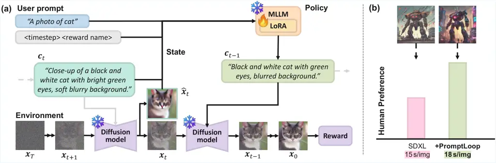
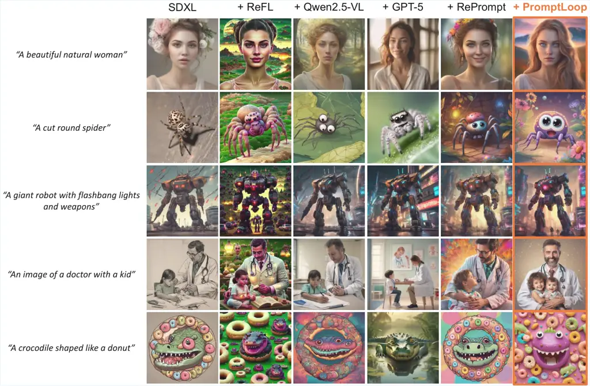
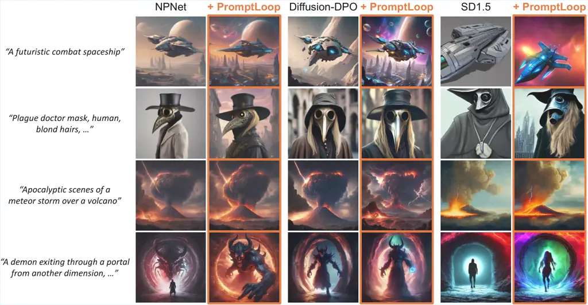
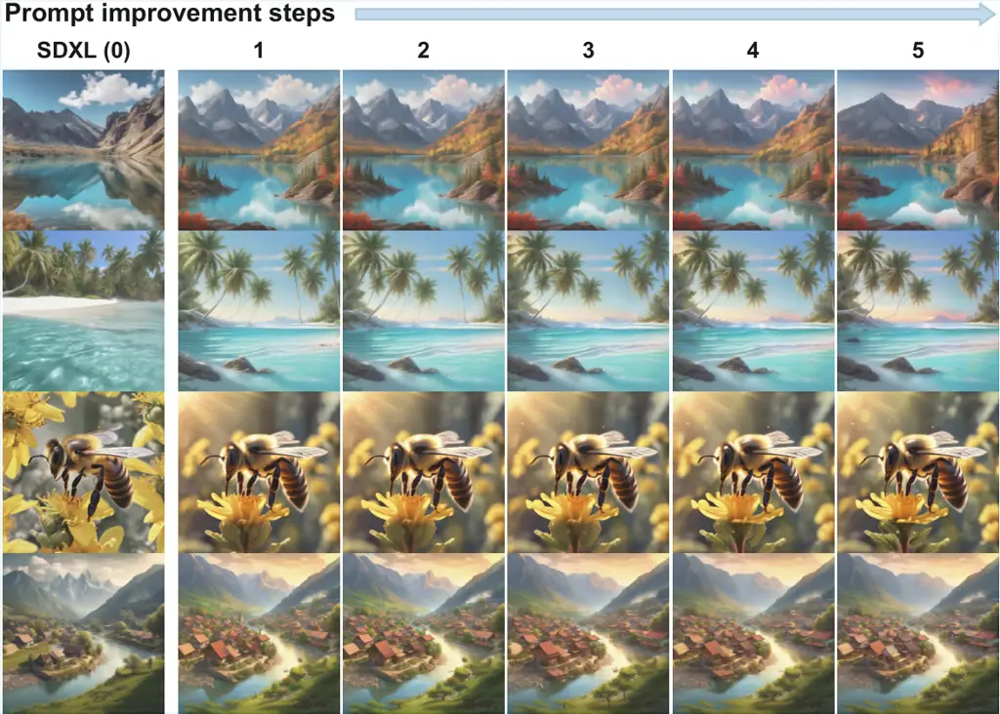
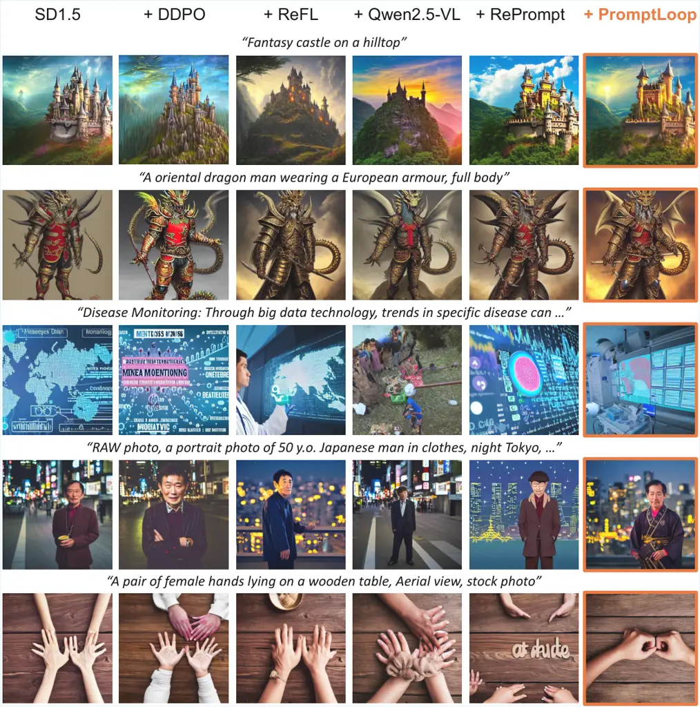
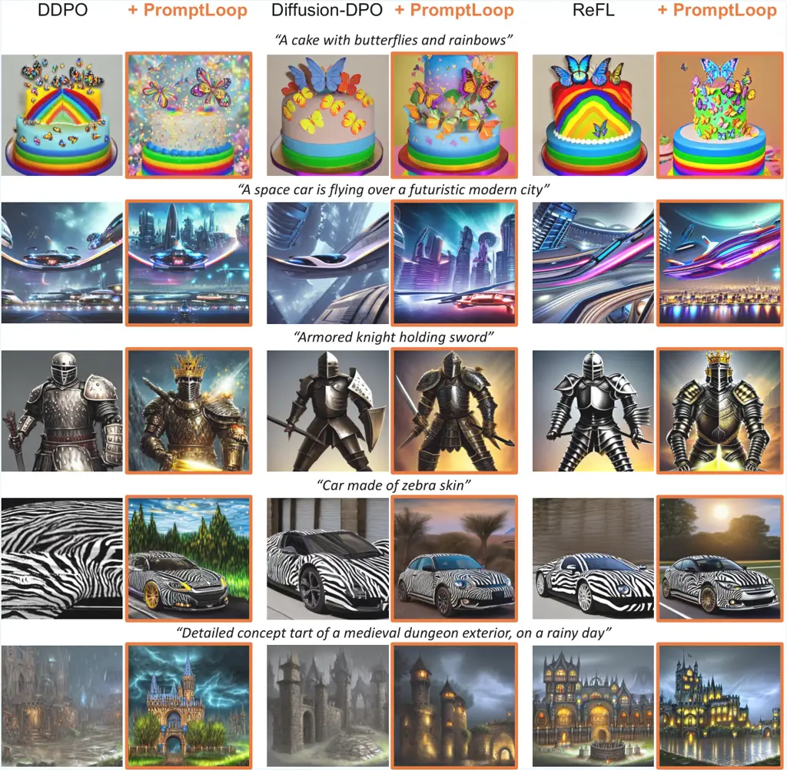
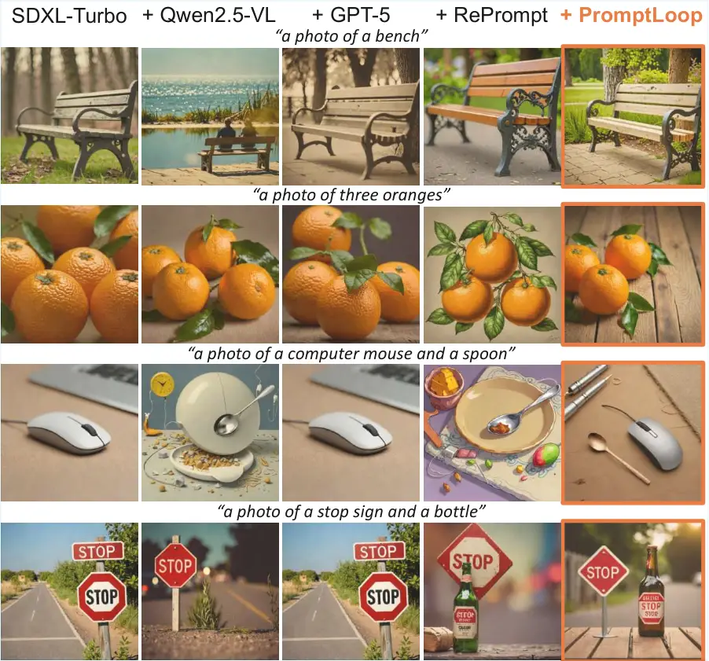
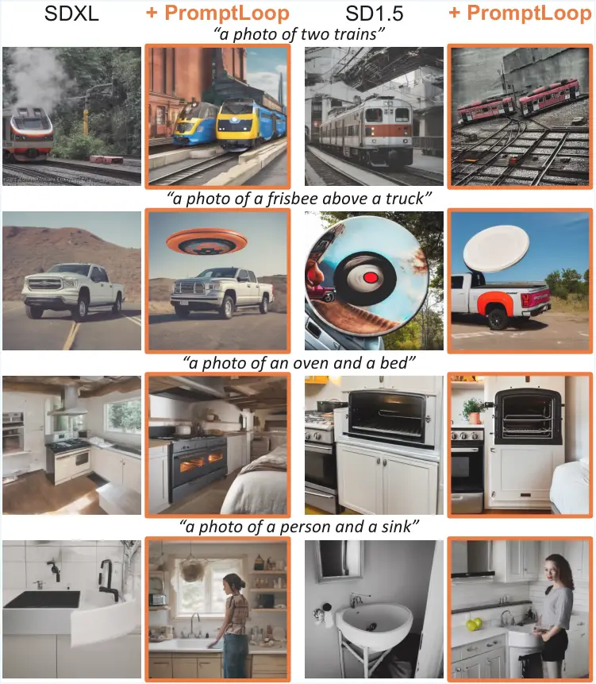
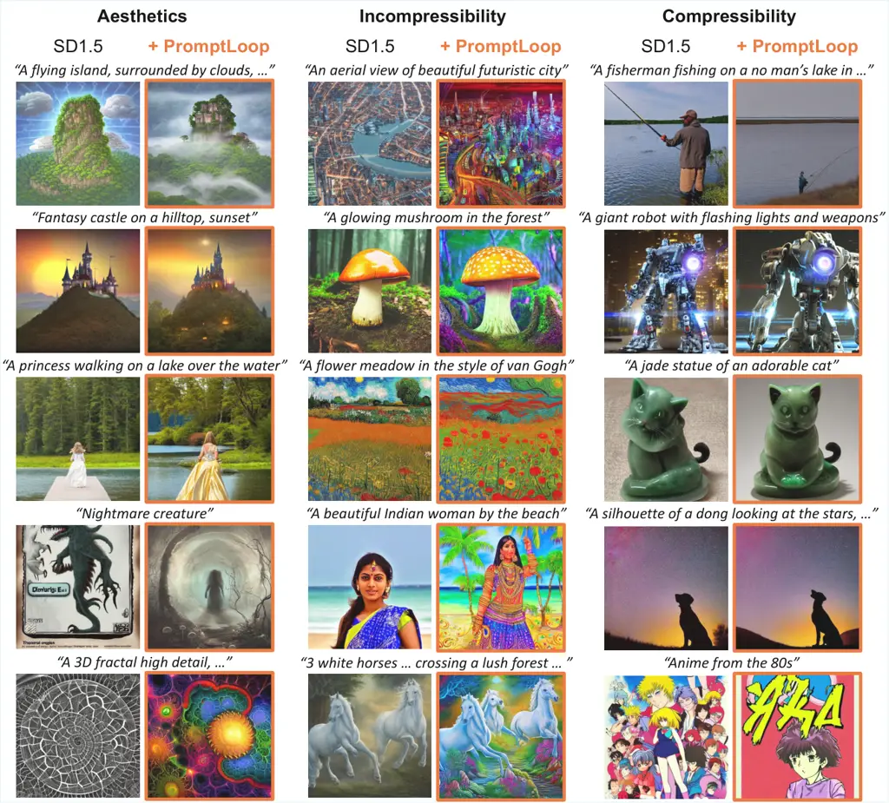

# PromptLoop: Plug-and-Play Prompt Refinement via Latent Feedback for Diffusion Model Alignment

Suhyeon Lee Affiliation: Kim Jaechul Graduate School of AI, KAIST   
Jong Chul Ye Affiliation: {suhyeon.lee, jong.ye}@kaist.ac.kr

###### Abstract

Despite recent progress, reinforcement learning (RL)-based fine-tuning
of diffusion models often struggles with generalization, composability,
and robustness against reward hacking. Recent studies have explored
prompt refinement as a modular alternative, but most adopt a
feed-forward approach that applies a single refined prompt throughout
the entire sampling trajectory, thereby failing to fully leverage the
sequential nature of reinforcement learning. To address this, we
introduce PromptLoop, a plug-and-play RL framework that incorporates
latent feedback into step-wise prompt refinement. Rather than modifying
diffusion model weights, a multimodal large language model (MLLM) is
trained with RL to iteratively update prompts based on intermediate
latent states of diffusion models. This design achieves a structural
analogy to the Diffusion RL approach, while retaining the flexibility
and generality of prompt-based alignment. Extensive experiments across
diverse reward functions and diffusion backbones demonstrate that
PromptLoop (i) achieves effective reward optimization, (ii) generalizes
seamlessly to unseen models, (iii) composes orthogonally with existing
alignment methods, and (iv) mitigates over-optimization and reward
hacking while introducing only a practically negligible inference
overhead.

## 1 Introduction

Diffusion models \[14, 47, 39\] have now become the state of the art for
image generation. Recently, increasing attention has been directed
toward reinforcement learning (RL)-based approaches \[48\] that align
these models with user preferences through explicit reward optimization.
Algorithms such as PPO \[42\] and DPO \[38\] have been applied directly
to fine-tune diffusion model parameters \[2, 51\]. With reward functions
defined over aesthetic quality, safety, human preference, or prompt
alignment, these methods successfully steer model behavior without
requiring new training data. However, direct RL fine-tuning remains
limited: improvements often fail to generalize across models, additional
enhancements are not easily composable once fine-tuning is complete, and
pathological behaviors such as reward hacking or over-optimization can
arise \[22\].

In parallel, the rapid development of large language models (LLMs) \[3,
10, 11\] and multimodal large language models (MLLMs) \[29, 53, 54\] has
inspired a new research direction: refining the input prompts rather
than the diffusion model itself. These prompt-alignment methods either
guide an LLM to improve a user’s prompt or adopt iterative feedback
loops for prompt refinement \[32, 62, 21, 19\]. Building further, \[12,
52, 57\] propose to fine-tune LLMs with RL, enabling them to generate
goal-directed prompt modifications more effectively. Compared to
weight-level tuning, prompt refinement is attractive because prompts are
shared across all text-to-image (T2I) models, inherently supporting
generalization and orthogonal composability. Moreover, prompts, being
abstract and discrete, may act as a buffer against reward hacking by
decoupling reward optimization from direct parameter updates \[27, 59,
8\]. For a detailed discussion of related works, see Appendix A.
Nevertheless, prompt-based strategies remain structurally distinct from
weight-level approaches. In diffusion models, parameters interact
directly with intermediate latent variables $`\bm{x}_{t}`$ in a feedback
loop, where each denoising step conditions on $`\bm{x}_{t}`$ to produce
$`\bm{x}_{t-1}`$. By contrast, existing RL-based prompt refinement
methods typically operate in a feed-forward manner, producing a refined
prompt once and applying it uniformly across all timesteps, without
leveraging the evolving latent trajectory.

To bridge this gap, we propose a generalized RL-based reward alignment
framework called PromptLoop that achieves structural analogy to
weight-level fine-tuning while preserving the modularity of prompt
refinement (Fig. 2). Specifically, our method introduces a plug-and-play
prompt refinement module as a policy. This module leverages an MLLM to
process feedback from the intermediate latent $`\bm{x}_{t}`$ as one of
the states, analogous to diffusion RL formulations, and then refines the
prompt $`\bm{c}_{t}`$ as the action injected into subsequent denoising
steps. Thus, the sampling dynamics are adaptively adjusted without
direct fine-tuning of the diffusion model itself. Unlike approaches that
either delay feedback until after sampling or confine it to external
loops, our method adopts a diffusion RL–style closed-loop design that
embeds refinement directly within a single diffusion pass, ultimately
enabling fine-grained adaptive control and improved efficiency. Despite
the introduction of iterative MLLM-based policy inference, our
implementation keeps the inference-time overhead at a practically
manageable level compared to standard diffusion model sampling.

Extensive experiments across diverse diffusion models and reward
functions demonstrate that our approach not only achieves effective
reward optimization, but also generalizes robustly to unseen models,
composes orthogonally with existing alignment methods, and mitigates
over-optimization and reward hacking. These results establish PromptLoop
as a practical and versatile approach to reward alignment for diffusion
models. Our contributions are summarized as follows:



Figure 2: (a) Closed-loop prompt refinement framework with RL. (b) The
proposed framework enhances human preference in a plug-and-play manner
with minimal additional inference cost. At each denoising step, the
policy MLLM takes the current state—denoised estimates, the user query,
and prior refinements—and generates an action, a refined prompt. The
diffusion model then updates the state, and this loop continues until
the final image is produced and scored by the reward model.

- •
  PromptLoop incorporates step-wise latent feedback into prompt
  refinement, achieving structural analogy to parameter-level tuning
  without modifying model weights.
- •
  We demonstrate broad generalization, effective reward optimization,
  and mitigation of reward hacking across diverse models and reward
  functions while incurring only minimal practical inference overhead.

## 2 Preliminaries

Diffusion Models. Diffusion models \[14, 46, 44\] are a class of latent
variable generative models that approximate the data distribution
$`\bm{x}_{0}\sim p_{\text{data}}`$ through a hierarchical latent
process. The generative distribution is formulated as

```math
p_{\phi}(\bm{x}_{0})=\int p(\bm{x}_{T})\prod_{t=1}^{T}p^{(t)}_{\phi}(\bm{x}_{t-1}|\bm{x}_{t})\,d\bm{x}_{1:T}, \tag{1}
```

where the prior $`p(\bm{x}_{T})`$ is typically a standard Gaussian
distribution. The latent sequence $`\{\bm{x}_{t}\}_{t=1}^{T}`$ is
obtained via a forward noising process, which follows a Markov chain
with a variance schedule $`\{\beta_{t}\}_{t=1}^{T}`$:

```math
\displaystyle q(\bm{x}_{t}|\bm{x}_{t-1}) \displaystyle=\mathcal{N}(\bm{x}_{t}\mid\sqrt{\alpha_{t}}\bm{x}_{t-1},(1-\alpha_{t})I), \tag{2}
```

```math
\displaystyle q(\bm{x}_{t}|\bm{x}_{0}) \displaystyle=\mathcal{N}(\bm{x}_{t}\mid\sqrt{\bar{\alpha}_{t}}\bm{x}_{0},(1-\bar{\alpha}_{t})I), \tag{3}
```

where $`\alpha_{t}=1-\beta_{t}`$ and
$`\bar{\alpha}_{t}=\prod_{i=1}^{t}\alpha_{i}`$. Training is carried out
by learning to predict the injected Gaussian noise $`\bm{\epsilon}`$
using a neural network $`\hat{\bm{\epsilon}}_{\phi}`$, which is often
conditioned by $`\bm{c}`$, known as _$`\epsilon`$-matching_. This is
equivalent to denoising score matching (DSM) \[50, 46\], which estimates
the score function $`\nabla_{\bm{x}_{t}}\log p(\bm{x}_{t})`$:

```math
\mathcal{L}_{\epsilon-\text{matching}}=\mathbb{E}_{t,\bm{x}_{0},\bm{\epsilon}}\Big[\left\|\hat{\bm{\epsilon}}_{\phi}(\bm{x}_{t},t,\bm{c})-\bm{\epsilon}\right\|^{2}_{2}\Big], \tag{4}
```

where
$`\bm{x}_{t}=\sqrt{\bar{\alpha}_{t}}\bm{x}_{0}+\sqrt{1-\bar{\alpha}_{t}}\,\bm{\epsilon}`$
with $`\bm{\epsilon}\sim\mathcal{N}(0,I)`$. Once trained, the model
iteratively reverses the noising process as follows:

```math
\displaystyle\bm{x}_{t-1} \displaystyle=f(\bm{x}_{t},\bm{z}_{t},\bm{c},t)
```

```math
\displaystyle:=\frac{1}{\sqrt{\alpha_{t}}}\left(\bm{x}_{t}-\frac{1-\alpha_{t}}{\sqrt{1-\bar{\alpha}_{t}}}\hat{\bm{\epsilon}}_{\phi}(\bm{x}_{t},t,\bm{c})\right)+\sigma_{t}\bm{z}_{t}, \tag{5}
```

where $`\bm{z}_{t}\sim\mathcal{N}(0,I)`$ and
$`\sigma_{t}^{2}=\tfrac{1-\bar{\alpha}_{t-1}}{1-\bar{\alpha}_{t}}\beta_{t}`$.
This corresponds to the canonical DDPM sampler \[14\]. In general,
$`f(\cdot)`$ can be replaced by a variety of alternative samplers such
as DDIM \[45\], PNDM \[30\], Euler \[18\], DPM-solver \[31\].

## 3 PromptLoop

![[Uncaptioned
image]](arxiv-2510-00430v2--71f9c782f54e.figures/figure-2.webp)

|                  |                                   |                                                          |
| ---------------- | --------------------------------- | -------------------------------------------------------- | ------------------------------------ | --------- |
|                  | Diffusion RL                      | PromptLoop (Ours)                                        |
| State $`s_{t}`$  | $`(\bm{x}_{t},q,t)`$              | $`(\bm{x}_{t},\bm{c}_{t},q,t)`$                          |
| Policy           | Diffusion model $`p_{\phi}`$      | MLLM $`\pi_{\theta}`$                                    |
| Action $`a_{t}`$ | $`\bm{x}_{t-1}\sim p_{\phi}(\cdot | s\_{t})`$                                                | $`\bm{c}_{t-1}\sim\pi_{\theta}(\cdot | s\_{t})`$ |
| Transition       | –                                 | $`\bm{x}_{t-1}=f(\bm{x}_{t},\bm{z}_{t},\bm{c}_{t-1},t)`$ |
| Reward $`R`$     | $`r(\bm{x}_{0},q)`$               | $`r(\bm{x}_{0},q)`$                                      |

Figure 3: Structural analogy and key differences in MDP formulation
between Diffusion RL and proposed framework. Latent feedback establishes
a functional correspondence with Diffusion RL, while PromptLoop diverges
by adjusting the diffusion dynamics through timestep-aware prompts as
actions.

### 3.1 MDP Formulation

In PromptLoop, as shown in Fig. 2, we aim to generate a refined text
prompt $`\bm{c}_{t-1}`$ conditioned on user input $`q`$ and interpret
intermediate visual states $`\bm{x}_{t}`$ arising during the reverse
diffusion process. The refined text prompt is then used to generate the
next visual sample $`\bm{x}_{t-1}`$. To this end, we adopt a multimodal
language model (MLLM) \[29, 53, 54\] that accepts multimodal inputs and
outputs refined prompts at each timestep. Then, our RL framework aims to
train the MLLM to maximize the reward at the final visual state
$`\bm{x}_{0}`$. Formally, our Markov decision process (MDP) is defined
as the $`T`$-step reverse process with state $`s_{t}`$ and actions
$`a_{t}`$:

```math
\displaystyle s_{t}=(\bm{x}_{t},\bm{c}_{t},q,t),\quad a_{t}=\bm{c}_{t-1}, \tag{6}
```

which are conditioned on an initial user prompt $`q`$, a previously
updated prompt $`\bm{c}_{t}`$, and a visual state $`\bm{x}_{t}`$. Then,
an action is sampled from the MLLM policy as
$`a_{t}\sim\pi_{\theta}(\cdot\mid s_{t})`$ and the visual state
$`\bm{x}_{t-1}`$ is updated using the frozen diffusion model with the
updated prompt $`\bm{c}_{t-1}`$. A terminal reward $`r(\bm{x}_{0},q)`$
is assigned at the final step.

This is in contrast to directly training the diffusion model’s
parameters \[2, 51\] using RL, where the MDP is defined with the state
and action:

```math
\displaystyle s_{t}=(\bm{x}_{t},q,t),\quad a_{t}=\bm{x}_{t-1} \tag{7}
```

where an action is sampled from the diffusion policy
$`\bm{x}_{t-1}\sim p_{\phi}(\cdot|s_{t})`$. The difference between the
original Diffusion-RL and our RL framework is detailed in Fig. 3.

Note that our MDP formulation provides a structural correspondence
between diffusion-model-based RL and the prompt refinement framework,
enabled by a timestep-aware closed-loop latent feedback mechanism. On
the other hand, in direct fine-tuning of diffusion models using RL, the
diffusion model should be trained as the optimization target. This
direct RL fine-tuning remains limited: improvements often fail to
generalize across models, additional enhancements are not easily
composable once fine-tuning is complete, and pathological behaviors such
as reward hacking or over-optimization can arise. In our framework, the
timestep-aware prompt-level actions can approximate the functional role
of weight-level control, while retaining plug-and-play modularity,
generalization, composability, and robustness against reward hacking.

Furthermore, our approach has fundamental advantages over other prompt
fine-tuning approaches. Specifically, prior prompt-tuning approaches
either lack an intrinsic feedback loop \[12, 57, 52\] or deliver
feedback only after full sampling \[32, 21, 19\], making them
fundamentally different from our MDP formulation.

### 3.2 Optimization

At the end of each episode (_i.e_.,
$`\bm{x}_{T},\bm{x}_{T-1},\dots,\bm{x}_{0}`$), the fully generated image
$`\bm{x}_{0}`$ is evaluated by a reward function $`r`$ to produce a
reward $`R=r(\bm{x}_{0},q)`$. This can encode diverse criteria such as
aesthetic quality \[41\], safety \[26\], prompt alignment \[37\], or
human preference \[58, 60\]. The diffusion model and the reward model
are both treated as black-box components: no gradient flows through
them, and the policy is updated solely based on observed rewards.

Policy gradient methods \[56, 49\] optimize this objective by estimating
gradients with respect to $`\theta`$. A widely used algorithm is
Proximal Policy Optimization (PPO) \[42\], which improves stability by
constraining policy updates through a clipped surrogate objective:

```math
\begin{gathered}\mathcal{L}_{\text{PPO}}(\theta)=\mathbb{E}_{t}\left[\min\!\Big(\rho_{t}(\theta)\,\hat{A}_{t},\;\mathrm{clip}(\rho_{t}(\theta),1-\epsilon,1+\epsilon)\,\hat{A}_{t}\Big)\right]\\
-\beta\,\mathrm{KL}\!\left[\pi_{\theta_{\text{old}}}(\cdot\mid s_{t})\;\|\;\pi_{\theta}(\cdot\mid s_{t})\right],\\
\text{where}\quad\rho_{t}(\theta)=\frac{\pi_{\theta}(a_{t}\mid s_{t})}{\pi_{\theta_{\text{old}}}(a_{t}\mid s_{t})}.\end{gathered} \tag{8}
```

Here, $`\beta`$ is a hyperparameter controlling the strength of the KL
penalty, and the advantage $`\hat{A}_{t}`$ measures how much better an
action is than the expected value under the current policy.
Specifically, Group Relative Policy Optimization (GRPO) \[11\] replaces
the advantage estimator with a group-normalized reward to stabilize
training and reduce variance:

```math
A_{i}=\frac{r_{i}-\mathrm{mean}(\{r_{j}(\cdot)\}_{j=1}^{G})}{\mathrm{std}(\{r_{j}(\cdot)\}_{j=1}^{G})}, \tag{9}
```

where $`\{r_{j}(\cdot)\}_{j=1}^{G}`$ are the rewards of $`G`$ sampled
outputs for the same prompt. Therefore, we employ the standard
token-level GRPO \[11\]. Each training episode is initialized with user
prompts drawn from a prompt-only dataset and proceeds via an online,
on-policy reinforcement learning procedure.

### 3.3 Implementation

As part of our implementation, we design the MLLM’s input to be denoised
latent representations rather than raw noisy states $`\bm{x}_{t}`$.
Specifically, we convert the noisy visual latent state $`\bm{x}_{t}`$
into its denoised estimate $`\hat{\bm{x}}_{t}`$, which lies closer to
the data manifold and thus provides a more semantically meaningful input
to the policy model:

```math
\displaystyle\hat{\bm{x}}_{t}=\frac{1}{\sqrt{\bar{\alpha}_{t}}}\big(\bm{x}_{t+1}-\sqrt{1-\bar{\alpha}_{t}}\,\hat{\bm{\epsilon}}_{\phi}(\bm{x}_{t+1},\bm{c}_{t},t)\big). \tag{10}
```

Notably, many studies adopt these estimates for the final sample
estimation \[4, 63\], even for evaluation with vision-language
models \[20, 43\]. We further provide empirical evidence to support this
design choice (Appendix E.2).

While our framework achieves structural equivalence, it introduces
additional computational overhead: the policy model must be invoked
during every denoising step of the diffusion process. This requirement
also significantly increases memory costs, as both the diffusion model
and the policy MLLM must be co-resident on the accelerator (e.g. VRAM),
or alternatively, incur large transfer times under offloading. Such
constraints not only limit practical applicability but also complicate
seamless integration of our approach into existing user-level
diffusion-based image generation pipelines.

To mitigate these issues, we adopt a sparse refinement strategy, where
prompt refinement steps are defined as a set of timesteps
$`\mathcal{R}\subseteq\{1,\dots,T\}`$ with $`|\mathcal{R}|=N_{R}`$. The
policy model is applied only at these steps rather than at every
denoising step. For example, if the policy refines the prompt at
timestep $`t_{1}`$ and the next refinement occurs at $`t_{2}`$ with
$`t_{1}>t_{2}`$, then
$`\bm{c}_{t_{1}-1:t_{2}}=\pi_{\theta}(\cdot\mid s_{t_{1}})`$ and remains
fixed until the next refinement step. During training, $`\mathcal{R}`$
is sampled uniformly at random, while during inference it is
deterministically set at even intervals. This design allows the policy
to generalize to an arbitrary number of refinement steps during
sampling, while introducing only minimal inference overhead (see
Sec. Runtime Overhead).

We empirically observe that visual feedback from intermediate denoised
states—though essential during training—is not strictly necessary at
inference. Once the policy has learned the transition dynamics of the
environment (_i.e_., the diffusion process coupled with the reward
model), it can generate effective refinements without explicit access to
intermediate visual signals. Consequently, refined prompts for all
timesteps can be generated a priori, allowing the diffusion process to
proceed without interruptions during inference. This design yields
substantial generalization capability and efficiency gains while
remaining fully compatible with existing diffusion model ecosystems. It
requires no modification to the generation loop and offers the ease of
integration seen in feed-forward prompt optimization methods, yet
uniquely retains the advantages of closed-loop RL fine-tuning.



Figure 4: Qualitative comparison of single-reward alignment,
illustrating improvements over baseline methods. (SDXL & ImageReward)



Figure 5: Qualitative results showing the orthogonality and
generalizability achieved by applying our method to unseen
reward-alignment baselines (SDXL & ImageReward).

|                      |                              |              |        |            |            |
| -------------------- | ---------------------------- | ------------ | ------ | ---------- | ---------- |
| Training Setup       | Method                       | Image Reward | HPSv2  | Aesthetics | MLLM Score |
| SDXL & Image Reward  | SDXL                         | 0.7244       | 0.2805 | 6.073      | 0.735      |
|                      | + ReFL \[60\]                | 1.0119       | 0.2740 | 6.286      | 0.715      |
|                      | + Qwen2.5-VL-3B \[1\]        | 0.5114       | 0.2739 | 6.279      | 0.741      |
|                      | + GPT-5                      | 0.6299       | 0.2794 | 6.231      | 0.740      |
|                      | + RePrompt \[57\]            | 1.0148       | 0.2796 | 6.518      | 0.763      |
|                      | + PromptLoop (ours)          | 1.0948       | 0.2807 | 6.583      | 0.764      |
|                      | SDXL + Diffusion-DPO \[51\]  | 0.9921       | 0.2868 | 6.015      | 0.731      |
|                      | + PromptLoop (ours)          | 1.2898       | 0.2862 | 6.491      | 0.763      |
|                      | SDXL + NPNet \[65\]          | 0.7357       | 0.2805 | 6.059      | 0.733      |
|                      | + PromptLoop (ours)          | 1.1213       | 0.2811 | 6.561      | 0.762      |
|                      | SD1.5 \[39\]                 | 0.0816       | 0.2678 | 5.458      | 0.675      |
|                      | + PromptLoop (ours)          | 0.4546       | 0.2688 | 5.813      | 0.723      |
| SD1.5 & Image Reward | SD1.5                        | 0.0816       | 0.2678 | 5.458      | 0.675      |
|                      | + DDPO \[2\]                 | 0.6051       | 0.2726 | 5.562      | 0.693      |
|                      | + ReFL \[60\]                | 0.6248       | 0.2748 | 5.577      | 0.691      |
|                      | + Qwen2.5-VL-3B \[1\]        | -0.1720      | 0.2628 | 5.668      | 0.693      |
|                      | + GPT-5 \[34\]               | -0.0950      | 0.2647 | 5.726      | 0.700      |
|                      | + RePrompt \[57\]            | 0.4344       | 0.2684 | 5.850      | 0.722      |
|                      | + PromptLoop (ours)          | 0.6320       | 0.2701 | 5.853      | 0.725      |
|                      | SD1.5 + DDPO \[2\]           | 0.6051       | 0.2726 | 5.562      | 0.693      |
|                      | + PromptLoop (ours)          | 0.9842       | 0.2742 | 5.926      | 0.726      |
|                      | SD1.5 + DanceGRPO \[61\]     | 0.6156       | 0.2795 | 5.662      | 0.704      |
|                      | + PromptLoop (ours)          | 0.8950       | 0.2799 | 5.990      | 0.728      |
|                      | SD1.5 + Diffusion-DPO \[51\] | 0.3012       | 0.2717 | 5.568      | 0.687      |
|                      | + PromptLoop (ours)          | 0.7920       | 0.2739 | 5.968      | 0.734      |
|                      | SD1.5 + ReFL \[60\]          | 0.6248       | 0.2748 | 5.577      | 0.691      |
|                      | + PromptLoop (ours)          | 0.9271       | 0.2751 | 5.877      | 0.724      |
|                      | SDXL \[36\]                  | 0.7244       | 0.2805 | 6.073      | 0.735      |
|                      | + PromptLoop (ours)          | 1.0859       | 0.2807 | 6.535      | 0.763      |

Table 1: Quantitative evaluation on single-reward alignment with SD1.5
and SDXL, showing comparison with baselines and demonstrating
orthogonality and generalizability.

|                       |                       |         |              |        |
| --------------------- | --------------------- | ------- | ------------ | ------ |
| Training Setup        | Method                | GenEval | Image Reward | HPSv2  |
| SDXL-turbo & RePrompt | SDXL-turbo \[40\]     | 0.5445  | 0.7769       | 0.2915 |
|                       | + Qwen2.5-VL-3B \[1\] | 0.5212  | 0.6417       | 0.2893 |
|                       | + GPT-5 \[34\]        | 0.5456  | 0.7593       | 0.2915 |
|                       | + RePrompt \[57\]     | 0.5101  | 0.7876       | 0.2912 |
|                       | + PromptLoop (ours)   | 0.5483  | 0.8516       | 0.2938 |
|                       | SDXL \[36\]           | 0.5431  | 0.5518       | 0.2886 |
|                       | + PromptLoop (ours)   | 0.5505  | 0.7420       | 0.2906 |
|                       | SD1.5 \[39\]          | 0.4206  | -0.1315      | 0.2783 |
|                       | + PromptLoop (ours)   | 0.4399  | -0.0375      | 0.2793 |

Table 2: Quantitative evaluation on composite-reward alignment with
SDXL-turbo, showing comparison with baselines and demonstrating
orthogonality and generalizability.

|                         |             |        |            |
| ----------------------- | ----------- | ------ | ---------- |
| Components              | ImageReward | HPSv2  | MLLM Score |
| SD1.5                   | 0.0816      | 0.2678 | 0.675      |
| + policy model          | -0.2315     | 0.2617 | 0.681      |
| + GRPO training         | 0.4344      | 0.2684 | 0.722      |
| + multiple improvements | 0.4912      | 0.2690 | 0.724      |
| + visual feedback       | 0.6320      | 0.2701 | 0.725      |

Table 3: Ablation study results showing the effectiveness of each
proposed component.

## 4 Experimental Results

### 4.1 Methods

Tasks. To evaluate our framework as a general black-box reward alignment
system, we consider two categories of reward models: single reward and
composite reward. For the single reward setting, we adopt
ImageReward \[60\], a widely used neural network–based reward function
for human preference and prompt alignment, along with incompressibility,
compressibility, and aesthetic score models \[2, 41\]. These rewards are
applied to train Stable Diffusion v1.5 \[39\] (SD1.5) and Stable
Diffusion XL \[36\] (SDXL) using prompts from the Pick-a-Pic v2
dataset \[23\]. For the composite reward setting, we follow a
RePrompt-style design \[57\], which combines ImageReward,
MLLM-reward \[33\], and additional task-specific signals such as format
and length reward. This composite reward style is intended to better
capture human preference and object-focused alignment. Compared to the
single reward setting, the composite reward is more complex and
difficult to optimize, since it requires balancing multiple
heterogeneous objectives simultaneously. We use it to train Stable
Diffusion XL Turbo \[40\] (SDXL-turbo), a distillation model designed
for few-step generation, with the prompt dataset introduced by Wu et al.
\[57\].

Evaluations. In evaluation, we validate our model’s capability along
three aspects: performance, orthogonality, and generalizability. For
performance evaluation, we compare against baseline reward alignment
methods, including DDPO \[2\], ReFL \[60\], Qwen2.5-VL-3B \[1\],
GPT-5 \[34\], and RePrompt \[57\]. For orthogonality, we apply our
trained policy model to other diffusion models that are fine-tuned or
augmented with additional modules for human preference alignment,
demonstrating that our method can be applied orthogonally to existing
preference alignment techniques. Specifically, we evaluate on
DDPO \[2\], DanceGRPO \[61\], Diffusion-DPO \[51\], ReFL, and
NPNet \[65\]. These experiments demonstrate that our method can be
applied orthogonally to diverse alignment techniques without requiring
retraining. For generalizability, we evaluate our trained policy model
on different versions of text-to-image diffusion models that were not
seen during training. It is important to note that for both
orthogonality and generalizability, the policy model was only trained on
the vanilla diffusion model environment, which differs from the sampling
variants.

### 4.2 Results

Single Reward. After aligning SD1.5 and SDXL models with the ImageReward
reward function, we conducted quantitative evaluations (Tab. 1). The
results demonstrate that our proposed methodology consistently
outperforms baselines not only with respect to the target reward but
also across most evaluation metrics. Crucially, our method is
orthogonal, demonstrating broad compatibility with a variety of human
preference alignment strategies—including noise optimization,
reinforcement learning, and gradient-based optimization—regardless of
their internal mechanisms. Consequently, establishing superiority over
full alignment frameworks is not the sole objective; rather, one of the
key values of our approach is its ability to seamlessly enhance and
extend these methods, not replace them.

The qualitative comparisons in Fig. 4, 5, which present SDXL results,
highlight effective alignment to the reward signal, composability of our
method, and robustness against over-optimization, an aspect not always
captured by quantitative metrics. For instance, ReFL optimized the
ImageReward signal through strategies resembling reward hacking from a
human perspective. However, this degradation was not clearly reflected
in commonly used metrics such as HPS or aesthetic scores. Thus, the
qualitative evaluation further underscores the value of our approach in
revealing such vulnerabilities.

Composite Reward. As one of the evaluation tasks, we consider
RePrompt-style multi-reward alignment, which imposes challenging
conditions such as a few-step distillation model and object-centric
prompt alignment benchmarks (Tab. 2). Our framework achieves strong
qualitative and quantitative results under these settings, showing
consistently high performance across an object-centric prompt alignment
benchmark and multiple human-preference benchmarks. This indicates that
our method effectively avoids over-optimization while achieving robust
alignment. Moreover, we observe similar generalization to diffusion
models unseen during training.

Ablation Studies. We conducted a series of ablation studies to validate
the contributions of our proposed components and to analyze the effects
of key hyperparameters. All experiments were performed on a single
reward task (ImageReward) using the SD1.5 model. Tab. 3 summarizes the
results, where each major component was added incrementally to highlight
its individual effect. First, simply applying the policy model to
improve prompts without training (+ policy model) degraded performance,
as the model could not fully capture the task despite the use of a
system prompt. Training the policy model with GRPO (+ GRPO training) led
to significant improvements across all metrics. Incorporating multiple
prompt refinements within a single diffusion trajectory (+ multiple
improvements, 5 steps) further boosted performance. Finally, introducing
training-time visual feedback substantially increased the target reward
without reducing other metrics, suggesting that it helps mitigate reward
hacking (+ visual feedback).

We also investigated the impact of the number of prompt refinement steps
(Fig. 6). Increasing the number of refinement steps improved not only
the reward metric but also other evaluation metrics. Importantly,
increasing the number of refinement steps does not increase the number
of diffusion sampling steps. When trained without visual feedback, these
improvements were much smaller or absent. These findings highlight that
visual feedback and iterative prompt refinement are indispensable
components of our equivalence MDP formulation. Together, they establish
the closed-loop structure that mirrors direct RL on diffusion models,
and the ablation results confirm that this formulation is not only
structurally well-founded but also empirically effective.

For further analyses, including timestep-wise prompt evolution analysis
and additional qualitative results, please refer to Appendix E and D.

|              |                   |                |          |
| ------------ | ----------------- | -------------- | -------- |
| Model        | Improvement Steps | Inference Time |          |
|              |                   | s/img          | relative |
| SDXL         | 0                 | 15.00          | 1.0      |
| + PromptLoop | 1                 | 15.73          | 1.05     |
|              | 2                 | 16.29          | 1.09     |
|              | 3                 | 16.95          | 1.13     |
|              | 4                 | 17.55          | 1.17     |
|              | 5                 | 18.43          | 1.23     |

Table 4: Inference time analysis showing minimal runtime overhead of the
proposed method (A100×1, batch size = 8).

Runtime Overhead. To evaluate the runtime overhead introduced by the
integrated MLLM policy model, we measure the inference time as a
function of the number of prompt improvement steps. Tab. 4 shows that
PromptLoop increases the total inference time only marginally, from 15s
to 18s in our default configuration with five prompt refinement steps.
This result indicates that our method keeps the inference-time overhead
at a manageable level, demonstrating the user-level practicality of our
framework.

Importantly, the MLLM policy model remains fixed in size and requires no
retraining when applied to new diffusion backbones. As diffusion models
continue to scale, the relative inference cost introduced by our policy
model naturally decreases. This plug-and-play design thus offers broad
architectural compatibility and long-term scalability, making the
framework increasingly efficient and readily applicable to
next-generation diffusion models without additional training cost.



Figure 6: Ablation study demonstrating that incorporating visual
feedback and increasing the number of refinement steps consistently
enhances reward alignment. (Left: SDXL, Right: SD1.5; reward:
ImageReward)

## 5 Conclusion

In this work, we introduced PromptLoop, a plug-and-play framework for
reward alignment of diffusion models via step-wise prompt refinement
with latent feedback. By leveraging a multimodal policy model trained
with reinforcement learning, our method attains structural equivalence
to parameter-level fine-tuning while retaining the flexibility,
generality, and modularity of prompt-based alignment. Experiments
demonstrate that PromptLoop achieves effective reward optimization,
generalizes seamlessly to unseen diffusion backbones, composes
orthogonally with existing alignment techniques, and mitigates
over-optimization and reward hacking. These results position PromptLoop
not only as a structurally sound but also as a practically robust
complement to weight-level tuning. Overall, PromptLoop provides a simple
yet effective path toward more reliable and adaptable generative models,
while its plug-and-play nature facilitates integration into user-facing
applications, underscoring strong potential for real-world deployment.

## Acknowledgment

This work was supported by Institute of Information & communications
Technology Planning & Evaluation (IITP) grant funded by the Korea
government (MSIT) (No. RS-2022-II220984, Development of Artificial
Intelligence Technology for Personalized Plug-and-Play Explanation and
Verification of Explanation) and by the National Research Foundation of
Korea under Grant RS-2024-00336454.

## References

- \[1\] S. Bai, K. Chen, X. Liu, J. Wang, W. Ge, S. Song, K. Dang, P.
  Wang, S. Wang, J. Tang, et al. (2025) Qwen2. 5-vl technical report.
  arXiv preprint arXiv:2502.13923. Cited by: §C.1, Table 1, Table 1,
  Table 2, §4.1.
- \[2\] K. Black, M. Janner, Y. Du, I. Kostrikov, and S. Levine (2024)
  Training diffusion models with reinforcement learning. In The Twelfth
  International Conference on Learning Representations, Cited by:
  Appendix A, §C.3, §E.4, §1, §3.1, Table 1, Table 1, §4.1, §4.1.
- \[3\] T. Brown, B. Mann, N. Ryder, M. Subbiah, J. D. Kaplan, P.
  Dhariwal, A. Neelakantan, P. Shyam, G. Sastry, A. Askell, et
  al. (2020) Language models are few-shot learners. Advances in neural
  information processing systems 33, pp. 1877–1901. Cited by: §1.
- \[4\] H. Chung, J. Kim, M. T. Mccann, M. L. Klasky, and J. C.
  Ye (2022) Diffusion posterior sampling for general noisy inverse
  problems. arXiv preprint arXiv:2209.14687. Cited by: §E.2, §3.3.
- \[5\] H. Chung, B. Sim, and J. C. Ye (2022) Improving diffusion models
  for inverse problems using manifold constraints. Cited by: §E.2.
- \[6\] C. Domingo-Enrich, M. Drozdzal, B. Karrer, and R. T. Chen (2024)
  Adjoint matching: fine-tuning flow and diffusion generative models
  with memoryless stochastic optimal control. arXiv preprint
  arXiv:2409.08861. Cited by: Appendix A.
- \[7\] P. Esser, S. Kulal, A. Blattmann, R. Entezari, J. Müller, H.
  Saini, Y. Levi, D. Lorenz, A. Sauer, F. Boesel, et al. (2024) Scaling
  rectified flow transformers for high-resolution image synthesis. In
  Forty-first international conference on machine learning, Cited by:
  §E.1.
- \[8\] T. Genewein, K. W. Li, J. Grau-Moya, A. Ruoss, L. Orseau, and M.
  Hutter (2025) Understanding prompt tuning and in-context learning via
  meta-learning. arXiv preprint arXiv:2505.17010. Cited by: §1.
- \[9\] D. Ghosh, H. Hajishirzi, and L. Schmidt (2023) Geneval: an
  object-focused framework for evaluating text-to-image alignment.
  Advances in Neural Information Processing Systems 36, pp. 52132–52152.
  Cited by: §C.4.
- \[10\] A. Grattafiori, A. Dubey, A. Jauhri, A. Pandey, A. Kadian, A.
  Al-Dahle, A. Letman, A. Mathur, A. Schelten, A. Vaughan, et al. (2024)
  The llama 3 herd of models. arXiv preprint arXiv:2407.21783. Cited by:
  §1.
- \[11\] D. Guo, D. Yang, H. Zhang, J. Song, R. Zhang, R. Xu, Q. Zhu, S.
  Ma, P. Wang, X. Bi, et al. (2025) Deepseek-r1: incentivizing reasoning
  capability in llms via reinforcement learning. arXiv preprint
  arXiv:2501.12948. Cited by: §1, §3.2, §3.2.
- \[12\] Y. Hao, Z. Chi, L. Dong, and F. Wei (2023) Optimizing prompts
  for text-to-image generation. Advances in Neural Information
  Processing Systems 36, pp. 66923–66939. Cited by: Appendix A, §1,
  §3.1.
- \[13\] P. He, X. Liu, J. Gao, and W. Chen (2021) DEBERTA:
  decoding-enhanced bert with disentangled attention. In International
  Conference on Learning Representations, External Links:
  [Link](https://openreview.net/forum?id=XPZIaotutsD) Cited by: §D.3.
- \[14\] J. Ho, A. Jain, and P. Abbeel (2020) Denoising diffusion
  probabilistic models. Advances in neural information processing
  systems 33, pp. 6840–6851. Cited by: §1, §2, §2.
- \[15\] E. J. Hu, Y. Shen, P. Wallis, Z. Allen-Zhu, Y. Li, S. Wang, L.
  Wang, W. Chen, et al. (2022) Lora: low-rank adaptation of large
  language models. In The Tenth International Conference on Learning
  Representations, Cited by: §C.1.
- \[16\] X. Hu, R. Wang, Y. Fang, B. Fu, P. Cheng, and G. Yu (2024)
  Ella: equip diffusion models with llm for enhanced semantic alignment.
  arXiv preprint arXiv:2403.05135. Cited by: Appendix A, §D.1.
- \[17\] W. Huang, S. Chen, Z. Xie, S. Cao, S. Tang, Y. Shen, Q. Yin, W.
  Hu, X. Wang, Y. Tang, et al. (2025) Interleaving reasoning for better
  text-to-image generation. arXiv preprint arXiv:2509.06945. Cited by:
  Appendix A.
- \[18\] T. Karras, M. Aittala, T. Aila, and S. Laine (2022) Elucidating
  the design space of diffusion-based generative models. Advances in
  neural information processing systems 35, pp. 26565–26577. Cited by:
  §2.
- \[19\] M. A. H. Khan, Y. Jain, S. Bhattacharyya, and V. Vineet (2025)
  Test-time prompt refinement for text-to-image models. arXiv preprint
  arXiv:2507.22076. Cited by: Appendix A, §1, §3.1.
- \[20\] J. Kim, B. S. Kim, and J. C. Ye (2025) Free2Guide:
  training-free text-to-video alignment using image lvlm. In Proceedings
  of the IEEE/CVF International Conference on Computer Vision,
  pp. 17920–17929. Cited by: §E.2, §3.3.
- \[21\] S. Kim, Y. Cha, J. Yoo, and S. Hong (2025) Reward-agnostic
  prompt optimization for text-to-image diffusion models. arXiv preprint
  arXiv:2506.16853. Cited by: Appendix A, §1, §3.1.
- \[22\] S. Kim, M. Kim, and D. Park (2025) Test-time alignment of
  diffusion models without reward over-optimization. In The Thirteenth
  International Conference on Learning Representations, Cited by: §1.
- \[23\] Y. Kirstain, A. Polyak, U. Singer, S. Matiana, J. Penna, and O.
  Levy (2023) Pick-a-pic: an open dataset of user preferences for
  text-to-image generation. Advances in neural information processing
  systems 36, pp. 36652–36663. Cited by: §4.1.
- \[24\] T. Kynkäänniemi, M. Aittala, T. Karras, S. Laine, T. Aila,
  and J. Lehtinen (2024) Applying guidance in a limited interval
  improves sample and distribution quality in diffusion models. Advances
  in Neural Information Processing Systems 37, pp. 122458–122483. Cited
  by: §D.1.
- \[25\] B. F. Labs (2024) FLUX.1-dev. Note:
  [https://huggingface.co/black-forest-labs/FLUX.1-dev](https://huggingface.co/black-forest-labs/FLUX.1-dev)Text-to-image
  diffusion model Cited by: §E.1.
- \[26\] LAION-AI (2023) LAION safety: CLIP-based nsfw detection. Note:
  GitHub repositoryAvailable at
  [https://github.com/LAION-AI/LAION-SAFETY](https://github.com/LAION-AI/LAION-SAFETY)
  Cited by: §3.2.
- \[27\] B. Lester, R. Al-Rfou, and N. Constant (2021) The power of
  scale for parameter-efficient prompt tuning. In Proceedings of the
  2021 Conference on Empirical Methods in Natural Language
  Processing, M. Moens, X. Huang, L. Specia, and S. W. Yih (Eds.),
  Online and Punta Cana, Dominican Republic, pp. 3045–3059. External
  Links: [Link](https://aclanthology.org/2021.emnlp-main.243/),
  [Document](https://dx.doi.org/10.18653/v1/2021.emnlp-main.243) Cited
  by: §1.
- \[28\] Y. Li, P. Chen, M. Han, B. Pi, H. Shi, R. Zhao, Y. Yao, X.
  Zhang, and J. Song (2025) Visual-cog: stage-aware reinforcement
  learning with chain of guidance for text-to-image generation. arXiv
  preprint arXiv:2508.18032. Cited by: Appendix A.
- \[29\] H. Liu, C. Li, Q. Wu, and Y. J. Lee (2023) Visual instruction
  tuning. Advances in neural information processing systems 36,
  pp. 34892–34916. Cited by: §1, §3.1.
- \[30\] L. Liu, Y. Ren, Z. Lin, and Z. Zhao (2022) Pseudo numerical
  methods for diffusion models on manifolds. In The Tenth International
  Conference on Learning Representations, Cited by: §2.
- \[31\] C. Lu, Y. Zhou, F. Bao, J. Chen, C. Li, and J. Zhu (2022)
  Dpm-solver: a fast ode solver for diffusion probabilistic model
  sampling in around 10 steps. Advances in neural information processing
  systems 35, pp. 5775–5787. Cited by: §2.
- \[32\] O. Mañas, P. Astolfi, M. Hall, C. Ross, J. Urbanek, A.
  Williams, A. Agrawal, A. Romero-Soriano, and M. Drozdzal (2024)
  Improving text-to-image consistency via automatic prompt optimization.
  arXiv preprint arXiv:2403.17804. Cited by: Appendix A, §1, §3.1.
- \[33\] OpenAI (2025) OpenAI platform: gpt-5-mini. Note:
  [https://platform.openai.com/docs/models/gpt-5-mini](https://platform.openai.com/docs/models/gpt-5-mini)Accessed
  on 2025-09-14 Cited by: §C.3, §4.1.
- \[34\] OpenAI (2025) OpenAI platform: gpt-5. Note:
  [https://platform.openai.com/docs/models/gpt-5](https://platform.openai.com/docs/models/gpt-5)Accessed
  on 2025-11-13 Cited by: Table 1, Table 2, §4.1.
- \[35\] P. Papalampidi, O. Wiles, I. Ktena, A. Shtedritski, E.
  Bugliarello, I. Kajic, I. Albuquerque, and A. Nematzadeh (2025)
  Dynamic classifier-free diffusion guidance via online feedback. arXiv
  preprint arXiv:2509.16131. Cited by: §D.1.
- \[36\] D. Podell, Z. English, K. Lacey, A. Blattmann, T. Dockhorn, J.
  Müller, J. Penna, and R. Rombach (2023) Sdxl: improving latent
  diffusion models for high-resolution image synthesis. arXiv preprint
  arXiv:2307.01952. Cited by: §C.1, Table 1, Table 2, §4.1.
- \[37\] A. Radford, J. W. Kim, C. Hallacy, A. Ramesh, G. Goh, S.
  Agarwal, G. Sastry, A. Askell, P. Mishkin, J. Clark, et al. (2021)
  Learning transferable visual models from natural language supervision.
  In International conference on machine learning, pp. 8748–8763. Cited
  by: §D.2, §3.2.
- \[38\] R. Rafailov, A. Sharma, E. Mitchell, C. D. Manning, S. Ermon,
  and C. Finn (2023) Direct preference optimization: your language model
  is secretly a reward model. Advances in neural information processing
  systems 36, pp. 53728–53741. Cited by: §1.
- \[39\] R. Rombach, A. Blattmann, D. Lorenz, P. Esser, and B.
  Ommer (2022) High-resolution image synthesis with latent diffusion
  models. In Proceedings of the IEEE/CVF conference on computer vision
  and pattern recognition, pp. 10684–10695. Cited by: §C.1, §1, Table 1,
  Table 2, §4.1.
- \[40\] A. Sauer, D. Lorenz, A. Blattmann, and R. Rombach (2024)
  Adversarial diffusion distillation. In European Conference on Computer
  Vision, pp. 87–103. Cited by: §C.1, Table 2, §4.1.
- \[41\] C. Schuhmann (2025) CLIP+MLP Aesthetic Score Predictor. Note:
  GitHub
  repository[https://github.com/christophschuhmann/improved-aesthetic-predictor](https://github.com/christophschuhmann/improved-aesthetic-predictor)
  Cited by: §C.3, §C.4, §E.4, §3.2, §4.1.
- \[42\] J. Schulman, F. Wolski, P. Dhariwal, A. Radford, and O.
  Klimov (2017) Proximal policy optimization algorithms. arXiv preprint
  arXiv:1707.06347. Cited by: §1, §3.2.
- \[43\] R. Singhal, Z. Horvitz, R. Teehan, M. Ren, Z. Yu, K. McKeown,
  and R. Ranganath (2025) A general framework for inference-time scaling
  and steering of diffusion models. arXiv preprint arXiv:2501.06848.
  Cited by: §E.2, §3.3.
- \[44\] J. Sohl-Dickstein, E. Weiss, N. Maheswaranathan, and S.
  Ganguli (2015) Deep unsupervised learning using nonequilibrium
  thermodynamics. In International conference on machine learning,
  pp. 2256–2265. Cited by: §2.
- \[45\] J. Song, C. Meng, and S. Ermon (2020) Denoising diffusion
  implicit models. arXiv preprint arXiv:2010.02502. Cited by: §C.1, §2.
- \[46\] Y. Song and S. Ermon (2019) Generative modeling by estimating
  gradients of the data distribution. Advances in neural information
  processing systems 32. Cited by: §2, §2.
- \[47\] Y. Song, J. Sohl-Dickstein, D. P. Kingma, A. Kumar, S. Ermon,
  and B. Poole (2020) Score-based generative modeling through stochastic
  differential equations. arXiv preprint arXiv:2011.13456. Cited by: §1.
- \[48\] R. S. Sutton A. G. Barto et al. (1998) Reinforcement learning:
  an introduction. Vol. 1, MIT press Cambridge. Cited by: §1.
- \[49\] R. S. Sutton, D. McAllester, S. Singh, and Y. Mansour (1999)
  Policy gradient methods for reinforcement learning with function
  approximation. Advances in neural information processing systems 12.
  Cited by: §3.2.
- \[50\] P. Vincent (2011) A connection between score matching and
  denoising autoencoders. Neural computation 23 (7), pp. 1661–1674.
  Cited by: §2.
- \[51\] B. Wallace, M. Dang, R. Rafailov, L. Zhou, A. Lou, S.
  Purushwalkam, S. Ermon, C. Xiong, S. Joty, and N. Naik (2024)
  Diffusion model alignment using direct preference optimization. In
  Proceedings of the IEEE/CVF Conference on Computer Vision and Pattern
  Recognition, pp. 8228–8238. Cited by: Appendix A, §1, §3.1, Table 1,
  Table 1, §4.1.
- \[52\] L. Wang, X. Xing, Y. Cheng, Z. Zhao, J. Tao, Q. Wang, R. Li, X.
  Li, M. Wu, X. Deng, et al. (2025) PromptEnhancer: a simple approach to
  enhance text-to-image models via chain-of-thought prompt rewriting.
  arXiv preprint arXiv:2509.04545. Cited by: Appendix A, §1, §3.1.
- \[53\] P. Wang, S. Bai, S. Tan, S. Wang, Z. Fan, J. Bai, K. Chen, X.
  Liu, J. Wang, W. Ge, et al. (2024) Qwen2-vl: enhancing vision-language
  model’s perception of the world at any resolution. arXiv preprint
  arXiv:2409.12191. Cited by: §C.4, §1, §3.1.
- \[54\] W. Wang, Z. Gao, L. Gu, H. Pu, L. Cui, X. Wei, Z. Liu, L.
  Jing, S. Ye, J. Shao, et al. (2025) InternVL3. 5: advancing
  open-source multimodal models in versatility, reasoning, and
  efficiency. arXiv preprint arXiv:2508.18265. Cited by: §1, §3.1.
- \[55\] X. Wang, N. Dufour, N. Andreou, M. Cani, V. F. Abrevaya, D.
  Picard, and V. Kalogeiton (2024) Analysis of classifier-free guidance
  weight schedulers. arXiv preprint arXiv:2404.13040. Cited by: §D.1.
- \[56\] R. J. Williams (1992) Simple statistical gradient-following
  algorithms for connectionist reinforcement learning. Machine learning
  8 (3), pp. 229–256. Cited by: §3.2.
- \[57\] M. Wu, L. Wang, P. Zhao, F. Yang, J. Zhang, J. Liu, Y. Zhan, W.
  Han, H. Sun, J. Ji, et al. (2025) RePrompt: reasoning-augmented
  reprompting for text-to-image generation via reinforcement learning.
  arXiv preprint arXiv:2505.17540. Cited by: Appendix A, §1, §3.1, Table
  1, Table 1, Table 2, §4.1, §4.1.
- \[58\] X. Wu, Y. Hao, K. Sun, Y. Chen, F. Zhu, R. Zhao, and H.
  Li (2023) Human preference score v2: a solid benchmark for evaluating
  human preferences of text-to-image synthesis. arXiv preprint
  arXiv:2306.09341. Cited by: §C.4, §C.4, §3.2.
- \[59\] S. M. Xie, A. Raghunathan, P. Liang, and T. Ma (2022) An
  explanation of in-context learning as implicit bayesian inference. In
  The Tenth International Conference on Learning Representations, Cited
  by: §1.
- \[60\] J. Xu, X. Liu, Y. Wu, Y. Tong, Q. Li, M. Ding, J. Tang, and Y.
  Dong (2023) Imagereward: learning and evaluating human preferences for
  text-to-image generation. Advances in Neural Information Processing
  Systems 36, pp. 15903–15935. Cited by: Appendix A, §C.3, §C.4, §3.2,
  Table 1, Table 1, Table 1, §4.1, §4.1.
- \[61\] Z. Xue, J. Wu, Y. Gao, F. Kong, L. Zhu, M. Chen, Z. Liu, W.
  Liu, Q. Guo, W. Huang, et al. (2025) DanceGRPO: unleashing grpo on
  visual generation. arXiv preprint arXiv:2505.07818. Cited by: Appendix
  A, Table 1, §4.1.
- \[62\] Z. Yang, J. Wang, L. Li, K. Lin, C. Lin, Z. Liu, and L.
  Wang (2024) Idea2img: iterative self-refinement with gpt-4v for
  automatic image design and generation. In European Conference on
  Computer Vision, pp. 167–184. Cited by: Appendix A, §1.
- \[63\] J. Yu, Y. Wang, C. Zhao, B. Ghanem, and J. Zhang (2023)
  Freedom: training-free energy-guided conditional diffusion model. In
  Proceedings of the IEEE/CVF International Conference on Computer
  Vision, pp. 23174–23184. Cited by: §D.1, §E.2, §E.2, §3.3.
- \[64\] T. Zhang\*, V. Kishore\*, F. Wu\*, K. Q. Weinberger, and Y.
  Artzi (2020) BERTScore: evaluating text generation with bert. In
  International Conference on Learning Representations, External Links:
  [Link](https://openreview.net/forum?id=SkeHuCVFDr) Cited by: §D.3.
- \[65\] Z. Zhou, S. Shao, L. Bai, S. Zhang, Z. Xu, B. Han, and Z.
  Xie (2025) Golden noise for diffusion models: a learning framework. In
  International Conference on Computer Vision, Cited by: Table 1, §4.1.

## Appendix

## Supplementary Materials

## Appendix A Related Works

Aligning Diffusion Models. Following the success of RLHF for LLMs, there
has been growing interest in aligning diffusion models with human
preferences or arbitrary reward functions. Methods such as DDPO \[2\],
Diffusion-DPO \[51\], and DanceGRPO \[61\] treat the diffusion sampling
process as a Markov decision process (MDP), and train the diffusion
model using RL algorithms. In contrast to RL-based approaches that rely
on black-box rewards, other methods directly exploit the gradient of the
reward or objective function. For example, ReFL \[60\] optimizes
sampling trajectories via reward gradients, applying the reward to
intermediate denoised estimates to avoid full backpropagation.
ELLA \[16\] introduces a timestep-aware connector module that maps
encoded prompt embeddings before they are fed into the diffusion model.
More recently, Adjoint Matching \[6\] casts reward fine-tuning as a
stochastic optimal control (SOC) problem, optimizing with reward
gradients.

Prompt-based Improvements for Diffusion Models. In text-to-image
generation, prompts serve as a powerful control signal and have been
widely leveraged as a means of alignment. Prior work such as
OPT2I \[32\], Idea2Img \[62\], RATTPO \[21\], and TIR \[19\] explores
LLM-based prompt refinement without fine-tuning, relying on feedback
from evaluations of fully generated images to suggest improved prompts.
To align LLM-based prompt refinement more closely with reward,
Promptist \[12\], RePrompt \[57\], and PromptEnhancer \[52\] fine-tune
LLMs with reinforcement learning, treating the diffusion model simply as
a black-box reward model in a feedforward manner. RL-based alignment has
also been extended beyond diffusion models to autoregressive (AR)
multimodal models, where methods such as Visual-CoG \[28\] and
IRGL \[17\] adopt CoT-style approaches that iteratively generate prompts
and images through self-feedback to achieve reward alignment.

## Appendix B Detailed Algorithm

We summarize the procedure of PromptLoop in two parts. Algorithm 1
presents the training process, while Algorithm 2 details the sampling
procedure.

Input: Policy $`\pi_{\theta}`$, diffusion denoiser
$`\hat{\bm{\epsilon}}_{\phi}`$, sampler $`f`$, prompts
$`p_{\text{data}}`$, reward $`R`$, \# refinement steps $`N_{R}`$, GRPO
group size $`G`$, total steps $`T`$

Output: Reward-aligned plug-and-play policy $`\pi_{\theta}`$

1 repeat

    2 Sample $`q\sim p_{\text{data}}`$

    3 Sample
$`\mathcal{R}\sim\mathrm{Unif}\!\left(\{\,R\subseteq\{1,\dots,T\}\,:\,|R|=N_{R}\,\}\right)`$

    4 for _$`g\in\{1,\dots,G\}`$_ do

       5 $`\bm{c}\leftarrow q`$ // init text prompt

       6 $`\tau^{g}\leftarrow[\,]`$ // trajectory: (state, action) pairs

       7 Sample $`\bm{x}_{T}\sim\mathcal{N}(0,I)`$

       8 for _$`t=T,T-1,\dots,1`$_ do

          9 if _$`t\in\mathcal{R}`$_ then

             10 $`s_{t}\leftarrow(\hat{\bm{x}}_{t},\bm{c},q,t)`$

             11 Sample $`\bm{c}\sim\pi_{\theta}(\cdot\mid s_{t})`$ //
prompt refinement

             12 $`\tau^{g}.\text{append}(s_{t})`$;
 $`\tau^{g}.\text{append}(\bm{c})`$

          13 end if

         // perform one sampler step

          14 Sample $`\bm{z}_{t}\sim\mathcal{N}(0,I)`$

          15
$`\bm{x}_{t-1}\leftarrow f(\bm{x}_{t},\bm{z}_{t},\bm{c},t)`$

          16
$`\hat{\bm{x}}_{t-1}\leftarrow\dfrac{1}{\sqrt{\bar{\alpha}_{t}}}\!\left(\bm{x}_{t}-\sqrt{1-\bar{\alpha}_{t}}\,\hat{\bm{\epsilon}}_{\phi}(\bm{x}_{t},t,\bm{c})\right)`$

       17 end for

       18 $`r^{g}\leftarrow R(\bm{x}_{0},q)`$ // reward calculation

    19 end for

    20 Update $`\pi_{\theta}`$ with GRPO using
$`\{(\tau^{g},r^{g})\}_{g=1}^{G}`$

21 until _optimization complete_

Algorithm 1 Training PromptLoop

Input: Policy $`\pi_{\theta}`$, diffusion denoiser
$`\hat{\bm{\epsilon}}_{\phi}`$, sampler $`f`$, input prompt $`q`$,
refinement steps $`\mathcal{R}\subseteq\{1,\dots,T\}`$

Output: Reward-aligned sample $`\bm{x}_{0}`$

1 Sample $`\bm{x}_{T}\sim\mathcal{N}(0,I)`$

2 $`\bm{c}\leftarrow q`$

3 for _$`t=T,T-1,\dots,1`$_ do

    4 if _$`t\in\mathcal{R}`$_ then

       5 $`s_{t}\leftarrow(\hat{\bm{x}}_{t},\bm{c},q,t)`$

       6 Sample $`\bm{c}\sim\pi_{\theta}(\cdot\mid s_{t})`$ // prompt
refinement

    7 end if

    8 Sample $`\bm{z}_{t}\sim\mathcal{N}(0,I)`$

    9 $`\bm{x}_{t-1}\leftarrow f(\bm{x}_{t},\bm{z}_{t},\bm{c},t)`$

    10
$`\hat{\bm{x}}_{t-1}\leftarrow\dfrac{1}{\sqrt{\bar{\alpha}_{t}}}\!\left(\bm{x}_{t}-\sqrt{1-\bar{\alpha}_{t}}\,\hat{\bm{\epsilon}}_{\phi}(\bm{x}_{t},t,\bm{c})\right)`$

11 end for

Algorithm 2 Sampling with PromptLoop

## Appendix C Implementation Details

### C.1 Framework and Training

We use Qwen2.5-VL-3B-Instruct \[1\] as the policy model, and Stable
Diffusion 1.5 \[39\] (SD1.5), XL \[36\] (SDXL), and XL-Turbo \[40\]
(SDXL-turbo) as the text-to-image diffusion backbones, with the specific
model chosen according to the task setting. Generation resolution,
classifier-free guidance (CFG) scale, inference steps, and sampler were
set to each model’s default configuration, except that we used the DDIM
sampler \[45\] for SD1.5 and 5 sampling steps for SDXL-turbo.

For GRPO training, we build on the TRL library¹¹ 1
[https://github.com/huggingface/trl](https://github.com/huggingface/trl)
and implement our framework on top of it. Training is performed with the
GRPO algorithm using a learning rate of $`5\times 10^{-6}`$, batch size
$`8`$, group size $`8`$, and $`\beta`$ (the KL-regularization
coefficient) set to $`0.005`$ for single-reward training and $`0`$ for
composite-reward training, without PPO clipping (num-iterations $`=1`$).
We further apply parameter-efficient fine-tuning (LoRA) \[15\] using the
PEFT library²² 2
[https://github.com/huggingface/peft](https://github.com/huggingface/peft),
with rank $`r=16`$, scaling factor $`\alpha=64`$, dropout $`0.05`$, and
updates applied to all linear projection layers in the transformer
blocks. All experiments are conducted in bf16 precision on four NVIDIA
A100 80GB GPUs, and each training run takes approximately three days to
complete.

To optimize our framework, we use $`2`$ training-prompt improvement
steps and $`5`$ sampling-prompt improvement steps. Visual feedback is
resized to $`256\times 256`$ from the original denoised estimates
obtained during the sampling process and provided to the policy model.
During sampling, we insert the built-in token \<\|image_pad\|\> as a
placeholder to replace the visual feedback.

### C.2 Prompting Policy Models

The policy models used for prompt refinement are guided by the
instruction shown in Fig. 7, 8. As described earlier, the policy model
is conditioned on the raw user input, the previously applied improved
prompt, and the current timestep. In addition, we provide auxiliary
information such as the total number of timesteps and the name of the
target reward function. The model is then required to output an improved
prompt that is suitable for the current denoising step. For the reward
specification, we only provide the name of the reward (e.g.,
ImageReward, HPSv2), without detailed definitions. This design leaves
open the possibility of using the reward identifier as a mechanism for
multi-reward alignment in future work. For composite rewards, the
increased complexity results in longer prompts, which can hinder the
diffusion model’s responsiveness. To address this, we employ a dedicated
prompt design that explicitly accounts for this issue.


Figure 7: Prompt provided to the policy model for refinement. The
instruction specifies the available context (user input, last improved
prompt, timestep information, and reward name), and the model must
output an improved prompt in JSON format.


Figure 8: Prompt provided to the policy model for refinement. The
instruction specifies the available context (user input, last improved
prompt, timestep information, and reward name), and the model must
output an improved prompt in JSON format.

### C.3 Reward Models

In the single-reward setting, we used ImageReward \[60\],
incompressibility \[2\], compressibility \[2\], and aesthetic score
models \[41\] without any modification from their official
implementations and checkpoints. For the composite reward in the
RePrompt-style setting, we adopted the same components—visual reasoning,
length, and structure rewards. The visual reasoning reward consists of
ImageReward and an MLLM-based reward, weighted equally, where the latter
is implemented with gpt-5-mini-2025-08-07 \[33\]. The evaluation prompt
for the MLLM reward is shown in Fig. 9. This design complements
ImageReward by preventing reward hacking related to weak text alignment
and aesthetic biases. The length reward follows the original formulation
without change, while the structure reward is adapted to match our
output format (JSON). Across all reward components, the scoring ranges
and configurations remain unchanged.


Figure 9: Prompt template for the MLLM reward in the RePrompt-style
composite setting, guiding fine-grained alignment checks and producing a
structured score.

### C.4 Evaluations

Baselines. We use the official public PyTorch implementations of DDPO³³
3
[https://github.com/kvablack/ddpo-pytorch](https://github.com/kvablack/ddpo-pytorch)
and ReFL⁴⁴ 4
[https://github.com/zai-org/ImageReward](https://github.com/zai-org/ImageReward),
training them on the same dataset and reward model as PromptLoop. For
ReFL on SD1.5, we perform full model fine-tuning, whereas for DDPO and
ReFL on SDXL we adopt LoRA-based training. Reported performance values
correspond to checkpoints where evaluation rewards match those of
PromptLoop. Qwen2.5-VL-3B and GPT-5 (gpt-5-2025-08-07) are incorporated
without GRPO training, relying solely on prompting (including visual
feedback and multi-turn refinement), while maintaining the overall
framework. RePrompt is implemented by removing visual feedback and
multi-turn refinement from PromptLoop; reasoning is also omitted to
ensure fair comparison under equivalent conditions. For Diffusion-DPO⁵⁵
5
[https://github.com/SalesforceAIResearch/DiffusionDPO](https://github.com/SalesforceAIResearch/DiffusionDPO)
and NPNet⁶⁶ 6
[https://github.com/xie-lab-ml/Golden-Noise-for-Diffusion-Models](https://github.com/xie-lab-ml/Golden-Noise-for-Diffusion-Models),
we directly used their officially released checkpoints and inference
code without modification. For DanceGRPO,⁷⁷ 7
[https://github.com/XueZeyue/DanceGRPO](https://github.com/XueZeyue/DanceGRPO)
we reproduce its results using the official training code and dataset,
training for 50 epochs with the HPSv2 \[58\] reward model.

Metrics. For the single-reward setting, we evaluate models using
ImageReward \[60\], HPSv2 \[58\], and an aesthetic scoring model \[41\].
These metrics assess prompt alignment, consistency with human
preference, and robustness to over-optimization. We follow the standard
evaluation protocols provided in the public implementations without any
modifications.

In addition, we compute MLLM scores using a pretrained multimodal large
language model, Qwen2.5-VL-3B-Instruct \[53\]. The evaluation is
performed locally with carefully designed prompts that balance
human-preference alignment and aesthetic quality. Input images are
resized to $`512\times 512`$ before being fed into the model. The
evaluator is instructed to provide a score between 0 and 10, with 10
indicating perfect quality. Scores are subsequently normalized to the
range $`[0,1]`$ during post-processing. The full evaluation prompt is
shown in Fig. 10.

For all these metrics, the evaluation prompts are drawn from the
validation split of the Pick-a-Pic v2 dataset.


Figure 10: Evaluation prompt used for computing MLLM scores. The scoring
model jointly considers prompt faithfulness and aesthetic quality, and
outputs a rating from 0 to 10, which is subsequently normalized to the
range \[0, 1\] in a post-processing step.

In the composite-reward setting, we additionally evaluate on the GenEval
benchmark \[9\], which emphasizes object-centric aspects of
text-to-image generation. We directly adopt the prompts and evaluation
procedures provided by the GenEval benchmark without modification. When
measuring ImageReward and HPSv2, we also use the prompts and the sample
counts from GenEval.

## Appendix D Prompt Evolution Analysis

### D.1 Quantitative Analysis of Prompt Evolution

Since our method controls the sampling dynamics of the diffusion model
through textual prompts, the evolution trajectory over diffusion
timesteps optimized via reinforcement learning remains interpretable,
unlike Hu et al. \[16\]. To analyze this, we examine the outputs of a
policy model trained on SDXL with ImageReward as a single reward signal.
Tab. 5 illustrates how the optimized prompts evolve as the diffusion
timesteps progress.

Not every case follows the exact same trajectory, but a consistent
overall pattern emerges across examples. At early timesteps, prompts
typically emphasize meta-level descriptors highlighting quality, style,
and realism (e.g., “photorealistic,” “vivid colors”), establishing a
broad atmospheric framing. As inference advances to intermediate
timesteps, these high-level descriptors give way to more concrete and
fine-grained details, such as object properties, environmental elements,
or specific lighting conditions, resulting in richer and more grounded
descriptions. Toward later timesteps, we observe two dominant
tendencies: in some cases, prompts continue to preserve the specificity
around salient elements of the scene, while in others they collapse back
into prototypical atmospheric cues (e.g., “warm glow,” “serene
atmosphere”). This overall progression—from evaluative abstraction, to
concrete specificity, and finally toward either preserved details or
prototypical generalities—highlights how reinforcement-learned prompt
evolution balances descriptive richness with compact, high-level
guidance throughout the diffusion trajectory.

Interestingly, the RL-optimized prompt evolvement trajectory aligns with
well-known scheduling strategies of classifier-free guidance (CFG). In
diffusion models, it is established that the early steps focus on
generating coarse global structures, while later steps refine finer
details \[63\]. Consistent with this, prior studies have demonstrated
that applying a strong CFG too early can be harmful, leading to a
variety of scheduling strategies. Two dominant families of approaches
exist: those that monotonically increase CFG strength throughout the
sampling process and those that increase CFG up to intermediate
timesteps before decreasing it again toward the final steps \[55, 24,
35\]. Since stronger CFG effectively enforces sharper and more detailed
conditioning, our results suggest that the RL-trained policy implicitly
learns both types of dynamics at the textual level, adapting prompt
specificity in ways that mirror optimal CFG schedules. This emergent
behavior, despite not being explicitly instructed, is intriguing.

|                  |                                                                                                                                                                                                                        |                                                                                                                                                                                                                         |                                                                                                                                                                                                          |
| ---------------- | ---------------------------------------------------------------------------------------------------------------------------------------------------------------------------------------------------------------------- | ----------------------------------------------------------------------------------------------------------------------------------------------------------------------------------------------------------------------- | -------------------------------------------------------------------------------------------------------------------------------------------------------------------------------------------------------- |
|                  | Initial ($`t=981.0`$)                                                                                                                                                                                                  | Middle ($`t=581.0`$)                                                                                                                                                                                                    | Final ($`t=181.0`$)                                                                                                                                                                                      |
| Corgi Dog        | …corgi wearing a hat and sunglasses, sitting on a beach chair, with a picturesque beach and ocean in the background.                                                                                                   | …corgi puppy wearing a multicolored bucket hat and sunglasses, sitting on a plush beach chair with its paws on the cushion, set against a background of a vibrant sandy beach, choppy waves, and lush tropical scenery… | …corgi wearing a colorful straw hat and large sunglasses, sitting on a sunlit beach chair with a tropical beach landscape, including palm trees and the ocean waves in the background.                   |
| City Night Scene | …lively city street at night with bright lights, towering skyscrapers, and people walking, with vibrant colors and realistic lighting effects, in the background there are numerous illuminated signs and decorations. | …bustling city street at night with bright lights, tall buildings, and people walking, realistic-looking photo with vibrant colors and detailed textures.                                                               | …lively city street at night with bright lights, tall buildings with illuminated signs, bustling crowds, and vibrant city lights surrounding it, realistic photo-like scene with warm and inviting glow. |
| Mountain View    | …stunning mountain landscape with snow-capped peaks, vibrant pine trees, and a clear blue sky, with stunning lighting and vibrant colors.                                                                              | …stunning mountain landscape with snow-capped peaks, vibrant pine trees, a clear blue sky with fluffy clouds, realistic photo, warm sunset lighting, beautiful natural scenery.                                         | …stunning mountain landscape with snow-capped peaks, vibrant pine trees, and a clear blue sky in the background, with colorful lighting effects and a fluffy cloud in the sky.                           |

Table 5: Comparative analysis of prompt evolvement at different
timesteps. Early prompts emphasize broad atmospheric qualities,
intermediate prompts expand into concrete details, and later prompts
either preserve these specifics or revert to prototypical descriptors.

Figure 11: Token counts of raw and refined prompts across improvement
steps. Prompt length increases gradually without catastrophic growth or
exceeding the text encoder limit (ImageReward task).

Figure 12: Quantitative analysis of semantic drift during prompt
refinement. Overall semantic similarity (BERTScore-recall) shows minor
changes, while core user intent (LLM-based recall) is well preserved
(1.0 indicates identical semantics; ImageReward task).

### D.2 Prompt Length Growth

We further analyze how prompt length evolves under iterative refinement.
In our framework, the prompt serves as the sole control signal for the
environment (_i.e_., the diffusion model). Without explicit
regularization on prompt length, the policy-refined prompts may
continuously grow or exceed the text encoder limit (77 tokens in our
setting \[37\]). Fig. 11 illustrates the change in prompt length
(measured in the number of tokens) across prompt improvement steps under
a single-reward setting, where no explicit constraint on prompt length
is imposed. As expected, the prompt length increases over time since it
is the primary control signal. However, reinforcement learning does not
lead to catastrophic length inflation nor does it exceed the text
encoder limit. Furthermore, we observe that more text-aligned
environments (_e.g_., SDXL) require fewer tokens for precise control,
whereas less aligned environments (_e.g_., SD1.5) tend to rely on longer
prompts. This suggests that the growth in prompt length is driven by the
capability of the environment rather than instability in the
reinforcement learning process.

### D.3 Semantic Drift in Iterative Prompt Refinement

Iterative prompt refinement may introduce semantic drift, potentially
causing the refined prompt to deviate from the original user intent.
However, this effect is mitigated by two key design choices in our
framework. First, the policy model has access not only to the prompt
from the previous step but also to the original prompt at every
refinement step, enabling it to preserve the initial intent. Second, the
entire refinement process is treated as a single episode in
reinforcement learning, where only the final reward is provided. As a
result, any deviation from the original intent leads to negative
feedback during training, discouraging semantic drift.

To quantitatively analyze this effect, Fig. 12 compares refined prompts
with the original prompts using two recall-based similarity metrics:
BERTScore-recall \[64\] (deberta-xlarge-mnli \[13\]) for overall
semantic similarity, and an LLM-based recall metric⁸⁸ 8 An LLM
(Qwen2.5-VL-3B-Instruct) extracts core user-intent concepts from the raw
prompt, and we measure the ratio of concepts retained in the refined
prompt. for core user intent preservation. The results indicate limited
semantic change and no significant loss of core intent compared to
non-RL prompt refinement, suggesting that reinforcement learning does
not exacerbate semantic drift. Consistent with prior observations, more
text-aligned environments (_e.g_., SDXL) exhibit smaller variations,
whereas less aligned models (_e.g_., SD1.5) require larger token-level
modifications.

## Appendix E Additional Results

### E.1 Generalization to Recent Flow-matching Models

To evaluate generalization beyond diffusion models, we assess our
trained policy on recent flow-matching text-to-image models that were
not seen during training. The policy is trained in a diffusion-model
environment (SD1.5 or SDXL with ImageReward) and directly applied to
flow-matching model environments without additional fine-tuning.
Specifically, we evaluate on SD3.5-large (8B) \[7\] and FLUX.1-dev
(12B) \[25\]. Quantitative results in Tab. 6 demonstrate that our method
generalizes effectively to these unseen environments, despite
substantial differences in model scale, architecture, training paradigm,
and release date.

Since flow-matching models employ a different noise parameterization and
scheduler from diffusion models, we align their timesteps by matching
the noise-to-signal ratio (SNR). Concretely, each flow-matching timestep
is converted into a simulated diffusion timestep with an equivalent SNR,
which is then provided as input to the policy model. For sampling, we
use the default hyperparameters of each flow-matching model. All
PromptLoop sampling hyperparameters are kept identical to those in the
main experiments, including the sparse refinement strategy applied at
evenly spaced intervals in the original timestep domain of the
flow-matching models.

|                      |             |              |       |            |            |
| -------------------- | ----------- | ------------ | ----- | ---------- | ---------- |
| Training Setup       | Method      | Image Reward | HPSv2 | Aesthetics | MLLM Score |
| SDXL & Image Reward  | FLUX.1-dev  | 1.001        | 0.286 | 6.202      | 0.741      |
|                      | + ours      | 1.246        | 0.286 | 6.570      | 0.757      |
|                      | SD3.5-large | 1.079        | 0.288 | 5.957      | 0.729      |
|                      | + ours      | 1.254        | 0.288 | 6.197      | 0.744      |
| SD1.5 & Image Reward | FLUX.1-dev  | 1.001        | 0.286 | 6.202      | 0.741      |
|                      | + ours      | 1.258        | 0.286 | 6.542      | 0.758      |
|                      | SD3.5-large | 1.079        | 0.288 | 5.957      | 0.729      |
|                      | + ours      | 1.242        | 0.287 | 6.229      | 0.744      |

Table 6: Quantitative results demonstrating zero-shot generalization to
recent flow-matching models.

### E.2 Denoised Estimate as an MLLM input

![[Uncaptioned
image]](arxiv-2510-00430v2--71f9c782f54e.figures/figure-6.webp)

|        |       |                                                                                                                                                                                                                                       |
| ------ | ----- | ------------------------------------------------------------------------------------------------------------------------------------------------------------------------------------------------------------------------------------- |
| Sample | $`t`$ | MLLM Generated Description                                                                                                                                                                                                            |
| 0      | 50    | The image is blurry and shows a plate with red berries, possibly raspberries or strawberries, on a white plate.                                                                                                                       |
|        | 45    | The image is blurry and shows a plate with various food items, including what appears to be fruits and possibly some vegetables or grains.                                                                                            |
|        | 40    | The image is a blurry photograph of a plate with various pastries and desserts, including macarons and other confections.                                                                                                             |
| 1      | 50    | The image appears to be a blurred, abstract representation of a landscape with warm colors, possibly featuring a body of water and some vegetation or terrain.                                                                        |
|        | 45    | The image appears to be a blurred photograph of a person’s face, with the focus on the nose and mouth area. The background is indistinct, but it seems to be an outdoor setting with some greenery visible.                           |
|        | 40    | The image depicts a cactus in a desert landscape with reddish-brown sand and a clear sky. The cactus has a long, thin trunk with two small branches extending from it. The overall scene is arid and typical of a desert environment. |
| 2      | 50    | The image appears to be a blurred photograph of a person wearing a hat and a light-colored top, possibly outdoors with greenery in the background.                                                                                    |
|        | 45    | The image depicts a dog holding a stack of books, with a colorful background. The dog appears to be wearing sunglasses and is standing on a table or surface.                                                                         |
|        | 40    | The image shows a cartoon dog wearing sunglasses and a hat, sitting on a striped beach chair by the ocean. The dog appears relaxed and is enjoying a sunny day at the beach.                                                          |

Figure 13: Top: Visualization of the denoised estimates along the
diffusion sampling trajectory. Bottom: Descriptions generated by the
MLLM policy model conditioned on these denoised estimates. Denoised
estimates provide identifiable visual states even at early diffusion
timesteps, for both humans and the MLLM policy model.

We feed the visual state $`\bm{x}_{t}`$ to the MLLM policy model in the
form of its denoised estimate $`\hat{\bm{x}}_{t}`$. Using
$`\hat{\bm{x}}_{t}`$ as an approximation of the final sample
$`\bm{x}_{0}`$ is a well-established practice in the diffusion
literature \[63, 4, 20, 43\], regardless of the specific guidance
mechanism, energy function formulation, or evaluation function used. For
example, denoised estimates are commonly used as inputs to a wide range
of energy functions, including measurement-consistency objectives \[5,
4\], neural network–based energy models \[63\], and MLLM reward
models \[20, 43\].

As shown in Fig. 13, the denoised estimate $`\hat{\bm{x}}_{t}`$ contains
semantically meaningful information even at early diffusion timesteps,
despite the inherent blur introduced by its expectation-based
formulation. Importantly, these blurred estimates remain interpretable
to humans, as coarse object shapes, colors, and global layouts are still
recognizable even though fine details are missing. The descriptions
generated by the MLLM policy model exhibit a similar behavior. The MLLM
can analyze and explain these early denoised estimates in much the same
way humans do when presented with a blurred image. This empirical
evidence indicates that denoised estimates provide identifiable visual
states for both humans and the MLLM policy model, which enables them to
generate meaningful guidance throughout the diffusion sampling
trajectory. In addition, prior work shows that the early phase of
diffusion sampling primarily captures the low-frequency structure of the
image, such as global shapes and coarse layout \[63\]. At this stage,
high-level textual guidance is especially relevant, and the blurred
$`\hat{\bm{x}}_{t}`$ is sufficiently informative to support such
guidance.

### E.3 Training Dynamics and Stability

Figure 14: Training dynamics of proposed framework, showing stable
optimization. Stronger policy initialization and improved environment
lead to faster convergence and more effective reward alignment
(ImageReward).

|               |              |        |            |            |
| ------------- | ------------ | ------ | ---------- | ---------- |
| Policy Model  | Image Reward | HPS v2 | Aesthetics | MLLM Score |
| Qwen2.5-VL-3B | 0.6320       | 0.2701 | 5.853      | 0.725      |
| Qwen3-VL-4B   | 0.6922       | 0.2705 | 6.024      | 0.730      |

Table 7: Ablation results showing that stronger policy initialization
improves reward alignment (SD1.5 & ImageReward).

Despite employing RL, our training remains stable, as shown in Fig. 14.
This stability primarily stems from three factors: (i) initialization
from a strong MLLM-based policy, (ii) parameter-efficient updates via
LoRA, and (iii) a fixed diffusion environment that interacts with the
policy only through prompts, reducing non-stationarity. Combined with
GRPO, these design choices effectively mitigate common RL instabilities
such as oscillatory behavior.

Fig. 14 further reveals that both convergence speed and final reward are
largely determined by the quality of the policy initialization and the
environment, rather than the intrinsic instability of RL itself. In
particular, stronger initial policies lead to faster and more stable
optimization trajectories. This trend is quantitatively supported in
Tab. 7, where replacing the policy with a more capable model
consistently improves all evaluation metrics. These results highlight
that policy initialization is a critical factor for achieving reliable
and efficient preference alignment.

### E.4 More Qualitative Samples

We present qualitative samples corresponding to the quantitative
evaluation of single-reward alignment on SD1.5 and composite-reward
alignment on SDXL-turbo reported in Tab. 1 and Tab. 2, which could not
be included in the main text due to space constraints. Specifically,
Fig. 15, 17 illustrates comparisons against baseline reward alignment
methods, Fig. 16, 18 highlights the orthogonality of our approach to
other reward alignment techniques. The results, consistent with the
quantitative findings, demonstrate clear advantages in prompt alignment
and human preference, while also highlighting the orthogonality and
generalization capability of our approach. In addition to ImageReward as
a single-reward task, we also trained models using aesthetic
quality \[41\], compressibility, and incompressibility rewards \[2\], as
shown in Fig. 19. These experiments further demonstrate that our
proposed framework can be generally applied across diverse reward types.



Figure 15: Qualitative comparison of baseline methods (SD1.5 &
ImageReward).



Figure 16: Qualitative results demonstrating the orthogonality of our
method compared with reward-aligned baselines (SD1.5 & ImageReward).



Figure 17: Qualitative comparison of composite-reward alignment,
illustrating improvements over baseline methods. (SDXL-turbo & RePrompt)



Figure 18: Qualitative results showing the orthogonality and
generalizability achieved by applying our method to unseen
reward-alignment baselines (SDXL-turbo & RePrompt).



Figure 19: Qualitative results demonstrating the applicability of our
framework to diverse reward signals.

## Appendix F LLM Usage

Large Language Models (LLMs) were used solely as an editorial aid to
improve the clarity and readability of the manuscript. Specifically,
LLMs assisted in polishing grammar, refining sentence structure, and
ensuring consistency in style. They were not used in any aspect of
research ideation, experimental design, data analysis, or in the
generation of substantive scientific content. All ideas, results, and
interpretations presented in this paper are the responsibility of the
authors.
